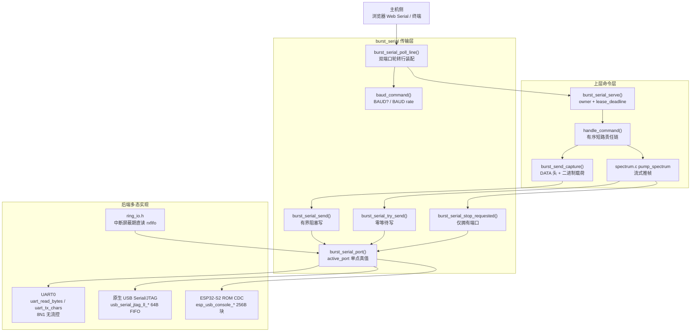
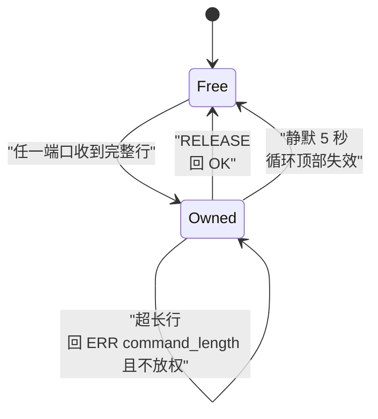
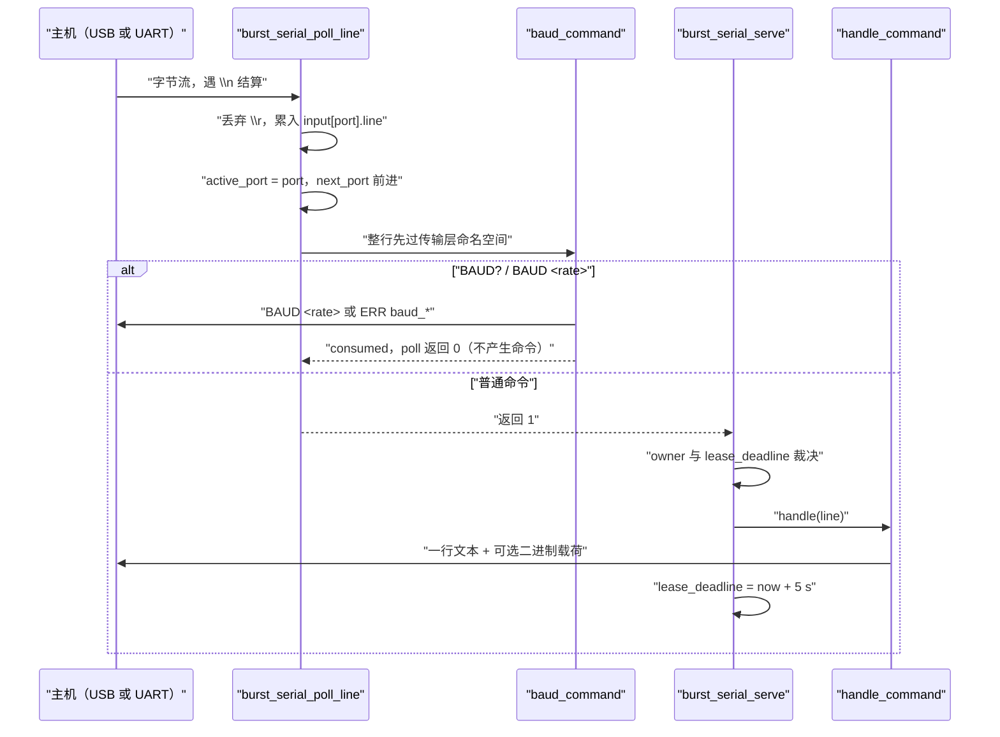

# 串口传输：USB/UART 复用与租约

## 1. 项目定位与核心价值

`burst_serial` 是 ESP-SDR 固件里唯一直接接触"物理线缆"的模块。它的存在源于一个非常具体的硬件现实：同一份固件必须同时服务两类主机入口——芯片原生 USB Serial/JTAG（或 S2 的 ROM CDC）与 UART0（经 USB-UART 桥）。这两条链路在电气层、驱动 API、缓冲模型上完全不同：UART0 走 `uart_read_bytes` 的 ISR 填充环形缓冲，原生 USB 走 `usb_serial_jtag_ll_read_rxfifo` 的 64 字节 FIFO，S2 则要走 ROM 里的 `esp_usb_console_*`（`burst_serial.c` 里 `read_port()` 的三分支正是这三种后端的编译期选择）。如果没有这一层，每颗芯片的 `receiver.c` 就要各自维护两套读写分支、两套行缓冲与两套状态机，而射频侧只允许一个所有者——重复实现必然导致"两个入口互相踩接收机"的竞态。该模块的核心价值，就是把"双入口、单接收机"这一物理事实收敛成一个可推理的抽象：**一条完整命令行决定此后所有回复与二进制载荷的出口端口，端口所有权（租约）覆盖整段二进制事务**。

在此基础上，模块承担了四项在别处无从安放的职责。其一是**逐端口行装配**：`input[BURST_SERIAL_COUNT]` 为每个端口保存独立的 `line[128]`、`used`、`overflow` 与 `last_byte`，`burst_serial_poll_line()` 以 `next_port` 游标轮转轮询，从而让两条链路可以同时插着、同时被敲命令而不互相污染。其二是**有界发送**：`burst_serial_send()` 通过 `transfer_deadline()` 计算绝对截止时间（UART 上为 `2 s + size*10/baud`，USB 上固定 3 秒），任何等待都必然终止，避免主机拔线后固件永久阻塞在半个帧里；与之相对的是零等待的 `burst_serial_try_send()`，专供流式后端做背压。其三是**传输层私有命令的内consumption**：`BAUD?` 与 `BAUD <1000000|2000000>` 在 `burst_serial_poll_line()` 内部被 `baud_command()` 拦截并直接应答，永远不会泄漏给上层 `handle_command()`。其四是**停止请求的定点消费**：`burst_serial_stop_requested()` 只从拥有端口读，任何字节都视为"停止流"，读掉即丢，不会变成下一条命令的前缀。

这四件事共同定义了一个**协议纪律**：一条命令恰好一行回应，且必须在读完之后才发下一条。这种纪律不是文档约定，而是由租约与阻塞写入在代码里强制出来的。

Sources: [burst_serial.c](main/common/burst_serial.c#L1-L35), [burst_serial.h](main/common/burst_serial.h#L1-L26), [burst_serial.c](main/common/burst_serial.c#L173-L179), [burst_serial.c](main/common/burst_serial.c#L108-L123), [protocol.md](docs/protocol.md#L1-L27)

## 2. 架构设计与模块划分

下图把该模块放进"主机 → 传输层 → 后端驱动 → 上层命令"的完整拓扑中。注意 `burst_serial_port()` 是一个被三方共享的**单点真值**：发送、停止检测、以及 `ring_io.h` 的中断屏蔽期旁路，全都以它为准。



**端口抽象层。** 枚举 `burst_serial_port_t` 的顺序是 USB=0、UART=1、COUNT=2，这个顺序不是装饰：`next_port` 作为轮转起点直接依赖它，而 `active_port` 的初值被写成 `BURST_SERIAL_USB`，意味着"尚未收到任何命令时"的默认归属是 USB。对 ESP32（无原生 USB）与 ESP32-C2（仅 UART）这类芯片，USB 后端的 `read_port()` 落到 `return 0` 分支，该端口静默失效但不破坏轮转逻辑；真正的端口归属仍由第一条完整行写入 `active_port`。

**行装配层。** `burst_serial_poll_line()` 是唯一被反复调用的热路径。它对外返回三态：`1` 完整行、`-1` 超长行、`0` 空闲。内部有三重防御：端口静默 `> 3000000 µs`（3 秒）即清空半行，防止主机崩溃后残留前缀污染下一条命令；内层 `for (k < COMMAND_SIZE)` 把单次调用对单端口的读取量硬性限制在 128 字节，使一个永不以换行结尾的洪流无法饿死对端；行缓冲写满即置 `overflow`，即使随后遇到 `\n` 也返回 `-1`，由上层答 `ERR command_length` 而不是截断执行——截断执行会把 `CAP20 16380 9` 静默变成另一条合法命令。另一个容易忽略的细节是：`if (!used && !overflow) continue;` 位于 `active_port = port` **之前**，因此一个孤立的空行既不会夺取所有权也不切换出口端口。

**传输命令层。** `baud_command()` 用 `strcmp(line,"BAUD?") && strcmp(line,"BAUD") && strncmp(line,"BAUD ",5)` 做命名空间守卫，只有前缀命中才继续；若当前 `active_port` 不是 UART，直接答 `ERR baud_transport`——即波特率只在它有意义的那条链路上可协商。参数被硬编码为 `1000000` / `2000000` 两档（`baud = !strcmp(line,"BAUD 1000000") ? 1000000 : ...: 0`），非法值答 `ERR baud_args`，裸 `BAUD` 因匹配守卫但参数为 0 也落到 `ERR baud_args`。切换顺序是这段代码的技术核心：**先以旧速率把 `OK BAUD <rate>` 整包发出、再 `uart_wait_tx_done(1000 ms)` 等发送器排空、才 `uart_set_baudrate()`**，最后 `uart_flush_input()` 并 `memset` 掉该端口的行缓冲，清掉所有在错误波特率下被采样的垃圾字节。头文件注释把这条语义写明为"ACK 一定以旧速率发出、波特率改动持续到复位为止"。

**租约仲裁层。** `burst_serial_serve()` 维护 `owner` 与 `lease_deadline` 两个变量，把并发问题降维成一次整数比较。`RELEASE` 在这一层就被拦截并回 `OK`，因此它不会进入任何芯片后端（这也是 `tests/test_c6_commands.py` 直接对 `handle_command()` 断言 `RELEASE` 必须返回 `ERR command` 的原因）。注释 `/* Ownership covers the entire binary transaction. */` 点明了要害：租约必须覆盖整段二进制传输，否则主机在接收 40950 字节负载期间，另一端口的一次 `CAP` 就能把采样缓冲区换掉。

Sources: [burst_serial.c](main/common/burst_serial.c#L26-L35), [burst_serial.c](main/common/burst_serial.c#L40-L69), [burst_serial.c](main/common/burst_serial.c#L135-L171), [burst_serial.c](main/common/burst_serial.c#L250-L280), [burst_serial.h](main/common/burst_serial.h#L9-L26), [test_c6_commands.py](tests/test_c6_commands.py#L99-L99)

### 2.1 初始化与引脚契约

`burst_serial_init()` 的顺序本身承载语义。它先为 S2 注册 `esp_usb_console_set_cb(usb_ready, usb_ready, NULL)`（该回调体为空，作用是占据 ROM CDC 组件唯一的全局回调槽，使 VFS 阻塞式语义让位于本模块的轮询模型）；随后在 `CONFIG_ESP_SDR_UART_ENABLED` 下配置 UART0：8N1、无校验、无硬件流控、时钟源默认，引脚取 `CONFIG_ESP_SDR_UART_TX_PIN` / `RX_PIN`（各芯片默认不同，S31 为 58/59，C3 为 21/20，ESP32 为 1/3）。`uart_driver_install(UART_NUM_0, 8192, 0, 0, NULL, 0)` 中 `tx_buffer_size = 0` 是关键决策：RX 走 ISR 填充 8 KiB 缓冲以吸收上传突发，TX 则完全绕过环形缓冲、由 `uart_tx_chars()` 直写 FIFO，从而让每次等待都有确定的截止时间。最后才调用 `burst_gpio_init()`——这一步必须在传输层占位之后，GPIO 服务才能通过 `esp_gpio_is_reserved()` 正确排除 UART 引脚。

Sources: [burst_serial.c](main/common/burst_serial.c#L71-L99), [Kconfig.projbuild](main/Kconfig.projbuild#L1-L57)

### 2.2 租约状态机

租约的状态迁移只有三条边，却覆盖了所有故障模式。下图按代码实际判定顺序绘制——注意"失效检查"发生在轮询**之前**，而"归属裁决"发生在端口已确定**之后**。



值得单独强调的是"不放权"这两条自环。外来端口发送一行时，`burst_serial_poll_line()` 已经把 `active_port` 切到该端口，`ERR busy` 因而写回正确的位置；但 `owner` 未被改写，等真正的拥有者下一条命令到达时 `active_port` 会被再次改回。超长行（`status < 0`）同样保留所有权，因为长度错误是协议违规而非主动交接。这套判定顺序还有一个可观察后果：**外来端口的畸形输入会得到 `ERR busy` 而不是 `ERR command_length`**，因为归属检查排在状态值检查之前。

Sources: [burst_serial.c](main/common/burst_serial.c#L250-L280)

## 3. 技术栈与核心工作流

### 3.1 对外接口一览

| 函数 | 语义 | 关键实现点 | 主要调用方 |
| --- | --- | --- | --- |
| `burst_serial_init()` | 一次性初始化两个后端 | UART 8N1 + 8 KiB RX 环 + 0 TX 环；S2 注册 CDC 回调；末尾调 `burst_gpio_init()` | 每颗芯片的 `app_main()` |
| `burst_serial_poll_line(line, capacity)` | 轮转装配一行 | 三态返回；3 秒空闲复位；128 字节/轮上界；内部消费 `BAUD*` | `burst_serial_serve()` |
| `burst_serial_port()` | 当前归属端口 | 返回可变的 `active_port` | 发送、停止检测、`ring_io.h`、`TRANSPORT?` |
| `burst_serial_baud()` | 当前 UART 速率 | UART 端口返回 `uart_baud`，USB 端口返回 0 | `TRANSPORT?` 应答格式化 |
| `burst_serial_send(data, size)` | 有界阻塞写 | `IRAM_ATTR`；绝对截止时间；失败返回 false | `reply()`、`burst_send_capture()`、频谱收尾 |
| `burst_serial_try_send(data, size)` | 零等待写 | 只写当前 FIFO 容得下的部分，返回字节数 | `spectrum.c` 的 `pump_spectrum()` |
| `burst_serial_stop_requested()` | 消费流停止请求 | 仅从 `active_port` 读，最多 128 字节，见到任意字节即 true | 频谱/流式采集循环 |
| `burst_serial_serve(handle)` | 永不返回的主循环 | `owner` + `lease_deadline`；拦截 `RELEASE` | `app_main()` 末尾 |

Sources: [burst_serial.h](main/common/burst_serial.h#L8-L26), [burst_serial.c](main/common/burst_serial.c#L76-L171), [burst_serial.c](main/common/burst_serial.c#L184-L244)

### 3.2 主链路：从一次按键到一行应答



这条链路的三个"前置守卫"顺序不可交换：先过传输层命令（`BAUD`），再过租约（`owner`），最后才进责任链（`handle_command`）。因此 `BAUD` 在任何端口都能被应答（只要它是 UART），`RELEASE` 永远由服务层应答，而芯片后端只看见真正需要动作的命令。

Sources: [burst_serial.c](main/common/burst_serial.c#L135-L171), [burst_serial.c](main/common/burst_serial.c#L250-L280)

### 3.3 发送侧的两极与截止时间预算

`burst_serial_send()` 与 `burst_serial_try_send()` 是同一份后端多态的两个极端。前者在 `esp_timer_get_time()` 的绝对截止时间约束下循环，逐块推进：UART 每次最多 128 字节 `uart_tx_chars()`，返回 0（FIFO 满）时 `vTaskDelay(1)` 让出 CPU；原生 USB 在 FIFO 不可写时 `continue` 忙等，但每一轮都重新检查截止时间；S2 路径以 256 字节整块调用 `esp_usb_console_write_direct()`，返回 0 时 `taskYIELD()`。后者完全不等待：UART 直接写、USB 先探 `usb_serial_jtag_ll_txfifo_writable()` 再写至多 64 字节并 flush、S2 走 256 字节块（注释明确说明这比 64 字节写吞吐翻倍，再大无收益），循环里 `if (sent <= 0) break;` 立即收工。

截止时间的公式值得逐项拆开：`2000000 + size * 10000000 / uart_baud` 微秒。`10000000 / baud` 就是 8N1 下每字节 10 个线路位所需的微秒数，前面的 2 秒是留给主机调度的余量——注释说明它要覆盖"主机暂时不读"以及"降低到低速波特率后整帧仍需时间"两种情况。USB 侧固定 3 秒，因为 USB 的时间尺度由主机帧而非本侧决定。函数末尾还有一个不显眼的收尾分支：当 `original % 64 == 0` 时，额外等待 FIFO 可写并再 `usb_serial_jtag_ll_txfifo_flush()` 一次，目的是给"长度恰为 64 整数倍"的传输一个明确的总线完成点，避免主机侧的读取停在最后一个整包的边界上。

| 维度 | `burst_serial_send` | `burst_serial_try_send` |
| --- | --- | --- |
| 等待 | 有界阻塞（截止时间） | 零等待 |
| 返回值 | `bool` 全有或全无 | 已写字节数（可能为 0） |
| UART 分块 | 128 字节 | 128 字节 |
| USB 分块 | 64 字节 + 每包 flush | 64 字节 + 每包 flush |
| S2 分块 | 256 字节 | 256 字节 |
| 典型用途 | 命令应答、`DATA` 帧、流式收尾 | 频谱推帧背压 |
| 失败语义 | 上层回 `ERR` / 结束会话 | 下一轮继续推 |

Sources: [burst_serial.c](main/common/burst_serial.c#L173-L244), [spectrum.c](main/common/spectrum.c#L113-L128)

### 3.4 中断屏蔽期的旁路与 IRAM 约束

传输层并非所有访问都走驱动。`ring_io.h` 在环形采集运行期间（中断可能被屏蔽、驱动 ISR 无法填充队列）直接读硬件：UART 用 `uart_ll_get_rxfifo_len()` + `uart_ll_read_rxfifo()`，USB 用 `usb_serial_jtag_ll_rxfifo_data_available()` + `usb_serial_jtag_ll_read_rxfifo()`；但在做这个判断之前，它仍然先问 `burst_serial_port()`，因此旁路不破坏租约语义——只有拥有端口上的字节才会被当作停止请求。S31 的链接片段进一步把 `burst_serial:burst_serial_port` 这条符号钉进 IRAM（`noflash`），因为该芯片的 bank 切换时限在亚毫秒级，端口查询路径不允许出现 flash cache miss。相应地，`burst_serial_send()` 带 `IRAM_ATTR`，使其可被非 flash 驻留路径安全调用。

Sources: [ring_io.h](main/common/ring_io.h#L1-L50), [linker.lf](main/targets/esp32s31/burst/linker.lf#L1-L9), [burst_serial.c](main/common/burst_serial.c#L206-L244)

## 4. 典型代码示例

行装配的核心不只是"读到换行"，而是**在不确定的两条流上维持公平与确定性**。下面这段是理解整个模块的起点：

```c
int burst_serial_poll_line(char *line, size_t capacity) {
    for (unsigned j = 0; j < BURST_SERIAL_COUNT; ++j) {
        unsigned port = (next_port + j) % BURST_SERIAL_COUNT;
        int64_t now = esp_timer_get_time();
        if (now - input[port].last_byte > 3000000) {   /* 3 s 静默即丢弃半行 */
            input[port].used = 0;
            input[port].overflow = false;
        }
        for (unsigned k = 0; k < COMMAND_SIZE; ++k) { /* 单轮最多 128 字节 */
            char ch;
            if (read_port(port, &ch, 1) != 1) break;
            input[port].last_byte = now;
            if (ch == '\r') continue;
            /* ... 累入 line，或置 overflow ... */
            if (!used && !overflow) continue;          /* 空行不夺权、不换端口 */
            active_port = port;
            next_port = (port + 1) % BURST_SERIAL_COUNT;
            if (overflow || used >= capacity) return -1;
            if (baud_command(line)) return 0;          /* 传输命令已被消费 */
            return 1;
        }
    }
    return 0;
}
```

而租约逻辑之所以能短到十几行，是因为它把所有复杂度都推给了"服务循环是单线程阻塞"这一前提：只要 `handle()` 不返回，就没有第二个端口能被轮询，于是"所有权覆盖整段二进制事务"是结构性的，而非靠锁实现。

```c
void burst_serial_serve(void (*handle)(char *line)) {
    char line[128];
    int owner = -1;
    int64_t lease_deadline = 0;
    for (;;) {
        if (esp_timer_get_time() >= lease_deadline) owner = -1;   /* 五秒静默失效 */
        int status = burst_serial_poll_line(line, sizeof(line));
        if (!status) { vTaskDelay(1); continue; }
        int port = burst_serial_port();
        if (owner >= 0 && owner != port) { serve_reply("ERR busy\n"); continue; }
        if (status < 0) { serve_reply("ERR command_length\n"); continue; }
        owner = port;
        if (!strcmp(line, "RELEASE")) { serve_reply("OK\n"); owner = -1; }
        else handle(line);
        lease_deadline = esp_timer_get_time() + 5000000;           /* 处理完再续租 */
    }
}
```

注意 `lease_deadline` 的赋值位置在 `handle()` **之后**：这意味着一次耗时超过五秒的 `CAP` 或频谱会话不会在返回时立刻丢掉所有权，续租起点始终是"本次事务结束的时刻"。这个位置选择是该模块最容易被误改的一行。

Sources: [burst_serial.c](main/common/burst_serial.c#L135-L171), [burst_serial.c](main/common/burst_serial.c#L250-L280)

## 5. 学习与探索建议

| 目标 | 建议路径 | 关注点 |
| --- | --- | --- |
| 先建立协议全貌 | [protocol.md](docs/protocol.md#L1-L27) → [20-command-protocol.md](.open-zread/wiki/主机协议与传输/20-command-protocol.md) | `RELEASE` / `ERR busy` 的对外契约；注意 `BAUD` 系列目前**未**写入 `protocol.md`，其权威定义只在 `burst_serial.h` 与 `baud_command()` 的注释里，属于文档待补项 |
| 追一条命令的完整生命周期 | [burst_commands.h](main/common/burst_commands.h#L24-L28) 的 `TRANSPORT?` → `burst_serial_baud()` | `TRANSPORT USB 0` 与 `TRANSPORT UART 2000000` 的差异完全由 `burst_serial_baud()` 的端口分支产生；`tests/test_burst_commands.py` 以桩函数把这条格式钉死 |
| 理解背压与丢帧边界 | [spectrum.c](main/common/spectrum.c#L113-L128) 的 `pump_spectrum()` | 为什么这里必须用 `try_send` 而不是 `send`？以及为何"编码只在输出空闲时发生" |
| 排查"中断里读不到数据"类问题 | [ring_io.h](main/common/ring_io.h#L1-L50) | 驱动 ISR 被屏蔽时 UART 环形队列不再被填充，必须回到 `uart_ll_*` 直读 |
| 移植到新芯片 | [23-chip-backend-porting.md](.open-zread/wiki/芯片适配与移植/23-chip-backend-porting.md) + [Kconfig.projbuild](main/Kconfig.projbuild#L1-L57) | 三件事：`ESP_SDR_UART_ENABLED` 是否可用、TX/RX 默认引脚、`CAPS` 里是否声明 `DUALSERIAL` |
| 修改波特率语义前必读 | [burst_serial.c](main/common/burst_serial.c#L40-L69) | ACK 必须先以旧速率发完；`uart_flush_input()` + `memset(input[UART])` 缺一不可，否则错速率采样的垃圾字节会变成命令 |

Sources: [burst_commands.h](main/common/burst_commands.h#L14-L28), [test_burst_commands.py](tests/test_burst_commands.py#L43-L45), [burst_serial.c](main/common/burst_serial.c#L40-L69)

## 🔗 关联模块与上下游

- [main/common/burst_commands.h](main/common/burst_commands.h#L14-L28) —— 唯一读取 `burst_serial_port()` / `burst_serial_baud()` 的命令层代码，`TRANSPORT?` 的格式化模板在此；S31 的 `receiver.c` 里有一份等价的手写分支。
- [main/common/spectrum.c](main/common/spectrum.c#L113-L128) —— `burst_serial_try_send()` 与 `burst_serial_stop_requested()` 的主要使用者，定义了"零等待写 + 按端口停止"的实际用法。
- [main/common/ring_io.h](main/common/ring_io.h#L1-L50) —— 中断屏蔽期的传输旁路，复用同一份端口真值但绕开驱动队列；阅读它才能理解 `active_port` 为何必须是全局单点。
