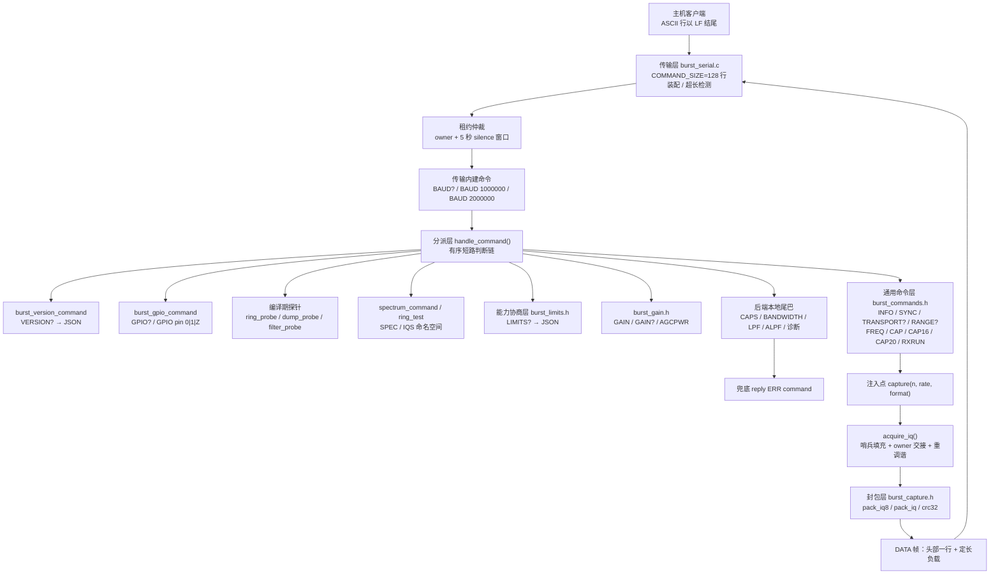
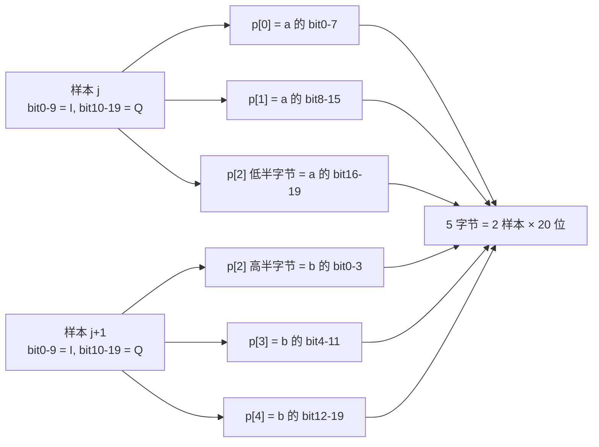
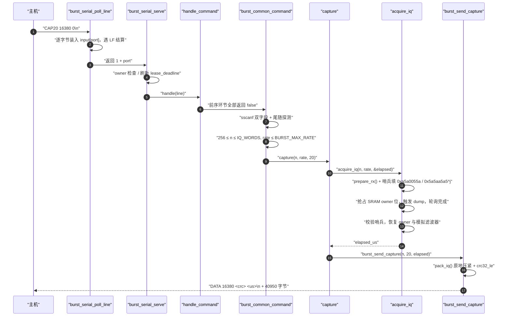

# 命令协议：分发与快照封包

## 项目定位与核心价值

ESP-SDR 的十个芯片后端（ESP32 / S2 / S3 / C2 / C3 / C5 / C6 / C61 / H2 / S31-burst）在硬件寄存器层面几乎没有共性：dump 引擎的触发位不同、owner 位的粒度不同、SRAM bank 布局不同、可用的采样率码不同。但它们对外必须呈现**完全一致**的文本协议：主机写完一次 `CAP20 16380 0`，就必须拿到一行 `DATA 16380 <crc32> <us>` 加 40950 字节定长负载，不论背后是 S3 的 USB Serial/JTAG 还是 C61 的 UART0。本模块就是这条契约的实现体：它把"一行 ASCII 命令"翻译成"一次寄存器级快照"再翻译成"一帧带 CRC 的二进制负载"，并把芯片差异压缩到少数几个编译期常量上。

其核心价值可以拆成三点。**第一，协议即 ABI。** 协议版本号 `6`、`INFO` 的应答格式、`LIMITS?` 的 JSON 形状、CRC32 的多项式与初始值，全部在头文件里以字面量硬编码，没有任何运行时协商机制——这消除了"固件与主机 SDK 版本漂移导致半懂不懂"的整类故障，代价是任何字段变更都必须同步改主机侧。**第二，共享是靠预处理器而非链接期符号实现的。** `burst_common_command()` 是一个 `static` 函数，它直接读写调用者文件作用域里的 `frequency_mhz`、`rx_ready`，并直接调用调用者的 `prepare_rx()`、`reply()`、`capture()`。没有上下文结构体、没有函数指针表、没有虚表跳转：所有间接性在编译期被内联消解，因此命令处理路径上没有一次指针追逐，这对一个在 160 MHz RISC-V 上要与 dump 引擎抢时序的固件是必要的。**第三，封包是原地进行的。** IQ10 每样本 20 位、IQ8 每样本 16 位，二者都小于被替换掉的 32 位采集字，所以 `pack_iq()` / `pack_iq8()` 可以直接在采集内存上覆写，省掉一块与采集区等大的额外缓冲——在 S2 这种只有 12284 字采集窗口的芯片上，这不是优化而是可行性前提。

Sources: [burst_commands.h](main/common/burst_commands.h#L1-L13), [burst_capture.h](main/common/burst_capture.h#L1-L12), [protocol.md](docs/protocol.md#L1-L6), [burst_serial.h](main/common/burst_serial.h#L1-L26)

## 架构设计与模块划分

该模块不是"一个解析器"，而是一条**五级责任链**：传输层负责把字节流切成行并仲裁端口所有权；分派层用短路判断把行路由到某个命名空间；通用命令层实现跨芯片共享的十种命令；能力协商层把编译期常量投影成 JSON；封包层把采集内存重排成线上格式。层与层之间没有数据结构传递，只有"字符串进、布尔出"的极薄接口，这正是它能被十个后端复用的原因。



### 传输层：行装配、超长拒绝与端口租约

传输层的状态是**每个端口一份**的解析器：`input[BURST_SERIAL_COUNT]` 里各自保存 `line[128]`、`used`、`overflow`、`last_byte`。`burst_serial_poll_line()` 以轮转起点 `next_port` 保证双端口公平，逐字节读取，丢弃 `\r`，遇到 `\n` 时结算。这里有三处值得单独指出的防御性设计。其一，**超长即拒绝**：一旦行缓冲写满就置 `overflow`，即便随后遇到换行也返回 `-1`，上层应答 `ERR command_length` 而不是截断执行——截断执行会把 `CAP20 16380 9` 静默变成另一条合法命令。其二，**3 秒静默复位**：`now - last_byte > 3000000` 时丢弃半行，避免主机崩溃后残留的前缀污染下一条命令。其三，**单次轮询上界**：内层 `for (k < COMMAND_SIZE)` 限制每轮最多消费 128 字节，使一个永不以换行结尾的持续洪流无法饿死另一个端口。

租约语义落在 `burst_serial_serve()` 里，而不是落在任何命令处理函数里：`owner` 记录当前端口，任何来自另一端口的行一律得到 `ERR busy`；`lease_deadline` 每次成功处理后被推到 `now + 5s`，所以"五秒静默即释放"是**一次性写对、全后端共享**的行为。`RELEASE` 也在这一层被拦截并直接应答 `OK`，只有其余行才交给 `handle()`。注释 `/* Ownership covers the entire binary transaction. */` 点明了这条设计的要害：租约必须覆盖整段二进制传输，否则主机在接收 40950 字节负载期间，另一端口的一次 `CAP` 就能把缓冲区换掉。

Sources: [burst_serial.c](main/common/burst_serial.c#L26-L35), [burst_serial.c](main/common/burst_serial.c#L135-L171), [burst_serial.c](main/common/burst_serial.c#L250-L280), [burst_serial.h](main/common/burst_serial.h#L9-L25)

`burst_serial_send()` 与 `burst_serial_try_send()` 构成发送侧的两极：前者是**有界阻塞**版本，按 `transfer_deadline()` 计算绝对截止时间——UART 上取 `2s + size*10/baud`（8N1 每字节 10 位，另留 2 秒给主机调度），USB 上取 3 秒；后者是**零等待**版本，`usb_serial_jtag_ll_txfifo_writable()` 为假就立刻放弃并返回已写字节数，专供流式后端在中断上下文里做背压。命令协议的应答路径一律走前者，因为"每个命令恰好一行应答"的语义不允许半行丢失。

Sources: [burst_serial.c](main/common/burst_serial.c#L173-L179), [burst_serial.c](main/common/burst_serial.c#L184-L244)

### 分派层：顺序本身即是架构决策

`handle_command()` 在每份 `receiver.c` 里是一串扁平 `if (...) return;`，形态上像 RFC 822 的解析顺序，语义上却是**命名空间所有权**的排列。以 C5/C6/C61 共享实现为例，顺序是：版本查询 → GPIO → 可选探针 → `ring_test` → `spectrum_command` → 可选探针 → `limits_command` → `gain_command` → `burst_common_command` → 本地命令 → 兜底。这条顺序中有三处不能交换：

- `spectrum_command()` **必须**早于 `burst_common_command()`。`SPEC` 与 `SPECEND` 不在通用命令的匹配集里，若顺序颠倒不会误匹配，但会先落到通用层的 `else` 分支返回 `false`，再落入本地尾巴的 `ERR command`——也就是说，即使不发生"抢命令"，把重命令排在前面也减少了热路径上的字符串比较次数。
- `ring_test` 在 C6/C61 上早于 `spectrum_command()`，因为它要先抢走"256 bin 且非 UART"的 `SPEC`，剩下的形态才归便携频谱后端。
- `GPIO` 紧随 `VERSION?`，独占 `GPIO` 前缀；它处在租约检查之后，因此天然继承"一次只有一个客户端控制接收机"的所有权语义。

顺序的另一面是**每级必须精确消费自己的前缀**。`CAPS` 之所以不会被 `CAP` 抢走，靠的是 `strncmp(line, "CAP ", 4)` 里那个空格：`"CAPS"` 第 4 个字符是 `S` 而非空格，前缀比较立即失败。同理 `CAP16` / `CAP20` 也不会被 `CAP ` 误吞。

Sources: [receiver.c](main/families/c5_c6_c61/receiver.c#L307-L325), [receiver.c](main/targets/esp32s3/receiver.c#L451-L511), [receiver.c](main/targets/esp32c3/receiver.c#L166-L190), [receiver.c](main/targets/esp32/receiver.c#L212-L256)

该分派层的错误处理责任分配同样值得注意：链上每一环返回 `true` 表示"这一行已被我消费"，**应答的发送责任随消费权一并转移**。因此 `capture()` 失败时会自己发 `ERR rate` / `ERR capture_timeout` / `ERR capture_overrun`，而 `burst_common_command()` 只是返回 `true` 让链条停止，绝不追加第二条应答。唯一会主动发错的层级是链条终点：`reply("ERR command\n")`。这保证了"每个命令恰好一行文本应答"这条不变量在最坏路径上也成立。

Sources: [burst_commands.h](main/common/burst_commands.h#L46-L62), [receiver.c](main/families/c5_c6_c61/receiver.c#L134-L140), [receiver.c](main/targets/esp32s3/receiver.c#L509-L510)

### 通用命令层：`burst_common_command()` 的十种命令

`burst_commands.h` 的文件头注释把隐式契约写成了显式清单：必须在定义 `BURST_ID`、`BURST_MAX_RATE`、`IQ_WORDS` 之后 include，并且调用方必须已提供 `frequency_mhz`、`rx_ready`、`frequency_valid()`、`prepare_rx()`、`reply()`、`capture()`。注意其中 `BURST_ID` 与 `BURST_MAX_RATE` 是**宏**（要在字符串拼接与比较中使用），其余是**符号**（要能被 `static` 函数直接引用）。这套区分就是该头文件能被 C5/C6/C61 三个 target 共用的全部机制——三个 target 各自的 `chip.h` 提供 `#define BURST_ID "C5SDR"` 之类的差异，而 `receiver.c` 只写一次。

Sources: [burst_commands.h](main/common/burst_commands.h#L1-L5), [chip.h](main/targets/esp32c5/chip.h#L1-L15), [chip.h](main/targets/esp32c61/chip.h#L1-L7), [chip.h](main/targets/esp32c6/chip.h#L1-L8)

命令集按语义分为两组。**会话组**不触碰接收机状态：`TRANSPORT?` 回报当前到达端口与波特率（`USB` 时波特率恒为 `0`）；`SYNC <nonce>` 回显一个 64 位随机数，供主机在端口复位后丢弃噪声直到对齐；`INFO` 回 `BURST_ID " 6 burst " IQ_WORDS`，其中 `6` 是协议版本字面量、`IQ_WORDS` 是本次构建的最大样本数；`RANGE?` 回 `RANGE RX_FREQ_MIN RX_FREQ_MAX 1`，步长 1 MHz 是硬编码的。

Sources: [burst_commands.h](main/common/burst_commands.h#L24-L40), [rx_tuning.h](main/common/rx_tuning.h#L4-L11)

`RANGE?` 与 `FREQ` 之间存在一处精心维持的一致性：`RANGE?` 打印编译期常量 `RX_FREQ_MIN/MAX`（100–6000），而 `FREQ` 的准入判定调用**注入的** `frequency_valid()`。两者若各写一套就会出现"查得到但不接受"的矛盾。各后端的做法统一为**别名到同一常量**：S3 写 `#define S3_FREQ_MIN RX_FREQ_MIN`，C3 写 `#define C3_FREQ_MIN RX_FREQ_MIN`，原版 ESP32 更直接地 `#define frequency_valid rx_frequency_valid`——用一个对象式宏把函数名重绑定，从而在 `burst_commands.h` 眼里"存在一个名为 `frequency_valid` 的函数"。这是本项目若干处宏充当适配层的最小样本。

Sources: [receiver.c](main/targets/esp32s3/receiver.c#L67-L71), [receiver.c](main/targets/esp32c3/receiver.c#L59-L63), [receiver.c](main/targets/esp32/receiver.c#L207-L210), [rx_tuning.h](main/common/rx_tuning.h#L8-L10)

`FREQ` 的受理动作是显式失效而非就地调谐：置 `frequency_mhz`、把 `rx_ready = false`、再 `prepare_rx()`。把 `rx_ready` 先清掉，是为了让 `prepare_rx()` 内部的"是否需要重标定"判断走上重标定分支——这一点在 C5/C6/C61 的实现里看得最清楚：`prepare_rx()` 用 `calibrated_mhz != frequency_mhz || rx_recalibration_stale()` 决定是否调用 `rx_recalibrate()`。若省略这行赋值，`rx_ready` 仍为真且频率未变时可能被短路，PLL 就不会真正重锁。协议文档对这一点给出了保守措辞："接受频率并不保证 PLL 锁定"。

Sources: [burst_commands.h](main/common/burst_commands.h#L41-L45), [receiver.c](main/families/c5_c6_c61/receiver.c#L88-L122), [protocol.md](docs/protocol.md#L29-L33)

**采集组**是三条命令与一条批处理：

| 命令 | 参数形状 | 校验闸门 | 传给 `capture()` 的格式码 |
| --- | --- | --- | --- |
| `CAP <n> <rate>` | 2 个无符号整数 + 无尾随 | `256 ≤ n ≤ IQ_WORDS`、`rate ≤ BURST_MAX_RATE` | `0`（裸 32 位字，协议未公开） |
| `CAP16 <n> <rate>` | 同上 | 同上 | `16`（IQ8） |
| `CAP20 <n> <rate>` | 同上 | 同上 | `20`（IQ10） |
| `RXRUN <n> <rate> <repeats> <format>` | 4 个无符号整数 + 无尾随 | 上述样本/速率闸门 + `1 ≤ repeats ≤ 1000` + `format ∈ {16,20}` | 逐次 `capture(n, rate, format)` |

Sources: [burst_commands.h](main/common/burst_commands.h#L46-L59)

三个闸门的写法共同依赖同一个 `sscanf` 技巧：`sscanf(line, "CAP %u %u %c", &n, &rate, &extra) == 2`。`%c` 的作用不是取值，而是**探测器**——只要参数之后还有任何一个字节（包括空格），`%c` 就会匹配成功并把返回值推到 3，整条命令随即被拒绝。这挡住了 `CAP 4096 0 junk` 这类"前缀合法、后缀有垃圾"的输入，而这种输入在朴素的 `sscanf("...%u")` 下会被静默接受。

Sources: [burst_commands.h](main/common/burst_commands.h#L56-L58), [test_burst_commands.py](tests/test_burst_commands.py#L52-L52)

`RXRUN` 的语义是"一串彼此分离的抓取"，其循环体里那句 `vTaskDelay(1)` 是协议的一部分而非节流：它在两次 `capture()` 之间让出一个 RTOS tick（ESP-IDF 默认 100 Hz 配置下约 10 ms），从而在射频谱上留下真实的 RF 间隙。协议文档因此明确写了"A capture is a single burst; there are gaps between captures"。成功时整条命令只产生一行 `END`，失败时立刻跳出循环且**不再补发任何应答**——错误行已由失败的 `capture()` 发出。

Sources: [burst_commands.h](main/common/burst_commands.h#L46-L55), [protocol.md](docs/protocol.md#L63-L69)

### 能力协商层：`burst_limits.h` 的编译期投影

`LIMITS?` 是协议 6 的能力扩展，它的应答是一行 JSON：`gain` 为 `[min,max,1]`（PHY 表索引，不是 dB）、`bandwidth` 为 `[min,max,1,default]` 或 `null`、`rates` 为以样本/秒为单位的支持速率、`bits` 为 `[8,10]`。实现方式是纯编译期的：`GAIN_MIN` 来自 `burst_gain_min.h`，`gain_max()` 在运行时读 `AGCPWR_CTRL7` 的 bits 8–14 并施加逐芯片上限截断（"绝不暴露未标定槽位"），`bandwidth` 与 `rates` 则是 `#if CONFIG_IDF_TARGET_*` 的一串字面量分支。缓冲区是 `char h[224]`——这个容量必须能容纳所有分支里最长的 JSON，因为 `snprintf` 截断会产出**语法合法但语义残缺**的 JSON，比直接报错更难排查。

Sources: [burst_limits.h](main/common/burst_limits.h#L1-L42), [burst_gain_min.h](main/common/burst_gain_min.h#L1-L8), [burst_gain.h](main/common/burst_gain.h#L25-L44), [rx-controls.md](docs/rx-controls.md#L3-L11)

`bandwidth` 的 `#else` 分支输出 `null`，语义是"没有表征过的 MHz 映射"，而不是"不支持带宽控制"。文档对此写得很直白："`null` 表示未表征"。`rates` 的三个分支也不是按芯片家族分组，而是按**可用的 dump 分频器**分组：H2 独占 `[32,16,10.667,6.4]` MS/s；S3/S2/C2/C3/C6 共享 `[80,40,16]`；其余（含未枚举 target）落到 `[80,40,20,10,8,4]`。与之呼应的是协议文档里的速率码表：码 8 = 10.667 MS/s、码 9 = 6.4 MS/s 这两个"非整数"档位只在 H2 上出现，而 H2 的 `BURST_MAX_RATE` 正是全部后端中唯一的 `9`。

Sources: [burst_limits.h](main/common/burst_limits.h#L9-L38), [protocol.md](docs/protocol.md#L65-L67), [receiver.c](main/targets/esp32h2/receiver.c#L206-L210), [receiver.c](main/families/c5_c6_c61/receiver.c#L307-L308)

`BURST_MAX_RATE` 与 `rates` 列表的关系必须精确对齐，否则会出现主机按 `LIMITS?` 选了某个码、而 `burst_common_command()` 的 `rate <= BURST_MAX_RATE` 判定却把同一码拒掉的错位。各后端的取值是：C5/C61 = `5`、C6 = `6`、S3/S2/ESP32/C2/C3 = `6`、H2 = `9`。注意这是一个**上界码**而非计数，因此 `BURST_MAX_RATE 6` 恰好覆盖 `rates` 的 `[80,40,16]` 三档（码 0/1/6），而码 2–5 虽落在判定内、却会在 `capture()` 里因分频器白名单不匹配而被拒——这是两道闸门刻意保留的粗细分工。

Sources: [receiver.c](main/families/c5_c6_c61/receiver.c#L307-L308), [receiver.c](main/targets/esp32s3/receiver.c#L451-L453), [receiver.c](main/targets/esp32h2/receiver.c#L206-L208), [receiver.c](main/targets/esp32/receiver.c#L196-L205)

### 严格解析层：`burst_parse.h`

`burst_parse.h` 只在 S3 上被真正用到（`IQS` 的六字段解析），但它存在的理由覆盖整个协议层：`sscanf("%u")` 会接受符号、会静默溢出、在可选字段场景下还会把尾随文本当成解析结束。`burst_parse_uints()` 逐个字符驱动，遇到非数字、超过 `max` 个字段、或十进制累加会溢出（`x > (~0u - d) / 10u` 预判）时统一返回 `-1`；`burst_parse_int()` 在其上叠加正负号与 `[low,high]` 区间，并且拒绝 `- 5`（符号与数字之间夹空格）和 `5 6`（不止一个字段）。这套语义被 `tests/burst_parse_test.c` 逐条锁定，包括 `4294967295` 通过而 `4294967296` 拒绝这条边界。

Sources: [burst_parse.h](main/common/burst_parse.h#L1-L39), [burst_parse_test.c](tests/burst_parse_test.c#L1-L28), [receiver.c](main/targets/esp32s3/receiver.c#L391-L423)

### 封包层：`burst_capture.h` 的原地重排

封包层只做三件事：算长度、重排字节、算 CRC 并发送。`wire_size(n, format)` 是唯一的真源：格式 16 返回 `n*2`，格式 20 返回 `(n*20+7)/8`，其他返回 `n*4`。格式 20 的 `+7` 处理奇尾巴：`n=257` 时 257×20 = 5140 位 = 642.5 字节，必须上取整到 643。这与协议文档里 "exactly `ceil(samples * bits * 2 / 8)` bytes" 的表述完全对应。

Sources: [burst_capture.h](main/common/burst_capture.h#L10-L12), [burst_capture.h](main/common/burst_capture.h#L41-L43), [protocol.md](docs/protocol.md#L56-L63)

`pack_iq()` 每两个样本写 5 字节，按小端把两个 20 位字段首尾相接：



奇数尾处 `b` 取 0 且 `p[3]`/`p[4]` 不写，指针仍按 5 前进——由于 `wire_size()` 对奇数 `n` 恰好只取到 `p+2`，最后一个样本的 3 字节既不越界也不留洞。`pack_iq8()` 则是丢弃低 2 位的截断：`p[2j] = (w >> 2) & 255` 取 I 的 bit2–9，`p[2j+1] = (w >> 12) & 255` 取 Q 的 bit12–19。这是**截断而非四舍五入**，会让 IQ8 的直流偏置带上一点固定偏移，换来的是一条 `>>` 指令且无分支。

Sources: [burst_capture.h](main/common/burst_capture.h#L15-L38), [test_burst_capture.py](tests/test_burst_capture.py#L12-L17)

原地重排之所以安全，靠的是一条可以被验证的不变量：**写指针永远落后于读游标**。IQ8 的第 `j` 个样本写入字节 `2j`、`2j+1`，而它读取的 32 位字位于字节 `4j`；即使 `2j` 落在了已读过的 `j/2` 号字上，那个字也早已消费完。IQ10 每轮末尾写到的最高字节是 `5*(j/2)+4`，而下一轮要读的字节起点是 `4j+8`，差值恒为正。`tests/test_burst_capture.py` 用一个完全独立的 Python 参考实现对 `n ∈ {1,2,3,256,257,4096}` 逐字节比对，正是为了锁住这类"看起来等价、边界处会错"的重排逻辑。

Sources: [burst_capture.h](main/common/burst_capture.h#L15-L38), [test_burst_capture.py](tests/test_burst_capture.py#L24-L56)

## 技术栈与核心工作流

整个模块是纯 C11 加 ESP-IDF 的薄封装，没有 JSON 库、没有协议缓冲区框架、没有状态机引擎。JSON 由 `snprintf` 手写拼装，CRC 由 ROM 里的 `esp_rom_crc32_le` 提供（zlib 多项式、初值 0，只覆盖负载、不覆盖头部），时基是 `esp_timer_get_time()`，延时只有 `vTaskDelay(1)` 与 `esp_rom_delay_us()`。这种"零依赖"取向使得整个命令层可以被裁剪出来在主机上编译——`tests/` 下每一个 `test_*_commands.py` 都是把 `receiver.c` 的一段落源码抠出来、配上桩函数、用宿主 `cc` 加 ASan/UBSan 直接跑的。

Sources: [burst_capture.h](main/common/burst_capture.h#L46-L56), [test_c3_commands.py](tests/test_c3_commands.py#L11-L57)

一次成功的 `CAP20` 请求在主链路上依次穿过下列环节：



Sources: [burst_serial.c](main/common/burst_serial.c#L250-L280), [burst_commands.h](main/common/burst_commands.h#L56-L59), [receiver.c](main/families/c5_c6_c61/receiver.c#L134-L220), [burst_capture.h](main/common/burst_capture.h#L46-L56)

链路中每个环节对"失败"的表达方式不同，理解这一点是读懂错误处理的前提：

| 环节 | 失败表现 | 应答 | 责任 |
| --- | --- | --- | --- |
| 行装配 | 超过 127 字符 | `ERR command_length` | 传输层，不进入分派 |
| 租约 | 非 owner 端口 | `ERR busy` | 传输层，不进入分派 |
| 参数解析 | `sscanf` 计数不符 / 越界 | 无（返回 `false`） | 链条继续，最终落到兜底 |
| 速率白名单 | 分频器不在本芯片表内 | `ERR rate` | `capture()` 自作主张 |
| 采集超时 | 仍有哨兵字未被覆写 | `ERR capture_timeout` | `acquire_iq()` |
| 采集越界 | 尾部 4 字哨兵被改写 | `ERR capture_overrun` | `acquire_iq()` |
| 未知命令 | 链条与本地尾巴全不认 | `ERR command` | `handle_command()` 终点 |

Sources: [burst_serial.c](main/common/burst_serial.c#L163-L167), [burst_serial.c](main/common/burst_serial.c#L262-L269), [receiver.c](main/families/c5_c6_c61/receiver.c#L188-L205), [receiver.c](main/targets/esp32/receiver.c#L196-L205), [protocol.md](docs/protocol.md#L5-L6)

`capture()` 与 `acquire_iq()` 的分工也是协议设计的一部分。`capture(n, rate, format)` 是**注入点**，其职责是把速率码翻译成该芯片的 dump 分频器并做白名单校验：C5/C6/C61 对 C6 只允许分频器 0/1/6，原版 ESP32 把码 0/1/6 映射到 dump clock 1/2/0，S31 用 `{0,1,3,5,7,9}` 的除法表并把样本/速率上界检查移到 `capture_rate()` 里、以 `ERR capture_settings` 报错。`acquire_iq()` 则是**通用采集契约**：哨兵填充、SRAM owner 交接、模拟滤波器状态暂存与复原、有界轮询、双重完整性校验，六件事一件不少。

Sources: [receiver.c](main/families/c5_c6_c61/receiver.c#L134-L206), [receiver.c](main/targets/esp32/receiver.c#L196-L205), [receiver.c](main/targets/esp32s31/burst/receiver.c#L318-L327)

## 典型代码示例

**其一，`CAP16` 到 `CAP20` 的就地字符串改写。** 这条 4 行代码是"用最少的机制复用最多逻辑"的典型：

```c
/* CAP16 is CAP20's capture packed as 8-bit I/Q. */
if (!strncmp(line, "CAP16 ", 6)) {
    memcpy(line, "CAP20", 5);
    iq8 = true;
}
```

`memcpy(line, "CAP20", 5)` 把行首的 `CAP16` 原地改成 `CAP20`——第 5 个字符 `'6'` 被覆写为 `'0'`，行长度不变，因此后面的 `sscanf` 与越界检查可以完全共用。`iq8` 标志携带"原本是 CAP16"这一事实，直到最后一步才被翻译回格式码：`capture(n, rate, !strncmp(line, "CAP20 ", 6) ? (iq8 ? 16 : 20) : 0)`。一个布尔、一次 5 字节写入，替代了一整套参数解析的复制。

Sources: [burst_commands.h](main/common/burst_commands.h#L19-L23), [burst_commands.h](main/common/burst_commands.h#L56-L59)

**其二，两级闸门的分工。** 通用层给出粗上界，注入点给出精白名单，两层都不省略：

```c
} else if (((!strncmp(line, "CAP ", 4) && sscanf(line, "CAP %u %u %c", &n, &rate, &extra) == 2) ||
            (!strncmp(line, "CAP20 ", 6) && sscanf(line, "CAP20 %u %u %c", &n, &rate, &extra) == 2)) &&
           n >= 256 && n <= IQ_WORDS && rate <= BURST_MAX_RATE) {
    capture(n, rate, !strncmp(line, "CAP20 ", 6) ? (iq8 ? 16 : 20) : 0);
}
```

注意这一分支**不检查 `capture()` 的返回值**：失败时错误行已由 `capture()` 自己发出，通用层只需返回 `true` 表示"这一行归我管"。返回值只被 `RXRUN` 使用，因为它需要在中途放弃整批。

Sources: [burst_commands.h](main/common/burst_commands.h#L56-L62)

**其三，封包与发送的原子性。** 头部与负载必须作为一个不可分割的序列写出，否则并发或超时会留下半个帧：

```c
uint32_t crc = esp_rom_crc32_le(0, (const uint8_t *)IQ_BUFFER, bytes);
char h[96];
snprintf(h, sizeof(h), "DATA %u %08" PRIx32 " %" PRIu32 "\n", n, crc, elapsed_us);
return send_bytes(h, strlen(h)) && send_bytes(IQ_BUFFER, bytes);
```

`%08PRIx32` 保证 CRC 恒为 8 位十六进制、无前导截断，主机侧因此可以定长切片解析；`&&` 短路使得头部写失败时不再发负载，把"半帧"的窗口缩到最小（真正消除它靠的是 `burst_serial_send()` 的有界阻塞语义，以及租约覆盖整段二进制传输这一条）。

Sources: [burst_capture.h](main/common/burst_capture.h#L46-L56), [burst_serial.c](main/common/burst_serial.c#L206-L244), [burst_serial.c](main/common/burst_serial.c#L277-L278)

**其四，主机侧如何验证这一切。** `tests/test_burst_commands.py` 把 `burst_common_command()` 原封不动编进来，用桩替换 `capture()` / `reply()` / `prepare_rx()`，先断言逐条语义，再用 10 万条随机命令做模糊测试：

```python
assert(run("CAP16 4096 0") and last_format == 16 and last_n == 4096)
assert(run("CAP20 257 6") and last_format == 20 and last_rate == 6)
assert(run("CAP 256 0") and last_format == 0)
assert(not run("CAP16 255 0") and not run("CAP16 16381 0") and not run("CAP20 256 7"))
assert(run("RXRUN 256 0 3 16") and captures == before + 3 and response == "END\n")
```

随机测试的收尾断言不是"命令被拒绝"，而是"随机输入之后 `capture()` 收到的参数仍然在合法域内"——这条不变量比任何单例断言都更能代表协议层的安全边界。

Sources: [test_burst_commands.py](tests/test_burst_commands.py#L10-L76)

## 学习与探索建议

| 目标 | 建议路径 | 关键入口 |
| --- | --- | --- |
| 想快速对着协议写主机客户端 | 先读协议文档的会话与抓取两节，再回头看 `burst_common_command()`，会发现实现与文档几乎逐行对应 | [protocol.md](docs/protocol.md#L8-L69), [burst_commands.h](main/common/burst_commands.h#L14-L63) |
| 想理解"片段式头文件"的全部代价 | 对比 `burst_commands.h` 的隐式契约与 S31-burst 的全内联实现，看清"复用"与"特化"的分界在哪里 | [burst_commands.h](main/common/burst_commands.h#L1-L5), [receiver.c](main/targets/esp32s31/burst/receiver.c#L329-L412) |
| 想加一条新命令 | 判断它属于哪一级：跨芯片通用则进 `burst_commands.h`；涉及能力投影则进 `burst_limits.h`；只在单芯片有意义就进该 `receiver.c` 的本地尾巴 | [burst_limits.h](main/common/burst_limits.h#L5-L42), [receiver.c](main/targets/esp32s3/receiver.c#L468-L508) |
| 想改封包格式 | 必须同步三处：`wire_size()`、`pack_iq*()`、协议文档的字节表；`tests/test_burst_capture.py` 的参考实现是第四处，改漏会立刻红 | [burst_capture.h](main/common/burst_capture.h#L10-L43), [test_burst_capture.py](tests/test_burst_capture.py#L12-L17) |
| 想复现命令层的单元测试手法 | 看测试如何从 `receiver.c` 里按 `#define BURST_ID` 与 `void app_main(` 切片抽出处理链，再用桩函数在宿主上编译 | [test_c3_commands.py](tests/test_c3_commands.py#L11-L57), [burst_parse_test.c](tests/burst_parse_test.c#L1-L28) |
| 想研究严格的整数解析 | `burst_parse.h` 是 `sscanf` 的替代品，注意它的溢出预判与"符号后不许空格"这两条细节 | [burst_parse.h](main/common/burst_parse.h#L10-L39) |

## 🔗 关联模块与上下游

- [burst_serial.c](main/common/burst_serial.c#L135-L280) — 上游：提供行装配、租约仲裁与有界发送，本模块的每一行输入与每一帧输出都要经过它。
- [receiver.c](main/families/c5_c6_c61/receiver.c#L134-L220) — 下游：提供 `capture()` / `acquire_iq()` / `prepare_rx()` 三个注入点，把命令翻译成寄存器级快照。
- [burst_capture.h](main/common/burst_capture.h#L10-L56) — 同级：本页"快照封包"的另一半，负责字节重排、CRC 与帧头，详细位布局可对照 [4-snapshot-dump-engine.md](.open-zread/wiki/射频采集引擎/4-snapshot-dump-engine.md)。
