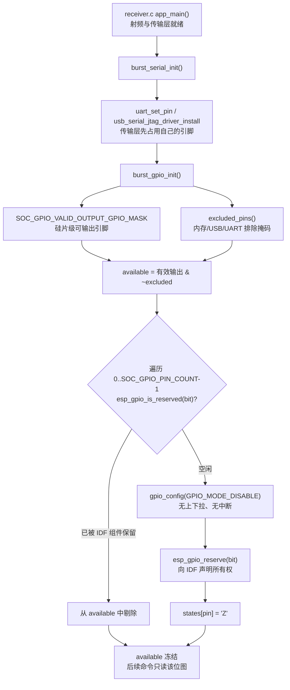
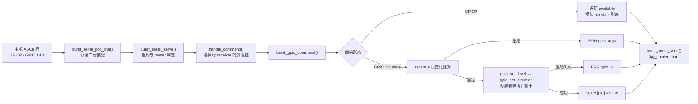

# GPIO 输出与外部器件控制

在一个把 Wi-Fi PHY 当作宽带 SDR 前端来用的固件里，射频链路本身只能被"调参"（`FREQ` / `GAIN` / `BANDWIDTH`），却无法改变**板级电气拓扑**。而真实的 SDR 硬件几乎总要在射频前端挂上若干可切换器件：天线选择开关、LNA 旁路继电器、分段带通滤波器的选通脚、外部步进衰减器、乃至给有源探头供电的 MOS 管栅极。这些器件的控制面不在 PHY 寄存器里，而在几根普通 GPIO 上。`burst_gpio` 模块正是为这一层"板级外设控制面"而生：它把散落在各芯片上的可用输出引脚抽象成协议里的一条 `GPIO` 命令族，让主机可以像发射频指令一样，用同一根串口、同一套租约语义去翻转外部器件。

其核心价值可以拆成三点。第一是**协议内聚**：GPIO 控制没有另建通道，而是作为行协议的一个命令命名空间存在，与 `FREQ`、`CAP` 共享同一套串口所有权（lease）检查和应答纪律，主机端无需为板级控制引入第二条链路或第二套错误处理。第二是**自我描述与能力协商**：固件不假设主机知道板子长什么样，而是通过 `CAPS` 公布 `GPIO` 能力位，再由 `GPIO?` 回吐"本芯片上真正可被应用驱动的引脚清单及当前状态"，主机必须依据返回列表而非芯片型号去渲染界面，这一取舍把"哪根引脚能用"的唯一真相源放在固件侧。第三是**电气安全优先的默认态**：所有被广告的引脚在启动时一律被配置为高阻（Z）、关闭内部上下拉、关闭中断，并且这一初始化只在 boot 阶段发生一次，后续查询与客户端重连都不会产生任何 GPIO 写操作——这保证了主机连上来之前，外接继电器与开关处于"固件不驱动"的中性状态，也保证了一次复位就能把硬件恢复到确定的安全态。

> 设计哲学：该模块把"可用性判定"当作编译期与启动期的一次性决策，把"状态变更"当作严格校验后的单点事务。二者分离，使得运行期的每条命令都不需要再做拓扑推理。

Sources: [burst_gpio.h](main/common/burst_gpio.h#L1-L7), [burst_gpio.c](main/common/burst_gpio.c#L56-L78), [rx-controls.md](docs/rx-controls.md#L185-L214), [protocol.md](docs/protocol.md#L37-L37)

---

## 架构设计与模块划分

`burst_gpio` 是一个极薄的二层模块：**引脚策略层**（编译期排除表 + 运行期保留位图交集 + 启动期一次性配置）与**命令解释层**（严格语法解析 + 电平/方向的两步写入 + 状态镜像）。它不持有任何任务、不使用堆内存、不做并发同步，完全寄生在串口服务任务的调用栈上执行。

### 启动期：能力面收敛



这条启动链的**顺序**本身就是设计的一部分。`burst_gpio_init()` 被放在 `burst_serial_init()` 的末尾，也就是在 `uart_param_config` / `uart_set_pin` / `uart_driver_install` 全部完成之后才执行，并通过 `esp_gpio_is_reserved()` 观察 IDF 侧已经登记的保留位图。头文件注释 "Initialize once after the radio and transports have claimed their pins" 正是这条契约的文字化：光看本模块的编译期排除表并不足以判定 UART 引脚，因为 UART 引脚由 Kconfig 自由配置（`CONFIG_ESP_SDR_UART_TX_PIN` / `RX_PIN`，各芯片默认值不同），只有"传输层先占位、GPIO 服务后扫描"的时间顺序，才能同时兜住"编译期已知的 UART 引脚"与"IDF 运行期保留的引脚"这两类来源。

Sources: [burst_gpio.c](main/common/burst_gpio.c#L56-L78), [burst_serial.c](main/common/burst_serial.c#L76-L99), [burst_gpio.h](main/common/burst_gpio.h#L4-L5), [Kconfig.projbuild](main/Kconfig.projbuild#L24-L55)

### 引脚可用性筛选：三重排除

可用性判定是"与"逻辑的交集运算：硅片级能力掩码 `SOC_GPIO_VALID_OUTPUT_GPIO_MASK` 先天然剔掉输入专用脚与不存在的脚号；模块自带的 `excluded_pins()` 再叠加三类保守排除；最后逐个与 IDF 的保留位图求差。位运算辅助宏 `PIN(n)` 与 `PINS(first, last)` 用 `(1<<(last+1))-1 & ~((1<<first)-1)` 表达闭区间，使得排除表可以用"区间"而非"枚举"描述，可读性与正确性都高于逐脚罗列。

| 排除类别 | 具体范围 | 设计意图 |
| --- | --- | --- |
| 专用存储焊盘 | ESP32 `6-11`,`16-17`；C3/C2 `11-17`；C5 `15-22`；C6 `24-30`；C61 `14-21`；H2 `15-21`；S2 `26-32`；S3 `26-37`；S31 `26-32` | 即使本固件未启用 PSRAM/VDD_SPI，也按"可能启用"保守排除，绝不允许驱动 Flash/PSRAM 供电脚 |
| 原生 USB 引脚 | `SOC_USB_SERIAL_JTAG_SUPPORTED` 时取 `USB_INT_PHY0_DM/DP_GPIO_NUM`；S2 取 `USBPHY_DM_NUM/DP_NUM` | 这些脚上是固件自己的控制台物理层，翻转即断链 |
| UART 传输引脚 | `CONFIG_ESP_SDR_UART_ENABLED` 时取 `CONFIG_ESP_SDR_UART_TX_PIN` / `RX_PIN` | 与 Kconfig 中可变配置保持一致，防止主机把 TX 脚当输出开关用 |
| IDF 已保留 | `esp_gpio_is_reserved(bit)` 命中的任意脚 | 覆盖重映射的内存脚、其他组件已声明的脚，属于运行期兜底 |

排除表末尾的 `#error` 是这份设计里最"硬"的一处：新增芯片若未显式声明内存焊盘区间，编译直接失败。它把一个容易在 code review 中被忽略的硬件约束，提升为构建期的强制检查——这是把"沉默的错误"转换为"响亮的失败"的典型手法。

Sources: [burst_gpio.c](main/common/burst_gpio.c#L15-L54)

### 运行期：从行到焊盘



派发链的**位置**同样有语义：`burst_gpio_command()` 在 `handle_command()` 里紧跟版本查询之后、排在 `limits_command` / `gain_command` / `burst_common_command` 之前。这意味着 `GPIO` 这个命名空间被本模块独占——任何以 `GPIO` 开头的行都由它裁决，绝不"下漏"给其他解析器产生歧义应答。同时，它处于 `burst_serial_serve()` 的租约检查之后，因此天然继承"一次只有一个客户端控制接收机"的所有权语义；而由于服务循环是单线程阻塞的，GPIO 写入在时间上必然落在两次抓取之间，不会与一次 `CAP` 二进制传输交错。

Sources: [burst_gpio.c](main/common/burst_gpio.c#L84-L125), [burst_serial.c](main/common/burst_serial.c#L250-L280), [receiver.c](main/targets/esp32s3/receiver.c#L455-L476), [receiver.c](main/families/c5_c6_c61/receiver.c#L310-L343), [burst_gpio.h](main/common/burst_gpio.h#L6-L7)

### 静态状态面

模块全部可变状态只有两个静态变量：`available`（uint64 位图，启动后只读）与 `states[]`（每脚一字节的驱动状态镜像，取值仅 `'Z'`/`'0'`/`'1'`）。没有堆分配、没有 FreeRTOS 原语、没有 flash 写入。`states[]` 的大小取 `SOC_GPIO_PIN_COUNT`，与芯片脚数对齐，避免了对"最大脚号"的硬编码假设。

Sources: [burst_gpio.c](main/common/burst_gpio.c#L17-L18)

---

## 技术栈与核心工作流

| 组件 / 函数 | 层次归属 | 在流程中的作用 |
| --- | --- | --- |
| `SOC_GPIO_VALID_OUTPUT_GPIO_MASK` | 硅片能力（ESP-IDF `soc_caps.h`） | 提供"这枚芯片上物理可做输出的脚"这一初始真值集 |
| `PINS(first,last)` / `PIN(n)` | 位运算原语 | 用闭区间构造掩码，支撑排除表的紧凑表达 |
| `excluded_pins()` | 编译期策略 | 按目标芯片 + Kconfig + 硅片特性合成"永不触碰"的焊盘集合 |
| `esp_gpio_is_reserved()` / `esp_gpio_reserve()` | ESP-IDF 内部 API | 与其它驱动共享引脚所有权：先查后占，避免后期争用 |
| `gpio_config()`（`GPIO_MODE_DISABLE`） | ESP-IDF 驱动 | 启动期唯一一次整脚配置：断开输入输出、禁上下拉、禁中断 |
| `burst_gpio_init()` | 模块入口（boot） | 完成掩码收敛、逐脚中性化、状态镜像置 `'Z'` |
| `burst_gpio_command()` | 模块入口（run） | 解释 `GPIO?` 与 `GPIO <pin> <state>`，是协议面的全部 |
| `reply()` → `burst_serial_send()` | 传输层 | 把应答写到 `active_port`，与二进制载荷共用同一发送路径 |
| `sscanf` + `strcmp(canonical)` | 解析纪律 | 双段校验：字段数正确 **且** 输入等同于唯一规范形式 |

Sources: [burst_gpio.c](main/common/burst_gpio.c#L1-L13), [burst_gpio.c](main/common/burst_gpio.c#L80-L110), [burst_serial.c](main/common/burst_serial.c#L206-L244), [CMakeLists.txt](main/CMakeLists.txt#L20-L21)

### 主链路一：状态查询 `GPIO?`

查询路径是纯读的。函数在栈上开一个 `char response[6 + 64 * 5]` 缓冲，先写入前缀 `GPIO`，再按脚号升序遍历 `available` 位图，对每个可用脚追加 `" %u:%c"`（脚号 + 状态字符），最后补 `\n` 与 NUL。缓冲尺寸的注释给出了它的推导依据："最多 64 条目，每条约 ` 63:Z`"，即 6 字节前缀 + 64×5 字节条目。应答因此是**单行、可变长、按脚号有序**的；当所有脚都被排除时，返回的就是裸 `GPIO\n`，主机必须能解析空列表。这一设计把"板上究竟引出哪些脚"的发现责任交给了固件，同时隐含一个不变量约束：条目格式假定脚号为至多两位、总脚数不超过 64——这与 ESP32 系列 `SOC_GPIO_PIN_COUNT ≤ 64` 的事实绑定。

需要强调的是，`GPIO?` 报告的是**被承认的驱动状态镜像**，而非从焊盘回读的电压；文档也明确 "Responses report the configured drive state, not the measured voltage at the pad"。原因很直接：引脚被配置为纯输出或高阻，输入缓冲已断开，硬件侧根本无从回读。

Sources: [burst_gpio.c](main/common/burst_gpio.c#L85-L97), [rx-controls.md](docs/rx-controls.md#L187-L208)

### 主链路二：状态写入 `GPIO <pin> <state>`

写入路径是本模块最值得细读的部分，它由四道关卡与一次"防毛刺"的两阶段硬件操作组成。

第一道关卡是**命名空间归属**：`strcmp(line, "GPIO")` 与 `strncmp(line, "GPIO ", 5)` 组合，使得既不是 `GPIO` 也不是 `GPIO ` 前缀的行直接 `return false`，把控制权交回派发链；而裸 `GPIO` 会被接纳并用 `ERR gpio_args` 明确拒绝，便于主机诊断。

第二道关卡是**字段数与取值范围**：`sscanf(line, "GPIO %u %c %c", &pin, &state, &extra) != 2` 要求恰好解析出两个字段（第三字段 `%c` 若成功即说明尾部还有内容），同时校验 `pin < SOC_GPIO_PIN_COUNT`、`available & PIN(pin)` 非零、且 `state ∈ {'Z','0','1'}`。

第三道关卡是**规范形唯一性**：解析成功后，用 `snprintf` 重建标准形式 `"GPIO %u %c"` 并与原始行 `strcmp`。这一条把所有"近似正确"的方言挡在门外——双空格、前导零（`GPIO 00 1`）、正负号前缀（`GPIO +0 1` / `GPIO -0 1`）、小写状态（`GPIO 0 z`）、尾部垃圾（`GPIO 0 1 junk`）全部落进 `ERR gpio_args`。其收益是协议面不存在"同一意图的多种字节序列"，宿主实现与测试都能用一行字符串相等来判定，也让模糊测试的失败语义变得确定。

第四道关卡是**硬件操作的顺序**：代码先把锁存值装好（`gpio_set_level`），再切换方向（`gpio_set_direction`）。源码注释点明了动机——"Preload the latch before enabling output, avoiding a low pulse when moving from Z to 1"。若顺序颠倒，从高阻切到输出的瞬间会先把锁存里的旧值（可能为 0）打到焊盘上，对继电器或天线开关而言就是一次几十纳秒到微秒级的误触发脉冲。当目标状态为 `'Z'` 时则跳过电平写入，仅把方向设为 `GPIO_MODE_DISABLE`，这样锁存内容被保留，后续再切回同一电平也不会产生跳变。任一驱动调用失败立即回 `ERR gpio_io`，且**不更新** `states[]`——状态镜像只反映"已被确认的意图"，失败的操作不会污染查询结果。

Sources: [burst_gpio.c](main/common/burst_gpio.c#L98-L125), [test_gpio.py](tests/test_gpio.py#L94-L104)

### 错误语义与状态持久性

| 输入 / 情形 | 应答 | 解释 |
| --- | --- | --- |
| `GPIO?` | `GPIO <pin>:<state> ...\n` | 单行、升序、可空列表 |
| `GPIO 14 1` | `OK GPIO 14 1\n` | 成功；`states[14]='1'` |
| 不可用脚 / 越界脚 / 非法状态 / 非规范形 / 裸 `GPIO` | `ERR gpio_args\n` | 解析层拒绝，不触碰任何 GPIO |
| 驱动返回错误 | `ERR gpio_io\n` | 硬件层失败，`states[]` 保持原值 |
| 其它任何行 | （无应答）返回 `false` | 让出命名空间给后续解析器 |

状态的生命周期被刻意设计成**会话级而非持久级**：设置在重新调谐（retune）与客户端断连后仍然保留，遇到复位则全部回到 `Z`，不写入 flash。这既避免了在射频固件里引入 NVS 写放大的风险，也保证了每次上电的硬件初态是确定的、与"无人控制"等价的。租约释放（`RELEASE`）或五秒静默只会让另一个客户端接手，并不会重置引脚——因此新客户端必须先用 `GPIO?` 读取既有状态，这是无状态客户端容易踩的坑。

Sources: [rx-controls.md](docs/rx-controls.md#L205-L219), [burst_serial.c](main/common/burst_serial.c#L250-L280)

---

## 典型代码示例

### 位掩码代数：用区间表达硬件排除表

```c
#define PIN(n)            (UINT64_C(1) << (n))
#define PINS(first, last) ((PIN((last) + 1) - 1) & ~(PIN(first) - 1))
static uint64_t available;
static char states[SOC_GPIO_PIN_COUNT];

static uint64_t excluded_pins(void) {
#if CONFIG_IDF_TARGET_ESP32
    uint64_t mask = PINS(6, 11) | PINS(16, 17);
#elif CONFIG_IDF_TARGET_ESP32S3
    uint64_t mask = PINS(26, 37);
#else
#error Define memory pin exclusions for this target before enabling GPIO control
#endif
#if CONFIG_ESP_SDR_UART_ENABLED
    mask |= PIN(CONFIG_ESP_SDR_UART_TX_PIN) | PIN(CONFIG_ESP_SDR_UART_RX_PIN);
#endif
    return mask;
}
```

`PINS()` 是标准的闭区间掩码构造，`PIN(last+1)-1` 生成 `0..last` 全 1，再与 `~(PIN(first)-1)` 相与清掉低位，得到 `first..last`。排除表使用 `#elif` 链而非数据表，使得每个目标的排除区间在源码中一目了然，也让 `#error` 兜底成为可能；UART 引脚则从 Kconfig 宏动态并入，从而同一份源码可以适配"启用/禁用 UART 传输"两种构建。

Sources: [burst_gpio.c](main/common/burst_gpio.c#L15-L54), [Kconfig.projbuild](main/Kconfig.projbuild#L3-L11)

### 启动期中性化：一次配置，永久占位

```c
void burst_gpio_init(void) {
    available = SOC_GPIO_VALID_OUTPUT_GPIO_MASK & ~excluded_pins();
    for (unsigned pin = 0; pin < SOC_GPIO_PIN_COUNT; ++pin) {
        uint64_t bit = PIN(pin);
        if (!(available & bit)) continue;
        if (esp_gpio_is_reserved(bit)) {
            available &= ~bit;
            continue;
        }
        const gpio_config_t config = {
            .pin_bit_mask = bit,
            .mode = GPIO_MODE_DISABLE,
            .pull_up_en = GPIO_PULLUP_DISABLE,
            .pull_down_en = GPIO_PULLDOWN_DISABLE,
            .intr_type = GPIO_INTR_DISABLE,
        };
        ESP_ERROR_CHECK(gpio_config(&config));
        esp_gpio_reserve(bit);
        states[pin] = 'Z';
    }
}
```

逐脚而非成批配置，是为了让每一步都能独立触发 `ESP_ERROR_CHECK`，并允许"保留位图命中即跳过"的细粒度剔除。`GPIO_MODE_DISABLE` 同时断开输入与输出缓冲、且不启用任何内部上下拉——源码注释写得很明确："DISABLE disconnects both input and output; no internal pulls. Do this only at boot, never as a side effect of discovery/reconnect." 这句注释守住了整个模块最重要的一条纪律：查询与重连是纯读操作，绝不会因副作用让一根高阻脚意外被驱动。配置成功后再调用 `esp_gpio_reserve(bit)` 把脚登记进 IDF 的保留位图，此后任何组件（含 UART 重配置、LED 驱动等）都不会再把它当作空闲脚。

Sources: [burst_gpio.c](main/common/burst_gpio.c#L56-L78), [test_gpio.py](tests/test_gpio.py#L75-L80)

### 写入事务：先锁存，后开方向

```c
    /* Preload the latch before enabling output, avoiding a low pulse when
     * moving from Z to 1. The pin stays in GPIO mode after initialization. */
    esp_err_t err = ESP_OK;
    if (state != 'Z') err = gpio_set_level(pin, state == '1');
    if (err == ESP_OK) err = gpio_set_direction(pin, state == 'Z' ? GPIO_MODE_DISABLE : GPIO_MODE_OUTPUT);
    if (err != ESP_OK) {
        reply("ERR gpio_io\n");
        return true;
    }
    states[pin] = state;
```

这段十行代码浓缩了三条约束：**顺序性**（锁存先于方向，消除 Z→1 的低脉冲）、**幂等性**（对已是目标状态的脚重复下发不会产生额外边沿，因为方向相同、电平相同）、**失败隔离**（`states[]` 只在两个驱动调用都成功后才更新，查询结果永远与硬件状态一致）。测试工程化的做法是把 `gpio_set_direction` 与 `gpio_set_level` 的调用次序断言进去，并在注入失败后验证 `GPIO?` 仍报告旧值。

Sources: [burst_gpio.c](main/common/burst_gpio.c#L111-L123), [test_gpio.py](tests/test_gpio.py#L72-L73), [test_gpio.py](tests/test_gpio.py#L100-L103)

---

## 学习与探索建议

| 关注点 | 下一步阅读 | 理由 |
| --- | --- | --- |
| 协议层面的权威描述 | [docs/rx-controls.md](docs/rx-controls.md#L185-L219) 的 "GPIO outputs" 节 | 逐条列出 Z/0/1 的电学含义、可用性排除原则、以及"板级丝印不可推断"的现实限制 |
| 命令族全景与错误约定 | [docs/protocol.md](docs/protocol.md#L29-L40) | 看清 `GPIO` 与 `FREQ`/`GAIN`/`CAP` 共享的"一命令一应答、错误以 `ERR` 开头"纪律 |
| 能力协商的落点 | [main/targets/esp32s3/receiver.c](main/targets/esp32s3/receiver.c#L455-L476)、[main/families/c5_c6_c61/receiver.c](main/families/c5_c6_c61/receiver.c#L310-L343) | 观察 `GPIO` 能力位在各目标 `CAPS` 应答中的位置与派发链顺序 |
| 串口所有权与应答路径 | [main/common/burst_serial.c](main/common/burst_serial.c#L135-L171)、[main/common/burst_serial.c](main/common/burst_serial.c#L250-L280) | 理解 `active_port` 如何被行到达事件绑定，以及 `ERR busy`/`RELEASE` 租约机制为何能天然约束 GPIO 访问 |
| 引脚冲突的配置根因 | [main/Kconfig.projbuild](main/Kconfig.projbuild#L24-L55) | UART TX/RX 默认值因芯片而异，这是 `excluded_pins()` 必须读 Kconfig 的原因 |
| 行为契约的可执行规格 | [tests/test_gpio.py](tests/test_gpio.py#L9-L129) | 单文件在十种目标 × UART 开关两种形态下编译真实源码并 mock IDF，是理解边界条件最快的方式 |
| 构建接线 | [main/CMakeLists.txt](main/CMakeLists.txt#L19-L21) | `burst_gpio.c` 无条件编入 burst 组件，依赖 `esp_driver_gpio`；流式固件在文件开头即提前返回，因此该模块只存在于 burst 形态 |

---

## 🔗 关联模块与上下游

- [main/common/burst_serial.h](main/common/burst_serial.h#L1-L26) / [main/common/burst_serial.c](main/common/burst_serial.c#L76-L99)：唯一调用 `burst_gpio_init()` 的地方，负责"传输层先占脚"的时序前提以及应答出口 `burst_serial_send`。
- [main/targets/esp32s3/receiver.c](main/targets/esp32s3/receiver.c#L455-L467)：典型派发宿主，`burst_gpio_command(line)` 位于 `handle_command()` 前段，决定命名空间优先级。
- [docs/rx-controls.md](docs/rx-controls.md#L185-L219)：面向主机的行为契约，与 `burst_gpio.c` 的每条分支一一对应。
