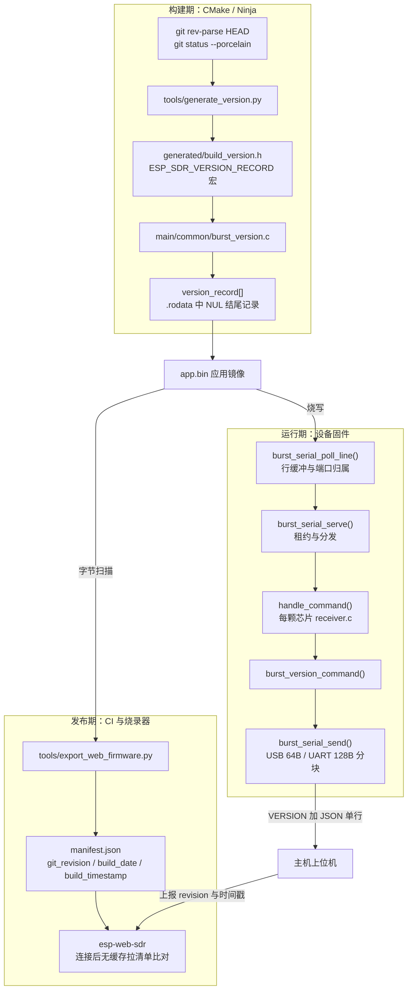

# 固件版本元数据与上报

## 一、项目定位与核心价值

在嵌入式 SDR 这类"设备固件 + 浏览器上位机 + 自动打包流水线"三者解耦的工程里，最容易腐化的信息不是采样率也不是增益表，而是**"这台设备里跑的到底是哪一次构建"**。ESP-SDR 的固件有十余个芯片后端（`esp32`、`esp32c2`、`esp32c3`、`esp32c5`、`esp32c6`、`esp32c61`、`esp32h2`、`esp32s2`、`esp32s3`、`esp32s31`），每颗芯片由独立的 CI 矩阵任务构建、独立导出成网页烧录器（flasher）的构件。如果版本信息由打包侧"顺手写上"，那么导出时刻、打包机上的 Git 检出、甚至人工填写的字段都会污染"固件年龄"这一语义：同一份二进制在不同流水线里跑出不同的构建时间，用户看到的"该升级了"提示就失去意义。

该模块的答案是一个极小的、但设计上刻意收束的方案：**把版本元数据以一段带标记的 JSON 记录编译进固件镜像本身，让"设备对外回答的字节"和"发布清单里的字段"来自同一份内存字节。** 整个实现只有 17 行 C 代码加 32 行 Python 生成器，却同时服务三条链路——构建期注入、运行期查询、发布期抽取。其核心价值在于**单一真相来源（single source of truth）**：`VERSION?` 命令回给主机的 JSON，与导出器从 `app.bin` 里扫出来的 JSON，是字符串常量 `version_record[]` 的同一段内容，任何一侧都无法"善意地"篡改另一侧。源码注释把这条纪律写得很直白——标记与 JSON 放在一起，使打包过程无法替换元数据。

需要强调这个模块解决的三类具体痛点。第一是**增量构建下的时间失真**：ESP-IDF 的应用描述符（`esp_app_desc_t`）里的编译时间在增量构建时常常不刷新，于是"刚改完代码的固件"看起来和三天前一样旧；因此元数据在每次构建时由 CMake 的 `add_custom_target` 无条件重跑生成器刷新 UTC 时间戳。第二是**修订号不可比较**：Git 提交哈希是内容指纹而非时间序，所以设计上明确"Git revision 仅供参考，永不参与新旧判定"，新旧一律比 `build_timestamp`，老清单只有 `build_date` 时退化到日期级比较。第三是**能力探测与降级**：不支持 `VERSION` 能力位的旧固件、或对 `VERSION?` 回 `ERR command` 的固件，即使清单不可用也被判为过期；反之清单不可达、变体缺失、元数据畸形都**不**触发告警，且目录请求不阻塞接收。

Sources: [burst_version.c](main/common/burst_version.c#L1-L17), [firmware-version.md](docs/firmware-version.md#L1-L35), [generate_version.py](tools/generate_version.py#L1-L32)

---

## 二、架构设计与模块划分

该模块的架构可以按"时间轴三段"来读：**构建期（元数据注入）→ 运行期（命令应答）→ 发布期（镜像抽取与清单比对）**。三段之间没有运行时耦合，唯一的契约是那段 NUL 结尾的 ASCII 记录。



### 2.1 构建期：把元数据钉进 `.rodata`

生成器 `tools/generate_version.py` 的接口是三个参数：`--root`（仓库根）、`--profile`（芯片目标，等于 `IDF_TARGET`）、`--output`（头文件路径）。`metadata()` 的取值策略包含若干防御性细节：用 `git rev-parse HEAD` 拿完整 40 位提交；用 `git status --porcelain --untracked-files=no` 判定脏工作区——**只统计已跟踪文件**，避免构建产物或未跟踪的临时文件把 revision 无意义地标成 `-dirty`；当 Git 完全不可用（`OSError` 或 `CalledProcessError`，例如从源码包构建）时降级为字符串 `unknown` 而不是让构建失败。

时间戳一次性取 `datetime.now(timezone.utc)` 并格式化成 `%Y-%m-%dT%H:%M:%SZ`，而 `build_date` 直接由同一个字符串切片前 10 个字符得到——这不是随手写的巧合，而是让"日期"与"时间戳"在生成侧就无法互相矛盾，导出侧随后会用 `value['build_date'] != stamp[:10]` 复核这一不变量。最终输出的是一个 C 头文件，内容形如 `#pragma once` 加 `#define ESP_SDR_VERSION_RECORD "<marker><json>"`：注意 `record = MARKER + json.dumps(...)`，**标记与 JSON 在生成时就已经拼成同一个字符串常量**，JSON 使用 `separators=(',',':')` 的最紧凑形式，省掉空格以压缩镜像体积与传输帧数。

构建系统的接线在 `main/CMakeLists.txt` 尾部：通过 `idf_build_get_property(version_python PYTHON)` 复用 ESP-IDF 自己的 Python 解释器（避免宿主 Python 环境差异），用 `add_custom_target`（而非 `add_custom_command`）注册生成动作，`BYPRODUCTS` 声明头文件路径，`add_dependencies(${COMPONENT_LIB} esp_sdr_build_version)` 把生成目标挂到组件库上，并把 `generated/` 目录加入私有 include 路径。**选择 `add_custom_target` 是这里最关键的一个设计决策**：自定义 target 每次构建都会执行，因此增量构建同样会刷新时间戳；代价只是 `burst_version.c` 这一个翻译单元在头文件内容变化后重编，开销可以忽略。注释亦点明该记录同时是"构件导出器的 revision 与 UTC 构建时间来源"。

Sources: [generate_version.py](tools/generate_version.py#L9-L32), [CMakeLists.txt](main/CMakeLists.txt#L73-L83)

### 2.2 运行期：一个无状态的命令处理函数

固件侧的实现被刻意压到最小：`burst_version.c` 只包含一个 `static const char version_record[] = ESP_SDR_VERSION_RECORD;`（放在 `.rodata`，NUL 结尾，随应用镜像一起烧写），以及一个 `burst_version_command()`。函数体是一条 `strcmp` 短路守卫——`if (strcmp(line, "VERSION?")) return false;` 意味着**只有整行严格等于 `VERSION?` 才接管**，带任何尾随参数（如 `VERSION? junk`）都会礼貌地让位给后续命令；这一行为被主机侧单元测试显式锁定。命中后它做三件事：先 `burst_serial_send("VERSION ", 8)` 发前缀，再跳过标记（`version_record + sizeof("ESP-SDR-VERSION:") - 1`，即偏移 16 字节）把纯 JSON 发出去，最后补一个 `\n`。整个应答约 150 字节，在 64 字节分块的 USB Serial/JTAG 路径上大概是三包，属于任何流式传输开始前都可以安全插入的轻量交互。

调用位置体现了一种"路由表语义"：每份 `receiver.c` 的 `handle_command()` 都是一串有序短路判断，而 `burst_version_command` 被放在**第一位**——它无副作用、不改射频状态、不需要 `prepare_rx()`，是最便宜且最安全的探针，因此排在任何会触碰 PHY 或 UART 的命令之前。`CAPS` 的能力位列表也把 `VERSION` 放在首个位置（`CAPS VERSION GPIO SPEC ...`），与探测顺序呼应。传输层则由 `burst_serial_poll_line()` 完成 CRC 无关的行缓冲（128 字节上限、3 秒空闲清空、超长报 `ERR command_length`）、`burst_serial_serve()` 完成端口租约（同一时刻只允许一个端口控设备，另一端口得 `ERR busy`），`burst_serial_send()` 提供带截止时间的阻塞写；版本应答因此天然继承了"一次命令一行回复"的协议纪律。

Sources: [burst_version.c](main/common/burst_version.c#L6-L17), [burst_version.h](main/common/burst_version.h#L1-L4), [receiver.c](main/families/c5_c6_c61/receiver.c#L310-L343), [receiver.c](main/targets/esp32/receiver.c#L212-L224), [burst_serial.c](main/common/burst_serial.c#L135-L171), [burst_serial.c](main/common/burst_serial.c#L206-L280), [protocol.md](docs/protocol.md#L10-L17)

### 2.3 发布期：从镜像里反抽同一份字节

`tools/export_web_firmware.py` 里有两条互不依赖的提取路径。`firmware_build_date()` 是**兼容旧固件**的兜底：它按 ESP-IDF 镜像布局定位 `esp_app_desc_t`（跳过 24 字节镜像头 + 8 字节段头，校验偏移 32 处的魔数 `0x3254cdab` 的小端字节序 `32 54 cd ab`），再从偏移 128 处读出 `%b %d %Y` 形式的编译日期。`firmware_version()` 才是新路径：在二进制里 `find` 标记 `ESP-SDR-VERSION:`，读到下一个 NUL，限制记录长度不超过 512 字节，然后做一整套**防御性校验**——`build_timestamp` 必须匹配 `\d{4}-\d{2}-\d{2}T\d{2}:\d{2}:\d{2}Z` **并且**通过 `strptime` 真实性检查（因此 `2026-02-30T...` 会被拒绝），`build_date` 必须等于时间戳前 10 字符，`revision` 必须是 40 位小写十六进制（可带 `-dirty`）或 `unknown`，`profile` 必须匹配 `esp32[a-z0-9]*`。任何一步失败都抛出统一的 `Invalid embedded firmware version`。

在 `export()` 中，这些字段会写进 `manifest.json` 的对应变体：`git_revision`、`build_date`、`build_timestamp`；并且**嵌入记录与导出板号必须一致**（`len(embedded) != 1 or embedded[0]['profile'] != board` 即报错），这实际上把"板号 == 芯片目标"变成一条硬不变量，杜绝把 C61 的镜像挂到别的变体下。清单里还可以看到更广的完整性防护：拒绝打包任何诊断探针固件（`RING_PROBE`/`SAMPLE_RATE_PROBE`/`S3_RF_PROBE` 等），拒绝构建目标与烧写目标不一致，拒绝重叠或超出 flash 容量的镜像，并拒绝覆盖已存在的输出目录。`tools/build_firmware.py` 则把 CI 的 `FIRMWARE_VERSION`（即 `github.sha`）作为**发布标签**传入，与嵌入记录的 `git_revision` 并存——前者是人类可读的发布号，后者是固件自证的内容指纹。

Sources: [export_web_firmware.py](tools/export_web_firmware.py#L11-L44), [export_web_firmware.py](tools/export_web_firmware.py#L47-L121), [build_firmware.py](tools/build_firmware.py#L43-L59), [firmware.yml](.github/workflows/firmware.yml#L60-L67)

### 2.4 明确的范围边界：S31 流式应用不参与

同一颗 ESP32-S31 有两套完全不同的固件形态：burst（行协议）与 streaming（以太网/高速 USB 的 SoapySDR 应用）。版本上报协议只属于 burst 形态——streaming 组件在 `CMakeLists.txt` 里直接 `REQUIRES streaming` 后返回，根本不编译 `common/burst_version.c`，也没有 `esptool` 之外的版本命令；它的"版本"是另一个概念：`stream.h` 里定义的 `STREAM_VERSION 2`，作为 JSON 的 `protocol` 字段出现在控制接口里。文档因此特意声明"独立的 S31 流式应用不使用本协议"，而导出器也用 `application: soapysdr` 字段区分两种构件。

Sources: [CMakeLists.txt](main/targets/esp32s31/streaming/CMakeLists.txt#L1-L10), [CMakeLists.txt](main/CMakeLists.txt#L1-L5), [stream.h](main/targets/esp32s31/streaming/stream.h#L10), [firmware-version.md](docs/firmware-version.md#L14)

---

## 三、技术栈与核心工作流

### 3.1 技术栈构成

| 层 | 技术 | 在该模块中的职责 |
| --- | --- | --- |
| 构建系统 | CMake + ESP-IDF `idf_component_register` / `add_custom_target` | 每次构建重跑生成器，把 `generated/` 注入 include 路径 |
| 元数据生成 | Python 3 标准库（`subprocess`、`datetime`、`json`、`pathlib`） | 采集 Git 与 UTC 时间，产出 C 宏 |
| 固件侧 | C11、`.rodata` 常量、`strcmp` 短路 | 单行应答，零状态、零动态分配 |
| 传输层 | USB Serial/JTAG、UART0（2 Mbaud 8N1）或 S2 的 ROM CDC | 行缓冲、端口租约、带截止时间的写 |
| 发布侧 | Python 3 标准库 + ESP-IDF 镜像布局知识 | 扫描标记、校验字段、生成 `manifest.json` |
| 客户端 | esp-web-sdr（浏览器） | 连接即读版本、无缓存拉清单、时间戳比较与升级提示 |
| 测试 | `unittest` + 宿主 `cc` 编译生产源码 | 线上字节与镜像字节的一致性回归 |

Sources: [CMakeLists.txt](main/CMakeLists.txt#L68-L83), [generate_version.py](tools/generate_version.py#L1-L7), [export_web_firmware.py](tools/export_web_firmware.py#L1-L8), [test_version.py](tests/test_version.py#L1-L16)

### 3.2 端到端主链路

一次完整的"版本闭环"包含五个阶段，每一步都有明确的失效处理：

1. **采集**：CI 检出代码 → `generate_version.py` 读 `HEAD`、判定 `-dirty`、取 UTC 秒级时间戳 → 拼接 `ESP-SDR-VERSION:{...}`。
2. **注入**：CMake 把宏写进 `generated/build_version.h` → `burst_version.c` 的 `version_record[]` 落在 `.rodata` → 链接进 `app.bin`。
3. **上报**：主机发 `VERSION?` → `burst_serial_poll_line()` 组装整行 → `burst_serial_serve()` 校验租约 → `handle_command()` 首条分支 → `burst_version_command()` → 三段落写出 `VERSION {...}\n`。
4. **抽取**：打包环节 `export_web_firmware.py` 扫同一份 `app.bin`，校验记录并写入清单的 `git_revision`/`build_date`/`build_timestamp`；若找不到嵌入记录，退回镜像描述符只填 `build_date`。
5. **比对**：浏览器连接后读设备版本、无缓存拉 `firmware/manifest.json`，用 `build_timestamp` 与匹配变体比较；**仅当已装构建更旧时**提示升级并给烧录器链接，相等或更新不提示；只有 `build_date` 的老清单按日期分辨率比较；设备名 hover 显示上报的 revision 与时间戳。

关键设计哲学可以概括为一句话：**"设备说的"优先于"打包说的"。** 因此记录必须与标记同处一段字节（`static const char` 数组而非两处字符串拼接），导出器只做"读取 + 校验"而不是"生成"，并且导出时间与打包机的 Git 检出都不影响记录的固件年龄。

Sources: [firmware-version.md](docs/firmware-version.md#L16-L34), [burst_version.c](main/common/burst_version.c#L6-L17), [export_web_firmware.py](tools/export_web_firmware.py#L95-L105)

### 3.3 元数据字段与不变量

| 字段 | 生成来源 | 语义 | 校验规则（导出侧） |
| --- | --- | --- | --- |
| `revision` | `git rev-parse HEAD`，脏工作区追加 `-dirty`，无 Git 则 `unknown` | 固件自证的内容指纹 | `^[a-f0-9]{40}(-dirty)?$` 或 `unknown`；**仅信息性，不参与新旧判定** |
| `build_date` | `build_timestamp[:10]` | 日期级精度，供老清单比较 | 必须严格等于 `build_timestamp` 的前 10 字符 |
| `build_timestamp` | `datetime.now(timezone.utc)` 秒级 | **唯一的年龄比较基准** | 正则 + `strptime` 双重校验，拒绝非法日期（如 02-30） |
| `profile` | `IDF_TARGET` | 芯片目标，与清单板号同构 | `^esp32[a-z0-9]*$`，且必须等于导出板号 |

Sources: [generate_version.py](tools/generate_version.py#L12-L21), [export_web_firmware.py](tools/export_web_firmware.py#L30-L44), [export_web_firmware.py](tools/export_web_firmware.py#L98-L105), [firmware-version.md](docs/firmware-version.md#L10-L14)

### 3.4 一致性回归：让"线上字节"等于"镜像字节"

`tests/test_version.py` 用了一种很值得借鉴的测试手法：它生成一份合成的 `build_version.h`，把**生产源码** `main/common/burst_version.c` 与一个桩 `burst_serial_send()` 用宿主 `cc` 编译成可执行文件，实际调用 `burst_version_command()` 拿回线上字符串，再断言 `response.startswith('VERSION ')`、`json.loads(response[8:]) == RECORD`，最后用导出器的 `firmware_version()` 去解析**这个可执行文件自身的字节**并比较结果。这等价于把"设备会说出的内容"与"导出器能从镜像读到的内容"钉成同一个断言；同一批用例还覆盖了畸形记录被拒（错误日期、缺 `Z`、非法 revision、路径穿越式 profile）与 `VERSION? junk`/`INFO` 不产生任何输出。`tests/test_firmware_export.py` 则从另一侧覆盖清单语义：嵌入记录覆盖镜像描述符日期、profile 不匹配即失败且不留输出目录。

Sources: [test_version.py](tests/test_version.py#L17-L55), [test_firmware_export.py](tests/test_firmware_export.py#L51-L75)

---

## 四、典型代码示例

固件侧的全部实现，值得逐行读完——它的"短"本身就是设计表达：

```c
/* The exporter reads this same NUL-terminated record from the app image.
 * Keep the marker and JSON together so packaging cannot substitute metadata. */
static const char version_record[] = ESP_SDR_VERSION_RECORD;

bool burst_version_command(const char *line) {
    if (strcmp(line, "VERSION?")) return false;
    const char *json = version_record + sizeof("ESP-SDR-VERSION:") - 1;
    burst_serial_send("VERSION ", 8);
    burst_serial_send(json, strlen(json));
    burst_serial_send("\n", 1);
    return true;
}
```

三个细节构成了契约：`sizeof("ESP-SDR-VERSION:") - 1` 是**编译期**算出的标记长度 16（不是魔法数字），跳过标记后 `json` 直接指向镜像里那段可被 `find` 命中的字节；"标记 + JSON"同处一个数组，使二进制里只有一份权威副本；`return false` 的短路语义让 `VERSION?` 成为 `handle_command()` 中最先尝试、最无副作用的一条分支。

对应的生成器核心同样只有几行，却承担了全部"可追溯性"：

```python
def metadata(root, profile):
    try:
        revision = subprocess.check_output(['git', '-C', str(root), 'rev-parse', 'HEAD'], text=True).strip()
        dirty = subprocess.check_output(['git', '-C', str(root), 'status', '--porcelain', '--untracked-files=no'], text=True)
        if dirty:
            revision += '-dirty'
    except (OSError, subprocess.CalledProcessError):
        revision = 'unknown'
    stamp = datetime.now(timezone.utc).strftime('%Y-%m-%dT%H:%M:%SZ')
    return dict(revision=revision, build_date=stamp[:10], build_timestamp=stamp, profile=profile)
```

`stamp[:10]` 与 `stamp` 同源，是 2.3 节那套导出校验能够成立的前提；`--untracked-files=no` 与 `except` 兜底则是"不制造假脏、不为环境差异阻断构建"的两处克制。

Sources: [burst_version.c](main/common/burst_version.c#L6-L17), [generate_version.py](tools/generate_version.py#L12-L21)

---

## 五、学习与探索建议

| 读者姿态 | 建议动作 | 目标文件 |
| --- | --- | --- |
| 想验证"记录真的每次都刷新" | 连续两次增量构建，对比 `build/generated/build_version.h` 的 `build_timestamp`；再改动一个已跟踪文件后重建，观察 `-dirty` 后缀 | `main/CMakeLists.txt#L73-L83`、`tools/generate_version.py` |
| 想改协议扩展字段 | 同步修改三处并跑回归：生成器 `metadata()`、导出器 `firmware_version()` 的校验白名单、文档字段说明 | `tools/generate_version.py`、`tools/export_web_firmware.py#L23-L44`、`docs/firmware-version.md` |
| 想理解"为什么要 `add_custom_target`" | 对照 `add_custom_command` 的依赖驱动语义，思考增量构建下 ESP-IDF `esp_app_desc_t` 的日期为何不可靠 | `main/CMakeLists.txt#L73-L83`、`tools/export_web_firmware.py#L11-L20` |
| 想接管命令路由 | 沿着短路链读一遍 `handle_command()`，注意版本查询为何必须排在 `prepare_rx()` 类命令之前 | `main/families/c5_c6_c61/receiver.c#L310-L343`、`main/targets/esp32/receiver.c#L212-L224` |
| 想审计镜像抽取的安全性 | 逐个字段核对正则与 `strptime` 双校验、512 字节上限、`len(embedded) != 1` 的失败路径 | `tools/export_web_firmware.py#L23-L44` |
| 想研究"发布流水线不可信"这一命题 | 读探针拒绝、目标一致性、覆盖拒绝、`build-info.json` 出处记录；这是同一份完整性思路的延伸 | `tools/export_web_firmware.py#L47-L60`、`tools/build_firmware.py#L39-L59`、`.github/workflows/firmware.yml#L60-L67` |

Sources: [CMakeLists.txt](main/CMakeLists.txt#L73-L83), [export_web_firmware.py](tools/export_web_firmware.py#L47-L60), [build_firmware.py](tools/build_firmware.py#L39-L59)

---

## 🔗 关联模块与上下游

- [main/common/burst_serial.c](main/common/burst_serial.c#L135-L171) —— 提供 `VERSION?` 的行缓冲、端口租约与 `burst_serial_send()` 写通道；版本应答是本协议中"最短的一次事务"。
- [main/families/c5_c6_c61/receiver.c](main/families/c5_c6_c61/receiver.c#L310-L343) —— `handle_command()` 的第一条分支与 `CAPS` 首位的 `VERSION` 能力位，决定了主机能否探测到该功能。
- [tools/export_web_firmware.py](tools/export_web_firmware.py#L23-L44) —— 从 `app.bin` 反抽同一份记录并写入 `manifest.json`，是"设备自证"延伸到"发布清单"的唯一桥梁。

Sources: [burst_serial.c](main/common/burst_serial.c#L135-L171), [receiver.c](main/families/c5_c6_c61/receiver.c#L310-L343), [export_web_firmware.py](tools/export_web_firmware.py#L23-L44)
