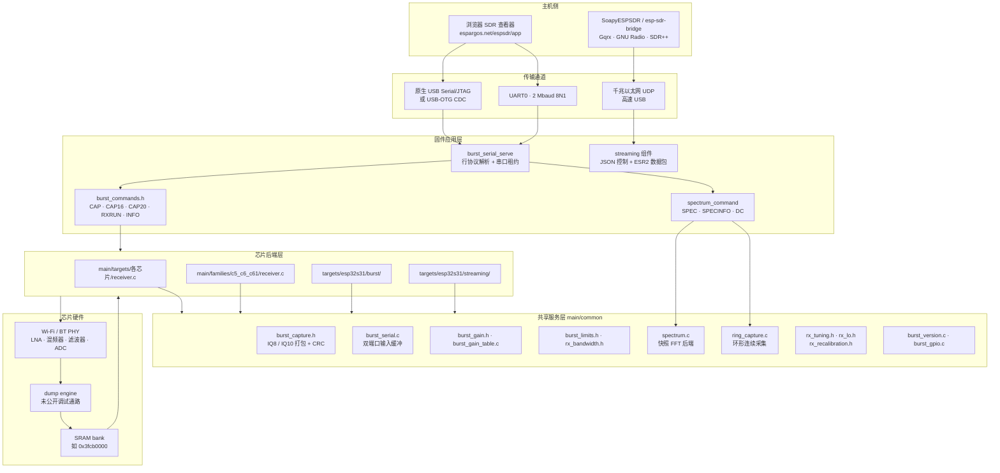
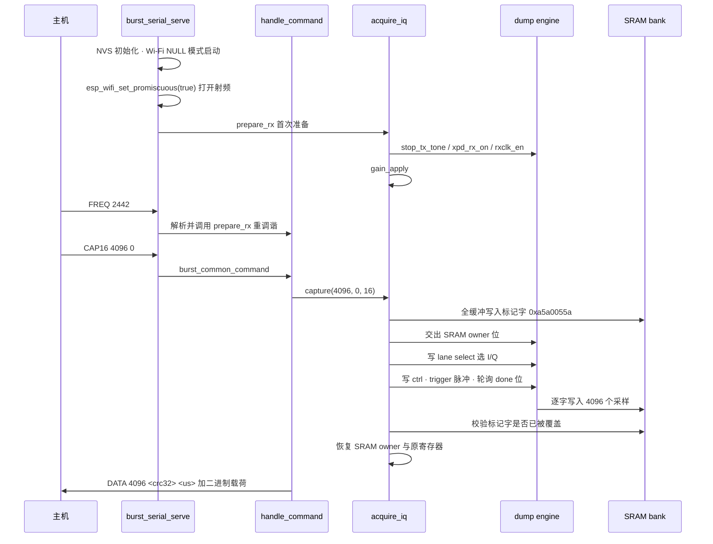

# 项目概览

## 1. 项目定位与核心价值

ESP-SDR 是一个**把普通 ESP32 系列芯片的 Wi-Fi / Bluetooth 射频前端改造成只接收软件定义无线电（SDR）**的固件工程。它的出发点来自一个非常具体的硬件事实：ESP32 家族每一颗受支持的芯片内部，接收链（天线 → LNA/混频器 → 滤波器 → ADC）输出的基带采样在正常情况下会**直接灌入固定功能的 Wi-Fi / 蓝牙调制解调器**，主机端无法访问。Espressif 从未公开这条路径的任何文档。ESP-SDR 通过逆向 ESP-IDF 随附的射频测试库 `librftest.a`（函数 `adctrig`）、反汇编以及在真实板卡上的实验，找到了一个**未公开的调试旁路（debug bypass）**：一个被项目命名为 **dump engine** 的硬件模块，原本用于工厂射频测试时记录接收机看到的信号，它会把接收机的基带采样按 32 位字逐个写入片上 SRAM 的一块固定区域。CPU 随后可以像读取普通数组一样读取那块内存并转发给主机。

这个机制的核心价值在于**成本结构的彻底改变**。传统 SDR 需要专用的 ADC + FPGA/USB3 桥接方案，而 ESP-SDR 让一块几美元的 ESP32 开发板具备了 80 MS/s 级别的原始 I/Q 抓取能力，且调谐指令接受 100–6000 MHz 的全范围（尽管 PLL 实际只在 2.4 GHz 附近、C5 额外在 5 GHz 附近锁定）。项目同时明确划定了能力边界：单次抓取最多 16,380 个采样（C2 为 8,190，S2 为 12,284），抓取之间存在射频间隙；增益以 PHY 表索引表达而非校准过的 dB；`FREQ` 被接受并不等于 PLL 锁定。这种"把局限写进 README 的显眼位置"的做法，是这个项目工程质量的一个标志。

在工程形态上，ESP-SDR 不是单一固件，而是**一个多目标固件矩阵 + 一套跨芯片共享的串口协议 + 一套主机侧验证工具链**的组合体。`firmware-targets.json` 是唯一的真相来源，逐条列出每个固件变体（10 个 burst 变体 + 1 个 streaming 变体）及其钉死的 ESP-IDF commit；同一份 `main/` 源码通过 CMake 的 `IDF_TARGET` 条件分支编译出十个不同的接收机后端，其中 C5/C6/C61 三个 RISC-V 芯片甚至共享同一个 `families/c5_c6_c61/receiver.c`。这种"单源码树、多芯片后端、统一协议"的组织方式，是理解整个代码库的第一把钥匙。

> 设计哲学：把芯片差异**下沉到编译期**（CMake 分支 + `chip.h` + Kconfig 默认值），把芯片共性**上浮到运行期**（统一的行协议、统一的 `CAPS` 能力协商、统一的二进制帧格式）。主机侧因此只需要写一份客户端。

Sources: [README.md](README.md#L1-L31), [how-it-works.md](docs/how-it-works.md#L1-L25), [firmware-targets.json](firmware-targets.json#L1-L96), [CMakeLists.txt](main/CMakeLists.txt#L6-L20)

---

## 2. 架构设计与模块划分

### 2.1 全局拓扑



Sources: [README.md](README.md#L131-L138), [main/CMakeLists.txt](main/CMakeLists.txt#L13-L71), [burst_serial.c](main/common/burst_serial.c#L250-L280)

### 2.2 传输层：一个协议，两个物理端口

`burst_serial.c` 是整个固件的入口地基。它在同一份代码里抽象了**原生 USB Serial/JTAG 与 UART0 两个端口**，并且在 `burst_serial_poll_line()` 中以轮转方式（`next_port` 游标）同时轮询两者，每个端口维护独立的行缓冲、溢出标志和"最后收到字节的时间戳"（3 秒无输入即重置缓冲）。这种设计的动因很实际：原生 USB 与 UART 可能同时被连接（例如 UART 用于烧写日志、USB 用于数据），而固件必须保证任意一个端口发来的完整命令行都能被正确解析，同时不能让一个未以换行符结束的半截命令把对端饿死——所以每一次 `poll_line` 调用内部的读取循环被硬性限制在 `COMMAND_SIZE`（128）次迭代内。

UART 波特率的运行时切换（`BAUD 1000000` / `BAUD 2000000`）是一个值得注意的实现细节：它**先把 ACK 以旧速率完整发完，等 `uart_wait_tx_done` 确认，才改写 UART 时钟**，随后冲刷输入缓冲并清空该端口的行状态。因为切换速率后对端仍在按旧速率发字节，冲掉这些残留字节是唯一能保证协议不被打断的做法。波特率是会话级的，每次上电都回到 `CONFIG_ESP_SDR_UART_BAUD` 的配置默认值。

比端口抽象更关键的，是**串口租约（serial lease）**机制。`burst_serial_serve()` 维护一个 `owner` 变量与 `lease_deadline`：第一个成功发来完整命令的端口取得所有权，另一端此后收到 `ERR busy`，直到 owner 发送 `RELEASE` 或静默 5 秒（`5000000` µs）。租约的语义被明确扩展到了"整个二进制事务"——因为一条 `CAP16` 的背后是头行 + 数万字节二进制载荷，如果中途被另一端口插入命令，帧边界会彻底错乱。

Sources: [burst_serial.c](main/common/burst_serial.c#L40-L69), [burst_serial.c](main/common/burst_serial.c#L135-L179), [burst_serial.c](main/common/burst_serial.c#L250-L280), [protocol.md](docs/protocol.md#L8-L27)

### 2.3 命令层：以"契约头文件"实现的静态多态

这是本项目最独特、也最容易让新读者困惑的架构手法。C 语言没有类与虚函数，而十个芯片后端需要**完全一致的** `CAP` / `INFO` / `FREQ` / `RXRUN` 命令语义。ESP-SDR 的解法是：把这些通用命令写成 `.h` 里的 `static` 函数，**要求包含方（每个 `receiver.c`）在 `#include` 之前先定义一组符号**——`BURST_ID`、`BURST_MAX_RATE`、`IQ_WORDS`、`frequency_mhz`、`frequency_valid()`、`prepare_rx()`、`reply()`、`capture()`。头文件里的注释把这组约定写得非常直白：

```c
/* Commands that every snapshot receiver answers the same way. Include after
 * defining BURST_ID (e.g. "C3SDR"), BURST_MAX_RATE (highest CAP rate code),
 * IQ_WORDS, and providing frequency_mhz, rx_ready, frequency_valid(), prepare_rx(),
 * reply() and capture(samples, rate, format). See docs/protocol.md. */
```

这在效果上等价于 C++ 的 CRTP 或 Rust 的 trait bound，只是由预处理器和 `static` 链接性来承载。`burst_capture.h` 采用同样的手法，但它注入的是 `IQ_BUFFER` 与 `send_bytes()`，并把 `IQ_BUFFER` 当作**原地打包缓冲区**——IQ8 和 IQ10 的输出都不大于其替换掉的 32 位字，所以 `pack_iq()` / `pack_iq8()` 可以直接在采集内存上覆盖写，省掉一比一的额外缓冲。

以 ESP32-C3 为例，其后端在文件中部以如下顺序"装配"自身：先 `#include "burst_serial.h"` 拿传输，再 `#define send_bytes burst_serial_send` 提供发送原语，再 `#include "burst_gain.h"` / `"burst_limits.h"` 拿增益与限值命令，最后 `#include "burst_capture.h"`（依赖 `IQ_BUFFER`）与 `"burst_commands.h"`（依赖 `capture()` 与 `BURST_ID`）。`handle_command()` 就是一个扁平的责任链：版本查询 → GPIO → 探针 → 频谱 → 限值 → 增益 → 通用捕获 → 芯片特有命令（C3 上是 `BANDWIDTH` / `LPF`）。链上任何一环返回 `true` 即表示"这条 line 已被我消费"。

Sources: [burst_commands.h](main/common/burst_commands.h#L1-L63), [burst_capture.h](main/common/burst_capture.h#L1-L56), [esp32c3/receiver.c](main/targets/esp32c3/receiver.c#L76-L82), [esp32c3/receiver.c](main/targets/esp32c3/receiver.c#L166-L205)

### 2.4 芯片后端层：快照型与环形型两条路线

所有后端可归入两种采集形态，二者在 `main/CMakeLists.txt` 里就以**源文件取舍**的形式分道扬镳：

| 形态 | 代表芯片 | 采集方式 | 频谱来源 | 是否连续 |
| --- | --- | --- | --- | --- |
| **快照型（burst）** | ESP32、C2、C3、C5、H2、S2 | dump engine 一次性写满 SRAM bank，等 done 位后 CPU 接管 | `spectrum.c`，每帧独立快照，帧头 bit 3 标记间隙 | 否，抓取间有间隙 |
| **环形型（ring）** | C6、C61、S3、S31 | dump engine 以 circular 模式在 16384 对采样环上连续写，CPU 轮换 bank | `ring_capture.c`，bank 轮换 + 分片 FFT | 是（仅原生 USB） |

CMake 中的分支逻辑非常清晰地体现了这条分界线：`ring_capture.c` 只被加入 C6、C61、S3 的源列表；`spectrum.c` 被加入除 S3 之外的所有目标（因为 S3 的频谱完全由环形后端承担）。S31 是唯一同时具备两套采集路径的芯片——`targets/esp32s31/burst/` 走快照协议供浏览器使用，`targets/esp32s31/streaming/` 则是一个**完全独立的应用**，走 PARLIO + DMA 的第三条路线，连串口协议都不讲。

环形后端的 bank 映射在 `ring_capture.h` 里以宏的形式固化：C6 两个 bank 覆盖 `0x40820000–0x40860000`，C61 两个 bank 覆盖 `0x40820000–0x40840000`，其余（S3）三个 bank 覆盖 `0x3fcb0000–0x3fce0000`。FFT 上限也随之分层：C6/C61 的 `RING_SPEC_NFFT_MAX` 是 256，S3 是 2048。这解释了为什么 `docs/spectrum.md` 的能力表里，C6/C61 的连续模式只有 256 bin——它们的两个 bank 无法为更大的块留出足够的轮换余量。

Sources: [main/CMakeLists.txt](main/CMakeLists.txt#L22-L66), [ring_capture.h](main/common/ring_capture.h#L11-L37), [spectrum.md](docs/spectrum.md#L1-L18)

### 2.5 共享服务层：调谐、增益、限值、带宽

`main/common/` 承担了所有芯片共享的"非采集"逻辑，它是整个代码库体量最大、也是最需要小心维护的部分：

- **调谐**（`rx_tuning.h` / `rx_lo.h` / `rx_recalibration.c`）：软件层接受 100–6000 MHz 的任意整数 MHz，但实际 PLL 锁定范围远窄于此。低于 2210 MHz 时，ESP32/C2/C3/C6/S2/S3 会把 LO 切到一个 **5/6 分频器**，因此 `FREQ 2001` 实际编程的是 2401.2 MHz 的 PLL 坐标。C5/C61/H2/S31 的模拟寄存器布局不同、没有等价的合格映射，`rx_lo.h` 明确只接受前述六颗芯片。
- **校准策略**（`rx_calibration_state.c` / `rx_recalibration.c`）：IQ 不平衡在启动时校准一次并跨频率复用；DC 偏移在每次新调谐频率上重测，并通过 `rx_recalibration_stale()` 侦测 PHY 是否在后台替换了 DC 校准表。
- **增益**（`burst_gain.h` / `burst_gain_table.c`）：默认硬件 AGC，手动增益以 PHY 表索引而非 dB 表达。C61/S31 通过 `--wrap=phy_write_gain_mem` 链接器包裹来镜像低表项，S3/C3 通过 `--wrap=set_rx_gain_table` 做增益校验，H2 则用 `--wrap=write_gain_mem` 并在固件内实现一个小型 AGC（因为它的蓝牙 AGC 只在链路层收包时才跟踪）。
- **带宽**（`rx_bandwidth.h`）：把 `BANDWIDTH <MHz>` 插值到芯片的电容码曲线（BBTOP 块 `0x67`，I2C host 1），并在抓取前后保存/恢复校准寄存器。

这一层的设计原则可以概括为：**"改写芯片状态前先保存，抓取结束（含失败路径）必须恢复"**。这一点在 C3 的 `rx_filter_apply()` / `rx_filter_restore()` 对中可以看得最清楚——它们只改写寄存器低 6 位，保留校准值与高位。

Sources: [rx_tuning.h](main/common/rx_tuning.h#L1-L10), [rx-controls.md](docs/rx-controls.md#L64-L115), [rx-controls.md](docs/rx-controls.md#L149-L170), [main/CMakeLists.txt](main/CMakeLists.txt#L86-L116)

### 2.6 构建系统层：单一目录树，十一个固件变体

顶层 `CMakeLists.txt` 只有 21 行，但它决定了整个项目的编译形态。`ESP_SDR_STREAMING` 是一个编译开关：置 `ON` 时把 `targets/esp32s31/streaming` 加入 `EXTRA_COMPONENT_DIRS`，`main/CMakeLists.txt` 在开头就检测到这个属性并**提前 return**，只注册 streaming 这一颗组件；置 `OFF` 时则关闭 ESP-IDF 组件管理器（`IDF_COMPONENT_MANAGER=0`），改用钉死的 `esp-dsp` 子模块。`idf_build_set_property(MINIMAL_BUILD ON)` 进一步裁掉了未引用的 IDF 组件。

每个芯片的 SDK 差异被推到 `sdkconfig.defaults.<target>` 系列文件里，`main/Kconfig.projbuild` 只暴露真正需要用户决策的三项：UART 传输是否启用、UART 波特率、以及 TX/RX 引脚号（且每颗芯片有各自的默认值，比如 C3 是 GPIO21/20、S3 是 GPIO43/44、S31 是 GPIO58/59）。

`tools/build_firmware.py` 是这条链路的自动化封装：它读取 `firmware-targets.json`，**校验当前 `IDF_PATH` 的 git HEAD 是否等于 profile 里钉死的 `idf_ref`**，不匹配就报错退出；随后拼装 `idf.py` 命令行（`preview`、`IDF_TARGET`、`SDKCONFIG`、`SDKCONFIG_DEFAULTS`、`ESP_SDR_STREAMING`），并在 release 构建中强制关闭全部诊断探针（`RING_PROBE`、`SAMPLE_RATE_PROBE`、`FILTER_REGISTER_PROBE` 等）。

Sources: [CMakeLists.txt](CMakeLists.txt#L9-L21), [Kconfig.projbuild](main/Kconfig.projbuild#L1-L56), [build_firmware.py](tools/build_firmware.py#L25-L59)

---

## 3. 技术栈与核心工作流

### 3.1 技术栈

| 层次 | 选型 | 说明 |
| --- | --- | --- |
| 芯片 | ESP32 / C2 / C3 / C5 / C6 / C61 / H2 / S2 / S3 / S31 | Xtensa（ESP32/S2/S3）与 RISC-V（C2/C3/C5/C6/C61/H2/S31）混合 |
| SDK | ESP-IDF（commit 钉死在 `firmware-targets.json`） | `25fe69f9…` 覆盖九个目标，S31 与 streaming 各自需要 `26dd2948…` / `c712a0dd…` |
| 语言 | C（含 Xtensa PIE / RISC-V SIMD 内联汇编）、少量 `.S` 汇编 | `s3_fft_rnd.S`、`s3_unpack.S`、`s3_firdot.S`、`s31_fft_rnd.S`、`s31_unpack.S` |
| DSP | `esp-dsp` 的 `dsps_fft2r_sc16`（定点 radix-2 FFT），加自研的定标与 dB 编码 | 归一化 Q15 域，功率码 = `20*log10(power)` 截断到 0–255 |
| 传输 | 原生 USB Serial/JTAG FIFO 直写、UART0 2 Mbaud、S2 的 ROM USB-OTG CDC、S31 的千兆以太网 UDP | USB 路径绕开 IDF 驱动直操作 `usb_serial_jtag_ll_*` 以消除不可控延迟 |
| 主机侧 | 纯 Python 工具链（`unittest`） | `tools/check_spectrum.py` 在真机上跑完每一档频谱 profile |
| 许可 | GPL-3.0-or-later（第三方代码保留原许可） | 明确声明"采集机制本身不受版权保护，只有本代码受" |

Sources: [README.md](README.md#L110-L129), [README.md](README.md#L169-L184), [firmware-targets.json](firmware-targets.json#L1-L96)

### 3.2 主链路：从 `app_main` 到一帧 I/Q

以 ESP32-C3 为例，完整的执行主链路如下：



对应到代码，`app_main()` 做的事情异常克制：压制日志级别、初始化 NVS、安装 USB Serial/JTAG 驱动、创建默认事件循环、以 `WIFI_MODE_NULL` 启动 Wi-Fi、关闭省电（`WIFI_PS_NONE`）、打开混杂模式、设一个初始信道，然后调用 `prepare_rx()`，随后**卸载 USB 驱动**（因为接下来要用 `usb_serial_jtag_ll_*` 直接操作 FIFO，走 driver 会引入不可控的延迟与缓冲），最后进入 `burst_serial_init()` + `burst_serial_serve(handle_command)` 的永不返回的循环。射频是被"顺手打开"的：固件先用标准 Wi-Fi 初始化把射频上电、调谐，然后用 PHY 库调用设定频率并关掉发射，此后调制解调器被完全忽略。

Sources: [esp32c3/receiver.c](main/targets/esp32c3/receiver.c#L83-L98), [esp32c3/receiver.c](main/targets/esp32c3/receiver.c#L207-L233), [how-it-works.md](docs/how-it-works.md#L21-L25)

### 3.3 采集原语：六个寄存器写操作

`acquire_iq()` 是整个项目的"心跳"，也是理解 dump engine 的最短路径。它的步骤与 `docs/how-it-works.md` 的六步叙述一一对应：

| 步骤 | 代码动作 | 设计意图 |
| --- | --- | --- |
| 1. 内存隔离 | `SOC_RESERVE_MEMORY_REGION(0x3fca0000, 0x3fcc0000, c3_rf_dump)` + `sram_guard.ld` | 阻止 FreeRTOS 把任务栈或 Wi-Fi 缓冲放进 dump engine 的落点 |
| 2. 写标记字 | 全缓冲填 `0xa5a0055a` | 事后任何仍是标记的字都说明未被写入，从而检出截断抓取而非静默返回陈旧数据 |
| 3. 交出 bank | `REG_WRITE(SRAM_OWNER_REG, (owner & ~7u) \| 2u \| 8u)` | 位 0–2 各让出一个 128 KiB 块，位 3 选中上半 64 KiB，故 `2\|8` = `0x3fcb0000` |
| 4. 选 lane | `REG_WRITE(0x60033d90, (1u<<6) \| (2u<<12) \| (3u<<18))` | 四个 6 位字段各选一路内部调试信号，0/1/2/3 对应接收机 I 与 Q 输出 |
| 5. 触发 | `ctrl = 0x80000000 \| n`，写 `ctrl \| (1<<19)` 再写 `ctrl`，轮询位 18 | 位 19 需要脉冲形式触发，位 18 是硬件置位的 done 标志 |
| 6. 还原 | 清 ctrl、恢复 SRAM owner、退出临界区 | CPU 拿回 bank 后才能安全读取样本 |

`taskENTER_CRITICAL(&capture_mux)` 包住了步骤 3–6 的全程，原因很硬核：**dump engine 拥有 bank 期间 CPU 读它会返回垃圾**（C3 上是一个重复的四字模式），如果中断在此时切进来读了那块内存，或者触发了一次调度导致寄存器上下文被别的任务改写，结果都是不可恢复的数据损坏。同理，代码在交出 bank 前后各插了一条 `fence rw,rw` 内存屏障——编译器和 CPU 都不能把这两侧的访存重排。

返回数据后还有两道校验：`done` 位未在 20 ms 内被硬件置位则回 `ERR capture_timeout`；任一标记字仍存活则回 `ERR capture_incomplete`。这条"用哨兵值证明数据完整性"的模式在整个项目中反复出现——环形后端用的是第二个哨兵 `0xa5c33c5a`。

Sources: [esp32c3/receiver.c](main/targets/esp32c3/receiver.c#L27-L33), [esp32c3/receiver.c](main/targets/esp32c3/receiver.c#L102-L147), [how-it-works.md](docs/how-it-works.md#L27-L102)

### 3.4 采集字的内存布局

每个 32 位字的切片是理解 `CAP` / `CAP16` / `CAP20` 三种输出格式的前提：

```
 31        28 27                20 19                10 9                 0
┌────────────┬────────────────────┬────────────────────┬────────────────────┐
│  (unused)  │  gain index (8 b)  │   Q (10-bit signed) │   I (10-bit signed) │
└────────────┴────────────────────┴────────────────────┴────────────────────┘
```

`CAP16` 只取 10 位字段的高 8 位（`(w >> 2) & 255` 与 `(w >> 12) & 255`），`CAP20` 把完整的 20 位按 5 字节一对紧凑打包，`CAP` 直接发原始 32 位字。位 20–27 的增益索引被固件复制进频谱帧头，让主机能看到 AGC 的行为。协议层还有一处反直觉的约定：**传输的第二个分量是 `-Q` 而非 `Q`**，接收方解码时需要再取反才能得到标准的 `(I, Q)`；S31 streaming 固件是唯一的例外，它发的是 `(I, Q)`。

Sources: [how-it-works.md](docs/how-it-works.md#L104-L122), [burst_capture.h](main/common/burst_capture.h#L10-L56), [protocol.md](docs/protocol.md#L43-L73)

### 3.5 核心数据结构与接口

C 项目没有类，但有几个"等效于抽象基类"的结构与函数指针约定，它们是读懂后端切换的关键：

| 名称 | 位置 | 在流程中的角色 |
| --- | --- | --- |
| `spectrum_acquire_fn` | `spectrum.h` | 快照频谱后端向芯片后端索要一块 CPU 可读的 IQ10 内存；签名 `(n, rate, &words, &elapsed_us)` |
| `ring_config_t` | `ring_capture.h` | 一次环形采集的全部参数：模式、速率码、时长、FFT 尺寸、stride、合并帧数、检测器、IQ 抽取选项 |
| `ring_result_t` | `ring_capture.h` | 采集结束报告：状态、detail、单元数、总对数、`late_max`、`work_max`、frames/drops/abandoned/ffts |
| `ring_status_t` | `ring_capture.h` | 七种失败原因：参数错误、切换过晚、bank 过旧、起始失配、结束越界、长度不合理、传输不支持 |
| `receiver_config_t` | `streaming/stream.h` | streaming 固件的频率/速率/增益/带宽/AGC/DC 开关集合 |
| `spectrum_workspace_t` | `spectrum.h` | 在 SRAM 紧张的芯片上复用 FFT 缓冲，取用即让快照窗口失效 |
| `burst_serial_port_t` | `burst_serial.h` | 传输端口枚举，被 `TRANSPORT?` 直接映射为 `USB` / `UART` 文本 |

`ring_config_t` 与 `ring_result_t` 的配对使用尤其值得注意：它们把"一个可能失败、可能被主机中断、可能因为处理不及时而主动丢弃工作"的实时任务，压缩成了一个**可被单元测试与主机脚本断言的结构体**。`RING_FAIL_LATE` 的 detail 是超出的对数、`RING_FAIL_AGE` 的是周期数、`RING_FAIL_START` 的是 `first` 与 `expected` 的拼接——每一种失败都携带了足够的现场信息用于事后判定。

Sources: [spectrum.h](main/common/spectrum.h#L1-L20), [ring_capture.h](main/common/ring_capture.h#L39-L84), [stream.h](main/targets/esp32s31/streaming/stream.h#L10-L52)

---

## 4. 典型代码片段

### 4.1 契约头文件的装配方式

下面这段来自 C3 后端，是全项目最典型的"用 include 顺序表达依赖"的写法——`send_bytes` 必须先于 `burst_capture.h` 定义，`IQ_BUFFER` 必须先于两者定义：

```c
#define IQ_WORDS       16380u
#define IQ_BUFFER      ((uint32_t *)0x3fcb0000)
#define SRAM_OWNER_REG 0x600c1020u
...
#define send_bytes burst_serial_send
static void reply(const char *s) {
    (void)send_bytes(s, strlen(s));
}
#include "burst_gain.h"
#include "burst_limits.h"
...
#include "burst_capture.h"
```

随后是 `#define BURST_ID "C3SDR"` / `#define BURST_MAX_RATE 6` 加 `#include "burst_commands.h"`。`BURST_MAX_RATE 6` 意味着 C3 只支持速率码 0/1/6（80/40/16 MS/s），比 C61 的 `4`（4 MS/s）要窄——能力上限由后端常量而非运行时探测声明，这也是 `CAPS` / `LIMITS?` 能给出精确答复的原因。

Sources: [esp32c3/receiver.c](main/targets/esp32c3/receiver.c#L31-L33), [esp32c3/receiver.c](main/targets/esp32c3/receiver.c#L76-L82), [esp32c3/receiver.c](main/targets/esp32c3/receiver.c#L166-L168)

### 4.2 命令责任链

```c
static void handle_command(char *line) {
    if (burst_version_command(line)) return;
    if (burst_gpio_command(line)) return;
#ifdef RING_PROBE
    if (ring_probe_command(line)) return;
#endif
    if (spectrum_command(line, frequency_mhz, spectrum_acquire)) return;
    if (limits_command(line)) return;
    if (gain_command(line)) return;
    if (burst_common_command(line)) return;
    ...
    reply("ERR command\n");
}
```

注意 `spectrum_command()` 拿到了 `spectrum_acquire` 这个**函数指针**而不是直接操作寄存器——这是快照后端与 `spectrum.c` 之间唯一的耦合面。C3 的 `spectrum_acquire()` 只是把 `acquire_iq()` 的结果连同 `IQ_BUFFER` 一起交出去。

Sources: [esp32c3/receiver.c](main/targets/esp32c3/receiver.c#L149-L153), [esp32c3/receiver.c](main/targets/esp32c3/receiver.c#L170-L205)

### 4.3 环形后端的调度骨架

`ring_capture_run()` 的主循环体量巨大（单文件超过 1500 行），但骨架清晰：**轮询写索引 → 在轮询间隙跑定长工作分片 → 达到阈值后切换 bank → 用哨兵窗口二分定位单元边界**。切换时机被 `r->work_max`（历史最长分片耗时，单位 CPU 周期）严格门控——如果当前剩余的对数不足以容纳一个最坏情况的分片，这个分片就不会被启动。当处理能力实在跟不上时，代码选择**放弃最旧单元未完成的部分**并计入 `abandoned`，而不是让环形缓冲停转。

Sources: [ring_capture.c](main/common/ring_capture.c#L1-L26), [ring_capture.c](main/common/ring_capture.c#L1721-L1886), [spectrum.md](docs/spectrum.md#L123-L158)

---

## 5. 能力边界与使用前提

在深入任何子系统之前，应当先建立对以下限制的准确预期，它们是源码里大量"防御性"设计存在的根本原因：

| 限制 | 具体表现 | 源码中的对应证据 |
| --- | --- | --- |
| 只接收 | 无发射路径，但 PHY 自身的启动与后台校准仍可能发射 | `rx-controls.md` 明确澄清"IQ 只校准一次"不等于整机射频静默 |
| 频率 | 接受 100–6000 MHz，但 PLL 仅在 2.4 GHz（C5 还有 5 GHz）附近锁定 | `RANGE 100 6000 1` 由 `rx_tuning.h` 硬编码 |
| 采样 | 快照最多 16,380 字；抓取之间有间隙 | `IQ_WORDS` 宏；帧头 bit 3 标记间隙 |
| 增益 | PHY 表索引，非 dB；硬件 AGC 对连续强信号会削顶 | `burst_gain.h` + `rx-controls.md` 的实测结论 |
| 连续模式 | 仅 C6/C61/S3/S31 的原生 USB；且只分析一小部分信号 | `CAPS` 的 `SPECCAPS` 协商 + "FFT coverage" 显示 |
| 时钟 | dump 的时钟分频在 S2/H2 上表现为直接丢样，低速率会混叠 | `how-it-works.md` 的"我们不知道的事"一节 |

Sources: [README.md](README.md#L33-L68), [rx-controls.md](docs/rx-controls.md#L11-L18), [rx-controls.md](docs/rx-controls.md#L93-L115), [how-it-works.md](docs/how-it-works.md#L178-L186)

---

## 6. 学习与探索建议

### 6.1 阅读路线

| 目标 | 建议路径 | 理由 |
| --- | --- | --- |
| 建立硬件心智模型 | `docs/how-it-works.md` → `main/targets/esp32c3/receiver.c` | C3 是最简后端，六个寄存器写操作与文档六步一一对应，行数最少 |
| 理解协议契约 | `docs/protocol.md` → `main/common/burst_commands.h` → `main/common/burst_capture.h` | 先看文档的表格，再看头文件如何用宏实现同一份语义 |
| 掌握传输层细节 | `main/common/burst_serial.c` → `main/Kconfig.projbuild` | 双端口轮询、租约、波特率切换、超时预算全在这一个文件里 |
| 进入连续采集 | `docs/spectrum.md` 的"How each chip computes spectra" → `main/common/ring_capture.h` → `main/common/ring_capture.c` | 先按芯片建立轮换模型的差异，再读 1500 行实现 |
| 研究 C5/C6/C61 复用 | `main/families/c5_c6_c61/receiver.c` + `main/targets/esp32c5/chip.h` | 观察"共享后端 + 芯片头文件"如何吸收三颗 RISC-V 芯片的差异 |
| 研究 S31 第三条路线 | `docs/s31-streaming.md` → `main/targets/esp32s31/streaming/stream.h` → `usb.c` / `network.c` | PARLIO + DMA 完全绕开 dump engine，是独立的架构 |
| 验证与回归 | `tests/` 下的 33 个 Python 单元测试 + `tools/check_spectrum.py` | 主机侧测试覆盖协议解析、增益、调谐、哨兵、环形退役逻辑 |

### 6.2 需要重点留意的"反直觉"设计

- **`#include` 顺序即依赖声明**：`burst_commands.h` 与 `burst_capture.h` 在文件头注释里写明了前置符号契约，改动包含顺序会直接导致编译失败或静默的语义错误。
- **哨兵值是唯一的完整性证明**：`0xa5a0055a`（快照）与 `0xa5c33c5a`（环形）不是调试痕迹，而是正式的数据校验机制。
- **临界区跨越仲裁，而不是跨越读写**：`taskENTER_CRITICAL` 包的是"交出 bank → 触发 → 等 done → 收回 bank"，因为 owner 位切换期间 CPU 对那块内存的任何访问都是未定义行为。
- **拒绝优于降级**：环形后端在切换过晚、单元起点失配、长度不合理时立即 `fail()` 并终止整次运行，而不是继续输出可能错位的数据。`SPECEND` 的 status/detail 字段就是这些失败原因的出口。
- **探针代码与发布代码物理隔离**：`main/diagnostics/` 下的 `dump_probe.h`、`filter_probe.h`、`ring_probe.h` 全部由 CMake option 控制，`build_firmware.py` 在 release 路径上强制置 OFF。

Sources: [burst_commands.h](main/common/burst_commands.h#L1-L5), [esp32c3/receiver.c](main/targets/esp32c3/receiver.c#L110-L144), [ring_capture.c](main/common/ring_capture.c#L1889-L1933), [build_firmware.py](tools/build_firmware.py#L51-L54)

---

## 🧭 源码导航 (Codebase Map)

**主入口与核心引擎**

- 固件入口：`main/targets/<chip>/receiver.c` 的 `app_main()`，如 [esp32c3/receiver.c](main/targets/esp32c3/receiver.c#L207-L233)
- 采集原语：`acquire_iq()` — [esp32c3/receiver.c](main/targets/esp32c3/receiver.c#L102-L147)（快照）、[ring_capture.c](main/common/ring_capture.c#L1534-L1987)（环形）
- 协议分发：`burst_serial_serve()` — [burst_serial.c](main/common/burst_serial.c#L250-L280)
- 命令契约：`burst_commands.h` / `burst_capture.h` / `spectrum.h` / `ring_capture.h`

**构建与配置**

- 目标矩阵：`firmware-targets.json`
- 顶层工程：`CMakeLists.txt`；组件注册与链接包裹：`main/CMakeLists.txt`
- 用户可配置项：`main/Kconfig.projbuild`；逐芯片默认值：`sdkconfig.defaults.<target>`
- 分区表：`partitions.csv` / `partitions-stream.csv`

**关键公共包（`main/common/`）**

- 传输：`burst_serial.c`、`burst_gpio.c`、`burst_version.c`
- 打包：`burst_capture.h`、`burst_parse.h`
- 射频控制：`rx_tuning.h`、`rx_lo.h`、`rx_bandwidth.h`、`rx_recalibration.c`、`rx_calibration_state.c`、`rx_gain_force.h`、`rx_gain_verify.c`
- 频谱：`spectrum.c`、`spectrum_fft.h`、`spectrum_math.h`、`spectrum_dc.h`、`spectrum_stats.c`
- 连续采集：`ring_capture.c`、`ring_io.h`、`ring_scalar.h`

**芯片后端与汇编内核**

- 每芯片后端：`main/targets/<chip>/receiver.c`；共享家族：`main/families/c5_c6_c61/receiver.c`
- 内存守卫：`main/targets/<chip>/sram_guard.ld`
- S3 汇编：`s3_fft_rnd.S`、`s3_unpack.S`、`s3_core1.S`、`s3_firdot.S`
- S31 汇编：`s31_fft_rnd.S`、`s31_unpack.S`

**独立应用与工具**

- S31 streaming：`main/targets/esp32s31/streaming/`（`receiver.c`、`control.c`、`network.c`、`usb.c`、`dc.c`）
- S2 CDC 补丁：`platform/esp32s2/esp_usb_cdc_rom_console/`
- 主机工具：`tools/build_firmware.py`、`tools/check_spectrum.py`、`tools/export_web_firmware.py`、`tools/generate_version.py`、`tools/s3_ring.py`
- 测试：`tests/test_*.py`（33 个），C 侧 `tests/*.c`

**文档索引**

- 机制：[how-it-works.md](docs/how-it-works.md) · 协议：[protocol.md](docs/protocol.md) · 频谱：[spectrum.md](docs/spectrum.md)
- 射频控制：[rx-controls.md](docs/rx-controls.md) · 连续 IQ：[iq-stream.md](docs/iq-stream.md) · S31 流式：[s31-streaming.md](docs/s31-streaming.md)
- 芯片笔记：[esp32c2.md](docs/esp32c2.md) · [esp32h2.md](docs/esp32h2.md) · 版本记录：[firmware-version.md](docs/firmware-version.md)

Sources: [README.md](README.md#L131-L138), [README.md](README.md#L110-L129)
