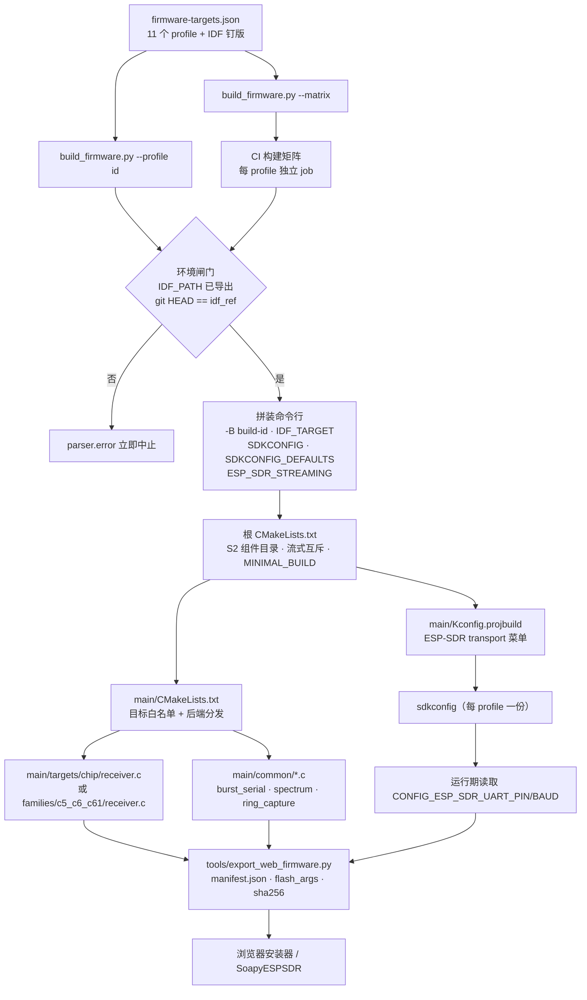

# 快速开始

> 「快速开始」在本项目中不是一条 shell 命令，而是一条**受版本钉定的供应链**：芯片目录（catalog）、ESP-IDF 提交号、CMake 入口、Kconfig 传输参数、构建产物导出格式，这五者必须同时对得上，固件才可能在真实板子上跑起来。

## 1. 项目定位与核心价值

ESP-SDR 把一块普通 ESP32 板子的 Wi-Fi/蓝牙射频前端改造成只收不收的软件定义无线电：固件从芯片自身的接收机里抓取原始 I/Q 采样，再经 USB 或 UART 送往主机，无需任何额外 SDR 硬件。这个能力的实现依赖于一条未经 Espressif 公开文档化的「dump 引擎」调试通路——接收机基带采样可以被 CPU 直接读出。正因为整条链路踩在私有寄存器、私有 PHY 函数与 ROM 符号之上，本仓库的「上手」复杂度并不来自业务逻辑，而来自**兼容性矩阵**：同一份 `main/` 代码要在 ESP32 / C2 / C3 / C5 / C6 / C61 / H2 / S2 / S3 / S31 十颗芯片上产出可烧录镜像，而每颗芯片的 SRAM 银行地址、SRAM 所有者寄存器、dump 控制寄存器、lane 选择寄存器、甚至晶振频率（C2 是 26 MHz）都不相同。

Sources: [README.md](README.md#L1-L22), [docs/how-it-works.md](docs/how-it-works.md#L1-L26), [docs/how-it-works.md](docs/how-it-works.md#L159-L176)

于是「快速开始」被设计成三条彼此正交的路径，每条路径对应一类读者的信任级别。**最短路径**是浏览器安装器：不装工具链、不看源码，直接把官方 CI 产出的镜像写进板子，然后在浏览器 viewer 里连接；它适合"先确认硬件能出数据"的探索者，代价是你对 IDF 版本一无所知。**本地路径**是 `idf.py` 手搓命令行：你自己检出被钉定的 IDF 提交、自己指定 `IDF_TARGET` 与 `SDKCONFIG_DEFAULTS`，对构建参数拥有完全控制权，适合需要在固件里加探针或改后端的开发者——但你必须自己承担"用了错误的 IDF 提交导致 ROM 符号缺失"这类故障。**可复现路径**是 `tools/build_firmware.py`：它按 `firmware-targets.json` 里的 profile 逐项校验 IDF 提交号、拼装与 CI 完全一致的 `idf.py` 参数、关闭所有诊断探针、调用导出器生成 `manifest.json`，适合需要发布或做硬件在环验证的维护者。

Sources: [README.md](README.md#L24-L31), [README.md](README.md#L110-L129), [tools/build_firmware.py](tools/build_firmware.py#L25-L58)

其核心价值可以概括为三点。第一，**单一事实来源**：`firmware-targets.json` 同时是浏览器安装器的目录、CI 构建矩阵的输入、以及本地脚本的 profile 白名单，任何一处改动都会自动传导到其余两处，避免了"文档写着 C61 支持、CI 却漏编"的经典漂移。第二，**封闭的依赖解析**：非流式构建在根 CMake 里显式把 `IDF_COMPONENT_MANAGER` 置 0，改用仓库内固定版本的 `components/esp-dsp` 子模块；只有实验性的 S31 流式固件才打开组件管理器去拉取 `esp_tinyusb`、`cjson`（见 `dependencies.lock` 的 `target: esp32s31`）。第三，**产物即可信凭证**：导出器会拒绝任何打开了诊断探针的构建，并把固件内嵌的 git 修订号与 UTC 时间戳写进 manifest，让"这块板子上跑的到底是哪份源码"成为可验证事实而非口头声明。

Sources: [CMakeLists.txt](CMakeLists.txt#L9-L20), [dependencies.lock](dependencies.lock#L48-L59), [tools/export_web_firmware.py](tools/export_web_firmware.py#L47-L105), [main/CMakeLists.txt](main/CMakeLists.txt#L45-L50)

## 2. 架构设计与模块划分

从"一次构建请求"到"一块能出 I/Q 的板子"，链路上有五个职责清晰、边界严格的层。下图给出完整的拓扑：



**目录层（Catalog）** 由 `firmware-targets.json` 承担，是整条供应链的根节点。它以 `schema_version: 1` 声明格式，`profiles` 数组里每个条目至少携带 `id`、`target`、`label`、`idf_ref`，可选携带 `preview`（需要 `idf.py --preview`，因为目标芯片尚未被 IDF 稳定支持）、`streaming`（走 S31 流式应用）、`sdkconfig`（覆盖默认的 `sdkconfig.defaults.<target>` 命名规则）与 `allow_larger_flash`（允许固定 flash 布局跑在更大容量的芯片上）。当前的 11 个 profile 使用了**三个不同的 IDF 提交号**：绝大多数芯片钉在 `25fe69f9…`，S31 burst 形态钉在 `26dd29…`，S31 流式形态钉在 `c712a0d…`——这本身就是一条重要情报：流式固件所依赖的内部 PHY 接口与 burst 固件不同源，不能共用一个 IDF 检出。`unavailable` 字段当前为空对象，保留了"某个 profile 暂时下架"的表达能力。

Sources: [firmware-targets.json](firmware-targets.json#L1-L96)

**环境层与调度层** 由 `tools/build_firmware.py` 承担。`--matrix` 模式只是把 `profiles` 原样包成 `{"include": …}` 输出给 CI，让 GitHub Actions 的 `matrix` 语法直接消费；`--profile` 模式则是一串严格的前置校验：`IDF_PATH` 必须存在，`git -C $IDF_PATH rev-parse HEAD` 必须**逐字符等于** profile 的 `idf_ref`，输出目录必须不存在（防止两次构建被静默合并），`--jobs` 必须为正。通过校验后，它把 `preview` 映射为 `--preview` 参数、把 `streaming` 映射为 `-DESP_SDR_STREAMING=ON`，并在非流式场景下**显式把六个诊断开关全部关成 OFF**，确保发布镜像里不可能残留探针代码。

Sources: [tools/build_firmware.py](tools/build_firmware.py#L25-L58)

**CMake 入口层** 是一道刻意做窄的闸门。根 `CMakeLists.txt` 只做四件事：为 ESP32-S2 追加一个打过补丁的 USB CDC 控制台组件目录（S2 使用 ROM 里的 USB-OTG CDC 驱动，需要针对性兼容修复）；校验 `ESP_SDR_STREAMING` 与目标芯片的一致性，非 S31 却打开流式开关会直接 `FATAL_ERROR`；在非流式模式下关闭组件管理器；以 `MINIMAL_BUILD ON` 启动工程，并把流式开关作为构建属性传给子目录。`main/CMakeLists.txt` 则负责真正的分发：流式构建在这里提前 `return`，只注册一个 `streaming` 组件；否则对 `IDF_TARGET` 做白名单校验（十颗芯片，不在名单里就报出完整支持列表），再按芯片挑选 receiver 源文件、汇编内核、链接片段、`--wrap` 重定向符号与 SRAM 守卫链接脚本。

Sources: [CMakeLists.txt](CMakeLists.txt#L1-L21), [main/CMakeLists.txt](main/CMakeLists.txt#L1-L33), [main/CMakeLists.txt](main/CMakeLists.txt#L42-L116)

**传输配置层** 由 `main/Kconfig.projbuild` 独占，它把"用哪根引脚、跑多快"从代码里彻底剥离。整个菜单叫 `ESP-SDR transport`，含四个符号：`ESP_SDR_UART_ENABLED`（burst UART0 传输开关）、`ESP_SDR_UART_BAUD`（波特率）、`ESP_SDR_UART_TX_PIN`、`ESP_SDR_UART_RX_PIN`。这里有一个非常漂亮的设计细节：`ESP_SDR_UART_ENABLED` 的提示串被写成 `if !IDF_TARGET_ESP32 && !IDF_TARGET_ESP32C2`，意味着在**没有原生 USB 的 ESP32 与 C2 上该选项没有可见提示、被强制取默认值 y**，用户不可能把自己锁死在"既无 USB 又无 UART"的不可达状态；其余芯片则可以在 `menuconfig` 里关掉它，把 UART 引脚释放给应用。引脚的取值范围也按芯片能力收紧：C2 是 0–20、H2 是 0–27、S31 是 0–63（其 GPIO 矩阵可达 62/63），其余为 0–48。

Sources: [main/Kconfig.projbuild](main/Kconfig.projbuild#L1-L57)

**运行期引导层** 在每颗芯片的 `receiver.c` 的 `app_main()` 里，顺序高度一致：初始化 NVS（并处理版本不匹配需擦除的情况）、装好 USB Serial/JTAG 驱动、建立默认事件循环、以 `WIFI_MODE_NULL` + `promiscuous` + 固定信道初始化射频、调用 `prepare_rx()` 完成调谐与 PHY 上电、**卸载** USB 驱动、初始化 burst 传输层、最后进入 `burst_serial_serve()` 的死循环。

Sources: [main/targets/esp32c3/receiver.c](main/targets/esp32c3/receiver.c#L207-L233), [main/targets/esp32s3/receiver.c](main/targets/esp32s3/receiver.c#L513-L540)


这条引导序列里最反直觉的一步是"先装 USB 驱动、再用、最后卸载"。原因在于 `prepare_rx()` 期间若发生断言或致命错误，需要有一条能让开发者看到日志的通道；而进入稳态后，传输层为了拿到确定性的时延上界，绕开 IDF 驱动，直接操作 `usb_serial_jtag_ll_*` 寄存器级 FIFO（每次最多 64 字节），并自行实现带绝对截止时间的发送循环。S2 走的是另一条路：`platform/esp32s2/esp_usb_cdc_rom_console/` 提供 `esp_usb_console_write_direct`，按 256 字节分块以获得翻倍吞吐。

Sources: [main/common/burst_serial.c](main/common/burst_serial.c#L173-L244), [main/common/burst_serial.c](main/common/burst_serial.c#L76-L99), [CMakeLists.txt](CMakeLists.txt#L3-L7)

## 3. 技术栈与核心工作流

| 层次 | 技术选型 | 在快速开始中的具体体现 |
| --- | --- | --- |
| 构建系统 | CMake ≥ 3.16 + ESP-IDF `project.cmake` | 根 `CMakeLists.txt` 只做闸门与属性注入，真正的组件注册在 `main/CMakeLists.txt` |
| SDK 版本控制 | 每个 profile 钉定一个 IDF commit | `idf_ref` 字段 + `build_firmware.py` 的 `git rev-parse` 校验 |
| 配置系统 | Kconfig（`main/Kconfig.projbuild`） | UART 开关、波特率、TX/RX 引脚；`main/sdkconfig.rename` 保留 S3 旧符号兼容 |
| 运行时 | FreeRTOS（单/双核按芯片选择）+ esp_timer | `CONFIG_FREERTOS_HZ=1000`、S3/ESP32/S2 单核、S31 320 MHz |
| 传输 | USB Serial/JTAG LL、USB-OTG CDC、UART0 8N1 | 默认 2 Mbaud，无硬件流控，运行期可在 1/2 Mbaud 间切换 |
| 产物交付 | `manifest.json` + `flash_args` + sha256/md5 | 供浏览器安装器（esp-web-sdr）消费 |
| 交付形态 | 单一 `factory` 应用分区 | `partitions.csv`（4 MiB 槽位）与 `partitions-stream.csv`（3 MiB 槽位） |

Sources: [CMakeLists.txt](CMakeLists.txt#L18-L21), [main/CMakeLists.txt](main/CMakeLists.txt#L68-L83), [sdkconfig.defaults.esp32s3](sdkconfig.defaults.esp32s3#L1-L28), [partitions.csv](partitions.csv#L1-L4), [partitions-stream.csv](partitions-stream.csv#L1-L4)

### 3.1 主链路：从选档到第一条命令

| 阶段 | 承担者 | 关键文件 | 典型失败症状 |
| --- | --- | --- | --- |
| ① 选档 | 开发者 / CI | `firmware-targets.json` | 编了 C61 却刷到 C6，串口静默 |
| ② 钉环境 | `install.sh` + `export.sh`（IDF 自带）+ 脚本校验 | `tools/build_firmware.py` | `Profile requires ESP-IDF …, found …` |
| ③ 合成配置 | Kconfig + `sdkconfig.defaults.<target>` | `main/Kconfig.projbuild`、`sdkconfig.defaults*` | 浏览器波特率与固件不匹配，出现乱码/超时 |
| ④ 构建分发 | 两层 CMake + 芯片后端 | 根 `CMakeLists.txt`、`main/CMakeLists.txt` | `No ESP-SDR RF backend for <target>` |
| ⑤ 烧录 | `idf.py flash` 或浏览器安装器 | manifest 的 `parts[].offset` | 板子被 UART 桥的 DTR/RTS 复位 |
| ⑥ 建链 | `SYNC` / `RELEASE` / `INFO` | `burst_serial.c`、`burst_commands.h` | `ERR busy`（另一端口持有租约） |
| ⑦ 取数 | `CAP16` / `CAP20` / `SPEC` | `burst_commands.h` | CRC32 校验失败、`ERR capture_incomplete` |

Sources: [README.md](README.md#L110-L129), [tools/build_firmware.py](tools/build_firmware.py#L33-L55), [main/CMakeLists.txt](main/CMakeLists.txt#L7-L9), [main/common/burst_serial.c](main/common/burst_serial.c#L250-L280), [main/common/burst_commands.h](main/common/burst_commands.h#L14-L63)

### 3.2 profile 速查：11 种固件变体

| profile `id` | `target` | 默认 sdkconfig | 控制台 | `preview` | 说明 |
| --- | --- | --- | --- | --- | --- |
| `esp32` | esp32 | `sdkconfig.defaults.esp32` | UART0 | 否 | 无线 USB，必须走 UART 桥 |
| `esp32c2` | esp32c2 | `sdkconfig.defaults.esp32c2` | UART0 | 否 | 26 MHz 晶振，波特率上限 2.5 Mbaud |
| `esp32c3` | esp32c3 | `sdkconfig.defaults.esp32c3` | USB Serial/JTAG | 否 | 160 MHz，最简单的参考后端 |
| `esp32c5` | esp32c5 | `sdkconfig.defaults.esp32c5` | USB Serial/JTAG | 否 | 支持 5 GHz 接收 |
| `esp32c61` | esp32c61 | `sdkconfig.defaults.esp32c61` | UART0 | 否 | 芯片家族共享 `families/c5_c6_c61` |
| `esp32s3` | esp32s3 | `sdkconfig.defaults.esp32s3` | USB Serial/JTAG | 否 | 双核 + 汇编 FFT + 连续捕获 |
| `esp32s31` | esp32s31 | `sdkconfig.defaults.esp32s31` | UART0 | **是** | 320 MHz，burst 形态（浏览器 viewer） |
| `esp32c6` | esp32c6 | `sdkconfig.defaults.esp32c6` | UART0 | 否 | 关闭 WDT，支持 256 点连续频谱 |
| `esp32h2` | esp32h2 | `sdkconfig.defaults.esp32h2` | USB Serial/JTAG | 否 | 走蓝牙射频，96 MHz |
| `esp32s2` | esp32s2 | `sdkconfig.defaults.esp32s2` | USB-OTG CDC | 否 | 4 MB flash，需打补丁的 ROM CDC 组件 |
| `esp32s31-stream` | esp32s31 | `sdkconfig.defaults.esp32s31-stream` | UART0 | **是** | `streaming: true`，16 MB flash + PSRAM + 以太网 |

Sources: [firmware-targets.json](firmware-targets.json#L3-L95), [sdkconfig.defaults.esp32c2](sdkconfig.defaults.esp32c2#L1-L25), [sdkconfig.defaults.esp32s2](sdkconfig.defaults.esp32s2#L1-L30), [sdkconfig.defaults.esp32s31-stream](sdkconfig.defaults.esp32s31-stream#L1-L45)

### 3.3 传输参数：Kconfig 的默认约定

`main/Kconfig.projbuild` 为每颗芯片刻出了一组"能开箱即用"的默认值，理解这张表就理解了一半的接线问题：

| `IDF_TARGET` | TX GPIO | RX GPIO | 波特率范围 | 备注 |
| --- | --- | --- | --- | --- |
| ESP32 | 1 | 3 | 115200–3000000 | 传统 UART0 引脚 |
| ESP32-C2 | 20 | 19 | 115200–**2500000** | 引脚范围仅 0–20 |
| ESP32-C3 | 21 | 20 | 115200–3000000 | 默认值 |
| ESP32-C6 | 16 | 17 | 115200–3000000 | 默认值 |
| ESP32-C5 | 11 | 12 | 115200–3000000 | 与 C61 TX 同脚 |
| ESP32-C61 | 11 | 10 | 115200–3000000 | |
| ESP32-H2 | 24 | 23 | 115200–3000000 | 引脚范围 0–27 |
| ESP32-S2 | 43 | 44 | 115200–3000000 | 与 S3 同脚 |
| ESP32-S3 | 43 | 44 | 115200–3000000 | 与 S2 同脚 |
| ESP32-S31 | 58 | 59 | 115200–3000000 | 引脚范围可到 0–63 |

Sources: [main/Kconfig.projbuild](main/Kconfig.projbuild#L12-L55)

默认波特率为 **2000000**，8N1、无硬件流控。协议层只允许在 `1000000` 与 `2000000` 之间切换（`BAUD` 命令），因此"配置里的 `range 115200 3000000`"是**编译期允许的取值区间**，而运行期可切换的集合要窄得多——这是一个容易踩的坑：把 `CONFIG_ESP_SDR_UART_BAUD` 调成 3 Mbaud 后，浏览器端的 `Switch to 1 Mbaud` 回退开关就再也回不来了。此外，波特率切换是**会话级**的：见 `burst_serial.c` 中的实现，它先把 ACK 以旧速率完整发出、等待 `uart_wait_tx_done`、才真正改速率并清空输入缓冲；任何复位都会回到 Kconfig 里配置的默认值。

Sources: [main/common/burst_serial.c](main/common/burst_serial.c#L37-L69), [README.md](README.md#L92-L108)

## 4. 典型代码示例

### 4.1 最小可用的本地构建

```sh
idf.py -B build-s3 -DIDF_TARGET=esp32s3 \
  -DSDKCONFIG=build-s3/sdkconfig \
  -DSDKCONFIG_DEFAULTS=sdkconfig.defaults.esp32s3 build
idf.py -B build-s3 -p /dev/ttyACM0 flash
```

三个参数缺一不可：`-B` 让每个芯片拥有独立构建目录（避免不同目标共享陈旧对象文件）；`-DSDKCONFIG` 把生成的 sdkconfig 放进构建目录而非仓库根（保持工作区干净）；`-DSDKCONFIG_DEFAULTS` 显式指向芯片默认值文件，否则 `sdkconfig.defaults` 里的"请显式 set-target"注释就成了空话。S31 相关构建还需追加 `--preview`。

Sources: [README.md](README.md#L116-L127), [sdkconfig.defaults](sdkconfig.defaults#L1-L3), [docs/s31-streaming.md](docs/s31-streaming.md#L17-L27)

### 4.2 分层闸门：`main/CMakeLists.txt` 的目标分发

```cmake
idf_build_get_property(streaming ESP_SDR_STREAMING)
if(streaming)
    idf_component_register(REQUIRES streaming)
    return()
endif()
set(esp_sdr_supported_targets esp32 esp32c2 esp32c3 esp32c5 esp32c6 esp32c61 esp32h2 esp32s2 esp32s3 esp32s31)
if(NOT IDF_TARGET IN_LIST esp_sdr_supported_targets)
    message(FATAL_ERROR "No ESP-SDR RF backend for ${IDF_TARGET}. Supported targets: ${esp_sdr_supported_targets}")
endif()

set(target_dir "targets/${IDF_TARGET}")
```

这段只有十余行，却定义了三种构建形态：[流式应用]、[十颗芯片的 burst 后端]、[其余芯片的硬失败]。失败信息里带上完整支持列表，把"我该用什么芯片"这个问题的答案直接印在编译错误里。

Sources: [main/CMakeLists.txt](main/CMakeLists.txt#L1-L18)

### 4.3 运行期自检：`app_main()` 的七步

```c
void app_main(void) {
    esp_log_level_set("*", ESP_LOG_NONE);
    esp_err_t e = nvs_flash_init();
    if (e == ESP_ERR_NVS_NO_FREE_PAGES || e == ESP_ERR_NVS_NEW_VERSION_FOUND) {
        ESP_ERROR_CHECK(nvs_flash_erase());
        e = nvs_flash_init();
    }
    ESP_ERROR_CHECK(e);
    usb_serial_jtag_driver_config_t usb = {.tx_buffer_size = 8192, .rx_buffer_size = 8192};
    ESP_ERROR_CHECK(usb_serial_jtag_driver_install(&usb));
    /* …事件循环、Wi-Fi 初始化、promiscuous、固定信道… */
    prepare_rx();
    (void)usb_serial_jtag_wait_tx_done(pdMS_TO_TICKS(100));
    ESP_ERROR_CHECK(usb_serial_jtag_driver_uninstall());
    burst_serial_init();
    burst_serial_serve(handle_command);
}
```

`esp_log_level_set("*", ESP_LOG_NONE)` 出现了两次——开头是为了让后续初始化不污染命令行协议（任何一行日志都会被主机当作命令回复），结尾再次调用是因为 Wi-Fi 初始化期间可能有子系统把日志级别改回去。"先 flush 再 uninstall"是给 UART 桥用户的保险：主机若走 UART，USB 那头可能根本没插线。

Sources: [main/targets/esp32c3/receiver.c](main/targets/esp32c3/receiver.c#L207-L233)

### 4.4 首条会话的正确写法

```text
SYNC 1720000000      →  SYNC 1720000000
INFO                 →  C3SDR 6 burst 16380
CAPS                 →  CAPS VERSION GPIO … IQ8
FREQ 2442            →  OK
CAP16 4096 0         →  DATA 4096 <crc32> <microseconds> + 二进制
RELEASE              →  OK
```

打开某些串口会复位板子（UART 桥上 DTR/RTS 接了 EN/BOOT、S2 的 USB-OTG 口、S31 的 USB Serial/JTAG），因此客户端必须先发 `SYNC` 并丢弃回显 nonce 之前的一切字节。租约机制保证同一时刻只有一个客户端控制射频：先到者持有，另一接口收到 `ERR busy`，直到 `RELEASE` 或静默 5 秒。此外 `CAP16` 发送的是 `(I, −Q)`，解码时需对第二分量取反——这是新手最容易忽略的一步。

Sources: [docs/protocol.md](docs/protocol.md#L8-L27), [docs/protocol.md](docs/protocol.md#L42-L73), [main/common/burst_serial.c](main/common/burst_serial.c#L250-L280)

### 4.5 一条命令拿到的版本凭证

```sh
python -m esptool --chip esp32s3 --port PORT write-flash @flash_args
```

`flash_args` 与 `manifest.json` 由 `export_web_firmware.py` 生成，其中 `parts[]` 记录每段镜像的偏移、长度、sha256 与 md5；manifest 还会从固件二进制里**反向解析**出 `ESP-SDR-VERSION:{…}` 这条内嵌 JSON，校验其修订号格式（40 位十六进制 + 可选 `-dirty`）、UTC 时间戳格式、以及 profile 是否与导出 ID 一致。导入时若发现任何探针宏为 ON，直接拒绝导出。

Sources: [tools/export_web_firmware.py](tools/export_web_firmware.py#L87-L121), [tools/generate_version.py](tools/generate_version.py#L9-L32)

## 5. 学习与探索建议

| 读者 | 建议下一步 | 具体入口 | 为什么 |
| --- | --- | --- | --- |
| 只想让板子出数据 | 浏览器安装器 → viewer | [README.md](README.md#L24-L31)、`tools/export_web_firmware.py` | 绕开工具链，先验证硬件与供电 |
| 首次本地构建 | 按 profile 逐项对齐参数 | [构建矩阵与固件导出流水线](27-build-and-release.md)、`firmware-targets.json` | 把"IDF 提交号 → idf.py 参数 → 产物"串成闭环 |
| 搞不清引脚/波特率 | 读 Kconfig 与传输层 | [串口传输：USB/UART 复用与租约](19-serial-transport-layer.md)、`main/Kconfig.projbuild` | 连接失败 90% 出在这一层 |
| 想改协议或加命令 | 从分发点切入 | [命令协议：分发与快照封包](20-command-protocol.md)、`main/common/burst_commands.h` | 所有芯片共享同一份命令实现 |
| 要移植到新芯片 | 先看分发逻辑再抄后端 | [多芯片后端移植策略](23-chip-backend-porting.md)、`main/CMakeLists.txt` | 新目标必须同时进白名单、CMake 分支与 catalog |
| 需要连续采样 | 走 S31 流式或 S3 抽取 | [S31 采集：PARLIO 环形 DMA](16-s31-parlio-capture.md)、[S3 连续 I/Q 抽取流水线](15-s3-iq-decimation.md) | burst 快照天然有间隙 |
| 上线前验证 | 硬件在环工具 | [主机测试与硬件在环验证](28-test-and-validation.md)、`tools/check_spectrum.py` | 一次性校验所有频谱 profile 的 CRC 与结束报告 |

Sources: [README.md](README.md#L70-L88), [README.md](README.md#L131-L138), [main/CMakeLists.txt](main/CMakeLists.txt#L6-L9), [main/sdkconfig.rename](main/sdkconfig.rename#L1-L5)

## 🧭 源码导航 (Codebase Map)

- **供应链根节点**：`firmware-targets.json` —— profile、目标芯片、IDF 钉版、flash 策略的唯一事实来源。
- **构建闸门**：根 `CMakeLists.txt`（S2 组件目录 / 流式互斥 / `MINIMAL_BUILD` / 组件管理器开关）、`main/CMakeLists.txt`（目标白名单、后端分发、`--wrap` 重定向、SRAM 守卫链接）。
- **传输配置**：`main/Kconfig.projbuild`（`ESP-SDR transport` 菜单）、`main/sdkconfig.rename`（S3 旧符号迁移）、`sdkconfig.defaults` + `sdkconfig.defaults.<target>`。
- **运行期主入口**：`main/targets/<chip>/receiver.c` 的 `app_main()`；C5/C6/C61 走 `main/families/c5_c6_c61/receiver.c`；S31 流式走 `main/targets/esp32s31/streaming/receiver.c`。
- **公共设施**：`main/common/burst_serial.c`（USB/UART 复用 + 租约）、`main/common/burst_commands.h`（共享命令集）、`main/common/spectrum.c`、`main/common/ring_capture.c`。
- **交付工具链**：`tools/build_firmware.py`（矩阵/单档构建）、`tools/export_web_firmware.py`（manifest 导出）、`tools/generate_version.py`（版本记录注入）、`tools/check_spectrum.py`（硬件在环校验）。
