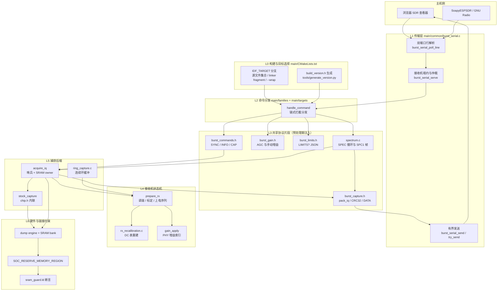
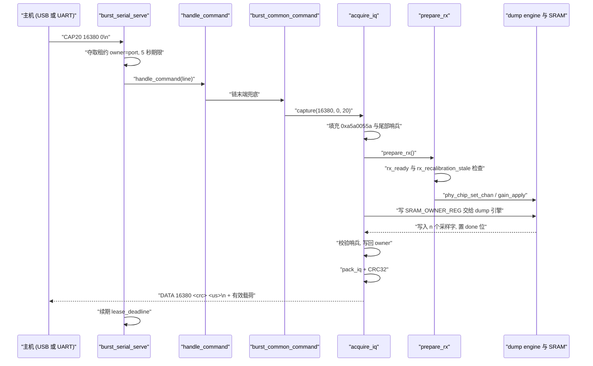

# 核心架构设计

ESP-SDR 的固件侧不是一个"通用 SDR 应用框架"，而是一台**把 Wi-Fi/蓝牙接收机改造成只读 I/Q 采样器的寄存器级适配器**。它站在一个非常特殊的边界上：一边是 Espressif 未公开的 PHY 静态库与其 dump（数据倾倒）引擎，另一边是浏览器/SoapyESPSDR 这类只认识 ASCII 行协议的主机。核心架构的全部设计张力，都来自如何用尽量少的抽象把这两人粘起来，同时保证在 ESP32 全家族（Xtensa 与 RISC-V、有无原生 USB、有无连续采集、6 种不同 SRAM owner 位布局）上行为一致。

## 项目定位与核心价值

ESP32 系列芯片的接收链路原本是一条封闭流水线：天线 → LNA/混频 → 滤波器 → ADC → 固定功能 Wi-Fi 调制解调器。ADC 之后的基带样本对应用层是不可见的。项目发现并利用了一条未公开的调试通路（业界称之为 dump engine），它可以把接收机基带样本直接写进一块普通片上 SRAM，每个样本一个 32 位字。于是 CPU 只需像读普通数组一样读那块内存，就能拿到 Wi-Fi 调制器"看不见信号内容"之前的原始 I/Q。这使一块售价几元的 ESP32 开发板具备了频谱观测与窄带 SDR 接收能力，代价是需要逐芯片、逐 PHY 库版本去校准寄存器语义。

在该机制之上，固件的核心价值体现在三层"工程化收敛"。第一层是**协议收敛**：所有芯片、所有采集模式（单快照 `CAP/CAP16/CAP20`、连续环缓冲 `RINGTEST`、片上频谱 `SPEC`）都走同一套以 `\n` 结尾的 ASCII 行协议，一条命令恰好一条文本回应，错误一律以 `ERR` 开头，二进制载荷用 `DATA <n> <crc32> <us>` 头部宣告并附带 CRC32 校验。第二层是**能力收敛**：芯片间差异被压缩成 `CAPS` 的 flag 串与 `LIMITS?` 的 JSON 数值域，主机不需要为目标芯片维护分支表。第三层是**失真可见化**：样本缓冲区在采集前被哨兵值填充，采集后逐字校验，任何被 dump 引擎漏写的位置都会变成显式的 `ERR capture_timeout`，而不是静默返回脏数据。

沿这条思路，整个固件刻意保持"无堆、无动态注册、无虚函数"的形态。共享逻辑几乎全部以**片段式头文件**（`burst_commands.h`、`burst_capture.h`、`burst_gain.h`、`burst_limits.h`）的形式存在：它们要求 include 之前先定义 `BURST_ID`、`IQ_WORDS`、`IQ_BUFFER`、`reply()`、`capture()` 等"注入点"，从而在不引入函数指针表与运行时间接跳转的前提下复用代码。这是整个代码库最独特、也最需要先理解的设计决定。

> 设计理念：把芯片差异推到**链接期与预处理期**，而不是运行时。目标芯片的差异在 `CMakeLists.txt` 的 `IDF_TARGET` 分支里被解析为不同的源文件集合、不同的 `--wrap` 选项与不同的 `chip.h`，编出来的二进制里不存在任何"这个芯片不支持"的判断分支。

Sources: [main/CMakeLists.txt](main/CMakeLists.txt#L1-L117), [docs/how-it-works.md](docs/how-it-works.md#L1-L102), [docs/protocol.md](docs/protocol.md#L1-L70), [main/common/burst_commands.h](main/common/burst_commands.h#L1-L13), [main/common/burst_capture.h](main/common/burst_capture.h#L1-L9)

## 架构设计与模块划分

从编译单元的角度看，一次固件构建最终只产出一个 IDF 组件——`main`。它由"每目标恰好一个 `receiver.c`（提供 `app_main`）"加上若干 `common/*.c` 与少许可选 `.S` 汇编组成。下图给出分层结构与调用方向：



### L0：以 `IDF_TARGET` 为轴的构建期目标矩阵

`main/CMakeLists.txt` 是整套架构的"事实来源"（single source of truth）。它先做一次白名单校验（`esp32/c2/c3/c5/c6/c61/h2/s2/s3/s31`），不在名单内的目标直接 `FATAL_ERROR`，避免产生"能编译但不能工作"的固件。随后它在基线源集合 `common/burst_serial.c`、`common/burst_gpio.c`、`common/burst_version.c`、`common/spectrum_stats.c`、`common/rx_recalibration.c`、`common/rx_calibration_state.c` 之上按目标追加模块：C2 追加 `heap_guard.c`（小内存目标的堆保护），C6/C61 追加 `ring_capture.c`（连续环缓冲），S3/C3 追加 `rx_gain_verify.c`（增益回读校验），C61/S31 追加 `burst_gain_table.c`。

最关键的一处重绑定发生在 C5/C6/C61：`set(receiver "families/c5_c6_c61/receiver.c")`。这三个芯片的 PHY 代际一致（同一套 `0x600a9xxx` dump 寄存器、同一 `SRAM_OWNER_REG 0x60095004`、同一 `IQ_WORDS 16380`），因此共享一份 `receiver.c`，仅通过 `target_includes` 里的 `targets/<chip>/chip.h` 提供差异。`esp32s31` 更进一步，构建目录被改写为 `${target_dir}/burst`，为同一芯片的第二套固件形态（streaming）让位——`ESP_SDR_STREAMING` 打开时，顶层构建甚至直接注册 `main/targets/esp32s31/streaming` 作为替代组件并提前返回。

`--wrap` 链接选项是这一层另一个高密度设计点。`rx_calibration_link.cmake` 按芯片挑选"DC 测量入口符号"（C5 用 `phy_set_rx_gain_cal_dc`、C61/S31 用 `phy_set_rx_gain_cal_dc_new`、C6 用 `set_rx_gain_cal_dc_new`），`main/CMakeLists.txt` 再按芯片挑选"信道设置入口"（C5 用 `phy_chip_set_chan_ana`、C61/S31 用 `phy_set_channel_rfpll_freq`、其余用 `chip_v7_set_chan_ana`）与增益写入入口（C61/S31 `phy_write_gain_mem`、H2 `write_gain_mem`、S3/C3 `set_rx_gain_table`）。所有这些都服务于同一目的：**在不修改厂商静态库的前提下，劫持 PHY 内部的标定调用点，把"参考信道标定"改写成"用户请求频率上的标定"**。ESP32 与 S2 被显式排除在 `--wrap` 之外，因为这两个 Xtensa 归档把 DC 调用解析在库内部，只能改用 DC 表内容比对来判失效。

Sources: [main/CMakeLists.txt](main/CMakeLists.txt#L6-L117), [main/common/rx_calibration_link.cmake](main/common/rx_calibration_link.cmake#L1-L17), [CMakeLists.txt](CMakeLists.txt#L9-L22), [main/common/rx_calibration_state.c](main/common/rx_calibration_state.c#L12-L49), [firmware-targets.json](firmware-targets.json#L1-L60)

### L1：双端口传输层与"租约"模型

`burst_serial.c` 承担了整个系统的 I/O 边界：它同时管理原生 USB Serial/JTAG 与 UART0，并对上层屏蔽两者差异。其状态是一个两元素数组 `input[BURST_SERIAL_COUNT]`，每个端口持有独立的 `line[128]`、`used`、`overflow`、`last_byte`。解析器采用**每端口独立缓冲 + 轮转轮询**：`burst_serial_poll_line` 从 `next_port` 开始遍历，单次最多读 `COMMAND_SIZE` 个字节，从而保证一个只发了一半的恶意/异常命令无法饿死另一个端口；端口静默超过 3 秒即丢弃半行（`now - last_byte > 3000000`）。

租约（lease）模型是此层的核心并发原语。`burst_serial_serve` 维护 `owner` 与 `lease_deadline`：某端口的第一条完整命令夺取所有权，此后另一端口的任何命令都会收到 `ERR busy`；`RELEASE` 主动交还，或 5 秒静默后自动过期。这条规则让"单接收机、双入口"的物理现实变得确定性可推理——主机可以放心地发完 `CAP20` 之后安静地读完一整段二进制，而不必担心 USB 侧的命令插进来抢走接收机。协议文档把这条约束写成"一条命令恰好一次回应，读完整之后再发下一条"，其实现基础就在这里。

发送侧有两个语义不同的函数：`burst_serial_send` 是阻塞式且**带 deadline** 的（UART 用 `2s + size*10/baud`，USB 固定 3s，8N1 每字节 10 个线路位），失败即返回 false 让上层回 `ERR`；`burst_serial_try_send` 则只写"现在能写进去的部分"并立即返回字节数，供 `spectrum.c` 的 `pump_spectrum` 做无阻塞推流。USB 路径还有一个细节：当发送长度为 64 的整数倍时，额外等待 FIFO 可写并再 flush 一次，以避免主机端把短包误判为传输结束。UART 的波特率命令 `BAUD`、`BAUD?` 在这一层被直接消费——`burst_serial_poll_line` 内部调用 `baud_command` 并在返回 `OK BAUD <rate>` 之后等待 TX 完成才切换波特率，因此 ACK 一定以旧速率发出。

Sources: [main/common/burst_serial.c](main/common/burst_serial.c#L26-L69), [main/common/burst_serial.c](main/common/burst_serial.c#L135-L171), [main/common/burst_serial.c](main/common/burst_serial.c#L173-L244), [main/common/burst_serial.c](main/common/burst_serial.c#L246-L280), [main/common/burst_serial.h](main/common/burst_serial.h#L1-L26)

### L2：链式命令分发层

`handle_command` 是每份 `receiver.c` 的"路由表"，但它的形态不是查表，而是一串有序的短路判断。以 C5/C6/C61 共享实现为例，顺序为：`burst_version_command` → `burst_gpio_command` → 可选 `ring_probe_command` → 可选 `ring_test` → `spectrum_command` → 可选 `filter_probe_command` → `limits_command` → `gain_command` → `burst_common_command` → 本地 `CAPS`/`BANDWIDTH`/`ALPF`/`LPF`/诊断探针 → 兜底 `ERR command`。

这个顺序不是随意的：**只读、无副作用的查询排在最前**（版本、GPIO 状态），随后是可能长跑的采集入口（`ring_test`、`spectrum_command`），再往后是修改接收机模拟状态的控制命令（增益、滤波、带宽），最后才是通用协议与本地扩展。每个 `*_command` 函数遵循统一契约：命中即返回 `true` 并自行承担回包责任，未命中返回 `false` 让链继续。这是 C 语言里实现"责任链模式"的最廉价形式——零分派开销、每个 handler 都能被内联，且新增一个能力只需在链上插一行。

Sources: [main/families/c5_c6_c61/receiver.c](main/families/c5_c6_c61/receiver.c#L310-L413), [main/common/burst_limits.h](main/common/burst_limits.h#L5-L42), [main/common/burst_gain.h](main/common/burst_gain.h#L94-L126), [main/common/burst_version.c](main/common/burst_version.c#L6-L17)

### L3：预处理期注入的共享协议片段

`burst_commands.h` 是"片段式头文件"模式的范式。文件头注释明确列出所有前置条件：必须在定义 `BURST_ID`、`BURST_MAX_RATE`、`IQ_WORDS` 之后 include，并且必须已提供 `frequency_mhz`、`rx_ready`、`frequency_valid()`、`prepare_rx()`、`reply()`、`capture()` 这些符号。于是这个头文件里的 `burst_common_command` 是一个 `static` 内联函数，直接操作调用者的局部状态——没有上下文结构体、没有回调、没有间接跳转。

有趣的是 `CAP16` 的实现方式：既然 `CAP16` 与 `CAP20` 共享同一份参数解析，代码在进入解析前先把行内前 5 个字节 `memcpy` 改成 `"CAP20"`，并用 `iq8 = true` 记住原始意图，最后按 `iq8 ? 16 : 20` 传出格式。这种"就地改写命令行"的技巧在别处也出现（`BANDWIDTH`、`ALPF` 的 `sscanf` 用尾部 `%c` 检测多余参数，从而严格拒绝 `CAP20 1024 0 extra`）。同理，`RXRUN n rate repeats format` 通过在循环里反复 `capture()` 并 `vTaskDelay(1)`，把"多次独立快照"显式地暴露成 RF 间隙，避免让主机误以为拿到了无缝流。

`burst_capture.h` 负责最后的字节级编码，其设计约束写在注释里——"packers work in place: each output format is no larger than the 32-bit words it replaces"。`pack_iq` 把每两个 20 位样本压成 5 字节（`IQ10/CAP20`），`pack_iq8` 把每个 32 位字的高 8 位 I 与高 8 位 Q 拆成 2 字节（`CAP16`），`wire_size` 则给出三种格式的线上长度。压完立即算 `esp_rom_crc32_le` 并输出 `DATA <n> <crc32> <us>` 头。原位压缩的意义在 SRAM 紧张的目标上非常实际：16,380 个字的缓冲区压成 20 位格式只占约 40 KiB，无需第二块缓冲。

Sources: [main/common/burst_commands.h](main/common/burst_commands.h#L1-L63), [main/common/burst_capture.h](main/common/burst_capture.h#L10-L56)

### L4：接收机状态机与"陈旧标定"检测

`prepare_rx` 是固件中最像"状态机"的函数，它用 `rx_ready` 这一个 bool 加上 `calibrated_mhz` 静态缓存来表达"接收机是否已经处于可采样态"。快速路径是 `if (rx_ready && !rx_recalibration_stale()) return;`——注意这里必须同时检查 `rx_recalibration_stale()`，因为 PHY 后台标定任务可能在两次采集之间悄悄替换了 DC 表，此时即使频率没变，增益表也必须重建。慢速路径依次执行：`rx_recalibrate(frequency_mhz)`（若频率变化或表已陈旧）→ `phy_chip_set_chan()`（C6 由 `chip.h` 重定义成 `c6_set_chan`，先按标准 Wi-Fi 信道标定再直接写 PLL）→ `phy_stop_tx_tone(1)` → `phy_pbus_workmode()` → `phy_pbus_xpd_tx_off()` → `phy_pbus_xpd_rx_on(1)` → `phy_set_rxclk_en(1)` → 可选 `phy_rx_filter_mode()` → `gain_apply()`。C61 在进入前还要回滚它自己保存的增益镜像寄存器（`0x600a7094`/`0x600a713c`），C6 则在最后调用 `rx_lo_select()` 并在 3 ms 延时后放行——这段时间留给了备用 LO 的选择稳定。

`rx_calibration_state.c` 提供了陈旧检测的两种实现策略：Xtensa 的 ESP32/S2 没有 `--wrap` 可用，于是持 PHY 锁并 `memcmp` 导出的 DC 表内容；其余目标则用一个 `atomic_uint dc_generation` 计数器，避免读表时的竞态，也天然支持 S3 的双核接收路径。`rx_recalibration_locked` 的注释点出了最关键的一条纪律：**重调谐必须只做"接收"路径的 DC 测量，绝不能触发环路回环的 IQ 标定**，因为后者会通过天线发射一个音调。实现上它们通过清除 `phy_param` 里的状态位（`*flags &= ~0x280u`）保留启动时的 IQ 系数，只让 DC/表缓存过期。

增益子系统（`burst_gain.h`）遵循同样的"芯片差异集中化"思路：`gain_max()` 从 `BURST_GAIN_REG` 的 bit 8..14 读出 PHY 标定出的最高可用索引，并对每个目标加一条经验上限（H2 截到 56，因为更高会因自生 DC 而饱和；S3/S2 上限 82；其余 80），超出即返回 0 以"绝不暴露未标定槽位"。`gain_apply()` 则按目标选择 `force_rx_gain(manual, code, 0)`、H2 的特殊 `force_rx_gain + bt_rx_force(1)` 序列、C5 的 `rx_gain_force()` 包装，或 S3/C3 的 `rx_gain_verified_apply()`（应用后回读校验，失败则让 `gain_command` 回 `ERR gain`）。

Sources: [main/families/c5_c6_c61/receiver.c](main/families/c5_c6_c61/receiver.c#L88-L122), [main/common/rx_recalibration.h](main/common/rx_recalibration.h#L1-L18), [main/common/rx_calibration_state.c](main/common/rx_calibration_state.c#L1-L54), [main/common/burst_gain.h](main/common/burst_gain.h#L22-L93), [main/common/rx_recalibration.c](main/common/rx_recalibration.c#L1-L80)

### L5：捕获后端——哨兵校验与 SRAM owner 交接

真正的采样动作被封装在 `acquire_iq` 里，它定义了四条不变量。其一，**sentinel 前填充**：把 `IQ_BUFFER[0..n)` 全写成 `0xa5a0055a`，再把尾部 4 个字写成 `0x5a5aa5a5 ^ j`；采集完成后逐字检查，仍有标记的样本说明 dump 引擎没写完（`ERR capture_timeout`），尾部 4 字被改写说明写超出请求长度（`ERR capture_overrun`）。其二，**SRAM owner 交接**：读原 owner → 置 dump 引擎位 → 采样 → 无条件写回原 owner，并用 `fence rw,rw` + 回读强制内存序。其三，**模拟滤波器状态暂存**：`rx_analog_apply()` 先把两个 I²C 滤波器寄存器读进 `saved[2]`，按需写入 `rx_analog_filter`（只改低 6 位，保留标定部分），采样后 `rx_analog_restore()` 复原，保证相邻快照之间不产生标定漂移。其四，**有界等待**：所有轮询都以 `esp_timer_get_time()` 与 20 ms 为上限。

`stock_capture` 由各 `chip.h` 提供，是唯一触碰厂商寄存器序列的地方。C5 最简单——直接调用 PHY 库的 `adctrig(n-1, 0, 0, divider*2, ...)` 并返回 true，把完整性判断完全交给上层哨兵检查。C6 与 C61 则需要手工编排：写时钟强制寄存器、写 lane select（`15u << 15` 或 `(15u << 17)`）、写 pack 映射、清 dump source gate、再以 `enable | count` → `trigger脉冲` → 等待 done 位（bit 18）的顺序启动。这里的注释记录了大量逆向结论，例如"C6 的 CTRL bits 15–16 把 80 MS/s dump 时钟除以 1/2/3/5，因此 rate code 0/1/6 映射到 80/40/16 MS/s，80/3 没有 code 可用"，以及"C5 上不要像 C61 那样置 CTRL bit 17，否则只会得到短而不完整的快照"。

Sources: [main/families/c5_c6_c61/receiver.c](main/families/c5_c6_c61/receiver.c#L43-L71), [main/families/c5_c6_c61/receiver.c](main/families/c5_c6_c61/receiver.c#L134-L220), [main/targets/esp32c5/chip.h](main/targets/esp32c5/chip.h#L1-L19), [main/targets/esp32c6/chip.h](main/targets/esp32c6/chip.h#L32-L65), [main/targets/esp32c61/chip.h](main/targets/esp32c61/chip.h#L1-L45)

### L6：片上频谱与连续环缓冲

`spectrum.c` 是一个独立于快照路径的"推流引擎"，它把 `SPEC <ms> <stride> <units> <det> <rate> <n> [stats]` 变成一个自循环：`acquire()` 取一帧原始字 → 加 Hann 窗（`16383.5f * (1 - cos(...))`）→ `dsps_fft2r` 蝶形 → DC 处理 → 每 bin 功率（max-hold 或累加均值）→ 攒满 `merged` 帧后用 `pack_spectrum` 编码成 `SPC1` 帧（28 字节头 + n 字节 bin + 4 字节 CRC）。缓冲策略值得一提：`powers` 是一个 `union { float mean[n]; uint32_t maximum[n]; }`，两种检测器共用同一块 SRAM；`frame[]` 在发送期间归传输层所有，下一批则在 `powers` 里继续累加，靠 `pump_spectrum` 的非阻塞写入做双缓冲。停止条件是"主机在拥有端口上发了任意字节"（`burst_serial_stop_requested`），加上 3 秒无进展则 `status = 7`。

`ring_capture.c`（C6/C61/S3/S31）把 dump 引擎切到循环模式，跨多块 SRAM bank 轮转：引擎写 bank A 时，固件处理刚写完的 bank B；`RING_BANKS`、`RING_BANK_BASE/END/STRIDE`、`RING_THRESHOLD`（12288 对后切 bank）在头文件里按目标给出。它自带一整套失败语义（`RING_FAIL_LATE`、`RING_FAIL_AGE`、`RING_FAIL_START`、`RING_FAIL_END`、`RING_FAIL_LENGTH`、`RING_FAIL_TRANSPORT`），宁可报告"漏采了多少对"也不交付被覆写的数据。`ring_test()` 在 `receiver.c` 里作为 `SPEC`/`RINGSPEC`/`RINGTEST` 的入口，并把 256 bin 的 SPEC 限制成"仅原生 USB"——因为 UART 带宽撑不住连续采集。

Sources: [main/common/spectrum.c](main/common/spectrum.c#L21-L49), [main/common/spectrum.c](main/common/spectrum.c#L113-L283), [main/common/ring_capture.h](main/common/ring_capture.h#L1-L101), [main/families/c5_c6_c61/receiver.c](main/families/c5_c6_c61/receiver.c#L222-L272), [main/common/spectrum_stats.h](main/common/spectrum_stats.h#L1-L21)

### L7：内存预留与链接期守卫

dump 引擎会直接覆写一整块 SRAM，因此"确保那块内存里没有堆对象、任务栈或静态数据"是硬性前提。固件用两道互补的防线表达它：运行前的 `SOC_RESERVE_MEMORY_REGION(0x40820000, 0x40860000, c6_rf_dump)` 让 IDF 堆分配器避开该区间（C61 只到 `0x40840000`，C5 同样，因其 owner 位粒度不同），链接期的 `sram_guard.ld` 则用三条 `ASSERT` 确保 `_iram_end`、`_data_end`、`_bss_end` 都不越过 dump 区起点。两者必须同时存在：前者管动态分配，后者管静态布局，任缺其一都会在特定构建配置下把程序自己的栈送进 dump 区。

Sources: [main/targets/esp32c6/chip.h](main/targets/esp32c6/chip.h#L1-L9), [main/targets/esp32c6/sram_guard.ld](main/targets/esp32c6/sram_guard.ld#L1-L3), [docs/how-it-works.md](docs/how-it-works.md#L33-L42)

## 技术栈与核心工作流

技术栈上，固件完全建立在 ESP-IDF 之上，并显式依赖 `esp_driver_gpio`、`esp_hw_support`、`esp_phy`、`esp_wifi`、`nvs_flash`、`esp_timer`、`esp_driver_uart`、`esp-dsp`；C2 额外用 `heap_memory_layout.h` 的堆守卫，S2 额外注册一个 ROM USB-CDC 兼容组件。顶层 `CMakeLists.txt` 关闭组件管理器（`IDF_COMPONENT_MANAGER=0`）并开启 `MINIMAL_BUILD`，意味着依赖版本完全由仓库内固定（`dependencies.lock` 与 `firmware-targets.json` 的 `idf_ref`），没有构建时的网络解析。

下表把核心组件在流程中的角色对齐到具体实现：

| 组件 | 角色 | 关键入口 | 状态归属 |
| --- | --- | --- | --- |
| `burst_serial` | 传输与租约仲裁 | `burst_serial_serve`、`burst_serial_poll_line` | `active_port`、`input[]`、`uart_baud` |
| `handle_command` | 责任链分发 | 各 `*_command()` 短路判断 | 无（纯分派） |
| `prepare_rx` | 接收机上电/调谐状态机 | `rx_recalibrate`、`phy_chip_set_chan`、`gain_apply` | `rx_ready`、`calibrated_mhz`、`frequency_mhz` |
| `acquire_iq` | 单快照采集与完整性校验 | `stock_capture` + 哨兵 | `IQ_BUFFER`、`SRAM_OWNER_REG` 临时抢占 |
| `burst_send_capture` | 帧编码与校验 | `pack_iq` / `pack_iq8` / `esp_rom_crc32_le` | 原地覆写 `IQ_BUFFER` |
| `spectrum_command` | 片上频谱推流 | `pump_spectrum`、`pack_spectrum` | `fft_data`、`window`、`powers`、`frame[]` |
| `ring_capture_run` | 无间隙连续采集 | 银行轮转 + 片上归约 | `ring_result_t` 统计 |
| `burst_gpio` | 外设输出（天线切换） | `burst_gpio_command` | `available` 位图、`states[]` |

执行主链路可以概括为"**接入 → 仲裁 → 分派 → 上电/调谐 → 交接 SRAM → 采样 → 校验 → 编码 → 有界发送**"。下面是一次 `CAP20 16380 0` 的完整时序：



入口级代码可以直接看到这套"注入点 + 片段"模式如何落地。`receiver.c` 必须先定义 `reply()`、`send_bytes` 与 `IQ_BUFFER`（来自 `chip.h`），然后才能 include 那些共享片段：

```c
#define send_bytes burst_serial_send
static void reply(const char *s) {
    (void)send_bytes(s, strlen(s));
}
#include "burst_gain.h"
#include "burst_limits.h"
```

而 `app_main` 的启动序列解释了"为什么先起 Wi-Fi 再拆掉它"：`esp_wifi_init` + `esp_wifi_set_promiscuous(true)` + `esp_wifi_set_channel(1, ...)` 只是为了让 PHY 完成射频上电与标定，随后 `prepare_rx()` 接管，接着立刻卸载临时的 `usb_serial_jtag` 驱动，把端口交给 `burst_serial_init()` 重新配置，最后进入 `burst_serial_serve(handle_command)` 的永久循环。把 `esp_log_level_set("*", ESP_LOG_NONE)` 调用两次也是为了确保任何 IDF 日志都不会污染二进制载荷流。

Sources: [main/families/c5_c6_c61/receiver.c](main/families/c5_c6_c61/receiver.c#L74-L86), [main/families/c5_c6_c61/receiver.c](main/families/c5_c6_c61/receiver.c#L276-L308), [main/CMakeLists.txt](main/CMakeLists.txt#L19-L33), [CMakeLists.txt](CMakeLists.txt#L1-L22)

### 诊断探针：编译期开关而非运行时分支

架构里另有一条旁路：诊断探针。它们通过 `option()` 与 `target_compile_definitions` 在编译期启用，默认全部 `OFF` 且注释明确标注 "never package"。`SAMPLE_RATE_PROBE` 在 C5 上可以临时改写 dump 的 raw source 与 ADC 时钟并做有界采样，用于反推采样率语义；`FILTER_REGISTER_PROBE`（C6 明确 `FATAL_ERROR` 禁用，因为未标定）、`C5_TUNE_PROBE`（提供 `FREQEX 100..7500` 的扩展调谐）、`RING_PROBE`、`S2_RF_PROBE`、`S3_RF_PROBE` 同理。这种"把逆向实验固化成可开关代码"的做法，使得寄存器级知识可以在仓库内累积而不污染发布固件。

Sources: [main/CMakeLists.txt](main/CMakeLists.txt#L11-L12), [main/CMakeLists.txt](main/CMakeLists.txt#L22-L30), [main/CMakeLists.txt](main/CMakeLists.txt#L44-L57), [main/families/c5_c6_c61/receiver.c](main/families/c5_c6_c61/receiver.c#L126-L178), [main/families/c5_c6_c61/receiver.c](main/families/c5_c6_c61/receiver.c#L391-L410)

### 配置面：Kconfig 与固件内自描述的配合

`main/Kconfig.projbuild` 只暴露一件事——传输层的物理参数：`ESP_SDR_UART_ENABLED`（是否启用 UART0 I/Q 传输）、`ESP_SDR_UART_BAUD`（默认 2 Mbaud，C2 上限 2.5 M）、`ESP_SDR_UART_TX_PIN`/`RX_PIN`（逐芯片默认值，S31 可到 GPIO63）。这是一个刻意克制的配置面：所有采样率、增益、带宽都不进 Kconfig，而是通过 `CAPS`、`LIMITS?`、`RANGE?`、`SPECINFO?` 在运行时自描述。固件版本同理——`burst_version.c` 内嵌一段 `ESP-SDR-VERSION:{json}` 记录，由 `tools/generate_version.py` 在构建时生成 `build_version.h`（`add_custom_target` 保证每次构建都重跑），并且注释声明"导出器从 app image 里读同一份记录，标记与 JSON 放在一起使打包过程无法替换元数据"。

Sources: [main/Kconfig.projbuild](main/Kconfig.projbuild#L1-L57), [main/common/burst_version.c](main/common/burst_version.c#L6-L17), [main/CMakeLists.txt](main/CMakeLists.txt#L73-L83)

## 🧭 源码导航 (Codebase Map)

按"读懂一条 `CAP20` 从入口到字节流"的顺序推进，下列路径是必读骨架：

- **构建与目标矩阵（先读，否则会被条件编译绕晕）**：`main/CMakeLists.txt`、`CMakeLists.txt`、`firmware-targets.json`
- **共享接收机主实现（C5/C6/C61 三芯片同一份，信息密度最高）**：`main/families/c5_c6_c61/receiver.c`
- **芯片差异层（寄存器地址、`IQ_BUFFER`、`stock_capture` 序列）**：`main/targets/esp32c6/chip.h`、`main/targets/esp32c61/chip.h`、`main/targets/esp32c5/chip.h`，对照 `main/targets/esp32c3/receiver.c` 看"没有 `chip.h` 的旧式写法"
- **传输与租约仲裁**：`main/common/burst_serial.c` + `main/common/burst_serial.h`
- **协议片段（模板式头文件的核心样例）**：`main/common/burst_commands.h`、`main/common/burst_capture.h`、`main/common/burst_gain.h`、`main/common/burst_limits.h`
- **接收机状态机与标定**：`main/common/rx_recalibration.c`、`main/common/rx_calibration_state.c`、`main/common/rx_lo.h`、`main/common/rx_tuning.h`
- **片上频谱与连续采集**：`main/common/spectrum.c`、`main/common/spectrum_math.h`、`main/common/ring_capture.c`、`main/common/ring_capture.h`
- **内存与链接守卫**：`main/targets/<chip>/sram_guard.ld`、`main/common/rx_calibration_link.cmake`
- **协议与机制的官方文字说明**：`docs/protocol.md`、`docs/how-it-works.md`、`docs/rx-controls.md`、`docs/spectrum.md`、`docs/firmware-version.md`

## 🔗 关联模块与上下游

- 机制原理（寄存器级）与固件实现的对应关系：[how-it-works.md](docs/how-it-works.md) — 与 `main/targets/*/receiver.c`、`main/targets/*/chip.h` 逐条对应
- 线协议与 `CAPS`/`LIMITS?` 自描述语法的完整定义：[protocol.md](docs/protocol.md) — 对应 `main/common/burst_commands.h`、`main/common/burst_limits.h`、`main/common/spectrum.h`
- 增益/带宽/ALPF/LPF 等接收机控制的语义细节：[rx-controls.md](docs/rx-controls.md) — 对应 `main/common/burst_gain.h`、`main/common/rx_bandwidth.h`
