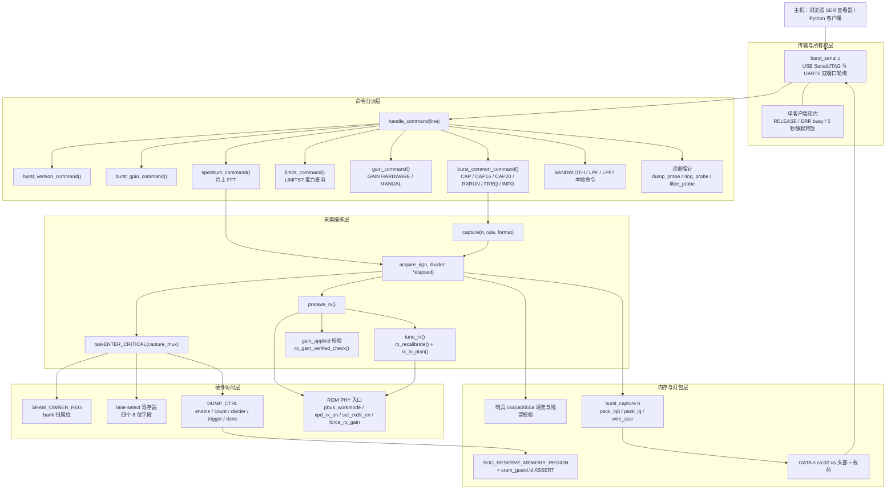
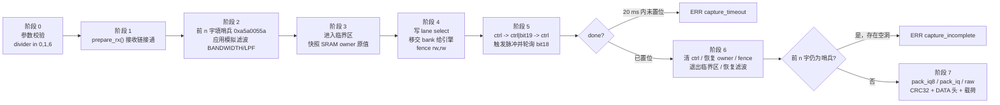

# 射频采集：未公开 dump 引擎驱动

> 「Espressif 没有公开这里的任何一个寄存器。下面全部来自阅读 ESP-IDF 随附的 RF 测试库（`librftest.a`，函数 `adctrig`）、反汇编，以及在真实板子上的试验。本文中的寄存器名都是我们自己起的。」
>
> —— `docs/how-it-works.md`

---

## 1. 项目定位与核心价值

ESP32 系列芯片在射频前端之后紧接着一个**固定功能的 Wi-Fi/BT 调制解调器**：ADC 输出被硬连线送入解调器做 DSSS/OFDM 处理，软件栈（Wi-Fi 驱动、蓝牙协议栈）能看到的只有解调后的帧，而不是基带波形。对 SDR 应用而言，这是一堵墙——直到有人注意到，出厂 RF 测试固件必须能够"把接收机看到的东西录下来"才能做产线校准，于是芯片内部保留了一条**未公开的调试通路**：一个被本仓库称为 **dump engine（转储引擎）** 的小型硬件块，可以把 ADC 侧的同相/正交样本按 32 位字逐个复制进片内 SRAM。

本模块（`main/targets/*/receiver.c` + `main/common/burst_capture.h`）解决的正是"把这条通路变成可用接收机"的工程问题。它不是一个抽象的驱动层，而是一套**逆向得出的时序契约**：先让 ROM 里的 PHY 例程把接收链唤醒并锁定本振，再把某一块 SRAM bank 的归属权移交给 dump engine，用一次写脉冲启动定长（bounded）转储，轮询完成位，归还 bank，最后校对哨兵、打包成紧凑的线格式并通过 USB/UART 发给主机。整个过程没有任何官方 API 参与，全部依赖对寄存器位域的实测归纳。

其核心价值可以概括为三点。第一是**零额外硬件**：一块几美元的 ESP32 开发板即可获得 80 MS/s、10 位 I/Q 的原始采样能力，且因为采样点在解调器之前，接收到的不是"Wi-Fi 帧"，而是整个接收通带内的任意信号。第二是**跨十个以上芯片型号的可移植抽象**：ESP32、S2、S3、C2、C3、C5、C6、C61、H2、S31 的 dump 寄存器地址、SRAM 归属位布局、lane 编号、时钟分频语义各不相同，仓库把它们收敛成同一个 `acquire_iq(n, divider, &elapsed)` 签名和同一套线协议。第三是**可验证性**：每一次快照都用哨兵字与 CRC32 双重保护，宁可上报 `ERR capture_timeout` / `ERR capture_incomplete` / `ERR capture_overrun`，也不把损坏或陈旧的数据当作有效样本发给主机——这对一个连寄存器都没有文档的逆向驱动而言，是可维护性的底线。

需要清醒认识的是它的能力边界：快照是**定长突发**而非连续流，最长 16,380 个样本（C2 为 8,190，S2 为 12,284），样本之间没有间隙但两次快照之间存在射频空窗；速率只有 80、40、16 MS/s 三档（H2 为 32/16/10.667/6.4 MS/s），且分频器很可能只是"抽点"而非带抗混叠滤波的抽取；增益以 PHY 增益表索引表示，不是 dB。真正的连续性由仓库中另一套环形 bank 轮转与 S31 PARLIO 直通固件承担，不在本篇的定长快照路径内。

| 能力维度 | 定长快照（本篇） | 说明 |
| --- | --- | --- |
| 最大样本数 | 16,380（C2 8,190 / S2 12,284） | 由预留 SRAM bank 大小减 4 字余量决定 |
| 标称速率 | 80 / 40 / 16 MS/s | 由 DUMP_CTRL 的 bit15 / bit16 分频码选择 |
| 样本精度 | 10 位 I + 10 位 Q（另有 8 位增益索引） | 单 32 位字内打包 |
| 线格式 | 原始 32 位 / CAP20 紧凑 20 位 / CAP16 有符号 8 位 | 均在原缓冲区就地打包 |
| 完整性 | 哨兵字（双向或单向）+ CRC32 + 超时 | 三类错误码分别对应三种失效模式 |
| 连续性 | 无（突发之间有空窗） | 连续模式见环形采集与 S31 流式固件 |

Sources: [how-it-works.md](docs/how-it-works.md#L1-L31), [README.md](README.md#L35-L68), [burst_capture.h](main/common/burst_capture.h#L1-L12), [protocol.md](docs/protocol.md#L42-L69)

---

## 2. 架构设计与模块划分

该模块采用**"传输层 / 命令分派层 / 采集编排层 / 硬件访问层 / 内存与打包层"** 的五段式分层。值得注意的是，分层的实现手段不是类继承或虚函数表，而是 C 预处理器：`receiver.c` 先定义 `IQ_BUFFER`、`send_bytes()`、`reply()`、`frequency_mhz`、`rx_ready`、`prepare_rx()`、`capture()` 等"接口符号"，然后在特定位置 `#include` 公共头文件，公共头文件里的 `static` 函数便直接绑定到这些符号上。这是一种**以包含顺序充当依赖注入**的架构，好处是编译期完全内联、无函数指针开销；代价是头文件必须在使用前满足隐式契约——`burst_capture.h` 的文件头就明确要求"在其之前定义 `IQ_BUFFER` 与 `send_bytes()`"。



**传输与所有权层。** `burst_serial_serve()` 是唯一的主循环：它持续轮询两个端口，当某一端口收到完整行时，该端口即成为后续所有回复与二进制载荷的归属端口；另一端口直到收到 `RELEASE` 或静默五秒才可接管。这层抽象之所以必要，是因为 dump 引擎是**独占资源**——两块主机同时发 `CAP` 会互相踩踏 bank 归属寄存器。序列层的实现细节（`burst_serial_send` 阻塞发送、`burst_serial_try_send` 只写当前能容纳的部分、`burst_serial_stop_requested` 消费流停止请求）直接决定了上层能否安全地连续推送二进制载荷。

Sources: [burst_serial.h](main/common/burst_serial.h#L8-L26), [protocol.md](docs/protocol.md#L8-L27)

**命令分派层。** `handle_command()` 是一条严格顺序的短路判断链，顺序本身即是架构决策：`VERSION`/`GPIO` 等无害命令先处理，诊断探针（编译期 `#ifdef` 开关）紧随其后，然后是 `spectrum_command()`（会内部调用 `acquire_iq`，因此必须在 `burst_common_command()` 之前），接着是能力与增益查询，最后才是 `CAP` 系列。若把顺序颠倒，`SPEC` 可能被识别成未知命令而返回 `ERR command`。

Sources: [receiver.c](main/targets/esp32c3/receiver.c#L170-L205), [burst_commands.h](main/common/burst_commands.h#L13-L63)

**采集编排层。** `capture()` 是极薄的适配器：取时间戳、调用 `acquire_iq()`、把结果交给打包器。真正的复杂度全在 `acquire_iq()` 与 `prepare_rx()` 里：前者负责银行归属交接与定长转储，后者负责"接收链是否已就绪"的状态收敛（重调谐、关闭发射音、打开 RX 时钟、恢复增益、必要时切换到 5/6 分频的备用本振）。`prepare_rx()` 的幂等性由 `rx_ready` 与 `rx_recalibration_stale()` 两个标志共同判定。

Sources: [receiver.c](main/targets/esp32c3/receiver.c#L83-L98), [receiver.c](main/targets/esp32c3/receiver.c#L157-L164)

**硬件访问层。** 三层寄存器构成最小接口：一个选择"哪块 SRAM 归引擎"，一个选择"记录内部哪四路信号"，一个同时承载样本数、分频码、触发与完成标志。所有访问都通过 `REG_WRITE`/`REG_READ` 直写，并在关键位置插入 `fence rw,rw` 内存屏障——因为 dump engine 是总线上的另一个 master，编译器与 CPU 的乱序都可能让归属移交先于控制字生效。

Sources: [receiver.c](main/targets/esp32c3/receiver.c#L115-L133), [receiver.c](main/targets/esp32/receiver.c#L100-L101)

**内存与打包层。** 双保险地保护采集缓冲区：`SOC_RESERVE_MEMORY_REGION` 在运行时把地址区间从堆分配器中摘除，链接脚本里的 `ASSERT` 则在链接期保证 `.data`/`.bss`/IRAM 不与之重叠。打包器工作在原缓冲区上，把 32 位字压缩成 16 位或 20 位样本流。

Sources: [receiver.c](main/targets/esp32c3/receiver.c#L27-L33), [sram_guard.ld](main/targets/esp32c3/sram_guard.ld#L1-L3), [burst_capture.h](main/common/burst_capture.h#L10-L43)

---

## 3. 技术栈与核心工作流

### 3.1 一次快照的执行主链路

C3 是最干净的范例（其他芯片同构，仅地址与附加写序列不同）。`acquire_iq()` 的执行可以拆成七个阶段，每个阶段都有明确的失败出口：



**阶段 0：参数校验。** 速率被编码为 `divider`，只接受 `0`（80 MS/s，不分频）、`1`（bit15 二分频 → 40 MS/s）、`6`（bit16 五分频 → 16 MS/s）三个值，其余立刻回 `ERR rate`。这个"用 rate code 当分频码"的编码在 C3/C2/S2/S3 上一致，但语义并不完全同构：C2 需要把 `6` 再映射成 `2` 写入 bit15–16 位域，ESP32 则用"时钟选择器" 0/1/2 的另一次编码。

Sources: [receiver.c](main/targets/esp32c3/receiver.c#L102-L106), [receiver.c](main/targets/esp32c2/receiver.c#L129-L130), [receiver.c](main/targets/esp32/receiver.c#L97-L118)

**阶段 1：接收链接通。** `prepare_rx()` 是一个"必要时才做重活"的收敛函数。若 `rx_ready` 为真且校准未失效，它只做一件事：手动增益模式下重新验证增益是否真的锁存（`rx_gain_verified_check`）——因为 PHY 的 PBUS 初始化会悄悄释放强制增益。否则它依次执行 `tune_rx()`（含 `rx_recalibrate()` 与新频率的 DC 重测）、`stop_tx_tone(1)`、`rom_pbus_workmode()`、`rom_pbus_xpd_tx_off()`、`rom_pbus_xpd_rx_on(1)`、`rom_set_rxclk_en(1)`、备用本振选择、3 ms 稳定延时、`gain_apply()`。这串调用的顺序不是随意的：`pbus_workmode` 会重置模拟偏置并释放强制增益，因此增益必须在它之后应用；`rx_lo_select` 改变的是本振分频比（5/6 分频覆盖 1842–2209 MHz），必须在 PLL 已锁定后切换。

Sources: [receiver.c](main/targets/esp32c3/receiver.c#L64-L98), [rx_lo.h](main/common/rx_lo.h#L9-L19), [rx_lo.h](main/common/rx_lo.h#L58-L63), [rx_recalibration.h](main/common/rx_recalibration.h#L1-L14)

**阶段 2：哨兵填充与滤波应用。** 每个待采集字被写成 `0xa5a0055a`。哨兵机制的核心价值在于**把"数据是否被写过"变成可判定的问题**：dump engine 若因时钟或触发问题提前停止，剩余字仍保持哨兵，驱动便能区分"短采集"与"有效数据"。同时该哨兵在 bits 20–27 的增益字段上取 `0x5A`，落在多数芯片标定增益上限之外，进一步降低与真实样本碰撞的概率。模拟滤波（`BANDWIDTH`/`LPF` 命令写入的 BBTOP 电容码）只在这个窗口内生效，采集结束立刻恢复，避免污染后续 PHY 校准。

Sources: [receiver.c](main/targets/esp32c3/receiver.c#L110-L111), [receiver.c](main/targets/esp32c3/receiver.c#L46-L56), [receiver.c](main/targets/esp32c3/receiver.c#L188-L202)

**阶段 3：进入临界区。** 这是全流程最反直觉、也最关键的一步。`taskENTER_CRITICAL(&capture_mux)` 屏蔽了任务切换与中断，原因是双重的：其一，SRAM 归属移交期间 CPU 读该 bank 会得到垃圾（C3 返回四字循环模式），任何 ISR 若访问该区间都会破坏数据或被数据破坏；其二，转储本身是有界但不可打断的时序窗口——在 80 MS/s 下 16,380 个样本约需 205 µs，40 MS/s 约 410 µs，16 MS/s 约 1 ms，若中途被中断拉长，引擎可能已经写满并回绕。仓库明确记录了这条权衡：临界区最长约 1 ms，意味着 USB/SDIO 中断会被延迟到采集结束。

Sources: [receiver.c](main/targets/esp32c3/receiver.c#L112-L115), [how-it-works.md](docs/how-it-works.md#L48-L67)

**阶段 4：lane 选择与 bank 移交。** 先把 lane 寄存器（C3 为 `0x60033d90`）写成 `(0 << 0) | (1 << 6) | (2 << 12) | (3 << 18)`——四个 6 位字段分别选中 I、Q 的两个字节及其顺序，值 0/1/2/3 是唯一被完整表征过的组合。随后修改 SRAM owner 寄存器：`(owner & ~7u) | 2u | 8u` 表示"把 128 KiB 块 1 交给引擎，并只写它的上半 64 KiB"。这里必须强调位域语义的危险性：C3 的 bit0/1/2 各对应一个 128 KiB 块（`0x3fc80000`/`0x3fca0000`/`0x3fcc0000`），bit3 选择上半区，写错一位就会让引擎覆盖程序自身内存或栈。移交后紧跟 `fence rw,rw`，确保归属写对引擎可见后才启动。

Sources: [receiver.c](main/targets/esp32c3/receiver.c#L117-L121), [how-it-works.md](docs/how-it-works.md#L48-L63)

**阶段 5：控制字与触发脉冲。** 控制寄存器同时承载 enable（bit31）、样本数（bit0–14）、分频码（bit15/16）、触发（bit19）与完成（bit18）。启动序列是三次写：`ctrl`（准备好参数）、`ctrl | (1<<19)`（拉高触发）、`ctrl`（拉低触发），形成一次脉冲。随后在 20 ms 上限内轮询 bit18。

| 位域 | 含义 | 本模块中的取值 |
| --- | --- | --- |
| 0–14 | 样本（字）数 | `n`，256 … 16,380 |
| 15 | 80 MS/s 二分频 | `divider == 1` 时置位 → 40 MS/s |
| 16 | 80 MS/s 五分频 | `divider == 6` 时置位 → 16 MS/s |
| 18 | 完成标志（硬件置位） | 轮询对象，超时 20 ms |
| 19 | 触发（写 1 再写 0） | 第二、三次写之间的脉冲 |
| 20+ | 数据源与模式（旧芯片） | ESP32/S2/S3 用于选 IQ source 0 |
| 31 | 使能 | 恒置位 |

Sources: [receiver.c](main/targets/esp32c3/receiver.c#L123-L129), [how-it-works.md](docs/how-it-works.md#L79-L96)

**阶段 6：归还与校验。** 先清控制字（停引擎），再恢复 owner 原值，再次 `fence`，最后退出临界区并恢复模拟滤波。顺序不可交换：若先归还 owner 再清 ctrl，引擎可能在新归属下继续写入。随后做两件事——超时判定，以及遍历前 `n` 字查找残留哨兵。后者能捕捉"完成位已置位但实际有空洞"的软故障。

Sources: [receiver.c](main/targets/esp32c3/receiver.c#L130-L146)

**阶段 7：打包与发送。** 见下节。

### 3.2 三种完整性校验策略

各芯片对哨兵的检查强度不同，这实际上反映了它们各自的已知风险：

| 策略 | 实现 | 能检出 | 代表芯片 |
| --- | --- | --- | --- |
| 仅前缀 | 遍历 `0 … n-1`，任一字仍为哨兵即失败 | 采集被截断（漏写） | C3、S3、C2、C5/C6/C61 |
| 前缀 + 尾部 | 额外检查 `n … n+3` 哨兵是否被改动 | 越界写（overrun） | S2 |
| 双向全窗口 | 前 `n` 字必须已变、`n … 16383` 必须未变 | 漏写与越界写同时检出 | ESP32 |

S2 的做法很典型：填充 `n + 4` 个哨兵，采集后若尾部 4 个哨兵中任一被改写就报 `ERR capture_overrun`，因为这说明引擎写了比请求更多的字。ESP32 更严格，它扫描整个 `CAPACITY`（16,384 字）并针对下标区间给出 `ERR capture_memory <index>`，把错误定位到具体字偏移。

Sources: [receiver.c](main/targets/esp32s2/receiver.c#L148-L148), [receiver.c](main/targets/esp32s2/receiver.c#L177-L187), [receiver.c](main/targets/esp32/receiver.c#L136-L141), [receiver.c](main/targets/esp32c3/receiver.c#L139-L144)

### 3.3 线格式：就地压缩

`burst_capture.h` 提供三种输出格式，全部**在原缓冲区上就地完成**，因为每种格式的字节数都不超过它替换掉的 32 位字，写游标永远落后于读游标：

| 格式码 | 命令 | 每样本字节 | I/Q 位宽 | CRC 覆盖长度 |
| --- | --- | --- | --- | --- |
| `0` | `CAP` | 4 | 原始 32 位字（含增益字段） | `n * 4` |
| `20` | `CAP20` | 2.5 | 20 位（I 在 bits 0–9，Q 在 10–19） | `(n*20+7)/8` |
| `16` | `CAP16` | 2 | 各 8 位（取 10 位字段的高 8 位） | `n * 2` |

命名有点反直觉：`CAP20` 传输 20 位样本，而 `CAP16` 才是"8+8 位"。`burst_common_command()` 里甚至用了一条就地字符串改写技巧——收到 `CAP16` 时把行首改写成 `CAP20` 并置 `iq8` 标志，从而复用同一套参数解析，再在调用 `capture()` 时把格式码换成 `16`。

Sources: [burst_capture.h](main/common/burst_capture.h#L40-L43), [burst_commands.h](main/common/burst_commands.h#L19-L59), [protocol.md](docs/protocol.md#L42-L62)

`CAP20` 的位打包值得逐字节拆解：两个 10 位样本恰好铺满 20 位，即 2.5 字节，因此**两个样本占五字节，奇数尾样本占三字节**。实现中 `p[2] = (a >> 16) | (b << 4)` 把样本 a 的高 4 位与样本 b 的低 4 位拼进同一个字节，随后 `p[3] = b >> 4`、`p[4] = b >> 12` 写满 b 的其余 16 位。这是一个纯 LSB-first、无填充的连续位流。

### 3.4 跨芯片差异图谱

同一套编排逻辑在不同芯片上要面对不同的寄存器拓扑。下表汇总了本模块涉及的关键地址与语义差异：

| 芯片 | 采集内存 | SRAM owner | DUMP 控制 | lane 选择 | 额外写序列 |
| --- | --- | --- | --- | --- | --- |
| ESP32 | `0x3ffe8000` (64 KiB) | DPORT `MAC_DUMP_MODE = 3` | `0x60033d90` | `0x60033dc4`（4 个独立字节） | ADC 强制使能、`DUMP_BYTES = 0x03020100`、读回 status 低 15 位比对样本数 |
| ESP32-S2 | `0x3fff0000` (48 KiB) | `0x3f4c10dc`，掩码 `15`，值 `7` | `0x60033d64` | `0x60033d98` | PHY 时钟/触发/模式寄存器保存-恢复、`adctrig` 外部符号 |
| ESP32-S3 | `0x3fcd0000` | `0x600c101c`，掩码 `15`，值 `4` | `0x60033d5c` | `0x60033d90` | 支持环形连续模式与双核协助 |
| ESP32-C3 | `0x3fcb0000` (64 KiB) | `0x600c1020`，`2 \| 8` | `0x60033d5c` | `0x60033d90` | 无额外写；整段临界区保护 |
| ESP32-C2 | `0x3fcc0000` (32 KiB) | `0x600c1018`，值 `2` | `0x6004bc04` | `0x6004bc14` | 时钟/触发/模式寄存器保存-恢复、禁用后等 5 µs 停稳 |
| ESP32-C6 | `0x40840000` | `0x60095004`，掩码 `0xf00` | `0x600a9004` | `0x600a9014` | 时钟强制三连写、写索引源 15、四步控制字序列 |

Sources: [how-it-works.md](docs/how-it-works.md#L159-L176), [receiver.c](main/targets/esp32/receiver.c#L34-L44), [receiver.c](main/targets/esp32/receiver.c#L105-L131), [receiver.c](main/targets/esp32s2/receiver.c#L30-L37), [receiver.c](main/targets/esp32c2/receiver.c#L110-L150), [chip.h](main/targets/esp32c6/chip.h#L32-L65)

两个差异点特别值得留意。**ESP32 的 ADC 门控问题**：仅强制 RX 时钟并不足以让 ADC 常开，PHY 的门控会在采样流中插入"非活跃转换器的固定值"短片段，因此 ESP32 后端在采集窗口内额外置位 `ADC_CTRL` 的强制使能位（bit9 与 bit8），结束后再恢复原值。**C2 的停稳等待**：C2 在清除使能位后必须空转约 5 µs 才恢复 owner，注释直接说明这是"按 vendor `adctrig` 的做法，必须在改变 dump 时钟选择前禁用"。

Sources: [receiver.c](main/targets/esp32/receiver.c#L108-L112), [receiver.c](main/targets/esp32c2/receiver.c#L138-L143)

---

## 4. 典型代码示例

### 4.1 定长转储的临界区核心（ESP32-C3）

下面这段是整套机制的骨架，去掉错误处理后的最小可运行路径：

```c
taskENTER_CRITICAL(&capture_mux);
uint32_t owner = REG_READ(SRAM_OWNER_REG);
int64_t start = esp_timer_get_time();
REG_WRITE(0x60033d5c, 0);                                    /* 清控制字 */
REG_WRITE(0x60033d90, (1u << 6) | (2u << 12) | (3u << 18));  /* lane: I/Q */
REG_WRITE(SRAM_OWNER_REG, (owner & ~7u) | 2u | 8u);          /* 上半 64 KiB 归引擎 */
__asm__ volatile("fence rw,rw" ::: "memory");
uint32_t ctrl = 0x80000000u | n |
                (divider == 1 ? 1u << 15 : divider == 6 ? 1u << 16 : 0);
REG_WRITE(0x60033d5c, ctrl);
REG_WRITE(0x60033d5c, ctrl | (1u << 19));   /* 触发拉高 */
REG_WRITE(0x60033d5c, ctrl);                /* 触发拉低，形成脉冲 */
while (!(REG_READ(0x60033d5c) & (1u << 18)) && esp_timer_get_time() - start < 20000) {}
```

这段代码里没有任何"官方 API"，只有三次对同一地址的写、一次内存屏障和一次忙等。它的正确性完全依赖三条硬约束：bank 归属必须在触发之前完成、触发必须是脉冲而非电平、忙等必须有界（20 ms 远大于最长 1 ms 的理论采集时长，用于兜住时钟异常）。

Sources: [receiver.c](main/targets/esp32c3/receiver.c#L115-L129)

### 4.2 就地打包与 CRC（公共头文件）

```c
static size_t packed_size(unsigned n) { return (n * 20u + 7u) / 8u; }

static void pack_iq(unsigned n) {                       /* CAP20：50 bit / 2 样本 */
    uint8_t *p = (uint8_t *)IQ_BUFFER;
    for (unsigned j = 0; j < n; j += 2, p += 5) {
        uint32_t a = IQ_BUFFER[j] & 0xfffffu;
        uint32_t b = j + 1 < n ? IQ_BUFFER[j + 1] & 0xfffffu : 0;
        p[0] = a; p[1] = a >> 8; p[2] = (a >> 16) | (b << 4);
        if (j + 1 < n) { p[3] = b >> 4; p[4] = b >> 12; }
    }
}

static bool burst_send_capture(unsigned n, unsigned format, uint32_t elapsed_us) {
    size_t bytes = wire_size(n, format);
    if (format == 16) pack_iq8(n); else if (format == 20) pack_iq(n);
    uint32_t crc = esp_rom_crc32_le(0, (const uint8_t *)IQ_BUFFER, bytes);
    char h[96];
    snprintf(h, sizeof(h), "DATA %u %08" PRIx32 " %" PRIu32 "\n", n, crc, elapsed_us);
    return send_bytes(h, strlen(h)) && send_bytes(IQ_BUFFER, bytes);
}
```

三点实现细节值得强调。**其一**，`pack_iq` 的写游标每两样本前进 5 字节，而读游标每两样本前进 8 字节，因此写永远不会追上尚未读取的样本——这就是"就地"能成立的形式化理由。**其二**，奇数尾样本只写 3 字节，恰好等于 `packed_size()` 对该样本数的产出，不会泄露未初始化内存。**其三**，CRC32 的初值是 `0` 而非 zlib 惯用的 `0xFFFFFFFF`，主机端必须用同样的初值才能校验通过；CRC 覆盖的是**打包后**的字节流，而不是原始 32 位字，因此换格式就会换 CRC。

Sources: [burst_capture.h](main/common/burst_capture.h#L10-L56), [protocol.md](docs/protocol.md#L56-L63)

### 4.3 完成位之外的第二道判定（ESP32）

旧 ESP32 后端在完成位之外还读回 status 低 15 位，与请求的样本数逐位比对：

```c
uint32_t result = REG_READ(DUMP_CTRL), status = REG_READ(DUMP_STATUS);
...
if (!(result & BIT(18)) || (status & 0x7fff) != n) {
    reply("ERR capture_timeout\n");
    return false;
}
```

这条额外判据解释了为什么 ESP32 后端把 `DUMP_STATUS`（`0x60033d94`）单独定义为一个符号：完成位只说明引擎"停了"，而计数器说明它"写了多少"。在新一代芯片上这个寄存器不再出现在同一偏移，于是后端退化为只依赖完成位加哨兵。

Sources: [receiver.c](main/targets/esp32/receiver.c#L35-L37), [receiver.c](main/targets/esp32/receiver.c#L124-L135)

### 4.4 时间戳字段的真实含义

`elapsed` 从 sentinel-bank 交接之前的 `esp_timer_get_time()` 起算，覆盖了寄存器写、屏障、忙等与归还操作，因此它是**含软件开销的墙钟时间**，比"样本数 ÷ 采样率"略长。上层的片上 FFT 路径正是拿它和标称速率一起推算样本在时间轴上的索引；如果主机侧需要精确重建时间基，应使用 `DATA` 头里的第三个字段并结合 `LIMITS?` 返回的标称速率交叉校验。

Sources: [receiver.c](main/targets/esp32c3/receiver.c#L117-L129), [spectrum.c](main/common/spectrum.c#L214-L232)

### 4.5 错误码字典

| 错误行 | 触发条件 | 排查方向 |
| --- | --- | --- |
| `ERR rate` | `divider` 不是 0/1/6 | 主机发了 `LIMITS?` 未列出的速率码 |
| `ERR gain` | 手动增益未通过 PBUS 回读校验 | PHY 覆盖了强制增益，或索引未标定 |
| `ERR capture_timeout` | 20 ms 内完成位未置位，或出现哨兵空洞 | dump 时钟/触发配置错误、供电跌落 |
| `ERR capture_incomplete` | 前 `n` 字仍有哨兵（C3/C2 命名） | 采集被提前终止 |
| `ERR capture_overrun` | 尾部哨兵被改写（S2、C5/C6/C61） | 引擎写了多于请求的字数 |
| `ERR capture_memory <i>` | 第 `i` 字与预期哨兵状态不符（ESP32） | 精确定位漏写/越界位置 |
| `ERR args` | 参数越界（如 `n < 256`、`n > MAX_SAMPLES`） | 与 `INFO` 报告的最大样本数比对 |

Sources: [receiver.c](main/targets/esp32c3/receiver.c#L102-L108), [receiver.c](main/targets/esp32c3/receiver.c#L135-L144), [receiver.c](main/targets/esp32s2/receiver.c#L173-L187), [receiver.c](main/targets/esp32/receiver.c#L100-L104), [rx_gain_verify.c](main/common/rx_gain_verify.c#L63-L91)

---

## 5. 学习与探索建议

| 目标 | 阅读对象 | 路径 | 为什么值得读 |
| --- | --- | --- | --- |
| 建立寄存器级心智模型 | `docs/how-it-works.md` | `docs/how-it-works.md#L27-L122` | 唯一一份把六个阶段、word 位布局与各芯片地址表写全的文档，先读它再看代码效率最高 |
| 吃透最简实现 | C3 后端 | `main/targets/esp32c3/receiver.c#L100-L147` | 无额外寄存器保存-恢复，`acquire_iq` 一步到位，适合作为模板比对 |
| 理解"为什么需要那么多额外写" | ESP32 后端 | `main/targets/esp32/receiver.c#L99-L144` | ADC 强制使能、DPORT dump mode、`DUMP_BYTES`、status 计数校验，一次看完全部历史包袱 |
| 研究跨代际寄存器演化 | C6 `chip.h` 的 `stock_capture` | `main/targets/esp32c6/chip.h#L32-L65` | 新版芯片把全部逻辑收进一个 helper，四步控制字序列与分频码语义与 C3 明显不同 |
| 从快照走向连续采集 | `ring_capture.c` 头部注释 | `main/common/ring_capture.c#L1-L26` | 解释 bank 轮转、写索引寄存器、双哨兵与"放弃单元"策略，是快照机制的必然延伸 |
| 追踪逆向过程本身 | 诊断探针 | `main/diagnostics/dump_probe.h#L1-L75` | `RXSRC`/`RXMODE`/`RXWIDE`/`RXCLOCK`/`RXREGS?` 这套可运行探针就是寄存器语义被"试"出来的方式 |
| 主机侧对接 | 协议参考 | `docs/protocol.md#L42-L69` | `DATA` 头、CRC 初值、`(I, -Q)` 约定、速率码表，写客户端前必读 |
| 校验与测试 | 主机单元测试 | `tests/` 目录 | 每个芯片都有对应的 `test_*_commands.py`，用桩替换 `spectrum_command` 后直接编译 `receiver.c`，是理解命令分派顺序的捷径 |

## 🔗 关联模块与上下游

- `main/common/burst_commands.h` — 直接调用本模块导出的 `capture(n, rate, format)`，把 `CAP`/`CAP16`/`CAP20`/`RXRUN`/`FREQ` 翻译成采集动作；`INFO` 回复中的最大样本数也来自这里引用的 `IQ_WORDS`。
- `main/common/spectrum.c` — 通过 `spectrum_acquire()` 回调复用同一条 `acquire_iq()` 路径，并对返回的 32 位字做 `(I, Q)` 符号扩展；它同时定义了 `n` 必须为 2 的幂、范围 256–2048 的额外约束。
- `main/common/rx_gain_verify.c` — 为 C3/S3 提供 `rx_gain_verified_apply` / `rx_gain_verified_check`，其返回值直接决定 `acquire_iq()` 是否以 `ERR gain` 提前退出。

Sources: [burst_commands.h](main/common/burst_commands.h#L14-L63), [spectrum.c](main/common/spectrum.c#L160-L232), [rx_gain_verify.c](main/common/rx_gain_verify.c#L63-L91)
