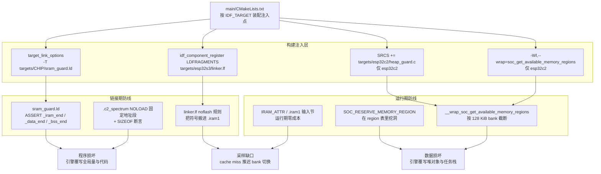
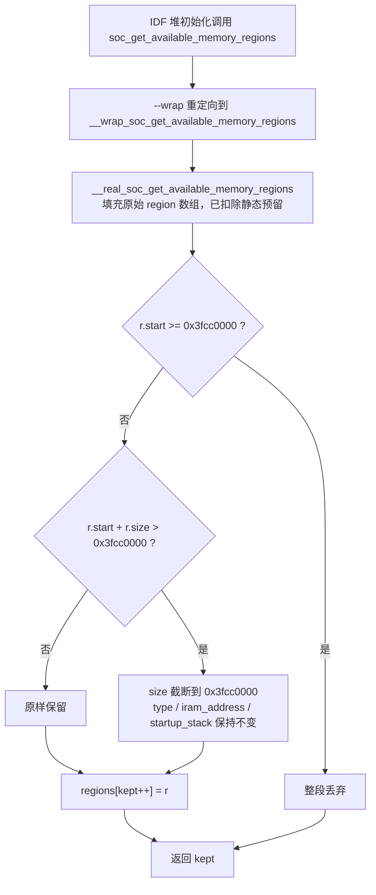
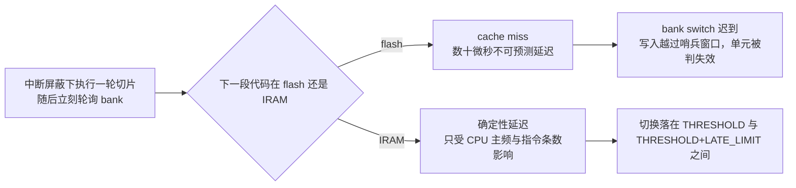

# 捕获内存守卫：SRAM 所有权与隔离

> 「dump engine 会直接覆写一整块 SRAM，因此'确保那块内存里没有堆对象、任务栈或静态数据'是硬性前提。固件用两道互补的防线表达它：运行前的 `SOC_RESERVE_MEMORY_REGION` 让 IDF 堆分配器避开该区间，链接期的 `sram_guard.ld` 则用三条 `ASSERT` 确保 `_iram_end`、`_data_end`、`_bss_end` 都不越过 dump 区起点。两者必须同时存在：前者管动态分配，后者管静态布局，任缺其一都会在特定构建配置下把程序自己的栈送进 dump 区。」
>
> —— 本仓库内存隔离设计的第一原则

---

## 1. 项目定位与核心价值

在 ESP-SDR 的采集路径上，最容易被低估的一环不是寄存器序列，而是**内存所有权**。dump engine 并不是一个"申请缓冲区然后往里写"的外设：它是挂在总线上的第二个 master，通过 SRAM owner 寄存器把一整块 SRAM bank 从 CPU 手里**整块夺走**。在它持有这块 bank 的时间窗内，CPU 对它的读会返回垃圾（C3 上是一个四字循环图案），写则直接丢失；而如果那块内存里本来放着一个任务栈、一个 Wi-Fi 接收缓冲、或一段被搬到 IRAM 的代码，后果不是"采集失败"，而是**程序在采集成功的同一瞬间被自己的硬件写成随机状态**。因此本模块要解决的问题并不是"怎么把数据取出来"，而是一个更前置、也更严酷的问题：**如何证明那块内存里什么都没有，并且在未来任何人改动固件时这个证明依然成立**。

仓库把这个问题拆成三条互相正交、不可互相替代的轴，并用三份看起来毫不相关的文件分别封堵：**空间轴**（`main/targets/<chip>/sram_guard.ld`，用链接期 `ASSERT` 把 `.data`/`.bss`/IRAM 的顶端压在采集 bank 之下）、**动态分配轴**（`main/targets/esp32c2/heap_guard.c`，在 IDF 计算"堆能用哪些区间"的出口再切一刀，把整个 128 KiB bank 从 region 表里裁掉）、**时间轴**（`main/targets/esp32s3/linker.lf` 与 `main/targets/esp32s31/burst/linker.lf`，用 ldgen 片段把 bank 切换窗口里必须执行的代码钉进 IRAM，使延迟不受 flash cache miss 摆布）。三者的共同点在于：它们都把"运行时的运气"换成了"构建期的确定性"——一次错误的静态布局会让 `idf.py build` 直接失败在链接阶段，一次错误的堆布局会让分配器根本看不到那段地址，一次错误的代码放置会被链接脚本强行搬走。

四条设计价值值得单独点出。**第一，沉默的数据损坏被转换成响亮的构建错误。** 采集区在这套固件里从来不是一个"段"：代码通过绝对地址常量 `IQ_BUFFER ((uint32_t *)0x3fcb0000)` 直接访问它，链接器没有义务、也没有能力发现某个 `.bss` 数组恰好长到了那里。既然正面表达"我要这块"不可能，唯一可行的表达方式就是**反向断言**——声明"常规段一个字节都不许越过这条线"，把不可见的冲突变成可见的链接失败。**第二，守卫必须对未来固件生效，而不只是对当前固件生效。** C5 的链接脚本里写得很直白：「堆预留本身并不能阻止未来固件的静态段向那里生长」，这句话正是 `ASSERT` 存在的全部理由——`SOC_RESERVE_MEMORY_REGION` 只管动态分配，管不住编译期就固定了地址的 `.bss`。**第三，守卫是逐芯片定制的，因为 SRAM 拓扑与 owner 位粒度逐芯片不同。** C3 的 owner 位以 128 KiB 为粒度（写错一位就让引擎覆写程序自身），C5/C61 以整 bank 为单位，C6 的环形采集要连吃两个 bank（256 KiB），S31 的预留终点甚至不对齐 bank 边界而是精确停在 ROM 数据之前（`0x2f07f170`）。**第四，守卫是可测试的。** `heap_guard.c` 的全部语义被一个 host 侧单元测试以桩函数替换的方式锁定，包括"跨界的 region 被截断后仍然保留 `type`、`iram_address`、`startup_stack` 字段"这种容易被后续重构悄悄破坏的细节。

| 守卫维度 | 实现载体 | 保护对象 | 失效后果 | 生效时机 |
| --- | --- | --- | --- | --- |
| 空间边界 | `sram_guard.ld` 的 `ASSERT` | `.data` / `.bss` / IRAM 的顶端 | 引擎覆写全局变量、堆元数据或正在执行的代码 | 链接期 |
| 动态分配 | `SOC_RESERVE_MEMORY_REGION` + `heap_guard.c` | 堆、任务栈、DMA 缓冲、Wi-Fi 包缓冲 | 引擎覆写栈帧与链表指针，崩溃点与现场无关 | 启动期堆初始化 |
| 固定工作区 | `.c2_spectrum` NOLOAD 段 + `SIZEOF` 断言 | FFT 工作区（C2 专用） | 工作区溢出 bank 槽位，或把工作区塞进 BSS 顶爆断言 | 链接期 |
| 时间确定性 | `linker.lf` / `IRAM_ATTR` / `.iram1.*` | bank 切换窗口内执行的代码 | cache miss 推迟切换，环形流出现缺口 | 链接期 |

Sources: [receiver.c](main/targets/esp32c3/receiver.c#L27-L33), [how-it-works.md](docs/how-it-works.md#L33-L42), [sram_guard.ld](main/targets/esp32c5/sram_guard.ld#L1-L5), [receiver.c](main/targets/esp32c3/receiver.c#L112-L121), [heap_guard.c](main/targets/esp32c2/heap_guard.c#L1-L16), [CMakeLists.txt](main/CMakeLists.txt#L85-L93)

---

## 2. 架构设计与模块划分

这套守卫体系没有运行期的类、接口或虚表：它的"架构"完全由**构建系统的三个注入点**与**三份声明式产物**构成。真正需要理解的是分层逻辑——哪一层负责把哪一类内存从哪一类使用者手里拿走，以及为什么某些层必须同时存在、缺一即失效。



**构建注入层。** `main/CMakeLists.txt` 是全套守卫的开关板，它用四个互不重叠的注入点表达"哪个芯片需要哪道锁"。第一处是无条件的 `target_link_options(${COMPONENT_LIB} INTERFACE "-T${CMAKE_CURRENT_LIST_DIR}/${target_dir}/sram_guard.ld")`：注意 `target_dir` 在 S31 上被重写为 `targets/esp32s31/burst`，因此那份链接片段是**跟着后端目录走**的，注释也明说了"把链接守卫放在它所保护的后端旁边"。第二处是 `LDFRAGMENTS ${fragments}`，只有 S3 与 S31 会向 `fragments` 追加 `linker.lf`。第三处是 `--wrap=soc_get_available_memory_regions`，只在 C2 生效。第四处是把 `targets/esp32c2/heap_guard.c` 追加进 `SRCS`，同样只对 C2 生效。把 `-Wl,--wrap` 与源文件注入成对绑定，是为了避免"只 wrap 不提供实现"或"提供了实现却没人调用"这两种半失效状态——它们在链接期不会报错，只会在运行期静默地不生效。

Sources: [CMakeLists.txt](main/CMakeLists.txt#L25-L33), [CMakeLists.txt](main/CMakeLists.txt#L45-L50), [CMakeLists.txt](main/CMakeLists.txt#L59-L71), [CMakeLists.txt](main/CMakeLists.txt#L85-L93)

**地址契约层。** 每个后端的 `receiver.c` 或 `chip.h` 顶端都有一对相邻的常量：`SOC_RESERVE_MEMORY_REGION(start, end, name)` 与 `#define IQ_BUFFER`。这两者的关系不是"随便写写"，而是一条可以逐芯片验证的规律：**预留区总是覆盖引擎可能触碰的全部物理 bank，而 `IQ_BUFFER` 只是其中的落点**。C3 预留在 `0x3fca0000–0x3fcc0000`（整 128 KiB bank），而 `IQ_BUFFER` 在 `0x3fcb0000`（上半 64 KiB），因为 owner 位以 128 KiB 为粒度，CPU 失去的是整块而不只是被写的那一半；C2 预留 `0x3fcc0000–0x3fcc8000`（32 KiB 采样窗口），把 bank 的剩余部分交给 heap guard 与 `.c2_spectrum` 段；C6 预留 `0x40820000–0x40860000`（256 KiB），因为环形采集轮流使用两个 bank；S31 预留 `0x2f040000–0x2f07f170`，终点取在 ROM 数据区起点而不是 bank 边界上。

Sources: [receiver.c](main/targets/esp32c3/receiver.c#L27-L33), [receiver.c](main/targets/esp32c2/receiver.c#L27-L34), [chip.h](main/targets/esp32c6/chip.h#L1-L9), [chip.h](main/targets/esp32c61/chip.h#L1-L9), [receiver.c](main/targets/esp32s31/burst/receiver.c#L33-L50)

**堆裁剪层。** `SOC_RESERVE_MEMORY_REGION` 与 `heap_guard.c` 作用于同一个数据结构：IDF 的"可用内存区间表"。`soc_get_available_memory_regions()` 是 IDF 启动时计算堆可用区间的唯一入口，它在返回前已经扣掉了所有通过 `SOC_RESERVE_MEMORY_REGION()` 登记的静态预留。`heap_guard.c` 用 GNU ld 的 `--wrap` 机制在这个函数的**出口**再切一刀：被 `--wrap` 的符号在链接时被重定向到 `__wrap_*`，而原名可通过 `__real_*` 调用，于是 C2 的堆看到的是一个被强行截断在 `0x3fcc0000` 的地址空间。这一层的存在理由在注释里写得很克制却关键：「过滤 IDF 已经裁剪过的 region，这样 ROM 预留可以随芯片修订变化而不会与静态预留重叠」——也就是说，它不假设 ROM 预留多大，只声明"这个 bank 之上的任何东西我都不要"。

Sources: [heap_guard.c](main/targets/esp32c2/heap_guard.c#L1-L16), [CMakeLists.txt](main/CMakeLists.txt#L91-L93), [esp32c2.md](docs/esp32c2.md#L25-L28)

**静态布局层。** `sram_guard.ld` 只有三到九行，却是整套体系里最不可绕过的一环。它以追加链接脚本（`-T`）的方式参与同一次链接，在主脚本完成布局后对 `_iram_end`、`_data_end`、`_bss_end` 求值并断言其不越过采集区起点。C2 的版本还额外承担第二项职责：用 `SECTIONS { .c2_spectrum 0x3fcc8000 (NOLOAD) : ALIGN(16) { *(.c2_spectrum) } }` 把 FFT 工作区**钉死**在预留 bank 的上半 32 KiB，并用 `ASSERT(SIZEOF(.c2_spectrum) <= 0x8000)` 兜住溢出。这是全仓库唯一一处"守卫脚本同时兼任放置器"的地方。

Sources: [sram_guard.ld](main/targets/esp32c3/sram_guard.ld#L1-L3), [sram_guard.ld](main/targets/esp32c2/sram_guard.ld#L1-L9), [spectrum.c](main/common/spectrum.c#L20-L45)

**IRAM 布局层。** 第三道轴与前两道正交：它保护的既不是数据也不是栈，而是**延迟的可预测性**。`linker.lf` 用 ldgen 的 `noflash` 规则把三类符号搬进 IRAM——第三方归档 `libesp-dsp.a` 里的 `dsps_fft2r_sc16_aes3`，以及 `libmain.a` 里的 `s3_fft_rnd`、`s3_unpack`、`s3_firdot`。S31 的片段则是另一个变体：它把整个 `receiver` 函数与 `burst_serial:burst_serial_port` 一起钉进 IRAM，因为 S31 的 bank 切换时限是"亚毫秒级"，调度器与串口端口都必须在 cache miss 之外。

Sources: [linker.lf](main/targets/esp32s3/linker.lf#L1-L13), [linker.lf](main/targets/esp32s31/burst/linker.lf#L1-L9)

---

## 3. 技术栈与核心工作流

### 3.1 链接期断言：把"不可见冲突"变成"构建失败"

`sram_guard.ld` 的三行 `ASSERT` 之所以能起作用，依赖一个不太直观的事实：**采集区在这套固件里不是一个输出段**。代码通过绝对地址常量访问它，既没有 `__attribute__((section))`，也没有对应的 `SECTIONS` 条目（C2 的 `.c2_spectrum` 是唯一例外）。链接器因此无从知道"这里不该有别的东西"，只能由人写下边界并断言常规段的顶端不越过它。

三条断言的语义分工非常清楚：`_data_end` 管已初始化的全局与静态变量，`_bss_end` 管零初始化区（任务栈通常也从这块里切，或在 BSS 之后的堆里），`_iram_end` 管指令段。三条必须齐全，因为它们分布在不同物理方向：在 RISC-V 统一编址的芯片（C5/C6/C61/H2）上三者共享同一上界 `0x40820000`；而在 Xtensa 与 C2/C3 这类"同一块 SRAM 在数据总线与指令总线上有两个地址"的设计里，`_iram_end` 的上界是采集区在指令总线上的别名地址，与数据界**数值不同、物理相同**——只在数据侧断言，等于允许链接器把一段代码搬进引擎的写入范围。

| 芯片 | 预留区间 | `_iram_end` 上界 | `_data_end` / `_bss_end` 上界 | 特点 |
| --- | --- | --- | --- | --- |
| ESP32 | `0x3ffe8000–0x3fff8000` | `0x400a8000` | `0x3ffe8000` | DPORT dump mode 3 才暴露整 64 KiB |
| ESP32-S2 | `0x3fff0000–0x3fffc000` | `0x40060000` | `0x3fff0000` | 保留前三块 16 KiB，顶部 16 KiB 留给 ROM USB |
| ESP32-S3 | `0x3fcb0000–0x3fce0000` | `0x403a0000` | `0x3fcb0000` | 三个 bank 供环形轮转，边界由 `RING_BANK_BASE/END` 提供 |
| ESP32-C2 | `0x3fcc0000–0x3fcc8000` | `0x403a0000` | `0x3fcc0000` | 唯一同时使用 `heap_guard` 与 `.c2_spectrum` 的芯片 |
| ESP32-C3 | `0x3fca0000–0x3fcc0000` | `0x403a0000` | `0x3fca0000` | owner 位按 128 KiB 块，CPU 失去整块 |
| ESP32-C5 | `0x40820000–0x40840000` | `0x40820000` | `0x40820000` | owner bit1 覆盖整个 128 KiB bank |
| ESP32-C6 | `0x40820000–0x40860000` | `0x40820000` | `0x40820000` | 需 256 KiB，环形采集吃掉两个 bank |
| ESP32-C61 | `0x40820000–0x40840000` | `0x40820000` | `0x40820000` | 用 bank 3 并留 bank 4 的 ROM 数据可达 |
| ESP32-H2 | `0x40820000–0x40830000` | `0x40820000` | `0x40820000` | 蓝牙调试 lane，bank 2 单块 |
| ESP32-S31 | `0x2f040000–0x2f07f170` | `0x2f040000` | `0x2f040000` | 终点精确停在 ROM 数据前，非 bank 对齐 |

Sources: [sram_guard.ld](main/targets/esp32/sram_guard.ld#L1-L3), [sram_guard.ld](main/targets/esp32s2/sram_guard.ld#L1-L3), [sram_guard.ld](main/targets/esp32s3/sram_guard.ld#L1-L3), [sram_guard.ld](main/targets/esp32c2/sram_guard.ld#L1-L3), [sram_guard.ld](main/targets/esp32c3/sram_guard.ld#L1-L3), [sram_guard.ld](main/targets/esp32c5/sram_guard.ld#L1-L5), [sram_guard.ld](main/targets/esp32c6/sram_guard.ld#L1-L3), [sram_guard.ld](main/targets/esp32c61/sram_guard.ld#L1-L3), [sram_guard.ld](main/targets/esp32h2/sram_guard.ld#L1-L3), [sram_guard.ld](main/targets/esp32s31/burst/sram_guard.ld#L1-L3)

C5 的脚本在这三行之前多加了两行注释，值得当作设计哲学的原文保留：

```ld
/* The modem owns this entire SRAM bank while adctrig runs. Heap reservation
 * alone does not prevent a future firmware's static sections growing into it. */
ASSERT(_iram_end <= 0x40820000, "C5 RF dump overlaps IRAM")
ASSERT(_data_end <= 0x40820000, "C5 RF dump overlaps data")
ASSERT(_bss_end  <= 0x40820000, "C5 RF dump overlaps BSS")
```

这段话解释了为什么"堆预留"与"链接断言"不是冗余而是互补：前者是运行期的一次性计算，后者是对**所有可能的构建配置**的静态证明。当有人打开一个新 Kconfig 选项让 `.bss` 涨了 8 KiB，堆预留不会有任何反应，断言会立刻拦住他，并且错误信息直接点出是哪一类段越界，把定位成本从"采集偶尔返回垃圾"降到"看一行链接错误"。

Sources: [sram_guard.ld](main/targets/esp32c5/sram_guard.ld#L1-L5)

### 3.2 运行期裁剪：从 region 表到 `--wrap`

`SOC_RESERVE_MEMORY_REGION(start, end, name)` 的形态很像一次函数调用，实际上它展开成一条**带 `used` 属性的静态记录**，被链接进一个专用输入节；IDF 的堆初始化在读取芯片内存布局表时，会把这些记录从可用区间里扣除。这就是为什么宏的第三个参数是一个标识符而不是字符串——它只用于构成 C 变量名，确保同一编译单元内多条记录不冲突。

在 C2 上这还不够，因为 owner 位与 bank 的粒度让"扣除 32 KiB 采样窗口"没有意义：整个 128 KiB bank 都不该有 CPU 的流量。`heap_guard.c` 的做法不是在 `SOC_RESERVE_MEMORY_REGION` 里把范围写大（那样会与 ROM 修订相关的预留重叠），而是在 region 表的出口按地址做一次**几何裁剪**：



这段算法有三处值得逐字读的细节。**其一，判定顺序是"先看起点、再截长度"**：起点已在 bank 内或之上的 region 被整段丢弃（`continue`，不写入 `kept`），起点在 bank 之下的才可能被保留，且只有跨界的那个会被截断。**其二，截断只改 `r.size`，其余字段原样复制**——测试里显式断言 `r[1].type == 3 && r[1].iram_address == 0x40398000 && !r[1].startup_stack`，说明 `iram_address`（该 region 在指令总线上的别名）与 `startup_stack`（是否作为启动栈）必须随截断后的区间一起被下游正确理解；截断只砍尾巴，因此基址与别名关系仍然成立。**其三，它不假设 ROM 预留的边界**：注释说"过滤 IDF 已经裁剪过的 region，这样 ROM 预留可以随芯片修订变化而不会与静态预留重叠"。这是整套设计里最"防御性编程"的一句话——它把 ROM 修订差异从"我们必须知道"降级为"我们不需要知道"。

Sources: [heap_guard.c](main/targets/esp32c2/heap_guard.c#L1-L16), [test_c2_heap_guard.py](tests/test_c2_heap_guard.py#L9-L46), [esp32c2.md](docs/esp32c2.md#L25-L28)

### 3.3 C2 的第三层：把 FFT 工作区钉进预留 bank

C2 是全仓库内存最紧的板子，因此它的守卫脚本做了别人不做的事：**在预留 bank 内部再划一块固定地址的 NOLOAD 段**。动机可以从数值反推。`spectrum.c` 的静态工作区包含 `fft_data[2*2048]`（8 KiB）、`window[2048]`（4 KiB）、`powers` 联合（8 KiB）、`frame[28+2048+4]`、`twiddles[2048]`（4 KiB），合计约 26 KiB。如果这些留在 `.bss` 里，`ASSERT(_bss_end <= 0x3fcc0000)` 就会被推高到危险边缘；如果它们去堆里，就会和采集窗口抢同一片 SRAM。于是采用第三条路：用一个自定义节把工作区搬到 `0x3fcc8000`——预留 bank 的上半 32 KiB，由 `heap_guard` 从堆里排除，由 `SECTIONS` 语句精确放置，由 `SIZEOF` 断言限制尺寸。

```ld
ASSERT(_iram_end <= 0x403a0000, "C2 RF dump overlaps IRAM")
ASSERT(_data_end <= 0x3fcc0000, "C2 RF dump overlaps data")
ASSERT(_bss_end  <= 0x3fcc0000, "C2 RF dump overlaps BSS")
SECTIONS {
    .c2_spectrum 0x3fcc8000 (NOLOAD) : ALIGN(16) {
        *(.c2_spectrum)
    }
}
ASSERT(SIZEOF(.c2_spectrum) <= 0x8000, "C2 spectrum workspace exceeds reserved bank slot")
```

这段脚本的精巧之处在于它**同时解决了两个互相冲突的约束**：`NOLOAD` 让该段不占镜像、不产生初始化数据，固定地址让链接器不去"顺便"扩展 BSS，而 `SIZEOF` 断言把"别长出去"这句口头约定变成构建规则。它还有一个隐含前提——工作区必须在采集期间**静默**。`spectrum.c` 的注释只用一句话交代了这一点：「RF 采集期间静默；把堆与栈留在其他 SRAM bank」；`esp32c2.md` 则给出了完整的现场描述：FFT 工作区占 `0x3fcc8000..0x3fcce820`，采集时不被触碰，任务栈、堆分配与 Wi-Fi 包缓冲都待在 bank 之下。

Sources: [sram_guard.ld](main/targets/esp32c2/sram_guard.ld#L1-L9), [spectrum.c](main/common/spectrum.c#L20-L45), [esp32c2.md](docs/esp32c2.md#L25-L34)

### 3.4 时间轴：`noflash` 与"40% 的首次采集失败"

第三份关联文件看起来与内存无关，其实是对**同一块 SRAM 的另一种占用**。S3 的 SPEC 模式在两次轮询之间保持中断屏蔽，bank 切换的时限是亚毫秒级；如果切换路径上的某个函数还躺在 flash 里，一次 cache miss 就足以把切换推迟到哨兵窗口之外，环形流因此出现缺口。`linker.lf` 的注释把这条因果链写得很干脆：「SPEC 模式在轮询之间屏蔽中断地跑 FFT；把内核留在 flash 之外，这样一次 cache miss 就不会推迟 bank 切换」。



值得留意的是**为什么这里用链接片段而不是 `IRAM_ATTR`**。三个被点名的符号里，`dsps_fft2r_sc16_aes3` 来自第三方归档 `libesp-dsp.a`（一个 pinned submodule），改源码的成本与风险都不合算；`s3_fft_rnd` 与 `s3_unpack` 来自手写汇编，源文件用的是普通 `.text` 段，没有 `IRAM_ATTR` 可用。链接片段恰好是这两类情况的正确工具：它不改动被放置对象的源码，只在链接期把承载这些符号的输入节搬进 `.iram1`。由于 ldgen 的 `entries` 规则按输入节粒度生效，片段只点名 `s3_fft2r_sc16_rnd`，同一 `.S` 里的 `s3_fft2r_sc16_rnd_stage` 也随之进入 IRAM——这正是设计想要的结果，因为单阶段入口在切片式执行中同样是热路径。

C 语言层面还有一套等价机制在并行使用：`ring_capture.c` 用 `RING_HOT`（`IRAM_ATTR`）标注最热的发送队列操作，用 `RING_SWITCH` 标注只在 bank 切换窗口执行的函数，并把两者的生效范围按芯片收窄：

| 宏 | S3 | C6 / C61 | 其他芯片 | 设计意图 |
| --- | --- | --- | --- | --- |
| `RING_HOT` | `IRAM_ATTR` | 空 | 空 | 切片的稳态开销 |
| `RING_SWITCH` | `IRAM_ATTR` | `IRAM_ATTR` | 空 | 切换窗口的硬时限 |
| 汇编内核 | `linker.lf` + `.iram1.*` 节 | 不适用 | 不适用 | 第三方归档与手写汇编 |

C6/C61 只升级了 `RING_SWITCH` 而不升级 `RING_HOT`，注释给出了原因与后果："C6/C61 没有那么多 IRAM 可以全放，但 bank 切换时执行的代码同样不能 miss flash cache——否则启动后的第一次采集会在约 40% 的上电中丢掉第一个单元结尾，且只取决于二进制布局。" 「只取决于二进制布局」这句话把问题的性质说穿了：这不是逻辑 bug，而是**放置问题**，因此正确的修复手段也只能是放置手段。

Sources: [linker.lf](main/targets/esp32s3/linker.lf#L1-L13), [ring_capture.c](main/common/ring_capture.c#L62-L76), [ring_capture.c](main/common/ring_capture.c#L401-L420), [s3_fft_rnd.S](main/targets/esp32s3/s3_fft_rnd.S#L13-L17), [s3_unpack.S](main/targets/esp32s3/s3_unpack.S#L18-L22)

S3 上还有第三种声明方式：手写汇编自己把节名写成 `.iram1.*`，从而被 IDF 的默认通配 `*(.iram1 .iram1.*)` 自动收进 IRAM，完全不需要片段介入。`s3_core1.S` 用 `.section .iram1.s3_core1, "ax"`，`s3_firdot.S` 用 `.section .iram1.s3_firdot, "ax"`；后者同时仍出现在 `linker.lf` 的 `entries` 里，属于"显式冗余"——同一符号被两种机制同时指向 IRAM，效果一致，但意图更清楚，也让后来者无法通过删除片段把滤波器内核悄悄挪回 flash。

Sources: [s3_core1.S](main/targets/esp32s3/s3_core1.S#L1-L16), [s3_firdot.S](main/targets/esp32s3/s3_firdot.S#L1-L20), [linker.lf](main/targets/esp32s3/linker.lf#L8-L13)

S31 的片段则展示了另一种权衡：它的 `entries` 里写的是 `receiver (noflash)` 与 `burst_serial:burst_serial_port (noflash)`，即**把整个 `receiver` 函数与串口端口函数一起搬进 IRAM**，而不是挑几个内核。理由是 S31 的切换期限"低于一毫秒"，任何落在 flash 里的调度路径都可能拖垮 bank 轮转；同时 S31 的 IRAM 相对宽裕，可以用空间换确定性。注意 `burst_serial:burst_serial_port` 这条写法里的冒号是 ldgen 的"归档成员限定"语法——同一个归档 `libmain.a` 里有多个目标文件，冒号左侧指定成员名，右侧指定符号名。

Sources: [linker.lf](main/targets/esp32s31/burst/linker.lf#L1-L9)

### 3.5 三条轴在一次采集中的时序协同

把守卫放回采集主链路，可以看到三道闸门在时间上从不同时生效，却互为前提：

| 阶段 | 正在执行的动作 | 生效的守卫 | 若缺失会怎样 |
| --- | --- | --- | --- |
| 构建 | `idf.py build` 链接 | `sram_guard.ld` 三条断言、`SIZEOF(.c2_spectrum)` | 静态段悄悄长进采集区，故障延迟到运行期 |
| 启动 | IDF 初始化堆 | `SOC_RESERVE_MEMORY_REGION` + `--wrap` 裁剪 | 任务栈/包缓冲被分配到采集区 |
| 链接后期 | ldgen 生成放置规则 | `linker.lf` 的 `noflash` | 切换路径含 flash 代码，缺口率取决于二进制布局 |
| 首次 `prepare_rx` | 分配 FFT 旋转因子（S3） | 堆已被裁到 bank 之下 | 旋转因子落入 bank，被引擎覆写 |
| `acquire_iq` 临界区 | 移交 owner、触发、轮询、归还 | 前四者共同保证"这里只有引擎" | CPU 读到垃圾、或引擎覆写程序 |

其中 S3 的旋转因子分配是一个极好的"三轴交汇点"：`ring_capture_init()` 里那句注释只有一行——"twiddles from the heap: BSS must end below the RF ring (sram_guard.ld)"——但它同时解释了三件事：为什么一个 FFT 库的初始化会出现在采集模块里（因为放置决策由采集区的边界决定）、为什么旋转因子要以指针形式从 `heap_caps_aligned_alloc` 取得而不是声明成数组（因为 `.bss` 的顶端被断言卡在 `0x3fcb0000`）、以及为什么这个分配失败会成为"没有第二核心"的判据（`dsp_ready` 同时控制 FFT 初始化与 `c1_start()`，内存路径与双核降级路径被刻意绑在一起）。

Sources: [ring_capture.c](main/common/ring_capture.c#L324-L363), [ring_capture.h](main/common/ring_capture.h#L11-L37), [receiver.c](main/targets/esp32s3/receiver.c#L31-L37), [receiver.c](main/targets/esp32c3/receiver.c#L112-L133)

---

## 4. 典型代码示例

### 4.1 `heap_guard.c` 全文拆解

这是全仓库最短、语义最密的一个文件。十六行里包含一次 `--wrap` 拦截、一次 region 表的二次裁剪、以及三次边界判断：

```c
/* The RF dump shares the last 128 KiB SRAM bank. Keep all dynamic
 * allocations (including DMA buffers and task stacks) below that bank.
 * Filter IDF's already-trimmed regions, so the ROM reservation can vary
 * between chip revisions without overlapping a static reservation. */
#include "heap_memory_layout.h"
extern size_t __real_soc_get_available_memory_regions(soc_memory_region_t *regions);
size_t __wrap_soc_get_available_memory_regions(soc_memory_region_t *regions) {
    size_t count = __real_soc_get_available_memory_regions(regions), kept = 0;
    for (size_t i = 0; i < count; i++) {
        soc_memory_region_t r = regions[i];
        if (r.start >= 0x3fcc0000) continue;
        if (r.size > (size_t)(0x3fcc0000 - r.start)) r.size = 0x3fcc0000 - r.start;
        if (r.size) regions[kept++] = r;
    }
    return kept;
}
```

四个实现决策值得逐一说明。**第一，原地压缩而非新数组**：`regions[kept++]` 把保留项写回同一个数组的前缀，`kept` 永远不大于 `i`，因此写游标不会追上尚未读取的项——与 `burst_capture.h` 的就地打包是同一个技巧，为的是不在堆初始化期间再申请一块内存（此刻堆还不可用）。**第二，`continue` 之后不写 `kept`**：被丢弃的 region 直接在输出数组里"消失"，返回值 `kept` 是新长度，调用方无需感知被删除的项。**第三，长度截断用减法而不是加法**：`0x3fcc0000 - r.start` 不会溢出，且 `r.start < 0x3fcc0000` 已由第一条判断保证。**第四，`if (r.size)` 是最后一道保险**：若某个 region 的起点恰好比边界低一个字节，截断后 `size` 可能为 0，此时不再写入，避免向调用方返回一个零长区间。

Sources: [heap_guard.c](main/targets/esp32c2/heap_guard.c#L1-L16)

与之配套的 host 侧测试更进一步，把"边界附近的每一个字节"都扫了一遍——`for (unsigned end = 0x3fcdf000; end <= 0x3fce0000; end += 4)` 让最后一个 region 的终点在 bank 边界附近滑动，并对每种情况断言返回值恒为 2（前两个 region 原样保留、第三个被截断、第四个被丢弃）。这种"把边界当作被测对象"的写法，是这套守卫能被长期维护的原因：它不是一段只能靠"在真板上跑一下"验证的内存代码。

Sources: [test_c2_heap_guard.py](tests/test_c2_heap_guard.py#L19-L46)

### 4.2 三种典型内存地图

把断言、预留与缓冲落点画在同一张地址图上，整篇文档的论述就一目了然。

```text
ESP32-C3
0x3FC80000 ┌────────────────────────┐
           │ DRAM：堆 / 任务栈 / Wi-Fi 缓冲 │
0x3FCA0000 ├────────────────────────┤ ← ASSERT _data_end / _bss_end ≤ 此处
           │ RF bank 1（128 KiB）          │   owner bit1 整块交出（含 IRAM 别名 0x403A0000）
0x3FCB0000 │   └─ IQ_BUFFER（上半 64 KiB）  │   dump engine 实际落点
0x3FCC0000 ├────────────────────────┤
           │ RF bank 2（128 KiB）          │
0x3FCE0000 └────────────────────────┘

ESP32-C6（统一编址，IRAM 与 DRAM 同界）
0x40800000 ┌────────────────────────┐
           │ 代码与数据：.data / .bss / IRAM │
0x40820000 ├────────────────────────┤ ← 三条 ASSERT 全部 ≤ 此处
           │ ring bank 0（0x40820000）      │
0x40830000 │ ring bank 1（0x40830000）      │   IQ_BUFFER 落在 bank 1 内
0x40840000 │ ring bank 2 / 快照落点         │
0x40860000 └────────────────────────┘

ESP32-C2（一个 bank 被切成三种用途）
0x3FCA0000 ┌────────────────────────┐
           │ 堆 / 栈 / Wi-Fi 缓冲（heap_guard 全部保留） │
0x3FCC0000 ├────────────────────────┤ ← ASSERT _data_end / _bss_end ≤ 此处
           │ RF dump 采样窗口 32 KiB        │   SOC_RESERVE_MEMORY_REGION
0x3FCC8000 ├────────────────────────┤
           │ .c2_spectrum（NOLOAD，≤ 32 KiB）│   固定地址段 + SIZEOF 断言
0x3FCD0000 ├────────────────────────┤
           │ bank 剩余部分：堆不可用         │   heap_guard 截断至 0x3FCC0000
0x3FCE0000 └────────────────────────┘
```

C3 的图揭示了最容易犯的错误：**断言线与缓冲线不是同一条线**。断言卡在 `0x3fca0000`（bank 起点），而缓冲在 `0x3fcb0000`（bank 中段）。如果按"缓冲起点"去断言，`0x3fca0000–0x3fcb0000` 这 64 KiB 就仍然可能被静态数据占用，而引擎持有 owner 位时 CPU 失去的是整块——这块内存会在采集期间变成垃圾，并在归还后变成野值。C6 的图则解释了为什么它的预留区是 256 KiB 而不是 128 KiB：环形采集要轮流使用两个 bank，快照路径落在其中一个之内。

Sources: [receiver.c](main/targets/esp32c3/receiver.c#L27-L33), [sram_guard.ld](main/targets/esp32c3/sram_guard.ld#L1-L3), [how-it-works.md](docs/how-it-works.md#L48-L66), [chip.h](main/targets/esp32c6/chip.h#L1-L9), [ring_capture.h](main/common/ring_capture.h#L11-L24), [sram_guard.ld](main/targets/esp32c2/sram_guard.ld#L1-L9)

### 4.3 S3 的 ldgen 片段：不改源码的放置手段

```lf
# SPEC mode runs the FFT with interrupts masked between ring polls; keep the
# kernel out of flash so a cache miss cannot delay a bank switch.
[mapping:esp_sdr_s3_fft]
archive: libesp-dsp.a
entries:
    dsps_fft2r_sc16_aes3 (noflash)

[mapping:esp_sdr_s3_fft_rnd]
archive: libmain.a
entries:
    s3_fft_rnd (noflash)
    s3_unpack (noflash)
    s3_firdot (noflash)
```

三条语法要点。**`[mapping:name]`** 是片段内的规则块标识，名字只需在工程内唯一；**`archive:`** 指定被检索的归档，`libesp-dsp.a` 是第三方 ESP-DSP 组件产出的静态库，`libmain.a` 是本工程的 `main` 组件；**`entries:` + `(noflash)`** 是 ldgen 的"符号级放置"语法，`noflash` 是 IDF 预定义的放置别名，等价于"搬进 `.iram1`"。这份片段通过 `idf_component_register(... LDFRAGMENTS ${fragments} ...)` 注册，只在 `IDF_TARGET STREQUAL "esp32s3"` 或 `"esp32s31"` 时进入构建。

Sources: [linker.lf](main/targets/esp32s3/linker.lf#L1-L13), [CMakeLists.txt](main/CMakeLists.txt#L45-L62), [CMakeLists.txt](main/CMakeLists.txt#L68-L71)

一个容易被忽视的收益是：**这份片段也是文档**。当有人问"SPEC 模式的 FFT 到底跑在 flash 还是 IRAM"，答案不需要翻汇编、不需要看 map 文件，只需读这九行；而当有人想把 FFT 换回 flash 以节省 IRAM 时，他必须删掉一行显式声明，而删除动作本身就会触发代码评审——这正是把隐式约定外化为可审查产物的价值。

Sources: [linker.lf](main/targets/esp32s3/linker.lf#L1-L13)

---

## 5. 学习与探索建议

| 关切点 | 阅读对象 | 路径 | 收获 |
| --- | --- | --- | --- |
| 建立"为什么必须有两道防线"的直觉 | `docs/how-it-works.md` 第 1 步 | `docs/how-it-works.md#L33-L42` | 官方叙述里唯一一处把 `SOC_RESERVE_MEMORY_REGION` 与链接脚本并列说明的地方 |
| 看清 owner 位粒度如何决定预留范围 | C3 后端文件头 | `main/targets/esp32c3/receiver.c#L27-L33` | 为什么预留 128 KiB 却只写上半 64 KiB，注释里连厂商 `adctrig` 的 usage 编码都写了 |
| 理解 region 表的裁剪算法与边界语义 | C2 堆守卫 + 其单测 | `main/targets/esp32c2/heap_guard.c#L1-L16`、`tests/test_c2_heap_guard.py` | 原地压缩、跨界截断、字段保真，三层语义各有断言 |
| 看一个守卫脚本兼任放置器 | C2 链接片段 | `main/targets/esp32c2/sram_guard.ld#L1-L9` | `NOLOAD` 固定段 + `SIZEOF` 断言的组合用法，可直接移植到别的项目 |
| 吃透 `noflash` 与 ldgen 的关系 | S3 / S31 片段 | `main/targets/esp32s3/linker.lf`、`main/targets/esp32s31/burst/linker.lf` | 归档成员限定语法 `member:symbol`、以及"不改源码改放置"的工程范式 |
| 从内存约束反推代码风格 | `ring_capture.c` 的静态区与初始化 | `main/common/ring_capture.c#L324-L363` | 旋转因子为何走堆、`dsp_ready` 为何同时是 FFT 判据与双核判据 |
| 追踪"放置问题"的实测证据 | `RING_HOT` / `RING_SWITCH` 注释 | `main/common/ring_capture.c#L62-L76` | 40% 上电失败率、与二进制布局相关、以及 C6/C61 的 IRAM 预算权衡 |
| 内存裁剪之后的容量现实 | C2 板级笔记 | `docs/esp32c2.md#L25-L34` | 32 KiB 预留曾导致 PHY 函数指针与 UART 堆对象被损坏，这是一次真实的故障复盘 |

## 🔗 关联模块与上下游

- `main/CMakeLists.txt` — 守卫的唯一注入者。`-T` 追加链接片段、`LDFRAGMENTS` 注册 ldgen 片段、`--wrap` 与 `heap_guard.c` 的条件注入全部发生在这里；修改任何一道守卫之前，先确认这段按 `IDF_TARGET` 分支的装配逻辑。
- `main/common/ring_capture.c` — 守卫的最重消费者。S3 的 2048 点工作区（`fft_buf`、`accum_buf`、`win2`、`txq`）把 `.bss` 顶推到断言的极限，旋转因子因此被迫走堆；`RING_HOT` / `RING_SWITCH` 是 `linker.lf` 在 C 语言侧的对应物。
- `main/common/spectrum.c` — `.c2_spectrum` 段的定义方。`SPEC_STORAGE` 宏只在 `CONFIG_IDF_TARGET_ESP32C2` 下展开成节属性，它与 `sram_guard.ld` 的 `SECTIONS` 段是一条契约的两端，任一端单独改动都会让工作区落错位置。

Sources: [CMakeLists.txt](main/CMakeLists.txt#L85-L93), [ring_capture.c](main/common/ring_capture.c#L324-L363), [spectrum.c](main/common/spectrum.c#L23-L45)
