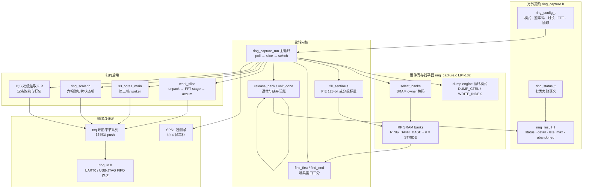
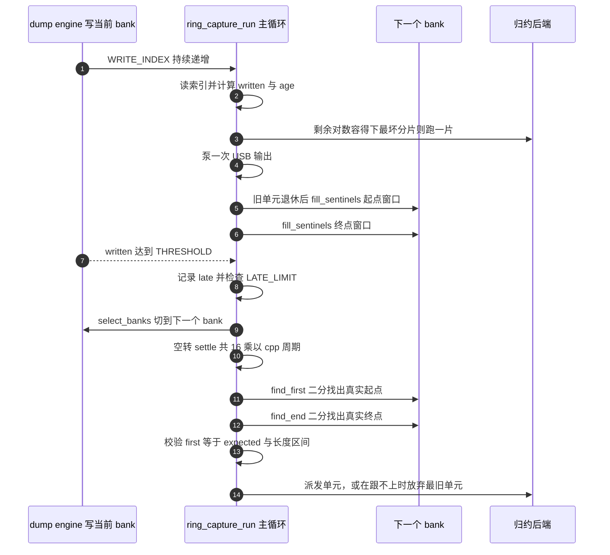

# 环形捕获：多银行轮转与哨兵校验

> 设计理念：连续采集的敌人不是算力，而是**时间的不确定性**。当 ADC 以 80 Msps 向 SRAM 里倾倒数据时，CPU 每多花一个周期去"看看情况"，就可能永久丢失一段样本流。`ring_capture.c` 的全部结构——哨兵字、二分定位、按最坏分片门控、放弃而非阻塞——都是为了把"我可能晚了"这件不可控的事，转换成一条可测量、可上报、绝不撒谎的数值。

## 项目定位与核心价值

快照式采集（`CAP/CAP16/CAP20`）的工作方式是"停下接收机 → CPU 读 SRAM → 再开接收机"，这中间存在一段无法覆盖的射频空洞，主机只能靠墙上时钟去补这段缺口。对于需要长时观察的频谱（干扰源调查、跳频活动、占空比统计）与需要连续相位的 I/Q 流（解调、协议逆向），这种空洞是致命的。`ring_capture.c` 解决的正是这个痛点：把 dump 引擎切到**循环模式**，让它在 16384 对采样的环上永不停歇地写，CPU 则在多个 SRAM bank 之间做"接力"——引擎写 bank *b* 时，固件处理刚刚写满的 bank *b−1*，并必须在下一次轮转到来之前把 *b−1* 干净地交还。于是采样流从"一段段被切断的胶片"变成"一条连续带子"，唯一的代价是固件必须持续证明自己没有掉队。

第二个痛点是**带宽与算力的错配**。80 Msps 的原始 I/Q 是每对 4 字节，约 320 MB/s，原生 USB Serial/JTAG 的 FIFO 连零头都吃不下。因此该模块从一开始就不是"搬运工"，而是**片上归约器**：数据从未离开芯片，只有 256 字节的功率码帧（`SPC1`）、1024 字节的抽取 I/Q 帧（`IQS1`）或者一小段 RINGCAP 原始 bank 才会出门。频谱路径把一整个单元的数千对采样压缩成每 bin 一个 8 位 dB 码，压缩比接近 60:1；I/Q 路径则在芯片内完成两级抽取 FIR，把 16 Msps 降到 250 kcps 以下。这种"就地归约"的设计让"连续"在物理上成为可能。

第三个、也是最容易被忽视的价值在于**失真可见化**。绝大多数 SDR 固件在来不及处理时会静默丢样，主机看到的是相位跳变或频谱毛刺，却无法判断是空口信号还是固件问题。本模块选择了一条更严苛的路线：任何被引擎覆写、被固件放弃、被队列丢弃的时间片，都以 `abandoned` / `drops` / `late_max` 计数上报，且帧头携带**无间隙的流索引** `pair_index`（8 字节）与跨度 `pairs`，主机可以逐帧累加校验。一旦连续性无法证明（起点不接上一单元终点、终点不在哨兵窗口内、单元长度不合理），固件不会交付可疑数据，而是直接以 `RING_FAIL_START` / `RING_FAIL_END` / `RING_FAIL_LENGTH` 结束本次采集——**宁可报错，绝不交伪数据**。

| 能力维度 | 快照后端（`spectrum.c`） | 环形后端（`ring_capture.c`） |
| --- | --- | --- |
| 采样连续性 | 每次采集之间有空洞 | 无间隙，或被显式标记为放弃 |
| 支持的芯片 | ESP32/C2/C3/C5/H2/S31(burst) | C6 / C61 / S3（S31 另有独立 streaming 固件） |
| bank 拓扑 | 单块 SRAM 独占 | C6/C61：2 bank；S3：3 bank（bank 3 留给 ROM） |
| FFT 上限 | 256–2048 | C6/C61：256；S3：256–2048 |
| 算力分配 | 单核阻塞 | C6/C61 单核分片；S3 双核（core0 管环 + 辅助，core1 纯 DSP） |
| 输出语义 | `DATA` + CRC32 | `SPC1`/`IQS1`/`SPS1` 帧 + `SPECEND` 报告 |

Sources: [ring_capture.h](main/common/ring_capture.h#L1-L37), [ring_capture.c](main/common/ring_capture.c#L1-L26), [how-it-works.md](docs/how-it-works.md#L124-L148), [spectrum.md](docs/spectrum.md#L123-L154)

## 架构设计与模块划分

整个模块被切成四个可独立推理的平面：**编译期目标矩阵**（`ring_capture.h` 的宏）、**硬件寄存器平面**（dump engine 与 SRAM owner）、**轮转内核**（哨兵 + 二分 + 主循环）、**归约与输出平面**（`work_slice`/`ring_scalar.h`/IQS 与 `txq`/`ring_io.h`）。下图给出结构拓扑与调用方向：



### 编译期银行地图与能力上限

`ring_capture.h` 的第一段就是一张**按目标硬编码的物理内存地图**。C6 拥有 2 个 128 KiB bank（`0x40820000`–`0x40860000`，stride `0x20000`）；C61 同样是 2 个 bank，但 stride 回落到 `0x10000`；S3 则是 3 个 64 KiB bank（`0x3fcb0000`–`0x3fce0000`），注释明确说明"bank 3 存放 ROM 数据"因而不入环。环本身的粒度与固件语义常量也不在一个数量级之外：`RING_PAIRS = 16384`（环长，恰好掩码 `0x3fff`），`RING_THRESHOLD = 12288`（写满 3/4 后必须切 bank），剩余 4096 对是给"切换指令生效延迟 + 最坏分片"预留的安全气囊。FFT 上限由 `RING_SPEC_NFFT_MAX` 一分为二：C6/C61 为 256，S3 为 2048——原因并不玄学，2 个 bank 意味着"处理中的 bank 与写入中的 bank"没有第三方缓冲，任何大块窗口都会把轮转余量吃光。

```c
#define RING_BANKS       3u
#define RING_BANK_BASE   0x3fcb0000u /* banks 0..2; bank 3 holds ROM data */
#define RING_BANK_END    0x3fce0000u
#define RING_PAIRS       16384u
#define RING_THRESHOLD   12288u /* switch banks after this many pairs */
```

这些宏并非"尽力而为"的约定：`ring_capture.c` 在文件作用域用四个 `_Static_assert` 把它们钉死成编译期不变量——银行地图必须首尾相接、起点哨兵窗口不得与阈值重叠、终点哨兵窗口不得压到下一单元起点、以及 `2*LATE_LIMIT+64 < END_GUARD` 的空间预算。任何一次"顺手调大 FFT 尺寸"或"放宽迟到限制"的改动，都会在编译期而非现场炸掉。

Sources: [ring_capture.h](main/common/ring_capture.h#L11-L37), [ring_capture.c](main/common/ring_capture.c#L77-L92), [ring_capture.c](main/common/ring_capture.c#L134-L137)

### 硬件寄存器层：循环倒置引擎与 bank 选择

硬件侧的入口只有一个配置寄存器与一个**写索引寄存器**。循环位 `DUMP_CTRL_CIRCULAR = 0x00024000` 打开后，引擎不再"写满即停并置中断"，而是在 16384 对的环上自行回卷；`DUMP_WRITE_INDEX_REG & RING_MASK` 则随时告诉 CPU 引擎此刻写到哪一格。这三处寄存器地址（控制、写索引、配置）在 C6、C61、S3 之间全部不同，被三段 `#if` 分别固化；速率码也不是统一的——C6 用 `1<<15`/`3<<15` 表示 40/16 Msps 的分频，S3 用 `1<<15`/`1<<16`，C61 干脆把速率写进写索引寄存器的 `[21:24]` 位。

`select_banks()` 是唯一触碰 SRAM 所有权的函数，且每个目标的位布局都不一样：C6 清 `0x10f00` 后把掩码左移 9 位，C61 清 `0x11f00` 后左移 10 位，S3 则直接用低 4 位。C6/C61 在写完之后还额外插入 `fence rw,rw` 加一次寄存器回读，因为 RISC-V 侧的外设写缓冲可能让"已经切了"和"还没切"在时间上错位；S3 的 Xtensa 不需要这层保险。这条 6 行的分支是整份文件里"芯片差异外置"思想最浓缩的体现——上层主循环只关心 `select_banks(saved, 1u << next)`。

Sources: [ring_capture.c](main/common/ring_capture.c#L94-L132), [ring_capture.c](main/common/ring_capture.c#L146-L167), [ring_capture.c](main/common/ring_capture.c#L1688-L1713)

### 哨兵窗口：把"边界未知"变成"单调谓词二分"

轮转法最反直觉的一点是：**切换指令发出时，你并不知道上一个单元真实写到了哪一对**。引擎可能在 CPU 读索引之后的几个周期里又写了几十对，也可能因为总线仲裁晚了几百对才真正生效。eSpDR 的原始做法被完整继承下来：在准备下一个 bank 时，先把它在"预测的起点"与"预测的终点"附近的一片区域填满哨兵字 `0xA5C33C5A`，再让引擎用真实数据覆盖它。于是切换完成后，bank 内的数据形态必然是**单调的**——某点之前全是哨兵、之后全是数据。这让"精确边界"退化成一次 12 步以内的二分查找。

```c
RING_SWITCH static uint32_t find_first(unsigned b, unsigned origin, unsigned guard) {
    const uint32_t *p = bank_ptr(b);
    if (p[origin & RING_MASK] != SENTINEL) return NOT_FOUND; /* started early */
    if (p[(origin + guard - 1) & RING_MASK] == SENTINEL) return NOT_FOUND;
    unsigned lo = 0, hi = guard - 1;
    while (lo < hi) {
        unsigned mid = (lo + hi) / 2;
        if (p[(origin + mid) & RING_MASK] == SENTINEL) lo = mid + 1; else hi = mid;
    }
    return (origin + lo) & RING_MASK;
}
```

`find_first` 的两个前置断言本身就是两道闸门：`p[origin]` 必须是哨兵（否则说明单元起点早于预测，窗口失效），`p[origin+guard-1]` 必须是数据（否则整个窗口内都没开始，同样失效）。`find_end` 的形态对称，但它的下界来自"切换前看到的写索引"——真实终点不可能早于那次读数，因此 `lo = (write_index - origin) & RING_MASK`，把二分区间直接砍掉一大截。

窗口尺寸是按最坏情况算出来的，而不是拍脑袋：S3 上 `START_GUARD = 3072`、`END_GUARD = 4096`、`LATE_LIMIT = 2000`，且受 `2*LATE_LIMIT + 64 < END_GUARD` 的编译期约束——即"迟到两倍仍然落在终点窗口内"。C6/C61 因为 SRAM 更紧张，取 `1024 / 2048 / 800`。单元 0 是特例：它的整个 bank 在启动前就是哨兵，因此直接以"读到的写索引 −1024"为起点搜索 3072 宽窗口，终点则用 1024 宽的 `UNIT0_END_GUARD`。

哨兵填充本身也是一场与 RF 带宽的赛跑：S3 用 `ee.movi.32.q` + `ee.vst.128.ip` 的 128 位 PIE 存储（约 4 字/指令），C6/C61 没有 PIE，退化成 8 字一组的手工展开（源码注释解释了原因：在 80 Msps 下纯标量循环来不及在下次切换前铺完 7 k 字）。函数开头先把指针抬到 4 字对齐（`head = (-at) & 3u`），尾部再逐字补齐，从而保证"向量主循环 + 标量头尾"的结构在任何环内偏移下都正确——`tests/test_ring_sentinels.py` 正是把这段函数抽出来在宿主机上跑 18×18 组偏移/长度组合，并逐字断言"目标区间以外绝未被触碰"。

Sources: [ring_capture.c](main/common/ring_capture.c#L169-L260), [test_ring_sentinels.py](tests/test_ring_sentinels.py#L14-L56)

### 主循环：轮询、切片、切换、定位、派发

`ring_capture_run()` 是整个模块的心脏，约 450 行，但骨架是五拍的固定节奏，源码自己的分节注释就把它们标成 1/2/3：

1. **Poll**（`L1730-L1886`）：反复读写索引，`written = (write_index - expected) & RING_MASK`；同时把三种不同优先级的事情插进轮询之间——准备下一个 bank、泵一次 USB、跑一个定长 DSP 分片。
2. **Switch**（`L1896-L1910`）：若已满足停止条件则关引擎并归还 bank；否则 `select_banks(saved, 1u << next)`，重置 `epoch`（年龄计时起点），然后空转 `settle = 16 * cpp` 个 CPU 周期等切换生效。
3. **Locate**（`L1912-L1933`）：用二分把 `first` / `end` 精确定位。
4. **Verify**（`L1921-L1933`）：`first == expected` 证明无间隙；长度必须落在 `[MIN_PAIRS, MAX_PAIRS]`。
5. **Dispatch**（`L1935-L1986`）：把单元交给 CAPTURE 缓冲区、标量后端、双核队列或 `work_t` FIFO，然后 `index += count; expected = end; b = next`。

其中最具工程价值的是 Poll 阶段里的**分片门控**：任何一次 DSP 工作都必须先证明"最坏情况也来得及"。S3 上这个证明直接用历史测量值：`slice_cycles = max(r->work_max, 8000)`，换算成采样对数 `slice_pairs = slice_cycles / cpp + 128`，只有当 `written + slice_pairs + 1024 < THRESHOLD + LATE_LIMIT/2` 时才允许启动。标量路径更精细，它用**当前相位的**历史最坏耗时（`scalar.cost[scalar.phase]`）而不是全局最大值，因为 CRC/遥测相位的成本远高于蝶形运算相位，用全局最大值去预留会让"bank 拷贝永远排不上队"。

```c
/* 标量路径的分片门控：按相位预留，而非按全局最坏值 */
uint32_t slice_cycles = scalar.cost[scalar.phase];
slice_cycles += slice_cycles / 4;
if (slice_cycles < minimum_slice) slice_cycles = minimum_slice;
uint32_t slice_pairs = slice_cycles / cpp + 128u;
if (written + slice_pairs + 1024u < THRESHOLD) scalar_work();
```

Poll 循环还兼顾了三类"外部世界"事件：`duration_ms` 到点、主机发来任意字节（`ring_input_available()` 后整行吞掉，避免污染后续解析器）、以及**主机停止读取超过 2 秒**——后者在 `L1764-L1767` 用一个 `st.last_ok` 软看门狗实现，使无人值守的流式运行不会永远占住接收机。所有停止决策都被刻意安排在 `written >= THRESHOLD/2` 之后才判定一次，并在注释里给出了理由：从"看到阈值"到"真正切 bank"之间只允许存在读索引这一条指令，任何额外的判断都可能把延迟推过 `LATE_LIMIT`。

Sources: [ring_capture.c](main/common/ring_capture.c#L1721-L1886), [ring_capture.c](main/common/ring_capture.c#L1889-L1986), [ring_capture.c](main/common/ring_capture.c#L1752-L1773)

### 退休与放弃：deadline 驱动的记账

"处理跟不上"在这套设计里不是异常，而是**一等公民**。当一个 bank 即将被引擎复用，`release_bank()` 会把它上面所有未完成的工作按 FIFO 顺序退掉；对每个单元，`unit_done()` 负责三件事：把未处理完的块数折算成 `abandoned`、在帧标志里置 bit1（"有跳过"）、以及决定是否立刻关帧。这里有一条极其关键的分界线——**"只有解包（unpack）会读 RF bank"**。FFT 与累加都工作在已经复制到私有 SRAM 的 `fft_buf` 上，因此若退休发生在 FFT 阶段，这一块变换允许跑完并计入本帧；若发生在 unpack 阶段，则只能整体作废。

```c
RING_HOT static void unit_done(void) {
    unsigned b = st.fifo[0];
    work_t *w = &st.work[b];
    if (w->next_block < w->blocks) {
        st.res->abandoned += (w->blocks - w->next_block + st.cfg->stride - 1) / st.cfg->stride;
        st.frame_flags |= 2;
    }
    if (st.phase == BLK_UNPACK && st.blk_bank == b) {
        st.phase = BLK_IDLE;
        st.res->abandoned++;
        st.frame_flags |= 2;
    }
    ...
}
```

"绝不把半次变换混进新帧"是这条规则的另一面：`frame_close()` 会先等 `st.emitting` 排空，且只有在 `frame_ffts > 0` 时才允许关帧——否则直接记一次 `drops`。空帧被显式丢弃而不是发出一个全零频谱，主机因此不会把"固件没算完"误读成"空口安静"。S3 上 `tests/test_ring_retirement.py` 把 `unit_done` 与 `work_slice` 抽出来在宿主机上遍历"退休发生在 FFT 的每一个 stage"以及"退休发生在 unpack"两条分支，断言前者不增加 `abandoned` 且能正常提交一帧、后者恰好增加 1。

Sources: [ring_capture.c](main/common/ring_capture.c#L578-L674), [ring_capture.c](main/common/ring_capture.c#L1013-L1026), [test_ring_retirement.py](tests/test_ring_retirement.py#L12-L67)

### 双核交接：Dekker 式 bank 所有权

S3 拥有两个核，于是这套轮转被拆成"core0 管环 + core1 纯 DSP"。难点在于 core1 读 bank 与 core0 重填同一 bank 之间的竞争：没有锁、没有信号量、没有缓存一致性协议（两核共享的内部 SRAM 本身不缓存，但**编译器的重排与写缓冲**仍然存在）。源码用的是一套显式的 Dekker 握手：

- core0 定位完单元后 `c1q[i % 8] = unit`，再写 `c1.bank_seq[b] = seq` 并 `MEMW()`；
- core1 每开始一段 256 样本的解包前，先写 `c1.busy = b+1` 并 `MEMW()`，**再次**读 `c1.bank_seq[b]` 校验是否等于自己的 seq；
- core0 在重填 bank 前调用 `c1_revoke(b)`：先清零 `bank_seq[b]`，`MEMW()`，然后自旋等待 `c1.busy != b+1`。

双向都"先声明、再复查、两侧 memw"正是教科书意义上的 Dekker 互斥，换成 RISC-V 或 Xtensa 的任意一种弱序模型都成立。握手之外还有两条提高吞吐的旁路：`claim_block()` 用 `xt_utils_compare_and_set` 在共享游标上做原子领块，使 core0 能在轮询间隙"偷"一块做 unpack+FFT 塞进 8 KB 的 `hbuf`（即 `DUAL 1` 的 assist 模式）；`DUAL 0/1/2` 三种调度形态与 `ASSIST` 计数器就是这条路径的对外开关与观测面。

Sources: [ring_capture.c](main/common/ring_capture.c#L1080-L1135), [ring_capture.c](main/common/ring_capture.c#L1267-L1300), [ring_capture.c](main/common/ring_capture.c#L1302-L1396), [ring_capture.c](main/common/ring_capture.c#L1448-L1500)

### 归约后端：三种形态，一套语义

后端被分成三条互斥的实现，但对外输出的帧格式完全一致：

| 后端 | 适用目标 | 状态机形态 | 关键特征 |
| --- | --- | --- | --- |
| `work_slice()` | S3 单核 / `DUAL 0` | `BLK_UNPACK → BLK_FFT(每片一级) → BLK_ACCUM(128 bin/片)` | FFT 按 stage 切片，最细粒度响应 deadline |
| `s3_core1_main()` | S3 双核 | core1 内 `c1_unit()` 串行 commit，`c1_encode_step()` 与编码并发 | 编码用双缓冲 `accum_buf[2]` 与 core0 填充分离 |
| `ring_scalar.h` | C6 / C61 | `SCALAR_COPY → FFT → BINS → ENCODE → FRAME` 六相位 | 代码内联注入，无函数指针；拷贝一步做完 |

标量后端 `ring_scalar.h` 不是普通头文件，而是**注入式片段**：它假定被 include 之前已经存在 `st`、`spec_n`、`bank_ptr()`、`fft_buf`、`accum`、`bin_of[]`、`txq_push()`、`scalar_telemetry()` 等符号——这正是本仓库"用预处理期拼接代替运行时间接"的惯用手法。它最值得读的是 `SCALAR_COPY` 的取舍：源码明确说明标量连续档只有 256 样本，把这个小拷贝一次性做完比切片更划算，因为"切片式拷贝会在 FFT 开始前被反复放弃"。剩下 FFT 蝶形用无符号模加实现——`(uint32_t)(wr*br) + (uint32_t)(wi*bi)`——注释解释了这是为了在不触发 64 位进位链的前提下，得到与 `int64_t` 完全一致的高 16 位结果。

I/Q 流（仅 S3）走的是另一条完全独立的链路：两级抽取 FIR（8 × D/8，Kaiser β=5.65，约 60 dB 阻带），第一级用三角窗把 fs/8 的整数倍（含 LO 泄漏与 1/f 裙边）打成双重零点，第二级做主体低通；`mode 2` 还会在 FIR 之前乘 `j^n` 完成 +fs/4 搬移，从而让 LO 泄漏落在滤波器零点上。输出经过四舍五入右移（注释直指"直接截断会在 −0.5 LSB 处留下 DC"）与定点饱和后打进 1024 字节帧。

Sources: [ring_capture.c](main/common/ring_capture.c#L1028-L1077), [ring_scalar.h](main/common/ring_scalar.h#L1-L143), [ring_capture.c](main/common/ring_capture.c#L715-L896), [ring_capture.c](main/common/ring_capture.c#L925-L1009)

### 输出与遥测：非阻塞队列 + 直访 FIFO

整个运行期中断是被屏蔽的（`portSET_INTERRUPT_MASK_FROM_ISR` 之后才开始配置引擎），这意味着 USB Serial/JTAG 与 UART **都不能用中断驱动**。`ring_io.h` 因此把传输收敛成三个寄存器级原语：`ring_input_available()` 直接读 UART0 的 RXFIFO 长度或用 `usb_serial_jtag_ll_rxfifo_data_available()`；`ring_read_byte()` 直读 FIFO；`ring_write()` 在 S3 上甚至跳过通用的逐字节状态检查，直接向 `USB_SERIAL_JTAG.ep1.rdwr_byte` 灌数据（注释记录了理由：环是唯一的 USB 写入者且每次 flush，所以"可写"等价于"空"）。

`txq` 是一条 free-running 头尾计数器的字节环（C6/C61 为 2 KiB，S3 为 16 KiB，恰好容纳 7 个 2048 bin 帧）。`txq_push()` 永不阻塞：空间不足就返回 false，调用方把整帧记为 `drops` 并在后续帧头置 bit2。这条规则让"主机读得慢"退化为"帧级丢失"，而不会把 RF 侧拖停。`txq_pump()` 每次最多发一个 64 字节包且从不等待，使 USB 输出可以均匀插在轮询间隙里；S3 上还会根据实测最慢包耗时动态调整 `tx_guard_pairs`，进一步压缩空闲余量。

遥测方面，S3 走自带的 `stats_maybe()`（每 250 ms 一帧 `SPS1`，含双核负载千分比、FFT 覆盖率、`late_max`、队列填充率、每秒 FFT 数），标量路径则共用 `spectrum_stats.h` 的 `spectrum_stats_emit()`。两者的字段布局在头文件里用 `_Static_assert(sizeof(...) == 36)` 锁死，主机侧可以零歧义解析。

Sources: [ring_io.h](main/common/ring_io.h#L1-L50), [ring_capture.c](main/common/ring_capture.c#L262-L302), [ring_capture.c](main/common/ring_capture.c#L484-L558), [spectrum_stats.h](main/common/spectrum_stats.h#L1-L21)

## 技术栈与核心工作流

### 执行主链路

| 阶段 | 关键函数 / 数据 | 作用与设计意图 |
| --- | --- | --- |
| 预检 | `ring_capture_init()`、`spec_setup()`、`log_tables_init()` | 在时间窗之外完成 FFT 表、Hann 窗、位反转映射、dB 查表的构建；S3 额外拉起 core1 |
| 参数闸门 | `ring_capture_rate_hz()`、`ring_capture_valid_nfft()` | 速率码与 FFT 尺寸在进入热点前被判死，非法参数以 `RING_FAIL_ARG` + detail 立即返回 |
| 预热 | 标量两轮 sentinel-only 变换；S3 的 `S3_FFT_STAGE` + `spec_accumulate` | 让 I-cache、CRC 表、遥测路径进热态，并把 `work_max` 播种为"实测最坏分片 + 余量" |
| 覆盖 | `fill_sentinels()` × `RING_BANKS` | 启动前所有 bank 全为哨兵，使空口痕迹与"未写入"可区分 |
| 启动 | 写 `DUMP_CTRL_REG` 并置 `DUMP_CTRL_RUN`、`select_banks(saved, 1)` | 记录 `epoch` 与 `w0`，此后进入不可中断的轮转 |
| 轮转 | Poll → Switch → Locate → Verify → Dispatch | 见上一节；每轮最多消耗一个单元，失败即 `fail()` 并跳出 |
| 收尾 | 停止引擎、还原 bank 选择、`scalar_flush()` / `c1_emit_frame()`、500 ms 限时排空 | 保证最后一帧完整、停止字节被吞掉、队列尽量发出 |
| 报告 | `SPECEND` / `RINGTEST` 行 | 12 个十进制字段，主机侧 `tools/s3_ring.py` 直接按名绑定 |

Sources: [ring_capture.c](main/common/ring_capture.c#L1534-L1643), [ring_capture.c](main/common/ring_capture.c#L1988-L2035), [ring_capture.c](main/common/ring_capture.c#L340-L400)

### 单次 bank 轮转的时序



### 时间预算：把宏换算成物理量

下表由 `cycles_per_pair()` 与 `RING_THRESHOLD` 直接推算（240 MHz CPU），是评估"某个目标能否跑某个 profile"的最快方法：

| 速率 | `cpp`（每对采样周期） | 单单元 RF 时长（12288 对） | `settle` | `max_age`（16256 对） |
| --- | --- | --- | --- | --- |
| 80 Msps | 3 | ≈ 154 µs | 48 周期 | ≈ 48.8 k 周期（≈203 µs） |
| 40 Msps | 6 | ≈ 307 µs | 96 周期 | ≈ 97.5 k 周期（≈406 µs） |
| 16 Msps | 15 | ≈ 768 µs | 240 周期 | ≈ 244 k 周期（≈1.02 ms） |

这些数字解释了文件里两处看似奇怪的注释：一是"40/80 Msps 下大部分块被跳过"——在 80 Msps 时，一个 2048 点 FFT 覆盖 25.6 µs 的采样，而单单元窗口只有 154 µs，S3 的 SIMD 内核勉强能跟上几块；二是标量路径 `RING_SPEC_NFFT_MAX` 被 `_Static_assert` 钉在 256——256 点 FFT 在 16 Msps 下是 16 µs 采样，单核标量仍有富余，再大就必须重新验证拷贝时序。

Sources: [ring_capture.c](main/common/ring_capture.c#L165-L167), [ring_capture.c](main/common/ring_capture.c#L1608-L1616), [ring_capture.c](main/common/ring_capture.c#L565-L573)

### 失败语义与对外契约

`ring_status_t` 的七个码构成了一套"可诊断"而不是"可重试"的接口。`fail()` 保证只记录**第一个**失败及其 detail，避免后续连锁错误覆盖根因：

| 状态 | detail 含义 | 典型成因 |
| --- | --- | --- |
| `RING_FAIL_ARG` | 0 参数 / 1 内部不变量 / 2-4 IQ 参数 | 速率、FFT、stride、抽取比越界 |
| `RING_FAIL_LATE` | 切换时的 `written` | 中断被长时间占用、外设阻塞 |
| `RING_FAIL_AGE` | 距上次切换的周期数 | 主机停止读取导致长时间停摆 |
| `RING_FAIL_START` | 低 16 位=first，高 16 位=expected | 单元起点不接上一单元终点，流有缺口 |
| `RING_FAIL_END` | 切换前的写索引 | 终点不在哨兵窗口内 |
| `RING_FAIL_LENGTH` | 单元对数 | 长度小于阈值或超过 `THRESHOLD+LATE_LIMIT+64` |
| `RING_FAIL_TRANSPORT` | — | 由命令层在传输不满足时提前拒绝（`ERR transport`），核心内不触发 |

正常结束时 `ring_result_t` 携带 `units / pairs / elapsed_us / late_max / work_max / frames / drops / abandoned / ffts / stopped_by_host`，以及 CAPTURE 模式下每单元的 `(bank, first, count)`。`tools/s3_ring.py` 用 `struct.Struct("<4sIQIHBBHBB")` 逐字段解 `SPC1` 头，并用 `STATUS` 表把 `status` 数字翻成 `LATE/AGE/START/...`，主机侧不需要维护第二份定义。

Sources: [ring_capture.h](main/common/ring_capture.h#L39-L83), [ring_capture.c](main/common/ring_capture.c#L1503-L1508), [ring_capture.c](main/common/ring_capture.c#L306-L322), [s3_ring.py](tools/s3_ring.py#L21-L26), [spectrum.md](docs/spectrum.md#L58-L96)

## 典型代码示例

### 1. 一个单元的完整定位与派发（主循环中的定位段）

```c
/* 3. Locate the finished unit exactly. */
uint32_t first, end;
if (unit == 0) {
    first = find_first(b, (w0 - 1024u) & RING_MASK, 3072u);
    end = find_end(b, write_index, write_index, UNIT0_END_GUARD);
} else {
    first = find_first(b, start_probe[b], START_GUARD);
    end = find_end(b, end_probe[b], write_index, END_GUARD);
}
if (first == NOT_FOUND || (unit && first != expected)) {
    fail(r, RING_FAIL_START, (first & 0xffffu) | (expected << 16));
    break;
}
if (end == NOT_FOUND) { fail(r, RING_FAIL_END, write_index); break; }
uint32_t count = (end - first) & RING_MASK;
if (count < (unit ? MIN_PAIRS : MIN_PAIRS - 1024u) || count > MAX_PAIRS) {
    fail(r, RING_FAIL_LENGTH, count);
    break;
}
```

这段不到 20 行的代码同时承担了"定位"与"证明无间隙"两个职责。`first != expected` 的检查把哨兵机制从"猜边界"升级为"验证连续"：因为 `expected` 恒等于上一个单元 `end`，任何一对丢失或重复都会让二分结果偏移，从而被立即捕获。

Sources: [ring_capture.c](main/common/ring_capture.c#L1912-L1933)

### 2. 双核 bank 所有权握手

```c
static inline void c1_revoke(unsigned b) {   /* 重填前回收 */
    c1.bank_seq[b] = 0;
    MEMW();
    while (c1.busy == b + 1u) {}
}

/* worker 侧：先声明 busy，再复查 bank_seq（Dekker） */
c1.busy = u->bank + 1u;
MEMW();
if (c1.bank_seq[u->bank] != u->seq) revoked = true;
else unpack_seg(fft_buf, bp, at, s0, s0 + 256u);
MEMW();
c1.busy = 0;
```

Core1 只在"声明 busy 之后重新读到的 seq 仍属于自己"时才碰 bank；core0 只在"清零 seq 后确认 busy 已落"时才重填。两侧都缺一不可，这是整个双核方案唯一正确性支点。

Sources: [ring_capture.c](main/common/ring_capture.c#L1484-L1488), [ring_capture.c](main/common/ring_capture.c#L1320-L1336)

### 3. 标量后端的相位边界

```c
static bool scalar_work(void) {
    if (!scalar.phase) return false;
    unsigned phase = scalar.phase;
    uint32_t start = esp_cpu_get_cycle_count();
    if (scalar.phase == SCALAR_COPY) {
        spec_unpack(bank_ptr(scalar.bank), scalar.first, 0, spec_n);
        st.work[scalar.bank].pending = false;
        scalar.phase = SCALAR_FFT;
    } else if (scalar.phase == SCALAR_FFT) { /* 每片最多 32 个蝶形 */ }
    ...
    uint32_t cycles = esp_cpu_get_cycle_count() - start;
    scalar_telemetry(cycles, scalar.phase == SCALAR_IDLE);
    if (cycles > scalar.cost[phase]) scalar.cost[phase] = cycles;   /* 供门控使用 */
    if (cycles > st.res->work_max) st.res->work_max = cycles;
    return true;
}
```

注意末尾的"自我测量"：每次分片都把自己的耗时写回 `scalar.cost[phase]` 与 `res->work_max`，而这两个值又在主循环里被用来决定"下一个分片还敢不敢启动"。整份实现构成一个**闭环自适应调度器**——不预设 CPU 与 Flash 的速度，只信任刚刚测到的数字。

Sources: [ring_scalar.h](main/common/ring_scalar.h#L37-L142), [ring_capture.c](main/common/ring_capture.c#L1860-L1885)

## 学习与探索建议

| 你的关注点 | 建议的阅读顺序 | 为什么 |
| --- | --- | --- |
| 想快速建立轮转模型 | `ring_capture.c#L1-L26`（文件头注释）→ `docs/how-it-works.md` 的 ring 小节 → `ring_capture.h` 宏 | 作者把三 bank 轮转的全部假设写在头 26 行里，比任何外部文档都准 |
| 想改哨兵/窗口参数 | `ring_capture.c#L77-L92` → `#L134-L137` 的四个 `_Static_assert` → `tests/test_ring_sentinels.py` | 先让编译期断言与宿主机单测同时失败，再谈调参 |
| 想理解 deadline 调度 | `#L1774-L1817`（准备与泵）→ `#L1826-L1885`（门控）→ `#L1013-L1026`（退休） | 三段合起来才是完整的"来不及怎么办"策略 |
| 想做主机侧解码 | `spec_header_t`（`#L306-L322`）→ `tools/s3_ring.py#L21-L26` → `docs/spectrum.md` 帧表 | 三方定义必须逐字段对齐，CRC32 覆盖范围易错 |
| 想移植到新芯片 | `select_banks`（`#L120-L132`）→ `rate_bits`（`#L156-L164`）→ 寄存器宏（`#L94-L118`）→ `ring_capture.h` 银行地图 | 差异被刻意收敛成这四个点，其余逻辑与目标无关 |
| 想研究双核同步 | `#L1080-L1119`（握手注释）→ `c1_unit`（`#L1302-L1368`）→ `c0_assist`（`#L1372-L1396`）→ `s3_core1_main`（`#L1448-L1482`） | 注释即规范，代码只是它的实现 |
| 想审计失败路径 | `fail()`（`#L1503-L1508`）→ `ring_status_t`（`ring_capture.h#L39-L48`）→ `receiver.c` 的 `SPECEND` 打印 | 每个失败码的 detail 都有确定的物理含义 |
| 想理解为何必须屏蔽中断 | `sdkconfig.defaults.esp32s3#L21-L24` → `#L1688` 附近的 `portSET_INTERRUPT_MASK_FROM_ISR` | 没有这一条，前 26 行注释里的所有时间假设都不成立 |

## 🔗 关联模块与上下游

- **命令层入口**：`main/families/c5_c6_c61/receiver.c#L222-L271`（C6/C61 的 `SPEC`/`RINGTEST`）与 `main/targets/esp32s3/receiver.c#L331-L448`（S3 的 `RING`/`RINGCAP`/`SPEC`/`IQS`）——它们负责准备接收机、构造 `ring_config_t`、调用 `ring_capture_run()` 并把 `ring_result_t` 翻译成 `SPECEND` 文本行。
- **共享数学与 DC 处理**：`main/common/spectrum_math.h`（整数功率→dB 码，标量路径使用）与 `main/common/spectrum_dc.h`（每次 FFT 后的 0 Hz 抑制，`ring_capture_dc_mode` 直接别名到 `spectrum_dc_mode`）。
- **行为契约与验证**：`docs/spectrum.md#L123-L154`（各芯片频谱路径的官方描述）与 `tests/test_ring_sentinels.py`、`tests/test_ring_retirement.py`（把热点函数抽到宿主机上做偏移遍历与相位遍历）。

Sources: [receiver.c](main/families/c5_c6_c61/receiver.c#L222-L271), [receiver.c](main/targets/esp32s3/receiver.c#L331-L448), [spectrum_math.h](main/common/spectrum_math.h#L1-L38), [spectrum_dc.h](main/common/spectrum_dc.h#L1-L35), [spectrum.md](docs/spectrum.md#L123-L154)
