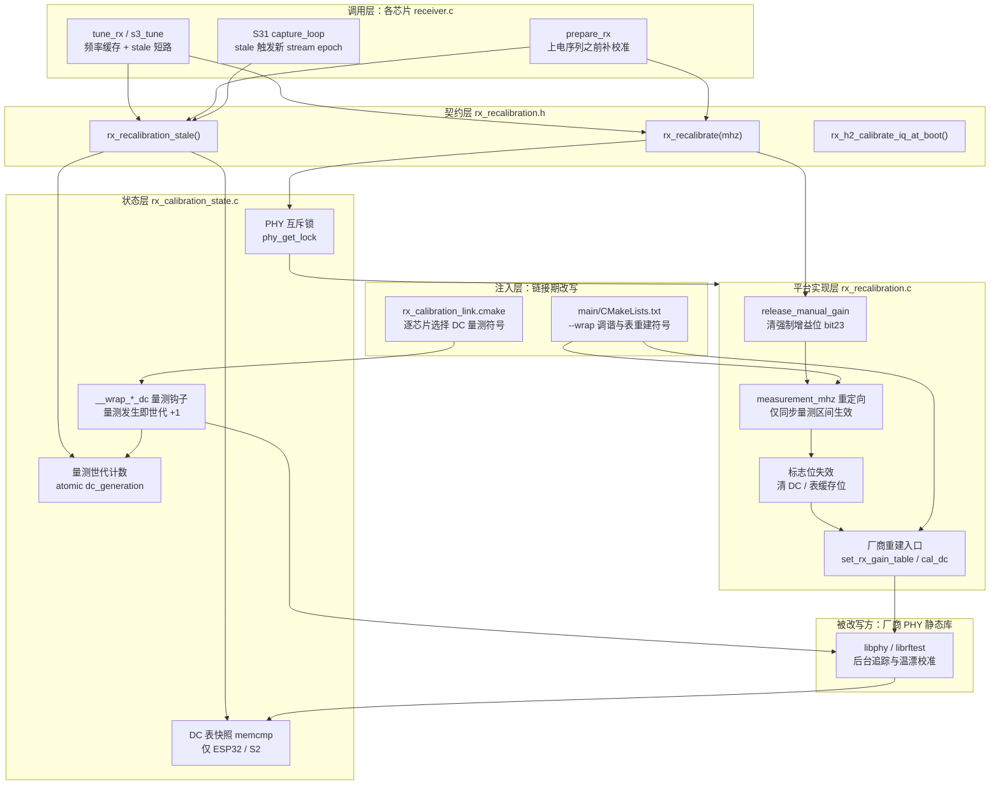

---
title: "接收校准：IQ 失配与 DC 漂移"
slug: "10-rx-calibration"
section: "接收链路控制"
level: "Advanced"
---

# 接收校准：IQ 失配与 DC 漂移

零中频（zero-IF）接收机有两个无法回避的模拟缺陷。其一是 **IQ 失配**：I 与 Q 两条支路的混频器、低通与 ADC 增益不相等、相位不正交，结果是镜像频率上的能量漏进目标频点，星座图被压扁、频谱出现共轭对称的鬼影。其二是 **DC 偏移**：本振（LO）自混频、以及 ADC 自身的失调，在基带中心叠加一个巨大的直流台阶。对采样型 SDR 来说，DC 台阶会让 FFT 第 0 个 bin 灌满能量并抬高整个底噪，而 IQ 失配则会破坏任何依赖复包络线性的处理。

ESP-SDR 的难点在于：它并不"拥有"这套校准，校准逻辑埋在 Espressif 未公开的 PHY 静态库（`libphy` / `librftest`）里，由 PHY 自己的跟踪任务在后台悄悄执行，且其入口函数的副作用远超"测一次 DC"——厂商的重调路径会在换频点时顺带跑一次**环回 IQ 校准**，通过天线发射一个测试音。对本项目而言这是不可接受的：一块只收不发的 SDR 不应该在每次调谐时对外辐射，而已经建立好的 IQ 系数也不应该被丢弃重算。`main/common/rx_recalibration.c` 与 `main/common/rx_calibration_state.c` 这对文件，就是为这条"**只重测 DC、保留 IQ**"的接收专用路径而生的收敛层。

## 项目定位与核心价值

该模块要解决的问题可以拆成三个层次，逐层收窄。第一层是**有效性判定**：一颗 ESP32 的 PHY 在启动时、后台跟踪时、以及我们主动换频时都会改写 DC 校准表，而表被换掉这件事没有任何中断或回调通知应用层。模块因此必须回答一个布尔问题——"当前驻留在 PHY 里的 DC 校准，是否仍是针对我此刻请求的这个 LO 测出来的？"——并且这个回答必须便宜到可以在每次采集准备时调用一次。第二层是**最小化副作用的重测**：既然只有 DC 需要刷新，就必须把厂商入口函数中那条"顺带重算 IQ"的分支掐掉，同时不破坏 PHY 其它状态（增益表、滤波器码、PLL 电容、增益组映射）。第三层是**芯片差异收敛**：十颗目标芯片的 PHY 静态库有不同的符号名、不同的私有调用约定（2 参数、4 参数、5 参数甚至 10 个 `uintptr_t`）、不同的标志位偏移与位编号，模块把这些差异压成一组编译分支与一张位掩码表。

其核心价值因此不是"实现了一套校准算法"，而是**把一份不可见的、带发射副作用的厂商状态机，收编为一份有明确契约、可判定、可复现的接收侧资源**。头文件把这份契约写得非常直白：调用者必须已经停止接收机与采集；调用会以 `mhz` 为 LO 测一份全新的 RX DC 并重建增益表，但保留启动时建立的 IQ 校正；重新调谐**不得**触发发射式的环回 IQ 校准；调用返回后由调用者负责恢复频道、滤波器、接收供电与增益设置。厂商自身的启动校准与后台校准仍在运行，不在这条接收专用路径的管辖范围内。

这个"不得触发发射"的约束并非洁癖，而是有实测依据的设计红线。C5 分支的注释明确写出：环回 IQ 校准会**通过天线发出一个音**，因此代码只刷新 DC 而不做那一步 TX；C61/S31 分支的注释同样写明"保留启动时的 IQ 系数，只让 DC 表缓存过期"。主机测试甚至把这条红线做成了断言——模拟的 `phy_set_rx_gain_cal_iq` / `phy_rxiq_cal_init` 一旦被调用就直接 `assert(0)`。

Sources: [rx_recalibration.h](main/common/rx_recalibration.h#L1-L19), [rx_recalibration.c](main/common/rx_recalibration.c#L6-L13), [rx_recalibration.c](main/common/rx_recalibration.c#L48-L49), [rx_recalibration.c](main/common/rx_recalibration.c#L76-L77), [test_rx_recalibration.py](tests/test_rx_recalibration.py#L205-L230), [rx-controls.md](docs/rx-controls.md#L64-L91)

## 架构设计与模块划分

模块在物理上只有两个 `.c` 加一个 `.h`，但它与三样东西强耦合：PHY 静态库（被改写方）、各芯片的 `receiver.c`（调用方）、以及链接脚本层面（改写手段）。下图给出完整的分层与依赖方向：



### 契约层：三行接口背后的语义约定

头文件只暴露三个符号，但每一条都在注释里锁死了前置条件与副作用边界。`rx_recalibrate()` 的前置条件是"接收与采集已停止"，`rx_recalibration_stale()` 的使用时机被明确为"**采集准备阶段**，包括所请求的 LO 未变的情况"——这一句是整套机制的关键，因为它把"同频重发 `FREQ` 命令要不要重测"这个问题变成了"表有没有被人换掉"，而不是"频率参数变没变"。第三个符号 `rx_h2_calibrate_iq_at_boot()` 只对 H2 存在，注释要求它在**暴露接收命令之前**调用一次，因为该 PHY 需要为每个 RF 增益组分别建立启动 IQ 校正。

值得注意的是 `rx_recalibration_stale()` 的注释还显式否认了一个常见误解：它**不是**一把采集锁，恢复动作被推迟到采集停止之后才执行。

Sources: [rx_recalibration.h](main/common/rx_recalibration.h#L1-L19)

### 状态层：两条互相独立的失效检测路线

`rx_calibration_state.c` 是整个设计中最精巧的部分，因为它面对的是一个信息不完整的系统。文件头注释道出了原始方案的失败原因：**不能拿温度戳（temperature stamp）当失效标志**，因为 PHY 可以在不改温度戳的情况下替换整张 DC 表。于是代码改用"**数实际发生了多少次 DC 量测**"这一更本质的信号，并选用原子操作以覆盖双核接收机，同时借用 PHY 互斥锁把自己的量测与 PHY 的跟踪任务串行化。

由此分叉出两条路线，按目标架构在编译期二选一：

| 路线 | 适用芯片 | 检测手段 | 原因 |
| --- | --- | --- | --- |
| A：世代计数 | C2 / C3 / C5 / C6 / C61 / H2 / S3 / S31 | `atomic_uint dc_generation` 每次量测 +1，与 `calibrated_generation` 比较 | 可用 `--wrap` 拦截量测函数 |
| B：表快照对比 | ESP32 / S2 | `memcmp` 比对导出的 `phy_rxbb_dc` / `phy_rxrf_dc`（S2 另加 56 字节 `phy_chan_dc`） | 这两颗 Xtensa 的静态库在内部**本地解析**自己的 DC 调用，`--wrap` 拦不住 |

路线 A 的注册点是每个芯片各自的量测符号，`__wrap_*` 只做一件事——调用 `__real_*`，然后 `atomic_fetch_add(&dc_generation, 1)`。注释特别点明这个钩子的价值在于"覆盖周期性跟踪器之外的重建"，也就是那些由参考信道重建引发的、不走周期任务的量测。

路线 B 的表尺寸是**从固定版本的 PHY 静态库导出的字节数**，而非温度状态结构体的偏移量：ESP32 是 RXBB 16 字节 / RXRF 136 字节，S2 是 RXBB 60 字节 / RXRF 48 字节外加对 `phy_chan_dc[56]` 的额外比较。这些数字看起来极其脆弱，但注释明确说它们的来源就是"pinned PHY archives"，也正因为如此，项目把 ESP-IDF 的 commit 固定在 `firmware-targets.json` 里。

`rx_recalibrate()` 本身的写法体现了顺序上的小心：先取 PHY 锁，调用平台实现 `rx_recalibrate_locked()`，**然后**才做表快照或读取 `dc_generation`——因为对路线 A 来说，我们自己的这次量测同样会把世代加一，快照必须发生在它之后，否则校准刚做完就会被自己判为失效。ESP32/S2 的 `memcmp` 与快照也都在同一把 PHY 锁内完成，避免读到半更新的表。

Sources: [rx_calibration_state.c](main/common/rx_calibration_state.c#L9-L32), [rx_calibration_state.c](main/common/rx_calibration_state.c#L35-L49), [rx_calibration_state.c](main/common/rx_calibration_state.c#L51-L65), [rx_calibration_state.c](main/common/rx_calibration_state.c#L67-L112), [firmware-targets.json](firmware-targets.json#L1-L96)

### 注入层：用链接器把钩子挂到静态库上

整套机制能成立，靠的是 `-Wl,--wrap=<symbol>`。`rx_calibration_link.cmake` 按目标选择"DC 量测函数"的具体名字——C5 是 `phy_set_rx_gain_cal_dc`，C61/S31 是 `phy_set_rx_gain_cal_dc_new`，C6 是 `set_rx_gain_cal_dc_new`，C2 是 `ram_set_rx_gain_cal_dc`，其余是 `set_rx_gain_cal_dc`——对 ESP32/S2 则直接 `return()`，因为路线 B 不需要钩子。注释点明这份 cmake 的作用是"让 burst 与 streaming 两种构建共用同一套 DC 世代钩子"。

调谐重定向的钩子则由 `main/CMakeLists.txt` 按目标挂载：C5 包 `phy_chip_set_chan_ana`，C61/S31 包 `phy_set_channel_rfpll_freq`，其余全部包 `chip_v7_set_chan_ana`；此外 C61/S31 额外包 `phy_write_gain_mem`、S3/C3 额外包 `set_rx_gain_table`（供增益回读校验使用）、H2 包 `write_gain_mem`（供 IQ 分组重新打包使用）。

> 设计理念：不改厂商二进制、不重实现 PHY 算法，只在**链接期**把少数几个符号换成自己的门面函数。门面函数一律"先调 `__real_`，再附加自己的簿记或状态重写"，因此即使厂商内部算法演进，只要 ABI 不变，改写就仍然成立。代价是所有 ABI 都被硬编码，任何未验证的目标都会在编译期被 `#error` 挡住。

Sources: [rx_calibration_link.cmake](main/common/rx_calibration_link.cmake#L1-L17), [CMakeLists.txt](main/CMakeLists.txt#L100-L116), [rx_calibration_state.c](main/common/rx_calibration_state.c#L67-L112)

### 平台实现层：一份 `rx_recalibrate_locked` 的四种形态

`rx_recalibration.c` 用 `#if CONFIG_IDF_TARGET_*` 分出四个互斥实现，外部统一看到 `rx_recalibrate_locked(unsigned mhz)` 这一个符号。它们的共同骨架是：**释放手动增益 → 把"测量频率"注入调谐路径 → 清掉 DC / 表缓存的标志位（但保留 IQ 有效位）→ 调厂商重建入口 → 撤销测量频率**。差异集中在钩子形态、标志位偏移与位掩码上。

| 芯片 | 调谐重定向钩子 | 标志字位置 | 清除掩码 | 保留的 IQ 语义位 | 重建入口 |
| --- | --- | --- | --- | --- | --- |
| C5 | `__wrap_phy_chip_set_chan_ana` + 直接调 `__real_` | `phy_param + 148` | `~0x280` | `0x400`，完成后连同 `0x80` 一起显式置回 `0x480` | `phy_set_rx_gain_cal_dc`（频段相关，可能两次）+ `phy_adc_rate_cal_rxdc` + `phy_set_rx_gain_table` |
| C61 / S31 | `__wrap_phy_set_channel_rfpll_freq`（含 `rx_pll_recover`） | `phy_param + 164` | `~0x280` | `0x400` | `phy_set_rx_gain_table(mhz, 0)` |
| H2 | `__wrap_chip_v7_set_chan_ana` + `phy_set_freq` | `phy_param + 52` | `~0x100` | `0x200` | `set_rx_gain_table()` |
| ESP32 | `__wrap_chip_v7_set_chan_ana` → `measurement_tune()` | `chip7_sleep_params[0]` | `~0x20320` | `0x400` | `set_rx_gain_table(rx_lo_plan(mhz).mhz, 0)` |
| S2 | 同上 | `chip7_sleep_params[0]` | `~0x20240` | `0x400` | 同上 |
| C3 / S3 | 同上 | `phy_param + 288` | `~0x200` | `0x400`（置位时厂商跳过 TX-tone IQ 步） | `set_rx_gain_table(rx_lo_plan(mhz).mhz, 0)` |
| C6 | 同上 | `phy_param + 164` | `~0x280` | `0x400` | `set_rx_gain_table()` |
| C2 | 同上 | `phy_param + 328` | `~0x300` | `0x400` | `set_rx_gain_table_new(rx_lo_plan(mhz).mhz, 0, 1, 1)` |

Sources: [rx_recalibration.c](main/common/rx_recalibration.c#L34-L80), [rx_recalibration.c](main/common/rx_recalibration.c#L81-L126), [rx_recalibration.c](main/common/rx_recalibration.c#L128-L206)

#### `measurement_mhz`：只在同步区间内改写频率

这是整个实现里最容易被误读的一处。文件注释说明：校准通常在固定的**参考信道**上完成内部调谐，而我们需要的是在**用户请求的频点**上测 DC。做法是引入一个文件级静态变量 `measurement_mhz` 作为"覆盖频率"，并只在 `rx_recalibrate_locked()` 的同步执行区间内让它非零。调谐钩子据此判断：

```c
/* C61/S31 分支：正常调谐 mhz 时零开销透传；量测期间改为 mhz = measurement_mhz */
void __wrap_phy_set_channel_rfpll_freq(unsigned mhz, unsigned crystal, unsigned mode) {
    __real_phy_set_channel_rfpll_freq(measurement_mhz ? measurement_mhz : mhz, crystal, mode);
    if (measurement_mhz) (void)rx_pll_recover(measurement_mhz);
}
```

对老一代芯片，`measurement_tune()` 直接把计划频率写进 PLL（ESP32 还要额外清掉信道钳位的电容位、并把 kHz 偏移换算成 1/1024 MHz），随后调用 `rx_lo_select(plan.alternate)` 应用 5/6 分频；而 `__wrap_chip_v7_set_chan_ana()` 会在厂商于 `set_rx_gain_table` 内部再次改信道时，重新把 LO 拉回 `measurement_mhz`。也就是说：**测量期间的任何厂商内部调谐请求，都会被静默重定向到目标频点**；一旦 `measurement_mhz` 归零，所有钩子立即退化为纯透传，启动流程与普通换频完全不受影响。

Sources: [rx_recalibration.c](main/common/rx_recalibration.c#L6-L14), [rx_recalibration.c](main/common/rx_recalibration.c#L63-L70), [rx_recalibration.c](main/common/rx_recalibration.c#L144-L167), [rx_lo.h](main/common/rx_lo.h#L15-L19)

#### `release_manual_gain()`：让测量看到它该看到的增益

如果用户当前处于手动增益模式，PHY 里那个"强制增益索引"寄存器仍然生效，它会**压过** DC 测量所需的增益扫描，导致测出来的一组 DC 值只对一个增益有效。因此每个分支在测量前都要清掉强制增益位。寄存器地址随芯片不同（S31 `0x2010702c`、C5/C6/C61 `0x600a702c`、C2 `0x6004a02c`、ESP32 `0x3ff5c02c`、其余 `0x6001c02c`），但动作一致：`REG_CLR_BIT(reg, 1u << 23)`。H2 没有这个位，改用 `force_rx_gain(0, 0)` 显式解除强制。这与增益校验模块在写寄存器时使用的 `1u << 23` 语义完全对齐。

Sources: [rx_recalibration.c](main/common/rx_recalibration.c#L16-L32), [rx_recalibration.c](main/common/rx_recalibration.c#L118-L121), [rx_gain_verify.c](main/common/rx_gain_verify.c#L83-L91)

#### C5：频段相关的双表与显式 IQ 位回置

C5 是唯一在测量后**主动把 `0x400` 置回**的分支（`*flags |= 0x480u`），因为它需要在 `0x80`（DC 缓存）与 `0x200` 之间精确地只让 DC 失效。它还按 `phy_param[42]` 判断频段：双频段时把每个插值 bin 都用当前 LO 的新测量填满；单频段时，先测 `phy_param+312/+896`，跑一次 `phy_adc_rate_cal_rxdc()`，再测 `phy_param+348/+904`，最后才重建增益表。所有私有地址（`+384/+912/+312/+896/+348/+904`）都是固定静态库的 ABI。

Sources: [rx_recalibration.c](main/common/rx_recalibration.c#L42-L62)

#### H2：四个 RF 增益组的启动 IQ，靠重写增益字安装

H2 是唯一需要额外启动步骤的芯片，也是唯一在 `--wrap` 里做**数据重打包**的芯片。它的 PHY 有四个 RF 增益组（word 1 的 bits 20..21 编码 C7/D7/E7/F7），环回测量会为每组给出一个相位/幅度对；但厂商 efuse 辅助函数只提供**两字节**（`phy_param+60`），直接用它替换四个组的校正显然不等价。因此代码的做法是：启动时 `rx_h2_calibrate_iq_at_boot()` 在 2412 MHz、强制增益 0 下跑一次环回，把四组结果存进 `startup_iq[4]`；此后每次 `write_gain_mem` 被调用时，钩子从 `b` bits 20..21 取出组号，把对应 IQ 对按 `(iq >> 1) & 0x1f80 | iq & 0x7f` 打包进增益字，且**只覆盖低 13 位**（`b & ~0x1fff`），保留其余字段。

`rx_h2_calibrate_iq_at_boot()` 是幂等的（`startup_iq_valid` 早退），并在测量前后保存/恢复 `0x600a0450` 的 IQ 控制寄存器，以免环回步骤留下副作用。主机测试对这段逻辑的约束非常具体：`phy_param+60..67` 的 8 个 0xa5 字节在校准与两次重调谐之后必须原样不动。

Sources: [rx_recalibration.c](main/common/rx_recalibration.c#L88-L126), [test_rx_recalibration.py](tests/test_rx_recalibration.py#L13-L77)

## 技术栈与核心工作流

模块本身是纯 C11 加少量内联汇编式寄存器宏（`REG_READ` / `REG_WRITE` / `REG_CLR_BIT`），依赖面极窄：`sdkconfig.h` 做目标选择、`esp_private/phy.h` 取 PHY 互斥锁、`sys/lock.h` 提供 `_lock_t`、`stdatomic.h` 提供世代计数、`soc/soc.h` 提供寄存器宏。真正的"技术栈"其实是三样非常规手段：**链接期符号替换**、**静态库私有 ABI 的硬编码复用**、以及**用原子计数模拟不可观测状态的变化通知**。

执行主链路可以概括为"判定 → 加锁 → 释放增益 → 重定向调谐 → 失效标志 → 厂商重建 → 快照世代 → 交还"：

```mermaid
flowchart LR
    A["采集准备<br/>prepare_rx / tune"] --> B{"频率未变<br/>且 !stale ?"}
    B -- 是 --> Z["直接进入上电序列"]
    B -- 否 --> C["rx_recalibrate(mhz)"]
    C --> D["phy_get_lock<br/>与 PHY 跟踪任务串行化"]
    D --> E["平台分支 rx_recalibrate_locked"]
    E --> F["release_manual_gain<br/>解除强制增益"]
    F --> G["measurement_mhz = mhz<br/>钩子开始重定向调谐"]
    G --> H["清 DC / 表缓存位<br/>保留 IQ 有效位"]
    H --> I["厂商重建：cal_dc / set_rx_gain_table"]
    I --> J["measurement_mhz = 0<br/>钩子恢复透传"]
    J --> K["快照表内容 或 读取 dc_generation"]
    K --> L["calibrated = true"]
    L --> M["释放 PHY 锁"]
    M --> N["调用者恢复<br/>频道 / 滤波 / 供电 / 增益"]
    N --> Z
```



链条上两点值得单独强调。其一，**锁的边界不含采集期**：PHY 互斥锁只保护"测量"这一步不与 PHY 跟踪任务交错；采集进行中如果跟踪任务改了 DC 表，是允许发生的，代价被推迟到下一次采集准备时的 `stale` 检查——文档对此说得很直白，"互斥锁并不在整个采集过程中持有"。其二，**恢复责任在调用者**：`rx_recalibrate()` 不负责把接收机重新上电，各芯片的 `prepare_rx()` 在它返回后继续走自己的 PBUS / 时钟 / 增益序列，这也是为什么头文件把"接收与采集必须已停止"写成前置条件而不是内部检查。

Sources: [rx_recalibration.c](main/common/rx_recalibration.c#L118-L126), [rx_calibration_state.c](main/common/rx_calibration_state.c#L51-L65), [rx-controls.md](docs/rx-controls.md#L83-L91)

### 调用侧的三种典型形态

虽然所有后端都调同样的两个函数，但"什么时候判、判完做什么"因采集形态而异：

| 后端 | 判定点 | 频率缓存 | 失效后的附加动作 |
| --- | --- | --- | --- |
| S3 / ESP32 / C2 / C3 / S2 / H2 | `tune_rx()` / `s3_tune()` 入口，`prepare_rx()` 入口 | `static unsigned calibrated_mhz` | 仅重跑调谐与 PBUS 上电序列 |
| C5 / C6 / C61 | `prepare_rx()` 内，先还原增益镜像与默认值再校准 | `static unsigned calibrated_mhz` | C61 先撤掉 `burst_gain_mirror` 并写回保存的增益初值/阈值 |
| S31 burst | `prepare_rx()` 内 | 由 `s31_tune()` 的 `calibrated_mhz` 承载 | 需要显式 `phy_rfrx_sat_rst` + `phy_force_rx_gain` 重应用增益 |
| S31 streaming | `capture_loop` 每次循环迭代 | 配置里带 `frequency_hz` | 停 DMA、丢旧数据、`stream_epoch + 1`、重新时钟标定与 DC 校正 |

S31 流式固件是最特别的一个：它不把"失效"当成一次重调谐，而当成**一次流的重启**。`capture_loop` 在 `running && rx_recalibration_stale()` 时把当前配置重新走一遍（`radio_configure` → `diagnostic_start` → 时钟标定 → `receiver_dc_calibrate` → 重新装 PARLIO/DMA），并显式递增 `stream_epoch` 让主机知道这是一段新数据。注释写明"**绝不在采集中重校准**"。

Sources: [receiver.c](main/targets/esp32s3/receiver.c#L53-L65), [receiver.c](main/targets/esp32s3/receiver.c#L112-L146), [receiver.c](main/targets/esp32/receiver.c#L83-L95), [receiver.c](main/targets/esp32/receiver.c#L166-L189), [receiver.c](main/targets/esp32c2/receiver.c#L65-L99), [receiver.c](main/targets/esp32h2/receiver.c#L46-L76), [receiver.c](main/families/c5_c6_c61/receiver.c#L88-L122), [tuning.h](main/targets/esp32s31/tuning.h#L1-L15), [receiver.c](main/targets/esp32s31/burst/receiver.c#L108-L118), [receiver.c](main/targets/esp32s31/streaming/receiver.c#L329-L400)

### 启动期的三个必备前置

校准能工作的前提是"PHY 已经在正确的模式下运行"。三处启动代码因此不能省：S3 需要先跑完 `esp_wifi` 初始化并至少设过一次信道，`prepare_rx()` 才会走到 `s3_tune()`；H2 必须 `esp_phy_enable(PHY_MODEM_BT)` + `rftest_open_clk()` 之后立刻调 `rx_h2_calibrate_iq_at_boot()`，再 `prepare_rx()`，最后才暴露接收命令；S31 burst 后端则要先 `phy_pbus_workmode()` / `phy_pbus_xpd_rx_on(1)` 把接收供电拉起来，才能谈增益与调谐。

Sources: [receiver.c](main/targets/esp32s3/receiver.c#L112-L138), [receiver.c](main/targets/esp32h2/receiver.c#L243-L262), [receiver.c](main/targets/esp32s31/burst/receiver.c#L108-L118)

## 典型代码示例

调用侧的真实写法只有三行上下文，却决定了整个性能特征——同频重复请求**不会**重测 DC：

```c
static void s3_tune(unsigned mhz) {
    static unsigned calibrated_mhz;
    if (calibrated_mhz != mhz || rx_recalibration_stale()) {
        rx_recalibrate(mhz);
        calibrated_mhz = mhz;
    }
    /* ... 随后才是 rx_lo_select / set_chanfreq / set_rf_freq_offset ... */
}
```

这里的关键是"或短路"的语义：`calibrated_mhz != mhz` 覆盖"换频"这一常规情形，`rx_recalibration_stale()` 覆盖"没换频但表被人换掉"这一隐蔽情形。两者共用同一条慢路径，但只有后者能在频率参数完全没变时触发重测。

Sources: [receiver.c](main/targets/esp32s3/receiver.c#L53-L65), [rx-controls.md](docs/rx-controls.md#L74-L76)

第二段代码展示钩子与"测量频率注入"的配合，这是所有分支共享的骨架（以 H2 为例）：

```c
void __wrap_chip_v7_set_chan_ana(unsigned channel) {
    __real_chip_v7_set_chan_ana(channel);          /* 厂商内部调谐照常执行 */
    if (measurement_mhz) phy_set_freq(measurement_mhz, 0);  /* 测量期间拉回目标 LO */
}

void rx_recalibrate_locked(unsigned mhz) {
    measurement_mhz = mhz;
    force_rx_gain(0, 0);                           /* 解除强制增益，让增益扫描有效 */
    phy_set_freq(mhz, 0);
    *(uint32_t *)(phy_param + 52) &= ~0x100u;      /* 只让接收 DC 失效，保留 IQ 位 0x200 */
    set_rx_gain_table();                           /* 厂商重建：不跑 TX 环回 IQ */
    measurement_mhz = 0;
}
```

Sources: [rx_recalibration.c](main/common/rx_recalibration.c#L84-L87), [rx_recalibration.c](main/common/rx_recalibration.c#L118-L126)

## 学习与探索建议

| 读者 | 建议路径 | 关注点 |
| --- | --- | --- |
| 想弄清"为什么不能沿用厂商调谐" | 先读 `docs/rx-controls.md` 的 Receive calibration 小节，再回到 `rx_recalibration.c` 顶部的两段块注释 | 发射式环回、参考信道调谐、温度戳失效这三个前提 |
| 想验证某颗新芯片能否接入 | 先看 `rx_calibration_link.cmake` 与本文件末尾的两个 `#error` 分支，再看 `tests/test_rx_recalibration.py` 中对应 `subTest` | 需要的符号名、私有调用约定、标志位偏移与 IQ 保留位 |
| 想理解失效检测的两种实现 | 对照 `rx_calibration_state.c` 的 `rx_recalibration_stale()` 与 `rx_recalibrate()` | 世代快照必须发生在自身量测之后；ESP32/S2 走表内容比对 |
| 想扩展成"背景 DC 追踪" | 从 `rx_gain_verify.c` 的 `__wrap_set_rx_gain_table` 与 `ring_capture.c` 的 bank 轮转读起 | 锁粒度、采集期允许陈旧这一设计取舍 |
| 想排查"画面出现中心尖峰 / 镜像" | 先确认 `stale` 判定是否被绕过（S31 streaming 的新 epoch 路径），再看数字域 `receiver_dc_calibrate` | PHY 域 DC 与数字域 DC DAC 级联的两套机制 |

## 🔗 关联模块与上下游

- [rx_recalibration.h](main/common/rx_recalibration.h)：契约本身，包含"接收与采集必须已停止"与"H2 启动期调用"两条硬约束。
- [rx_calibration_state.c](main/common/rx_calibration_state.c)：失效检测与 PHY 锁边界，所有调用侧判断都依赖它。
- [main/CMakeLists.txt](main/CMakeLists.txt)：`--wrap` 挂载点，决定了哪些内部调谐路径会被重定向。
