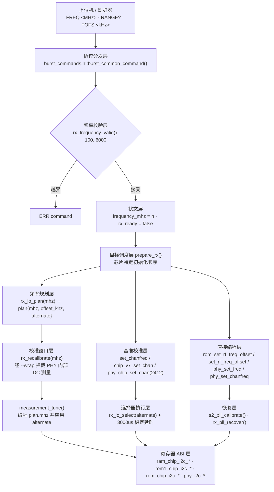
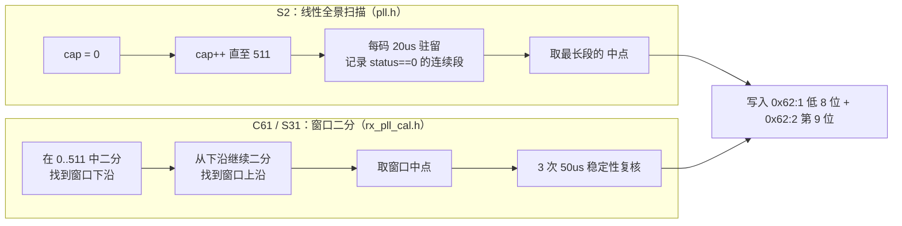
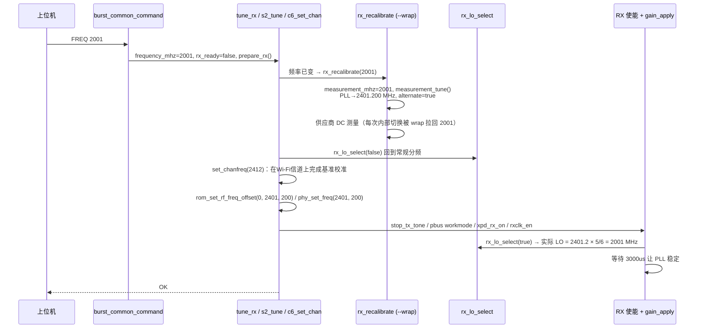

# 频率调谐：PLL 与 5/6 分频 LO

> 「接受一个频率」与「锁定了这个频率」是两件完全不同的事。本子系统只承诺前者。

ESP-SDR 把一颗量产 Wi-Fi/蓝牙芯片的射频前端改造成接收机，而射频前端唯一不可绕过的物理约束就是本振（LO）。厂商固件从未把 LO 当作可编程资源暴露给用户：它只为 2.4 GHz 与 5 GHz 的十二个/若干个 Wi-Fi 信道服务，通道号经 `mhz2ieee` 之类的映射被折叠成一张固定的校准表。本页面覆盖的四个头文件构成的正是这条"把任意 MHz 请求翻译成 RFPLL 寄存器写入序列"的窄而深的管线——它比抓取链路短得多，但几乎每一行都对应一次硬件失败。

## 1. 项目定位与核心价值

### 1.1 诞生背景：三个必须同时绕过的障碍

第一个障碍是**通道语义**。ESP-IDF 的 `esp_wifi_set_channel` 与 `chip_v7_set_chan` / `set_chanfreq` 这类供应商入口以"通道号"为参数，MHz 只是被折算成通道的输入形式；任何不在 5 MHz 网格上的频率、任何超出 Wi-Fi 信道表的频率，都会在下游被静默地就近取整，甚至触发一次针对参考信道的完整重校准。于是"我要在 2001 MHz 采样"和"芯片把 LO 放在 2400 MHz"可以同时成立而毫无报错。

第二个障碍是**校准表只对 Wi-Fi 带有效**。RFPLL 的 VCO 需要一个九位电容码（capacitor code）把振荡器拉到目标频点，这个码由供应商校准流程按 Wi-Fi 信道预先算出并缓存。一旦把 SDM 字直接改成带外频率，缓存里的电容码仍然指向旧信道，PLL 电压比较器落在窗口之外，芯片看起来"在工作"，实际没有任何信号能通过。`main/targets/esp32s2/pll.h` 与 `main/common/rx_pll_cal.h` 就是两种针对该现象的补丁：前者穷举、后者二分，思路不同但目标一致——在不改变已编程频率、不引入任何采样处理的前提下，用 PLL 自带的比较器把电容码重新找回。

第三个障碍是**没有锁指示**。芯片不提供任何可信的 lock 位。可用的只有 RFPLL 寄存器 `0x62:1:12` 的 bit 3:2：它把 VCO 控制电压与一个窗口比较，`0` 表示落在窗口内、`1` 表示偏低、`2` 表示偏高。这个"窗口内"与"能收到信号"高度相关但并非等价——实测中 S2、S3、C3 出窗后基本收不到信号，而 C2 在 2950 MHz、C3 在 1850 MHz 仍能收到。因此固件在架构层面做了一个克制而重要的决定：**从不把这几位当作 lock 状态上报给客户端**，只把它们当作搜索代价函数使用。

第三个障碍的对立面，是本子系统最有价值的一项发现：**5/6 分频**。既然 RFPLL 在 2210–2651 MHz 这个"保守包络"内最稳，而用户想要 1842–2210 MHz，那就不要把 PLL 拉到低频去挣扎，而是把 PLL 编程到 `f × 6/5` 的高位坐标，再用 CKGEN 里一个隐藏的 LO 分频比把实际本振除回 5/6。`main/common/rx_lo.h` 把这条规则压缩成了一个三元组与一行乘法，但它的代价是整条初始化顺序必须被重排：校准阶段必须留在常规分频下，分频切换必须发生在 RX 使能之后。

> 设计理念：**调谐是"尝试"，不是"承诺"**。`RX_FREQ_MIN/RX_FREQ_MAX` 的注释明确写着这是"software attempt limits, independent of the radio's nominal RF bands"，`RANGE 100 6000 1` 因此是一个宽于物理能力的声明，协议文档也用同一句话约束客户端：接受频率不代表 PLL 锁定。

Sources: [rx_tuning.h](main/common/rx_tuning.h#L1-L11), [rx_lo.h](main/common/rx_lo.h#L1-L19), [rx_pll_cal.h](main/common/rx_pll_cal.h#L1-L23), [pll.h](main/targets/esp32s2/pll.h#L1-L14), [rx-controls.md](docs/rx-controls.md#L93-L114)

### 1.2 核心特性：四个头文件各自承担什么

这一族代码的组织方式值得先看清：它们全部是**头文件**，没有 `.c`，全部以 `static inline` / `static` 形式定义在包含点展开，并被 `main/CMakeLists.txt` 的 `PRIV_INCLUDE_DIRS "common"` 统一暴露。这不是风格偏好，而是被裁剪需求驱动的——每个目标芯片只编译自己的 `receiver.c`，头文件里的 `#if CONFIG_IDF_TARGET_*` 与 `#error` 保证"未经验证的寄存器布局"在编译期就失败，而不是在硬件上安静地给出错误频谱。

| 文件 | 抽象层级 | 核心职责 | 移植性策略 |
| --- | --- | --- | --- |
| `rx_tuning.h` | 协议契约 | 定义 100–6000 MHz 的软件尝试区间、校验器与 `RANGE` 应答字面量 | 与芯片无关，纯常量 |
| `rx_lo.h` | 频率规划 + 选择器 | `rx_lo_plan()` 把接收 MHz 转成 PLL 坐标与 `alternate` 标志；`rx_lo_select()` 对 CKGEN 做读改写 | 按目标别名化四套 ROM I2C ABI，未列入目标直接 `#error` |
| `rx_pll_cal.h` | 校准恢复（C61/S31） | 二分搜索九位电容码，取窗口中点并做稳定性复核，失败则全字段回滚 | 仅 C61/S31，其余 `#error` |
| `pll.h` | 校准恢复（S2） | 线性扫完 512 个码，选**最宽连续可用区间**的中点 | 仅 S2 使用（位于 `targets/esp32s2/`） |

四者的分工体现了一条清晰的分层原则：**规划与执行分离，恢复策略与芯片实现绑定**。`rx_lo_plan()` 不知道寄存器在哪，`rx_lo_select()` 不知道用户请求了多少 MHz，两个恢复函数则完全不参与频率规划——它们只接收一个 MHz 用于判断"是否值得救"。

Sources: [rx_tuning.h](main/common/rx_tuning.h#L4-L10), [rx_lo.h](main/common/rx_lo.h#L9-L63), [rx_pll_cal.h](main/common/rx_pll_cal.h#L8-L16), [pll.h](main/targets/esp32s2/pll.h#L3-L13), [CMakeLists.txt](main/CMakeLists.txt#L13-L20)

## 2. 架构设计与模块划分

### 2.1 分层拓扑



这张图里有两个容易被忽略的"隐形边"。第一条是 **`--wrap` 链路**：`cmd/receiver.c` 并没有显式调用 `measurement_tune()`，是链接期的 `-Wl,--wrap=chip_v7_set_chan_ana`（C5 为 `phy_chip_set_chan_ana`，C61/S31 为 `phy_set_channel_rfpll_freq`）把供应商 PHY 内部的每一次通道切换重定向到了本模块。第二条是 **`rx_lo_select()` 的两次调用**：先 `false` 把选择器复位到常规分频以便供应商校准跑在它认识的频段上，最后再 `alternate` 把用户真正想要的频率接通。这两次调用分处两个函数、跨过一次完整的 RX 使能序列，是该子系统最脆弱的时序契约，也正因如此它被写成了测试用例。

Sources: [CMakeLists.txt](main/CMakeLists.txt#L100-L106), [rx_recalibration.c](main/common/rx_recalibration.c#L128-L167), [rx_lo.h](main/common/rx_lo.h#L58-L63)

### 2.2 频率规划层：把 1.2 倍写成一个三元组

整个"5/6 分频"策略的数学部分只有三行：

```c
static inline rx_lo_plan_t rx_lo_plan(unsigned mhz) {
    bool alternate = mhz >= 1842 && mhz < 2210;
    unsigned khz = mhz * (alternate ? 1200u : 1000u);
    return (rx_lo_plan_t){khz / 1000u, (int)(khz % 1000u), alternate};
}
```

这段代码做了三件事，每一件都值得展开：

1. **区间判定用的是半开区间 `[1842, 2210)`**。乘以 6/5 后映射到 `[2210.4, 2652)`，正好落在文件头注释所称的"conservative 2210..2651 MHz PLL envelope"内。`2210` 本身被排除在外，因为它可以直接调谐，不需要分频；这个边界值在 `tests/test_tuning.py` 里被显式覆盖（`1841`、`1842`、`2209`、`2210` 四个端点同时出现在测试向量里）。
2. **算术全部在 kHz 上做，且刻意先乘后除**。`khz = mhz * 1200` 后再拆成 `khz / 1000` 与 `khz % 1000`，保证 `plan.mhz * 1000 + plan.offset_khz == mhz * 1200` 精确成立，不存在浮点或取整漂移。测试用 `assert(pll*1000u+pll_offset==expected_khz)` 对这一恒等式做了 5901 次校验。
3. **`alternate` 被显式携带出函数**，而不是让调用方自己再算一次 `mhz >= 1842 && mhz < 2210`。这是有意的：调用方共有七八处，任何一处把边界抄错都会导致"PLL 编到 2401.2 却没切分频"这类只能靠频谱仪发现的故障。

`offset_khz` 的取值范围是 `[0, 999]`，它被原样喂给供应商 API 的 kHz 偏移参数；唯一的例外是 ESP32，其 ROM 使用 1/1024 MHz 而不是 kHz，因此需要一次带四舍五入的单位换算。

Sources: [rx_lo.h](main/common/rx_lo.h#L9-L19), [esp32/receiver.c](main/targets/esp32/receiver.c#L180-L188), [test_tuning.py](tests/test_tuning.py#L100-L107), [test_tuning.py](tests/test_tuning.py#L183-L194)

### 2.3 选择器执行层：一次跨四代芯片的读改写

`rx_lo_select()` 本身只有五行，是标准的"读—改—写—报告是否变化"：

```c
static inline bool rx_lo_select(bool alternate) {
    unsigned old = rx_lo_read(RX_LO_BLOCK, RX_LO_HOST, RX_LO_REG);
    unsigned value = (old & ~RX_LO_MASK) | (alternate ? RX_LO_MASK : 0u);
    if (value != old) rx_lo_write(RX_LO_BLOCK, RX_LO_HOST, RX_LO_REG, value);
    return value != old;
}
```

真正的复杂度在它上方那二十行预处理指令里。四个头文件里出现的第一处（也是唯一一处）跨目标 ABI 别名声明的集合就在这里，因为不同世代的 ROM 把同一个 I2C 读寄存器能力放在了不同符号名下：

| 目标 | ROM 符号 | `RX_LO_HOST` | `RX_LO_BLOCK` | `RX_LO_REG` | `RX_LO_MASK` |
| --- | --- | --- | --- | --- | --- |
| ESP32 | `ram_chip_i2c_readReg` / `writeReg`（SDK 补丁版） | 4 | 0x65 | 0 | 0x10 |
| ESP32-C3 | `rom1_chip_i2c_readReg` / `writeReg` | 1 | 0x65 | 0 | 0x10 |
| ESP32-S2 / S3 / C2 / C6 | `rom_chip_i2c_readReg` / `writeReg` | 1 | S2/S3: 0x65:0<br/>C2/C6: 0x62:16 | S2/S3: 0<br/>C2/C6: 16 | S2/S3: 0x10<br/>C2/C6: 0x08 |

三点实现细节值得记录。其一，`RX_LO_MASK` 是**单比特**，读改写的意义在于绝不覆盖同一寄存器里的其它 CKGEN 配置位——测试用 `for value in 0..255` 把全部 256 种邻居状态都跑了一遍，断言 `rx_lo_select(true)` 后恰好等于 `value|MASK`、`rx_lo_select(false)` 后恰好等于 `value&~MASK`。其二，ESP32 需要的是 SDK 打过补丁的 `ram_chip_i2c_*` 且必须使用 host 4，这是文档中明确记录的芯片怪癖。其三，`RX_LO_HOST` 有一个 `#ifndef` 兜底为 1，而 block/reg/mask 没有——意味着新增芯片必须同时确认这四个量，否则会落进 `#else #error Unqualified alternate LO selector`。

`rx_lo_select()` 返回 `bool` 不是为了报错（I2C 写没有返回值可用），而是为了让 ESP32 后端决定**是否需要等那 3 ms**：分频比未变则不需要 PLL 重新稳定。这是一处非常务实的小优化，其他后端选择了无条件等待。

Sources: [rx_lo.h](main/common/rx_lo.h#L21-L63), [esp32/receiver.c](main/targets/esp32/receiver.c#L88-L95), [test_tuning.py](tests/test_tuning.py#L134-L150), [test_tuning.py](tests/test_tuning.py#L184-L187)

### 2.4 恢复层：穷举 vs 二分的两种校准哲学

两个恢复函数解决同一个问题，但彼此的取舍几乎互补，放在一起读能看清硬件约束。



`pll.h` 的 `s2_pll_calibrate()` 是穷举式：对 `cap ∈ [0, 512)` 全量写码、每次等 20 µs，用 `rom_chip_i2c_readReg(0x62,1,12) & 0x0c` 判断是否落在窗口内，并维护当前连续段长度 `run` 与历史最佳 `best`，最终取**最宽可用区间的中点**。选"最宽"而非"第一个"是有物理依据的：VCO 电容码的可用窗口宽度直接对应频率漂移余量，窄窗口即使当下能锁也会随温度失锁。代价是固定 512 次写加一次复核，主机侧测试断言 `steps == 513`（成功）/ `512`（失败），实际约 11 ms 加 I2C 开销。

`rx_pll_cal.h` 的 `rx_pll_recover()` 是二分式，并且包含三层防御：

- **值域防御**：`if (mhz >= 2400 || rx_pll_status() == 0) return true;` —— 2.4 GHz 以上的Wi-Fi 带本来就在校准表覆盖内，且已锁定时不做任何写入（测试以 `writes == 0` 断言这一点，避免无谓的寄存器抖动）。
- **搜索防御**：第一段二分找窗口下沿（`status == 1` 说明还需增大电容，故 `low = mid + 1`），第二段找上沿（`status == 0` 继续，`status == 2` 收敛）；任何一步遇到 `status == 3` 立即放弃。`status == 3` 在测试桩里被用来模拟"窗口在复核过程中发生变化"，属于不稳定工况。
- **回滚防御**：搜索前先快照 `0x62:1:1`、`0x62:1:2`、`0x62:1:11` 三个寄存器，失败时逐字段还原。测试对其做了跨全部 `lo ∈ [0,512)`、`width ∈ [1,12]` 的组合覆盖（近六千组），并在最后专门验证"最后一次稳定性检查才失败"也必须完整还原。

两处寄存器布局差异必须记住，否则跨芯片移植必然踩坑：九位电容码的**第 9 位落点不同**（S2 在 `0x62:1:2` 的 bit 4，C61/S31 在 bit 6），手动模式使能位则都是 `0x62:1:11` 的 bit 6。此外 S2 额外把 `0x62:1:0` 的 bit 7 置位，而 ESP32 后端在直接重调谐前恰恰要**清** `0x62:1:0` 的 bit 7（"释放通道固定的电容"），同名寄存器上的相反操作提醒我们：这是两位不同芯片世代语义相近但不等价的位。

Sources: [pll.h](main/targets/esp32s2/pll.h#L8-L40), [rx_pll_cal.h](main/common/rx_pll_cal.h#L18-L69), [pll_calibration_test.c](tests/pll_calibration_test.c#L47-L76), [test_tuning.py](tests/test_tuning.py#L198-L233), [esp32/receiver.c](main/targets/esp32/receiver.c#L180-L185)

### 2.5 校准窗口劫持：`--wrap` 如何把 DC 测量钉在目标频点上

这是本子系统中设计最精妙、也最容易在阅读时漏掉的一环。供应商的 DC 校准（`phy_set_rx_gain_cal_dc` 及其同族函数）内部会把芯片调到若干**固定参考信道**上测量，然后写回一张按增益插值的表。如果我们只是"调谐后重新调用一次校准"，校准仍然发生在 2.412 GHz，表却是给 2001 MHz 用的——直流偏置量级完全对不上。

解决方案是在链接期劫持，而不是在源码层改写：

```c
static void measurement_tune(void) {
    rx_lo_plan_t plan = rx_lo_plan(measurement_mhz);
    /* 各目标分支：把 PLL 编程到 plan.mhz / plan.offset_khz */
    rx_lo_select(plan.alternate);
}
void __wrap_chip_v7_set_chan_ana(unsigned channel) {
    __real_chip_v7_set_chan_ana(channel);
    if (measurement_mhz) measurement_tune();
}
```

`measurement_mhz` 是一个"仅在本函数栈帧有效"的全局钩子：`rx_recalibrate_locked()` 进入时置位、退出时清零。于是窗口期内供应商 PHY 的**每一次**内部通道切换都会先执行原始逻辑、再被 `measurement_tune()` 强制拉回用户请求的 LO，包括分频选择。这解释了为什么 `rx_lo.h` 的分频切换在 `measurement_tune()` 里也出现了一次——不是冗余，而是必须让 DC 在"真实的接收频率"上测量，否则重校准后的表会整体偏移。

以此为参照，`rx_lo.h` 头注释那句"Keep the vendor calibration in normal mode and select the final mode only after RX setup"的适用范围就清楚了：它约束的是**通道校准**（`set_chanfreq(2412)` 之后紧跟的直接 PLL 编程），而不是 DC 重校准。测试用例 `test_alternate_lo_setup_and_return_to_normal` 把这条契约写成了断言——在 `set_chanfreq`、`stop_tx_tone`、`pbus_workmode`、`pbus_xpd_tx_off`、`xpd_rx_on`、`set_rxclk_en` 的每一次进入点上，都断言 `!(ckgen & RX_LO_MASK)`，即"此刻选择器必须还在常规分频"。

Sources: [rx_recalibration.c](main/common/rx_recalibration.c#L128-L167), [rx_recalibration.c](main/common/rx_recalibration.c#L178-L205), [rx_lo.h](main/common/rx_lo.h#L4-L8), [test_tuning.py](tests/test_tuning.py#L127-L196)

## 3. 技术栈与核心工作流

### 3.1 执行主链路：从 `FREQ 2001` 到本振接通

协议层的入口极薄，只有四行有效逻辑——校验、改状态、清 `rx_ready`、立即 `prepare_rx()`：

```c
} else if (sscanf(line, "FREQ %u %c", &n, &extra) == 1 && frequency_valid(n)) {
    frequency_mhz = n;
    rx_ready = false;
    prepare_rx();
    reply("OK\n");
}
```

`rx_ready = false` 是整条链路的关键开关：它把"下一次抓取前必须重新初始化射频"这一事实编码进状态，而不是让 `FREQ` 自己去完成全部初始化。真正的时序编排在 `prepare_rx()` 里，而它的第一步永远是"如果频率变了或校准过期，就重校准"——这就把 `FREQ` 变成一个幂等且可被延迟的操作。

下面以 ESP32 后端为例，标注每一步的寄存器动作与耗时：



值得强调的是"**为什么非要先调 2412 再改 PLL**"。对 ESP32/C2/C3/S2/S3/C6 这些后端，`set_chanfreq()` 不只是设频点，它还承担了整整一套 PBUS 模拟控制表、滤波器带宽、增益表的装载。跳过它直接写 PLL，芯片会停在上一个信道遗留的模拟配置上。因此固件选择了一条看起来冗余的路径：**先用最保守的 2.412 GHz 完整跑一遍供应商流程，再把 SDM 字覆盖成真实目标**。注释把这件事写得很直白——"Calibrate using a real Wi-Fi channel, then program exact PLL MHz. The channel API otherwise rounds off-grid frequencies."

Sources: [burst_commands.h](main/common/burst_commands.h#L37-L45), [esp32/receiver.c](main/targets/esp32/receiver.c#L166-L189), [esp32s2/receiver.c](main/targets/esp32s2/receiver.c#L50-L64), [esp32c2/receiver.c](main/targets/esp32c2/receiver.c#L65-L79)

### 3.2 目标差异矩阵

十一款芯片共享同一套契约，但落点各不相同。这张表是本页面最需要随身携带的部分：

| 目标 | 基准通道校准 | 直接 PLL 编程 | 分频切换 | 附加恢复 | 通道判定特例 |
| --- | --- | --- | --- | --- | --- |
| ESP32 | `set_chanfreq` | `rom_set_rf_freq_offset(xtal, mhz, off/1024)` | 0x65:0[4] @host4 | 前置清 `0x62:1:0[7]` | — |
| ESP32-S2 | `set_chanfreq` | `rom_set_rf_freq_offset(0, mhz, kHz)` | 0x65:0[4] @host1 | `s2_pll_calibrate()` 全扫 512 码 | — |
| ESP32-S3 | `set_chanfreq` | `set_rf_freq_offset(0, mhz, kHz+fofs)` | 0x65:0[4] @host1 | — | `FOFS` 非零时强制直调 |
| ESP32-C3 | `set_chanfreq` | `phy_set_freq(mhz, kHz)` | 0x65:0[4] @rom1 | — | — |
| ESP32-C2 | `set_chanfreq` | `phy_set_freq(mhz, kHz)` | 0x62:16[3] @host1 | — | 增益表按 `plan.mhz` 索引 |
| ESP32-C6 | `chip_v7_set_chan` | `phy_set_freq(mhz, kHz)` | 0x62:16[3] @host1 | — | 分频在 `prepare_rx` 末尾 |
| ESP32-C5 | `phy_set_chanfreq(mhz)` | 同一个调用，无二次编程 | 无 | — | 直接接受 MHz，不做通道折叠 |
| ESP32-C61 | `phy_chip_set_chan(2412)` | `phy_set_freq(mhz, 0)` | 无 | `rx_pll_recover(mhz)` | 仅离网时调用 |
| ESP32-S31 | `phy_chip_set_chan(2412)` | `phy_set_freq(mhz, 0)` | 无 | `rx_pll_recover(mhz)` | **始终**调用，含信道 |
| ESP32-H2 | `set_chanfreq` | `phy_set_freq(mhz, 0)` | 无 | — | 蓝牙 PHY |

表格之外有三条隐含结论。第一，**C5 是唯一的例外路线**：它的 `phy_set_chanfreq` 原生接受 MHz，`targets/esp32c5/tuning.h` 因此只有四行，并且测试专门断言 100–6000 MHz × 两种 PHY 模式的每一个组合都 `tuned == mhz`。第二，**C61/S31 不参与 5/6 分频**，`rx_lo.h` 的 `#else #error` 会把它们挡在编译期之外；它们改用 PLL 电容恢复来换取 2200 MHz 的可用性，这也是为什么 C61 的实测下限能到 2200 而 C6 到 1950。第三，**S31 与 C61 的分支不对称**：C61 只在 `!channel` 时调 `rx_pll_recover`，S31 无条件调用——因为 S31 的 `phy_set_freq` 也在无条件执行，它不信任基准通道留下的电容码。

Sources: [esp32/receiver.c](main/targets/esp32/receiver.c#L166-L189), [esp32s3/receiver.c](main/targets/esp32s3/receiver.c#L53-L65), [esp32c6/chip.h](main/targets/esp32c6/chip.h#L12-L20), [esp32c5/tuning.h](main/targets/esp32c5/tuning.h#L1-L8), [esp32c61/tuning.h](main/targets/esp32c61/tuning.h#L10-L17), [esp32s31/tuning.h](main/targets/esp32s31/tuning.h#L5-L15), [esp32h2/receiver.c](main/targets/esp32h2/receiver.c#L46-L58), [rx-controls.md](docs/rx-controls.md#L112-L114)

### 3.3 校准失效检测：为什么本模块不能信任"频率没变"

`FREQ` 的重复请求在朴素实现里是可以被优化的：同一个频率不必重做 DC 测量。但供应商 PHY 会在后台周期性重校准，把 DC 表整个替换掉却不改变任何温度戳。于是固件引入了一条**独立的失效信号**：

```c
bool rx_recalibration_stale(void) {
    ...
    return !calibrated || atomic_load(&dc_generation) != calibrated_generation;
}
```

`dc_generation` 由 `--wrap` 系列挂钩在每个 DC 测量函数上自增（C5 的 `phy_set_rx_gain_cal_dc`、C61/S31 的 `phy_set_rx_gain_cal_dc_new`、C6 的 `set_rx_gain_cal_dc_new`、C2 的 `ram_set_rx_gain_cal_dc` 等）。ESP32 与 S2 是特例：它们的 Xtensa 归档在本地解析内部 DC 调用，`--wrap` 拦不住，因此改为**逐字节比对导出的 DC 表**（`phy_rxbb_dc`/`phy_rxrf_dc`，S2 另加 `phy_chan_dc`）。这就是 `rx_calibration_link.cmake` 里第一行直接 `return()` 的原因。

对本模块的直接后果是：`tune_rx()` 的缓存条件必须写成 `if (calibrated_mhz != mhz || rx_recalibration_stale())`，而 `prepare_rx()` 的快速返回条件必须写成 `if (rx_ready && !rx_recalibration_stale())`。两个条件少写任何一个，都会导致"用户没换频率但频谱悄悄变脏"这类极难复现的问题。`rx_tuning.h` 的 `rx_tuning` 一族本身无状态，状态的正确性完全依赖这一层。

Sources: [rx_calibration_state.c](main/common/rx_calibration_state.c#L20-L65), [rx_calibration_state.c](main/common/rx_calibration_state.c#L76-L112), [rx_calibration_link.cmake](main/common/rx_calibration_link.cmake#L1-L17), [esp32c2/receiver.c](main/targets/esp32c2/receiver.c#L65-L70)

### 3.4 时序预算

调谐不是免费的，各步骤的耗时有量级差异，理解它们才能解释"为什么 `FREQ` 之后首帧会更慢"：

| 动作 | 典型耗时 | 量级来源 | 可否省略 |
| --- | --- | --- | --- |
| `rx_lo_select()` 读改写 | 两次 I2C 事务 | 寄存器访问 | 否 |
| 分频切换后的稳定延时 | 3000 µs | `esp_rom_delay_us(3000)` | ESP32 在"值未变"时省略 |
| S2 电容全扫 | ≈ 11 ms + I2C 开销 | 512 码 × 20 µs + 复核 20 µs | 仅离网频率触发 |
| C61/S31 窗口二分 | ≤ 25 次探测 × 50 µs ≈ 1.25 ms | 九位值域 + 稳定性复核 | `mhz ≥ 2400` 或已锁定时直接返回 |
| `rx_recalibrate()` | 供应商 DC 测量，毫秒级 | PHY 内部增益扫描 | 频率未变且未过期时省略 |

`RX_FREQ_MAX` 取 6000 而非 2651，正是因为在承认"绝大多数请求会失败"的前提下，拒绝调谐比拒绝接受更容易让客户端逻辑复杂化。协议文档同时给出了实测可用区间表作为补偿：C2 实测到 2950 MHz、C5 是唯一覆盖 5180–5800 MHz 的型号、H2 仅在 2300–2650 MHz 有响应。

Sources: [rx_pll_cal.h](main/common/rx_pll_cal.h#L25-L61), [pll.h](main/targets/esp32s2/pll.h#L15-L27), [esp32/receiver.c](main/targets/esp32/receiver.c#L94), [rx-controls.md](docs/rx-controls.md#L116-L136)

## 4. 典型代码示例

### 4.1 一次完整的离网调谐（ESP32 后端）

下面这段浓缩了本模块的全部设计取舍：先校准、再复位分频、再跑基准通道、再直写 PLL、最后释放被通道固定的电容。

```c
static void tune_rx(unsigned mhz) {
    static unsigned calibrated_mhz;
    if (calibrated_mhz != mhz || rx_recalibration_stale()) {
        rx_recalibrate(mhz);
        calibrated_mhz = mhz;
    }
    rx_lo_plan_t plan = rx_lo_plan(mhz);
    rx_lo_select(false);
    bool channel = (mhz >= 2412 && mhz <= 2472 && (mhz - 2412) % 5 == 0) || mhz == 2484;
    /* Calibrate on a real channel before bypassing the channel-number mapping. */
    set_chanfreq(channel ? mhz : 2412, 0);
    if (!channel) {
        unsigned xtal = rtc_clk_xtal_freq_get();
        unsigned cap = ram_chip_i2c_readReg(0x62, 1, 0);
        ram_chip_i2c_writeReg(0x62, 1, 0, cap & ~0x80u);
        int offset = (plan.offset_khz * 1024 + 500) / 1000;
        rom_set_rf_freq_offset(xtal == 26 ? 1 : xtal == 24 ? 2 : 0, plan.mhz, offset);
    }
}
```

三个细节：信道判定同时接受 `2412..2472` 的 5 MHz 网格 **以及** 2484（信道 14 的特殊中心频点）；晶振频率在 26/24/40 MHz 三档间映射成 ROM 的枚举；`(plan.offset_khz * 1024 + 500) / 1000` 是唯一一处需要四舍五入的换算，测试对其误差约束为 `±500` 个 1/1024 MHz 单位。

Sources: [esp32/receiver.c](main/targets/esp32/receiver.c#L166-L189), [test_tuning.py](tests/test_tuning.py#L100-L104)

### 4.2 二分找窗口：`rx_pll_recover()` 的两段搜索

```c
unsigned low = 0, high = 512;
while (low < high) {                      /* 第一段：找窗口下沿 */
    unsigned mid = low + (high - low) / 2;
    unsigned status = rx_pll_probe(mid, reg2);
    if (status == 3) goto restore;
    if (status == 1) low = mid + 1;       /* 电压偏低 → 需要更大电容 */
    else high = mid;
}
if (low == 512 || rx_pll_probe(low, reg2) != 0) goto restore;
const unsigned first = low;
high = 512;
while (low < high) {                      /* 第二段：找窗口上沿 */
    unsigned mid = low + (high - low) / 2;
    unsigned status = rx_pll_probe(mid, reg2);
    if (status == 1 || status == 3) goto restore;
    if (status == 0) low = mid + 1;
    else high = mid;
}
if (rx_pll_probe(first + (low - first - 1) / 2, reg2) != 0) goto restore;
```

这段代码的信息密度很高，四个不变量值得逐条确认：`rx_pll_probe()` 每次都重写 `0x62:1:1` 与 `0x62:1:2` 并等 50 µs 再读状态，因此它是一个**带驻留的原子探测**；`status == 3` 在两段中被区别对待——第一段直接放弃，第二段与 `status == 1` 一起放弃，因为上沿搜索中"偏低"意味着已越过整个窗口；中点计算用 `(low - first - 1) / 2` 保证落在开区间内部而非边界，边界处最容易随温度滑出；最后的 3 次 50 µs 复核把"测量瞬间锁住、马上又失锁"的伪解排除。

Sources: [rx_pll_cal.h](main/common/rx_pll_cal.h#L18-L69)

### 4.3 主机侧验证：在没有射频硬件的情况下守住契约

这一族代码的测试方式同样值得学习：`tests/test_tuning.py` 把生产代码里的 `tune_rx` / `s2_tune` / `c6_set_chan` 等函数**按源码切片取出**，配上桩函数在主机上编译，然后对 100–6000 的每个整数 MHz 断言频率映射恒等式、分频选择器状态、以及"校准必须结束于常规分频"。`tests/pll_calibration_test.c` 更进一步，用 `-fsanitize=undefined -Werror` 编译，并对电容搜索做近六千组窗口组合的穷举回归。

这种做法的价值在于：射频行为无法在 CI 里验证，但**寄存器写入序列**可以。凡是能在这层被断言的设计契约，都不再需要用频谱仪去发现。

Sources: [test_tuning.py](tests/test_tuning.py#L1-L20), [test_tuning.py](tests/test_tuning.py#L69-L125), [test_pll_calibration.py](tests/test_pll_calibration.py#L12-L22)

## 5. 学习与探索建议

| 阅读路径 | 目标 | 建议动作 |
| --- | --- | --- |
| 只想确认某个频点能不能用 | 建立现实的期望 | 先读 `docs/rx-controls.md` 的"Measured reception range"表，再对照 `rx_lo.h` 的 `alternate` 区间；不要从代码猜覆盖范围 |
| 只关注协议与客户端 | 弄清 `RANGE?`/`FREQ` 语义 | 读 `main/common/burst_commands.h` 的 `RANGE?` 与 `FREQ` 两支，注意 `RX_TUNING_RANGE_REPLY` 与 S31 后端的手写应答之间的重复 |
| 想移植到新芯片 | 一份完整的检查清单 | 以 `rx_lo.h` 的 `#if/#error` 为清单：确认 ROM I2C 符号名、host、block/reg/mask 四要素，再用 `tests/test_tuning.py` 的桩结构写一个 100–6000 的穷举用例 |
| 想改分频策略 | 理解整条时序契约 | 同时修改 `rx_lo_plan()` 与候选后端的 `prepare_rx()`；任何"提前切分频"的改动都会让 `test_alternate_lo_setup_and_return_to_normal` 的六个断言点失败 |
| 想改校准恢复算法 | 避免破坏回滚语义 | 先读 `tests/pll_calibration_test.c` 的 `restore` 分支覆盖，再做二分/穷举的取舍；`status == 3` 的处理不能简化 |
| 想排查"频谱莫名其妙变脏" | 找到真正的失效源 | 从 `rx_calibration_state.c` 的 `dc_generation` 与 `rx_recalibration_stale()` 入手，而不是怀疑 `rx_lo_plan()` 的算术 |

## 🔗 关联模块与上下游

- `main/common/rx_recalibration.c` — 本模块最重要的调用方与"校准窗口劫持"实现处；`measurement_tune()` 是 `rx_lo_plan()` / `rx_lo_select()` 的第二个消费者，也是 `--wrap` 钩子的落点。改这里会同时影响分频时序与 DC 测量频点。
- `main/common/rx_calibration_state.c` — 提供 `rx_recalibration_stale()` 与 `dc_generation` 失效信号；`tune_rx()` 的缓存条件依赖它，"频率未变也要重校准"的行为由它决定。
- `docs/rx-controls.md` — 与代码一一对应的寄存器与实测记录：分频寄存器地址、ESP32 的 1/1024 偏移怪癖、无锁指示的判定依据，以及各芯片的实测接收下限。修改调谐逻辑后应同步更新此文档。

Sources: [rx_recalibration.c](main/common/rx_recalibration.c#L128-L167), [rx_calibration_state.c](main/common/rx_calibration_state.c#L30-L49), [rx-controls.md](docs/rx-controls.md#L149-L173)
