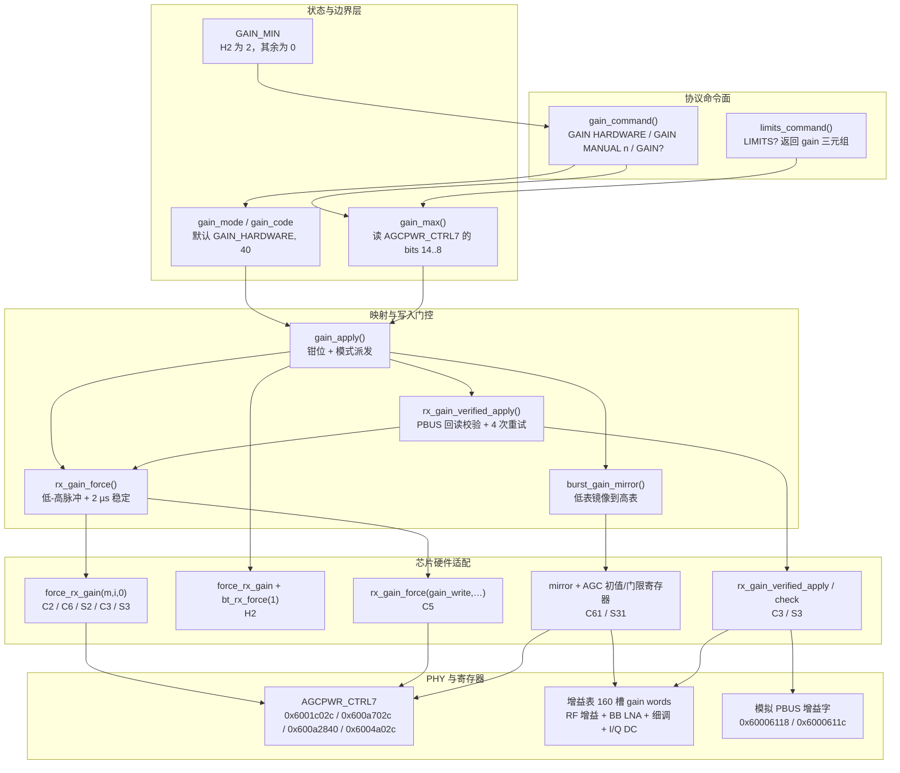
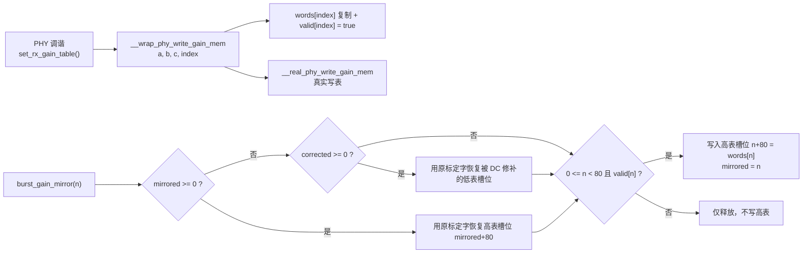
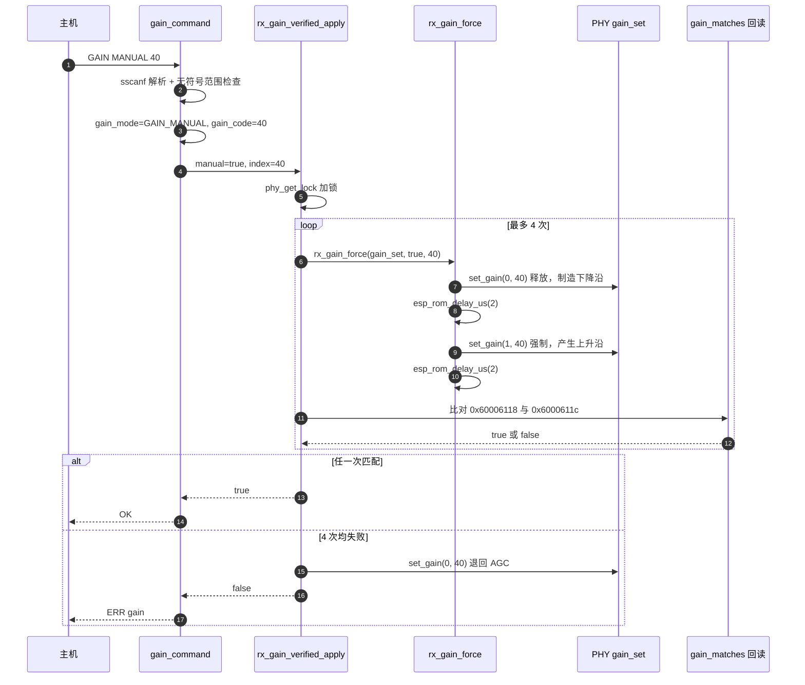

# 增益控制：AGC 与手动索引映射

> **设计信条：索引即真理。** 增益不以 dB 表达，而以 PHY 标定表的槽位号表达。任何"看起来合理"的换算都在真实芯片上被证明是幻觉——同一索引在不同芯片、不同频点、不同温度下的实际增益并不相等，因此固件只承诺"我强制了第 N 号标定表项"，从不承诺"我设置了 X dB"。

ESP-SDR 的增益子系统是整个接收链路中最"多态"的一层：它既要对外暴露一条稳定的三命令协议（`GAIN HARDWARE` / `GAIN MANUAL <index>` / `GAIN?`），又要在十种芯片上分别对接四套完全不同的 PHY 接口形态（三参数 ROM 调用、两参数蓝牙调用、`g_phyFuns` 间接表、双表镜像 + AGC 寄存器直写），还要在 H2 这种"没有可用 AGC"的目标上把 AGC 语义用固件重新实现一遍。理解这一层，等于理解该项目处理"厂商不公开硬件"这一根本约束的标准手法：**把不具备可验证性的抽象全部砍掉，只保留可观测的物理量**。

---

## 一、项目定位与核心价值

增益控制模块诞生的直接动因，是一条被实测推翻的直觉假设——"板载硬件 AGC 会保护采样链"。`docs/rx-controls.md` 记录了这一结论的来源：Wi-Fi AGC 的设计目标是**在数据包前导期间快速收敛**，而 ESP-SDR 的典型使用场景是**连续波信号或连续占用信道**。当测试音源放在天线数厘米处时，所有 Wi-Fi 芯片在 AGC 模式下都出现削顶（峰值顶到满量程），互调产物反而把被测信号埋掉。这意味着：对 SDR 用途而言，AGC 不是"自动保护"，而是"自动误伤"。于是模块的第一个设计目标被确定下来——**默认硬件 AGC 以求开箱可用，但必须提供一条精确、可重复、可验证的手动增益通路**，并把它作为强信号场景的推荐做法。

第二个动因更隐蔽，也更能解释本模块为何存在三个文件而不是一个函数。`rx_gain_verify.c` 的文件头注释直接点破了陷阱：dump 引擎会把"当前强制索引字段"原样复制进每个采样字的 bits 20–27，**即使增益根本没有锁存**。也就是说，主机看到的"每样本增益号"是一个自我证实的假象：它来自你写入的那一位域，而非来自模拟前端真正生效的状态。因此"设置增益"在硬件上必须拆成两个独立问题：**写入是否到达了 PHY**，以及**模拟增益是否真的切过去了**。对 C3/S3 这两个可回读的芯片，项目选择直接读取模拟 PBUS 的两个增益字并逐位比对，用最多四次重试把"跨时钟域脉冲丢失"这类偶发失败消化掉，并让失败最终以 `ERR gain` 的形式暴露给主机，而不是静默返回 `OK`。

第三个动因来自芯片差异的极端不公平。C61 与 S31 的 PHY 使用**双增益表**结构：低表（槽位 0–79）服务于 DSSS/低速率解调路径，高表（槽位 80–159）服务于 OFDM 路径，而 DSSS 分类器可能在采样期间改选二次表项——选中一个未标定的表项就意味着增益瞬间跳变。`burst_gain.h` 的顶部注释与 `burst_gain_table.c` 的镜像逻辑正是为此而设：强制增益时把低表项**复制**到对应的 `index+80` 槽位，让两条路径看到同一组模拟参数。H2 则是另一个极端：它没有 Wi-Fi 外设，蓝牙 AGC 只在链路层收包时才跟踪信号，采集期间会"停"在一个带大 DC 偏置的固定状态，外部测试音完全不可见。于是 `GAIN HARDWARE` 在 H2 上被重新定义为**固件 AGC**——用最多六轮 512 样本的试探采集，把强制索引推到峰值落在 128…447（满量程 511）区间内。这三条动因合起来定义了本模块的核心价值：**一个命令面，四种硬件实现，一条"绝不暴露未标定槽位"的边界铁律，以及一条可验证的锁存通路。**

Sources: [rx-controls.md](docs/rx-controls.md#L11-L31), [rx_gain_verify.c](main/common/rx_gain_verify.c#L1-L3), [burst_gain.h](main/common/burst_gain.h#L1-L4), [burst_gain_table.c](main/common/burst_gain_table.c#L1-L4), [esp32h2.md](docs/esp32h2.md#L51-L64)

---

## 二、架构设计与模块划分

### 2.1 分层总览

增益子系统由四个物理文件 + 一组分散在 `receiver.c` 中的调用点组成，但它在逻辑上严格分为五层。关键点在于：**`burst_gain.h` 不是一个被编译的翻译单元，而是一段被 `#include` 进各后端 `receiver.c` 的片段**。它把 `gain_mode` / `gain_code` / `gain_apply()` / `gain_command()` 全部定义为文件级静态符号，因此每个固件镜像里恰好只有一份增益状态，不存在跨模块可见性问题，也不存在函数指针表。代价是它必须在 include 之前就存在 `reply()`、`REG_READ`、`snprintf`、`force_rx_gain` 等注入点——这是一份显式的**契约式头文件**。



Sources: [burst_gain.h](main/common/burst_gain.h#L20-L24), [burst_gain.h](main/common/burst_gain.h#L61-L126), [burst_gain_min.h](main/common/burst_gain_min.h#L1-L7), [burst_limits.h](main/common/burst_limits.h#L5-L42)

### 2.2 命令面：`gain_command()` 的解析纪律

`gain_command()` 是三个命令的唯一入口，返回 `bool` 表示"这条 line 已被我消费"，从而嵌入各后端的责任链（C3 中依次是 version → gpio → spectrum → limits → **gain** → common → 本地命令）。三个子命令的分支有明确的严格性差异：

- `GAIN?` 用 `strcmp` 精确匹配，回复一行 `GAIN <MODE> <index> <0> <max> <latched>`。
- `GAIN HARDWARE` 同样精确匹配——因此 `GAIN HARDWARE x` 会落到下面的 `sscanf` 分支并失败，最终由调用方回 `ERR command`。
- `GAIN MANUAL <n>` 使用 `sscanf(line, "GAIN MANUAL %u %c", &code, &extra) == 1`，通过**捕获一个尾部字符**来拒绝多余参数：返回 2 即表示行尾还有垃圾。

范围检查写成 `code - GAIN_MIN <= gain_max() - GAIN_MIN`，这是一处刻意利用无符号回绕的技巧。以 H2 的 `GAIN_MIN=2` 为例：`GAIN MANUAL 0` 计算 `0-2 = 0xFFFFFFFE`，远大于 `56-2=54`，天然被拒；`GAIN MANUAL 2` 计算 `0 <= 54`，通过。这样"低于下限"与"高于上限"共用一条比较，无需额外分支或短路求值，也避免了 `code < GAIN_MIN` 的显式判断。第三个数值字段（回复中的 `0`）是保留位，当前恒为 0，主机应按位置解析而非按名称解析。

| 回复字段 | 含义 | 源码表达式 |
| --- | --- | --- |
| 模式字串 | `HARDWARE` 或 `MANUAL` | `gain_mode == GAIN_HARDWARE ? "HARDWARE" : "MANUAL"` |
| 索引 | 手动索引；硬件模式为 `-1` | `gain_mode == GAIN_HARDWARE ? -1 : (int)gain_code` |
| 保留 / 步进 | 恒为 `0` | 字面量 |
| 最大索引 | 当前标定的低表上界 | `gain_max()` |
| 锁存标志 | `AGCPWR_CTRL7` bit23：强制增益是否生效 | `(REG_READ(BURST_GAIN_REG) >> 23) & 1` |

Sources: [burst_gain.h](main/common/burst_gain.h#L94-L126), [receiver.c](main/targets/esp32c3/receiver.c#L170-L205)

### 2.3 边界层：`gain_max()` 的"绝不暴露未标定槽位"

`gain_max()` 是全模块最重要的一个函数，因为它是"能不能用"与"会不会崩"的分界线。它从目标专属的 `BURST_GAIN_REG` 读出 PHY 在调谐阶段写入的**最高已标定低表索引**（bit 8..14，即 `AGCPWR_CTRL7` 的字段），然后对每个芯片施加一条经验上限；一旦读数超出该上限（说明表未标定或读取到垃圾值），函数返回 `0`，把可用范围压到最小。

| 目标 | `BURST_GAIN_REG` | 采样字段 | 上限策略 | 注释中的实测理由 |
| --- | --- | --- | --- | --- |
| H2 | `0x600a2840` | `phy_param[83]`（uint8） | `>80 → 0`；`57–79 → 56` | 56 以上接收机被自身 DC 偏置饱和，顶索引（实测 66）几乎无信号 |
| C5 | `0x600a702c` | bits 14..8 | `<90`，否则 `0` | C5 表规模更大 |
| S3 / S2 | `0x6001c02c` | bits 14..8 | `≤82`，否则 `0` | 83 号槽位（S3 的 `WIFI_GAINS=83`）为边界 |
| C2 | `0x6004a02c` | bits 14..8 | `<80`，否则 `0` | 与通用规则一致，仅寄存器基址不同 |
| C6 / C61 | `0x600a702c` | bits 14..8 | `<80`，否则 `0` | 低表 80 槽为硬边界 |
| ESP32 | `0x6001c02c` | bits 14..8 | `<80`，否则 `0` | 同上（DPORT 别名 `0x3ff5c02c`） |

注意 H2 是唯一"双重钳位"的分支：先判 `<80`，再判 `>56`。这与 H2 的固件 AGC 常量 `AGC_MAX 56` 必须保持一致（源码注释直接写明 `same limit as gain_max()`），否则 AGC 会把索引推到协议层面被拒绝的区间。

钳位责任的划分也值得注意：**命令层只拒绝明显越界，`gain_apply()` 做最终钳位**。每次应用前都有 `if (gain_code > gain_max()) gain_code = gain_max();`。当 `gain_max()` 因表未标定返回 `0` 时，命令层的无符号比较会退化（H2 上上界变成极大值而恒真），但 `gain_apply()` 会把索引钳到 0 —— 也就是"宁可退到 PHY 默认的最保守状态，也绝不触碰未标定槽位"。这条取舍在注释里被压缩成一句 `/* Never expose uncalibrated slots. */`。

Sources: [burst_gain.h](main/common/burst_gain.h#L11-L19), [burst_gain.h](main/common/burst_gain.h#L25-L44), [burst_gain_min.h](main/common/burst_gain_min.h#L1-L7), [receiver.c](main/targets/esp32h2/receiver.c#L144-L148), [receiver.c](main/targets/esp32/receiver.c#L38-L46)

### 2.4 映射层：`gain_apply()` 的芯片分支

`gain_apply()` 把"模式 + 索引"翻译成具体硬件动作，其结构是一个按目标预处理器分派的窄分支树。它同时承担三件事：钳位、模式释放（`manual` 决定是否启用强制增益）、以及"某些目标必须在写增益之外再做点什么"。

```c
static void gain_apply(void) {
    bool manual = gain_mode == GAIN_MANUAL;
    if (gain_code > gain_max()) gain_code = gain_max();
#if CONFIG_IDF_TARGET_ESP32C61
    if (!gain_defaults_saved) {                       /* 首次应用才快照 AGC 默认值 */
        gain_init_saved      = REG_READ(0x600a7094u);
        gain_threshold_saved = REG_READ(0x600a713cu);
        gain_defaults_saved  = true;
    }
    burst_gain_mirror(manual ? (int)gain_code : -1);   /* 低表 → 高表镜像 */
    phy_rfrx_sat_rst(manual ? 0u : 1u);                /* 手动时关闭饱和干预 */
    REG_WRITE(0x600a7094u, manual ? (gain_init_saved & ~0x1fcu) | (gain_code << 2)
                                  : gain_init_saved);
    REG_WRITE(0x600a713cu, manual ? (gain_threshold_saved & ~0x1fc0000u) | (gain_code << 18)
                                  : gain_threshold_saved);
#endif
#if CONFIG_IDF_TARGET_ESP32S3 || CONFIG_IDF_TARGET_ESP32C3
    gain_applied = rx_gain_verified_apply(manual, gain_code);
#elif CONFIG_IDF_TARGET_ESP32H2
    force_rx_gain(manual, gain_code);
    bt_rx_force(1);                                    /* 释放强制增益后保持 BT 接收 */
#elif CONFIG_IDF_TARGET_ESP32C5
    rx_gain_force(gain_write, manual, gain_code);
#else
    force_rx_gain(manual, gain_code, 0);
#endif
}
```

四个分支各自解决一个不可回避的硬件事实：

| 分支 | 硬件事实 | 代码对策 |
| --- | --- | --- |
| C3 / S3 | 强制索引字段会随采样一起被 dump，无法作为锁存证据 | 改为回读模拟 PBUS 增益字（见 2.6），返回值写入 `gain_applied` |
| H2 | `force_rx_gain` 只有两个参数；释放强制增益会连带关闭蓝牙接收 | 调两参数版本，并无条件 `bt_rx_force(1)` 保活 |
| C5 | 增益写入必须经 `g_phyFuns` 间接表，且需要低-高脉冲 | 用 `rx_gain_force()` 包装一个本地 `gain_write()` 薄垫片 |
| C61 / S31 | 双表结构 + AGC 初值/门限参与选表 + 饱和复位干预 | 镜像 + 三处寄存器直写 + `phy_rfrx_sat_rst()` |

C61 那两处寄存器写是全模块最"土"的部分，但每一位都有依据：`0x600a7094` 的 bits 8..2（掩码 `0x1fc`）是 AGC 初始增益，写入 `gain_code` 让 AGC 从用户指定值起步；`0x600a713c` 的 bits 24..18（掩码 `0x1fc0000`）是对应的门限；`phy_rfrx_sat_rst(0)` 则在手动模式下关闭"射频饱和自动回退"，否则硬件会把用户精心选定的强信号增益偷偷降回去。默认值快照只在第一次应用时执行，`prepare_rx()` 在重标定前会显式回滚这两处并清 `gain_defaults_saved`，避免把用户手动值当成"标定默认值"永久污染 PHY 状态。

ESP32（初代）与 S31-burst 这两个目标**不使用** `burst_gain.h`，而是保留了自己的一份实现——因为它们直接操作强制增益字段本身：ESP32 的 `apply_gain()` 保留低 23 位（其它 AGC 字段），手动模式写入 `(gain_code << 24) | BIT(23)`，硬件模式只清 bit23 而不改索引位（使能位为 0 时索引字段被硬件忽略，避免向未标定字段写入）。这恰好反过来印证了寄存器布局：**bits 31..24 为索引，bit23 为使能**。

Sources: [burst_gain.h](main/common/burst_gain.h#L45-L93), [receiver.c](main/targets/esp32/receiver.c#L155-L161), [receiver.c](main/targets/esp32s31/burst/receiver.c#L300-L317), [receiver.c](main/families/c5_c6_c61/receiver.c#L88-L122)

### 2.5 表镜像层：`burst_gain_table.c` 的 160 槽影子表

`burst_gain_table.c` 只在 C61 与 S31 参与编译（`main/CMakeLists.txt` 按目标追加），并通过 `-Wl,--wrap=phy_write_gain_mem` 劫持 PHY 唯一的表写入入口。它的做法是：**在 PHY 写表的同时，把每个 gain word 的三元组（3×uint32）抄一份到 RAM 影子表**，从而在不反汇编 PHY 的前提下获得"标定结果"的完整副本。影子表 `words[160][3]` + `valid[160]` 约 2 KiB，注释明确标注"无采样缓冲、无堆分配"。



`burst_gain_mirror(index)` 是一个带双向记账的幂等操作，三个状态变量承担不同职责：

- `mirrored` 记录"当前哪个低表槽被镜像到了高表"，下次调用时先用影子表中的**原始高表字**恢复它，再镜像新槽位；传入 `-1` 则只做恢复。这就保证了 AGC 模式下高表能回到 PHY 标定的原值。
- `corrected` 记录"哪个低表槽被 DC 校准改写过"，因为 `burst_gain_dc_set()` 会直接写硬件而不改影子表，所以镜像前必须先把那一槽恢复成原字。
- 恢复高表时用 `if (valid[high])` 守卫：**未标定的高表槽位不需要恢复，但必须被镜像覆盖**——这正是"AGC 用不到、强制增益用得到"的那部分槽位（测试用例专门覆盖了 `index=76 → 槽位 156` 这条无 original 的路径）。

`burst_gain_dc_set()` 是影子表的第二个消费者，服务于 S31 的 DC 校准。它把新的 I/Q 码拆进两个 32 位字的**互不重叠字段**：I 的低 8 位进 word1 的低字节、I 的最高位进 word0 的 bit31、Q 的 9 位进 word0 的 bits 21..13，其余位（射频 DC、射频/基带增益、原生 I/Q 校准）原样保留。随后把同一个字写进四个槽位 `{index, index+80, 79, 159}` 并置 `corrected = index`：`index` 是实际使用的表项，`index+80` 是镜像副本，79/159 是"未被 AGC 使用的缓冲区"，调用方（`streaming/dc.c`）随后会先锁存 79 再锁存真实索引，用一次"影子项 + 真实项"的双写把 DC 码稳定推进前端。`burst_gain_dc_codes()` 则反向解码影子表中的原始标定码，供校准算法作为起点——两者都要求 `mirrored == index`，即**只有手动增益期间、镜像生效时**才能做 DC 校准，因为 AGC 期间前端增益随信号漂移，DC 响应无法测量。

Sources: [burst_gain_table.c](main/common/burst_gain_table.c#L1-L55), [burst_gain_table.h](main/common/burst_gain_table.h#L1-L10), [CMakeLists.txt](main/CMakeLists.txt#L64-L66), [CMakeLists.txt](main/CMakeLists.txt#L88-L90), [dc.c](main/targets/esp32s31/streaming/dc.c#L19-L32)

### 2.6 锁存验证层：`rx_gain_verify.c` 的模拟域回读

这一层只为 C3/S3 存在（`main/CMakeLists.txt` 条件追加源文件，并附加 `-Wl,--wrap=set_rx_gain_table`）。它解决的核心问题是：**如何在不信任"强制索引字段"的前提下证明增益确实切过去了。** 答案是抓取 PHY 自己生成的 gain word，然后把回读到的模拟 PBUS 寄存器按位反推回增益码。

机制分三步：

1. **挂钩写入函数。** `__wrap_set_rx_gain_table()` 在调用真函数前，从 `g_phyFuns[11]` 取出 PHY 内部真正用于写 gain word 的函数指针，把该槽替换成 `capture_gain`。这是一次"运行期函数指针槽位劫持"——比静态链接期 `--wrap` 更进一步，因为目标函数藏在 PHY 的函数表里。
2. **捕获增益码。** `capture_gain(low, high, index)` 在转发写入的同时解码 `codes[index] = low >> 17`：增益码的 RF 段在 bits 15..8、BB LNA 在 bits 7..3、细调在 bits 2..0，最高 RF 位落在 word0 之外且对 Wi-Fi 恒为 1。这张 `codes[80/83]` 表就是"索引 → 物理位图"的权威映射。
3. **回读比对。** `gain_matches(code)` 把增益码**按 PBUS 的位序重新排列**（BB 字的 LNA 位序是反的，细调被搬到 bits 8..6），再分别与射频字 `0x60006118` 的 bits 17..9 和基带字 `0x6000611c` 的 bits 26..18 比较。两个 9 位字段必须**同时**相等。

```c
static bool gain_matches(uint16_t code) {
    unsigned rf = 0x180u | (code >> 8);
    /* PBUS BB 字把 LNA 位序反转，并把细调搬到 bits 8..6。 */
    unsigned bb = ((code & 7u) << 6) | ((code & 8u) << 2) | (code & 0x10u) |
                  ((code & 0x20u) >> 2) | ((code & 0x40u) >> 4) | ((code & 0x80u) >> 6) |
                  ((code >> 8) & 1u);
    return ((REG_READ(0x60006118u) >> 9) & 0x1ffu) == rf &&
           ((REG_READ(0x6000611cu) >> 18) & 0x1ffu) == bb;
}

bool rx_gain_verified_apply(bool manual, unsigned index) {
    _lock_t lock = phy_get_lock();
    _lock_acquire(&lock);
    bool ok = !manual;                       /* 硬件 AGC 天然视为成功 */
    if (!manual) gain_set(0, index);
    else if (gain_write && index < WIFI_GAINS && valid[index]) {
        for (unsigned attempt = 0; attempt < 4; attempt++) {
            rx_gain_force(gain_set, true, index);
            if (gain_matches(codes[index])) { ok = true; break; }
        }
    }
    if (!ok) gain_set(0, index);             /* 失败则显式退回 AGC，避免半配置状态 */
    _lock_release(&lock);
    return ok;
}
```

三处工程设计值得单独指出。其一，**持锁**：整个应用过程在 `phy_get_lock()` 上串行化，因为 PBUS 增益字也是 PHY 后台跟踪任务会写的共享资源。其二，**四次重试**：单次写-读不能区分"脉冲没跨过时钟域"与"索引不可用"，重试把前者过滤掉，而后者会在四次后稳定失败。其三，**失败即释放**：`if (!ok) gain_set(0, index)` 把前端退回 AGC，宁可让主机看到 `ERR gain` 后重试，也不留下一个"以为强制了但实际是默认增益"的静默错误状态。

`rx_gain_verified_check(index)` 是采集前的廉价复核：先检查强制字段 `(forced >> 23) == (1u | (index << 1))`（即 bit23 使能且索引位于 bits 31..24，检出值为 `1 | index<<1`）**并且** PBUS 仍匹配；任一不成立就直接调 `rx_gain_verified_apply()` 重装。C3 的 `prepare_rx()` 快速路径与 `acquire_iq()` 都依赖它，`capture()` 则在 `gain_applied == false` 时补发 `ERR gain`。

Sources: [rx_gain_verify.c](main/common/rx_gain_verify.c#L14-L91), [CMakeLists.txt](main/CMakeLists.txt#L42-L44), [CMakeLists.txt](main/CMakeLists.txt#L110-L112), [receiver.c](main/targets/esp32c3/receiver.c#L83-L108), [receiver.c](main/targets/esp32c3/receiver.c#L157-L164)

### 2.7 脉冲层：`rx_gain_force.h` 的跨时钟域时序

这个 18 行头文件只做一件事，但它解释了所有 C5/C3/S3 路径中反复出现的"先释放、再设置"：

```c
/* 增益强制信号要跨越到接收机时钟域。背靠背的两次 MMIO 写不构成可靠的
 * 低/高脉冲，尤其当重复应用同一索引时。先拉低，再让选定增益稳定。
 * 调用方必须已停止采集；set_gain 是目标的 PHY API。 */
static inline void rx_gain_force(void (*set_gain)(unsigned, unsigned), bool manual, unsigned index) {
    if (manual) { set_gain(0, index); esp_rom_delay_us(2); }
    set_gain(manual, index);
    if (manual) esp_rom_delay_us(2);
}
```

关键在于"重复应用同一索引"这一情形：如果当前已经是索引 N，直接再写一次 N，使能位不会产生任何边沿，接收机可能根本看不到更新请求；必须先写 `manual=0` 把使能拉低，形成一次真实的上升沿。两侧各 2 µs 的延时对应接收机时钟域同步器的建立时间。函数被声明为 `static inline` 且只接受一个函数指针参数，使它能同时服务于 C5 的 `g_phyFuns` 垫片、C3 的 `force_rx_gain` 垫片和 S3 的 `rom_rx_gain_force`，而不引入任何全局状态。

Sources: [rx_gain_force.h](main/common/rx_gain_force.h#L8-L18), [burst_gain.h](main/common/burst_gain.h#L56-L60)

---

## 三、技术栈与核心工作流

### 3.1 手动增益的完整主链路

以下时序图以 C3（带锁存验证）为例，展示一次 `GAIN MANUAL 40` 从协议解析到硬件确认的全过程。S3 的差异仅在 `gain_command()` 末尾改走 `gain_reconfigure()`，C2/C6/S2 的差异仅在最后一步是多参数 ROM 调用。



注意 `gain_command()` 在 `gain_apply()` 之后才处理失败：先应用、再判定、后回复。这个顺序保证任何时刻主机看到的回复都与硬件真实状态一致——不存在"回了 OK 但寄存器没变"的窗口。

Sources: [burst_gain.h](main/common/burst_gain.h#L105-L126), [rx_gain_verify.c](main/common/rx_gain_verify.c#L63-L81), [rx_gain_force.h](main/common/rx_gain_force.h#L11-L18)

### 3.2 核心函数职责矩阵

| 函数 | 所在文件 | 输入 | 副作用 | 失败语义 |
| --- | --- | --- | --- | --- |
| `gain_max()` | `burst_gain.h` | 无（读 `BURST_GAIN_REG` / `phy_param[83]`） | 只读 | 返回 `0` 表示"表不可用" |
| `gain_apply()` | `burst_gain.h` | 全局 `gain_mode` / `gain_code` | 钳位 `gain_code`；写 PHY/寄存器；C61 首次快照默认值 | C3/S3 时写 `gain_applied` |
| `gain_command()` | `burst_gain.h` | 一行命令文本 | 更新模式与索引；调用 `gain_apply()` 或 `gain_reconfigure()` | 返回 `false` 让责任链继续；`ERR gain` |
| `burst_gain_mirror()` | `burst_gain_table.c` | 索引或 `-1` | 恢复旧槽、镜像新槽；更新 `mirrored` | `index≥80` 或未标定时静默不镜像 |
| `burst_gain_dc_set()` | `burst_gain_table.c` | 索引, I 码, Q 码 | 写 4 个槽位；置 `corrected` | 返回 `false`（未镜像 / 索引≥79 / 码越界） |
| `burst_gain_dc_codes()` | `burst_gain_table.c` | 索引 | 只读影子表 | 同上返回 `false` |
| `rx_gain_verified_apply()` | `rx_gain_verify.c` | `manual`, 索引 | 持 PHY 锁写增益；可能退回 AGC | 返回 `false` |
| `rx_gain_verified_check()` | `rx_gain_verify.c` | 索引 | 必要时重装增益 | 返回最终是否一致 |
| `rx_gain_force()` | `rx_gain_force.h` | `set_gain` 函数指针, `manual`, 索引 | 低-高脉冲 + 2×2 µs 延时 | 无（纯时序） |

Sources: [burst_gain.h](main/common/burst_gain.h#L25-L126), [burst_gain_table.c](main/common/burst_gain_table.c#L22-L55), [rx_gain_verify.c](main/common/rx_gain_verify.c#L63-L91), [rx_gain_force.h](main/common/rx_gain_force.h#L11-L18)

### 3.3 时序约束：谁在偷偷释放强制增益

增益子系统最容易被误读的地方是它和"接收机准备"流程的耦合。三处代码明确记录了同一事实：**`pbus_workmode()` 一类的模拟偏置初始化会清除强制增益位**。因此增益必须在 PBUS 之后应用，且每次重新准备接收机后都要重装。

- ESP32 后端在 `prepare_rx()` 里先调 `rom_pbus_workmode()` / `rom_pbus_xpd_rx_on(1)` / `rom_set_rxclk_en(1)`，随后紧跟 `apply_gain()`，注释写明 "PBUS work-mode setup releases a forced RX gain; apply it afterwards"。
- S31 burst 后端把这一顺序固化为 `prepare_rx()` + `apply_gain()` 的组合，并让 `apply_gain()` 自己再走一遍 `phy_pbus_debugmode → mirror → prepare_rx → phy_rfrx_sat_rst → 写 AGC 初值/门限 → phy_force_rx_gain`，专门覆盖"PBUS 释放"这一坑。
- S31 streaming 后端在 `radio_configure()` 里先 `burst_gain_mirror(-1)` 移除手动覆盖，再恢复 AGC 默认寄存器、重设信道、重建增益表、记录新的 `receiver_gain_max` 与默认初值/门限，最后才按 `c->agc` 决定镜像哪一槽并 `phy_force_rx_gain()`。顺序一旦颠倒，PHY 会用量表过程中的临时状态覆盖用户设置。

另外两个反向约束同样重要：

- **重标定必须先释放手动增益。** `rx_recalibration.c` 的 `release_manual_gain()` 直接 `REG_CLR_BIT(reg, 1u<<23)`，注释是"上一轮的手动增益不能覆盖本次测量中的增益扫描"。这解释了为什么 `gain_apply()` 在每次 `prepare_rx()` 末尾都要重跑一次——重标定主动把它清掉了。
- **S3 改增益不能只写寄存器。** S3 的 `gain_command()` 走 `gain_reconfigure()` 而非 `gain_apply()`：若接收机未就绪或校准已陈旧则完整 `prepare_rx()`，否则直接 `gain_apply()`。原因是 S3 的通道/PBUS 配置流程会短暂选择 PHY 默认增益，只改强制字段无法保证最终状态。

Sources: [receiver.c](main/targets/esp32/receiver.c#L83-L95), [receiver.c](main/targets/esp32s31/burst/receiver.c#L108-L118), [receiver.c](main/targets/esp32s31/streaming/receiver.c#L112-L147), [rx_recalibration.c](main/common/rx_recalibration.c#L17-L32), [receiver.c](main/targets/esp32s3/receiver.c#L112-L146)

### 3.4 H2：当"硬件 AGC"变成固件 AGC

H2 是唯一一个把协议语义与硬件状态**刻意解耦**的目标。`gain_mode` 仍然报告 `GAIN_HARDWARE`，但硬件上并不存在可用的 AGC 通路——蓝牙 AGC 只在链路层收包时跟踪，采集期间停在一个带大 DC 偏置的固定状态。因此 `acquire_iq()` 在硬件模式下先跑 `software_agc(divider)`，用"试探采集 + 峰值反馈"把强制索引调到合适位置，然后再做正式采集。

算法参数与收敛条件都在注释中给出了实测依据：

| 常量 | 值 | 含义 |
| --- | --- | --- |
| `AGC_MIN` / `AGC_MAX` | 2 / 56 | 与 `gain_max()` 的 H2 上限一致；0/1 号索引像最大增益一样饱和 |
| `AGC_PROBE` | 512 | 每轮试探采样数 |
| `AGC_TARGET` | 256 / 511 | 目标峰值（约 −6 dBFS） |
| 收敛窗口 | 128…447 | 落在其中即直接返回 |
| 最大轮数 | 6 | 防止振荡拖长采集 |
| 步长 | `20·log10(256/peak)`，限幅 ±20 | 索引近似 1 dB/step，故可用对数步长 |
| 削顶步长 | −10 | 峰值 ≥448 时真实电平未知，只能粗退 |

`probe_peak()` 先做 10 位二补码折叠（`i >= 512 ? 1024 - i : i`）再取最大值，因此正负半周对称计入。当 `dump_iq()` 失败、索引已到边界、或峰值进入窗口时函数提前返回——**"到边界就停"是可接受的不收敛**：`tests/test_h2_agc.py` 明确断言"要么落在窗口内，要么被钉在 `AGC_MIN`/`AGC_MAX` 且无法做得更好"，并验证 6 轮上限内的采集次数。实测结果是：该固件 AGC 使 2300–2650 MHz 区间 SNR 达到 58–68 dB，输入电平变化 60 dB 时峰值仍稳定在 236–313 / 511。

Sources: [receiver.c](main/targets/esp32h2/receiver.c#L136-L192), [esp32h2.md](docs/esp32h2.md#L51-L64), [test_h2_agc.py](tests/test_h2_agc.py#L35-L46)

### 3.5 手动增益与 DC 校准的耦合边界

S31 streaming 的 DC 校准把增益子系统的约束推到台前：`receiver_dc_calibrate()` 在三种情况下**直接放弃**——`receiver_gain_max >= 79`、`burst_gain_dc_codes()` 返回假（未镜像或索引未标定）、或首次测量得到的 DC 代价已足够小。原因是校准需要"稳定且已知"的前端增益来辨识 2×2 DAC→I/Q 响应矩阵：AGC 模式下增益随信号漂移，测出来的雅可比行列式毫无意义。

这也解释了为什么 `burst_gain_dc_set()` 的槽位集合包含 79 与 159：这两个槽位是**AGC 不使用的缓冲区**，写入它们不会干扰正常选表，但能被前端作为"影子项"锁存，从而实现"先影子、后真实"的无毛刺切换。`streaming/dc.c` 随后又直写 `0x2010702c`：先 `79<<24`，再 `gain<<24`，保持强制使能位不变——与 `rx_gain_force()` 的"先低后高"是同一思想的另一种表达。

Sources: [dc.c](main/targets/esp32s31/streaming/dc.c#L36-L46), [burst_gain_table.c](main/common/burst_gain_table.c#L46-L55), [s31-streaming.md](docs/s31-streaming.md#L51-L61)

---

## 四、典型代码示例

### 4.1 片段式头文件的契约

`burst_gain.h` 被 `#include` 的位置决定了它能干什么。以 C3 后端为例，`reply()` 与 `send_bytes` 必须在 include 之前就位，`force_rx_gain` 由链接期从 PHY 库解析：

```c
#define send_bytes burst_serial_send
static void reply(const char *s) { (void)send_bytes(s, strlen(s)); }

#include "burst_gain.h"      /* 依赖：reply()、REG_READ/REG_WRITE、force_rx_gain、strcmp/sscanf */
#include "burst_limits.h"    /* 依赖：reply()、gain_max()、GAIN_MIN */

static void prepare_rx(void) {
    if (rx_ready && !rx_recalibration_stale()) {
        if (gain_mode == GAIN_MANUAL) gain_applied = rx_gain_verified_check(gain_code);
        return;
    }
    /* … tune_rx / PBUS 初始化 / 3 ms 稳定 … */
    gain_apply();            /* 必须在 PBUS 之后 */
    rx_ready = true;
}
```

这种"头文件即实现"的形态把增益状态放进后端的翻译单元，使 `gain_command()` 无需全局变量、无需初始化钩子，也不会出现跨目标符号冲突；代价是无法独立单元测试，所以主机测试采用"把 header 直接塞进生成的 C 文件再编译"的手法。

Sources: [receiver.c](main/targets/esp32c3/receiver.c#L76-L98), [burst_gain.h](main/common/burst_gain.h#L20-L24)

### 4.2 主机侧契约测试（节选）

`tests/test_burst_gain.py` 用 `#define REG_READ(address) ((forced << 23) | (mock_maximum << 8))` 伪造整个寄存器语义，从而在不接触硬件的情况下锁定协议行为：

```c
gain_apply();                                  assert(forced==0);
gain_command("GAIN?");                         assert(strstr(response,"GAIN HARDWARE -1"));
gain_command("GAIN MANUAL 23");                assert(forced==1 && selected==23);
assert(!gain_command("GAIN AUTO"));            /* 没有这个命令 */
assert(!gain_command("GAIN MANUAL 99"));       /* 越上界 */
gain_command("GAIN MANUAL 76");                assert(selected==76);
assert(!gain_command("GAIN MANUAL 77"));       /* 恰好越界一格 */
mock_maximum=71; assert(!gain_command("GAIN MANUAL 72"));
gain_command("GAIN HARDWARE");                 assert(forced==0);
```

同一测试随后把 `force_rx_gain` 改写为两参数、把上限换成 `phy_param[83]`，对 H2 变体断言"`56` 可用、`57` 被拒、`0`/`1` 被拒、释放强制后 `bt_rx_force(1)` 仍为 1"。这是**用同一份 header 源码编译出两种芯片语义**的典型做法：差异全部由 `#if CONFIG_IDF_TARGET_*` 承载，因此测试也必须按目标分别编译运行。

Sources: [test_burst_gain.py](tests/test_burst_gain.py#L17-L35), [test_burst_gain.py](tests/test_burst_gain.py#L46-L70), [test_rx_controls.py](tests/test_rx_controls.py#L103-L115)

---

## 五、继续深入的方向

| 想去哪里 | 读什么 | 为什么从这里继续 |
| --- | --- | --- |
| 搞清"增益在哪一刻被偷偷改回" | [10-rx-calibration.md](10-rx-calibration.md) + `main/common/rx_recalibration.c` | `release_manual_gain()` 清 bit23 是增益子系统最隐蔽的外部写入者；C61 还需在重标定前回滚 AGC 初值/门限 |
| 搞清采样字里的 bits 20–27 | [4-snapshot-dump-engine.md](4-snapshot-dump-engine.md) + `docs/how-it-works.md` | 该字段正是"看起来能验证增益、实际不能"的那一位，理解 dump 引擎才能理解 `rx_gain_verify.c` 为何绕道 PBUS 回读 |
| 搞清 S31 的双表与 DC 校准联动 | [16-s31-parlio-capture.md](16-s31-parlio-capture.md) + `main/targets/esp32s31/streaming/dc.c` | `burst_gain_table.c` 的四个 DC 槽位与"影子项 79 → 真实项"锁存序列在此被真正使用 |
| 搞清 H2 为何没有可用 AGC | [24-h2-bluetooth-backend.md](24-h2-bluetooth-backend.md) + `docs/esp32h2.md` | 蓝牙 AGC 的停摆行为、`bt_adctrig` 序列与 `phy_param[83]` 的标定来源 |
| 搞清命令如何被路由到这里 | [20-command-protocol.md](20-command-protocol.md) | `gain_command()` 是责任链中的一环，返回 `false` 的语义由分发器定义 |
| 想验证自己的改动 | `tests/test_burst_gain.py`、`tests/test_h2_agc.py`、`tests/test_s31_gain.py`、`tests/test_streaming_gain.py`、`tests/dc_calibration_test.c` | 五份主机测试分别锁定协议边界、AGC 收敛、S31 增益存活、streaming 默认值恢复与 DC 槽位写入 |

---

## 🔗 关联模块与上下游

- `main/targets/esp32c3/receiver.c` — `burst_gain.h` 的宿主之一：提供 `reply()` 注入点、在 `prepare_rx()` 快速路径中调用 `rx_gain_verified_check()`、并以 `ERR gain` 把 `gain_applied` 传播到采集失败路径。
- `main/families/c5_c6_c61/receiver.c` — C5/C6/C61 共享后端：`gain_apply()` 的唯一调用点，并负责 C61 在重标定前回滚 `0x600a7094` / `0x600a713c` 与 `burst_gain_mirror(-1)`。
- `main/targets/esp32s31/streaming/dc.c` — `burst_gain_table.c` 的直接调用者：`burst_gain_dc_codes()` 取名、`burst_gain_dc_set()` 写名，并以 `receiver_gain_max >= 79` 作为放弃 DC 校准的前置条件。
