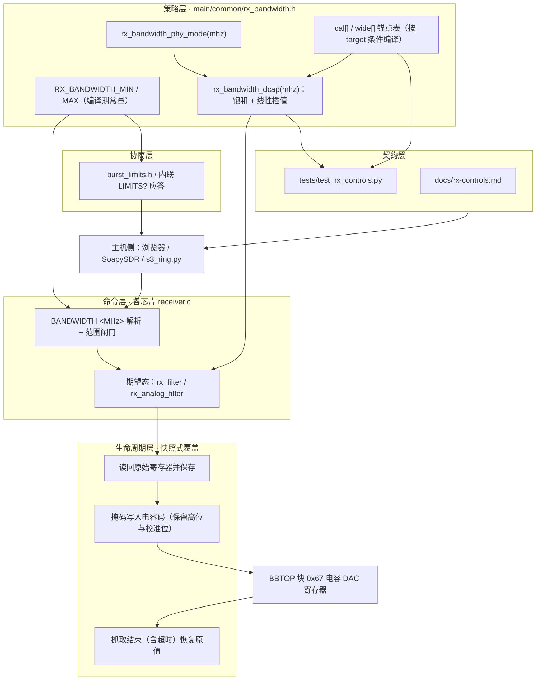

# 模拟带宽：电容码插值滤波

## 项目定位与核心价值

在 ESP32 家族的射频前端里，"带宽"并不是一个可以被读写的物理量。接收通路的基带抗混叠能力由 BBTOP（基带顶层模块，块地址 `0x67`）内部一组**开关电容阵列**决定：固件能写进去的只是一个 6 位或 7 位的**电容码（capacitor code，代码里记作 `dcap`）**。码字越大、接入的电容越多，RC 极点越低，可通过的双边带噪声宽度就越窄。厂商 PHY 从未公开这条"码 ↔ MHz"的映射，PHY 自己的校准流程还会不断改写它，而不同芯片的码宽、寄存器位置、甚至 I2C 主机号都不一样。

这就是本项目要填的坑。`main/common/rx_bandwidth.h` 把**实测得到的噪声响应曲线**固化成一张编译期按 target 选择的锚点表，再用一段十几行的定长整数线性插值，把任意整数 MHz 请求折算成电容码。它解决的痛点可以拆成四层：

- **语义缺失**：硬件只有码字，用户只懂 MHz，中间必须有一层双向可解释的换算，且换算结果要能被文档、测试、主机 UI 三处共同引用。
- **跨芯片异构**：十款芯片的码宽（6/7 位）、寄存器对（`0/` — `1/2`、`4/5`、`6/7`）、I2C host（0 或 1）各不相同，但对外必须暴露同一个 `BANDWIDTH <MHz>` 命令与同一套 `LIMITS?` 协商格式。
- **曲线的非解析性**：开关电容阵列的步进不是线性的，MHz 与码字之间既非等比也非等差，只能以"锚点 + 分段线性"逼近；同时低码区响应不平坦，曲线端点必须刻意保守。
- **校准共存**：那对电容 DAC 的原始值正是 PHY 校准算出来的。直接覆写会破坏 IQ/DC 校准结果，所以带宽码只能以**快照式覆盖**存在——抓取前写入，抓取后（含超时路径）立刻还原。

其核心价值因此不是"多了一个可调参数"，而是**把不可观测的模拟退化，收敛成一个可测、可回归、可协商的工程契约**。头文件开篇就诚实地限定了它的地位：这是"近似双边可用带宽，不是精密的 −3 dB 规格"。曲线来源逐芯片记录在注释里——C61 取自参考传感器固件 `sensor-firmware/main/iq/modem.c` 的 CBW20 噪声底标定并保留 S31 独立标定的 21 MHz 锚点；S3 用 2300 MHz、增益 75、80 MS/s 下每码 12 次快照的中值窗函数 FFT 求近似全宽；H2/C2/C3/C6 则是每码 24 次采集的中值噪声谱。这种"以物理响应作为唯一事实来源"的做法，让跨十款芯片的同一句 `BANDWIDTH 20` 至少具有可比含义。

Sources: [rx_bandwidth.h](main/common/rx_bandwidth.h#L1-L7), [rx-controls.md](docs/rx-controls.md#L33-L62), [esp32h2.md](docs/esp32h2.md#L66-L94), [esp32c2.md](docs/esp32c2.md#L51-L66)

值得单独强调的是**"0 不等于旁路"**这条语义。滤波器没有 bypass 位，最宽的物理状态就是码字 0，因此 `BANDWIDTH 0` 被定义为"选择最宽档"，而不是"关掉滤波"。与之相对，`BANDWIDTH <MAX>` 走的是**标定区间上界对应的码字**，两者在若干芯片上并不相等：ESP32 的最宽设置超出可测跨度，数值上界用码 8，而完全打开用码 0；C2 的曲线刻意从码 32 起算（低码响应不平坦），所以 `BANDWIDTH 20` 给码 32、`BANDWIDTH 0` 给码 0。这条区分是整个模块最容易踩的坑，也是 `LIMITS?` 里默认值字段恒为 `0` 而不是 `MAX` 的原因。

Sources: [rx_bandwidth.h](main/common/rx_bandwidth.h#L78-L82), [rx_bandwidth.h](main/common/rx_bandwidth.h#L119-L121), [rx-controls.md](docs/rx-controls.md#L36-L37), [rx-controls.md](docs/rx-controls.md#L61-L62)

---

## 架构设计与模块划分

带宽控制被切成五个职责互不重叠的层。每一层只对一种变化原因负责，因此新增一颗芯片时，改动范围是可预测的。



### 编译期区间常量：`RX_BANDWIDTH_MIN` / `RX_BANDWIDTH_MAX`

区间不是运行期数据，而是两条 `#if` 链在编译期选出的宏。它们被三处共用：命令闸门、`LIMITS?` 应答、主机回归测试。C5 的 MAX 排在 ESP32 之后、S3 之前，S3 单独一档，其余未列名的 target（含 C61、S31 与未来芯片）落到 `#else 54`；MIN 的 `#else` 是 13。这种"兜底值即新芯片默认值"的写法，意味着移植一颗未被枚举的芯片时，即使不写任何代码也会得到一个语法正确但语义可疑的 `13–54 MHz` 区间——这是刻意的：宁可让新芯片可用，也不让它无法协商。

Sources: [rx_bandwidth.h](main/common/rx_bandwidth.h#L8-L22), [rx_bandwidth.h](main/common/rx_bandwidth.h#L23-L39), [burst_limits.h](main/common/burst_limits.h#L5-L28)

一个可以验证的不变量是：**MAX 恒等于曲线首锚点的 MHz，MIN 恒等于末锚点的 MHz**（含 C5 的 `wide[]`）。测试对全部十个 target 逐个断言了这件事，因此"曲线端点"与"命令区间"在结构上无法漂移——除非有人同时改表和改测试。唯一的结构性例外是 C2：它的末锚点 12 MHz/码 63 是区间下界，但区间上界 20 MHz 对应码 32，而码 0–31 只能通过 `BANDWIDTH 0` 触及。

Sources: [test_rx_controls.py](tests/test_rx_controls.py#L26-L45), [rx_bandwidth.h](main/common/rx_bandwidth.h#L62-L69)

### 曲线表：以实测锚点为唯一事实

`rx_bandwidth_point_t` 的成员顺序是 `uint8_t dcap, mhz;`——**码字在前、频率在后**，且数组严格按 **MHz 降序** 排列。于是 `{0, 62}` 读作"62 MHz 对应码 0"，`{63, 14}` 读作"14 MHz 对应码 63"。这个约定对算法至关重要：首元素永远是最宽档（码最小）、末元素永远是最窄档（码最大），插值永远在相邻两点间做**正增量**，舍入的符号问题被结构性消除，两端 clamp 也只需比较首末元素。

Sources: [rx_bandwidth.h](main/common/rx_bandwidth.h#L52-L54), [rx_bandwidth.h](main/common/rx_bandwidth.h#L56-L106)

下表把十一个编译分支的锚点还原成"MHz ← 码"的对照（左宽右窄）：

| 芯片 / 分支 | 锚点（MHz） | 对应电容码 | 命令区间 | 码宽 |
| --- | --- | --- | --- | --- |
| H2 | 11, 10, 9, 8, 7, 6, 5, 4 | 0, 8, 16, 24, 32, 48, 80, 112 | 4–11 | 7 位 |
| C2 | 20, 17, 14, 13, 12 | 32, 40, 48, 56, 63 | 12–20 | 6 位 |
| C3 | 62, 50, 45, 39, 34, 27, 23, 20, 18, 16, 15, 14 | 0, 4, 8, 12, 16, 24, 32, 40, 48, 56, 60, 63 | 14–62 | 6 位 |
| ESP32 | 67, 55, 48, 38, 32, 25, 20, 17, 15, 14, 12 | 8, 12, 16, 24, 32, 48, 64, 80, 96, 112, 127 | 12–67 | 7 位 |
| S2 | 60, 49, 41, 32, 26, 22, 19, 16, 15 | 8, 12, 16, 24, 32, 40, 48, 56, 63 | 15–60 | 6 位 |
| C5（PHY 模式 0） | 23, 22, 21, 20, 18, 16, 15, 13, 12, 11 | 0, 4, 8, 12, 16, 24, 32, 40, 48, 60 | 11–23 | 6 位 |
| C5（PHY 模式 1） | 48, 45, 42, 40, 37, 34, 30, 27, 25, 23, 22 | 0, 4, 8, 12, 16, 24, 32, 40, 48, 56, 60 | 24–48 与 0 | 6 位 |
| C6 | 54, 48, 39, 33, 28, 23, 20, 17, 15, 12 | 0, 4, 8, 12, 16, 24, 32, 40, 48, 60 | 12–54 | 6 位 |
| S3 | 69, 51, 45, 33, 25, 21, 16, 13 | 0, 4, 8, 16, 24, 32, 48, 60 | 13–69 | 6 位 |
| C61（默认分支） | 54, 36, 30, 21, 18, 15, 13 | 0, 8, 16, 24, 32, 48, 60 | 13–54 | 6 位 |
| S31（默认分支） | 54, 36, 30, 21, 18, 15, 13 | 0, 8, 16, **28**, 32, 48, 60 | 13–54 | 6 位 |

S31 与 C61 的曲线共用默认分支，唯一差异是 21 MHz 的锚点码字：C61 用 24，S31 用 28（`#if CONFIG_IDF_TARGET_ESP32S31` 单独一格），即头文件注释所说"S31 保留其单独标定的 21 MHz 锚点"。C6 与 C61 是两颗同族不同曲线的芯片，说明这张表是按**实测板级响应**而非按系列归档的。

Sources: [rx_bandwidth.h](main/common/rx_bandwidth.h#L57-L105), [test_rx_controls.py](tests/test_rx_controls.py#L79-L84)

### 双模分支：`rx_bandwidth_phy_mode()`

C5 是全仓库唯一需要两套曲线的芯片。`rx_bandwidth_phy_mode(mhz)` 在 `mhz == 0`（最宽/开放）或 `mhz > 23` 时返回 1，其余返回 0；其他所有芯片恒返回 0（`(void)mhz` 显式消除未用参数告警）。头文件注释记录了两条硬事实：**模式 1 在跑宽 PHY 通路时仍然保留 RX0 那对电容 DAC**；模式 2/3 会切到另一条模拟分支并旁路这对电容，所以固件只在 0 与 1 之间切换。注释还警告：单独的数字化寄存器写入不会更新 PHY 的 PBUS 模拟控制表，**必须走一次完整通道设置**。

Sources: [rx_bandwidth.h](main/common/rx_bandwidth.h#L40-L51), [rx_bandwidth.h](main/common/rx_bandwidth.h#L109-L117)

这条约束在命令层被兑现为"模式变则重跑 `prepare_rx()`"：C5 收到 `BANDWIDTH` 后先插值出码字，再比较 `rx_bandwidth_phy_mode(n)` 与当前 `rx_channel_mode`，不同则置 `rx_ready = false` 并立即 `prepare_rx()`。而 `prepare_rx()` 里真正传递模式的是 `phy_chip_set_chan(frequency_mhz, rx_channel_mode)`——一次通道级重配置，而非仅一次 PLL 写入。也正因如此，模式切换是一条**昂贵且同步完成**的路径（命令返回 `OK` 时硬件已在新通路上），而码字的落地却是延后的（每次抓取前由 `rx_analog_apply()` 覆盖）。

Sources: [c5_c6_c61/receiver.c](main/families/c5_c6_c61/receiver.c#L344-L358), [c5_c6_c61/receiver.c](main/families/c5_c6_c61/receiver.c#L88-L122), [rx-controls.md](docs/rx-controls.md#L55-L60)

### 生命周期层：快照式覆盖与恢复

带宽码是"每次抓取前后的临时覆盖"，而不是持久配置。各后端形态高度一致但细节逐芯片不同：

| 后端 | 寄存器 | I2C host | 掩码 | 覆盖范围 | 证据 |
| --- | --- | --- | --- | --- | --- |
| ESP32（原版） | BBTOP `0x67` 的 1/2 | 1 | `~127`（7 位） | 抓取前后 | `filter_apply` / `filter_restore` |
| C2 | 4/5 | 1 | `~63` | 抓取前后 | `rx_filter_apply` / `rx_filter_restore` |
| C3 | 4/5 | 1 | `~63` | 抓取前后 | 同上 |
| S2 | 4/5 | 1 | `~63` | 抓取前后 | 同上 |
| S3 | 4/5 | **0** | `~63` | 抓取与 ring 连续采集前后 | 同上 |
| H2 | 0（仅 bit 6:0） | 1 | `~127` | 抓取前后 | `rx_filter_apply` |
| C5 | 6/7 | 1 | `~63` | 抓取与 ring 测试前后 | `rx_analog_apply` |
| C6 / C61 | 4/5 | 1 | `~63` | 抓取与 ring 测试前后 | 同上 |
| S31 burst | 4/5 | 1 | `~63` | 抓取与 RINGPROBE 前后 | `filter_apply` |
| S31 streaming | 4/5 | 1 | `~63` | **持久写入**，不恢复 | `radio_configure()` |

掩码之所以必须是 `~63u` 或 `~127u` 而不是直接赋值，是因为同一字节里还有校准相关的其余位。测试把这一点钉死：C3 上原始值 `0xe3` 在写入码 0 后必须变成 `0xc0`（高位保留），H2 上原始值 `0xad` 写入码 127 后必须变 `0xff`、写入码 0 后必须变 `0x80`，且恢复后必须逐位回到原值。

Sources: [esp32/receiver.c](main/targets/esp32/receiver.c#L48-L65), [esp32c3/receiver.c](main/targets/esp32c3/receiver.c#L43-L56), [esp32c2/receiver.c](main/targets/esp32c2/receiver.c#L44-L57), [esp32s2/receiver.c](main/targets/esp32s2/receiver.c#L85-L100), [esp32s3/receiver.c](main/targets/esp32s3/receiver.c#L81-L96), [esp32h2/receiver.c](main/targets/esp32h2/receiver.c#L78-L91), [c5_c6_c61/receiver.c](main/families/c5_c6_c61/receiver.c#L52-L71), [esp32s31/burst/receiver.c](main/targets/esp32s31/burst/receiver.c#L63-L78), [test_rx_controls.py](tests/test_rx_controls.py#L148-L222)

S3 是唯一使用 **I2C host 0** 的后端，其余全部 host 1（`main/targets/esp32s3/receiver.c#L86-L96`；与之呼应的 `LPF?` 读回路径同样用 host 0，见同文件 `#L487-L491`，两处一致，说明这是该芯片 ROM/PHY 拓扑的必然差异，而非笔误）。H2 更进一步：硬件扫描证明只有寄存器 0 的 bit 6:0 影响采集通路带宽，寄存器 1–3 对它没有可测影响，所以 H2 的覆盖范围只有**单个字节的一处 7 位字段**，其余三处校准值完全不动。

Sources: [esp32s3/receiver.c](main/targets/esp32s3/receiver.c#L86-L96), [esp32h2/receiver.c](main/targets/esp32h2/receiver.c#L78-L91), [esp32h2.md](docs/esp32h2.md#L66-L72)

>"采一次、还原一次"不是洁癖，而是校准约束下的唯一可行方案：PHY 认为那对寄存器属于自己，任何重调谐、任何 DC 重测都可能重算它们。把覆盖窗口压缩到"通道已就绪、抓取未开始"之间，就能同时满足两侧的所有权声明。

### 能力协商层与命名陷阱

`burst_limits.h` 是区间常量的**对外投影**：它把 `RX_BANDWIDTH_MIN/MAX` 直接摊平进 `LIMITS {"gain":[…],"bandwidth":[min,max,1,0],…}` 字符串，默认值恒为 `0`（即最宽），未表征的 target 输出 `null`。S31 的 burst 后端不包含这个头文件，而是在自己的命令分派里内联了同一条 `LIMITS?` 应答，因此虽然 `burst_limits.h` 的 `#else` 是 `null`，S31 仍能协商出 `[13,54,1,0]`。

Sources: [burst_limits.h](main/common/burst_limits.h#L1-L3), [burst_limits.h](main/common/burst_limits.h#L9-L41), [esp32s31/burst/receiver.c](main/targets/esp32s31/burst/receiver.c#L360-L363), [protocol.md](docs/protocol.md#L33-L37)

这里有一个**必须知道的命名陷阱**：在 `esp32`、`c2`、`c3`、`s2`、`s3`、`h2`、`s31-burst` 这些后端上，`LPF <n>` 是**原始电容码**的旁路入口（`n` 上限分别是 127 或 63）。而在 C5/C6/C61 家族里，`LPF` 指的是 **PHY 数字滤波器档位**（`0/4/8/12`），原始电容码的入口改名 `ALPF <0..63>`，自动模式叫 `ALPF AUTO`、查询叫 `ALPF?`（回显期望值 + 两个寄存器的当前值）。C5/C61 因此拥有"模拟电容 DAC 粗调 + PHY 数字 LPF 细档"的两级级联，`BANDWIDTH` 只动前者。

Sources: [c5_c6_c61/receiver.c](main/families/c5_c6_c61/receiver.c#L359-L390), [esp32c3/receiver.c](main/targets/esp32c3/receiver.c#L192-L202), [esp32h2/receiver.c](main/targets/esp32h2/receiver.c#L229-L238), [esp32s3/receiver.c](main/targets/esp32s3/receiver.c#L481-L491)

---

## 技术栈与核心工作流

### 执行主链路


命令解析采用 `sscanf(line, "BANDWIDTH %u %c", &n, &extra) == 1` 的严格形式：只有"恰好一个无符号整数且其后无任何字符"才算合法；多一个字节（例如 `BANDWIDTH 20x`）会让 `%c` 命中而使返回值变成 2，整条命令被拒绝。范围判定写成 `!n || (n >= RX_BANDWIDTH_MIN && n <= RX_BANDWIDTH_MAX)`——`!n` 前置，把 `0` 这个合法特例从区间判断里摘出来，而不是把值域拆成两段。越界请求不会被"夹紧到最近合法值"，而是直接落到命令链末尾的 `ERR command`；文档措辞与此一致："越界请求被拒绝"。

Sources: [esp32c3/receiver.c](main/targets/esp32c3/receiver.c#L188-L191), [c5_c6_c61/receiver.c](main/families/c5_c6_c61/receiver.c#L344-L358), [rx-controls.md](docs/rx-controls.md#L36-L37)

### 插值算法逐行解剖

```c
if (!mhz) return 0;
if (mhz >= curve[0].mhz) return curve[0].dcap;
if (mhz <= curve[count - 1].mhz) return curve[count - 1].dcap;
for (unsigned i = 1; i < count; i++)
    if (mhz >= curve[i].mhz) {
        unsigned span = curve[i - 1].mhz - curve[i].mhz;
        return curve[i - 1].dcap +
               ((curve[i].dcap - curve[i - 1].dcap) * (curve[i - 1].mhz - mhz) + span / 2) / span;
    }
return curve[count - 1].dcap;
```

四段结构对应四个不变量：

1. **零值短路**：`mhz == 0` 恒返回码 0。这一步排在 C5 的模式选择之后、clamp 之前，因此 `BANDWIDTH 0` 在 C5 上同时意味着"切到宽通路"与"用最宽码"，两者语义一致。
2. **双侧饱和**：`mhz >= curve[0].mhz` 取最宽码，`mhz <= 末锚点` 取最窄码。因为命令闸门已保证 `mhz ∈ [MIN, MAX]`，这两条分支实际上只在 C2 这类"曲线端窄于命令端"的情形下才起作用（`BANDWIDTH 20` 恰好命中首锚点）。
3. **线性扫描**：从 `i = 1` 起找第一个满足 `mhz >= curve[i].mhz` 的点，说明 `mhz` 落在 `(curve[i].mhz, curve[i-1].mhz]` 这段。因为 `count` 最多 12，二分没有意义，顺序扫描既短又无分支预测风险。
4. **定点插值**：权重是 `(curve[i-1].mhz - mhz) / span`，即以"离上一锚点多远"为分子。`+ span / 2` 实现四舍五入（`span == 1` 时退化为截断，误差可忽略）。所有量均为 `unsigned`，`dcap` 差值最多 127、`span` 最多 32（H2 的 80→112 段），乘积上限约 4064，不会溢出 32 位。

一个可手算的验算：C3 请求 21 MHz。首锚点 62 > 21，末锚点 14 < 21，扫描到 `curve[7] = {40, 20}` 首次满足 `21 >= 20`，于是 `span = 23 - 20 = 3`，`dcap = 32 + ((40 - 32) * (23 - 21) + 1) / 3 = 32 + 17/3 = 37`。测试正是这么断言的（`rx_bandwidth_dcap(21) == 37`）。C5 宽通路请求 24 MHz 同理：`span = 25 - 23 = 2`，`dcap = 48 + ((56 - 48) * 1 + 1) / 2 = 52`。

Sources: [rx_bandwidth.h](main/common/rx_bandwidth.h#L119-L128), [test_rx_controls.py](tests/test_rx_controls.py#L57-L68)

### 核心接口职责

| 符号 | 位置 | 输入 → 输出 | 在流程中的作用 | 调用频度 |
| --- | --- | --- | --- | --- |
| `RX_BANDWIDTH_MIN` / `MAX` | `rx_bandwidth.h` | 编译期常量 | 命令闸门 + `LIMITS?` + 测试三处共用同一真源 | 每芯片固定 |
| `rx_bandwidth_point_t` | `rx_bandwidth.h` | `{dcap, mhz}` | 锚点结构，字段序与降序排列共同承载算法约定 | 编译期 |
| `rx_bandwidth_phy_mode(mhz)` | `rx_bandwidth.h` | MHz → `0/1` | 仅 C5 区分模拟分支；其余芯片恒 0 | 每命令 1 次 |
| `rx_bandwidth_dcap(mhz)` | `rx_bandwidth.h` | MHz → 电容码 | 选表、饱和、插值，产出唯一硬件码字 | 每命令 1 次 |
| `rx_filter` / `rx_analog_filter` | 各后端静态变量 | `int`（`-1` = PHY 自动） | **期望态**：命令时写、抓取时用，跨命令持久 | 常驻 |
| `rx_filter_apply` / `rx_analog_apply` | 各后端 | `saved[]` → 无 | 读回保存 + 掩码写入，实施一次性覆盖 | 每快照 1 次 |
| `rx_filter_restore` / `rx_analog_restore` | 各后端 | `saved[]` → 无 | 写回校准值，先于错误判定执行 | 每快照 1 次 |
| `receiver_bandwidth(cfg)` | `s31/streaming/stream.h` | 配置 → Hz | 零带宽推导为 `max(13 MHz, rate)` | 每配置 1 次 |
| `limits_command(line)` | `burst_limits.h` | 命令行 → 应答 | 把区间投影成 JSON 片段 | 每查询 1 次 |

值得注意的一个实现细节：`rx_filter == -1`（默认自动模式）时，`apply` 仍会执行两次 I2C **读**（为了填 `saved[]`），随后的写入与还原都被跳过。测试断言此时写次数为 0，但读开销确实存在——这是"统一路径、少一套分支"换来的恒定小成本。

Sources: [esp32c2/receiver.c](main/targets/esp32c2/receiver.c#L47-L57), [test_rx_controls.py](tests/test_rx_controls.py#L164-L173), [stream.h](main/targets/esp32s31/streaming/stream.h#L30-L33)

### 两条旁路：流式持久配置与连续采集

**S31 streaming 走的是另一条哲学。** 它没有"快照式覆盖"，而是在 `radio_configure()` 里把电容码当作接收机配置的一部分持久写入：先 `s31_tune()` 完成通道设置，再做增益与 `phy_force_rx_gain()`，最后才把 `rx_bandwidth_dcap(receiver_bandwidth(c) / 1000000u)` 掩码写进寄存器 4/5。顺序是关键——写入排在通道设置之后，因此不会被 PHY 的调谐流程覆盖；不恢复则是因为这套固件从不回到"PHY 自动"状态。

Sources: [s31/streaming/receiver.c](main/targets/esp32s31/streaming/receiver.c#L112-L147)

`receiver_bandwidth()` 在 `bandwidth == 0` 时返回 `max(13 MHz, rate)`，即"零带宽跟随采样率，但不低于模拟滤波器能提供的最小值"。控制面把合法值域表达为三段式：`number(..., 0, 54000000, 1000000)` 允许 1 MHz 步进的 0–54 MHz，随后用 `(cfg.bandwidth && cfg.bandwidth < 13000000)` 单独摘掉 1–12 MHz——用"非零且小于 13"这个谓词而不是拆值域，正好与 `BANDWIDTH` 命令里 `!n` 的写法互为镜像。状态回报里同时给出 `bandwidth` 与 `effective_bandwidth`，主机不必自己复述推导规则。浏览器侧在 `onsubmit` 里做了同样的判断并给出更友好的文案，形成"固件守底线、页面做体验"的分工。

Sources: [control.c](main/targets/esp32s31/streaming/control.c#L96-L105), [control.c](main/targets/esp32s31/streaming/control.c#L51-L52), [s31-streaming.md](docs/s31-streaming.md#L62-L63)

**连续采集路径同样需要覆盖。** S3 的 ring 采集在 `ring_capture_run()` 前后各调用一次 `rx_filter_apply()` / `rx_filter_restore()`，C5/C6/C61 家族的 `ring_test()` 也照此处理；这意味着"覆盖窗口"的边界不是"一次 DUMP"，而是"一段独占硬件的时间"。对 ring 这类持续数毫秒到数十毫秒的模式，滤波器必须在整段持续期内保持用户设定，而不是退回校准值。

Sources: [esp32s3/receiver.c](main/targets/esp32s3/receiver.c#L443-L445), [c5_c6_c61/receiver.c](main/families/c5_c6_c61/receiver.c#L250-L263)

---

## 语义边界与回归契约

### 带宽不等于抗混叠

这套曲线描述的是**模拟通路的噪声宽度**，它不承诺采样率之下的抗混叠。S2 的 40/16 MS/s 模式只是从 80 MS/s 流里每 2/5 个样本取一个，没有数字滤波器；S31 的低速档同样只是抽取，13 MHz 的模拟带宽下限在 4/8 MSa/s 下完全挡不住折叠。因此文档给出的操作建议是"若强信号就在带外边缘，主动收窄 `BANDWIDTH`"。同理，C5 的两条曲线本身已包含数字滤波器响应，跨芯片比较时不能只比模拟段。

Sources: [rx-controls.md](docs/rx-controls.md#L143-L147), [s31-streaming.md](docs/s31-streaming.md#L128-L132), [rx-controls.md](docs/rx-controls.md#L57-L60)

### 板级、温度与频率的外推风险

所有曲线都是单板实测：H2 在 2300/2412/2484 MHz、增益 35、32 MS/s、每码 24 次采集、2048 点 Hann 窗中值谱；C2 在 2300/2484 MHz、增益 75、80 MS/s，并以 2–4 MHz 噪声参考避开 DC 基座，2412 MHz 因强信号削顶被剔除；S3 为每码 12 次快照。文档明确声明这些值不是精密滤波器标定，也不保证跨板、跨温、跨频一致。工程含义是：`BANDWIDTH` 适合做"档位选择"，不适合做"带宽标定"。

Sources: [esp32h2.md](docs/esp32h2.md#L89-L94), [esp32c2.md](docs/esp32c2.md#L61-L66), [rx_bandwidth.h](main/common/rx_bandwidth.h#L3-L7)

### 测试如何锁住这些语义

`tests/test_rx_controls.py` 用宿主 `cc` 把 `rx_bandwidth.h` 分别以十个 target 宏编译十次，断言分三层：端点（MIN/MAX 的码字）、单调性（同一 PHY 模式内 `dcap` 随 MHz 下降不增）、点位抽样（每芯片 2–4 个具体数值）。单调性断言特意带上 `rx_bandwidth_phy_mode(mhz) == rx_bandwidth_phy_mode(mhz - 1)` 的前提，因为 C5 在 23→24 MHz 处会跨曲线，码字必然跳变——这是"全局单调"这一更强断言在双模芯片上不成立的诚实表达。

Sources: [test_rx_controls.py](tests/test_rx_controls.py#L46-L47), [test_rx_controls.py](tests/test_rx_controls.py#L88-L89)

另有一组测试直接抽出现网函数体，用桩替换 I2C 读写并断言"高位保留 + 完整还原"：原版 ESP32（`filter_apply`/`filter_restore`，含"每次抓取重新备份，因为重调谐会改校准"这一条）、C3、C2、H2 各一份。C5 的模式记忆性则由 `test_c5_bandwidth_mode_survives_prepare_and_retuning` 覆盖：在模式 0/1 与 2300/5500 MHz 的组合上断言 `prepare_rx()` 恰好调用一次 `phy_chip_set_chan`、参数中的模式与频率均正确，且重复调用 `prepare_rx()` 不产生额外调用。

Sources: [test_rx_controls.py](tests/test_rx_controls.py#L118-L146), [test_rx_controls.py](tests/test_rx_controls.py#L204-L222), [test_tuning.py](tests/test_tuning.py#L235-L272)

### 一份最小可用的调用示例

下面这段是各后端 `BANDWIDTH` 分支的规范形态（以 C3 为例），也是移植新芯片时最该照抄的部分：解析、闸门、插值、存期望态，**不碰硬件**。

```c
} else if (sscanf(line, "BANDWIDTH %u %c", &n, &extra) == 1 &&
           (!n || (n >= RX_BANDWIDTH_MIN && n <= RX_BANDWIDTH_MAX))) {
    rx_filter = rx_bandwidth_dcap(n);   /* 期望态；硬件在抓取前才被覆盖 */
    reply("OK\n");
}
```

而硬件侧的覆盖与还原必须像下面这样"先备份、再掩码、错误路径也还原"：

```c
static void rx_filter_apply(void) {
    for (unsigned j = 0; j < 2; j++) {
        rx_filter_saved[j] = rom1_chip_i2c_readReg(0x67, 1, 4 + j);
        if (rx_filter >= 0)
            rom1_chip_i2c_writeReg(0x67, 1, 4 + j, (rx_filter_saved[j] & ~63u) | (unsigned)rx_filter);
    }
}
```

注意 `rx_filter >= 0` 这个守卫：`-1` 表示"交还给 PHY 自动"，此时既不写也不还原，硬件保持校准值不动。这对 I/Q 两个寄存器写同一个码字，是为了让两路滤波响应保持一致，避免人为引入 IQ 失配。

Sources: [esp32c3/receiver.c](main/targets/esp32c3/receiver.c#L43-L56), [esp32c3/receiver.c](main/targets/esp32c3/receiver.c#L188-L191)

---

## 学习与探索建议

| 你的处境 | 建议的阅读路径 | 需要回答的问题 |
| --- | --- | --- |
| 只想正确用 `BANDWIDTH` 写工具 | [rx-controls.md](docs/rx-controls.md#L33-L62) → [protocol.md](docs/protocol.md#L33-L37) → `rx_bandwidth.h#L119-L128` | `0` 与 `MAX` 的差别；越界是报错还是夹紧；`LPF`/`ALPF` 在各芯片上分别指什么 |
| 要为新芯片接一条曲线 | `rx_bandwidth.h#L8-L39`（宏）→ `#L56-L106`（表）→ [burst_limits.h](main/common/burst_limits.h#L5-L41) → 任一 `receiver.c` 的 `BANDWIDTH` + `apply/restore` 四件套 | 码宽、寄存器对、I2C host、掩码、区间端点这五处是否同时改到 |
| 要复现/推翻某条曲线 | [esp32h2.md](docs/esp32h2.md#L89-L94) 与 [esp32c2.md](docs/esp32c2.md#L61-L66) 的测量方法 → `tests/test_rx_controls.py#L18-L89` | 为什么用中值噪声谱而非单音；为什么避开 DC 基座取 2–4 MHz 参考；为何要先判在带内噪声再判谱中位数 |
| 要改带宽与采样率的联动 | [stream.h](main/targets/esp32s31/streaming/stream.h#L30-L33) → [control.c](main/targets/esp32s31/streaming/control.c#L96-L105) → [s31-streaming.md](docs/s31-streaming.md#L62-L63) | `effective_bandwidth` 为何是推导值而非回显值；为何固件不拒绝"带宽小于采样率"的组合 |
| 关心模式与调谐的交互（C5） | `rx_bandwidth.h#L40-L51` → [c5_c6_c61/receiver.c](main/families/c5_c6_c61/receiver.c#L344-L358) → 同文件 `#L88-L122` → [test_tuning.py](tests/test_tuning.py#L235-L272) | 为什么模式切换必须走完整通道设置；为什么码字反而要延后到抓取前才写 |

---

## 🔗 关联模块与上下游

- `main/common/burst_limits.h` — 带宽区间的对外投影。它与 `rx_bandwidth.h` 的 `RX_BANDWIDTH_MIN/MAX` 必须同步；注意 `#else` 分支输出 `null`，因此未枚举的 target（含 S31 burst，它改用内联应答）需要单独确认 `LIMITS?` 输出。
- `main/common/rx_gain_force.h` / `main/common/burst_gain.h` — 与带宽并列的接收链路控制面。两者共享同一套"期望态 + 抓取前落地"的生命周期范式，`c5_c6_c61/receiver.c` 里的 `prepare_rx()` 是它们唯一的交汇点（先 `gain_apply()`，随后才由抓取路径覆盖电容码）。
- `main/targets/esp32s31/streaming/receiver.c` — 同一张曲线表的另一种消费方式：持久配置而非快照覆盖。对比阅读 `radio_configure()` 的写入顺序，可以看清"为什么流式后端不需要 restore"。
