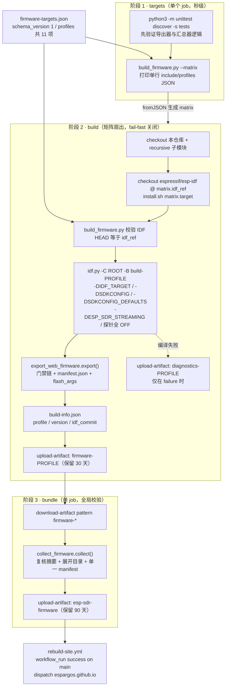

---
title: "构建矩阵与固件导出流水线"
slug: "27-build-and-release"
---

# 构建矩阵与固件导出流水线

## 一、项目定位与核心价值

ESP-SDR 是一个"一颗固件仓库同时服务十颗芯片"的项目：ESP32、ESP32-C2/C3/C5/C6/C61/H2、ESP32-S2/S3 走突发（burst）接收机固件，ESP32-S31 还有一份独立的以太网/USB 高速流式应用。当同一份源码需要产出十余个可烧写变体，并且这些变体要被浏览器烧录器（esp-web-sdr 的 `flash.html`）当作"商品陈列"直接消费时，构建与发布就不再是"跑一次 `idf.py build`"这么简单的事。项目要解决的核心痛点有三个层次：其一是**构建输入的可复现性**——每个 profile 必须绑定到一个确切的 ESP-IDF 提交，否则同一标签产出的镜像行为会随编译期版本漂移；其二是**产物的可验证性**——烧录器拿到的每一段二进制都要有偏移、长度、SHA-256 与 MD5，且必须保证这些字节确实来自那次构建，而不是打包机工作区里凑出来的文件；其三是**发布的全或无（all-or-nothing）语义**——一个缺了 ESP32-C61 的固件目录，对烧录器而言比完全没有固件目录更危险，因为它会静默地把用户引导到"没有你的板子"的错误分支。

该模块给出的答案是一条**三段式、以 JSON 目录为唯一事实来源**的流水线：`firmware-targets.json` 定义构建矩阵，`tools/build_firmware.py` 把矩阵翻译成受控的 `idf.py` 调用，`tools/export_web_firmware.py` 把一次构建"降维"成带摘要的静态发布件，最后 `tools/collect_firmware.py` 把 N 个独立产物重新聚合成单一 `manifest.json`。其核心价值在于**每一个脚本都只信任上游的字节、从不信任上游的结论**：导出器不读 Git，而是从 `app.bin` 内部把 `ESP-SDR-VERSION:` 记录扫出来；汇总器不复用导出器的摘要，而是重新打开文件算一遍 SHA-256/MD5；矩阵生成器不需要 ESP-IDF 环境，因此可以在完全没装工具链的 job 里跑。

这套设计还刻意把"**发布口径**"与"**构建口径**"分开。`--version`（CI 里是 `github.sha`）是人类可读的发布标签，写进 `manifest.json` 的 `version` 与 `build-info.json` 的 `version`；固件内部记录的 `revision` / `build_timestamp` 才是固件自证的内容指纹与年龄。二者并存而非互相覆盖，使得"重新导出旧镜像"永远不会伪造出更年轻的构建时间——这一点在导出器与汇总器里被反复加固，构成了本模块最值得学习的工程纪律。

Sources: [build_firmware.py](tools/build_firmware.py#L1-L63), [export_web_firmware.py](tools/export_web_firmware.py#L1-L121), [collect_firmware.py](tools/collect_firmware.py#L1-L85), [firmware-targets.json](firmware-targets.json#L1-L96)

---

## 二、架构设计与模块划分

整条流水线在 CI 里被切成三个 job：`targets` 产出矩阵、`build` 扇出执行、`bundle` 收口发布。这不是随意的拆分，而是把"零成本决策"与"高成本执行"分层：`targets` 只跑主机单元测试和一次 JSON 打印，秒级完成；`build` 是最贵的部分（`timeout-minutes: 45`）；`bundle` 是唯一有全局视野的位置，也只有它知道"是否所有 profile 都到齐了"。



### 2.1 目录层：`firmware-targets.json` 作为矩阵的唯一事实来源

该 JSON 的 `profiles` 数组被**三种消费者同时读取**，这是整个设计的枢纽：本地开发者用它选 profile，GitHub Actions 用它生成 `strategy.matrix`，`collect_firmware.py --catalog` 用它判定"发布是否完整"。正因为三方读的是同一份文件，"CI 构建了哪些板子"与"发布要求哪些板子"不可能不同步。

profile 的字段语义被刻意压到最小：`id`（同时是产物目录名、manifest 的 variant 键、烧录器 URL 路径片段）、`target`（`IDF_TARGET`）、`label`（人类可读机型描述）、`idf_ref`（钉死的 ESP-IDF 提交）、`allow_larger_flash`（烧录策略）、`preview`（是否需要 `idf.py --preview`）、`streaming` 与 `sdkconfig`（仅流式 profile 使用）。当前矩阵共 11 个 profile，分布在三个 ESP-IDF 提交上：

| profile `id` | `target` | `idf_ref`（前 8 位） | `preview` | `streaming` | `sdkconfig` 覆盖 |
| --- | --- | --- | --- | --- | --- |
| `esp32` | esp32 | `25fe69f9` | 否 | 否 | 默认 `sdkconfig.defaults.esp32` |
| `esp32c2` | esp32c2 | `25fe69f9` | 否 | 否 | 默认 |
| `esp32c3` | esp32c3 | `25fe69f9` | 否 | 否 | 默认 |
| `esp32c5` | esp32c5 | `25fe69f9` | 否 | 否 | 默认 |
| `esp32c61` | esp32c61 | `25fe69f9` | 否 | 否 | 默认 |
| `esp32s3` | esp32s3 | `25fe69f9` | 否 | 否 | 默认 |
| `esp32c6` | esp32c6 | `25fe69f9` | 否 | 否 | 默认 |
| `esp32h2` | esp32h2 | `25fe69f9` | 否 | 否 | 默认 |
| `esp32s2` | esp32s2 | `25fe69f9` | 否 | 否 | 默认 |
| `esp32s31` | esp32s31 | `26dd2948` | **是** | 否 | 默认 `sdkconfig.defaults.esp32s31` |
| `esp32s31-stream` | esp32s31 | `c712a0dd` | **是** | **是** | `sdkconfig.defaults.esp32s31-stream` |

注意 `esp32s31` 与 `esp32s31-stream` 的**同一个 target 却钉在两个不同的 IDF 提交上**：突发固件停在较早的 `26dd2948`，流式应用需要更新的 `c712a0dd`（因为它依赖 `esp_driver_parlio`、`espressif__esp_tinyusb` 与 `espressif__cjson` 等较新的组件）。这正是把 `idf_ref` 放在 profile 而不是放在仓库级常量的理由——**钉版粒度等于产物的粒度**。此外文件尾部的 `unavailable` 是一个空对象，三个脚本均未读取它（全仓库仅有该文件自身出现该键），它是为下游站点/烧录器预留的"已知缺货"扩展位，新增字段不需要改动任何 Python 逻辑。

Sources: [firmware-targets.json](firmware-targets.json#L1-L96), [build_firmware.py](tools/build_firmware.py#L25-L32), [collect_firmware.py](tools/collect_firmware.py#L67-L70)

### 2.2 编排层：`build_firmware.py` 的双模式入口

`build_firmware.py` 是一个"一文件两模式"的命令行工具，这种设计直接对应 CI 的两个 job：

- `--matrix` 模式（第 26–28 行）：`print(json.dumps({'include': catalog['profiles']}, separators=(',', ':')))` 后立即 `return`。它**在任何环境校验之前就返回**，所以 `targets` job 完全不需要 ESP-IDF、不需要 `IDF_PATH`、不需要网络工具链。`{'include': ...}` 是 GitHub Actions 矩阵对"对象数组"的官方写法，因此 `profiles` 里每个键都会自动变成 `matrix.id`、`matrix.idf_ref`、`matrix.target`、`matrix.preview`……无需在 YAML 里重复声明字段。`separators=(',', ':')` 则是为了把输出压成单行——`GITHUB_OUTPUT` 的 `key=value` 语法不接受裸换行。
- 构建模式（第 29–59 行）：先做"廉价失败"检查（profile 是否存在、`--version` 是否给出、`IDF_PATH` 是否已激活、`IDF_PATH` 的 `git rev-parse HEAD` 是否等于 `idf_ref`、输出目录是否已存在），全部通过后才启动编译器。这个顺序非常关键：把"会被浪费 40 分钟的编译器调用"放在所有校验之后。

构建命令的拼装体现了三个隔离意图。**构建目录隔离**：`-B build-<profile>`，配合 `-DSDKCONFIG=<build>/sdkconfig`，使 11 个 profile 的 `sdkconfig` 永不互相污染（也让失败诊断产物 `build-<profile>/log/` 有确定路径可上传）。**默认配置隔离**：`-DSDKCONFIG_DEFAULTS` 优先取 profile 的 `sdkconfig` 字段，否则回退到 `sdkconfig.defaults.<target>`——这就是 `esp32s31-stream` 能共用 `target=esp32s31` 却加载完全不同的 16 MB / PSRAM / 以太网配置的原因。**应用形态隔离**：`-DESP_SDR_STREAMING=ON|OFF` 加上子进程环境里的 `IDF_COMPONENT_MANAGER`，决定这次构建究竟编"突发接收机"还是"流式接收机"。

Sources: [build_firmware.py](tools/build_firmware.py#L14-L55), [firmware.yml](.github/workflows/firmware.yml#L15-L35)

### 2.3 编译期开关：`ESP_SDR_STREAMING` 与探针的"编译输入级"关闭

顶层 `CMakeLists.txt` 把 `ESP_SDR_STREAMING` 当作**应用选择器**而非编译宏：置 ON 时会 `list(APPEND EXTRA_COMPONENT_DIRS .../targets/esp32s31/streaming)`，并强制要求 `IDF_TARGET STREQUAL esp32s31`，否则 `message(FATAL_ERROR ...)`；而 `main/CMakeLists.txt` 的第一段就是早退——一旦 streaming 为真，只 `idf_component_register(REQUIRES streaming)` 然后 `return()`，整个突发固件的源文件列表、链接器片段与 `--wrap` 选项都不会被求值。换句话说，**同一个仓库编译出了两个互斥应用，切换点是 CMake 变量，而不是 `#ifdef`**。非流式分支还顺手把 `ENV{IDF_COMPONENT_MANAGER}` 设为 `0`，确保 `esp-dsp` 走仓库内的钉死子模块而不是组件注册表。

诊断探针则代表了另一条纪律。`main/CMakeLists.txt` 用 6 个 `option()`（`SAMPLE_RATE_PROBE`、`RING_PROBE`、`S2_RF_PROBE`、`S3_RF_PROBE`、`FILTER_REGISTER_PROBE`、`C5_TUNE_PROBE`，其中后四个按 target 追加进 `probes` 列表）控制是否 `target_compile_definitions(... "<probe>=1")`，默认全 `OFF` 且注释写着 *never package*。`build_firmware.py` 在非流式构建里**显式传 `-D...=OFF`**（第 51–53 行），而不是依赖默认值——这是"编译输入级的关闭"；导出器随后还会再扫一遍 `CMakeCache.txt` 拒绝任何 truthy 值，构成**两道相互独立的闸门**。两道闸门的存在不是为了冗余美观：第一道防的是"人忘了关"，第二道防的是"构建缓存里残留了 ON"。

Sources: [CMakeLists.txt](CMakeLists.txt#L9-L21), [main/CMakeLists.txt](main/CMakeLists.txt#L1-L57), [build_firmware.py](tools/build_firmware.py#L43-L54), [sdkconfig.defaults.esp32s31-stream](sdkconfig.defaults.esp32s31-stream#L1-L45)

### 2.4 导出层：`export_web_firmware.py` 的门禁链

导出器是整条流水线的"海关"：它读的是 ESP-IDF 构建目录里的三份权威产物——`CMakeCache.txt`（探针开关）、`config/sdkconfig.json`（最终生效配置）、`flasher_args.json`（esptool 视角的镜像清单），然后逐项交叉验证。它的校验顺序与其失败语义值得逐条列出：

| # | 门禁 | 实现位置 | 拒绝条件 | 防的是什么 |
| --- | --- | --- | --- | --- |
| 1 | 板号字符集 | 第 48–49 行 | 不匹配 `[A-Za-z0-9][A-Za-z0-9_.-]*` | 板号会进入文件名、`flash_args`、烧录器 URL 与清单键，必须拒绝路径分隔符与空白 |
| 2 | 探针残留 | 第 50–54 行 | 任一探针既不等于 `OFF/FALSE/0/NO/空` | 把"寄存器实验固件"当成发布件 |
| 3 | 目标一致性 | 第 57–61 行 | `sdkconfig.json` 的 `IDF_TARGET` 与 `flasher_args.json` 的 `chip` 不一致，或 target 不匹配 `esp32[a-z0-9]*` | "编译到 A 芯片、生成 B 芯片烧写参数"的错配 |
| 4 | flash 容量具体化 | 第 62–67 行 | `flash_size` 为 `detect` 且 `ESPTOOLPY_FLASHSIZE` 缺失，或无法解析为 `数字+MB` | `detect` 是运行期行为，清单里必须落成确定值 |
| 5 | 镜像归属 | 第 72–74 行 | 任一闪写文件解析后不在 `build/` 之内 | 路径逃逸或软链接把构建目录外的文件卷进产物 |
| 6 | 布局合法性 | 第 76–79 行 | 空文件 / offset 小于上一段末端 / 超出 flash 上限 | 镜像重叠或越界导致烧录后无法启动 |
| 7 | 镜像非空 | 第 84–85 行 | `flasher_args.json` 里没有任何 flash 文件 | 空发布件 |
| 8 | 内嵌版本自证 | 第 98–105 行 | 找到多份 `ESP-SDR-VERSION:` 记录，或记录里的 `profile` 与导出板号不符 | 把 C61 的镜像挂到别的变体键下 |
| 9 | 不可覆盖 | 第 107 行 | `output.mkdir(..., exist_ok=False)` | 两次导出"就地合并"出半新半旧的目录 |

其中最精巧的是**用镜像自证身份**（门禁 8）。`firmware_version()` 在二进制里查找标记 `ESP-SDR-VERSION:`，读到 NUL 为止、长度上限 512 字节，然后做完整校验：`build_timestamp` 必须匹配 `YYYY-MM-DDTHH:MM:SSZ` 形态**并通过 `strptime` 真实性检查**（所以 `2026-02-30T...` 会被拒），`build_date` 必须等于时间戳前 10 字符，`revision` 必须是 40 位小写十六进制（可带 `-dirty`）或 `unknown`，`profile` 必须匹配 `esp32[a-z0-9]*`。原因是"导出时刻"与"打包机的 Git 检出"都不可信，只有镜像内部的字节可信。同时保留一条兼容旧固件的兜底路径 `firmware_build_date()`：按镜像布局定位 `esp_app_desc_t`（24 字节镜像头 + 8 字节段头之后，偏移 32 处校验魔数 `0x3254cdab` 的小端字节 `32 54 cd ab`），再从偏移 128 读出 `%b %d %Y` 形式的编译日期。

需要提醒维护者的是两处"局部而非全局"的行为：其一，`firmware_build_date()` 使用的 `%b` 依赖进程 locale，在 CI 的 C locale 下稳定，但在本地化环境里可能解析失败（此时函数返回 `None` 而不抛错，属安全降级）。其二，流式应用（`esp32s31-stream`）不链接 `burst_version.c`，镜像里没有 `ESP-SDR-VERSION:` 记录，因此 `embedded` 为空，该变体只会有 `build_date`（来自应用描述符）与发布标签 `version`，而**没有** `git_revision` / `build_timestamp`；汇总器的完整性检查也不要求这两个字段，所以这是被有意容忍的差异，而不是漏洞。

Sources: [export_web_firmware.py](tools/export_web_firmware.py#L11-L121), [generate_version.py](tools/generate_version.py#L9-L32), [test_firmware_export.py](tests/test_firmware_export.py#L33-L120)

### 2.5 清单层：`manifest.json` 的字段契约

导出器产出的 `manifest.json` 以 `schema_version: 1` 开头，`variants` 以板号为键。单变体的字段可以按下表理解——它同时是烧录器（读什么）、发布审计（信什么）、前端提示（比什么）三方的契约：

| 字段 | 来源 | 语义与注意事项 |
| --- | --- | --- |
| `revision` | 导出参数 `board` | 与 variant 键冗余保存，便于下游扁平化消费 |
| `label` | profile 的 `label` | 人类可读机型名，烧录器下拉框展示用 |
| `target` / `chip` | `sdkconfig.json` 的 `IDF_TARGET`，`chip` 由 target 派生为 `ESP32-C61` 形式 | 两字段必须互推一致，汇总器会复核 |
| `version` | 导出参数（CI 为 `github.sha`） | **发布标签**，不参与"是否过旧"判断 |
| `flash_size` | `flash_settings.flash_size`，`detect` 时回退到 `ESPTOOLPY_FLASHSIZE` | 必须形如 `2MB` / `16MB` |
| `flash_size_policy` | `allow_larger_flash` 为真则 `minimum`，否则 `exact` | `minimum` 表示"此布局可写入容量不小于该值的芯片"；11 个 profile 全部为 `true` |
| `flash_settings` / `esptool_args` | 原样透传 `flasher_args.json` | 浏览器端构造 esptool 参数时直接用 |
| `parts[]` | 按 offset 数值升序遍历 `flash_files` | 每项含 `name`（重命名为 `序号-原名`）、`offset`、`size`、`sha256`、`md5` |
| `application` | `CMakeCache.txt` 中 `ESP_SDR_STREAMING:BOOL=ON` | 仅流式变体出现，值固定 `soapysdr` |
| `xtal_mhz` | `sdkconfig.json` 的 `XTAL_FREQ` | **仅 esp32c2**：该芯片存在 26/40 MHz 晶振两种硬件 |
| `git_revision` / `build_date` / `build_timestamp` | 内嵌版本记录（优先）或应用描述符（兜底） | 固件自证的年龄与指纹 |

`parts` 的重命名不是美化：序号按**烧写顺序**编码，使得下游只要按数组顺序遍历即可，不必再排序；这也让 `flash_args` 里的每一行与文件名天然对齐。`flash_args` 的前三行是 `--flash-mode/--flash-freq/--flash-size`，随后每段一行 `偏移 板号/文件名`，正好是 `python -m esptool ... write-flash @flash_args` 的 argfile 语法；`flash_command.txt` 则把 `@flash_args` 写成相对路径，并保留 `--no-stub`（当构建侧 `extra_esptool_args.stub` 为假时）——S31 板上 ROM 下载器不可靠这条硬件事实，就这样从 sdkconfig 一路传导到浏览器烧录命令。

Sources: [export_web_firmware.py](tools/export_web_firmware.py#L47-L121), [sdkconfig.defaults.esp32c2](sdkconfig.defaults.esp32c2#L11-L11), [sdkconfig.defaults.esp32s31-stream](sdkconfig.defaults.esp32s31-stream#L41-L42)

### 2.6 汇总层：`collect_firmware.py` 的事务式发布

汇总器是整个流水线里唯一拥有全量知识的组件，它的实现几乎就是一段事务：**先验证一切，再写出任何东西**。控制流上 `output.mkdir(parents=True)` 出现在所有校验循环之后（第 74 行），这正是 `test_corrupt_input_never_produces_catalog` 能断言"失败后 `firmware/` 目录不存在"的原因。它重做的校验包括：manifest 必须 `schema_version == 1` 且有 `variants`；profile id 字符集与**唯一性**（重复 profile 直接拒绝，杜绝两个 artifact 抢同一个变体）；`label/chip/target/version` 必须是非空字符串；`chip` 必须由 `target` 推导得出；`flash_size` 必须为正且 `flash_size_policy` 只能是 `exact` 或 `minimum`（老清单缺该字段时默认 `exact`）；每个 part 的 `name` 必须匹配 `.bin` 后缀且不重名；offset 必须单调不重叠且不越界；**并重新打开文件算 SHA-256 与 MD5、比对 `st_size`**，任何不一致即报 `Firmware integrity check failed`。

目录遍历用的是 `rglob('manifest.json')`，因为 `actions/download-artifact` 会把每个 artifact 解到独立子目录；随后两处 `is_relative_to(source)` 检查（manifest 本身、以及每个镜像与元数据文件）封住了软链接或路径逃逸。当传入 `--catalog` 时，变体集合与 profile id 集合不等会直接报 `Artifact set does not match the complete build catalog`——这就是"全或无"的落点：少一颗芯片，整批发布失败。最后一层细节是 `version` 的合并策略：所有变体标签相同则取该值，否则写 `multiple releases`（第 71–72 行），并且 `flash_command.txt` 里的 `@flash_args` 会被改写成 `@<profile>/flash_args` 以匹配摊平后的目录结构。

Sources: [collect_firmware.py](tools/collect_firmware.py#L11-L85), [test_firmware_collect.py](tests/test_firmware_collect.py#L21-L47)

### 2.7 产物布局与 `partitions.csv` 的真实角色

一次成功发布在磁盘上长这样（`<id>` 同时是 profile 与 board）：

```text
firmware/
├── manifest.json                # schema_version 1，variants 覆盖全部 11 个 profile
├── esp32s3/
│   ├── 0-bootloader.bin
│   ├── 1-partition-table.bin
│   ├── 2-ota_data_initial.bin     # 视构建配置而存在
│   ├── 3-esp_sdr.bin
│   ├── flash_args                 # esptool argfile，路径已改写成 esp32s3/0-bootloader.bin
│   ├── flash_command.txt          # python -m esptool --chip esp32s3 ... @esp32s3/flash_args
│   └── build-info.json            # profile / version / idf_commit
└── esp32s31-stream/
    └── ...
```

`partitions.csv` 在这套布局里扮演的是**分区布局参考**，而不是构建输入：它的内容是 `nvs` 于 `0x9000`（24 KiB）、`phy_init` 于 `0xf000`（4 KiB）、`factory` 于 `0x10000`（4 MiB 槽位）。仓库中唯一被 sdkconfig 显式引用的自定义分区表是 `sdkconfig.defaults.esp32s31-stream` 里的 `CONFIG_PARTITION_TABLE_CUSTOM_FILENAME="partitions-stream.csv"`（`factory` 槽位收窄到 3 MiB，配合 16 MB flash 与 SPIRAM 布局）；没有任何 profile 把 `CONFIG_PARTITION_TABLE_CUSTOM` 指向 `partitions.csv`。这意味着流水线真正校验的偏移与长度**全部来自 `flasher_args.json`**，而容量上限来自该次构建的 `flash_size`（多数 profile 为 2 MB，S2 为 4 MB，S31 流式为 16 MB）。理解这一点很重要：`partitions.csv` 描述的是"在 4 MiB 及以上板子上应用槽位有多大余量"，而导出器的越界判断用的是实际镜像长度，所以一份 4 MiB 槽位的规划不会让 2 MB 板子的构建失败。

Sources: [partitions.csv](partitions.csv#L1-L4), [partitions-stream.csv](partitions-stream.csv#L1-L4), [sdkconfig.defaults.esp32s31-stream](sdkconfig.defaults.esp32s31-stream#L36-L37), [export_web_firmware.py](tools/export_web_firmware.py#L68-L83)

---

## 三、技术栈与核心工作流

### 3.1 技术栈取舍

| 维度 | 选择 | 取舍理由 |
| --- | --- | --- |
| 语言 | Python 3，**仅标准库**（`argparse`/`json`/`hashlib`/`re`/`shutil`/`subprocess`/`pathlib`） | 导出器 docstring 明写 "stdlib only"；CI 里无需 `pip install`，包供应链风险为零，脚本可直接 `python3 tools/xxx.py` 运行 |
| 构建系统 | ESP-IDF `idf.py` + CMake，`MINIMAL_BUILD ON` | 只编译依赖图内的组件，缩短 11 路矩阵的单任务耗时，45 分钟超时才有余量 |
| 并行度 | `IDF_PY_BUILD_JOBS`（默认 2，`--jobs` 可调） | 显式控制内存峰值，避免 2 核 CI runner 上 ninja 把 RAM 打爆 |
| 编排 | GitHub Actions 三 job（`targets` → `build` 扇出 → `bundle`），外加 `workflow_run` 触发站点重建 | 把"零成本矩阵计算"与"高成本编译"分离；矩阵变更只改 JSON |
| 发布件 | 静态目录 + `manifest.json`（schema_version 1） | 浏览器烧录器直接 HTTP GET，无需后端服务；产物即站点资源 |
| 制品传递 | `upload-artifact` / `download-artifact` | 每个 profile 一个独立 artifact，天然满足"永不就地合并" |

### 3.2 执行主链路

主链路可以概括为 **目录解析 → 钉版校验 → 隔离构建 → 门禁导出 → 事务汇总 → 站点发布**。它与"感知 → 规划 → 执行"的经典范式同构：`targets` 是感知（读目录、跑测试），`build` 矩阵是规划加执行（每个 profile 独立一次），`bundle` 是校验收口（对全部结果做一次全局复核）。

| 阶段 | 关键入口 | 输入 | 输出 | 失败语义 |
| --- | --- | --- | --- | --- |
| 矩阵计算 | `build_firmware.main()` 的 `--matrix` | `firmware-targets.json` | 单行 `include` 数组 JSON | `parser.error`（例如 `--jobs` 非正） |
| 前置测试 | `python3 -m unittest discover -s tests` | `tests/test_firmware_export.py`、`tests/test_firmware_collect.py` | 退出码 | job 失败，矩阵不再计算 |
| 钉版校验 | `build_firmware.py` 第 33–38 行 | `IDF_PATH` 的 git HEAD | 通过或直接退出 | `Profile requires ESP-IDF ..., found ...` |
| 隔离构建 | `idf.py -B build-<id> ... build` | CMake 与 sdkconfig defaults | `build-<id>/flasher_args.json` 等 | `subprocess.run(check=True)` 抛错 |
| 门禁导出 | `export_web_firmware.export()` | `CMakeCache.txt`、`config/sdkconfig.json`、`flasher_args.json` | `artifacts/<id>/manifest.json` + `<id>/*.bin` + `flash_args` | `ValueError`，9 道门禁任一触发 |
| 溯源落盘 | `build_firmware.py` 第 57–58 行 | profile / version / IDF commit | `build-info.json` | 无，导出成功后才写 |
| 事务汇总 | `collect_firmware.collect()` | 全部 artifact 目录 | `firmware/` 与合并后的单一 manifest | 任一完整性检查失败即不产出目录 |
| 站点发布 | `rebuild-site.yml` | `workflow_run` 事件 | 对 `espargos.github.io` 的 dispatch | `permissions: {}` 加 `if` 条件守卫 |

Sources: [firmware.yml](.github/workflows/firmware.yml#L15-L105), [rebuild-site.yml](.github/workflows/rebuild-site.yml#L1-L24), [build_firmware.py](tools/build_firmware.py#L14-L59)

### 3.3 CI 工程细节

`build` job 里有若干"成本优化 + 故障可见性"的配置值得注意。`fail-fast: false` 保证一颗芯片编译失败不会取消其他仍在跑的芯片，从而一次 PR 就能看到全部坏点；`timeout-minutes: 45` 对最慢的 S31 流式构建给出上限；`~/.espressif` 缓存键由操作系统、架构、`idf_ref`、`target` 四元组构成，既复用了工具链下载，又保证换 target 或换 IDF 提交时不会误命中共用缓存；`install.sh "$IDF_TARGET_NAME"` 只装当前芯片需要的工具，进一步压缩每个 job 的下载量。失败时额外上传 `build-<id>/log/` 与 `build-<id>/sdkconfig`（保留 7 天）——这两个路径恰好由 `-B build-<id> -DSDKCONFIG=<build>/sdkconfig` 决定，编排层与构建层在此形成闭环。

发布侧的时间窗也做了区分：单个 profile 的 artifact 保留 30 天（临时件），汇总后的 `esp-sdr-firmware` 集合保留 90 天（可回溯的发布件）。`rebuild-site.yml` 用 `workflow_run` 而非 `push` 触发，`if` 条件同时要求构建成功与事件类型为 `push`，因此 PR 上的构建成功不会触发线上站点重建；注释也点明了原因——等构建结束再触发，站点才能找到"那次成功的 run"。`permissions: {}` 把默认 GITHUB_TOKEN 权限清零，改用独立的 `ESPARGOS_GITHUB_IO_TOKEN` 做跨仓 dispatch，权限最小化做得相当彻底。

Sources: [firmware.yml](.github/workflows/firmware.yml#L29-L105), [rebuild-site.yml](.github/workflows/rebuild-site.yml#L9-L24), [build_firmware.py](tools/build_firmware.py#L39-L43)

---

## 四、典型代码示例

### 4.1 矩阵模式：零依赖的矩阵计算

`--matrix` 分支的关键在于"先返回、后校验"，以及压缩成单行 JSON 以适应 `GITHUB_OUTPUT`：

```python
catalog = json.loads((ROOT / 'firmware-targets.json').read_text())
if args.matrix:
    print(json.dumps({'include': catalog['profiles']}, separators=(',', ':')))
    return
```

对应 CI 侧只需两行即可把 11 个 profile 展开成 11 个并发 job：

```yaml
- id: catalog
  run: echo "matrix=$(python3 tools/build_firmware.py --matrix)" >> "$GITHUB_OUTPUT"
# 下游：strategy.matrix: ${{ fromJSON(needs.targets.outputs.matrix) }}
#       引用：${{ matrix.id }} / ${{ matrix.idf_ref }} / ${{ matrix.target }}
```

Sources: [build_firmware.py](tools/build_firmware.py#L25-L28), [firmware.yml](.github/workflows/firmware.yml#L26-L35)

### 4.2 钉版校验：把"文档约定"变成"硬失败"

```python
sdk = os.environ.get('IDF_PATH')
if not sdk:
    parser.error('Activate the pinned ESP-IDF environment first')
revision = subprocess.check_output(['git', '-C', sdk, 'rev-parse', 'HEAD'], text=True).strip()
if revision != profile['idf_ref']:
    parser.error(f"Profile requires ESP-IDF {profile['idf_ref']}; found {revision}")
```

这段代码把 README 里"检出 `firmware-targets.json` 中列出的提交"这句建议，升级成了不可绕过的运行时约束；同时它也是 `build-info.json` 里 `idf_commit` 的唯一来源，使"用的哪套工具链"具备逐产物可审计性。

Sources: [build_firmware.py](tools/build_firmware.py#L33-L38), [build_firmware.py](tools/build_firmware.py#L56-L59)

### 4.3 镜像遍历：一次循环完成五种校验

```python
for i, (address, name) in enumerate(sorted(args['flash_files'].items(), key=lambda p: int(p[0], 0))):
    source = (build / name).resolve()
    if not source.is_relative_to(build.resolve()):
        raise ValueError('Flash image must be inside the build directory')
    data = source.read_bytes()
    offset = int(address, 0)
    if not data or offset < end or offset + len(data) > limit:
        raise ValueError('Empty, overlapping or out-of-flash image')
    end = offset + len(data)
    filename = f'{i}-{source.name}'
    parts.append(dict(name=filename, offset=offset, size=len(data),
                      sha256=hashlib.sha256(data).hexdigest(), md5=hashlib.md5(data).hexdigest()))
```

一个 `sorted` 加一个 `end` 游标，同时完成了"地址按数值排序而非字典序"、"路径不越界"、"非空"、"不重叠"、"不超出 flash"五件事，并把摘要与序号一并固化进清单——这是整份代码里最紧凑的一段，也是 `test_out_of_flash_rejected` 与 `test_manifest_and_cli_offsets` 共同锁定行为的对象。

Sources: [export_web_firmware.py](tools/export_web_firmware.py#L69-L83), [test_firmware_export.py](tests/test_firmware_export.py#L33-L38)

---

## 五、学习与探索建议

### 5.1 阅读路线（按目标分岔）

| 目标 | 建议路径 | 关注点 |
| --- | --- | --- |
| 新增一颗芯片到发布矩阵 | 先读 `firmware-targets.json` 的 `profiles` 结构，再看 `main/CMakeLists.txt` 的 `probes` 与 `target_dir` 推导，最后补一份 `sdkconfig.defaults.<target>` | 新 profile 必须让 `label/chip/target/version` 通过 `collect_firmware` 的完整性检查；`chip` 是 `target` 的派生值，不能手写不一致 |
| 调整发布布局（分区 / flash 容量） | `sdkconfig.defaults.<target>` 的 flash 容量项，然后 `partitions*.csv`，最后 `export_web_firmware.py` 的 `flash_size` 解析 | 改了 flash 容量就改写了 `manifest.flash_size` 与 `flash_size_policy` 的语义，浏览器烧录器的兼容判断随之变化 |
| 排查"烧录器里没有我的板子" | `collect_firmware.collect()` 的 `--catalog` 分支，再看 workflow 里 `pattern: firmware-*` | 少一个 profile 会导致整批 `Artifact set does not match the complete build catalog`，先看 bundle job 日志 |
| 排查"版本提示一直让我升级" | `export_web_firmware.firmware_version()`，然后 `generate_version.py`，最后 `main/common/burst_version.c` | 固件年龄只看 `build_timestamp`；流式变体没有该字段，属预期行为 |
| 想知道探针为什么没进发布件 | `build_firmware.py` 第 51–53 行，对照 `export_web_firmware.py` 第 50–54 行 | 两道闸门：编译输入级 OFF 加导出级扫描 `CMakeCache.txt` |
| 想压缩 CI 成本与时长 | `.github/workflows/firmware.yml` 的缓存键、`MINIMAL_BUILD ON`、`--jobs` | 缓存键必须随 `idf_ref` 与 `target` 变化，否则会命中错误的工具链 |
| 想复现一次线上发布 | `python3 tools/build_firmware.py --profile <id> --version <sha>`，再 `python3 tools/collect_firmware.py --input ... --output firmware --catalog firmware-targets.json` | 本地复现与 CI 走的是**完全同一组脚本**，不存在"CI 专用路径" |

### 5.2 可以动手的三个小实验

1. **删掉一个 profile 试跑汇总**：把某个 artifact 目录移走再执行带 `--catalog` 的汇总，观察"全或无"语义如何阻止半成品发布。
2. **伪造一次探针残留**：在任意 `build-<id>/CMakeCache.txt` 里把 `RING_PROBE` 改成 `ON` 后单独跑导出器，验证门禁 2 的独立性，以及 `test_probe_firmware_rejected` 对六个探针的逐一参数化覆盖。
3. **篡改一个字节**：修改 `firmware/<id>/<序号>-*.bin` 的任一字节后重跑汇总器，观察它是用 `sha256`、`md5` 还是文件长度先抓到问题（第 57 行的三条件或运算）。

Sources: [collect_firmware.py](tools/collect_firmware.py#L67-L70), [test_firmware_export.py](tests/test_firmware_export.py#L77-L83), [test_firmware_collect.py](tests/test_firmware_collect.py#L27-L31)

---

## 🔗 关联模块与上下游

- **上游（构建输入）**：[firmware-targets.json](firmware-targets.json) 定义矩阵与钉版；[CMakeLists.txt](CMakeLists.txt#L9-L21) 与 [main/CMakeLists.txt](main/CMakeLists.txt#L11-L98) 决定 `ESP_SDR_STREAMING` 与探针的编译期形态；[sdkconfig.defaults.esp32s31-stream](sdkconfig.defaults.esp32s31-stream#L1-L45) 是唯一自带自定义分区表与 16 MB flash 的配置。
- **下游（消费发布件）**：`manifest.json` 由浏览器烧录器（esp-web-sdr 的 `flash.html`）无缓存拉取，`parts[]` 与 `flash_args` 直接驱动 esptool；`git_revision` / `build_timestamp` 用于连接后的版本比对。
- **同章节的验证侧**：主机测试与硬件在环脚本见 *构建与验证 · 主机测试与硬件在环验证*；版本元数据的生成与上报细节见 *主机协议与传输 · 固件版本元数据与上报*。

Sources: [firmware-targets.json](firmware-targets.json#L1-L96), [export_web_firmware.py](tools/export_web_firmware.py#L87-L121), [docs/firmware-version.md](docs/firmware-version.md#L16-L27)
