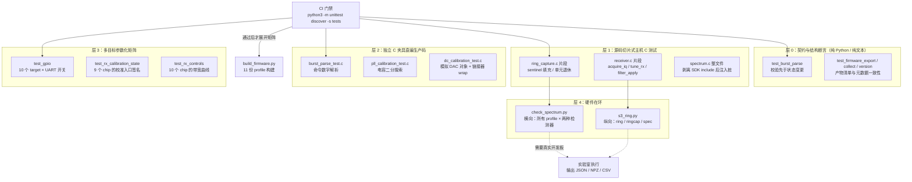
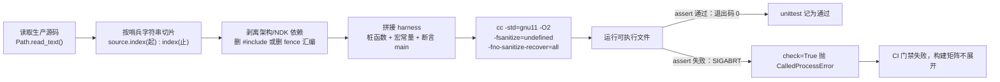
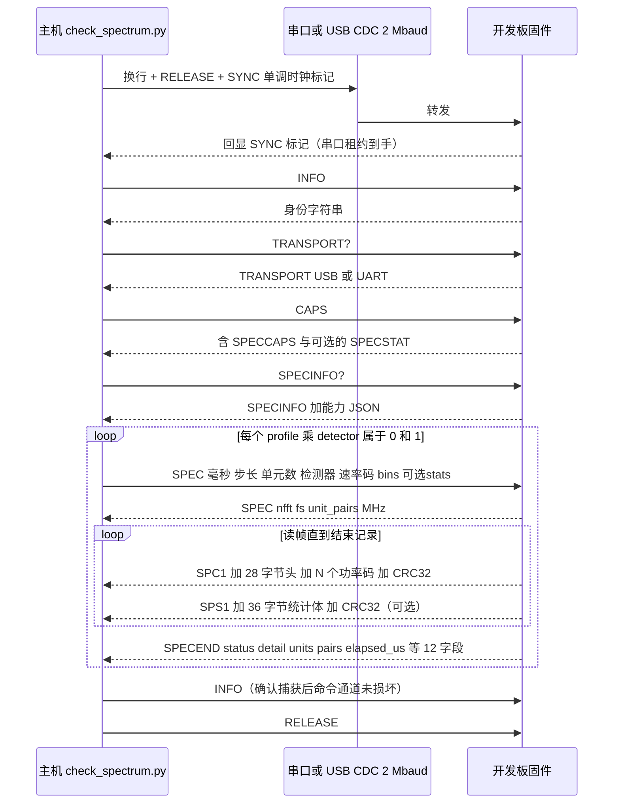

# 主机测试与硬件在环验证

> 该验证体系的设计前提可以概括为一句话：**没有任何一块开发板能进入 CI，但绝大部分可回归的逻辑必须进入 CI**。于是验证被切分成两类——可在主机上判定的"逻辑与结构"，以及只能由硅片回答的"物理与时序"。前者以源码切片 + 桩件 + UBSan 的方式在每次提交时执行；后者退化为带明确判据的可复现实验脚本，由人在实验室里跑，并打印机器可读的 JSON 报告。

本页剖析 `tests/` 目录与 `tools/` 下两个 HIL 脚本（`check_spectrum.py`、`s3_ring.py`）共同构成的证据链，说明它们各自守护哪一种失效模式，以及为何必须采用现在这种（看起来颇为非典型的）测试形态。

---

## 1. 项目定位与核心价值

### 1.1 被验证对象的特殊性

ESP-SDR 做的事情本身就处在"未文档化"的边界上：它借助 LLM 辅助逆向，找到了一条让 CPU 直接读取接收机 ADC 输出的 debug 路径，从而把普通 ESP32 板载的 Wi-Fi/蓝牙射频变成一个只收不发、无额外硬件的软件无线电。这条路径不经过任何公开 API，其实现细节完全由寄存器时序、SRAM 所有权切换和 PHY 私有校准函数构成。

这类代码的失效模式极其"安静"——它不会抛异常，不会返回错误码，而是：SRAM bank 被 dump engine 与 FreeRTOS 堆同时占用导致栈被覆盖；CPU 在引擎持有 bank 期间读取，拿到 repeating four-word pattern 并在频谱上表现为假峰；bank 轮换晚了一拍，两个捕获单元的数据混进同一帧；校准过期后 tune 到新频率，输出的却是上一次的 DC 表。因此验证不能停留在接口层，必须直接针对**机制**本身：bank 归还是否发生在最后一个读者退出之后、sentinel 填充是否覆盖了整段窗口、FFT 的切片状态机是否在任何阶段被打断都能正确收敛。

Sources: [README.md](README.md#L14-L22), [how-it-works.md](docs/how-it-works.md#L1-L26), [ring_capture.h](main/common/ring_capture.h#L39-L60)

### 1.2 广度压力：十一份固件、十个芯片目标

第二个难点是广度。`firmware-targets.json` 中登记了十一份固件 profile（`esp32`、`esp32c2`、`esp32c3`、`esp32c5`、`esp32c61`、`esp32s3`、`esp32s31`、`esp32c6`、`esp32h2`、`esp32s2`，以及独立的 `esp32s31-stream`），每份都钉死一个 ESP-IDF commit。在这十个芯片 target 之上，同一条命令在不同芯片上走的是完全不同的实现：GPIO 数量与保留位不同、带宽—DCAP 曲线不同、PLL 校准入口的函数名与参数个数不同（`phy_set_rx_gain_cal_dc` 有 4 参、`set_rx_gain_cal_dc` 有 1 参或 10 参、`ram_set_rx_gain_cal_dc` 有 2 参）。

手工在十块板子上做回归是不可持续的。项目的应对方式是把"芯片差异"变成**编译期参数矩阵**：同一份测试源码用不同的 `-DCONFIG_IDF_TARGET_*` 编译十遍，每一遍都断言该目标下正确的常量、正确的符号调用、正确的寄存器地址。`test_gpio.py` 里那张 `TARGETS` 表（引脚总数、USB 引脚对、UART 引脚对、被其他外设占用的引脚集合）就是这种异构性最直白的清单。

Sources: [firmware-targets.json](firmware-targets.json#L1-L96), [test_gpio.py](tests/test_gpio.py#L9-L20), [test_rx_calibration_state.py](tests/test_rx_calibration_state.py#L14-L23)

### 1.3 核心价值：把"可判定性"下沉

由此形成的价值主张是清晰的：**主机测试承担可判定性，HIL 承担物理真实性。**

主机测试不需要射频硬件，也不需要 ESP-IDF 链接成功——它只需要一个 C 编译器。因此它能在 GitHub Actions 的 `ubuntu-24.04` 上以 `python3 -m unittest discover -s tests` 一条命令跑完，并且被放在固件构建矩阵**之前**作为门禁：只有这批主机测试通过，才会去解析 profile 矩阵、逐个拉取钉死的 ESP-IDF 并编译十一份固件。这意味着一次语法性错误、一次寄存器语义回归、一次协议字段错位，都会在消耗四十五分钟构建时间之前被拦下。

HIL 则反过来放弃了覆盖面，专注回答主机无法回答的问题：真实 PLL 是否落在锁定窗口内、bank 轮换在真实 80/40/16 MS/s 采样率下是否真的无缝、USB 吞吐能否支撑所需的 FFT 覆盖率、连续模式在真实 CW 音下的相位是否跨单元连续。

Sources: [firmware.yml](.github/workflows/firmware.yml#L15-L27), [firmware.yml](.github/workflows/firmware.yml#L29-L74), [README.md](README.md#L124-L127)

### 1.4 三层证据链一览

| 证据类型 | 回答的问题 | 判定信号 | 代表实现 |
| --- | --- | --- | --- |
| 结构性断言（文本） | 代码是否保持了某个顺序/形状，例如"先校验参数再改接收机状态" | 字符串索引先后关系 | `test_burst_parse.py` 的 `index('ERR args') < index('snprintf(h')` |
| 语义性断言（编译运行） | 该函数在给定输入下的行为是否符合协议/数学定义 | `assert` 失败导致进程非零退出 | `test_ring_sentinels.py`、`test_spectrum_math.py` |
| 物理性断言（真板） | 硅片上的时序、锁相、传输是否成立 | CRC、`SPECEND` 状态码、相位步进 | `tools/check_spectrum.py`、`tools/s3_ring.py` |

Sources: [test_burst_parse.py](tests/test_burst_parse.py#L18-L24), [test_ring_sentinels.py](tests/test_ring_sentinels.py#L11-L56), [check_spectrum.py](tools/check_spectrum.py#L45-L108)

---

## 2. 架构设计与模块划分

验证体系采用四层递进结构，层与层的差别不在"测试粒度"，而在**被替换掉的依赖的范围**：层 0 不编译任何东西，层 1 只编译一个函数片段，层 2 编译整份生产文件并劫持外部符号，层 3 把同一逻辑编译十次，层 4 把代码真正放进芯片。



### 2.1 层 1 的核心创新：源码切片（Source Slicing）

这是整个验证体系里最值得注意的设计。常规做法是把被测函数抽到独立模块里方便单测，但那会引入"测试的是副本、发布的是原件"的漂移风险。本项目选择反向操作：**测试运行时从生产 `.c` 文件里按哨兵字符串切出目标函数段，然后把它和桩件拼进同一个翻译单元编译。** 被测代码永远是仓库里那一份，切片只是选择编译范围。

`test_ring_sentinels.py` 是最简洁的范例：它读取 `main/common/ring_capture.c`，以 `RING_SWITCH static void fill_sentinels(` 为起点、`/* First written pair` 为终点截取，再删掉与架构强相关的 `fence rw,rw` 内联汇编，最后拼上声明 `bank_ptr`、`RING_PAIRS`、`SENTINEL` 的 harness。测试体穷举 18 个起始偏移 × 18 个长度 × 2 个 bank，断言只有目标 bank 的目标窗口被写成 sentinel，相邻字节与其他 bank 一字未动——包括跨 `RING_PAIRS` 回绕的情形。

Sources: [test_ring_sentinels.py](tests/test_ring_sentinels.py#L14-L28), [test_ring_sentinels.py](tests/test_ring_sentinels.py#L30-L56)

`test_ring_retirement.py` 把这一手法推到更精细的程度：它同时切片 `unit_done()` 与 `work_slice()` 两段，并在拼接时用 `'#if 1\n' + 片段` 保证每段自带的 `#endif` 守卫闭合。测试在 FFT 的每一个 stage 和每一个处理阶段（`BLK_FFT`、`BLK_ACCUM`）调用 `unit_done()`，断言 work 结构被接管而非丢弃、帧索引与配对计数被正确继承、`abandoned` 计数器只在 `BLK_UNPACK` 阶段递增，并且最终 `frame_close()` 恰好发生一次、累积恰好覆盖 2048 个 bin。这实质上是在主机上把一个**并发/时序不变量**降维成了确定性状态机检查。

Sources: [test_ring_retirement.py](tests/test_ring_retirement.py#L13-L46), [test_ring_retirement.py](tests/test_ring_retirement.py#L47-L72)

`test_snapshot_spectrum.py` 走的是"整文件 + 剥壳"路线：它把整个 `main/common/spectrum.c` 读入，用循环逐个删掉 `esp_cpu.h`、`dsps_fft2r.h`、`esp_rom_crc.h`、`esp_timer.h`、FreeRTOS 头等 SDK 引用，然后前置一个提供 `dsps_fft2r_init_sc16`、`dsps_fft2r_sc16_ansi`、`spectrum_fft_poll` 的桩实现块。测试用一个确定性的"假 FFT"（把输出填成 `(j%97+1)*(transforms+1)`）驱动 `spectrum_command()`，从而可以把期望的功率值解析地算出来，再逐 bin 与线上字节比对——包括 mean 与 max-hold 两种检测器、256 到 2048 四种 FFT 尺寸、1 到 8 个 unit、以及"输出队列满/不满"两种发送路径。同一份源码会被分别以 `ESP32C3` 与 `ESP32C61` 编译，验证同一条 `SPECINFO?` 命令在两个 target 上返回不同但各自正确的 profile 集合。

Sources: [test_snapshot_spectrum.py](tests/test_snapshot_spectrum.py#L14-L50), [test_snapshot_spectrum.py](tests/test_snapshot_spectrum.py#L83-L118)

同样的切片手法被系统性地用在了芯片特定路径上：`test_esp32_capture_recovery.py` 切出 `acquire_iq()`（到 `#include "ring_probe.h"` 为止），用假寄存器文件模拟 dump engine，断言"校准过期时绝不启动 DMA"以及 ADC 控制位的并发修改不会被恢复动作抹掉；`test_tuning.py` 为 ESP32/C2/C3/S2/S3 切出 `tune_rx`/`s2_tune`/`s3_tune`，为 C6 切出 `c6_set_chan`，对 C5/C61/S31 则直接 include 其 `tuning.h`，然后对 100–6000 MHz 的每一个整数频点断言 PLL 分频与偏移误差；`test_rx_controls.py` 切出各芯片的 `filter_apply`/`filter_restore`，断言"备份—覆盖—还原"三步在重调频率后仍能恢复出厂校准字节。

Sources: [test_esp32_capture_recovery.py](tests/test_esp32_capture_recovery.py#L12-L87), [test_tuning.py](tests/test_tuning.py#L68-L125), [test_rx_controls.py](tests/test_rx_controls.py#L118-L146), [test_rx_controls.py](tests/test_rx_controls.py#L204-L222)

### 2.2 层 2：独立夹具直编生产码 + 链接器劫持

当被测单元边界清晰、依赖较少时，切片就不再必要，测试直接编译整份生产文件。`tests/burst_parse_test.c` 只 `#include "burst_parse.h"`，断言解析器对空串、尾随垃圾、字段溢出、`+999`、`- 5`、`4294967296` 等边界的接受/拒绝矩阵；`tests/pll_calibration_test.c` 则穷举了 512 个起始码 × 12 种窗口宽度，要求二分搜索必须落在窗口中心，并且在内联稳定性复核失败时完整回滚电容寄存器与手动模式位。

Sources: [burst_parse_test.c](tests/burst_parse_test.c#L1-L28), [pll_calibration_test.c](tests/pll_calibration_test.c#L47-L77)

`tests/dc_calibration_test.c` 展示了这套手法的上限：它把一个"模拟对象"——四组 `phy_pbus_force_test` 写入的 DAC 码、一个 2×2 响应矩阵、一个可注入失败的测量回调——接到真实校准算法上，然后要求算法在交叉耦合（`{0.2, 0.1, -0.1, 0.2}`）与反相（`{-.2, 0, 0, -.4}`）对象上都能把残余 DC 压到 0.51 以内、迭代不超过 15 步、写入锁存次数必须为偶数（即成对提交）、并且在第 1 次或第 2 次测量失败时既不遗留写入、也不改变 DAC 码。它还额外断言校准不越界改写 RF/baseband 增益控制字段。

Sources: [dc_calibration_test.c](tests/dc_calibration_test.c#L65-L118), [test_dc_calibration.py](tests/test_dc_calibration.py#L9-L28)

另一个反复出现的技巧是利用符号命名约定做依赖注入：`test_c2_heap_guard.py` 在测试文件里定义 `__real_soc_get_available_memory_regions()` 供生产代码调用，然后在 `main()` 里**直接调用** `__wrap_soc_get_available_memory_regions()`，绕开了 `-Wl,--wrap` 的需要；`test_rx_recalibration.py` 则真的使用 `-Wl,--wrap=` 劫持 `chip_v7_set_chan_ana` 与 `write_gain_mem`，并刻意**不提供**某个私有 IQ 测量符号，使得"如果谁重新引入直接 IQ 测量，链接就会失败"成为一条编译期契约。

Sources: [test_c2_heap_guard.py](tests/test_c2_heap_guard.py#L21-L46), [heap_guard.c](main/targets/esp32c2/heap_guard.c#L1-L16), [test_rx_recalibration.py](tests/test_rx_recalibration.py#L136-L190)

### 2.3 层 3：把芯片差异参数化

层 3 不是新的测试类型，而是把层 1/2 的用例套进 `for chip in [...]` 加 `subTest` 的循环，用宏切换 target。`test_rx_calibration_state.py` 维护一张 `chip → (符号名, 参数个数)` 表，为每个 chip 生成原型完全匹配的 `__wrap_` 桩，从而在主机上验证"PHY 锁必须被持有、测量期间必须持锁、测量结束必须解锁、四张 DC 表任一字节变化都必须使缓存失效"这条跨芯片不变量。

`test_rx_controls.py` 则把带宽—DCAP 曲线变成数据：对十个 target 分别断言每段码值区间内的单调性、区间端点值、以及若干具体采样点（例如 C5 的 `rx_bandwidth_dcap(24)==52`、`(34)==24`、`(48)==0`，以及 `rx_bandwidth_phy_mode` 在 23/24 处的模式切换）。这类断言的价值在于：它们把"某芯片手册上那种含糊的表格"固化成了可执行规范，任何人改动插值表都会立刻在某一行上爆掉。

Sources: [test_rx_calibration_state.py](tests/test_rx_calibration_state.py#L24-L81), [test_rx_controls.py](tests/test_rx_controls.py#L18-L89)

### 2.4 层 0：结构断言与产物一致性

有些性质无法用运行时断言表达，只能对源码文本做断言。`test_burst_parse.py` 的第二个用例就是典型：它取 `receiver.c` 中 `"IQS ", 4)` 之后的全部文本，断言 `ERR args` 出现在 `snprintf(h` 之前——即"参数校验必须发生在任何接收机状态变更与任何回复构造之前"。同一用例还断言 `ring_capture.c` 里 `(d & (d - 1u))` 出现在 `while ((1u << l) < d)` 之前，即"2 的幂判断先于位宽计算"。这是一种低成本、高杠杆的**顺序不变量**守卫。

Sources: [test_burst_parse.py](tests/test_burst_parse.py#L18-L24)

另一半层 0 测试针对构建产物而非固件行为，它们用 `importlib.util.spec_from_file_location` 直接加载 `tools/` 下的脚本，绕开包结构。`test_version.py` 先验证嵌入镜像的 `ESP-SDR-VERSION:` JSON 记录被正确解析，并拒绝错误日期、非 UTC 时间戳、非法 revision、`../bad` 这类路径型 profile；随后编译真正的 `burst_version.c` 与一个 harness，把 `VERSION?` 的线上回复解码后与 `firmware_version()` 的结果做**双向**一致性比对。

Sources: [test_version.py](tests/test_version.py#L11-L54)

`test_firmware_export.py` 把导出器当作规格书来测：清单里的 `flash_size_policy` 必须是 `minimum`、分区偏移必须被换算成十进制、`flash_args` 文本必须与 CLI 一致、构建日期必须能从镜像描述符的 `Sep 28 2026` 反解出来、`detect` 尺寸必须回落到 sdkconfig 并保留 `--no-stub`、C2 必须记录 26 MHz 晶振。它同时是"拒绝路径"的集合：target 与清单不符、镜像越界、重复导出覆盖已有发布、以及**任何诊断探针被编进固件**都必须抛出异常且不得留下半成品输出目录。

Sources: [test_firmware_export.py](tests/test_firmware_export.py#L33-L120)

`test_firmware_collect.py` 在其之上验证"全或无"的聚合语义：只要有一个输入镜像 CRC 不符、或 `firmware-targets.json` 里某个 profile 缺失，就绝不生成 catalog；重复目录与空输入同样被拒绝。

Sources: [test_firmware_collect.py](tests/test_firmware_collect.py#L21-L46)

### 2.5 层 4：两个 HIL 工具的分工

`tools/check_spectrum.py` 的定位是**横向覆盖审计**。它遍历 `SPECINFO?` 返回的所有 profile，对每个 profile 再遍历两种检测器（mean / max），把固件当前宣称支持的每一种组合都实际跑一遍，最后输出 JSON。它的判据全部是"协议层可验证事实"：帧 CRC、FFT 形状字段、样本索引单调性、`SPECEND` 的 13 个字段与状态 0、捕获结束后命令通道是否仍然可用。它明确声明自己不烧写固件——只使用当前串口上的那一份。

Sources: [check_spectrum.py](tools/check_spectrum.py#L1-L7), [check_spectrum.py](tools/check_spectrum.py#L45-L108)

`tools/s3_ring.py` 的定位是**纵向深挖**，因为它面对的是三 bank 轮换 + core1 worker + 连续捕获这类"只有连续模式才存在"的失效模式。它有三个子命令：`ring` 只跑轮换统计并检查 `pairs / (elapsed × fs) ≈ 1`；`ringcap` 抓 2–3 个连续单元并用 CW 音做跨边界相位连续性判决；`spec` 抓连续频谱帧并落盘为 `.npz` + `_summary.csv` 供离线分析。

Sources: [s3_ring.py](tools/s3_ring.py#L1-L15), [s3_ring.py](tools/s3_ring.py#L91-L119)

### 2.6 横切关注点：诊断探针与发布的隔离

HIL 需要寄存器级观测，但这些观测代码不能出现在分发的固件里。项目的处理是把它们集中到 `main/diagnostics/`，全部用 `#ifdef RING_PROBE` 之类的宏包住，并在两处强制关闭：`build_firmware.py` 在非 streaming profile 上显式追加 `-DRING_PROBE=OFF -DSAMPLE_RATE_PROBE=OFF -DFILTER_REGISTER_PROBE=OFF -DS3_RF_PROBE=OFF -DC5_TUNE_PROBE=OFF -DS2_RF_PROBE=OFF`；`export_web_firmware.py` 侧再由 `test_firmware_export.py` 断言任何 `*_PROBE:BOOL=ON` 的构建都会被拒绝导出。于是"调试能力"与"发布可信度"被彻底解耦。

Sources: [build_firmware.py](tools/build_firmware.py#L51-L58), [ring_probe.h](main/diagnostics/ring_probe.h#L1-L5), [test_firmware_export.py](tests/test_firmware_export.py#L77-L83)

---

## 3. 技术栈与核心工作流

| 组件 | 技术栈 | 在验证链路中的职责 | 关键约束 |
| --- | --- | --- | --- |
| `tests/*.py` | Python `unittest` + `subprocess` + `tempfile` | 编排编译、注入桩件、断言 | 无第三方依赖；无 `cc` 时整体 skip |
| `tests/*.c` | C11 + `assert.h` | 独立测试夹具与被测入口 | 必须能被 host gcc 独立链接 |
| 被测生产码 | C11 / GNU11 + ESP-IDF 头 | `main/common/*`、`main/targets/*` | 通过 `-I` 暴露 `main/common` |
| 编译器开关 | `-fsanitize=undefined -fno-sanitize-recover=all -Werror` | 把整数溢出/越界/shift UB 变成硬失败 | 见各测试的 `subprocess.run` 参数 |
| 链接器 | `-Wl,--wrap=<symbol>` | 劫持 PHY/校准外部符号 | 仅用于层 2 的少数用例 |
| HIL 脚本 | Python + `pyserial`（`s3_ring.py` 另需 `numpy`） | 真板协议审计与波形分析 | 2 Mbaud、DTR/RTS 释放 |
| CI | GitHub Actions `ubuntu-24.04` | 先跑 `unittest discover`，再展开 11 profile 矩阵 | 矩阵由 `build_firmware.py --matrix` 生成 |

Sources: [test_spectrum_math.py](tests/test_spectrum_math.py#L162-L166), [test_gpio.py](tests/test_gpio.py#L22-L22), [test_rx_calibration_state.py](tests/test_rx_calibration_state.py#L76-L81), [firmware.yml](.github/workflows/firmware.yml#L24-L27), [s3_ring.py](tools/s3_ring.py#L14-L14)

### 3.1 主机测试的执行主链路



这条链路的关键在于它**不模拟整机**，只模拟被测函数所能观测到的那一小片世界。以 `test_ring_sentinels.py` 为例，它需要提供的全部环境是：`banks[2][RING_PAIRS+2]`、`bank_ptr()`、`RING_PAIRS`、`RING_MASK`、`SENTINEL`，以及把 `RING_HOT`/`RING_SWITCH` 定义成空。没有 FreeRTOS、没有中断、没有 DMA——但 `fill_sentinels()` 的每一个字节写入位置都被精确验证。这种"最小可观测宇宙"是切片式测试能够规模化（30+ 个测试文件）的根本原因。

Sources: [test_ring_sentinels.py](tests/test_ring_sentinels.py#L18-L28), [test_ring_sentinels.py](tests/test_ring_sentinels.py#L50-L56)

### 3.2 HIL 的会话主链路

HIL 脚本面对的第一个真实问题是**串口不是一条干净的信道**：打开端口可能复位开发板，启动日志与排队的回复会混进来；上一次异常终止的运行可能在对端留下未读字节。`check_spectrum.py` 用"租约 + 回显标记"解决：连续发送 `\nRELEASE\nSYNC <monotonic_ns>\n`，直到读回那个独一无二的标记为止，超时 10 秒后放弃。



`SPEC` 的参数语义与文档严格对齐：`SPEC <milliseconds> <stride> <units_per_frame> <detector> <rate_code> <fft_bins> [stats]`，其中 detector 0 表示均值功率、1 表示最大值保持，附加 `1` 才会同时收到 `SPS1` 遥测。

Sources: [check_spectrum.py](tools/check_spectrum.py#L29-L64), [spectrum.md](docs/spectrum.md#L45-L58)

### 3.3 HIL 的判定矩阵

| 判定点 | 实现位置 | 失败意味着什么 |
| --- | --- | --- |
| 租约同步 | `synchronize()` 10 秒内读回标记 | 端口被复位循环或他人占用 |
| 能力自洽 | `CAPS` 含 `SPECCAPS`；`--stats` 时含 `SPECSTAT` | 固件版本与脚本期望不匹配 |
| 传输可用 | `TRANSPORT?` 的值必须出现在 `SPECINFO` 的 `transports` 中 | 该接口本不提供频谱（例如 S3 走 UART） |
| 启动回执 | 回执 5 字段且 `[1]==n`、`[2]==fs` | 固件实际采用了与请求不同的 profile |
| 帧 CRC | `zlib.crc32(frame[:-4]) == int.from_bytes(frame[-4:],'little')` | 传输丢字节或帧长度算错 |
| FFT 形状 | `1<<frame[26]==n` 且 `frame[27]==2` | 头部字段布局漂移 |
| 索引单调 | `index > previous` 且 `ffts != 0` | 出现空帧或样本索引倒退（意味着 bank 复用/混帧） |
| 统计合法 | 四个百分点字段 ≤1000、`u32(16) >= u32(12)` | `SPS1` 语义错误或堆统计取反 |
| 结束记录 | 13 字段、`report[0]=='SPECEND'`、`report[1]==0` | 捕获因 LATE/AGE/START/END/LENGTH/TRANSPORT 中止 |
| 覆盖非空 | `run['frames']` 非空；≥500 ms 且带 `--stats` 时必须有统计与可持续 FFT 速率 | 连续模式"能启动但不出活" |
| 捕获后可用 | 结束时 `INFO` 与开始一致，随后 `RELEASE` | 高速循环破坏了命令通道 |

Sources: [check_spectrum.py](tools/check_spectrum.py#L45-L108), [ring_capture.h](main/common/ring_capture.h#L39-L48), [spectrum.md](docs/spectrum.md#L58-L96)

---

## 4. 典型代码示例

### 4.1 切片式 harness：把生产函数钉在最小世界里

下面这段是 `test_ring_sentinels.py` 的核心。注意它的三个动作——切片、去架构化、注入桩——顺序不可交换：必须先去 `fence` 汇编，harness 才能在 x86 主机上编译通过；必须先注入 `bank_ptr` 与 `RING_PAIRS`，切片得到的函数体才能解析。

```python
source = (ROOT / 'main/common/ring_capture.c').read_text()
source = source[source.index('RING_SWITCH static void fill_sentinels('):
                source.index('/* First written pair')]
source = source.replace('__asm__ volatile("fence rw,rw" ::: "memory");', '')
harness = r'''
#define RING_HOT
#define RING_SWITCH
#define RING_PAIRS 16384u
#define RING_MASK (RING_PAIRS-1)
#define SENTINEL 0xa5c33c5au
static uint32_t banks[2][RING_PAIRS+2];
static uint32_t *bank_ptr(unsigned b){return &banks[b][1];}
'''
```

断言部分为每个 bank、每个起始偏移、每个长度组合维护一个 `0x12345678` 的"未触碰"基准，并同时检查两个越界哨兵（`banks[k][0]` 与 `banks[k][RING_PAIRS+1]`），因此任何一次"多写一个字节"或"写错 bank"都会立即暴露。这正是 SRAM 所有权 bug 的典型形态：越界一位就会静默损坏邻近数据。

Sources: [test_ring_sentinels.py](tests/test_ring_sentinels.py#L14-L46)

### 4.2 帧级校验：把"协议事实"变成可判定谓词

`check_spectrum.py` 的读帧循环只接受两种 magic，其余一律视为失框：

```python
if magic != b'SPC1':
    raise RuntimeError(f'Lost framing: {magic!r}')
frame = magic + exact(port, n + 28)
if zlib.crc32(frame[:-4]) != int.from_bytes(frame[-4:], 'little'):
    raise RuntimeError('Frame CRC mismatch')
if 1 << frame[26] != n or frame[27] != 2:
    raise RuntimeError('Unexpected FFT shape or power encoding')
index = int.from_bytes(frame[8:16], 'little')
ffts = int.from_bytes(frame[20:22], 'little')
if index <= previous or not ffts:
    raise RuntimeError('Empty FFT frame or non-monotonic sample index')
```

`index <= previous` 这一行是整套 HIL 里信息量最大的断言：它把"bank 轮换是否真的连续、帧是否重复或缺失"压缩成一次 64 位比较。相比之下，用射频相位去验证连续性会受信号源稳定性干扰；样本索引来自固件内部对连续 bank 边界的实测值，不受 RF 影响。

Sources: [check_spectrum.py](tools/check_spectrum.py#L84-L97), [spectrum.md](docs/spectrum.md#L76-L82)

### 4.3 相位连续性：给"无缝"一个数值定义

`ringcap` 子命令是唯一使用射频信号本身的检查。它先用加 Hann 窗的 FFT 与抛物线插值得到粗频，再在每个单元内部用解缠相位的斜率精修频率，最后只比较单元边界处的**初始相位**：若两个相邻单元的相位差换算成样本数后小于 0.25，则判为无缝。

```python
for u in range(len(counts) - 1):
    step = (phases[u + 1] - phases[u] + np.pi) % (2 * np.pi) - np.pi
    gap = step / w if w else float("nan")
    good = abs(gap) < 0.25
    ok &= good
    print(f"boundary {u}->{u + 1} at pair {edges[u + 1]}: phase step "
          f"{np.degrees(step):+.2f} deg -> {gap:+.3f} samples  {'OK' if good else 'GAP?'}")
```

该判据的物理含义是：丢失或重复 `k` 个样本会在边界处造成 `2π·f·k/fs` 的相位阶跃，把它除以角频率就得到等效的"缺失样本数"。脚本还会打印 `unambiguous for gaps up to ±... samples` 与单元内相位噪声 RMS——前者给出该音下的可分辨上限，后者决定判决是否可信（信噪比低于 25 dB 时会明确警告"弱音，相位测试不可靠"）。

Sources: [s3_ring.py](tools/s3_ring.py#L122-L169)

同一个脚本的 `spec` 子命令则补上了数据侧的可复现性：它把帧头与 bin 一起落盘为 `.npz`，并另写一份逐帧 `CSV`（时间、抛物线插值后的峰值频率与功率、上限边缘频率、增益、FFT 数、标志位），其中峰值搜索会屏蔽 DC bin 及其左右各一个 bin，因为 DC 校正会污染中心三点。频率轴还会按 `I+jQ = LO - RF` 的约定做 `fftshift` 与方向翻转，之后按 `f_rf` 升序重排——这是把"固件输出顺序"翻译成"频谱分析惯例"的唯一一处，写错会让整份数据左右颠倒。

Sources: [s3_ring.py](tools/s3_ring.py#L237-L275)

---

## 5. 学习与探索建议

| 目标 | 建议路径 | 关键文件 | 预期收获 |
| --- | --- | --- | --- |
| 首次接触：搞清这套测试为何长这样 | 先读 `test_ring_sentinels.py` 全文件（56 行），再读 `ring_capture.c` 中 `fill_sentinels` 与 `unit_done` | `tests/test_ring_sentinels.py`、`main/common/ring_capture.c` | 理解"切片 + 桩件"的完整闭环，能自行新增一个切片式用例 |
| 首次接触：跑通门禁 | `python3 -m unittest discover -s tests`（需 `cc`，无 `cc` 时全部 skip） | `tests/`、`.github/workflows/firmware.yml` | 看清 CI 在展开 11 profile 构建前先跑什么 |
| 深入：校准与 PHY 语义 | 对照 `test_rx_calibration_state.py`、`test_rx_recalibration.py`、`test_tuning.py` 读 `main/common/rx_calibration_state.c`、`rx_recalibration.c` | `main/common/rx_recalibration.c`、`main/common/rx_pll_cal.h` | 掌握"过期判定—持锁—重测—失效缓存"这条链路，以及各芯片函数签名差异 |
| 深入：连续捕获的时序不变量 | 读 `test_ring_retirement.py`，再读 `ring_capture.c` 的 `work_slice`/`unit_done`/帧关闭逻辑 | `tests/test_ring_retirement.py`、`main/common/ring_capture.c` | 理解三 bank 轮换下"最后一个读者退出后才归还 bank"的证明方式 |
| 深入：协议与线上编码 | 读 `test_snapshot_spectrum.py`，再对照 `docs/spectrum.md` 的帧布局表与本页 3.3 判定矩阵 | `tests/test_snapshot_spectrum.py`、`docs/spectrum.md` | 能把 28 字节头逐字段映射到断言 |
| 攻坚：真板复现 | 按 `check_spectrum.py` 的 JSON 输出定位失败 profile，再用 `s3_ring.py spec/ringcap` 做深挖；带 `--stats` 观察 `SPS1` 的 FFT 速率与堆余量 | `tools/check_spectrum.py`、`tools/s3_ring.py`、`main/diagnostics/ring_probe.h` | 具备从"协议层失败"下钻到"寄存器/时序层失败"的能力 |
| 攻坚：构建与发布完整性 | 读 `tools/export_web_firmware.py` 与其三个测试文件 | `tools/export_web_firmware.py`、`tools/collect_firmware.py`、`tools/build_firmware.py` | 理解"全或无"聚合、探针拒绝、版本内嵌三条发布契约 |

Sources: [test_ring_sentinels.py](tests/test_ring_sentinels.py#L1-L56), [test_ring_retirement.py](tests/test_ring_retirement.py#L1-L72), [test_snapshot_spectrum.py](tests/test_snapshot_spectrum.py#L1-L118), [check_spectrum.py](tools/check_spectrum.py#L1-L133), [s3_ring.py](tools/s3_ring.py#L1-L15)

---

## 🔗 关联模块与上下游

- **被切片测试的直接生产源**：`main/common/ring_capture.c` 与 `main/common/ring_capture.h` —— `fill_sentinels`、`unit_done`、`work_slice`、`ring_status_t` 是层 1 与 HIL 判据的共同来源；改动这里必然同时触发主机断言与 `check_spectrum.py` 的 `SPECEND` 状态码语义。
- **门禁与构建编排**：`.github/workflows/firmware.yml` + `tools/build_firmware.py` —— 定义了主机测试在流水线中的位置（先测后构建）以及探针宏的强制关闭点。
- **协议契约**：`docs/spectrum.md` —— `SPEC` 参数、`SPC1` 帧布局、`SPECEND` 十二字段、`SPS1` 遥测表，是 `tools/check_spectrum.py` 与 `tools/s3_ring.py` 全部校验逻辑的规范依据。

Sources: [ring_capture.h](main/common/ring_capture.h#L39-L60), [firmware.yml](.github/workflows/firmware.yml#L15-L27), [build_firmware.py](tools/build_firmware.py#L51-L58), [spectrum.md](docs/spectrum.md#L45-L113)
