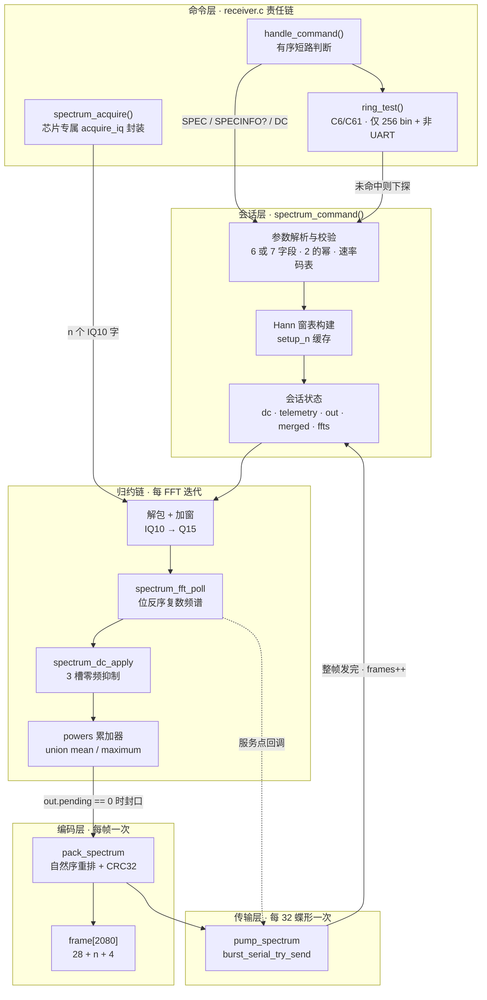
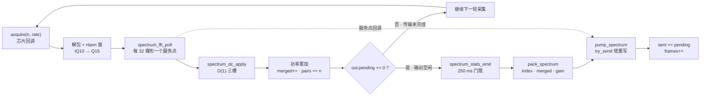

---
title: "频谱流水线：FFT 归约与 SPC1 帧"
slug: "11-spectrum-pipeline"
section: "片上频谱引擎"
difficulty: "Advanced"
---

# 频谱流水线：FFT 归约与 SPC1 帧

> 设计理念：`main/common/spectrum.c` 是整个频谱引擎的**兜底实现（fallback backend）**——它不试图榨干任何一个芯片的吞吐，而是保证"只要这颗芯片能抓到一段 I/Q，就能吐出一帧 CRC 正确的频谱"。它把一次会话压缩成一个 124 行的 `do/while` 循环，循环体内既做射频采集、变换与编码，又承担串口泵送、看门狗让出、停滞检测与统计上报。理解这份文件的关键不是读懂每个数学式子（那是 `spectrum_fft.h`/`spectrum_math.h`/`spectrum_dc.h` 的职责），而是看懂**它如何在"只有一个核、没有银行轮转、没有 DMA 双缓冲"的约束下，把计算与发送交织进同一段时间轴**。

## 项目定位与核心价值

片上频谱引擎在项目里存在两种形态。一种是**连续后端**：S3、S31 用双核加银行轮转，C6/C61 用两银行环加标量切片，它们能在不停采集的前提下持续产出频谱。另一种就是本页讨论的**便携快照后端**：ESP32、S2、C2、C3、C5、H2 这些目标既没有可用的第二核协作，也没有足够的 SRAM 做双银行，因此只能"抓一段、停一下、算完、发出去"。协议文档用一张表给出了这条分界线，并解释了物理原因——C3 的 dump engine 一旦占用 SRAM，CPU 读回的数据会退化成四字重复模式，在频谱上直接表现为假峰，所以它必须彻底停采后再算。这个后端因此不是"简化版"，而是**唯一正确的形态**：它把"采集间隙"从缺陷变成了协议里显式声明的语义（帧头 flag bit 3、`SPECINFO` 的 `"continuous":false`），让主机能诚实地把间隙画出来而不是伪装成连续。

它的第二个核心价值是把**字节级契约**牢牢钉死在固件里。主机看到的不是浮点数组，而是一个 28 字节头 + N 字节功率码 + 4 字节 CRC 的 `SPC1` 帧；每个功率码代表 `20·log10(power)` 的 Q15 归一化功率，步长固定 0.5 dB（帧头 `db_step = 2` 正是在声明这条换算）。为了让"同一份射频在不同芯片上画出来一致"，这个后端做了三件容易被忽略的事：窗函数按 `n` 缓存但保证**峰值归一化为 1.0**，使频域标定与 FFT 尺寸无关；DC 抑制在功率累加**之前**执行，使均值与最大保持两种检测器共享同一条数值链路；编码走整数/位模式解析而**不调用 `logf`**，让没有 FPU 的 C2/C3 也能在采集节拍内完成编码。这些取舍使它成为跨芯片对拍测试（`tools/check_spectrum.py` 在全平台跑通）的基准实现。

第三个价值在于**内存姿态**。整个后端没有一次堆分配：8 KiB 的 FFT 缓冲、4 KiB 的窗、8 KiB 的功率累加器、2 KiB 的帧缓冲与 4 KiB 的旋转因子表全部是 `static`，总量约 26 KiB。在 ESP32-C2 上它们还被显式放进 `.c2_spectrum` 段（链接到 `0x3fcc8000`，也就是 RF 采集期间静止的那个 SRAM bank），并由链接脚本用 `ASSERT(SIZEOF(...) <= 0x8000)` 卡死在 32 KiB 之内。这种"把工作区当作链接期资源来规划"的做法，正是这个后端能在最紧张的芯片上活下来的原因。

Sources: [spectrum.c](main/common/spectrum.c#L1-L49), [spectrum.h](main/common/spectrum.h#L1-L19), [spectrum.md](docs/spectrum.md#L1-L20), [spectrum.md](docs/spectrum.md#L123-L130), [sram_guard.ld](main/targets/esp32c2/sram_guard.ld#L1-L9)

## 架构设计与模块划分

这个后端的结构不是"函数调用的树"，而是**五层各司其职、彼此只通过两个共享对象（`powers` 与 `frame[]`）交汇**的流水线。命令层负责把文本行翻译成一次会话；会话层持有全部状态并驱动主循环；归约链每个 FFT 迭代跑一遍；编码层在每个批次封口时跑一次；传输层则在 FFT 的服务点里被高频调用。下图给出完整拓扑：



### 命令层：一个函数指针就是全部耦合面

`spectrum_command(line, frequency_mhz, acquire)` 的签名暴露了这个模块的边界哲学：它认识**字符串**、认识**当前调谐频率**、认识一个**函数指针**，但不认识任何寄存器。采集由芯片侧注入：C3 的实现只有两行——调用 `acquire_iq(n, rate, elapsed)`，然后把静态 `IQ_BUFFER` 的地址交出去。协议约定该缓冲必须是"CPU 可稳定访问、且存放归一化 IQ10 词（I 在 bit0–9，Q 在 bit10–19）"的内存。

注意第二个形参的语义陷阱：`acquire` 收到的 `rate` 是**速率码（rate code）**而不是 Hz。这是因为各芯片的 dump 分频器编码互不相同（H2 直接把码当 divider 用，其码 8 表示 32 MHz/3），把它翻译成 Hz 的动作只发生在两处：对外报告（`rate_hz()`）与样本序号推算。命令层在责任链里的位置也很讲究：在 `handle_command` 里 `spectrum_command` 必须排在 `burst_common_command` 之前（否则 `SPEC` 会被通用处理器当成未知命令），而在 C6/C61 上它必须排在 `ring_test` 之后——因为 `ring_test` 会先抢走"256 bin 且非 UART"的 `SPEC`，剩下的情形（UART，或 512–2048 bin）才落到这个便携后端。这条准入条件与 `capabilities()` 里把 `n == 256 && port != UART` 的 profile 标记为 `continuous=1` 是**同一份契约的两侧**，任何一侧改动都会让主机选中的 profile 与真正执行的后端错位。

Sources: [spectrum.c](main/common/spectrum.c#L160-L178), [spectrum.h](main/common/spectrum.h#L1-L7), [receiver.c](main/targets/esp32c3/receiver.c#L149-L153), [receiver.c](main/targets/esp32c3/receiver.c#L170-L186), [receiver.c](main/families/c5_c6_c61/receiver.c#L222-L249), [receiver.c](main/families/c5_c6_c61/receiver.c#L310-L319), [spectrum.c](main/common/spectrum.c#L86-L111)

### 会话层：静态工作区的物理布局

会话开始前，所有缓冲已经存在于 `.bss`（或 C2 的专用段）里。它们的布局不是随手排的，每一块都对应一个"必须常驻"的理由：

| 符号 | 类型 | 尺寸 | 对齐 / 段 | 生命周期与用途 |
| --- | --- | --- | --- | --- |
| `fft_data` | `int16_t[2*2048]` | 8 KiB | 16 字节对齐 | 时间域交错的复数缓冲，FFT 原地回写 |
| `window` | `int16_t[2048]` | 4 KiB | 16 字节 | Hann 窗，按 `n` 缓存（`setup_n` 是唯一缓存键） |
| `powers` | `union{float[2048]; uint32_t[2048];}` | 8 KiB | 16 字节 | 两种检测器**共用同一块**累加器 |
| `frame` | `uint8_t[2080]` | 2080 B | 16 字节 | 唯一的线上帧缓冲，`28 + n + 4` |
| `twiddles` | `int16_t[2048]` | 4 KiB | 16 字节 | 交给 `dsps_fft2r_init_sc16` 的旋转因子表 |
| `setup_n` / `ready` | `unsigned` / `bool` | 4+1 B | — | 窗表缓存键与 FFT 初始化结果 |

`powers` 用 `union` 的理由写在注释里：**最大保持根本不需要浮点，均值累加需要保留小数但不该再占一块 SRAM**。因为 `float` 与 `uint32_t` 同为 4 字节，这个 `union` 并没有"缩小单块"，它的价值是让两个检测器共享 8 KiB 而不是各占 8 KiB——在 C2 上这就是能否塞进 32 KiB 段槽的差别。同理，`spectrum_workspace()` 会先把 `setup_n` 清零再返回这四块缓冲，因为连续后端（当前只有 S31）会在接管前重新填窗表；把这个缓存键作废，就保证了"传输方式切换后再回到快照路径时，窗表会被重建"。

`ready` 的写法则体现了一种"失败可重试"的约定：`spectrum_fft_init()` 写成 `if (!ready) ready = dsps_fft2r_init_sc16(...) == ESP_OK;`，即一次性成功即永久跳过，而一旦失败，下一次 `SPEC` 会再试一次。命令层在调用后并不看返回值，而是复查静态 `ready`——两者等价，但后者让"初始化失败"变成一个可观测的模块状态，而不是一次调用的局部结果。

Sources: [spectrum.c](main/common/spectrum.c#L21-L49), [spectrum.h](main/common/spectrum.h#L11-L19), [sram_guard.ld](main/targets/esp32c2/sram_guard.ld#L4-L9), [s31_spectrum.h](main/targets/esp32s31/burst/s31_spectrum.h#L287-L297), [s31_spectrum.h](main/targets/esp32s31/burst/s31_spectrum.h#L499-L513)

### 归约链：四个阶段与它们的强制次序

每个 FFT 迭代包含四步，次序不可交换。**解包与加窗**用两次移位把 IQ10 的词拆成符号扩展的 10 位有符号数（`(int32)(w << 22) >> 22` 取 I，`(int32)(w << 12) >> 22` 取 Q），再与窗表相乘后右移 9 位。这里 `>> 9` 与窗峰值 `16383.5 * 2 = 32767` 精确配套：`32767 / 512 ≈ 64`，于是 10 位输入被提升到 Q15 量级，而**窗峰值增益恰为 1.0**——这正是"频域标定与 FFT 尺寸无关"的实现细节。`clamp16` 只为防御性存在，因为 `511 × 32767 >> 9 ≈ 32705` 本身已在 `int16` 范围内。

**变换**由 `spectrum_fft_poll` 完成，它除了算 11264 次蝶形（2048 点）以外还承担一个隐藏职责：每 32 个蝶形回调一次 `pump_spectrum`，于是 2048 点 FFT 内部埋着 **352 个输出心跳**。**零频抑制**必须紧跟其后、且在功率累加之前出现（`spectrum_dc_apply`），否则 DC 裙边会被累加进均值并被 64 帧平均"固化"下来，而这种错误只会在均值模式可见、最大保持模式下消失——极难从画面上诊断。**功率累加**按检测器分叉：`det=1` 走 `if (p > powers.maximum[j]) powers.maximum[j] = p;` 的整数路上取大，`det=0` 走 `powers.mean[j] += (float)p;`。两条路写同一块内存的不同解释，`merged` 计数器则是它们共同的"批次已积累多少帧"。

Sources: [spectrum.c](main/common/spectrum.c#L228-L245), [spectrum_fft.h](main/common/spectrum_fft.h#L5-L23), [spectrum_dc.h](main/common/spectrum_dc.h#L13-L35), [spectrum_math.h](main/common/spectrum_math.h#L6-L9)

### 编码层与传输层：一次"所有权交接"

`pack_spectrum` 与 `pump_spectrum` 之间的关系是这个文件里最重要的设计，注释只用了一句话描述：**编码消费已完成的批次，发送独占 `frame[]`，而下一批在 `powers` 里独立积累**。由此推出三条硬约束：

- `pack_spectrum` 只在 `out.pending == 0` 时被调用，因为 `frame[]` 是唯一缓冲，正在发送的帧不允许被覆写；
- 编码完成后 `memset(&powers, 0, n * sizeof(float))` 立即清空累加器（`0.0f` 与 `0u` 的全零位模式一致，所以同一个 `memset` 对两条检测器路径都成立）；
- `frames` 计数器只在 `pump_spectrum` 里 `sent == pending` 的那一刻自增，即"整帧真正离机"才算一帧，而不是"编码完成"就算一帧。

这个交接还解释了 `merged` 的 65535 上限：帧头的 FFT 计数是 `uint16`，当主机停止读取、`pending` 长时间不为零时，累加器只能继续攒——不加界就会在编码时静默溢出。

Sources: [spectrum.c](main/common/spectrum.c#L113-L158), [spectrum.c](main/common/spectrum.c#L250-L258)

## 技术栈与核心工作流

主链路可以概括为**采集 → 加窗 → 变换 → 抑制 → 累加 → 封口 → 编码 → 泵送**，但真正的重点在"封口"是一个**机会主义的门**而不是定时器：只要输出空闲就立刻封口，不等固定帧率。下图把这条链路与批次边界画在一起：



### 采集与批次索引

每轮迭代开头先问两件事：主机是否请求停止（`burst_serial_stop_requested()`），以及本批是否还没有任何一帧（`!merged`）。只有在批次的第一帧才执行 `index = (uint64_t)(esp_timer_get_time() - start) * rate_hz(rate) / 1000000u;` 与 `gain = words[0] >> 20;`。这意味着**帧头里的"首个样本序号"是用墙钟乘名义速率推算出来的**，而不是硬件计数器——协议文档明确写了这一点（snapshot sample indices use elapsed wall time），它的后果是：`index` 与帧头 offset16 的"样本跨度"（真实值 `n * merged`）**有意不一致**，因为采集之间本就有间隙；主机必须靠 flag bit 3（值 8）把这些跳跃画出来，而不能把它们当成连续采样。增益字节取每批第一帧 IQ 词的高位（`words[0] >> 20` 后被 `uint8_t` 截断，即只保留 bit20–27），它的用途是让主机在自动增益变化时能做相对校准，文档也提示 H2 上该字段是另一种编码、只能作相对参考。

Sources: [spectrum.c](main/common/spectrum.c#L214-L232), [spectrum.md](docs/spectrum.md#L58-L80), [spectrum.md](docs/spectrum.md#L123-L130)

### 参数校验：把不可能的组合挡在门外

`SPEC` 的解析用一次 `sscanf` 抓 7 个无符号数与 1 个字符，字段数只接受 6 或 7（第 8 个 `%c` 一旦捕获成功就说明有多余 token）。随后是一串**合取条件**，每个条件都对应一种真实故障：

| 校验项 | 约束 | 拒绝理由 |
| --- | --- | --- |
| `stride != 1` | 必须为 1 | 便携快照逐帧处理，不存在"跳过"语义（连续后端才支持 1–64） |
| `units` 为 0 或 > 8 | 1–8 | 仅为兼容旧主机的遗留字段，已不参与处理 |
| `ms > 86400000` | ≤ 24 小时 | 防止 `ms * 1000` 在 `int64_t` 比较中失去意义 |
| `det > 1` | 0 或 1 | 均值 / 最大保持二选一 |
| `!rate_hz(rate)` | 速率码必须命中非零项 | 表里为 0 的槽位即"当前芯片不支持该码" |
| `n < 256` 或 `n > 2048` 或非 2 的幂 | 256–2048 且 `n & (n-1) == 0` | 基 2 FFT 与静态缓冲共同约束 |

校验失败统一回 `ERR spec_args`；窗表构建只依赖 `setup_n`，所以同一尺寸反复请求不会重复调用 `cosf`。会话起点的问候行是 `SPEC <fft_bins> <sample_rate_hz> <unit_pairs> <MHz>`，它同时起到"二进制流即将开始"的闸门作用——若这一行都发不出去（`send_text` 返回 false），函数直接放弃本次会话。

Sources: [spectrum.c](main/common/spectrum.c#L179-L201), [spectrum.md](docs/spectrum.md#L52-L58), [receiver.c](main/families/c5_c6_c61/receiver.c#L238-L239)

### 三条退出路径与收尾的次序保证

主循环的 `while (!ms || elapsed < ms * 1000)` 只描述"正常时长到点"，真正的退出涉及四条路径，它们的收尾动作各不相同：

| 退出原因 | 触发点 | `status` | 收尾行为 |
| --- | --- | --- | --- |
| 主机停止字节 | 循环顶部 `burst_serial_stop_requested()` | 0 | `stopped = 1`，排空 pending，再打包残留的 `merged` 批次 |
| 采集失败 | `acquire(...)` 返回 false | 1 | 直接 `break`，不打包残留批次 |
| 传输停滞 | `pending` 且 3 秒无字节被接受 | 7 | 不打包残留批次（最多 65535 帧的累加作废） |
| 帧计数到界 | `merged == 65535` | 0 | 提前结束但**仍会把这一整批打包送出** |
| 时长到点 | 循环条件 | 0 | 排空 pending，再打包残留批次 |

收尾段的两步顺序是关键：先 `burst_serial_send(frame + sent, pending - sent)` 把已经编码、只发了一半的帧**阻塞**写完，再对残留的 `merged` 调用一次 `pack_spectrum` 并阻塞发出。之所以能这么做，是因为"编码只在输出空闲时发生"这条不变量保证了 **pending 的帧永远是较新的一帧**——残留批次里的 FFT 全部发生在那帧之后，因此不会出现"最后一帧包含更早数据"的乱序。

Sources: [spectrum.c](main/common/spectrum.c#L246-L283), [spectrum.md](docs/spectrum.md#L82-L95)

### SPC1 帧的字节级构造

`pack_spectrum` 用四个手写序列化原语（`put16/put32/put64`，全部小端）把 28 字节头拼出来。逐字段的取值来源如下：

| 偏移 | 字节 | 含义 | 本后端的取值 |
| --- | --- | --- | --- |
| 0 | 4 | ASCII `SPC1` | `memcpy(frame, "SPC1", 4)` |
| 4 | 4 | 帧序号 | `frames`（整帧离机时才自增） |
| 8 | 8 | 首个样本序号 | 批次起点的墙钟 × 名义速率 |
| 16 | 4 | 帧覆盖的样本数 | `n * merged`（真实样本对） |
| 20 | 2 | 代表的 FFT 帧数 | `merged` |
| 22 | 1 | flags | `8 | det`：bit3 恒置（快照间隙），bit0 为检测器 |
| 23 | 1 | 增益元数据 | 本批首帧 `words[0] >> 20` 的低 8 位 |
| 24 | 2 | 累计丢帧（饱和） | 恒 0：便携后端不丢帧，只以 `status=7` 报错 |
| 26 | 1 | `log2(fft_bins)` | 由 `while ((1u << log2n) < n) log2n++` 求得 |
| 27 | 1 | dB 码步长 | 恒 2（每个码 = 0.5 dB） |
| 28 | N | 自然频序功率码 | 见下文的位反序重排 |
| 28+N | 4 | CRC32（覆盖头部与全部 bin） | `esp_rom_crc32_le(0, frame, 28 + n)` |

最有技巧的一行是 bin 的写回。FFT 的输出是**位反序频序**：槽位 `k` 承载自然频点 `bitrev(k)`。如果按自然序查表重排，需要每个 bin 做一次 `log2n` 位的反转（或一张 `n` 项的索引表，2048 点就是 8 KiB）。这里改用**增量式位反序计数器**：`j` 按自然时间序递增，`bin` 用"从最高位开始的进位链"就地更新，均摊 `O(1)`、零额外内存：

```c
for (unsigned j = 0, bin = 0; j < n; j++) {
    frame[HEADER_BYTES + bin] = det ? spectrum_power_code(powers.maximum[j])
                                    : spectrum_mean_power_code(powers.mean[j] * mean_scale);
    unsigned bit = n >> 1;
    while (bin & bit) { bin ^= bit; bit >>= 1; }
    bin ^= bit;
}
put32(HEADER_BYTES + n, esp_rom_crc32_le(0, frame, HEADER_BYTES + n));
memset(&powers, 0, n * sizeof(float));
```

注意 `mean_scale = 1.0f / merged` 在循环外算好：均值模式把除法摊到每帧一次，而不是每个 bin 一次；`spectrum_mean_power_code` 内部再直接解析 IEEE-754 尾数，因此均值路径完全没有整数↔浮点的称重转换。最后 CRC 覆盖 `HEADER_BYTES + n` 字节（不含自身），主机据此在流里重同步。

Sources: [spectrum.c](main/common/spectrum.c#L70-L84), [spectrum.c](main/common/spectrum.c#L130-L158), [spectrum.md](docs/spectrum.md#L59-L80), [spectrum_math.h](main/common/spectrum_math.h#L19-L38)

### 传输泵：把 `try_send` 变成心跳

`pump_spectrum` 只有 11 行，却是整个后端的节拍器。它的契约是**永不等待**：`burst_serial_try_send` 只写当前 FIFO 容得下的字节，返回值可能为 0；只有真正写入时才刷新 `progress` 时间戳；写满整帧才让 `frames` 自增并清空 `pending`。因为它在 FFT 服务点里被反复调用，一次 2048 点变换就提供了 352 次推进机会，加上每轮累加后与打包后的显式调用，输出几乎不会成为瓶颈——除非主机彻底停读，此时 3 秒无进展会把 `status` 置 7 结束会话，避免固件在无望的等待里锁死。

与之配套的还有两个调度细节。其一是**让出**：`esp_timer_get_time() - yield_at >= 20000` 时执行一次 `vTaskDelay(1)`，把 CPU 交给 IDLE 与串口任务，既避免任务看门狗，也让 `stop_requested` 有被置位的机会。其二是**负载计账**：`esp_cpu_get_cycle_count()` 在每轮开头与结尾各取一次，差值累加进 `telemetry.busy`，最终被 `spectrum_stats_emit` 换算成"处理耗时占墙钟的比例"（per mille）。这份统计只在本后端单核运行，所以 `core1`、`mode.late_max` 等字段保持 0，`coverage` 则因为采集间隙天然偏低——文档特别提醒过："快照的覆盖率包含采集间隙"，这不是缺陷而是事实陈述。

Sources: [spectrum.c](main/common/spectrum.c#L113-L128), [spectrum.c](main/common/spectrum.c#L219-L262), [spectrum_stats.h](main/common/spectrum_stats.h#L6-L21), [spectrum_stats.c](main/common/spectrum_stats.c#L15-L40), [burst_serial.h](main/common/burst_serial.h#L16-L21), [spectrum.md](docs/spectrum.md#L97-L113)

### 能力广告：`SPECINFO?` 与 `DC` 的三态语义

`capabilities()` 的输出是主机决定"发什么命令"的唯一依据。它的构造方式是把 `rates[]` 里的非零项与非零项无关的 `n ∈ {256,512,1024,2048}` 做笛卡尔积，逐条打印 `[sample_rate_hz, rate_code, fft_bins, stride, units_per_frame, continuous]`。这张 `rates[]` 表本身就是芯片差异的容器：H2 把 0–5 号槽置零、只保留 6–9（16/32/10.667/6.4 MS/s），ESP32/S2/C2/C3/C6 只保留 80/40/16 MS/s 三个槽，其余目标（C5/C61/S31 等）用满六个槽。**表里为 0 的槽位等于"这个码不存在"**，`rate_hz()` 返回 0 使它在参数校验阶段即被拒绝，于是"能力广告"与"命令校验"共享同一份真相，不会漂移。

`DC` 与 `SPECINFO?` 是这个文件顺带承载的两个短命令。`DC?` 回 `DC <mode>`，`DC <0|1>` 严格只接受单参数（多一个 token 就落到 `fields == 2` 而不被接受）并回 `OK`，其余行一律交回责任链。这些处理之所以放在这里而不是各芯片的 `receiver.c`，是因为 `spectrum_dc_mode` 是**全局唯一**的策略量（定义在 `spectrum_stats.c`，被连续后端别名成 `ring_capture_dc_mode`），一台芯片上只应存在一种零频策略，主机也不必为不同后端记住不同默认值。

Sources: [spectrum.c](main/common/spectrum.c#L45-L66), [spectrum.c](main/common/spectrum.c#L86-L111), [spectrum.c](main/common/spectrum.c#L160-L177), [spectrum_stats.c](main/common/spectrum_stats.c#L8-L14), [spectrum.md](docs/spectrum.md#L30-L43), [spectrum.md](docs/spectrum.md#L115-L121)

## 典型代码示例

要把这个后端的时序行为讲清楚，最合适的一段不是主循环，而是**"输出空闲才封口"这个门**，因为它同时编码了批次语义、所有权与统计插入点：

```c
if (!out.pending) {
    if (stats) spectrum_stats_emit(&telemetry, n, rate_hz(rate), ffts, 0, 0, 0, 0, burst_serial_send);
    out.pending = pack_spectrum(n, log2n, det, merged, frames, index, gain);
    merged = 0;
    out.progress = esp_timer_get_time();
    pump_spectrum(&out);
}
telemetry.busy += (uint32_t)(esp_cpu_get_cycle_count() - busy_start);
if (merged == 65535) break;
```

四个赋值构成一次完整的状态迁移：`pending` 从 0 变为帧长，`merged` 归零，`progress` 重置为当前时刻（否则下一轮立刻会被判为停滞），随后立即尝试泵一次以减少延迟。`spectrum_stats_emit` 放在打包**之前**且只在空闲时调用，意味着 `SPS1` 记录天然落在帧边界上、与 `SPC1` 帧不会交错在半个 payload 里；它内部还有 250 ms 的门限，因此在高速批处理时不会每帧都插一条统计。

第二段值得逐字读的是收尾，因为它用"先阻塞排空、再打包残留"两条语句解决了一个典型的流式协议难题——**如何在不引入额外缓冲的前提下，保证结束时刻不丢数据也不乱序**：

```c
if (out.pending) {
    if (burst_serial_send(frame + out.sent, out.pending - out.sent)) frames++;
    else status = 7;
}
if (!status && merged) {
    size_t size = pack_spectrum(n, log2n, det, merged, frames, index, gain);
    if (burst_serial_send(frame, size)) frames++;
    else status = 7;
}
snprintf(text, sizeof(text), "SPECEND %u 0 %u %" PRIu64 " %" PRIi64 " 0 0 %u 0 0 %u %u\n",
         (unsigned)status, (unsigned)ffts, pairs, esp_timer_get_time() - start, (unsigned)frames,
         (unsigned)ffts, stopped);
```

注意 `SPECEND` 的 12 个字段里，"units"与"ffts"两处填的是同一个 `ffts`（快照后端每次采集恰好产生一次 FFT，两个概念在这里重合），而 `late_max`、`work_max_cycles`、`drops`、`abandoned` 四个位置恒填 0——它们是连续后端才会真正使用的指标，便携后端用"恒 0"而非"省略"来保持字段数不变。把 `status` 作为第一个字段、`stopped_by_host` 作为最后一个字段，也让主机可以只解析首尾就判断这次会话是否可信。

Sources: [spectrum.c](main/common/spectrum.c#L250-L262), [spectrum.c](main/common/spectrum.c#L264-L281), [spectrum.md](docs/spectrum.md#L82-L95)

这个后端的数值与顺序不变量并非只靠代码评审保证。仓库里的主机侧测试把 `spectrum.c` 原样编译进一个带桩的 C 程序，用确定性的假 FFT（每帧输出 `(j%97+1)*(frames+1)`）驱动 256–2048 全部尺寸 × 8 种遗留 `units` × 两种检测器 × 满量程饱和输入，然后逐 bin 断言"用 64 位浮点参考算出的 `lrint(20*log10(p))` 与线上字节相差不超过 1"，同时断言 `pairs == wanted_n * wanted_units`、`frame[27] == 2`、`frame[22] & 1 == det`、以及帧长恰为 `n + 32`：

```python
for(unsigned j=1;j<wanted_n;j++){
  if(j==wanted_n/2||j==wanted_n-1)continue; /* DC correction neighbors */
  ...  assert(abs((int)b[28+test_reverse(j,b[26])]-expected)<=1);
}
...
assert(frames==(release_at?3:6));
```

`test_reverse(j, b[26])` 这一句就是"位反序写回"的独立验算：测试从帧头读回 `log2n`，自行反转索引，再从对应偏移取字节。而 `release_at` 的两组取值（0 与 5）则专门覆盖"`try_send` 永远成功"与"前 5 次全部写 0、帧被合并"两种传输压力，验证 `merged` 与 `frames` 的对应关系确实随输出进度变化——这正是前文那条"65535 上限"存在的前提条件。

Sources: [test_snapshot_spectrum.py](tests/test_snapshot_spectrum.py#L13-L105)

## 学习与探索建议

| 你的目标 | 建议路径 | 为什么从这里开始 |
| --- | --- | --- |
| 想改帧格式或加字段 | 先读 `pack_spectrum` 的 28 字节拼装与 `docs/spectrum.md` 的字段表，再改主机解码 | 帧头是端到端契约：`db_step`、`log2n`、flag 位任意一处偏差，主机只会静默画错而不是报错 |
| 想提高吞吐或降延迟 | 从 `pump_spectrum` 与 `spectrum_fft_poll` 的 32 蝶形服务点入手，再看 3 秒停滞判据 | 瓶颈永远是"发送与计算争同一段时间"，改缓冲区大小没用，改服务点密度才有用 |
| 想把这套逻辑移植到新芯片 | 只需实现 `spectrum_acquire_fn`（两行即可），并在 `rates[]` 补表、在 `CAPS` 里挂 `SPEC SPECN SPECCAPS SPECSTAT DCT` | 采集契约只有一个函数指针，连 H2 的 divider 编码差异都被隔离在芯片侧 |
| 想理解连续后端为何不同 | 读 `ring_scalar.h` 的五相位切片与 `ring_capture.c` 的银行轮转，对照 `docs/spectrum.md` 的"How each chip computes spectra" | 同样的数学、完全不同的时序控制器：一个用协程式切片，一个用机会式封口 |
| 想验证自己的改动 | `python -m unittest tests.test_snapshot_spectrum tests.test_spectrum_math`，再上板跑 `tools/check_spectrum.py --stats` | 前者逐位验算编码与批次计数，后者覆盖全 profile 的 CRC 与 `SPECEND` |
| 想弄清 C6/C61 的双生关系 | 读 `families/c5_c6_c61/receiver.c` 的 `ring_test` 准入条件，再回看 `capabilities()` 的 `continuous` 标记 | 两个后端通过"256 bin + 非 UART"这一条判据分工，能力广告与准入条件必须同步 |

Sources: [spectrum.c](main/common/spectrum.c#L51-L111), [spectrum.c](main/common/spectrum.c#L130-L158), [spectrum.h](main/common/spectrum.h#L1-L19), [spectrum.md](docs/spectrum.md#L123-L175), [receiver.c](main/families/c5_c6_c61/receiver.c#L222-L249), [test_snapshot_spectrum.py](tests/test_snapshot_spectrum.py#L83-L105)

## 🔗 关联模块与上下游

- **数值内核（被本文件直接 `#include`）**：`main/common/spectrum_fft.h`、`main/common/spectrum_dc.h`、`main/common/spectrum_math.h` —— 主循环里每一次 `spectrum_fft_poll` / `spectrum_dc_apply` / `spectrum_power_code` 调用都指向它们，数学层面的取舍见《频谱内核：功率编码与 DC 抑制》。
- **采集与传输边界**：各芯片 `receiver.c` 里的 `spectrum_acquire()`（例如 `main/targets/esp32c3/receiver.c`）与 `main/common/burst_serial.h` —— 前者提供数据，后者提供 `try_send` / `stop_requested` 两个非阻塞原语，共同定义了本后端的实时预算。
- **同构参照实现**：`main/common/ring_scalar.h` 与 `main/common/spectrum_stats.c` —— 前者是同一套归约逻辑的"可切片版本"，后者既定义 `spectrum_dc_mode` 也提供本文件调用的 `SPS1` 遥测编码，是比对"快照与连续两条路径是否已经漂移"的基准。

Sources: [spectrum.c](main/common/spectrum.c#L1-L19), [receiver.c](main/targets/esp32c3/receiver.c#L149-L153), [burst_serial.h](main/common/burst_serial.h#L1-L21), [spectrum_stats.c](main/common/spectrum_stats.c#L1-L40)
