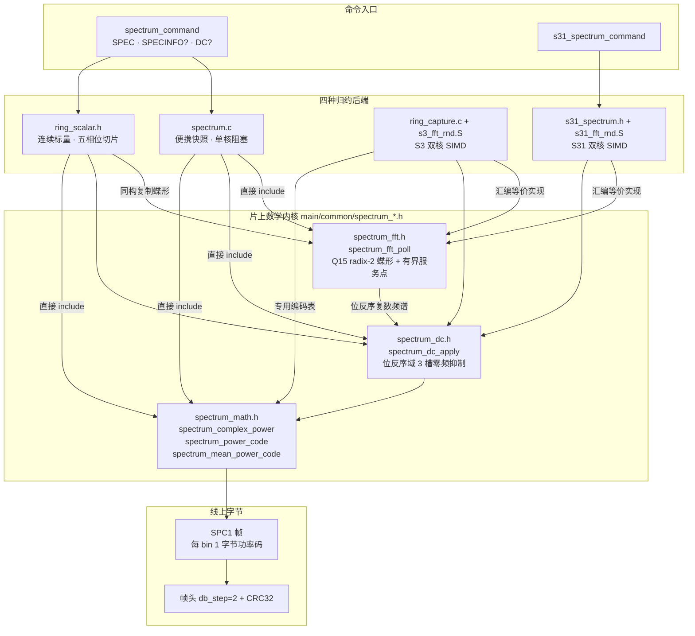

# 频谱内核：功率编码与 DC 抑制

> 设计理念：这三个头文件是整份固件里**唯一存在"数学"的地方**，而它们的每一行都在回答同一个问题——"在硬截止时间内，我能为每个频点花多少纳秒？"。答案决定了它们必须是 `static inline`、必须只有加法与移位、必须把 17 个三角函数值烘焙成常量表、必须把浮点比较改成整数比较。它们不是"可复用的库"，而是被四个结构完全不同的后端（便携快照、连续标量、S3 双核 SIMD、S31 双核 SIMD）共享的**证据链**：同一批蝶形、同一套 dB 码、同一个零频策略，任何一处偏离都会让主机看到的频谱在芯片之间对不上。

## 项目定位与核心价值

片上频谱引擎的产物不是波形，而是**字节**：每个 FFT 频点在线上只占一个字节。这条从 `int16` 复数样本到 8 位 dB 码的旅途上，固件必须连续做三件事——做完整的一次实数域到频域的变换、把 0 Hz 处的巨大尖峰削掉以免它掩盖真实信号、再把浮点/整数混合的功率值量化成可比较且跨芯片一致的一字节。分别承担这三件事的就是 `spectrum_fft.h`（变换核）、`spectrum_dc.h`（零点抑制核）、`spectrum_math.h`（量化编码核）。它们被拆成三个头文件而不是一个 `.c`，理由很实际：**后端要的不是"函数调用"，而是"可以内联进自己的热循环、可以按自己的节奏切片"的算法本体**。S3 用汇编实现了同一批蝶形（因为它要在两个核之间按 stage 切片），连续标量后端把同一批蝶形逐字抄进自己的状态机（因为它要对每个相位单独计时），而便携快照后端直接 `#include` 该头文件（因为它一个人跑完全程，不需要切片）。

它们共同对付的第一个痛点，是**时间与算力的错配**。在 80 Msps 的速率下，2048 点窗口只覆盖 25.6 µs 的射频时间，而 2048 点基 2 FFT 需要 `n/2 · log2 n = 11264` 次蝶形；若每次蝶形花 20 个周期，仅变换一项就是 22.5 万个周期。更致命的是**传输必须在变换过程中同时进行**：主机是流式读的，UART/USB FIFO 只有几 KB，一旦等 FFT 算完再发，前面攒下的帧早就把 FIFO 撑爆。因此变换核不能是一个"可调用函数"，必须是一个**带服务点的协程式循环**（`spectrum_fft_poll` 每 32 个蝶形回调一次 `poll`），把"算"与"发"交织在同一段时间里。

第二个痛点是**没有 FPU 的芯片上的 `libm` 代价**。ESP32-C2/C3 之类目标执行一次 `logf` 或一次 `float` 比较要走软件浮点软陷，动辄数百到数千周期；若对 2048 个 bin 逐个调用对数，光编码就能吃掉整帧预算。`spectrum_math.h` 的方案是把 `log2` 在 `[1,2)` 上以 1/16 倍频程为步长切成 16 段直线（17 个 Q12 端点），再用整数乘加插值；同时把"输入是否非法（NaN/负数/小于 1.0）"的判断降级为一次**无符号整数比较**——因为正数的 IEEE-754 位模式在数值上单调。量化误差被压到 0.5 dB 步长之下（详见下文误差预算），而代价只有两次查表乘加。

第三个痛点最隐蔽，也最能体现工程品味：**定点 FFT 的舍入偏差会伪装成频谱特征**。原始 ESP-DSP AES3 内核对和输出做向下取整、对旋转因子乘积也单独向下取整，于是每个蝶形的"和"分支系统性偏低约 1 LSB，而"差"分支不偏；在只有几个 LSB 的弱噪声输入下，这个偏差沿频轴积累成一条**单侧噪声斜坡**，在 0 Hz 处形成可达 15 dB 的台阶（S3 汇编头部注释明确记录了这一现象与修复方式）。`spectrum_fft.h` 采用"每次蝶形先加 32767 再右移 16 位"的舍入形式，把系统性偏差换成对称的 ±0.5 LSB 量化噪声，使标量路径、S3/S31 SIMD 路径与浮点参考三者一致到约 1 dB 以内。

Sources: [spectrum_fft.h](main/common/spectrum_fft.h#L1-L23), [spectrum_dc.h](main/common/spectrum_dc.h#L1-L35), [spectrum_math.h](main/common/spectrum_math.h#L1-L38), [s3_fft_rnd.S](main/targets/esp32s3/s3_fft_rnd.S#L1-L11), [spectrum.md](docs/spectrum.md#L123-L158)

## 架构设计与模块划分

三个内核在依赖关系上是严格串行的：变换核产出位反序的复数频谱，零点抑制核在这个位反序布局上定点清除 0 Hz 及其 Hann 裙边，量化核再把剩下的每个频点压成一个字节。真正的复杂度不在串行链路，而在**同一套算法被四种节奏完全不同的执行者复用**：便携快照后端一口气跑完；S3 的核 0 只在银行切换间隙"帮忙跑一个 stage"；连续标量后端把整个流程拆成 COPY/FFT/BINS/ENCODE/FRAME 五个相位、每相位 32 单元预算；S31 的核 1 则在 SIMD 汇编里一次跑完整变换。下图给出内核与四个后端之间的拓扑：



Sources: [spectrum.c](main/common/spectrum.c#L1-L20), [ring_scalar.h](main/common/ring_scalar.h#L1-L14), [s31_spectrum.h](main/targets/esp32s31/burst/s31_spectrum.h#L225-L235), [ring_capture.h](main/common/ring_capture.h#L92-L93)

### 变换核：`spectrum_fft.h` 只暴露一个带回调的循环

`spectrum_fft_poll` 的签名本身就是设计声明：输入输出共用同一个 `int16_t *x` 交错的复数数组、旋转因子是**外部传入**的 `const int16_t *w`、外加一个 `void (*poll)(void *)` 与上下文指针。传入旋转因子而不是自己初始化，是为了与 ESP-DSP 完全互操作——`spectrum_fft_init()` 只是把一块 2048 个 `int16` 的静态缓冲区交给 `dsps_fft2r_init_sc16()`，之后所有后端都共享同一张全局位反序表 `dsps_fft_w_table_sc16`。

```c
static inline void spectrum_fft_poll(int16_t *x, unsigned n, const int16_t *w, void (*poll)(void *),
                                     void *context) {
    unsigned work = 0;
    for (unsigned half = n / 2, groups = 1; half; half /= 2, groups *= 2)
        for (unsigned group = 0; group < groups; group++)
            for (unsigned offset = 0; offset < half; offset++) {
                unsigned a = group * half * 2 + offset, b = a + half;
                int32_t wr = w[2 * group], wi = w[2 * group + 1];
                ...
                if ((++work & 31u) == 0) poll(context);
            }
}
```

三层循环的坐标选择值得逐条拆解。**最外层按 `half` 递减、`groups` 递增**，这是基 2 分解中"跨度由大变小"的标准次序：第一轮所有蝶形跨 `n/2`，最后一轮全在相邻样本之间。**旋转因子的下标只有 `group`，与 `offset` 无关**——这意味着 `wr/wi` 可以在最内层循环之外加载，每个 group 只取两个 `int16`，而不是每个蝶形取一次。这一"每蝶形零次取表"的优化之所以成立，正是因为表是**位反序**存储的：第 `g` 组使用 `exp(-j2π·bitrev(g)/N)`，与跨度递减的分解次序精确配套。它还有一个便于验证的副产品：一张 2048 点的位反序表可以服务所有 256–2048 的尺寸，因为尺寸变小时表索引只是在高位多出若干个零，位反序后这些零落到末尾，指数值不变——所以 `spectrum_fft_init()` 成功一次即可，后续换 FFT 尺寸不需要重建表。

输出是**位反序频序**：输入是自然时间序，输出槽位 `k` 承载自然频点 `bitrev(k)`。这一点由三处独立证据确认——S3 汇编头注释明写 "bit-reversed output"；连续后端 `spec_setup()` 构造 `bin_of[i] = bitrev(i, log2n)` 用于发射时重排；便携后端 `pack_spectrum()` 里手写了一段递增的位反序计数器把编码结果写回自然序。位反序在这里不是妥协而是**红利**：它让零点抑制核可以只碰三个固定槽位就完成整帧 DC 处理（见下节）。

Sources: [spectrum_fft.h](main/common/spectrum_fft.h#L5-L23), [spectrum.c](main/common/spectrum.c#L45-L49), [spectrum.c](main/common/spectrum.c#L144-L154), [ring_capture.c](main/common/ring_capture.c#L369-L386), [s3_fft_rnd.S](main/targets/esp32s3/s3_fft_rnd.S#L1-L3)

### 蝶形算术：为什么全程使用无符号模加

四个乘积/求和表达式全部在 `uint32_t` 域完成，这不是疏忽，而是精算过的：

```c
uint32_t tr = (uint32_t)(wr * br) + (uint32_t)(wi * bi);
uint32_t ti = (uint32_t)(wr * bi) - (uint32_t)(wi * br);
uint32_t rr = (uint32_t)(ar * 32767) + 32767u, ri = (uint32_t)(ai * 32767) + 32767u;
x[2 * a]     = (int16_t)((rr + tr) >> 16);
x[2 * b]     = (int16_t)((rr - tr) >> 16);
```

| 现象 | 依据 | 后果 |
| --- | --- | --- |
| 单个有符号乘积不溢出 | `\|int16 × int16\| ≤ 32768×32767 < 2^31` | 可以在 `int32_t` 里安全相乘，无需提升到 64 位 |
| 两个乘积之**和**可能溢出有符号 32 位 | 最坏情况可达 2·(2^30) 甚至恰好 2^31 | 若用 `int32_t` 相加即为 UB；分别转 `uint32_t` 后相加是定义良好的模运算 |
| 只有结果的第 16..31 位会存活 | 输出 `(int16_t)(v >> 16)` 恰好取这些位 | 模运算在低位丢掉的进位不影响第 16..31 位，因此结果与 `int64_t` 参考实现**逐位相同** |
| `+32767` 同时承担两件事 | 一是把 `>>16` 变成四舍五入（`32767 ≈ 65536/2`），二是补偿 Q15 旋转因子取 32767 而非 32768 造成的每级微小衰减 | 消除"和/差分支偏置不对称"导致的单侧噪声斜坡 |

这是整个文件里最值得记住的取舍：**用"我只需要某些位"这个数学事实，换掉 64 位中间量与进位链**。在 32 位 RISC-V/Xtensa 上，一次 `int64_t` 加法是 2–3 条指令且无法与相邻运算并行；而模加是一条 `add`。同样的论证被连续标量后端逐字注释在自己的蝶形副本里，说明这不是一处偶然写法，而是被复审过的约定。

Sources: [spectrum_fft.h](main/common/spectrum_fft.h#L12-L22), [ring_scalar.h](main/common/ring_scalar.h#L49-L74), [s3_fft_rnd.S](main/targets/esp32s3/s3_fft_rnd.S#L5-L10), [test_spectrum_math.py](tests/test_spectrum_math.py#L110-L139)

### 零点抑制核：`spectrum_dc.h` 用 12 个字节解决 0 Hz

每个 FFT 帧的 0 Hz 槽位都藏着两股能量：ADC/混频器残留的直流偏置，以及射频前端在 LO 处泄漏的本振。它们的幅度常常高于真实信号几十 dB，直接把整个瀑布图的动态范围压死。朴素方案是"在时域减去均值"，但那需要额外一次 `O(n)` 遍历（2048 点就是 8 KB 读写），在截止时间内是奢侈的。`spectrum_dc_apply` 选择在**频域**做，而且利用了 Hann 窗的一个精确性质：

```c
static inline __attribute__((always_inline)) void spectrum_dc_apply(spectrum_dc_t *dc, int16_t *x,
                                                                    unsigned n) {
    int32_t dr = x[0], di = x[1];
    if (spectrum_dc_mode) {          /* 模式 1：慢速跟踪器，α = 1/64 */
        if (!dc->ready) { dc->re = dr * 256; dc->im = di * 256; dc->ready = true; }
        else { dc->re += (dr * 256 - dc->re) >> 6; dc->im += (di * 256 - dc->im) >> 6; }
        dr = (dc->re + 128) >> 8;
        di = (dc->im + 128) >> 8;
    }
    x[0] = spectrum_sat16(x[0] - dr);        /* 去掉 0 Hz 主瓣 */
    x[1] = spectrum_sat16(x[1] - di);
    for (unsigned k = 0; k < 2; k++) {       /* 补偿 Hann 窗的 ±1 相邻槽 */
        unsigned j = k ? n - 1 : n / 2;
        x[2 * j]     = spectrum_sat16(x[2 * j] + dr / 2);
        x[2 * j + 1] = spectrum_sat16(x[2 * j + 1] + di / 2);
    }
}
```

推导链条只有三步。第一，所有后端用的都是 Hann 窗（`w[j] = 32767·0.5·(1 − cos(2πj/n))`），它的频谱是 `W(0) = N/2`、`W(±1) = −N/4`——即**幅度恰好一半且符号相反**。第二，因此一个直流分量 `c` 在频域产生三点响应：bin 0 得到 `+c·N/2`，bin ±1 各得到 `−c·N/4`。第三，若只把 bin 0 的值减掉，bin ±1 会留下"半高反相的裙边"，视觉上表现为 0 Hz 两侧多出两个对称的凹槽；正确做法是把同样形状的响应整体扣除，即对 bin ±1 **加上** `dr/2`（因为那里原本是 `−dr/2`）。这就是"两种模式都修正 Hann 窗相邻 bin"的真实含义——不是打补丁，而是把窗函数的直流响应完整地减掉。

三点定位之所以能写成常数时间，完全是位反序布局的功劳：自然频点 0 落在槽 0；自然频点 +1 在位反序后是 `1 << (log2n − 1) = n/2`；自然频点 −1（即 `n−1`，全 1 位模式）反序后仍是 `n−1`。于是整个 DC 处理只触碰三个复槽、6 个 `int16`——`O(1)`，与 FFT 尺寸无关。主机的单元测试也印证了这一点：验证逐 bin 编码正确性时，测试刻意**跳过** `n/2` 与 `n-1` 两个槽位，注释直呼其为 "DC correction neighbors"。

两种模式的语义差异是刻意的产品设计。**模式 0**（`DC 0`）每帧用当前帧的 bin 0 作为估计值，等价于"本帧完美陷波"，代价是它会把一个恰好落在 LO 上的**真实信号**一起抹掉。**模式 1**（`DC 1`，默认）维护一个 Q8 定点指数滑动平均（`>>6` 即 α = 1/64），时间常数是 64 个 FFT；偏置被跟踪并压制，而短时出现的真实信号只会被削弱其量的 1/64，随后被跟踪器缓慢"学会"。跟踪器状态在每次采集开始时由 `dc = (spectrum_dc_t){0}` 清零，因此一次采集的瞬态不会污染下一次。模式本身是一个全局量（`spectrum_dc_mode`，默认 1），由 `spectrum_stats.c` 定义、被 `ring_capture.h` 直接别名成 `ring_capture_dc_mode`、由 `spectrum.c` 负责 `DC?` / `DC <0|1>` 的协议解析——**一台芯片上只有一个 DC 策略**，主机不必为每个后端记住不同的默认值。

Sources: [spectrum_dc.h](main/common/spectrum_dc.h#L10-L35), [spectrum_stats.c](main/common/spectrum_stats.c#L1-L8), [ring_capture.h](main/common/ring_capture.h#L92-L93), [spectrum.c](main/common/spectrum.c#L160-L173), [spectrum.c](main/common/spectrum.c#L193-L196), [ring_capture.c](main/common/ring_capture.c#L371-L386), [ring_capture.c](main/common/ring_capture.c#L1598-L1598), [test_snapshot_spectrum.py](tests/test_snapshot_spectrum.py#L63-L76), [spectrum.md](docs/spectrum.md#L115-L121)

### 量化编码核：两条路径、一个插值核心

`spectrum_math.h` 只有三个函数和一个 17 项表，但它们的结构揭示了最重要的一致性约束：**均值检测器与最大保持检测器必须产生可互相比较的码值**。最大保持路径拿到的是整数功率，均值路径拿到的是浮点平均功率；如果两条路径各自实现一套对数近似，同一份射频在两种模式下的线上字节就会出现系统性差异，主机切换检测器时画面会整体跳变。因此设计被拆成"一个插值核心 + 两个尾数提取器"：

```c
static inline uint8_t spectrum_log_power_code(unsigned exponent, uint32_t norm) {
    static const uint16_t log2_q12[17] = {0, 358, 696, ..., 3908, 4096};
    unsigned slot = (norm - 256u) >> 4, frac = norm & 15u;
    uint32_t logarithm =
        (exponent << 12) + log2_q12[slot] + ((log2_q12[slot + 1] - log2_q12[slot]) * frac + 8) / 16;
    unsigned code = (logarithm * 1541u + (1u << 19)) >> 20;   /* 20 log10(power), rounded */
    return code > 255 ? 255 : code;
}
```

`norm` 被约定在 `[256, 511]` 区间：高 8 位表示尾数（隐含的 1 加上 7 位小数），`slot = (norm−256)>>4` 落在 0–15，`frac` 是 4 位细分数。表值全部是 `log2(1 + k/16) × 4096`，所以 `logarithm` 是 **Q12 的 `log2(power)`**（`exponent<<12` 加上尾数对数的 Q12）。最后一步 `×1541 >> 20` 把 log2 域换成 `20·log10`：因为 `4096 × 1541 / 2^20 = 1541/256 ≈ 6.0195 ≈ 20·log10(2) = 6.0206`。

关于线上一字节到底代表什么，最容易误读，这里给出精确结论：**码值 = round(20·log10(P))，其中 P 是该频点在 Q15 归一化域里的功率（`re² + im²`）**。因为 `20·log10 P = 2 × (10·log10 P)`，所以**每个码值等价 0.5 dB 的功率刻度**，8 位可覆盖 0–127.5 dB；帧头字节 `db_step = 2` 正是把这条换算关系告诉主机（`code = 10·log10(P) × db_step`）。主机再用 Hann 窗归一化把它折算成 dBFS。码 0 是**量化下限而非"没有能量"**——这一点在协议文档里被专门强调，因为把码 0 解释成"绝对静默"会让自动化测试误判。

两条路径的尾数提取各有讲究。整数路径先 `31 − __builtin_clz(power)` 取指数，再 `(power << (31 − exponent)) >> 23` 把最高位对齐到 bit 31 后取 9 位，得到 `[256, 511]` 的 `norm`。浮点路径则直接**解析 IEEE-754 位模式**，并且用一次整数比较完成三重合法性检查：

```c
union { float f; uint32_t u; } value = {.f = power};
if (value.u < 0x3f800000u || value.u > 0x7f800000u) return 0;
unsigned exponent = (value.u >> 23) - 127u;
if (exponent >= 43) return 255;
return spectrum_log_power_code(exponent, 256u + ((value.u & 0x7fffffu) >> 15));
```

`0x3f800000` 是 1.0f 的位模式，`0x7f800000` 是 +∞；因为**正数的 IEEE-754 位模式在数值上单调**，这一个区间判断同时排除了负数（符号位使 `u ≥ 0x80000000`）、NaN（`u > +∞`）与小于 1.0 的值（落到量化下限 0），且完全不需要浮点比较器——在没有 FPU 的目标上，`float <` 会链接进 `__ltsf2`，这正是注释里所说的"避免在采集截止时间内调用软件浮点比较"。`exponent >= 43` 直接给 255，因为 `20·log10(2^43) ≈ 258.9 > 255`。浮点路径保留 8 位尾数、截断其余 15 位，是为了让两条路径送进同一个 `spectrum_log_power_code`，从而保证 `spectrum_power_code(p)` 与 `spectrum_mean_power_code((float)p / c)` 的差不超过一个码——这一点被主机侧的对拍测试穷举验证。

Sources: [spectrum_math.h](main/common/spectrum_math.h#L6-L38), [ring_capture.c](main/common/ring_capture.c#L318-L321), [ring_capture.c](main/common/ring_capture.c#L388-L399), [test_spectrum_math.py](tests/test_spectrum_math.py#L140-L158), [spectrum.md](docs/spectrum.md#L76-L80)

## 技术栈与核心工作流

三个内核在数据流上首尾相接，中间没有一次堆分配、没有一次浮点除法、没有任何动态分派。下图以字节量标注整条链路（以 2048 点为例）：


把这条链路拆成阶段，可以看清每个内核的成本与约束边界：

| 阶段 | 实现位置 | 复杂度 | 关键约束与理由 |
| --- | --- | --- | --- |
| 解包与加窗 | 各后端自己的 `unpack` | `O(n)` | IQ10 左移 6 位、窗峰值归一化为 1.0，使频域标定与 FFT 尺寸无关 |
| 变换 | `spectrum_fft_poll` / 汇编等价体 | `O(n log n)`，`n/2·log2 n` 次蝶形 | 每 32 蝶形一个服务点，保证发送与停止请求的延迟有界 |
| 零频抑制 | `spectrum_dc_apply` | **`O(1)`** | 必须在功率累加**之前**执行，否则均值里仍含 DC 裙边 |
| 功率 | `spectrum_complex_power` | `O(n)`，每 bin 两次乘加 | 返回 `uint32_t`，因为最坏可达 2^31，用无符号避免有符号溢出 |
| 累加 | 后端内的 `powers`/`accum` | `O(n)` | max-hold 用 `uint32`、mean 用 `float`，两者共用同一块存储（`union`） |
| 编码 | `spectrum_power_code` / `spectrum_mean_power_code` | `O(n)`，每 bin ≤ 3 次整数乘 | 码值步长 0.5 dB，与帧头 `db_step=2` 对应 |
| 打包 | `pack_spectrum` / 各后端的 emit | `O(n)` | 位反序槽 → 自然序 bin，再算 CRC32 |

Sources: [spectrum.c](main/common/spectrum.c#L130-L158), [spectrum.c](main/common/spectrum.c#L228-L257), [ring_scalar.h](main/common/ring_scalar.h#L100-L109), [ring_capture.c](main/common/ring_capture.c#L1138-L1160)

几处流程耦合值得单独指出。**其一，DC 处理的位置是被累加器"钉死"的**：`spectrum_fft_poll(...)` → `spectrum_dc_apply(...)` → `spectrum_complex_power(...)` 三步在便携后端里紧邻出现，任何把 DC 移到累加之后的改动都会让均值帧保留 0 Hz 裙边，而 max-hold 帧看起来正常——这种"只在一种检测器下出现"的 bug 极难从画面上诊断。**其二，服务点回调的实际工作不是空转**：`pump_spectrum` 在回调里推进 `burst_serial_try_send`，把上一帧剩余的字节灌进串口 FIFO，并在写满时推进帧计数；这意味着 FFT 的 352 个服务点同时是"输出流水线的 352 次心跳"。**其三，编码只能发生在输出空闲之后**：`pack_spectrum` 复用 `frame[]`，所以在发送期间新的 FFT 结果只能继续累加进 `powers`——这条"编码消费已完成的批次、发送独占 `frame[]`"的分工写在注释里，也是 65535 帧上限存在的原因（主机停读时不能无限累加）。

Sources: [spectrum.c](main/common/spectrum.c#L118-L158), [spectrum.c](main/common/spectrum.c#L228-L258)

## 典型代码示例

理解这三个内核最有效的方式不是读注释，而是看**它们如何被钉在数值上**。仓库里的主机侧测试把产品代码原样拉进一个独立的 C 程序，用 64 位宽算术实现"前一代内核"作为参考，然后在 256–2048 全部尺寸、包括 `INT16_MIN`/`INT16_MAX` 饱和输入上逐位比对：

```c
/* 循环骨架：256…2048 每个尺寸 × 66 组输入（含 INT16_MIN / INT16_MAX 全饱和） */
for (spec_n = 256; spec_n <= 2048; spec_n *= 2) {
    /* 参考实现：int64_t 中间量 + 每个输出统一 +32767 舍入 */
    int64_t tr = wr * br + wi * bi, ti = wr * bi - wi * br;
    reference[2 * a] = (int16_t)((ar * 32767 + tr + 32767) >> 16);
    ...
    /* 产品实现：uint32_t 模加，只关心结果的第 16..31 位 */
    spectrum_fft_poll(sliced, spec_n, coefficients, poll, &polls);
    assert(polls && !memcmp(sliced, reference, 2 * spec_n * sizeof(*fft_buf)));
}
```

这段断言的价值在于它把"模加等价于 64 位结果"从口头论证变成了机器验证：只要有一次进位影响到第 16 位以上，`memcmp` 就会在随机输入上失败。同一个测试文件里还有两段同等重要的断言：对 `p ∈ [1, UINT32_MAX]` 逐步枚举，要求 `spectrum_power_code(p)` 与 `lrint(20*log10(p))` 相差不超过 1；以及 `spectrum_complex_power(INT16_MIN, INT16_MIN) == 2147483648u`——正面确认了功率上限恰好是 2^31，也就解释了为什么返回类型必须是 `uint32_t`。

零点抑制核的测试则写成"物理场景断言"，可以直接当作行为规格阅读：先给一个纯直流帧（bin 0 与两个相邻槽按 `+1 : −0.5` 关系摆放），要求处理后**六个值全部为 0**；再给一个"直流 + 真实信号"帧，要求信号槽位 `x[8]/x[9]` 完全不被触碰；然后连续 1024 帧喂入恒定额，要求跟踪器收敛到 ±1 LSB 之内；最后切到模式 0，验证满量程 `32767/−32768` 输入经饱和后 `x[0]` 归零而相邻槽被 `spectrum_sat16` 截在 `32767/−32768`。

Sources: [test_spectrum_math.py](tests/test_spectrum_math.py#L110-L158), [test_spectrum_math.py](tests/test_spectrum_math.py#L168-L190)

## 学习与探索建议

| 你的目标 | 建议路径 | 为什么从这里开始 |
| --- | --- | --- |
| 想改编码精度或动态范围 | 先读 `spectrum_math.h` 的 `log2_q12` 表与 `×1541>>20`，再改 `db_step` 字段与主机解码 | 码值语义是端到端契约：改表必须同步改帧头，否则主机静默错标 |
| 想换窗函数或改 DC 策略 | `spectrum_dc.h` 的三槽补偿依赖 `W(±1) = −W(0)/2`，换窗必须重推这两个系数 | 换 Blackman 窗会让三槽补偿失效，且失效只在 0 Hz 附近可见 |
| 想优化 FFT 或移植到新核 | 以 `spectrum_fft.h` 为等价性基准，比对 `s3_fft_rnd.S` / `s31_fft_rnd.S` 的舍入约定 | 汇编路径已就"舍入偏差"踩过坑，绕过它等于重犯单侧噪声斜坡 |
| 想理解切片与截止时间 | 读 `ring_scalar.h` 的 FFT/BINS/ENCODE 相位循环，再回看 `spectrum_fft_poll` 的 `work & 31` 分频 | 一个是"外部驱动切片"，一个是"内部回调切片"，两种服务点策略互为参照 |
| 想验证自己的改动 | `python -m unittest tests.test_spectrum_math tests.test_snapshot_spectrum` | 两套测试都把产品代码原样编译，改动一旦破坏位级等价会立刻失败 |

Sources: [spectrum_math.h](main/common/spectrum_math.h#L10-L23), [spectrum_dc.h](main/common/spectrum_dc.h#L28-L34), [ring_scalar.h](main/common/ring_scalar.h#L37-L143), [test_spectrum_math.py](tests/test_spectrum_math.py#L10-L20)

## 🔗 关联模块与上下游

- **直接调用方（快照后端）**：`main/common/spectrum.c` —— `SPEC` 主循环、窗表构建、`SPC1` 打包与 CRC 都在这里，三个内核的每一次调用都能在其主循环里找到对应行。
- **直接调用方（连续后端）**：`main/common/ring_capture.c` 与 `main/common/ring_scalar.h` —— 前者持有静态 `dc` 跟踪器（S3 双核与 bank 轮转下的 DC 处理），后者把同一批蝶形与编码逻辑重排成可切片状态机。
- **同构实现参照**：`main/targets/esp32s3/s3_fft_rnd.S`、`main/targets/esp32s31/burst/s31_fft_rnd.S` —— 两个汇编内核与 `spectrum_fft.h` 共享数据布局、旋转因子表与位反序输出，是核对"我改的蝶形是否仍然等价"的最快基准。

Sources: [spectrum.c](main/common/spectrum.c#L214-L258), [ring_capture.c](main/common/ring_capture.c#L422-L429), [ring_scalar.h](main/common/ring_scalar.h#L49-L109)
