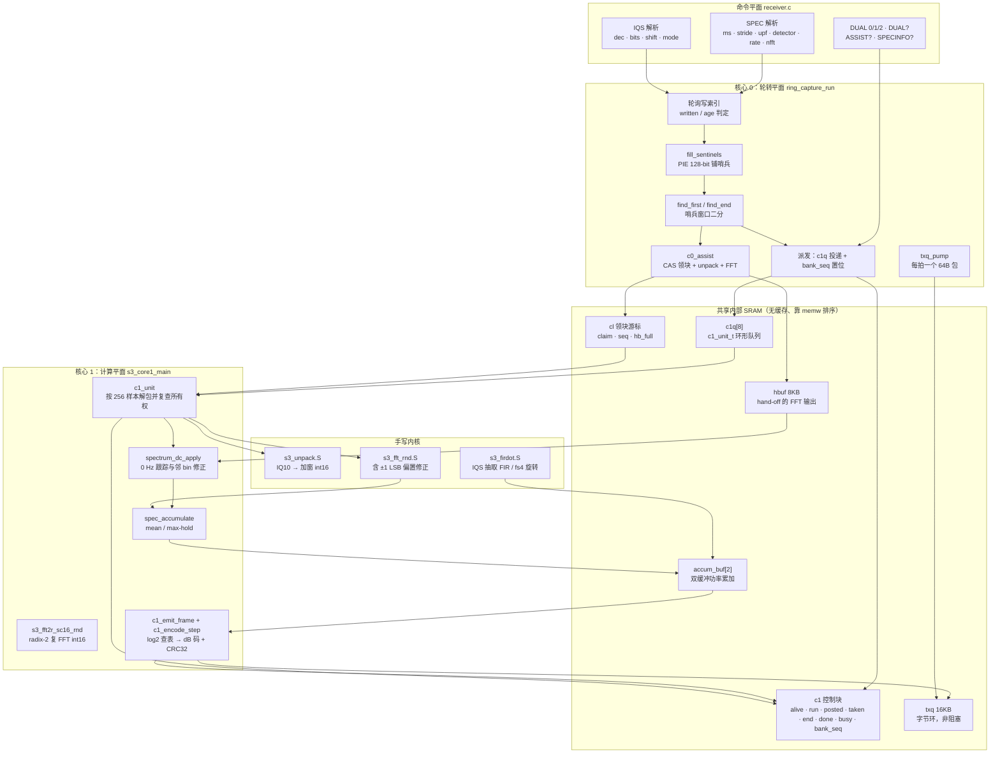
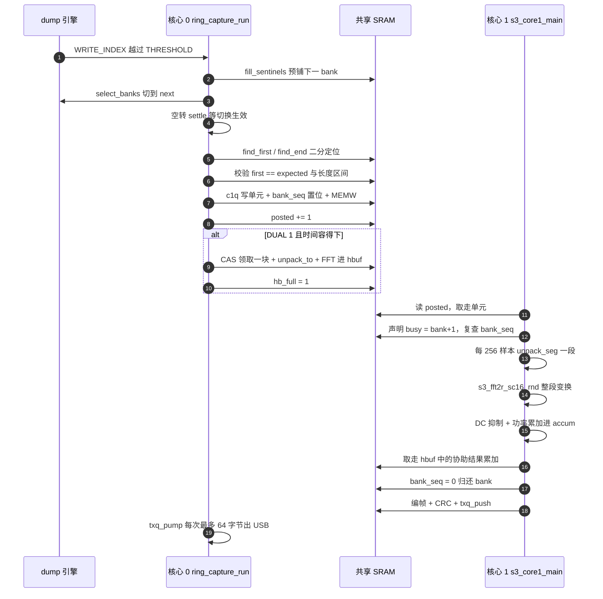

# S3 双核 SIMD 频谱工作器

> 设计理念：ESP32-S3 的频谱路径并不追求"把每一个采样都算完"，而是追求**让算力与信道带宽解耦**。ADC 以最高 80 Msps 向 SRAM 倾倒数据，这个速率由射频时钟而非 CPU 决定；固件唯一能自由支配的变量是"每个 bank 轮转窗口里塞进多少次变换"。把 unpack → FFT → 累加 → 编帧这条链整体搬到第二颗 Xtensa 核上，并用一段手写汇编把每次变换的成本压到单核标量时代的几分之一，正是为了让"连续频谱"在物理上成为可能——核心 0 只负责证明数据没丢，核心 1 只负责从数据里榨出信息。

## 项目定位与核心价值

ESP32-S3 的连续频谱功能面对的是一个三重约束问题。第一重来自硬件：dump 引擎把 16384 对 IQ 采样写成环形缓冲，每写满 12288 对就必须切换 bank，此时 CPU 必须已经完成"定位单元边界、准备下一个 bank 的哨兵、把旧 bank 交还"这一整套动作，否则迟到会被记录为 `late`，超过限制即整个采集失败。第二重来自算力：2048 点复 FFT 加上 Hann 加窗、DC 抑制、功率累加、dB 编码，如果用标量 C 实现，在 240 MHz 的 Xtensa 上单次变换就要吞掉数万周期，而 80 Msps 下一个 bank 窗口只有约 154 µs（约 37 k 周期）。第三重来自传输：原生 USB Serial/JTAG 单帧 2048 bin 只允许 256 字节净荷，任何"先存后发"的思路都会立刻撞上 SRAM 与带宽的墙。

这三重约束交汇处的答案是：**把一个核完完整整地献给 DSP**。`ring_capture.c` 中 `s3_core1_main()` 是一个常驻的裸机 worker，它不属于 FreeRTOS，没有任务、没有中断、没有 flash 访问，只通过一块内部 SRAM 上的 mailbox 与核心 0 通信；核心 0 保留环形轮转的全部时间敏感职责（轮询写索引、填哨兵、切 bank、二分定位、泵 USB），并把每个定位完成"单元"以序号形式投递给 worker。所有频谱数学——10 bit IQ 的符号扩展与加窗、radix-2 复 FFT、Hann 窗旁瓣修正、0 Hz 跟踪、功率平方与对数编码——全部落在三条手写汇编内核上（`s3_unpack.S`、`s3_fft_rnd.S`、`s3_firdot.S`）以及它们的 C 调度壳里。

其核心价值可以用一组可测量的对比说明。`receiver.c` 的 `SPECINFO?` 回复在两套 profile 之间切换：worker 不可用时，16000/6/256 这一档提示 stride 4、80 Msps/256 档提示 stride 48；worker 启用后同样的档位变成 stride 2 与 stride 10。也就是说双核 + SIMD 把 80 Msps 下的频谱处理能力提升了近五倍——这五倍不是靠更快的时钟，而是靠"核心 0 不再与 FFT 抢同一个时间轴"。第二个价值在于**退化路径的完整性**：`DUAL 0/1/2` 三种调度形态共享同一套帧格式 `SPC1`、同一套遥测 `SPS1` 与同一套失败语义，worker 启动失败（`c1_ok == false`）时固件自动回落到核心 0 的分片状态机，主机侧无需任何改动。第三重价值是**可观测性**：`SPS1` 帧里同时给出核心 0 / 核心 1 的千分比负载、FFT 覆盖率、`late_max`、输出队列填充率与每秒变换数，使"哪个核先成为瓶颈"成为一个可以直接读出来的数字，而不是靠猜。

| 维度 | 单核分片路径（`DUAL 0` / worker 缺席） | 双核 SIMD 路径（`DUAL 1` / `DUAL 2`） |
| --- | --- | --- |
| 调度单元 | FFT 的一个 stage、128 个 bin 的累加 | 一整次变换（unpack + FFT + accumulate） |
| 时间轴控制 | 每个分片必须先证明"最坏情况来得及" | 核心 1 无 deadline，靠 bank 所有权握手保护 |
| unpack | PIE 快路径 + 标量回退（含环回守卫） | 同一条 PIE 内核，按 256 样本块切分并复查所有权 |
| 加窗乘法 | `(I * window_q15[i]) >> 9` | 同一个算术，用 `vmul.s16` + `SAR=15` 一次 8 通道并行 |
| 典型吞吐提示 | 80 Msps/256 bin：stride 48 | 80 Msps/256 bin：stride 10 |
| 帧编码位置 | 核心 0，与轮询交错 | 核心 1，在等待新单元的 idle 循环里推进 |

Sources: [ring_capture.c](main/common/ring_capture.c#L1080-L1119), [ring_capture.c](main/common/ring_capture.c#L1448-L1500), [receiver.c](main/targets/esp32s3/receiver.c#L306-L322), [spectrum.md](docs/spectrum.md#L136-L147)

## 架构设计与模块划分

整条链路被切成四个平面：**命令平面**（`receiver.c` 的 `SPEC`/`IQS`/`DUAL`/`ASSIST` 解析）、**轮转平面**（核心 0 独占的环与 bank 生命周期）、**共享内存平面**（mailbox、单元队列、领块游标、hand-off 缓冲、累加器双缓冲、输出队列）、**计算平面**（三条汇编内核及其 C 包装）。下图把四个平面与数据流画在一起，注意箭头方向即是所有权流动方向——没有任何一条边是"双向共享"，全部是"投递—取走—归还"。



### 四个汇编目标与三种落位手段

`main/CMakeLists.txt` 在 S3 分支上一次性挂进五个汇编/源文件：`ring_capture.c`、`s3_fft_rnd.S`、`s3_unpack.S`、`s3_core1.S`、`s3_firdot.S`，并附带一份链接片段 `linker.lf`。四个 `.S` 文件的落位方式各不相同，这本身就是一份关于"热代码必须在 IRAM"的工程笔记：

| 文件 | 对外符号 | 落位方式 | 依据 |
| --- | --- | --- | --- |
| `s3_core1.S` | `s3_core1_entry`、`s3_core1_stack` | 显式 `.section .iram1.s3_core1, "ax"` + `.bss.s3_core1_stack` | 第二核启动代码不能依赖 flash cache |
| `s3_fft_rnd.S` | `s3_fft2r_sc16_rnd`、`s3_fft2r_sc16_rnd_stage` | 普通 `.text`，由 linker fragment `s3_fft_rnd (noflash)` 提升 | 与 esp-dsp 的 `dsps_fft2r_sc16_aes3` 并列固定在 IRAM |
| `s3_unpack.S` | `s3_unpack_iq10_win` | 普通 `.text`，由 fragment `s3_unpack (noflash)` 提升 | 同上；`RING_HOT`/`RING_SWITCH` 只覆盖 C 侧 |
| `s3_firdot.S` | `s3_unpack_iq10_split`、`s3_fir_split`、`s3_fir8_l32`、`s3_rot_fs4` | 显式 `.iram1.s3_firdot` + fragment 双保险 | IQS 抽取与轮转共用同一 deadline |

`linker.lf` 顶部的注释把理由写得很直白：SPEC 模式在两次环轮询之间是**屏蔽中断**运行的，一次 cache miss 就可能把 bank 切换推过 `LATE_LIMIT`。因此 `dsps_fft2r_sc16_aes3`（esp-dsp 原始内核）与本仓库的三个内核一起被钉死在 IRAM，无论链接器如何排布 `libesp-dsp.a` 与 `libmain.a`。

Sources: [CMakeLists.txt](main/CMakeLists.txt#L45-L50), [linker.lf](main/targets/esp32s3/linker.lf#L1-L13), [s3_core1.S](main/targets/esp32s3/s3_core1.S#L11-L16), [s3_firdot.S](main/targets/esp32s3/s3_firdot.S#L16-L19), [ring_capture.c](main/common/ring_capture.c#L62-L76)

### 核心 1 的裸机进场：从 stall 到可计算

S3 的固件在 `sdkconfig.defaults.esp32s3` 里显式选择了 `CONFIG_FREERTOS_UNICORE=y`。这个选择不是偷懒，而是把"第二个核归我专用"变成一条硬约束：IDF 启动时会把 APP CPU 停在 ROM 的 stall 点，既不调度任务也不注册中断，于是 core 1 变成一张白纸，可以由固件按应用处理器的原始语义拉起。`c1_start()` 完成四步：分配 8 KB 的 hand-off 缓冲、`cpu_utility_ll_unstall_cpu(1)` 解除 stall、`cpu_utility_ll_enable_clock_and_reset_app_cpu()` 打开时钟并复位、`ets_set_appcpu_boot_addr((uint32_t)s3_core1_entry)` 指定入口，然后用 50 ms 超时轮询 `c1.alive`。若缓冲分配失败或 worker 未在期限内举手，`c1_ok` 保持 false，`ring_capture_dual_active()` 随之为 false，整条链路静默退回单核路径——**没有断言、没有 panic、没有半残状态**。

`s3_core1_entry` 自身只有二十余条指令，但它必须把状态寄存器的每一处都设置到"不会意外回到 IDF 世界"的位置：`intenable = 0`（不接收任何中断）、`windowbase = 0` 且 `windowstart = 1`（窗口化 ABI 只启用一个窗口，溢出时走 IDF 的向量表）、`cpenable = 9` 即 CP0（FPU）+ CP3（PIE，S3 的 128 位 SIMD 协处理器）、`vecbase = _vector_table`（把窗口溢出异常的落点交给 IDF 安装的表），最后是 `ps = 0x4002f`——拆开看就是 `INTLEVEL = 15`（屏蔽所有可屏蔽中断）、`UM = 1`（以用户态运行，不使用 ring 保护）、`WOE = 1`（窗口溢出异常使能）。栈指针指向 `.bss.s3_core1_stack` 顶端的 8 KiB 静态区，随后用 `s32e` 在栈顶之下写一个伪帧并把栈指针存进去，使窗口溢出时的调用链仍可展开，最后 `call8 s3_core1_main`，并以一个自跳转的 `1: j 1b` 作为永不返回的归宿。

这段代码有一个容易被忽略的约束：它**不能返回**，也不能调用任何 IDF 或 newlib 的函数。`s3_core1_main` 因此被声明为 `IRAM_ATTR`，其触达的所有数据都在 DRAM（内部 SRAM 不做数据缓存），`st`、`c1`、`c1enc`、`accum_buf` 等静态区全部落在 DRAM 而非 flash 常量池。这条纪律是双核方案能成立的前提：任何一次 flash 访问都可能与核心 0 的 flash 写/擦或 cache 关闭撞车，而 core 1 没有中断可以救场。

Sources: [s3_core1.S](main/targets/esp32s3/s3_core1.S#L1-L44), [ring_capture.c](main/common/ring_capture.c#L1490-L1500), [sdkconfig.defaults.esp32s3](sdkconfig.defaults.esp32s3#L21-L24)

### 共享内存平面：一个 mailbox、一条单元队列、一枚领块游标

双核之间的契约全部记录在 `c1` 这个 `volatile` 结构体里，字段名本身就是协议：`alive`（worker 已进场）、`run`（本次采集的代号）、`posted`（核心 0 已投递的单元数）、`taken`（核心 1 已取走的单元数）、`end`（本次采集结束）、`done`（worker 已收尾）、`busy`（worker 正在读哪个 bank，编码为 `bank + 1`，0 表示空闲）、`bank_seq[RING_BANKS]`（每个 bank 当前属于哪个单元的序号）、`block_max`（最长一次单块处理耗时，用于回填 `work_max`）。没有任何一把锁，也没有信号量：所有跨核可见性靠 `memw`（Xtensa 的内存屏障指令）与"先声明、再复查"的双向顺序保证。

投递通道是 `c1q[8]` 的环形队列，每个槽是 `c1_unit_t`：`seq`、`bank`、`first`、`count`、`blocks`、`start`、`index`、`gain`。`posted`/`taken` 是自由计数器，取模 `C1_QUEUE` 定位槽位；核心 0 在投递前检查 `i - c1.taken >= C1_QUEUE`，若 worker 落后超过 8 个单元就直接放弃该单元并把块数记进 `c0_lost`，最后合并进 `abandoned`——**队列满不是阻塞条件，而是丢弃条件**。

第二条通道是"领块游标" `cl`。因为一个单元里通常有几十个 FFT 块（12288 样本 ÷ nfft），逐块投递太贵，于是设计成两核共享一个原子游标 `cl.claim`：核心 1 打开单元后写 `cl.seq`，核心 0 便可在轮询间隙用 `xt_utils_compare_and_set` 领走一块做 unpack + 整个 FFT，把结果放进 8 KB 的 `hbuf` 并置 `cl.hb_full`；核心 1 在下一次循环开头 `c1_take_handoff()` 把它取走做 DC 抑制与功率累加。这条旁路就是 `DUAL 1` 相对 `DUAL 2` 的那部分增益，也是 `ASSIST?` 命令回读 `ring_capture_c0_blocks` 所观测的计数。

第三条通道是累加器本身。S3 上 `accum_buf` 是 `[2][RING_SPEC_NFFT_MAX]` 的双缓冲，并配一个可重新指向的 `accum` 指针。核心 1 在 `c1_emit_frame()` 里把 `accum` 交给 `c1enc.src`，随后立刻把 `accum` 翻到另一半（该半区已被上一次编码清零），于是"编码上一帧"与"累加下一帧"在时间上重叠，而两者永远不会读写同一块内存。

Sources: [ring_capture.c](main/common/ring_capture.c#L1092-L1127), [ring_capture.c](main/common/ring_capture.c#L1267-L1300), [ring_capture.c](main/common/ring_capture.c#L1952-L1980), [ring_capture.c](main/common/ring_capture.c#L324-L341)

### 三条数据通路，一套语义

`ring_capture_run()` 在入口处根据 `cfg->mode` 选路，S3 上有三种互斥形态，且都共用同一套 `SPECEND` 报告与失败码：

| 模式 | 计算路径 | 触发条件 | 特有输出 |
| --- | --- | --- | --- |
| `RING_MODE_SPEC` + dual | `c1_unit()`：unpack → 整段 FFT → DC → 累加 → 编帧 | `ring_capture_dual_active()` | `SPC1` 频谱帧 |
| `RING_MODE_SPEC` 单核 | `work_slice()`：`BLK_UNPACK → BLK_FFT(每片一级) → BLK_ACCUM(128 bin)` | `DUAL 0` 或 worker 未启动 | 同一 `SPC1` 格式 |
| `RING_MODE_IQ` + dual | `c1_iq_unit()` → `fir_feed()` 两级抽取 FIR | `IQS` 命令且 worker 可用 | `IQS1` 帧，`r->ffts` 复用为丢样计数 |
| `RING_MODE_IQ` 单核 | `iqs_slice()` 在轮询间隙推进 | `DUAL 0` | 同上 |
| `RING_MODE_CAPTURE` | 不做归约，直接把 bank 原文回传 | `RINGCAP` | `RINGDATA` + CRC32 |

值得注意的是 IQ 路径对 `ring_result_t` 的**字段复用**：结束时 `r->ffts = iqs.lost_pairs`，把"丢失采样对数"塞进频谱语义里的"变换次数"字段。这在源码里有明确注释，主机侧 `tools/s3_ring.py` 也按模式解释同一列数字——一种"格式稳定优先于字段纯洁"的取舍。

Sources: [ring_capture.c](main/common/ring_capture.c#L1028-L1078), [ring_capture.c](main/common/ring_capture.c#L1398-L1446), [ring_capture.c](main/common/ring_capture.c#L2001-L2029), [ring_capture.h](main/common/ring_capture.h#L50-L83)

### 内存布局的铁律

S3 的 SRAM 在这套设计里被切成三段互不可越界的区域：`0x3fcb0000–0x3fce0000` 是 RF bank（通过 `SOC_RESERVE_MEMORY_REGION` 从堆与静态区中挖掉），`0x3fcd0000` 起是厂商 `adctrig` 的 64 KiB 采样窗口，IRAM 顶端被限制在 `0x403a0000`。`sram_guard.ld` 用三条 `ASSERT` 把这些边界变成链接期错误：

```
ASSERT(_iram_end <= 0x403a0000, "S3 RF ring overlaps IRAM")
ASSERT(_data_end <= 0x3fcb0000, "S3 RF ring overlaps data")
ASSERT(_bss_end  <= 0x3fcb0000, "S3 RF ring overlaps BSS")
```

这条铁律直接决定了代码风格：FFT 旋转因子、hand-off 缓冲 `hbuf`、IQS 帧缓冲、FIR 系数与历史窗口全部改从 `heap_caps_aligned_alloc` / `heap_caps_malloc` 取得，而不是声明成静态数组。`ring_capture_init()` 里的注释只有一句"twiddles from the heap: BSS must end below the RF ring (sram_guard.ld)"，但它解释了为什么一个 FFT 库的初始化会出现在一个采集模块里、并且要显式判空。同理，`hbuf` 的分配失败是"没有第二核心"的唯一判据——这条内存路径与降级路径被刻意绑定在一起。

Sources: [sram_guard.ld](main/targets/esp32s3/sram_guard.ld#L1-L4), [receiver.c](main/targets/esp32s3/receiver.c#L31-L36), [ring_capture.c](main/common/ring_capture.c#L324-L363), [ring_capture.c](main/common/ring_capture.c#L1279-L1279)

## 技术栈与核心工作流

### 执行主链路

| 阶段 | 关键函数 / 数据 | 职责与设计意图 |
| --- | --- | --- |
| 冷启动 | `ring_capture_init()` → `dsps_fft2r_init_sc16()` → `c1_start()` | 建旋转因子表、拉起核心 1；全部发生在中断仍可用的时间窗内 |
| 参数预置 | `spec_setup(n)`、`log_tables_init()` | Hann 系数（同时写 `win2` 双份）、位反转表 `bin_of[]`、dB 码的指数/尾数查表 |
| 单次运行预热 | `spec_unpack` + `S3_FFT_STAGE` 全 stage 循环 + `spec_accumulate` | 让 I-cache、查表、PIE 单元进热态，并把最长 stage 周期数播种到 `work_max` |
| 派发前 | `spec = true → automatic.stride = 1` | 历史 stride 参数被就地覆盖：SPEC 总是尽力处理每一个块 |
| 投递 | `c1q[posted % 8] = unit`、`c1.bank_seq[b] = seq`、`MEMW`、`posted++` | 一条 `memw` 把"单元内容 + bank 归属"一次性发布 |
| 处理 | `c1_unit()` → `unpack_seg()` → `S3_FFT()` → `spec_remove_dc()` → `spec_accumulate()` | 核心 1 的全部工作量；每次解包前复查 `bank_seq` |
| 编码 | `c1_emit_frame()` → `c1_encode_step()` | 头 + bin 码 + CRC 分片推进，在 idle 自旋里也能继续 |
| 归还 | `c1.bank_seq[b] = 0`、`MEMW` | bank 重新可被核心 0 填哨兵 |
| 收尾 | `c1.end = 1` → 自旋等 `c1.done` → `txq_pump` | 保证最后一帧完整出队，`work_max = c1.block_max` |
| 报告 | `ring_report("SPECEND", r)` | 12 个十进制字段，主机侧按名绑定 |

Sources: [ring_capture.c](main/common/ring_capture.c#L344-L399), [ring_capture.c](main/common/ring_capture.c#L1589-L1597), [ring_capture.c](main/common/ring_capture.c#L1644-L1682), [ring_capture.c](main/common/ring_capture.c#L1989-L2015), [receiver.c](main/targets/esp32s3/receiver.c#L220-L228)

### 一个单元的一生（双核时序）



Sources: [ring_capture.c](main/common/ring_capture.c#L1721-L1987), [ring_capture.c](main/common/ring_capture.c#L1302-L1368), [ring_capture.c](main/common/ring_capture.c#L1448-L1482)

### 两种调度范式：分片与整段

最能体现设计意图的对比是同一份 FFT 内核的两个入口。`s3_fft_rnd.S` 同时导出 `s3_fft2r_sc16_rnd(data, N, w)`（整段）与 `s3_fft2r_sc16_rnd_stage(data, N, w, stage)`（单级），两者的分派只在开头几行：整段入口把 `a12` 置为 `-1` 当作"跑完全部 stage"的哨兵，单级入口把第四参数 `stage` 搬进 `a12`。

- **核心 0 必须分片**：它夹在两次"读写索引"之间，任何一次工作都可能撞上 bank 切换，因此 `work_slice()` 一次只调一个 stage，用 `st.fft_stage` 记进度，并把每个分片的实测周期写回 `r->work_max` 供下一拍的门控使用。
- **核心 1 可以整段**：它不承担 deadline，唯一的义务是"不要在 bank 被我占着的时候放手"，因此直接跑整段变换，把函数调用的开销、stage 之间的状态保存都省掉。`c1_unit()` 里对 `S3_FFT(fft_buf, spec_n)` 的调用没有任何分片逻辑。

这种"同一内核、两种时间观"的拆法是整套设计中最优雅的一处：调度策略被完全从算法里剥离，算法只为调度提供了粒度。

Sources: [s3_fft_rnd.S](main/targets/esp32s3/s3_fft_rnd.S#L17-L28), [ring_capture.c](main/common/ring_capture.c#L1028-L1078), [ring_capture.c](main/common/ring_capture.c#L1302-L1345)

### SIMD 解包：一次移位把三件事做完

环形 bank 里的原始字是 `IQ10` 打包格式：bit 0–9 是 10 bit 有符号 I，bit 10–19 是 10 bit 有符号 Q，bit 20–27 被 PHY 用来携带增益元数据。标量参考实现是这样写的：

```c
int32_t I = (int32_t)(w << 22) >> 22, Q = (int32_t)(w << 12) >> 22;
fft_buf[2 * i]     = (int16_t)((I * window_q15[i]) >> 9);
fft_buf[2 * i + 1] = (int16_t)((Q * window_q15[i]) >> 9);
```

PIE 版本不逐位取符号，而是**把两次算术右移折叠成两次逻辑左移 + 掩码**，理由是 10 bit 字段左移 6 位后，符号位恰好落在 int16 通道的最高位：

| 步骤 | 指令（SAR 语义） | 结果 |
| --- | --- | --- |
| `q3 = q2 << 6` | `ssai 6` + `ee.vsl.32` | I 落在 bit 6–15，Q 落在 bit 16–25 |
| `q3 &= 0x0000ffc0` | `ee.andq q3, q3, q6` | 低 16 位只剩 `I << 6` |
| `q4 = q2 << 12` | `ssai 12` + `ee.vsl.32` | Q 落在 bit 22–31 |
| `q4 &= 0xffc00000` | `ee.andq q4, q4, q7` | 高 16 位只剩 `Q << 6` |
| `q3 \|= q4` | `ee.orq` | 一个 32 位字 = `{(Q<<6), (I<<6)}` |
| `vmul.s16` with SAR 15 | `ee.vmul.s16 q3, q3, q5` | `((I<<6) * w) >> 15 = (I*w) >> 9` |

两个副产品值得点明。第一，**掩码同时完成了增益字段的剥离**：`0x0000ffc0 | 0xffc00000` 的补集正好覆盖 bit 20–27，因此 PHY 塞进同一个字的增益元数据不会污染采样值，而 `c1_unit` 恰好用 `bank_ptr(b)[first] >> 20` 从首字里把增益取进 `SPC1` 帧头。第二，**预乘 64 再右移 15 与右移 9 在整数域完全等价**，因为两者都是 2 的幂，没有舍入差异；源码注释用的词是 "bit-identical to the C reference"，这不是修辞而是可验证的恒等式。若没有这一步预乘，`vmul.s16` 的 SAR 就必须是 9，而 Q15 系数乘以 16 位样本后只有 15 位有效精度，先移位再乘能保住全部有效位。

源指针的非对齐是常态（bank 起点任意 4 字节对齐），PIE 用 `ee.ld.128.usar.ip` 配合 `ee.src.q` 把两段 128 位装载旋转拼接成对齐向量；代价是可能读到最后一个字之后的 16 字节。这条"越界读"由两层守卫兜住：`spec_unpack` 要求 `first + count + 4 <= RING_PAIRS` 才走 PIE，`unpack_seg` 则显式把可用长度算成 `RING_PAIRS - first - 4`，把环绕与 bank 尾部的样本交给标量尾部处理——目标缓冲的 16 字节对齐因此始终不被破坏。

Sources: [s3_unpack.S](main/targets/esp32s3/s3_unpack.S#L1-L67), [ring_capture.c](main/common/ring_capture.c#L401-L420), [ring_capture.c](main/common/ring_capture.c#L1224-L1245)

### radix-2 内核：一个 `+1` 与 15 dB 的噪声台阶

`s3_fft_rnd.S` 派生自 esp-dsp 的 `dsps_fft2r_sc16_aes3_`，保留相同的数据布局（交错 int16 I/Q、原地变换、位反转输出）与相同的旋转因子表。文件头注释记录了一次极有耐心的调试：原始内核把 `a*32767 >> 16` 与旋转因子乘积的 `>> 16` **分别**取整，导致每个蝶形的和路输出被系统性偏置约 −1 LSB，而差路不受影响。在弱信号（只有几个 LSB 的噪声）上，这个偏置表现为一条单边噪声斜坡，并在 0 Hz 处形成一个台阶，2048 点上可达 15 dB。修法只加了一条指令：给每个蝶形的和路再加 1（`ee.vadds.s16 q3, q3, q7`，其中 `q7` 是全 1 的广播向量）。修正后的输出与采用舍入的 ANSI 参考实现、以及浮点 FFT 在 1 dB 以内一致。

内核的缩放策略也在注释里定死：每个 stage 乘 `32767/32768 ≈ 1/2`（`q6` 即 `32767` 广播），`log2(N)` 个 stage 之后整体除以 N。这解释了 `spec_setup()` 里那句"Scaling is independent of n: IQ10 << 6 in, the int16 FFT divides by n"——前端预乘 64、后端除以 N，两条路径的绝对定标与 FFT 尺寸无关，于是 dB 码的查表偏移只需处理"帧内平均了多少次变换"这一个变量。

结构上，内核分成三段循环：**通用 stage**（组数 ≥ 4 时，一次处理 8 个复数，用 `ee.vldbc.32` 广播旋转因子、两条 `ee.cmul.s16` 变体分别取实虚部、`ee.vsubs` 求差、带 store 与指针自增的 `ee.vadds` 求和）、**倒数第二级特化**（`ee.vld.l.64` / `ee.vld.h.64` + `ee.vunzip.32`，因为此时每组只剩 4 个复数，128 位装载会跨组）、**最后一级特化**（`ee.vld.128` 两次加载同一组的偶/奇指针 + `ee.vzip.32` 合并输出）。三级结构让 N = 8 这类极小尺寸也能落到 `Lr_short` 分支正确返回，无需外部特判。

Sources: [s3_fft_rnd.S](main/targets/esp32s3/s3_fft_rnd.S#L1-L20), [s3_fft_rnd.S](main/targets/esp32s3/s3_fft_rnd.S#L29-L117), [ring_capture.c](main/common/ring_capture.c#L369-L386)

### 帧编码：对数域里的除法

累加器里存的是原始功率（mean 模式为 float 和，max-hold 模式为 uint32 峰值）。把功率变成 8 位 dB 码需要一次 `10*log10`，在屏蔽中断的热路径上用 `logf` 是不可接受的。实现改为**直接拆 IEEE-754 位域**：指数字节查 `log_e_q4[256]`、尾数高 7 位查 `log_m_q4[128]`，两表都以 1/16 码为单位存储，相加后右移 4 位即得 0.5 dB 步进的码值，最大误差 0.09 码（约 0.05 dB）——比原先的多项式 `fast_log2` 更准且更快。mean 模式还需除以帧内的变换次数，这一步在对数域退化成**减去一个常数** `emit_off_q4`，由 `c1_emit_frame()` 用同一套查表算出 `log2(ffts)`；max-hold 模式不除，偏移为 0。

编码在时间上是被切片驱动的：`c1_encode_step()` 每次推 256 个 bin，然后是 1 KB 一段的 CRC32，最后才把 `frame_out` 推进 `txq`。这条设计让编码可以插在 worker 等待下一个单元的空转循环里（`s3_core1_main` 在 `taken == posted` 时调它），也让"队列满"退化为一次 `drops` 计数而不是一次阻塞。CRC 覆盖范围是"帧头 + 全部 bin 码"，与主机侧 `tools/s3_ring.py` 的 `HEADER` 结构逐字段对齐。

Sources: [ring_capture.c](main/common/ring_capture.c#L388-L399), [ring_capture.c](main/common/ring_capture.c#L1129-L1181), [ring_capture.c](main/common/ring_capture.c#L1183-L1222), [ring_capture.c](main/common/ring_capture.c#L1448-L1482)

### 自适应门控：用刚测到的数字决定下一拍

双核路径把"是否来得及"变成一个纯经验的判定，而不是静态预算：

```c
/* one core-0 block (unpack + FFT) must end before the bank
 * preparation deadline, or before the switch if prepared */
uint32_t c0_pairs = c0_cost / cpp + 256u;
uint32_t limit =
    prepared || !need_next ? THRESHOLD + LATE_LIMIT / 2 : THRESHOLD - prep_pairs - LATE_LIMIT;
if (written + c0_pairs < limit) { ... c0_assist(); ... if (dt > c0_cost) c0_cost = dt; }
```

`c0_cost` 在运行开始时被播种为预热阶段实测的 `assist_cost * 4 / 3`（+33% 余量），此后每次协助实测到更慢的块就往上更新。同理，`prep_pairs = prep_cycles / cpp + 1024` 里的 `prep_cycles` 在双核模式下固定为 20 k 周期（因为核心 0 不做分片，`work_max` 已被 worker 的整块耗时占用，不能再拿来估算填哨兵的成本），在单核模式则取 `max(work_max, 20000)`。IQ 模式还多一层动态量：一旦某个 64 字节包真正发出，`tx_guard_pairs` 就被重算为"最慢包耗时的两倍 + 128 对"，把固定 2048 对的空闲余量换成实测值。

这套机制的可观测面由 `SPS1` 帧承担：核心 0 与核心 1 各自用 `esp_cpu_get_cycle_count()` 在自己的时间轴上累加 `ld.c0_busy` / `ld.c1_busy`（各写各的字段，无需原子操作），`stats_maybe()` 每 250 ms 把它们换算成千分比，连同覆盖率 `cov_pm`、`late_max`、`txq` 填充率一起打包成 36 字节 + CRC32 的记录；`mode` 字段的 bit0/bit1 直接对应 `DUAL` 与 `ASSIST` 的当前取值。当 `SPS1` 显示 `c1_pm` 长期贴近 1000 而 `c0_pm` 很低时，瓶颈就在 worker；反之则说明填哨兵与 USB 输出已经吃满核心 0。

Sources: [ring_capture.c](main/common/ring_capture.c#L1825-L1840), [ring_capture.c](main/common/ring_capture.c#L1644-L1682), [ring_capture.c](main/common/ring_capture.c#L484-L560), [ring_capture.c](main/common/ring_capture.c#L1778-L1817)

### 对外控制面：DUAL / ASSIST / SPECINFO

三个命令构成完整的调度开关与观测面，语义在 `receiver.c` 的 `ring_command()` 里各占一段：

| 命令 | 语义 | 实现要点 |
| --- | --- | --- |
| `DUAL?` | 回 `DUAL <mode> <alive>` | `mode = dual_active * (assist ? 1 : 2)`，因此 0 表示 worker 关闭、1 表示 worker + 核心 0 协助、2 表示 worker 独跑；`alive` 是 `c1_ok`，区分"被关掉"与"根本没起来" |
| `DUAL 0/1/2` | 切换调度形态 | `ring_capture_set_dual(n != 0)` + `ring_capture_assist = (n == 1)`，立即生效，下次 `SPEC`/`IQS` 使用 |
| `ASSIST?` | 回 `ASSIST <assist> <c0_blocks>` | `c0_blocks` 是上一轮 run 里核心 0 通过 `cl.claim` 领走的块数，直接量化协助比例 |
| `SPECINFO?` | 回 JSON 能力表 | 依据 `ring_capture_dual_active()` 在两套 12 档 profile 之间切换 |

`SPECINFO?` 的两套 profile 是这份设计最诚实的自我描述：它们不是理论值，而是"worker 在/不在"时能稳定跑出来的 stride 提示。切换 `DUAL` 之后必须重新查询 `SPECINFO?`，因为能力表本身已经变了。

Sources: [receiver.c](main/targets/esp32s3/receiver.c#L253-L330), [ring_capture.h](main/common/ring_capture.h#L94-L101), [spectrum.md](docs/spectrum.md#L20-L44)

## 典型代码示例

### 1. 解包内核的两次半迭代

```asm
    ee.ld.128.usar.ip q0, a2, 16
    loopnez a5, .Lunpack_end
    /* words 0..3 */
    ee.ld.128.usar.ip q1, a2, 16
    ee.src.q    q2, q0, q1
    ssai    6
    ee.vsl.32   q3, q2
    ssai    12
    ee.vsl.32   q4, q2
    ee.andq     q3, q3, q6
    ee.andq     q4, q4, q7
    ee.orq      q3, q3, q4
    ee.vld.128.ip q5, a4, 16
    ssai    15
    ee.vmul.s16 q3, q3, q5
    ee.vst.128.ip q3, a3, 16
```

一个循环体处理 8 个采样（两组各 4 字），窗口向量分两次装载，与乘法错开形成天然的软件流水，掩盖 `vld` 的延迟。`q0` 在迭代末尾被下一次 `usar` 装载覆盖，`q1` 则成为下一轮的前半段——这段"半开区间滚动"，正是零开销处理非对齐源的惯用手法。整个内核的实测成本在注释里写成"~3 cycles/sample instead of ~17"，即相对标量实现约 5.7 倍。

Sources: [s3_unpack.S](main/targets/esp32s3/s3_unpack.S#L35-L64), [ring_capture.c](main/common/ring_capture.c#L401-L413)

### 2. 核心 1 的解包与所有权复查

```c
for (unsigned s0 = 0; s0 < spec_n && !revoked; s0 += 256u) {
    c1.busy = u->bank + 1u;
    MEMW();
    if (c1.bank_seq[u->bank] != u->seq)
        revoked = true;              /* core 0 needs the bank */
    else
        unpack_seg(fft_buf, bp, at, s0, s0 + 256u);
    MEMW();
    c1.busy = 0;
}
if (revoked) {
    cl.claim = cl.blocks;            /* stop further claims; the partial block is dropped */
    continue;
}
```

两条约束被同时满足：**解包必须以 256 样本为粒度**，这样核心 0 回收 bank 的最坏等待不超过一个 256 样本的搬运；**撤销后整块作废而不是缝补**，因为半个变换混进帧里比丢一块更糟。注意 `revoked` 分支设 `cl.claim = cl.blocks` 之后再 `continue`，此时循环会重新进入 `claim_block()` 并立刻失败退出——用"把游标推到终点"这一条写操作表达"我不再领新块"，避免额外的标志位。

Sources: [ring_capture.c](main/common/ring_capture.c#L1316-L1358)

### 3. 协助路径：一次 CAS 与一次 hand-off

```c
IRAM_ATTR static bool claim_block(uint32_t *out) {
    for (;;) {
        uint32_t b = cl.claim;
        if (b >= cl.blocks) return false;
        if (xt_utils_compare_and_set(&cl.claim, b, b + cl.stride)) { *out = b; return true; }
    }
}

IRAM_ATTR static void c0_assist(void) {
    if (cl.hb_full) return;
    uint32_t seq = cl.seq;
    if (!seq) return;
    cl.c0_seq = seq;
    MEMW();
    uint32_t blk;
    if (cl.seq != seq || !claim_block(&blk)) { cl.c0_seq = 0; return; }
    unsigned bank = cl.bank;
    if (c1.bank_seq[bank] != seq) { cl.c0_seq = 0; return; }
    unpack_to(hbuf, bank_ptr(bank), cl.first + (blk << spec_log2));
    S3_FFT(hbuf, spec_n);
    cl.hb_seq = seq;
    MEMW();
    cl.hb_full = 1;
    cl.c0_blocks++;
    MEMW();
    cl.c0_seq = 0;
}
```

核心 0 的整套动作是"声明 `c0_seq` → 复查单元仍开着 → CAS 领块 → 复查 bank 归属 → unpack + 整段 FFT 进 `hbuf` → 发布 `hb_full` → 撤销声明"。核心 1 在退出单元前会自旋等 `cl.c0_seq` 归零、以及 `hb_seq` 属于本单元的 hand-off 被取走，因此**不存在跨单元的张冠李戴**：一块 FFT 结果只可能被计入它所属的那个单元的帧。`DUAL 2` 只是把 `ring_capture_assist` 置 false，主循环便不再调用 `c0_assist()`，其余握手代码原样保留。

Sources: [ring_capture.c](main/common/ring_capture.c#L1281-L1300), [ring_capture.c](main/common/ring_capture.c#L1370-L1396), [ring_capture.c](main/common/ring_capture.c#L1346-L1358)

## 学习与探索建议

| 关注点 | 建议路径 | 理由 |
| --- | --- | --- |
| 建立双核心智模型 | `ring_capture.c#L1081` 的 11 行协议注释 → `c1` 结构体 → `s3_core1_main` → `c1_unit` | 注释即规范：三条不变量（投递、撤销、复查）写完之后代码只是实现 |
| 弄清 worker 为何能无中断运行 | `s3_core1.S#L1-L44` → `c1_start()` → `sdkconfig.defaults.esp32s3#L21-L24` | 从 stall 解除到 PS/CPENABLE 设置，是"专用核"这件事的全部物理依据 |
| 精读 SIMD 位运算 | `s3_unpack.S#L1-L17` 的注释 → 与 `ring_capture.c#L414-L419` 的标量参考对照 | 先证明两者逐位等价，再谈性能；掩码顺手剥掉增益字段这一层最容易被漏读 |
| 审计 FFT 的定点定标 | `s3_fft_rnd.S#L1-L12` → `spec_setup()` 的缩放注释 → `c1_emit_frame` 的 `log2(ffts)` 偏移 | 三级定标（预乘 64、每级 /2、帧内平均）必须一次串起来才不会算错 dBFS |
| 研究时间自适应 | `#L1644-L1682` 的预热播种 → `#L1826-L1840` 的 c0 门控 → `#L1778-L1817` 的 prep/tx 预算 | 三段合起来才是完整的"这个分片敢不敢启动"的判据 |
| 修改 FFT 尺寸或速率 | `SPECINFO?` 两套 profile → `ring_capture_valid_nfft` → `RING_SPEC_NFFT_MAX` → `sram_guard.ld` | 2048 bin 已经是 SRAM 与 IRAM 双重约束下的上限，先看 ASSERT 再动手 |
| 对照 esp-dsp 上游 | `s3_fft_rnd.S` 与 `dsps_fft2r_sc16_aes3_` → `linker.lf` 的 noflash 映射 | 同布局、同旋转因子表，差异只有和路的 `+1`；便于用上游测试向量回归 |
| 主机侧验证 | `tools/s3_ring.py --out run1 spec` → `SPS1` 字段表（`docs/spectrum.md#L97-L113`） | 覆盖率与双核负载是判断"worker 是否真的在跑"的最快手段 |
| 权限与测量纪律 | `portSET_INTERRUPT_MASK_FROM_ISR` 的位置 → `CONFIG_ESP_INT_WDT` 关闭 → `ring_io.h` 直访 FIFO | 中断被屏蔽之后，所有"稍后再处理"的幻想都必须换成立即完成的寄存器操作 |

## 🔗 关联模块与上下游

- **环形轮转与 bank 生命周期**：`main/common/ring_capture.c#L1721-L1987` 的 Poll → Switch → Locate → Dispatch 主循环，以及同文件 `#L1080-L1119` 的双核握手契约；本页只讨论"worker 如何消费单元"，"单元如何被无损地生产出来"见环形捕获调度页。
- **命令层与能力协商**：`main/targets/esp32s3/receiver.c#L253-L449`（`RING`/`RINGCAP`/`SPEC`/`IQS`/`DUAL`/`ASSIST`/`SPECINFO?` 的解析与接收机准备）与 `#L513-L540`（`ring_capture_init()` 的调用时机）。
- **共享数学与对数编码**：`main/common/spectrum_dc.h`（0 Hz 跟踪与邻 bin 补偿，`dc_track` 只允许 DSP 所有者调用）与 `main/common/ring_capture.c#L388-L399`（`log_e_q4` / `log_m_q4` 两张 1/16 码单位的查表）。
- **IQ 流的姊妹内核**：`main/targets/esp32s3/s3_firdot.S` 提供 `s3_unpack_iq10_split`、`s3_fir_split`、`s3_fir8_l32`、`s3_rot_fs4`，与 `c1_iq_unit()` 共同构成 `IQS1` 路径；其 ABI 以 `fir_job_t` 结构体传参，结构体布局即汇编偏移契约。
- **行为契约文档**：`docs/spectrum.md#L1-L14`（各芯片能力矩阵）与 `#L123-L154`（S3 双核频谱路径的官方描述）。

Sources: [ring_capture.c](main/common/ring_capture.c#L1721-L1987), [receiver.c](main/targets/esp32s3/receiver.c#L253-L449), [spectrum_dc.h](main/common/spectrum_dc.h#L1-L35), [s3_firdot.S](main/targets/esp32s3/s3_firdot.S#L1-L16), [spectrum.md](docs/spectrum.md#L123-L154)
