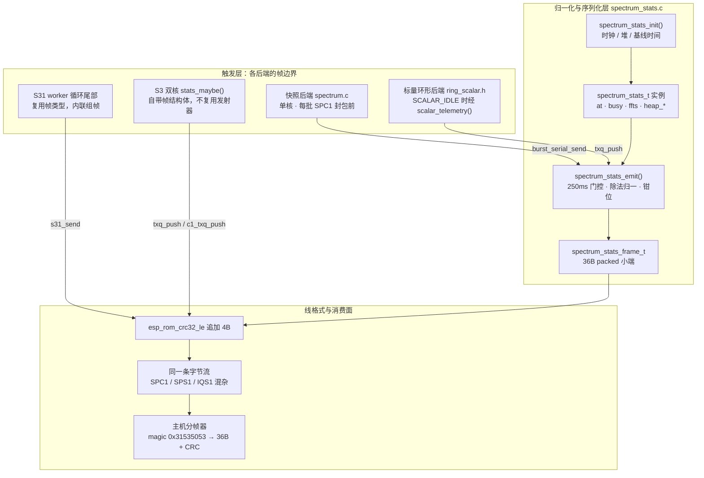
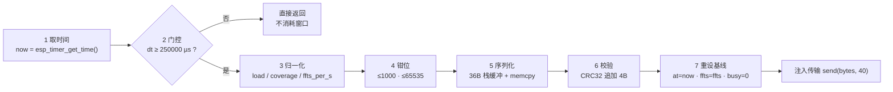

# 频谱遥测：SPS1 统计与负载

## 1. 项目定位与核心价值

在 esp-sdr 的设计里，片上频谱引擎把 FFT 从主机搬到了 MCU 内部：主机不再收到原始 I/Q，而是收到已经被压成 8 位 dB 码的 bin 数组。这个决定换来了带宽，却制造了一个观测黑洞——主机看到的是**谱线形状**，看不到固件为了产出这条谱线付出了多少算力、跳过了多少样本、丢了几帧。`SPS1` 遥测帧就是补上这个缺口的旁路通道：一条 40 字节、默认关闭、约每 250 ms 插入一次的二进制记录，与频谱数据帧共用同一条 CRC 保护的分帧字节流，把"固件自认为跑得怎么样"这件事变成主机可以校验、可以画图、可以做回归断言的事实。

它存在的必要性可以由三类真实故障反推出来。第一，连续后端在算不过来时会**主动跳过工作**（`abandoned`、`late_max`），这是刻意的降级策略而不是 bug；但如果没有遥测，主机无法区分"谱线里的凹陷是信号"还是"固件没来得及算这一段"。第二，快照后端在两次采集之间存在**静默间隙**，`coverage` 字段让主机知道这条谱线实际覆盖了多少比例的采样，从而决定是否该降低 FFT 点数或换采集模式。第三，输出队列 `txq` 一旦积压，新帧会被丢弃（`drops`），而 `queue` 填充率是判断"到底是不是主机读得太慢"的唯一线上证据。换言之，遥测不是可选的调试输出，而是这套"会主动丢工作的系统"与主机之间的信任契约。

> **设计哲学**：遥测必须便宜到可以永远开着（几条 64 位除法、40 字节栈缓冲、无堆分配、无锁）；必须与数据帧共享同一套 CRC + magic 分帧规则（主机用同一套状态机复位即可解析）；必须在不需要时退化为零成本（`SPEC` 命令的可选第 7 个参数决定是否进入采样路径）。这三条约束共同解释了为什么这里的代码如此短小、为什么字段布局被 `_Static_assert` 死死锁在 36 字节、为什么所有比例量都被钳到 1000 的千分比。

Sources: [spectrum_stats.h](main/common/spectrum_stats.h#L1-L21), [spectrum_stats.c](main/common/spectrum_stats.c#L15-L40), [docs/spectrum.md](docs/spectrum.md#L97-L113)

---

## 2. 架构设计与模块划分

`spectrum_stats` 刻意只承担"采样状态 + 归一化 + 序列化"三件事，不承担触发时机、不承担传输、更不感知任何芯片。触发由各采集后端在自己的帧边界决定，传输由一个注入的函数指针 `bool (*send)(const void *, size_t)` 决定。这个切分让同一份发射代码既能跑在快照后端（`burst_serial_send`，可能部分写入），也能跑在标量环形后端（`txq_push`，非阻塞全有或全无）。



### 2.1 线格式层：一个 36 字节的 ABI

`spectrum_stats_frame_t` 用 `__attribute__((packed))` 固定布局，并用 `_Static_assert(sizeof(...) == 36, "SPS1 layout")` 在编译期把任何来自编译器对齐规则的偏移漂移挡在门外；线上再追加 4 字节 CRC32，总计 40 字节。字段顺序经过精心排布：`uint32_t` 打头（magic），随后成对的 `uint16_t` 被夹在中间以减少内部空洞，最后才是两个 `uint32_t` 累计量和 `ffts_per_s`。这种手工排布不是美学问题——主机的解析器与 `tools/check_spectrum.py` 的断言都直接按字节偏移读出，任何一次"顺手调整字段顺序"都会静默破坏兼容性。

| 偏移 | 宽度 | 字段 | 语义与来源 |
| --- | --- | --- | --- |
| 0–3 | u32 | `magic` | `0x31535053`，小端落盘即 ASCII `SPS1` |
| 4–5 | u16 | `core0` | 本核处理负载，千分比，钳到 1000 |
| 6–7 | u16 | `core1` | 第二核负载；共用发射器**恒为 0** |
| 8–9 | u16 | `coverage` | FFT 已分析样本占采样总量的千分比 |
| 10–11 | u16 | `mode` | bit0 双核、bit1 核 0 协助；共用发射器恒 0 |
| 12–15 | u32 | `heap_free` | 内部堆空闲量，**捕获开始前的快照** |
| 16–19 | u32 | `heap_largest` | 最大连续空闲块，同上 |
| 20–23 | u32 | `abandoned` | 累计被放弃的工作（跳过 / 超龄单元） |
| 24–27 | u32 | `drops` | 累计丢弃帧 |
| 28–29 | u16 | `late_max` | 换银行最大迟到量（样本对），钳到 65535 |
| 30–31 | u16 | `queue` | 输出队列填充率千分比，钳到 1000 |
| 32–35 | u32 | `ffts_per_s` | 该窗口内每秒完成 FFT 数 |
| 36–39 | u32 | *CRC32* | 对前 36 字节的 `esp_rom_crc32_le(0, …)` |

值得单独指出的是 `core1` 与 `mode` 这两个字段在共用发射器里被**有意留空**（初始化列表里干脆没有出现，于是零值）。它们的存在是为 S3 与 S31 的自建帧预留同一 ABI：主机只需实现一个解析器，就能解析三种实现——只要把"未置位"解释为"该后端不具备此维度"。

Sources: [spectrum_stats.h](main/common/spectrum_stats.h#L6-L13), [spectrum_stats.c](main/common/spectrum_stats.c#L22-L35), [docs/spectrum.md](docs/spectrum.md#L97-L109)

### 2.2 采样状态层：一个 40 字节的滑动窗口

`spectrum_stats_t` 是纯状态的：基线时间 `at`（微秒，`int64_t`）、累计忙周期 `busy`（`uint64_t`）、上次发射时的 FFT 计数 `ffts`、以及初始化时冻结的 `heap_free` / `heap_largest` 与换算系数 `cycles_per_us`。它没有指针、没有堆、没有锁，因此可以被任意后端静态持有——快照后端把它放在栈上（`spectrum_stats_t telemetry;`），标量环形后端把它放在文件作用域（`static spectrum_stats_t scalar_stats;`）。这种"状态与代码同生命周期"的选择，让遥测在多任务、屏蔽中断的连续采集环境里不需要任何同步原语。

`cycles_per_us` 来自 `esp_clk_cpu_freq() / 1000000u`，在 `init` 时一次性采样。这是一个有意识的简化：连续 SPEC 期间中断被屏蔽、变频被禁用，频率在窗口内视为常量；代价是如果上层启用了动态调频，负载读数会整体偏斜——这一点在代码里没有运行时防护，属于调用方契约。

Sources: [spectrum_stats.h](main/common/spectrum_stats.h#L14-L18), [spectrum_stats.c](main/common/spectrum_stats.c#L9-L14), [spectrum.c](main/common/spectrum.c#L206-L208), [ring_capture.c](main/common/ring_capture.c#L562-L563)

### 2.3 触发层：三种后端，三种时间语义

同一份 ABI 下，触发方式与"负载"的度量口径并不统一，这正是阅读本模块时最容易踩坑的地方：

| 后端 | 实现位置 | 窗口判定 | 负载分子 | `coverage` 分母 | 自建帧 |
| --- | --- | --- | --- | --- | --- |
| 快照（ESP32/S2/C2/C3/C5/H2 等） | `spectrum.c` | `esp_timer_get_time()` 微秒 | 逐次累加的 CPU 周期 | 时间 × 采样率（含采集间隙） | 否 |
| 标量环形（C6 / C61，256 点） | `ring_capture.c` + `ring_scalar.h` | 同快照（共用发射器） | 每个工作切片的周期数 | 时间 × 采样率 | 否 |
| S3 双核 | `ring_capture.c` | **CPU 周期计数**（假定 240 MHz） | 两核各自累加的周期 | 样本基：`df·n / pairs_done` | 是 |
| S31 | `s31_spectrum.h` | CPU 周期计数（`CONFIG_ESP_DEFAULT_CPU_FREQ_MHZ`） | 两核原子累加的周期 | 时间 × 采样率（等价快照公式） | 是（复用类型） |

S3 之所以不复用共用发射器，从代码可见的直接原因是它需要同时上报两核负载与 `mode` 位（`sx.mode = dual | assist << 1`），并且必须把统计帧推进与数据帧相同的队列（核 0 用 `txq_push`、核 1 用 `c1_txq_push`），保证 SPS1 与 SPC1 在同一条字节流上的相对顺序不乱。它的 `stats_maybe()` 被标注为 `IRAM_ATTR`，因为该函数位于连续采集的热路径上，必须避开 flash cache 停顿。S31 则更进一步：它直接构造 `spectrum_stats_frame_t` 并自己算 CRC，只借用了类型定义，因为它的统计窗口落在 worker 任务循环尾部，需要对 `busy0` / `busy1` / `late` 等原子变量做一次快照读取。

Sources: [ring_capture.c](main/common/ring_capture.c#L486-L558), [ring_capture.c](main/common/ring_capture.c#L562-L570), [ring_capture.c](main/common/ring_capture.c#L1673), [s31_spectrum.h](main/targets/esp32s31/burst/s31_spectrum.h#L250-L280)

### 2.4 一个容易被忽略的链接期细节

`spectrum_dc_mode`——DC 抑制模式的全局开关——的定义并不在 `spectrum_dc.h` 对应的实现文件里（该头文件本身只有 `extern` 与内联函数），而是落在 `spectrum_stats.c` 第 8 行。结合构建脚本可以推断其动机：`common/spectrum_stats.c` 是所有 profile 的**无条件基础源文件**，而 `common/spectrum.c` 只在部分目标上追加。把该全局放进"必然被编译的翻译单元"，就保证了无论目标启用快照后端、S3 双核后端还是 S31 后端，链接时总有且仅有一个定义。这是一个典型的"用链接布局解决可移植性"的取舍：语义上略显随机，工程上极其有效。

Sources: [spectrum_stats.c](main/common/spectrum_stats.c#L1-L8), [spectrum_dc.h](main/common/spectrum_dc.h#L1-L9), [CMakeLists.txt](main/CMakeLists.txt#L20-L32)

---

## 3. 技术栈与核心工作流

### 3.1 发射主链路：七步



这七步里有两个细节决定了整个遥测的可靠性语义：**门控不消耗窗口**，即当 `dt < 250000` 时函数直接返回，`busy` 与 `ffts` 的基线保持不动，实际统计窗口总是"≥250 ms 的整数倍附近"，而不会是"每 250 ms 精确切一刀"；**重设发生在发送之后**，因此序列化与入队本身的成本被记入下一个窗口，而不是当前窗口。

Sources: [spectrum_stats.c](main/common/spectrum_stats.c#L15-L40)

### 3.2 三个归一化公式

发射器的全部算术集中在三行，值得逐条推导：

```
load      = busy · 1000 / (dt · cycles_per_us)
coverage  = Δffts · n · 1e9 / (dt · fs)
ffts_per_s= Δffts · 1e6 / dt
```

- **`load`（千分比 CPU 占用）**：`busy` 是 CPU 周期数，`dt · cycles_per_us` 是同一窗口内"一整颗核"可提供的周期数，商即"本核被频谱处理占用的时间比例"，乘 1000 转为千分比。注意它**不是** FreeRTOS 的 CPU 使用率统计：它只覆盖被 `spectrum_stats_emit` 的调用方显式累加的那几段热路径（FFT、解包、搬移、累加、编码），刻意排除了中断、任务切换与主循环开销。
- **`coverage`（千分比样本覆盖率）**：`Δffts · n` 是被 FFT 真正分析过的样本数，`dt · fs` 是同一窗口内 ADC 理论上吐出的样本数。快照后端在两次采集之间停机，这段静默时间被算进分母，所以覆盖率会明显小于 1000——这正是主机需要的"这条谱线有多稀疏"信息。S3 的实现把这个分母换成了"已看清的样本对"，得到的是"在看得见的样本里算掉了多少"，两种口径互不替代。
- **`ffts_per_s`**：纯吞吐量指标，除以窗口而非某个固定周期，所以窗口被门控拉伸后读数依然正确。

三者的中间量都是 `uint64_t`：`Δffts · n · 1e9` 在 2048 点、上千次 FFT 的量级下可达 1e15，刚好在 64 位内安全落地；`dt` 是 `uint64_t`（由 `int64_t` 相减得到），避免了 32 位微秒计时器在约 71 分钟后回绕的雷区。

Sources: [spectrum_stats.c](main/common/spectrum_stats.c#L17-L31)

### 3.3 钳位与"诚实降级"

所有对外比例量在写出前都被钳位：`core0` 与 `coverage` 上限 1000（千分比不可能超过"满"），`late_max` 上限 65535（字段只有 16 位），`queue` 上限 1000（队列填充率）。这些钳位不是防御性编程的装饰，而是**契约的一部分**：主机侧解析器把它们当作硬不变量来断言，`tools/check_spectrum.py` 会直接拒绝任何 `>1000` 的百分比字段，并检查 `heap_largest ≤ heap_free`。一旦某个后端算错了公式，主机在冒烟测试阶段就会失败，而不是把错误数据画进瀑布图里。

Sources: [spectrum_stats.c](main/common/spectrum_stats.c#L22-L31), [check_spectrum.py](tools/check_spectrum.py#L75-L83)

### 3.4 传输注入与帧序安全

`send` 是本模块唯一的对外依赖，签名是 `bool (*)(const void *, size_t)`。两个调用点的语义差别很大：

- **快照后端**使用 `burst_serial_send`，它在内部可能是一次完整写入，也可能是分片写入；返回值只用于在 `SPECEND` 报告里记录状态。
- **标量环形后端**使用 `txq_push`，这是非阻塞的"全有或全无"入队；当队列满时返回值被忽略（`(void)`），意味着**遥测帧会被静默丢弃而不会拖慢采集**。这是正确的取舍：遥测的价值在于长期统计，单帧丢失不影响趋势；而如果为它阻塞，就会污染它自己正在度量的一切。

帧序安全由调用方保证：快照后端只在 `out.pending == 0`（即上一帧已经完全送出）时调用发射器，紧接着才 `pack_spectrum` 装载下一帧，因此 SPS1 永远落在 SPC1 帧的边界上，绝不会切进某个帧体中间。S3 与 S31 则把统计帧推进与数据帧相同的队列，靠队列本身维持顺序。

Sources: [spectrum.c](main/common/spectrum.c#L118-L128), [spectrum.c](main/common/spectrum.c#L250-L256), [ring_capture.c](main/common/ring_capture.c#L564-L570), [ring_capture.c](main/common/ring_capture.c#L636-L646)

### 3.5 三类角色的职责对照

| 角色 | 代表符号 | 在流程中的作用 | 关键约束 |
| --- | --- | --- | --- |
| 状态载体 | `spectrum_stats_t` | 保存窗口基线，跨调用累积 | 无锁、可静态/栈分配 |
| 线格式 | `spectrum_stats_frame_t` | 36 字节 packed ABI + 4 字节 CRC | `_Static_assert` 锁尺寸 |
| 发射器 | `spectrum_stats_emit()` | 门控、归一、钳位、序列化、重设 | 不感知传输，不阻塞 |
| 触发者 | 后端帧边界（`out.pending` / `SCALAR_IDLE` / `s31_emit`） | 决定何时采样 | 必须保证 SPS1 不与数据帧交错 |
| 传输注入 | `burst_serial_send` / `txq_push` / `s31_send` | 写入同一字节流 | 允许整体失败/丢弃 |
| 消费者 | `tools/check_spectrum.py` | CRC 校验 + 不变量断言 | 只按字节偏移解析 |

Sources: [spectrum_stats.h](main/common/spectrum_stats.h#L6-L21), [spectrum.c](main/common/spectrum.c#L245-L262), [ring_scalar.h](main/common/ring_scalar.h#L126-L142), [s31_spectrum.h](main/targets/esp32s31/burst/s31_spectrum.h#L270-L280)

---

## 4. 典型代码示例

### 4.1 发射器全貌（逐段注释）

```c
void spectrum_stats_emit(spectrum_stats_t *s, unsigned n, unsigned fs, uint32_t ffts, uint32_t abandoned,
                         uint32_t drops, uint32_t late, unsigned queue, bool (*send)(const void *, size_t)) {
    int64_t now = esp_timer_get_time();
    uint64_t dt = now - s->at;
    if (dt < 250000) return;                 /* 门控：窗口不足 250 ms 时不消耗基线 */
    uint64_t load = s->busy * 1000 / (dt * s->cycles_per_us), df = ffts - s->ffts;
    uint64_t coverage = df * n * 1000000000ull / (dt * fs);
    spectrum_stats_frame_t frame = {.magic = 0x31535053u,
                                    .core0 = load > 1000 ? 1000 : load,
                                    .coverage = coverage > 1000 ? 1000 : coverage,
                                    .heap_free = s->heap_free,     /* 捕获开始前的冻结值 */
                                    .heap_largest = s->heap_largest,
                                    .abandoned = abandoned,
                                    .drops = drops,
                                    .late_max = late > 65535 ? 65535 : late,
                                    .queue = queue > 1000 ? 1000 : queue,
                                    .ffts_per_s = df * 1000000 / dt};
    uint8_t bytes[40];
    memcpy(bytes, &frame, 36);               /* 依赖 packed + 小端 */
    uint32_t crc = esp_rom_crc32_le(0, bytes, 36);
    memcpy(bytes + 36, &crc, 4);
    send(bytes, sizeof(bytes));              /* 注入传输：可以整体失败 */
    s->at = now;                             /* 重设基线发生在发送之后 */
    s->ffts = ffts;
    s->busy = 0;
}
```

这段代码里没有任何 `#if`、没有任何芯片常量，也没有任何静态缓冲——`bytes` 是 40 字节的栈数组。正因如此，它才能在从 ESP32 到 S31 的十个目标上共用；而所有与频率相关的换算被抽象成 `cycles_per_us`，所有与传输相关的行为被抽象成函数指针。

Sources: [spectrum_stats.c](main/common/spectrum_stats.c#L15-L40)

### 4.2 调用点：快照后端如何累加 `busy`

```c
uint32_t busy_start = esp_cpu_get_cycle_count();
/* … 解包 + 窗函数 + FFT + DC 抑制 + 功率累加 … */
if (!out.pending) {
    if (stats) spectrum_stats_emit(&telemetry, n, rate_hz(rate), ffts, 0, 0, 0, 0, burst_serial_send);
    out.pending = pack_spectrum(n, log2n, det, merged, frames, index, gain);
    merged = 0;
    out.progress = esp_timer_get_time();
    pump_spectrum(&out);
}
telemetry.busy += (uint32_t)(esp_cpu_get_cycle_count() - busy_start);
```

注意两条容易被误解的时序事实。第一，`busy` 的累加发生在 `emit` **之后**：关闭当前批次的最后一次 FFT 的周期，被记入了下一个窗口；这只造成一个迭代粒度的边界偏移，不会丢失统计。第二，`emit` 内部会把 `s->busy` 清零，所以序列化、CRC 与 `pack_spectrum` 的成本全部归入下一窗口——这保证了"负载"永远不会被自己的观测行为污染。

在这条路径上，`abandoned`、`drops`、`late`、`queue` 四个参数被硬编码为 0：快照后端不存在银行轮转与输出队列，也没有"被放弃的工作"，这些维度对它无意义，字段因此保持为零而不是伪造。

Sources: [spectrum.c](main/common/spectrum.c#L219-L262)

### 4.3 调用点：标量环形后端的切片式喂料

```c
static spectrum_stats_t scalar_stats;
static void scalar_telemetry(unsigned cycles, bool complete) {
    scalar_stats.busy += cycles;
    if (st.cfg->stats && complete)
        spectrum_stats_emit(&scalar_stats, spec_n, ring_capture_rate_hz(st.cfg->rate), st.res->ffts,
                            st.res->abandoned, st.res->drops, st.res->late_max,
                            (txq_head - txq_tail) * 1000u / TXQ_SIZE, txq_push);
}
```

它被 `ring_scalar.h` 在每个工作切片末尾调用一次，把本切片消耗的周期数喂进累加器；只有回到 `SCALAR_IDLE`（即一帧完全封好）时才尝试发射。这与快照后端的"帧边界发射"是同一条纪律的两种写法。此外，`ring_capture.c` 在 SPEC 预热阶段做了一次小动作——`scalar_stats.at -= 250000;`——把基线时间人为拨回 250 ms，好让哨兵数据的首次发射立刻通过门控，从而把 FFT、CRC 与遥测代码路径一并预热进缓存，避免第一段真实数据撞上冷缓存。

Sources: [ring_capture.c](main/common/ring_capture.c#L562-L570), [ring_scalar.h](main/common/ring_scalar.h#L137-L141), [ring_capture.c](main/common/ring_capture.c#L1618-L1642)

### 4.4 主机侧：40 字节就是全部契约

```python
if magic == b'SPS1':
    frame = magic + exact(port, 36)
    if zlib.crc32(frame[:-4]) != int.from_bytes(frame[-4:], 'little'):
        raise RuntimeError('Statistics CRC mismatch')
    if any(u16(at) > 1000 for at in [4, 6, 8, 30]):
        raise RuntimeError('Invalid statistics percentage')
    if u32(16) > u32(12):
        raise RuntimeError('Invalid heap statistics')
```

主机侧没有任何 schema 协商，只有 magic、长度、CRC 与几条不变量。这也解释了为什么固件端的钳位必须无条件执行：钳位即是"让不变量永远成立"的手段，而设备的自检脚本正是靠这些不变量来在硬件在环测试中捕捉后端公式回归。

Sources: [check_spectrum.py](tools/check_spectrum.py#L75-L83), [check_spectrum.py](tools/check_spectrum.py#L100-L102)

### 4.5 S31 的内联组帧：同一 ABI 的另一种写法

```c
spectrum_stats_frame_t f = {
    .magic = 0x31535053,
    .core0 = c0 > 1000 ? 1000 : c0,
    .core1 = c1 > 1000 ? 1000 : c1,
    .coverage = coverage > 1000 ? 1000 : coverage,
    .mode = 1,
    .heap_free = s31.heap_free,
    .heap_largest = s31.heap_largest,
    .abandoned = s31.skipped + LOAD(s31.skipped0),
    .drops = s31.drops,
    .late_max = LOAD(s31.late),
    .queue = (LOAD(s31.txhead) - LOAD(s31.txtail)) * 1000 / S31_TX_BYTES,
    .ffts_per_s = (uint64_t)df * CONFIG_ESP_DEFAULT_CPU_FREQ_MHZ * 1000000ull / dt};
uint8_t bytes[40];
memcpy(bytes, &f, 36);
uint32_t crc = esp_rom_crc32_le(0, bytes, 36);
memcpy(bytes + 36, &crc, 4);
s31_send(bytes, 40);
```

与共用发射器的三处差异很能说明问题：`core1` 与 `mode` 被真正填上（S31 是双核 worker 架构）；`abandoned` 是"本轮跳过 + 上一轮遗留"两项之和；`ffts_per_s` 用 `CONFIG_ESP_DEFAULT_CPU_FREQ_MHZ` 把周期换成微秒，而不是像共用发射器那样预存 `cycles_per_us`。等价、但多了一次编译期常量乘法——在热路径上这是可以接受的。

Sources: [s31_spectrum.h](main/targets/esp32s31/burst/s31_spectrum.h#L250-L280), [s31_spectrum.h](main/targets/esp32s31/burst/s31_spectrum.h#L528-L531)

---

## 5. 学习与探索建议

| 读者画像 | 建议路径 | 为什么 |
| --- | --- | --- |
| 想先建立全局图景 | 先读 [核心架构设计](../入门指南/3-core-architecture.md)，再回到本页的 2.3 表格 | 三种触发语义只有在知道"哪些芯片跑快照、哪些跑环形"之后才有意义 |
| 关心数据帧本身 | 读 [频谱流水线：FFT 归约与 SPC1 帧](11-spectrum-pipeline.md) | SPS1 的发射时机由 `out.pending` 决定，必须先理解 SPC1 的封包与 `pump_spectrum` 节奏 |
| 关心连续采集调度 | 读 [环形捕获：多银行轮转与哨兵校验](../射频采集引擎/6-ring-capture-scheduler.md) | `abandoned` / `drops` / `late_max` 的语义完全由银行轮转与 `txq` 的行为定义 |
| 想修改字段或新增维度 | 同时改 `spectrum_stats.h` 的布局、四处组帧点、`tools/check_spectrum.py` 的解析与 [docs/spectrum.md](docs/spectrum.md#L97-L113) 的表格 | 这是跨固件/主机/文档的三方 ABI，任何单点修改都会在不同的验证环节暴露 |
| 想验证自己的改动 | 运行 `python tools/check_spectrum.py --port … --milliseconds 3000 --stats` | 它会遍历所有 profile、两种检测器，并断言 CRC、百分比范围与 `ffts_per_s` 非零 |
| 想理解双核统计 | 读 [S3 双核 SIMD 频谱工作器](13-s3-dual-core-spectrum.md) | `stats_maybe()` 的 `c1_txq_push` 分支与 `sx.mode` 位只有对照核 1 worker 才能读懂 |

Sources: [spectrum_stats.h](main/common/spectrum_stats.h#L1-L21), [check_spectrum.py](tools/check_spectrum.py#L45-L52), [docs/spectrum.md](docs/spectrum.md#L160-L168)

---

## 🔗 关联模块与上下游

- **上游调用者（共用发射器）**：[main/common/spectrum.c](main/common/spectrum.c#L206-L262) —— 快照后端在 SPC1 帧边界调用 `spectrum_stats_emit`，并负责累加 `telemetry.busy`。
- **上游调用者（标量环形）/ 自建帧实现**：[main/common/ring_capture.c](main/common/ring_capture.c#L486-L570) 与 [main/common/ring_scalar.h](main/common/ring_scalar.h#L126-L142) —— 前者提供 `scalar_telemetry()` 与 S3 独立的 `stats_maybe()`，后者决定切片喂料时机。
- **线格式契约的消费方**：[tools/check_spectrum.py](tools/check_spectrum.py#L75-L83) 与 [docs/spectrum.md](docs/spectrum.md#L97-L113) —— CRC 校验、百分比不变量与字段表的单一事实来源。
