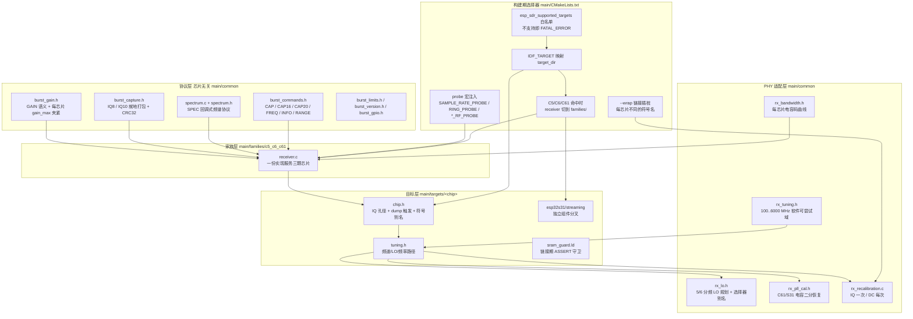
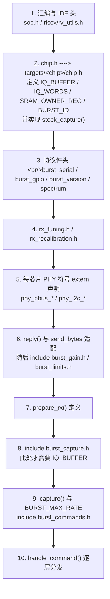
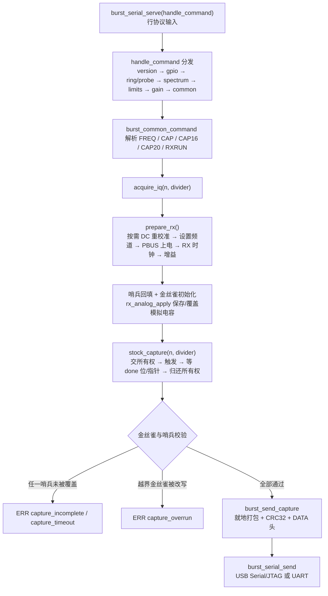

# 多芯片后端移植策略

> "把一颗芯片的射频调试通道变成 SDR" 是逆向工作；"把同一套通道在十颗芯片上重复十次" 是工程学问题。本页讨论的是后者——ESP-SDR 如何在 **十个 IDF target、四种 CPU 架构、两代 PHY 私有 ABI** 之间，维持一套统一的线协议与一套可审计的移植契约。

---

## 1. 项目定位与核心价值

ESP-SDR 的目标是把普通 ESP32 开发板上那套固定功能的 Wi-Fi/蓝牙射频前端，改造成一个仅接收的软件定义无线电：从接收机的调试通路里直接把 I/Q 样本取到内存，再经 USB 或 UART 送到主机。这条通路 Espressif 从未公开文档，它的存在、触发序列、SRAM 所有权字段与位域语义全部来自对随 IDF 发布的射频测试归档 `librftest.a`（函数 `adctrig`）的阅读、反汇编与实板实验。项目目前覆盖 ESP32、C2、C3、C5、C6、C61、H2、S2、S3、S31 共十个 target，每个 target 在 `firmware-targets.json` 中都有独立的 profile 与被钉死的 IDF commit。

这类项目最尖锐的矛盾在于**共享与分化的比例是反直觉的**：线协议、打包格式、CRC、频谱协议、增益语义、校准策略在十颗芯片上完全一致（主机端只需一套客户端），而真正与硅片绑定的部分——SRAM 孔径地址、所有权位段、dump 控制寄存器位序、PLL 电容寄存器、频段覆盖——却是逐芯片、逐 revision 甚至逐板卡不同的。如果按"一颗芯片一个 `receiver.c`"来组织，协议层会被复制十遍，任何协议修订都要十处同步；如果强行把所有芯片塞进一个文件，`#if CONFIG_IDF_TARGET_*` 的组合会以指数级爆炸。ESP-SDR 选择的路径是**按"共享面"分层收敛、按"差异面"声明式下沉**：把芯片无关的部分抽成可被 `#include` 的协议件，把芯片相关的部分压进 `targets/<chip>/` 的三件套（`chip.h`、`tuning.h`、`sram_guard.ld`），再把 C5/C6/C61 这三颗寄存器布局高度同源的芯片合并成一个 **family 后端** 共享一份 `receiver.c`。

其核心价值可以归结为四个设计承诺。第一，**移植点必须是显式的、可列举的**：新增一颗芯片时，需要提供哪些符号、哪些宏、哪些链接期钩子，在 `burst_commands.h` 的文件头注释里以"include 前必须定义"的形式写死，而不是散落在 `#ifdef` 里。第二，**不可信硬件行为必须被自证**：由于触发序列是实验推导出来的，固件在每次捕获时用哨兵字（`0xa5a0055a`）与四个越界金丝雀字来自检，把"dump 引擎没写满"这种静默失败转换成 `ERR capture_incomplete` / `ERR capture_overrun` 这样的显式协议错误，这是让 LLM 辅助移植仍保持可验证性的关键机制。第三，**闭源归档不可修改但可拦截**：厂商 PHY 归档（`librftest.a`、`libphy.a`）里的私有 ABI 通过 `-Wl,--wrap=<每芯片不同的符号名>` 在链接期被透明插桩，从而在不重建归档的前提下注入自研的直流校准逻辑。第四，**能力面由后端而非主机决定**：每颗芯片在自己的 `CAPS` 行中申报它支持的扩展命令（`RX40`/`RX16`、`LPF`、`ALPF`、`GAIN`、`HWAGC`……），主机据此协商，避免"协议里能写、硬件上无效"的悬空能力。

> **设计理念**：这套代码库不追求"一次抽象、处处复用"的教科书式分层，而是追求**差异的最小可寻址面积**。凡是能通过头文件宏、符号别名或链接期 `--wrap` 表达的差异，都不允许上升到运行时分支；凡是上升到运行时分支的差异，必须在源码里附带实测依据的注释。

Sources: [README.md](README.md#L1-L22), [README.md](README.md#L33-L68), [firmware-targets.json](firmware-targets.json#L1-L96), [how-it-works.md](docs/how-it-works.md#L1-L26), [how-it-works.md](docs/how-it-works.md#L159-L176)

---

## 2. 架构设计与模块划分

### 2.1 三层收敛拓扑

整个后端不是"公共代码 + 十份拷贝"，而是**协议层（芯片无关）→ 家族层（同源芯片聚合）→ 目标层（硅片绑定）** 的三级收敛，外加一个横切的"PHY 适配层"负责频率、校准、带宽这些跨芯片但语义不同的能力。



**协议层**是唯一"主机可见"的层。`burst_commands.h` 的头部注释直接把后端契约写成清单：`BURST_ID`、`BURST_MAX_RATE`、`IQ_WORDS`，以及必须存在的 `frequency_mhz`、`rx_ready`、`frequency_valid()`、`prepare_rx()`、`reply()`、`capture(samples, rate, format)`。它用 `#include` 的方式被接收器"反向依赖"进来，从而在不引入函数指针表的前提下完成依赖注入。`burst_capture.h` 承担线格式：IQ10 两个样本压五字节、IQ8 取 10 位字段的高 8 位，且**就地打包**（每种输出格式都不比它替换掉的 32 位字更大），最后计算 CRC32 并发出 `DATA <n> <crc32> <us>` 头。

**家族层**目前只有一个成员，也是本页的主战场。`families/c5_c6_c61/receiver.c` 的第一行注释就点明定位："Shared ESP32-C5/C6/C61 burst receiver. Chip differences: target-selected chip.h." 这句话是整份家族层的设计纲领——三颗芯片的差异被约定为**只能通过 `chip.h` 注入**，而 `receiver.c` 内部仅保留少量已被实测证明无法下沉的分支（C5 的 `rx_channel_mode`、C6 的速率码校验、C61 的增益镜像回滚）。

**目标层**是每一颗芯片唯一的新增代码。以 C61 为例，`chip.h` 只做三件事：声明 64 KiB 的 IQ 孔径与 128 KiB 的保留区、给出 `stock_capture()` 的完整触发序列、在文件末尾 `#include "tuning.h"`。`sram_guard.ld` 则把"静态数据不得长进捕获孔径"从口头约定升级为链接错误。

Sources: [CMakeLists.txt](main/CMakeLists.txt#L1-L25), [CMakeLists.txt](main/CMakeLists.txt#L42-L71), [burst_commands.h](main/common/burst_commands.h#L1-L13), [burst_capture.h](main/common/burst_capture.h#L1-L56), [receiver.c](main/families/c5_c6_c61/receiver.c#L1-L1), [chip.h](main/targets/esp32c61/chip.h#L1-L46)

### 2.2 编译期的依赖注入：include 顺序即接口

接收器并不是"实现一个接口"，而是**把接口的实现以特定顺序拼装进同一个翻译单元**。这带来零开销的静态内联与对 `static` 符号（`IQ_BUFFER`、`frequency_mhz`、`reply`）的完全访问权，代价是顺序必须精确，且顺序本身就是文档。



这条链上的每一环都有不可交换的理由，且注释里几乎都留了证据：

- `chip.h` 必须在第 2 步，因为 `burst_capture.h` 在展开时立即需要 `IQ_BUFFER`；`acquire_iq()` 的哨兵回填与越界金丝雀也依赖 `IQ_BUFFER` 与 `IQ_WORDS`。
- `reply()` 必须在 `burst_gain.h` 之前定义，因为后者内部的 `gain_command()` 直接调用它。
- `tuning.h` 被放在 `chip.h` 的**末尾**而非顶部，原因在 C61/S31 版本里写得很清楚：`c61_set_chan()` 需要先把真实的 `phy_chip_set_chan` 声明成 `extern`，再用 `#define phy_chip_set_chan c61_set_chan` 完成符号劫持；如果把 `tuning.h` 放在顶部，宏会在 `extern` 声明之前生效，导致自引用。
- `BURST_MAX_RATE` 在 `#include "burst_commands.h"` 之前用三元表达式定义（C6 为 6，其余为 5），因为该头文件用它做 `RXRUN`/`CAP` 的速率上界校验。

`chip.h` 末尾 `#include "tuning.h"` 这种"反向包含"是这套体系最反直觉、也最容易被误改的一处。它的语义是：**频率路径是捕获引擎的一部分，而不是使用者的配置**。

Sources: [receiver.c](main/families/c5_c6_c61/receiver.c#L2-L42), [receiver.c](main/families/c5_c6_c61/receiver.c#L81-L86), [receiver.c](main/families/c5_c6_c61/receiver.c#L123-L133), [receiver.c](main/families/c5_c6_c61/receiver.c#L307-L308), [chip.h](main/targets/esp32c5/chip.h#L1-L19), [chip.h](main/targets/esp32c61/chip.h#L45-L46), [tuning.h](main/targets/esp32c61/tuning.h#L1-L18)

### 2.3 链接期的无源插桩：`--wrap` 与符号别名

移植中最难处理的一类差异，是"厂商归档内部的私有函数名与 ABI 在同一代 PHY 上也不一致"。ESP-SDR 的答案是双轨：**编译期符号别名**处理"名字不同、语义相同"的情况，**链接期 `--wrap`** 处理"需要包裹（前后插桩）"的情况。

| 差异形态 | 机制 | 具体案例 | 落点 |
| --- | --- | --- | --- |
| 同一功能、不同归档符号名 | `#define` 别名 | C6 把 `phy_stop_tx_tone` 映射到 `ram_stop_tx_tone`、`phy_pbus_workmode` 到 `pbus_workmode`、`phy_chip_i2c_readReg` 到 `rom_chip_i2c_readReg` | `targets/esp32c6/chip.h` |
| 需要在调用前后注入逻辑 | `-Wl,--wrap=<符号>` + `__wrap_*` / `__real_*` | C5 包裹 `phy_chip_set_chan_ana`、C6 包裹 `chip_v7_set_chan_ana`、C61/S31 包裹 `phy_set_channel_rfpll_freq` | `rx_recalibration.c` + `CMakeLists.txt` |
| 直流测量函数名逐芯片漂移 | CMake 变量 `rx_dc_measure` 后统一 wrap | C5→`phy_set_rx_gain_cal_dc`、C61/S31→`phy_set_rx_gain_cal_dc_new`、C6→`set_rx_gain_cal_dc_new`、C2→`ram_set_rx_gain_cal_dc` | `rx_calibration_link.cmake` |
| 硅片固件抢占内存区间枚举 | `--wrap=soc_get_available_memory_regions` | C2 的 `heap_guard.c` | `CMakeLists.txt` |
| 增益表写入需要拦截 | `--wrap=phy_write_gain_mem` / `write_gain_mem` / `set_rx_gain_table` | C61/S31 的 H2 式 IQ 组修正、C3/S3 的增益验证 | `CMakeLists.txt` |

其中 `rx_calibration_link.cmake` 是最能体现"把差异集中到一个可审计位置"的样本：它先为 ESP32/S2 直接 `return()`（因为 Xtensa 归档把内部直流调用**本地解析**了，`--wrap` 根本拦不到），然后按 target 选择 5 个不同名字之一，最后只发一条 `--wrap`。注释还额外说明"burst 与 streaming 两种构建共用同一组 DC 钩子"，即这套插桩是跨固件形态复用的公共契约。

Sources: [rx_calibration_link.cmake](main/common/rx_calibration_link.cmake#L1-L17), [CMakeLists.txt](main/CMakeLists.txt#L86-L116), [chip.h](main/targets/esp32c6/chip.h#L21-L28), [rx_recalibration.c](main/common/rx_recalibration.c#L34-L38), [rx_recalibration.c](main/common/rx_recalibration.c#L63-L70), [rx_calibration_state.c](main/common/rx_calibration_state.c#L67-L112)

### 2.4 内存孔径与所有权：两道互不重叠的守卫

dump 引擎把样本写进一块普通 SRAM，而 CPU 在这期间**不能读那块内存**（C3 会返回一个重复的四字模式，其他芯片行为不一）。因此"把内存从堆和静态段里挖出来"是移植的第一道硬门槛，而它需要两道守卫叠加：

1. **运行时守卫**：`SOC_RESERVE_MEMORY_REGION(起, 止, 符号)` 让 heap 初始化时不再把这区间纳入可用内存；
2. **链接期守卫**：`targets/<chip>/sram_guard.ld` 用三条 `ASSERT(_iram_end/_data_end/_bss_end <= <孔径基址>)` 阻止未来的固件把静态段长进捕获区。C5 的注释直白地说明了理由："Heap reservation alone does not prevent a future firmware's static sections growing into it."

预留粒度也逐芯片不同，这是最容易踩的坑。C61 的 `chip.h` 注释指出所有权选择器是**以 64 KiB 为单位**的，因此选 bank 3（`0x40830000`）时还必须把整块 128 KiB 以及 ROM 数据所在 bank 4 一起纳入考虑；而 C5 的注释说"ownership bit 1 covers an entire 128 KiB bank"，所以即便 IQ 只占 `0x40830000` 起的 64 KiB，预留也必须写成 `0x40820000–0x40840000`。C6 则把预留拉到 `0x40820000–0x40860000`，因为 stock `adctrig` 用 bank 2 而环形捕获会跨 bank 轮转。

| Target | IQ 孔径 | 预留区 | Owner 寄存器 / 写入值 | 说明 |
| --- | --- | --- | --- | --- |
| esp32c5 | `0x40830000` | `0x40820000–0x40840000` | `0x60095004`（由归档 `adctrig` 内部处理） | 位粒度 128 KiB，必须整块预留 |
| esp32c6 | `0x40840000` | `0x40820000–0x40860000` | `0x60095004` ← `(owner & ~0xf00) | 0x400` | stock 用 bank 2 + source 15 |
| esp32c61 | `0x40830000` | `0x40820000–0x40840000` | `0x60095004` ← `(owner & ~0x11f00) | (8u << 8)` | 选 bank 3，保留 bank 4 的 ROM 数据 |
| esp32s31 | `0x2f050000`（快照）/ `0x2f040000`（环形） | `0x2f040000–0x2f07f170` | 由 `HP_SYSTEM_TCM_DATA_DUMP_CTRL_REG` 选择 bank | 双 128 KiB 组轮转，快照用上组 |

Sources: [chip.h](main/targets/esp32c61/chip.h#L2-L13), [chip.h](main/targets/esp32c5/chip.h#L3-L8), [chip.h](main/targets/esp32c6/chip.h#L3-L9), [sram_guard.ld](main/targets/esp32c5/sram_guard.ld#L1-L5), [sram_guard.ld](main/targets/esp32c61/sram_guard.ld#L1-L5), [sram_guard.ld](main/targets/esp32c6/sram_guard.ld#L1-L4), [sram_guard.ld](main/targets/esp32s31/burst/sram_guard.ld#L1-L4), [receiver.c](main/targets/esp32s31/burst/receiver.c#L33-L51)

### 2.5 目标层三件套之外的第四个文件：`streaming/`

S31 展示了一种"目标层内部再分叉"的形态。burst 后端在 `targets/esp32s31/burst/`，而流式固件（Gigabit Ethernet / 高速 USB，供 SoapyESPSDR 使用）在 `targets/esp32s31/streaming/` 下成为**独立组件**，由 `firmware-targets.json` 中带 `"streaming": true` 的独立 profile 触发；`main/CMakeLists.txt` 在检测到 `ESP_SDR_STREAMING` 属性时直接 `idf_component_register(REQUIRES streaming)` 并提前返回，完全绕过 burst 组件。这条分叉是刻意的：流式路径根本不使用 SRAM dump 引擎，而是把接收机内部调试总线经 GPIO 矩阵引出、回环进 PARLIO 并行 DMA，因此它与 burst 后端的共享面只剩下校准钩子与 PHY 初始化约定。

Sources: [CMakeLists.txt](main/CMakeLists.txt#L1-L9), [firmware-targets.json](firmware-targets.json#L84-L93), [how-it-works.md](docs/how-it-works.md#L150-L157), [rx_calibration_link.cmake](main/common/rx_calibration_link.cmake#L5-L5)

---

## 3. 技术栈与核心工作流

### 3.1 主链路：命令 → 调谐 → 触发 → 自检 → 打包

无论是哪颗芯片，一次 `CAP16 4096 0` 都走同一条七阶段链路；芯片差异被压缩在阶段 ②③④ 的内部。



关键实现之一是阶段顺序的**不可交换性**。`prepare_rx()` 里的顺序是：先按需重校准（`rx_recalibrate`），再设频道（`phy_chip_set_chan`），然后 `phy_stop_tx_tone(1)` → `phy_pbus_workmode()` → `phy_pbus_xpd_tx_off()` → `phy_pbus_xpd_rx_on(1)` → `phy_set_rxclk_en(1)` → 滤波器模式 → `gain_apply()`。任何"顺手优化"把增益放到 PBUS 上电之前，都会因 PBUS 工作模式释放强制增益而失效——S31 后端对此留有明确注释与二次恢复（`phy_rfrx_sat_rst` + `phy_force_rx_gain`）。

Sources: [receiver.c](main/families/c5_c6_c61/receiver.c#L88-L122), [receiver.c](main/families/c5_c6_c61/receiver.c#L134-L206), [receiver.c](main/families/c5_c6_c61/receiver.c#L216-L220), [receiver.c](main/families/c5_c6_c61/receiver.c#L310-L330), [receiver.c](main/targets/esp32s31/burst/receiver.c#L108-L118)

### 3.2 频率路径三分法

调谐是移植中分歧最大的一环，因为各代 PHY 的频道 API 语义不同。代码库最终收敛为三条互斥路径：

| 路径 | 适用芯片 | 做法 | 存在的问题 / 为什么必须这样 |
| --- | --- | --- | --- |
| **直通 MHz** | C5 | 直接调用 `phy_set_chanfreq(mhz, mode)` | C5 的频道 API 接受 MHz，不必也不应选邻近频道，否则离格频率会被取整 |
| **标准频道校准 + 直接写 PLL** | C6、C61、S31、S2、S3、C3、ESP32 | 先在真实 Wi-Fi 频道（2412–2472 步进 5，或 2484）上跑完整校准，再用 `phy_set_freq()` / `set_rf_freq_offset()` 写目标频率 | 频道 API 会经 `mhz2ieee` 转换，离格请求会被吞掉；校准索引又只对标准频道有意义，所以两步必须拆开 |
| **PLL 电容恢复** | C61、S31（另加 S2） | 低波段校准失败时用 RFPLL 自身比较器搜索电容码 | 厂商校准在 Wi-Fi 频段以下会停在中途，不收尾就直接收到不信号 |

C61 的 `tuning.h` 更进了一步：它不只区分频道/离格，还在离格路径上调用 `rx_pll_recover(mhz)`。而 `rx_pll_cal.h` 的 `#error Unqualified PLL capacitor layout` 是一道防线——它保证这份"按 `0x62:1[7:0]`、`0x62:2[6]` 布局二分搜索"的知识**只在被实测过的两颗芯片上编译**，避免被复制到寄存器布局不同的 PHY 上。

S2 的 `pll.h` 则是同一思想的反面教材式对照：S2 没有比较器驱动的二分恢复，而是**线性扫描 512 个电容码**，找最长的一段"电压窗口内"区间并取中点，失败时恢复所有字段。两条实现从接口到耗时（S2 约 11 ms 加 I2C 开销）都不同，这正是"差异只能下沉、不能抽象"的实证。

Sources: [tuning.h](main/targets/esp32c5/tuning.h#L1-L8), [tuning.h](main/targets/esp32c61/tuning.h#L1-L18), [tuning.h](main/targets/esp32s31/tuning.h#L1-L15), [chip.h](main/targets/esp32c6/chip.h#L10-L21), [rx_pll_cal.h](main/common/rx_pll_cal.h#L1-L69), [pll.h](main/targets/esp32s2/pll.h#L1-L40), [rx-controls.md](docs/rx-controls.md#L93-L114), [rx-controls.md](docs/rx-controls.md#L149-L169)

### 3.3 校准策略：IQ 一次，DC 每次

跨十颗芯片唯一真正统一的行为约定是校准策略：**IQ 不平衡只在启动时测量一次并在频率切换间复用；直流偏置则每个新频率都重测**。这条策略在 `docs/rx-controls.md` 里被写成显式策略声明，而实现分布在三个文件中。

`rx_recalibration.c` 用一个编译期常量 `measurement_mhz` 作为"临时频率覆盖"，配合 `--wrap` 把覆盖值注入厂商函数：C61/S31 包裹 `phy_set_channel_rfpll_freq`（先让真实函数用测量频率跑，再补一次 PLL 恢复），C5 包裹 `phy_chip_set_chan_ana`。随后各芯片用**不同的 `phy_param` 偏移与位掩码**去"过期"DC/表缓存而保留 IQ 有效位：

| Target | DC/表失效操作 | IQ 保留位 | 备注 |
| --- | --- | --- | --- |
| C5 | `*(phy_param+148) &= ~0x280u`，再按 `phy_param[42]` 分两路重测 | 之后 `|= 0x480u` | 保留 IQ 系数，跳过会经天线发单音的环回步骤 |
| C61 / S31 | `*(phy_param+164) &= ~0x280u` | — | 只过期 DC/表缓存 |
| C6 | `*(phy_param+164) &= ~0x280u` | `0x400` | 注释明确"preserve IQ-valid bit 0x400" |
| C3 / S3 | `*(phy_param+288) &= ~0x200u` | `0x400` | `set_rx_gain_param` 在 0x400 置位时跳过 TX 单音 |
| C2 | `*(phy_param+328) &= ~0x300u` | `0x400` | 与 C6 同位意义、不同偏移 |
| H2 | `*(phy_param+52) &= ~0x100u` | 启动四点 IQ 组 | 需要每组 RF 增益独立的启动 IQ 修正 |
| ESP32 / S2 | `chip7_sleep_params[0] &= ~0x20320u` / `~0x20240u` | `0x400` | 改内存 | 
| 其它 | `#error RX recalibration ABI has not been qualified for this target` | — | 编译期拒绝未验证移植 |

"是否已经过期"的检测同样分两轨，原因写在 `rx_calibration_state.c` 的注释里：**计数真实 DC 测量次数，而不是比较温度戳**——PHY 可以在温度戳不变的情况下替换 DC 表。ESP32/S2 例外，因为它们的 Xtensa 归档把内部 DC 调用本地解析，`--wrap` 拦不到，只能退化为 `memcmp` 比较导出的 DC 表内容。

Sources: [rx_recalibration.c](main/common/rx_recalibration.c#L1-L32), [rx_recalibration.c](main/common/rx_recalibration.c#L34-L62), [rx_recalibration.c](main/common/rx_recalibration.c#L63-L80), [rx_recalibration.c](main/common/rx_recalibration.c#L128-L206), [rx_calibration_state.c](main/common/rx_calibration_state.c#L9-L49), [rx_recalibration.h](main/common/rx_recalibration.h#L1-L18), [rx-controls.md](docs/rx-controls.md#L64-L92)

### 3.4 触发与取回：三套硬件时序，一个返回值契约

`stock_capture(unsigned n, unsigned divider)` 是目标层对 `receiver.c` 暴露的**唯一必选函数**，签名统一、语义统一（返回是否完成），但内部实现分三类：

| 实现风格 | 芯片 | 关键序列 | 完成判据 |
| --- | --- | --- | --- |
| 委托归档 | C5 | `adctrig(n-1, 0, 0, divider*2, ...)`，返回值恒为 `true` | 靠哨兵自检兜底（注释："Common sentinel check detects incomplete stock captures"） |
| 字段式寄存器 | C6 | 先写 clock-force 三寄存器，再 `mode` 选 source 15，`owner` 交 bank 2，`n \|= clock << 15`，再走 `enable → trigger pulse` | 轮询 `0x600a9004` 的 bit 18，20 ms 超时 |
| 索引式寄存器 | C61 | `mode` 里 `15u << 17` 选源、`divider << 21` 选时钟，`pack` 里写 lane 24/25/26/27 与 bit 24，`owner` 交 bank 3 并**回读确认** | 同上 bit 18；注释指出 C61 的完成位是 bit 18（由 sensor-firmware 与硬件双重验证） |

这些差异不是可以抽象掉的"参数"，而是**位域语义级别的不同**。最能说明问题的是家族层 `acquire_iq()` 里的那段警告：

> "Vendor selector 0 maps to raw source 15 and pulses the software trigger. In particular, do NOT set CTRL bit 17 as in the C61 continuous backend: on this C5 it produced only a short, incomplete snapshot."

即：C61 连续后端的 bit 17 是"连续门控"，在 C5 上照抄会让快照提前结束。移植者必须把这类"看起来同构、实际反向"的知识写进注释，而不是指望抽象层能猜出来。C6 的注释同样记录了两条反例：CTRL 的 15–16 位是"除以 1/2/3/5"的字段（所以速率码 2 对应 26.7 MS/s，无对应码），且 bit 17 会让捕获**永不完成**。

Sources: [chip.h](main/targets/esp32c5/chip.h#L9-L13), [chip.h](main/targets/esp32c6/chip.h#L32-L65), [chip.h](main/targets/esp32c61/chip.h#L14-L44), [receiver.c](main/families/c5_c6_c61/receiver.c#L153-L178)

### 3.5 哨兵协议：把未知硬件行为转换成显式错误

由于触发序列本身是实验推导的，固件不能把"dump 完成"当成"数据有效"。`acquire_iq()` 在触发前做两件事：把 `IQ_BUFFER[0..n)` 全部填成 `0xa5a0055a`，并在 `IQ_BUFFER[n..n+4)` 写入四个值 `0x5a5aa5a5 ^ j` 的越界金丝雀。捕获后做三重复检：

1. `stock_capture()` 返回 false → `ERR capture_timeout`；
2. 任一前 n 个字仍为哨兵值 → `ERR capture_timeout`（说明 dump 未写满，静默截断被发现）；
3. 任一金丝雀字被改写 → `ERR capture_overrun`（说明引擎多写了，n 与实际写入量不符）。

S31 后端把同一思想推到更强：环形缓冲区用另一种标记 `0xa5c33c5a`（`S31_MARK`）在每次所有权切换前铺在 guard 区，再用**二分查找**定位"标记结束/开始"的边界，从而反推出硬件实际写入的起止索引（`s31_boundary`）。这在环形连续捕获里等于把"我到底读到哪了"这个无法直接查询的量，用可观测的内存内容重建出来。

> **设计理念**：哨兵不是调试辅助，而是**移植契约的一部分**。任何新增芯片的 `stock_capture()` 都不需要证明自己的时序正确，只需要让哨兵校验通过——这把"正确性证明"从不可形式化的硬件时序，降维成了可自动判定的内存谓词。

Sources: [receiver.c](main/families/c5_c6_c61/receiver.c#L141-L147), [receiver.c](main/families/c5_c6_c61/receiver.c#L179-L206), [receiver.c](main/targets/esp32s31/burst/receiver.c#L184-L215), [s31_spectrum.h](main/targets/esp32s31/burst/s31_spectrum.h#L60-L84), [how-it-works.md](docs/how-it-works.md#L43-L58)

### 3.6 能力面协商：`CAPS` 是后端的身份证

每颗芯片的能力集不在主机的表里，而在固件返回的那一行 `CAPS` 里。家族层用编译期条件拼接这一行：基线能力（`VERSION GPIO SPEC SPECN SPECCAPS SPECSTAT DCT UARTBAUD RXLIMITS GAIN HWAGC IQ8 SERIALLEASE TUNEEXT`）之后，C6 追加 `RX40 RX16`，其余追加 `LPF LPF12`，再按 `CONFIG_ESP_SDR_UART_ENABLED` 追加 `DUALSERIAL`，最后统一追加 `ALPF`。差异化的不止命令名，还有参数域：

| 维度 | 差异点 | 实现位置 |
| --- | --- | --- |
| 采样率上界 | `BURST_MAX_RATE` C6=6，其余=5；C6 还在 `acquire_iq()` 内二次校验只接受 0/1/6 | `receiver.c` 顶层与 `acquire_iq` |
| 带宽范围 | 逐芯片 `RX_BANDWIDTH_MIN/MAX`（H2 4–11 MHz，C5 11–48 MHz 双曲线，ESP32 12–67 MHz…） | `rx_bandwidth.h` |
| 带宽到电容码 | 每芯片一条实测曲线 + 线性插值；C5 依 PHY mode 在两张曲线间切换 | `rx_bandwidth_dcap()` |
| 增益上限 | C5 `< 90`、H2 `≤ 56`、S2/S3 `≤ 82`、其余 `< 80`，超限即视为 0（"Never expose uncalibrated slots"） | `burst_gain.h` |
| 增益实施方式 | C61 需镜像低表项 + 关 RF 饱和干预；H2 需保留蓝牙 RX 强制开；C3/S3 需验证回读 | `burst_gain.h` |
| 滤波器控制 | C6 无 `LPF`（`0x600a0430` 位域未表征）；C61/C6 `RX_FILTER_REG=4`，其余 `6` | `receiver.c` |
| C5 带宽模式切换 | 模式改变触发 `rx_ready = false` 并整轮重跑 `prepare_rx()` | `handle_command` |

`BANDWIDTH` 分支里还有一个值得单独指出的移植细节：C5 的 `rx_bandwidth_phy_mode(mhz)` 决定它走宽 PHY 通路（模式 1，保留 RX0 电容 DAC）还是窄通路（模式 0），而模式切换必须走**完整**的频道校准流程，因为"individual digital register writes do not update the PHY's PBUS analog-control tables"。

Sources: [receiver.c](main/families/c5_c6_c61/receiver.c#L329-L390), [rx_bandwidth.h](main/common/rx_bandwidth.h#L8-L51), [rx_bandwidth.h](main/common/rx_bandwidth.h#L55-L129), [burst_gain.h](main/common/burst_gain.h#L11-L89), [rx-controls.md](docs/rx-controls.md#L20-L62)

### 3.7 连续捕获的三种落地形态

同一个"环形 dump + 双 bank 轮转"概念，在三组芯片上有三种实现：

- **C6/C61**：`common/ring_capture.c` 由 CMake 按 target 条件加入，对外只有 `ring_capture_init/run/rate_hz` 与 `ring_config_t`/`ring_result_t`；家族层的 `ring_test()` 只在 `CONFIG_IDF_TARGET_ESP32C61 || CONFIG_IDF_TARGET_ESP32C6` 下编译，且把 FFT 点数硬限制为 256。
- **S31**：不走通用 `ring_capture`，而是 `s31_spectrum.h` 全自研——core 0 负责 bank 轮转与 USB 泵送，core 1 跑 SIMD FFT；用 `_Atomic` 的 `bank_seq` / `reader` 配对全屏障实现"读者发布 → 校验所有权 → 读取"的无锁协议，并在 worker 超时未完成时直接 `esp_restart()`。
- **S3**：把信号处理放到第二核，以独立汇编件（`s3_fft_rnd.S`、`s3_unpack.S`、`s3_core1.S`、`s3_firdot.S`）实现，并在 CMake 里附带 `linker.lf` 片段。

这三条路径共享的只有**语义**（环形、所有权、间隙标记），不共享代码——这是本代码库反复做出的同一取舍：当两条实现的寄存器时序与并发结构都不同时，抽象成本高于复制成本。

Sources: [CMakeLists.txt](main/CMakeLists.txt#L22-L25), [CMakeLists.txt](main/CMakeLists.txt#L45-L50), [receiver.c](main/families/c5_c6_c61/receiver.c#L222-L272), [s31_spectrum.h](main/targets/esp32s31/burst/s31_spectrum.h#L1-L59), [s31_spectrum.h](main/targets/esp32s31/burst/s31_spectrum.h#L188-L249), [s31_spectrum.h](main/targets/esp32s31/burst/s31_spectrum.h#L445-L453)

---

## 4. 典型代码示例

### 4.1 家族层如何把差异压缩到一个头文件

C5 的 `chip.h` 只有 19 行，却完整描述了它作为后端的全部身份：孔径、保留区、标识、触发委托、频率合法性，最后把频率路径的宏定义**追加**进来。

```c
#define SRAM_OWNER_REG 0x60095004u
#define IQ_WORDS       16380u
#define IQ_BUFFER      ((uint32_t *)0x40830000)
#define BURST_ID       "C5SDR"
/* C5 ownership bit 1 covers an entire 128 KiB bank. */
SOC_RESERVE_MEMORY_REGION(0x40820000, 0x40840000, c5_rf_dump);
extern void adctrig(uint32_t, uint32_t, uint32_t, uint32_t, uint32_t, uint32_t, uint32_t, uint32_t, uint32_t);
static bool stock_capture(unsigned n, unsigned divider) {
    adctrig(n - 1, 0, 0, divider * 2, 0, 0, 0, 0, 0);
    return true; /* Common sentinel check detects incomplete stock captures. */
}
static bool frequency_valid(unsigned mhz) { return rx_frequency_valid(mhz); }
#include "tuning.h"
```

对比 C6 的同名文件可以看到"同样的槽位、不同的填法"：C6 需要自己写完整触发序列（因为它的 stock `adctrig` 只能取 bank 2 + source 15，无法满足全部速率与离格频率需求），并且用七条 `#define` 把整组 PHY 符号改接到 `ram_*` / `rom_*` 版本。

Sources: [chip.h](main/targets/esp32c5/chip.h#L1-L19), [chip.h](main/targets/esp32c6/chip.h#L1-L66)

### 4.2 一次捕获的骨架：顺序、哨兵与所有权归还

`acquire_iq()` 是家族层唯一的核心例程，它把"准备 → 自检布置 → 触发 → 恢复 → 判定"五件事写在一个函数里，任何一步的失败都通过协议行返回而不是断言：

```c
static bool acquire_iq(unsigned n, unsigned divider, unsigned *capture_us) {
#if CONFIG_IDF_TARGET_ESP32C6
    if (divider != 0 && divider != 1 && divider != 6) { reply("ERR rate\n"); return false; }
#endif
    prepare_rx();

    for (unsigned j = 0; j < n; j++) IQ_BUFFER[j] = 0xa5a0055au;
    for (unsigned j = 0; j < 4; j++) IQ_BUFFER[n + j] = 0x5a5aa5a5u ^ j;
    unsigned analog_saved[2];
    rx_analog_apply(analog_saved);
    uint32_t owner = REG_READ(SRAM_OWNER_REG);
    ...
    bool done = stock_capture(n, divider);
    ...
    REG_WRITE(SRAM_OWNER_REG, owner);
    rx_analog_restore(analog_saved);
```

注意 `analog_saved` 与 `owner` 的保存时机都在触发**之前**，恢复都在触发**之后**且**先于**任何错误返回路径——这保证了 `ERR` 应答不会把模拟电容或 SRAM 所有权留在"捕获态"，否则下一次 `CAP` 会在错误的基线上运行。`rx_analog_apply()` 的注释还强调了一个语义陷阱：`0` 是"最宽的实测码"，不是旁路。

Sources: [receiver.c](main/families/c5_c6_c61/receiver.c#L59-L71), [receiver.c](main/families/c5_c6_c61/receiver.c#L134-L206)

### 4.3 链接期插桩：闭源归档内的频率覆盖

C61/S31 的 DC 重校准要把"测量频率"注入厂商函数，而该函数是归档里的 `phy_set_channel_rfpll_freq`。实现方式是在同一个文件里同时给出 `__wrap_` 与对 `__real_` 的调用：

```c
extern void __real_phy_set_channel_rfpll_freq(unsigned, unsigned, unsigned);
void __wrap_phy_set_channel_rfpll_freq(unsigned mhz, unsigned crystal, unsigned mode) {
    __real_phy_set_channel_rfpll_freq(measurement_mhz ? measurement_mhz : mhz, crystal, mode);
    if (measurement_mhz) (void)rx_pll_recover(measurement_mhz);
}
```

`measurement_mhz` 是一个**仅在该同步测量区间内非零**的静态变量：启动与普通频道设置继续走原始行为。这种"用一次性覆盖变量承载临时语义"的模式，是本代码库在不改归档、不加参数的约束下实现"借用厂商校准流程"的通用手法；同样的模式在 C5（包裹 `phy_chip_set_chan_ana`）、C6/H2/C3/S3（包裹 `chip_v7_set_chan_ana`）上各有一份。

Sources: [rx_recalibration.c](main/common/rx_recalibration.c#L63-L80), [rx_recalibration.c](main/common/rx_recalibration.c#L164-L167), [CMakeLists.txt](main/CMakeLists.txt#L100-L106)

### 4.4 移植探针：默认关闭，且带"永不打包"纪律

寄存器级实验代码（采样率探针、滤波器寄存器探针、环形探针、C5 调谐探针）不以分支形式留在发布代码里，而是以**整块 `#ifdef` + CMake option** 的形式存在，默认 `OFF`，注释统一标注"never package"：

| Option | 影响范围 | 产物 |
| --- | --- | --- |
| `SAMPLE_RATE_PROBE` | C5/S3 的原始 dump 源与 ADC 时钟实验（含 `RXPROBE`/`ADCCLOCK`） | 临时诊断固件 |
| `FILTER_REGISTER_PROBE` | `diagnostics/filter_probe.h` 的 `FRESET`/过滤寄存器读写；C6 上被 CMake 直接 `FATAL_ERROR` 拒绝 | 临时诊断固件 |
| `RING_PROBE` | C6/C61/S31 的环形所有权探针 | 临时诊断固件 |
| `C5_TUNE_PROBE` | `FREQEX` 越界调谐指令 | 临时诊断固件 |
| `S2_RF_PROBE` / `S3_RF_PROBE` | S2/S3 的射频内部状态探针 | 临时诊断固件 |

这套纪律是移植策略的元层：**先用探针把未知寄存器变成已知量，再把已知量写成 `chip.h` 里的固定序列，最后把探针关掉**。它也解释了为什么 `FILTER_REGISTER_PROBE` 在 C6 上被 CMake 硬拒——该位域在 C6 上尚未表征，允许编译就等于允许产出不可复现的固件。

Sources: [CMakeLists.txt](main/CMakeLists.txt#L11-L11), [CMakeLists.txt](main/CMakeLists.txt#L22-L29), [CMakeLists.txt](main/CMakeLists.txt#L51-L57), [CMakeLists.txt](main/CMakeLists.txt#L94-L98), [receiver.c](main/families/c5_c6_c61/receiver.c#L126-L133), [filter_probe.h](main/diagnostics/filter_probe.h#L1-L31)

### 4.5 移植交付清单

把上述模式整理成可执行的操作序，新增一颗芯片（或一次 revision）时需要交付的最小集合如下：

| 步骤 | 交付物 | 判定标准 | 参照文件 |
| --- | --- | --- | --- |
| 1 | CMake 白名单登记 | `esp_sdr_supported_targets` 含新 target，否则 `FATAL_ERROR` | `main/CMakeLists.txt` |
| 2 | SPIRAM/SRAM 孔径测绘 | 找到 dump 写入基址与 owner 位粒度 | `targets/*/chip.h` 首 10 行 |
| 3 | 双守卫落位 | `SOC_RESERVE_MEMORY_REGION` + `sram_guard.ld` 三条 `ASSERT` | `targets/esp32c5/sram_guard.ld` |
| 4 | `stock_capture()` 时序 | 哨兵与金丝雀校验全通，20 ms 内返回 | `targets/esp32c61/chip.h` |
| 5 | 频率路径 | `frequency_valid()` + `tuning.h` 决定直通/两步/PLL 恢复 | `targets/esp32c6/chip.h` |
| 6 | 校准 ABI | `rx_recalibrate_locked` 的 `phy_param` 偏移与 IQ 保留位；未验证则保留 `#error` | `common/rx_recalibration.c` |
| 7 | DC 测量符号 | 在 `rx_calibration_link.cmake` 增加 `rx_dc_measure` 分支 | `common/rx_calibration_link.cmake` |
| 8 | 能力面 | `CAPS` 行、`BURST_MAX_RATE`、带宽曲线、增益夹紧 | `families/.../receiver.c`、`rx_bandwidth.h`、`burst_gain.h` |
| 9 | 探针 | 仅对未表征寄存器开 option，合入前关闭 | `main/diagnostics/*`、CMake options |
| 10 | 文档与 profile | `firmware-targets.json` 的 IDF commit 钉死 + `docs/<chip>.md` | `firmware-targets.json` |

Sources: [CMakeLists.txt](main/CMakeLists.txt#L6-L9), [rx_recalibration.c](main/common/rx_recalibration.c#L200-L205), [firmware-targets.json](firmware-targets.json#L1-L10), [rx-controls.md](docs/rx-controls.md#L175-L183)

---

## 🧭 源码导航 (Codebase Map)

- **构建期选择器 / 移植入口**：`main/CMakeLists.txt`（target 白名单 → `target_dir` → family 切换 → probe 宏 → `--wrap` 注入）
- **家族后端（一份实现服务 C5/C6/C61）**：`main/families/c5_c6_c61/receiver.c`
- **目标层三件套**：`main/targets/esp32c5/chip.h` + `main/targets/esp32c5/tuning.h` + `main/targets/esp32c5/sram_guard.ld`（C6、C61 同构；S31 在 `main/targets/esp32s31/burst/`）
- **单体后端对照样本**（当差异大到无法共享时）：`main/targets/esp32c3/receiver.c`、`main/targets/esp32s3/receiver.c`、`main/targets/esp32s31/burst/receiver.c`
- **协议层公共件**：`main/common/burst_commands.h`、`main/common/burst_capture.h`、`main/common/spectrum.h`、`main/common/burst_gain.h`、`main/common/burst_serial.c`
- **PHY 适配层**：`main/common/rx_tuning.h`、`main/common/rx_lo.h`、`main/common/rx_pll_cal.h`、`main/common/rx_recalibration.c`、`main/common/rx_calibration_state.c`、`main/common/rx_bandwidth.h`、`main/common/rx_gain_force.h`
- **链接期插桩入口**：`main/common/rx_calibration_link.cmake`
- **流式分叉**：`main/targets/esp32s31/streaming/`（`ESP_SDR_STREAMING` 触发，`CMakeLists.txt` 顶部提前返回）
- **寄存器级一手资料**：`docs/how-it-works.md`（每芯片寄存器表）、`docs/rx-controls.md`（增益/带宽/校准/实测接收范围）

---

## 5. 学习与探索建议

| 读者档位 | 目标 | 建议路径 |
| --- | --- | --- |
| 刚接触本仓库 | 先建立"一次捕获发生了什么"的直觉 | `docs/how-it-works.md` 全篇 → `main/targets/esp32c3/receiver.c`（最短的单体后端，无 family 抽象干扰）→ `main/common/burst_capture.h` |
| 想读懂 family 抽象 | 理解 include 顺序与符号劫持 | `main/families/c5_c6_c61/receiver.c` 第 1–122 行 → 对照 `main/targets/esp32c5/chip.h`、`main/targets/esp32c6/chip.h`、`main/targets/esp32c61/chip.h` 三份同名文件逐行 diff |
| 想做新芯片移植 | 建立完整交付清单 | 本页 §2.4、§3.4、§4.5 → `main/targets/esp32c61/chip.h`（最完整的触发序列样本）→ `main/targets/esp32c61/sram_guard.ld` → `main/CMakeLists.txt` 的 target 分支 → `firmware-targets.json` 的 profile 格式 |
| 关注射频行为正确性 | 校准与频率路径 | `main/common/rx_recalibration.c` → `main/common/rx_calibration_state.c` → `docs/rx-controls.md` §Receive calibration 与 §Lower-band LO conversion → `main/common/rx_pll_cal.h`、`main/targets/esp32s2/pll.h` |
| 关注并发与实时性 | 连续捕获的三种实现 | `main/common/ring_capture.c`（C6/C61）→ `main/targets/esp32s31/burst/s31_spectrum.h`（双核 + `_Atomic` 所有权协议）→ `main/targets/esp32s3/receiver.c`（双核 + 汇编件） |
| 想扩展协议能力面 | 命令解析与能力协商 | `main/common/burst_commands.h` → `main/families/c5_c6_c61/receiver.c` 的 `CAPS`/`handle_command` → `docs/protocol.md` → `main/common/spectrum.c` |
| 关注构建与可复现性 | 链接期插桩与版本冻结 | `main/common/rx_calibration_link.cmake` → `main/CMakeLists.txt` §link options → `tools/generate_version.py`（构建期生成 `build_version.h`） |

Sources: [how-it-works.md](docs/how-it-works.md#L1-L60), [receiver.c](main/targets/esp32c3/receiver.c#L1-L60), [CMakeLists.txt](main/CMakeLists.txt#L73-L98), [rx-controls.md](docs/rx-controls.md#L1-L20)
