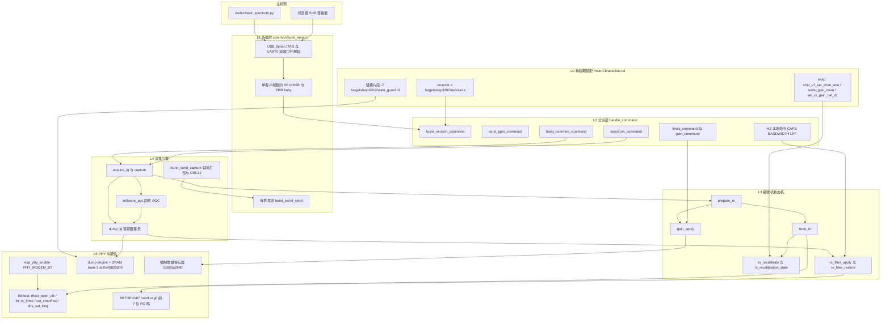
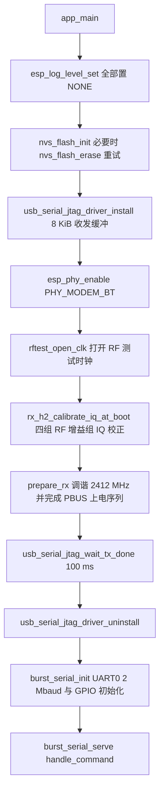
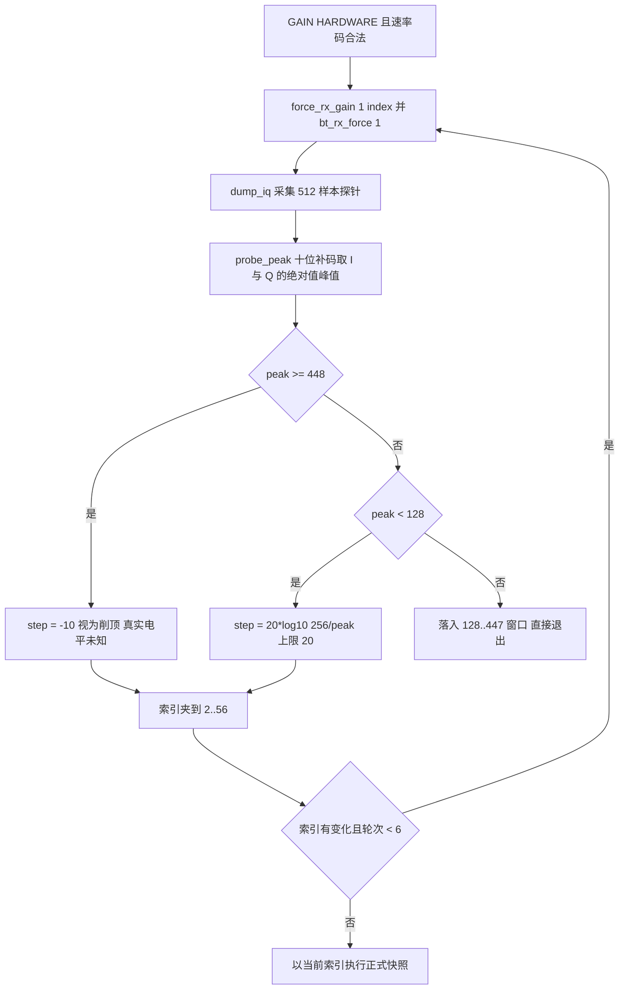

# H2 蓝牙射频后端适配

> 「H2 没有 Wi-Fi 外设。它引脚绑定的 `librftest.a` 把 `adctrig` 实现成空操作，因此该后端改为遵循蓝牙的 `bt_adctrig` 序列。」
>
> —— `docs/esp32h2.md`

---

## 1. 项目定位与核心价值

在 ESP-SDR 支持的十余个目标中，ESP32-H2 是唯一的**结构性异类**：它没有 Wi-Fi 外设。这不仅意味着 `esp_wifi_init()` / `esp_wifi_set_promiscuous(true)` 这条所有其他后端共享的"唤醒接收链"范式在 H2 上完全不可用，还意味着 `main/families/c5_c6_c61/receiver.c` 这类以 Wi-Fi NULL 模式 + 混杂模式上电为前置条件的实现无法被移植复用。H2 提供的是 2.4 GHz 的 Bluetooth LE / 802.15.4 射频，Wi-Fi USB 与 UART 只是外壳，射频内部完全是另一套 PBUS/BBTOP 控制面。因此 H2 后端的诞生，本质上是回答一个问题：当项目赖以通行的 Wi-Fi 侧 dump 入口（`adctrig`）在该芯片上被厂商库实现为**空函数**时，如何仍然让 CPU 读到解调器之前的原始 I/Q？

答案是逆向蓝牙侧的对应入口。`librftest.a` 中为产线蓝牙测试准备的 `bt_adctrig` 路径在 H2 上依然完整可用：它使用 **SRAM bank 2（`0x40820000`，64 KiB）** 作为落点，把**调试 lane 14/15/16/17** 四个内部信号（I、Q 及其余两路）复制进普通片上 SRAM，并通过 `0x600a4c04` 的专有控制寄存器启动定长转储。H2 后端把这条蓝牙测试时序从库函数里"拆出来自己走一遍"，从而绕过了 `adctrig` 的空实现。这不是简单的地址替换：蓝牙 PHY 的时钟树、PBUS 工作模式、增益寄存器、模拟滤波器 RC 码都与 Wi-Fi PHY 不同，每一项都需要单独标定。

其核心价值可以概括为四点。第一是**射频代际跨越**：H2 用蓝牙射频把 ESP-SDR 的能力延伸到一颗没有 Wi-Fi 的 RISC-V 芯片上，实测在 2300–2650 MHz 内可收到 58–68 dB SNR 的测试音，这是全家族中最窄但确实存在的接收窗口。第二是**速率档位重排**：H2 不复用 80/40/16 MS/s 的公共档位，而是把 dump 时钟选择器重映射为 **32 / 16 / 10.667 / 6.4 MS/s**（选择器 0/1/2/3 分别代表每 1/2/3/5 个 ADC 时钟采一点），其中 10.667 MS/s 是 32 MHz 晶振的 1/3，在整数协议字段里只能表示为 `10666667 Hz`。第三是**固件 AGC**：H2 的蓝牙 AGC 只在链路层收包时跟踪信号，捕获期间会停在一个带有巨大直流偏置的固定状态，外部测试音根本不出现在样本里——于是 `GAIN HARDWARE` 在该后端变成一个最多六轮、每轮 512 样本探针的**固件闭环 AGC**，这是全仓库唯一一处"硬件特性缺失由软件补齐"的设计。第四是**单寄存器模拟带宽**：逐寄存器扫频证明只有 BBTOP（`0x67`，host 1）寄存器 0 的低 7 位影响捕获路径带宽，寄存器 1–3 无可测影响，于是 `BANDWIDTH 4..11` MHz 被收敛成一条 7 位 RC 码的插值曲线，并在每次快照前后保存/还原。

> 设计理念：H2 后端把"芯片能做什么"与"厂商库愿意做什么"彻底解耦。凡是库函数实现了但语义不可用的（`adctrig`），就直接绕开；凡是库函数实现了且语义可用的（`rftest_open_clk`、`set_chanfreq`、`phy_set_freq`、`force_rx_gain`），就照常调用；凡是库函数缺位的（可用 AGC），就用几百行 C 在固件里补上。

Sources: [esp32h2.md](docs/esp32h2.md#L8-L27), [esp32h2.md](docs/esp32h2.md#L51-L64), [receiver.c](main/targets/esp32h2/receiver.c#L1-L2), [receiver.c](main/targets/esp32h2/receiver.c#L137-L192), [README.md](README.md#L43-L43)

---

## 2. 架构设计与模块划分

### 2.1 分层视图与依赖方向

H2 后端没有任何 H2 专属的 `.c` 文件之外的抽象层：`main/targets/esp32h2/receiver.c` 一个编译单元（约 260 行）承担了 `app_main`、命令分派、接收机状态机与采集引擎，再通过**包含顺序充当依赖注入**的方式复用 `main/common/` 下的公共片段（`burst_gain.h`、`burst_limits.h`、`burst_capture.h`、`burst_commands.h`）。这些片段在 include 之前要求存在 `IQ_BUFFER`、`send_bytes()`、`reply()`、`frequency_mhz`、`rx_ready`、`prepare_rx()`、`capture()` 等符号，H2 的 `receiver.c` 逐一定义。构建期则由 `main/CMakeLists.txt` 为 `IDF_TARGET=esp32h2` 装配三个关键的链接期开关：`sram_guard.ld` 片段、`--wrap=write_gain_mem`、以及 `rx_calibration_link.cmake` 推导出的 `--wrap=set_rx_gain_cal_dc`。



逐层说明：**L0** 决定 H2 用哪个 `receiver.c`、哪些 `--wrap` 与哪个链接片段；对 H2 而言三条 wrap 分别用于接管通道标定时的频率覆盖（`chip_v7_set_chan_ana`）、在每个增益字的写入路径上注入启动期测得的 IQ 校正（`write_gain_mem`）、以及统计 PHY 实际的 DC 测量次数（`set_rx_gain_cal_dc`）。**L1** 复用全仓库统一的传输层，`burst_serial.c` 全程直接操作 `usb_serial_jtag_ll_*` 与 `uart_*` 的底层 FIFO，并按端口维护独立行缓冲与五秒租约。**L2** 是链式拦截式分派：`handle_command` 依次把同一行交给版本、GPIO、频谱、能力、增益、公共命令，最后才落到 H2 专属的 `CAPS`/`BANDWIDTH`/`LPF` 分支。**L3** 是"按需重配"的接收机状态机，`rx_ready` 与 `calibrated_mhz` 两个静态位共同保证重复捕获不会重跑标定。**L4** 是采集引擎，其独特之处在于 AGC 探针与正式快照共用同一个 `dump_iq`。**L5** 才是真正与硬件语义耦合的部分，全部由 `extern` 声明 + 裸寄存器读写构成。

Sources: [CMakeLists.txt](main/CMakeLists.txt#L13-L20), [CMakeLists.txt](main/CMakeLists.txt#L68-L93), [CMakeLists.txt](main/CMakeLists.txt#L100-L116), [rx_calibration_link.cmake](main/common/rx_calibration_link.cmake#L1-L17), [burst_serial.c](main/common/burst_serial.c#L250-L280), [receiver.c](main/targets/esp32h2/receiver.c#L206-L241)

### 2.2 启动链：把射频所有权交给蓝牙 PHY

H2 的 `app_main` 是一串高度有序的副作用序列，每一步失败或不按序都会导致后续寄存器写入无效或者协议流出噪声：



其中三处细节值得单独说明。其一，`esp_log_level_set("*", ESP_LOG_NONE)` 在 PHY 初始化前后各调用一次：H2 的 PHY 初始化会产生大量日志，而此刻传输层尚未接管，任何日志都会污染后续的二进制协议流。其二，`usb_serial_jtag_driver_install` / `uninstall` 是一个**临时占用**对：从代码形态看，它的作用是让驱动吸收并排空启动期输出（`wait_tx_done` 等待 100 ms），随后立即卸载，因为 `burst_serial.c` 的收发路径完全绕开驱动、直接读写 USB Serial/JTAG 的 TX/RX FIFO，保留中断驱动会与之竞争同一片 FIFO。其三，`esp_phy_enable(PHY_MODEM_BT)` 明确选择蓝牙调制解调器，**不初始化 Wi-Fi**，这也解释了为什么 H2 需要在 `sdkconfig` 里打开 `CONFIG_ESP_PHY_ENABLE_CERT_TEST=y`——`librftest.a` 的测试符号才可用。

Sources: [receiver.c](main/targets/esp32h2/receiver.c#L243-L262), [sdkconfig.defaults.esp32h2](sdkconfig.defaults.esp32h2#L1-L21), [esp32h2.md](docs/esp32h2.md#L23-L27), [burst_serial.c](main/common/burst_serial.c#L76-L99)

### 2.3 调谐与重标定：`tune_rx` 的"信道标定 + 精确 PLL"双段式

H2 的频率设置走的是全家族通用的两段式策略：**先用一个标准 Wi-Fi 信道完成 PHY 的通道标定，再把 PLL 直接编程到精确的 MHz**。`tune_rx` 首先判断请求频率是否真的落在 Wi-Fi 栅格上（2412–2472 且步进 5 MHz，或 2484），若是则 `set_chanfreq(mhz, 0)`；若不是，先以 2412 MHz 做标定，再 `phy_set_freq(mhz, 0)` 覆盖到目标频率——因为信道 API 会把栅格外的频率四舍五入掉。源码注释明确声明这只是"尝试范围"，不保证 PLL 锁定与接收。

```c
static void tune_rx(unsigned mhz) {
    static unsigned calibrated_mhz;
    if (calibrated_mhz != mhz || rx_recalibration_stale()) {
        rx_recalibrate(mhz);
        calibrated_mhz = mhz;
    }
    bool channel = (mhz >= 2412 && mhz <= 2472 && (mhz - 2412) % 5 == 0) || mhz == 2484;
    set_chanfreq(channel ? mhz : 2412, 0);
    if (!channel) phy_set_freq(mhz, 0);
}
```

`rx_recalibrate()` 本身在 `main/common/rx_calibration_state.c` 里被两层包裹：外层取 PHY 互斥锁、调用目标的 `rx_recalibrate_locked`、记录 DC 代数；内层（H2 分支）才是真正的芯片操作。H2 的 `rx_recalibrate_locked` 依次做四件事：把请求频率写入 `measurement_mhz` 供 `__wrap_chip_v7_set_chan_ana` 覆盖库内部的参考信道、调用 `force_rx_gain(0, 0)` 释放手动增益（否则增益扫描会被人为固定）、`phy_set_freq(mhz, 0)` 精确调谐、清除 `phy_param + 52` 的 `0x100` 位使 DC 表失效但**保留 IQ 校正**，最后 `set_rx_gain_table()` 重建增益/DC 表。这条"保留 IQ、只过期 DC"的策略是全仓库统一的接收标定哲学：IQ 失配校正需要发射环回音，绝不能在用户重调谐时重复触发；DC 偏置必须按新本振重测。

```c
void rx_recalibrate_locked(unsigned mhz) {
    measurement_mhz = mhz;
    force_rx_gain(0, 0);
    phy_set_freq(mhz, 0);
    /* Keep startup IQ; expire only receive DC. */
    *(uint32_t *)(phy_param + 52) &= ~0x100u;
    set_rx_gain_table();
    measurement_mhz = 0;
}
```

值得注意的是"过期检测"机制：`rx_calibration_state.c` 在 H2 上包装 `set_rx_gain_cal_dc`，每次 PHY 自己做 DC 测量就原子自增一个代数计数器，`rx_recalibration_stale()` 比较代数而不是比较温度戳——注释点明"PHY 可以在温度戳不变的情况下替换 DC 表"。这就是为什么 `prepare_rx` 的提前返回条件是 `rx_ready && !rx_recalibration_stale()`：即使频率没变，PHY 后台重新标定也会让下一次捕获自动重测。

Sources: [receiver.c](main/targets/esp32h2/receiver.c#L39-L58), [rx_recalibration.c](main/common/rx_recalibration.c#L81-L126), [rx_calibration_state.c](main/common/rx_calibration_state.c#L30-L65), [rx_calibration_state.c](main/common/rx_calibration_state.c#L94-L99), [rx-controls.md](docs/rx-controls.md#L64-L92)

### 2.4 快照窗口：`dump_iq` 的寄存器事务

`dump_iq` 是整个 H2 后端的心脏，也是最需要逐位理解的一段代码。它的语义是"在最小时间窗内，把一块 SRAM 的所有权、四条调试 lane、转储模式与触发源全部改造，发起一次定长转储，然后把所有寄存器原样还回去"。下表把它触及的每一个硬件对象列清：

| 对象 | 地址 / 位域 | H2 上的写入值 | 作用 |
| --- | --- | --- | --- |
| 转储落点 | `0x40820000`，64 KiB SRAM bank 2 | `IQ_WORDS = 16380` 字 | 样本缓冲区（与堆、栈、静态数据隔离） |
| SRAM 归属 | `0x60095004`，位 `14:10` | `4` | 把 bank 2 交给 dump engine |
| 转储控制 | `0x600a4c04`，位 31 / `16:15` / `14:0` / 19 / 18 | 使能、时钟选择器、样本数、触发脉冲、完成位 | 一次写入完成启动，轮询完成 |
| 转储模式 | `0x600a4c08`，位 `18:15` | 置位（`15u << 15`） | 选择蓝牙 adctrig 的转储模式 |
| 四路 lane | `0x600a4c14` | `14 \| 15<<6 \| 16<<12 \| 17<<18` | I/Q 及另外两路内部信号 |
| 触发源 | `0x600a20b4`，位 0 | 清零 | 关闭外部触发，转由软件脉冲启动 |
| 强制增益 | `0x600a2840` | 由 `force_rx_gain` 间接触发 | `GAIN?` 读取其 bit 23 报告饱和标志 |
| 模拟滤波 | `0x67:1:0`，位 `6:0` | 7 位 RC 码（可覆盖） | 捕获路径带宽 |

```c
taskENTER_CRITICAL(&capture_mux);
uint32_t owner = REG_READ(SRAM_OWNER_REG);
uint32_t trigger = REG_READ(0x600a20b4);
uint32_t dump_mode = REG_READ(0x600a4c08);
uint32_t lanes = REG_READ(0x600a4c14);
REG_WRITE(0x600a20b4, trigger & ~1u);
REG_WRITE(0x600a4c08, dump_mode | (15u << 15));
int64_t start = esp_timer_get_time();
REG_WRITE(0x600a4c04, 0);
REG_WRITE(0x600a4c14, 14u | (15u << 6) | (16u << 12) | (17u << 18));
REG_WRITE(SRAM_OWNER_REG, (owner & ~(31u << 10)) | (1u << 12));
__asm__ volatile("fence rw,rw" ::: "memory");
/* H2 dump-clock selectors 0/1/2/3 sample every 1/2/3/5 ADC clocks. */
unsigned clock = divider == 7 ? 0u : divider == 6 ? 1u : divider == 8 ? 2u : 3u;
uint32_t ctrl = 0x80000000u | (clock << 15) | n;
REG_WRITE(0x600a4c04, ctrl);
REG_WRITE(0x600a4c04, ctrl | (1u << 19));
REG_WRITE(0x600a4c04, ctrl);
```

这段代码里有四个非显然的工程决定。**第一，临界区包裹的是"所有权移交 + 有界快照"而非整个函数**：哨兵填充与滤波器覆盖在临界区之外（前者只是普通内存写，后者是 I2C 慢速写），只有移交与最长几百微秒的转储被保护，从而把中断关闭时间压到最小。**第二，使用 `portMUX_TYPE` 自旋锁形式的 `taskENTER_CRITICAL`**，在单核 H2 上同时屏蔽任务切换与中断。**第三，`fence rw,rw` 内存屏障**：C 编译器与 CPU 都可能把 SRAM owner 的写重排到 lane/mode 写之前，一旦重排，dump engine 会在 lane 尚未就绪时就开始往 bank 里写。**第四，所有被修改的寄存器都在进入时读入局部变量、退出时按逆序写回**，包括超时路径——注释明确写了 "restore before returning, including timeouts"，因为一旦 bank 归属没有还给 CPU，后续所有对捕获区的读取都会返回垃圾。

完成判定是**轮询 + 20 ms 上限**：`while (!(REG_READ(0x600a4c04) & (1u << 18)) && esp_timer_get_time() - start < 20000) {}`。随后还有一次**逐字哨兵校验**：采集前整块填 `0xa5a0055a`，采集后任何仍持有该值的字都意味着引擎没有写完，返回 `ERR capture_incomplete` 而不是把脏数据当样本发出去。与 C5/C6/C61 家族不同，H2 没有在缓冲区尾部额外写 overrun canary，符合"16380 = 16384 − 4"这一保守上限。

Sources: [receiver.c](main/targets/esp32h2/receiver.c#L93-L135), [receiver.c](main/targets/esp32h2/receiver.c#L25-L29), [esp32h2.md](docs/esp32h2.md#L8-L27), [how-it-works.md](docs/how-it-works.md#L159-L176)

### 2.5 增益通路：两参数 `force_rx_gain` 与固件 AGC

H2 的增益 API 与其他芯片不同——`force_rx_gain` 只有**两个**参数（`manual, index`），而 Wi-Fi 芯片普遍是三个。`burst_gain.h` 用预处理分支吸收了这个差异；`gain_max()` 在 H2 上不读 `AGCPWR_CTRL7`，而是读固定 PHY 库导出的 `phy_param[83]`（实测板为 66），再被夹到 56：

```c
#if CONFIG_IDF_TARGET_ESP32H2
    /* Above 56 the receiver saturates on its own DC offset, and the top index
     * (66 on the tested board) collapses to almost no signal. */
    return maximum < 80u ? (maximum > 56u ? 56u : maximum) : 0u;
#endif
```

`GAIN_MIN` 也被单独抬到 2（`burst_gain_min.h`），语义是"索引 0/1 与最大增益一样饱和"；代码层面 `GAIN MANUAL 0` 会被范围检查拒绝为非法命令。`gain_apply()` 的 H2 分支保留了蓝牙专属的调用序列——先 `force_rx_gain(manual, index)`，再 `bt_rx_force(1)` 把蓝牙接收机保持在运行态，注释写明"即使释放强制增益也不要停掉蓝牙接收机"。

真正的设计创新在 `software_agc`。H2 的硬件 AGC 只在链路层收包时跟踪信号，捕获期间停在一个带大直流偏置的固定状态，因此"硬件增益模式"被实现为一个**六轮、每轮 512 样本的闭环**：



这段逻辑的三点巧思：其一，判据是**峰值落在 ADC 量程的哪个区间**而非常规的"均值贴近目标"，因为 AGC 的目的只是"别削顶、别淹没在量化噪声里"，峰值在 128–448（满量程 511）之间就已经足够。其二，`step` 用 `20*log10(target/peak)` 计算，即把索引当作约 1 dB/步的近似对数刻度（实测板 2..56 单调、约 1 dB/步），因此一步就能大致到位而无需逐格搜索。其三，`step` 被夹到 ±20、索引被夹到 2..56、且"索引没变就立刻退出"，三者共同保证最坏情况下也只多打六次探针。

实测结果给出了这套固件 AGC 的效力：2300–2650 MHz 内测试音 58–68 dB SNR，且在 60 dB 的输入电平变化范围内峰值稳定在 236–313（满分 511）。文档同时诚实声明：增益索引不是 dB，66 这个校准上限处信号会"塌掉"，因此手动增益也只能到 56。

Sources: [burst_gain.h](main/common/burst_gain.h#L5-L10), [burst_gain.h](main/common/burst_gain.h#L25-L44), [burst_gain.h](main/common/burst_gain.h#L61-L89), [burst_gain.h](main/common/burst_gain.h#L94-L126), [burst_gain_min.h](main/common/burst_gain_min.h#L1-L7), [receiver.c](main/targets/esp32h2/receiver.c#L137-L192), [esp32h2.md](docs/esp32h2.md#L51-L64)

### 2.6 模拟带宽：BBTOP 0 的单寄存器事实

H2 的模拟滤波器适配是全家族中最"窄"的一个：7 位 RC 码、单一寄存器、4–11 MHz 映射。起点是一次逐寄存器扫频——`rc_cal` 计算出四个 7 位 RC 标定值并由 `i2c_bbtop_init` 写入 BBTOP（`0x67`，host 1）寄存器 0–3，但只有**寄存器 0 的 `6:0`** 对捕获路径带宽有可测影响，寄存器 1–3 无影响因而保持不动。于是覆盖逻辑就是"保存寄存器 0、只改低 7 位、退出时还原"：

```c
static void rx_filter_apply(void) {
    rx_filter_saved = chip_i2c_readReg(0x67, 1, 0);
    if (rx_filter >= 0) chip_i2c_writeReg(0x67, 1, 0, (rx_filter_saved & ~127u) | (unsigned)rx_filter);
}
static void rx_filter_restore(void) {
    if (rx_filter >= 0) chip_i2c_writeReg(0x67, 1, 0, rx_filter_saved);
}
```

这里有一个容易忽略但决定正确性的细节：覆盖发生在**每次快照**，还原也发生在**每次快照**（含超时路径）。因此 H2 的 `BANDWIDTH` / `LPF` 命令不需要像 C5 家族那样把 `rx_ready` 置假并重跑 `prepare_rx`——滤波设置不进入 PHY 标定状态，重调谐看到的永远是标定值。命令面也因此与 C5 家族不同：H2 广告的是 `LPFANA`（`LPF <0..127>` 直写原始 RC 码、`LPF AUTO` 恢复自动、`LPF?` 同时报告选择值与当前寄存器值），而 C5/C6/C61 的 `LPF` 走的其实是 PHY 的另一套滤波器模式接口，模拟电容控制叫 `ALPF`。

MHz 到 RC 码的映射是一条 8 锚点插值曲线，锚点为 `{0,11} {8,10} {16,9} {24,8} {32,7} {48,6} {80,5} {112,4}`，即 RC 0 约 11 MHz、RC 112 约 4 MHz；`BANDWIDTH 0` 映射到 RC 0（最宽），而不是旁路。`LIMITS?` 对此报告 `bandwidth: [4,11,1,0]`。文档明确声明这是"近似噪声推导的全 −3 dB 宽度曲线"，不是精确滤波器标定，也不保证跨板/跨温/跨频一致。

Sources: [receiver.c](main/targets/esp32h2/receiver.c#L78-L91), [receiver.c](main/targets/esp32h2/receiver.c#L225-L238), [rx_bandwidth.h](main/common/rx_bandwidth.h#L8-L24), [rx_bandwidth.h](main/common/rx_bandwidth.h#L55-L61), [burst_limits.h](main/common/burst_limits.h#L8-L11), [esp32h2.md](docs/esp32h2.md#L66-L99)

### 2.7 命令面：`CAPS` / `LIMITS?` / `SPEC` 的 H2 形态

H2 的 `handle_command` 是链式拦截，顺序即优先级：版本 → GPIO → 频谱 → 能力 → 增益 → 公共命令 → 本轮未识别的 H2 本地命令（`CAPS`、`BANDWIDTH`、`LPF*`），最后统一 `ERR command`。它广告的能力集是全家族中最"局部化"的：

| 能力 token | H2 语义 |
| --- | --- |
| `TUNEEXT` | 接受 100–6000 MHz 的整数 MHz 调谐尝试（`RANGE 100 6000 1`） |
| `LPFANA` | 支持模拟 RC 码直控（`LPF` / `LPF AUTO` / `LPF?`） |
| `GAIN` / `HWAGC` | 支持手动增益与 `GAIN HARDWARE`（后者即固件 AGC） |
| `IQ8` | 支持 `CAP16` 有符号 8 位格式 |
| `SPEC SPECN SPECCAPS SPECSTAT` | 支持片上快照频谱与 `SPECINFO?` 能力协商 |
| `DCT` | 支持 `DC 0/1` 片上直流校正选择 |
| `SERIALLEASE` / `DUALSERIAL` / `UARTBAUD` | 支持租约、双端口与波特率切换 |
| `VERSION` / `GPIO` / `RXLIMITS` | 版本、GPIO 输出、`LIMITS?` 数值域 |

`LIMITS?` 与 `CAPS` 的数值域在 `burst_limits.h` 中以预处理分支给出：H2 的带宽域是 `[4,11,1,0]`，速率数组是 `32000000,16000000,10666667,6400000`，位深 `[8,10]`。这三项正是主机侧视图的全部依据——主机不需要知道目标芯片是什么，只需读 `LIMITS?`。

片上频谱侧，H2 走的是**纯快照路径**：它没有 `ring_capture.c`（该文件只被 C6/C61 与 S3 编译），因此 `spectrum_acquire` 只是把 `acquire_iq` 的结果指针换成 `IQ_BUFFER`：

```c
static bool spectrum_acquire(unsigned n, unsigned rate, const uint32_t **data, unsigned *elapsed) {
    bool ok = acquire_iq(n, rate, elapsed);
    *data = IQ_BUFFER;
    return ok;
}
```

`spectrum_command` 直接把 `SPEC` 的速率码当作 divider 传给采集回调，因此 H2 的合法速率码就是 6/7/8/9；`rates[]` 表在 H2 上把 0–5 号槽位置零，`rate_hz()` 返回 0 使这些码在参数校验阶段即被拒绝。`pack_spectrum` 把 `frame[22]` 写成 `8 | det`，第 3 位（值 8）即"快照间隙"标志，配合 `SPECINFO` 的 `"continuous":false`，主机会显式标注"快照之间有间隙"。增益元数据取自首个 I/Q 字的位 20–27（`words[0] >> 20`）——注意 `docs/how-it-works.md` 指出 H2 在该字段存的是**另一种编码**（索引 18 对应 114），所以该字节在 H2 上只能作为相对参考。

Sources: [receiver.c](main/targets/esp32h2/receiver.c#L194-L241), [burst_limits.h](main/common/burst_limits.h#L5-L42), [spectrum.c](main/common/spectrum.c#L51-L66), [spectrum.c](main/common/spectrum.c#L132-L158), [spectrum.c](main/common/spectrum.c#L160-L201), [spectrum.md](docs/spectrum.md#L28-L34), [how-it-works.md](docs/how-it-works.md#L104-L118)

---

## 3. 技术栈与核心工作流

### 3.1 核心符号与职责

H2 后端没有任何类或虚函数：它是一组 `static` 函数 + 一批 `extern` PHY 符号。理解这些符号的归属，就理解了全部分层。

| 符号 | 归属 | 在流程中的作用 |
| --- | --- | --- |
| `esp_phy_enable(PHY_MODEM_BT)` | ESP-IDF `esp_phy_init.h` | 打开蓝牙 PHY，是全流程的唯一合法起点 |
| `rftest_open_clk()` | `librftest.a` | 打开射频测试时钟，使 `set_chanfreq`/`phy_set_freq` 生效 |
| `set_chanfreq(unsigned, unsigned)` | `librftest.a` | 按标准 Wi-Fi 信道做通道标定 |
| `phy_set_freq(unsigned, int)` | `librftest.a` | 直接编程 PLL 到精确 MHz（含小数偏移参数） |
| `stop_tx_tone / pbus_workmode / pbus_xpd_tx_off / pbus_xpd_rx_on / set_rxclk_en` | `librftest.a` | PBUS 上电序列：停发射、进工作模式、断 TX、开 RX、开接收时钟 |
| `force_rx_gain(unsigned, unsigned)` | `librftest.a` | H2 特有的两参数增益强制（manual, index） |
| `bt_rx_force(unsigned)` | `librftest.a` | 保持蓝牙接收机运行，避免释放强制增益后停摆 |
| `set_rx_gain_table()` / `set_rx_gain_cal_iq()` | `librftest.a` | 重建增益与 DC 表；测启动期 IQ 校正 |
| `chip_i2c_readReg / chip_i2c_writeReg` | `librftest.a` | BBTOP 模拟寄存器读写（`0x67`，host 1） |
| `rx_recalibrate / rx_recalibration_stale` | `common/rx_recalibration.c`、`rx_calibration_state.c` | 频率相关 DC 重测与失效检测 |
| `rx_h2_calibrate_iq_at_boot` | `rx_recalibration.c` | H2 专属：启动期四组 RF 增益组 IQ 校正 |

其中 `rx_h2_calibrate_iq_at_boot` 是 H2 独有的高价值细节。它的注释说明：H2 的 RF 增益组 C7/D7/E7/F7 各自需要一对相位/幅度校正值，而原厂 efuse 助手只提供"两个字节"（`phy_param + 60`），因此固件在启动时调用一次环回测量 `set_rx_gain_cal_iq(startup_iq, 0)` 得到四个 `uint16_t`，随后通过 `--wrap=write_gain_mem` 在**每一次增益字写入**时按 `(b >> 20) & 3` 选出对应组，并把该 16 位值拆成 `0x1f80` / `0x7f` 两个位域嵌入原字：

```c
void __wrap_write_gain_mem(uint32_t a, uint32_t b, unsigned index) {
    if (startup_iq_valid) {
        unsigned group = (b >> 20) & 3u;
        uint16_t iq = startup_iq[group];
        b = (b & ~0x1fffu) | ((iq >> 1) & 0x1f80u) | (iq & 0x7fu);
    }
    __real_write_gain_mem(a, b, index);
}
```

这个包装是"启动期一次性标定、用户重调谐永不重复"这一策略得以成立的关键：IQ 环回测量会从天线发射音，必须在开机时做且只做一次。

Sources: [receiver.c](main/targets/esp32h2/receiver.c#L30-L38), [receiver.c](main/targets/esp32h2/receiver.c#L66-L76), [rx_recalibration.c](main/common/rx_recalibration.c#L88-L117), [receiver.c](main/targets/esp32h2/receiver.c#L243-L256), [CMakeLists.txt](main/CMakeLists.txt#L114-L116)

### 3.2 主链路：从 `FREQ` 到 `DATA`

一次完整的采集请求在 H2 上的执行主链路如下（以主机 `CAP20 4096 7` 为例，速率码 7 = 32 MS/s）：

| 阶段 | 入口 | 关键动作 |
| --- | --- | --- |
| ① 传输与租约 | `burst_serial_serve` | 端口行解析、租约归属检查、五秒静默释放 |
| ② 分派 | `handle_command` | 版本/GPIO/频谱/能力/增益逐级拦截后落到 `burst_common_command` |
| ③ 参数校验 | `burst_common_command` | `256 ≤ n ≤ IQ_WORDS`、`rate ≤ BURST_MAX_RATE(9)` |
| ④ 接收机就绪 | `prepare_rx` | 若 `rx_ready && !stale` 直接返回；否则 `tune_rx` + PBUS 上电 + `gain_apply` |
| ⑤ 固件 AGC | `software_agc`（仅 `GAIN HARDWARE`） | 最多 6 轮 × 512 样本探针，收敛到 128–447 峰值窗口 |
| ⑥ 定长转储 | `dump_iq` | 哨兵填充 → 滤波覆盖 → 临界区寄存器事务 → 轮询完成 → 还原 |
| ⑦ 完整性 | `dump_iq` | `ERR capture_timeout` / `ERR capture_incomplete` 或返回耗时 |
| ⑧ 打包发送 | `burst_send_capture` | 就地打包 IQ8/IQ10、CRC32、`DATA <n> <crc> <us>` 头 |
| ⑨ 传输 | `burst_serial_send` | 按端口选择 UART FIFO 或 USB Serial/JTAG FIFO，带截止时间 |

速率码到实际采样率的映射只在 `dump_iq` 一处发生，这是 H2 与"位域分频"型芯片（C3/S3 用控制位 15/16 直接表示 40/16 MS/s）最显著的区别：

| 速率码 | 标称速率 | dump 选择器 | 每样本 ADC 时钟 | 16380 样本耗时 | 频谱 `rates[]` 槽位 |
| --- | --- | --- | --- | --- | --- |
| 7 | 32 MS/s | 0 | 1 | ~517 µs | 7 |
| 6 | 16 MS/s | 1 | 2 | ~1028 µs | 6 |
| 8 | 10.667 MS/s | 2 | 3 | ~1540 µs | 8（`10666667` Hz） |
| 9 | 6.4 MS/s | 3 | 5 | ~2563 µs | 9 |
| 0–5 | 不支持 | — | — | — | 槽位为 0（校验阶段拒绝） |

必须清醒认识这些档位的性质：**选择器只是"跳样本"，不做抗混叠**。文档给出具体证据——测量频谱中 −4 MHz 附近的窄带特征在 6.4 MS/s 下折叠到约 +2.4 MHz。因此正确用法是"先按目标跨度设定模拟带宽，再选速率"，而模拟滤波的有限滚降并不保证无混叠接收。

Sources: [receiver.c](main/targets/esp32h2/receiver.c#L96-L135), [receiver.c](main/targets/esp32h2/receiver.c#L182-L204), [burst_capture.h](main/common/burst_capture.h#L41-L56), [burst_commands.h](main/common/burst_commands.h#L56-L59), [esp32h2.md](docs/esp32h2.md#L29-L49)

### 3.3 时序与资源配额

H2 的资源约束比 Wi-Fi 芯片更紧：96 MHz 主频、`CONFIG_ESP_PHY_IRAM_OPT` 关闭（把 IRAM 留给静态数据与任务栈）、并且必须为 64 KiB 捕获 bank 让路。三个关键配额互相咬合：

- **捕获上限 16380 字**：`IQ_WORDS`，即 64 KiB bank 的 16384 字减 4 字余量。
- **超时 20 ms**：`dump_iq` 的完成位轮询上限，远大于最慢档位（6.4 MS/s 下约 2.6 ms）的实际耗时，只在引擎挂死时触发。
- **AGC 探针预算 6 × 512 样本**：即使六轮全部走满，额外耗时也只有数十微秒级，相对正式快照可忽略。

此外，`sdkconfig.defaults.esp32h2` 中 `CONFIG_ESP_PHY_DISABLE_PLL_TRACK=y` 关闭了周期性 PLL 跟踪——因为跟踪任务会在捕获期间改动本振相关寄存器；`docs/rx-controls.md` 明确记录"H2 与两个 S31 配置当前禁用周期性 PLL 跟踪；显式 PHY DC 测量仍会使标定失效"。这与 `rx_recalibration_stale()` 的代数机制配合，构成"不做后台跟踪、但一旦后台标定发生就必须重测"的闭环。

Sources: [receiver.c](main/targets/esp32h2/receiver.c#L25-L28), [receiver.c](main/targets/esp32h2/receiver.c#L96-L135), [sdkconfig.defaults.esp32h2](sdkconfig.defaults.esp32h2#L11-L21), [rx-controls.md](docs/rx-controls.md#L83-L92), [sram_guard.ld](main/targets/esp32h2/sram_guard.ld#L1-L3)

---

## 4. 典型代码示例：一次 H2 快照的完整调用栈

下面这段"伪调用序列"把散落在四个文件里的关键片段按执行顺序串起来，可用于快速建立调试心智模型：从主机下发一行命令，到 `DATA` 头部离开芯片，中间只经过了这些符号。

```c
/* L1 传输层：行解析 + 租约（common/burst_serial.c） */
burst_serial_serve(handle_command);          /* RELEASE / 5 s 静默 / ERR busy */

/* L2 分派：链式拦截（targets/esp32h2/receiver.c） */
handle_command(line)
  burst_version_command / burst_gpio_command / spectrum_command
  limits_command / gain_command / burst_common_command
  /* 落到 CAP/CAP20： */
  capture(n, rate, format)
    acquire_iq(n, rate, &elapsed)
      if (rate < 6 || rate > 9) reply("ERR rate");          /* H2 速率域 */

      prepare_rx();                                          /* L3 状态机 */
        tune_rx(frequency_mhz);                              /* 必要时 rx_recalibrate */
        stop_tx_tone(1); pbus_workmode(); pbus_xpd_tx_off(); /* PBUS 上电序列 */
        pbus_xpd_rx_on(1); set_rxclk_en(1); gain_apply();     /* 增益（含 bt_rx_force） */

      if (gain_mode == GAIN_HARDWARE) software_agc(rate);     /* L4 固件 AGC，最多 6 轮 */

      dump_iq(n, rate, &elapsed);                            /* L4 定长转储 */
        /* 哨兵 → rx_filter_apply → 临界区寄存器事务 → 轮询 bit18/20 ms → 还原 */
        /* 失败返回 "ERR capture_timeout" / "ERR capture_incomplete" */

    burst_send_capture(n, format, elapsed);                   /* L4 打包 */
      pack_iq8 / pack_iq → esp_rom_crc32_le → "DATA <n> <crc> <us>\n"
      send_bytes(...)                                         /* L1 有界发送 */
```

编译器在背后做了三件"看不见但必须知道"的事：`--wrap=chip_v7_set_chan_ana` 让 PHY 库内部的参考信道标定落到 `measurement_mhz` 指定的频率上；`--wrap=set_rx_gain_cal_dc` 让每次 PHY DC 测量自增代数计数器，从而驱动 `rx_recalibration_stale()`；`--wrap=write_gain_mem` 让每个增益字在写入前被注入启动期测得的 RF 增益组 IQ 校正。

Sources: [receiver.c](main/targets/esp32h2/receiver.c#L182-L208), [burst_commands.h](main/common/burst_commands.h#L14-L63), [burst_capture.h](main/common/burst_capture.h#L14-L56), [rx_recalibration.c](main/common/rx_recalibration.c#L81-L126), [CMakeLists.txt](main/CMakeLists.txt#L100-L116)

---

## 5. 学习与探索建议

H2 后端是全仓库"硬件细节密度最高、抽象最少"的一份实现，阅读顺序应当遵循"先协议、再状态机、最后寄存器"的依赖倒序。

| 迭代路径 | 建议动作 | 目标产物 |
| --- | --- | --- |
| A · 先建立边界感 | 读 `docs/esp32h2.md` 全文，特别是三张表（寄存器映射、速率选择器、滤波锚点），再读 `sdkconfig.defaults.esp32h2` 理解每个 Kconfig 对应的硬件约束 | 能解释"为什么 H2 必须先 `esp_phy_enable(PHY_MODEM_BT)` 而不是 `esp_wifi_init`" |
| A · 对照反例 | 与 `main/families/c5_c6_c61/receiver.c` 做逐函数对照：`prepare_rx`、`acquire_iq`、`handle_command` 三处的差异即为"蓝牙射频 vs Wi-Fi 射频"的全部分水岭 | 列出一张"H2 与 Wi-Fi 家族差异清单" |
| B · 直击寄存器事务 | 精读 `dump_iq` 第 96–135 行，与 `docs/how-it-works.md` 的 `DUMP_CTRL` 位表逐位对应，重点理解 `fence rw,rw` 与 SRAM owner 的先后关系 | 能手工推演出"若把 owner 写提前会发生什么" |
| B · 标定与 wrap | 读 `rx_recalibration.c` 的 H2 分支 + `rx_calibration_state.c` 的 `set_rx_gain_cal_dc` 包装 + `rx_calibration_link.cmake`，串起 `--wrap` 如何把 PHY 私有调用变成固件可见事件 | 理解"IQ 只测一次、DC 每次重测"的实现边界 |
| C · 扩展实验 | 以 `BANDWIDTH` 曲线为模板，用 `tools/check_spectrum.py` 与新采集脚本重测 RC 码到带宽的映射；或尝试用 `LPF` 直写 RC 码验证 1–3 号寄存器无影响的结论 | 得到自己板子的带宽锚点表，或推翻一条既有结论 |

若关心"下一步能改什么"，优先级最高的是**速率语义**：dump 选择器 0/1/2/3 对应 1/2/3/5 个 ADC 时钟，其中"每 5 个时钟"只出现在 6.4 MS/s，而 20 MS/s（32/1.6）之类的中间档没有选择器可用——这与 C6 "位域能表示 1/2/3/5 但 3 对应 26.7 MS/s 而在协议中无码"的困境同源。其次是**固件 AGC 的收敛质量**：当前实现以固定步长与固定窗口收敛，没有历史状态，也不区分"饱和"与"近饱和"，在快速变化的输入下会重复探针。

Sources: [esp32h2.md](docs/esp32h2.md#L1-L118), [receiver.c](main/targets/esp32h2/receiver.c#L93-L135), [rx_recalibration.c](main/common/rx_recalibration.c#L81-L126), [rx_calibration_link.cmake](main/common/rx_calibration_link.cmake#L1-L17), [rx-controls.md](docs/rx-controls.md#L93-L114)

---

## 🔗 关联模块与上下游

| 直接调用方 | 关系 | 读它的理由 |
| --- | --- | --- |
| [main/common/burst_gain.h](main/common/burst_gain.h) | 被 `receiver.c` 在定义 `reply()` 后包含，提供 `gain_apply` / `gain_command` / `gain_max` 的 H2 分支 | H2 的两参数 `force_rx_gain`、`phy_param[83]` 上限、56 的夹紧与 `bt_rx_force` 全在此文件 |
| [main/common/rx_recalibration.c](main/common/rx_recalibration.c#L81-L126) | 被 `prepare_rx → tune_rx` 直接调用，并提供启动期 `rx_h2_calibrate_iq_at_boot` | H2 的 DC/IQ 分离策略、`measurement_mhz` 频率覆盖与 `write_gain_mem` 注入实现 |
| [main/targets/esp32h2/sram_guard.ld](main/targets/esp32h2/sram_guard.ld) | 由 `main/CMakeLists.txt` 以 `-T` 注入的链接期断言，保护 `0x40820000` 以下的 IRAM/data/BSS | 解释"为什么捕获 bank 必须被整块排除在堆与静态数据之外" |
