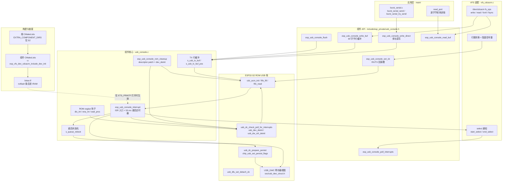
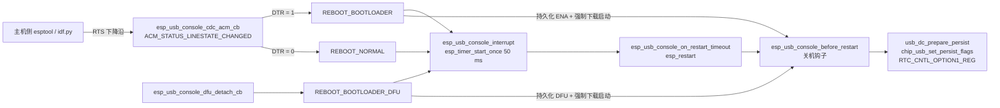

# S2 USB CDC ROM 补丁

`platform/esp32s2/esp_usb_cdc_rom_console/` 是整个 ESP-SDR 代码库中唯一一个"非自研"的目录：它是 ESP-IDF `esp_usb_cdc_rom_console` 组件的一份**带旁路补丁的整目录拷贝**，仅当 `IDF_TARGET == esp32s2` 时通过 `EXTRA_COMPONENT_DIRS` 挂进构建。它的存在不是为了让 S2 能打印日志，而是为了在 S2 上**同时满足两个互相拉扯的约束**：一条能承载高吞吐 I/Q 数据的 USB 通路，以及一套不会在 `idf.py flash` 过程中把主机、固件、USB 描述符三者关系搞乱的 ROM 级设备栈控制。这一页解释这个"影子组件"为什么必须存在、它如何与 ROM 里的二进制 USB 驱动对接、以及修改它时需要小心什么。

## 项目定位与核心价值

ESP32-S2 是 ESP32 家族中第一颗带原生 USB-OTG 的芯片，而它的 USB Device 协议栈**不在 flash 里，在 ROM 里**。这意味着应用无法直接改进 USB 驱动的内部实现，只能通过 ROM 导出的 `usb_dc_*` / `cdc_acm_*` / `usb_dfu_*` 符号驱动它，并把自己的 RTOS 语义（临界区、延时、回调）通过 `rom_usb_osglue` 这组函数指针**注入**进 ROM 代码。ESP-IDF 因此维护了一个 `esp_usb_cdc_rom_console` 组件作为胶水层：分配中断、注册 osglue 钩子、暴露 `esp_usb_console_write_buf()` 之类的收发包接口，并在 VFS 层把它包装成 `/dev/cdcacm`。ESP-SDR 的传输层本来可以直接用这个组件，但它在 S2 上撞到两堵墙。

第一堵墙是**吞吐**。上游组件的写接口 `esp_usb_console_write_buf()` 是一个 64 字节的行缓冲：字节先进 `s_usb_tx_buf`，直到缓冲填满或遇到 `\n` 才通过 `cdc_acm_fifo_fill()` 推给 ROM。这对 `printf` 日志是合理设计，对 SDR 数据通路则是灾难——每次调用封装一个 64 字节包，主机侧只能看到一串孤立的小批量传输，S2 上一帧上万样本的快照要跨越成百上千次这样的往返。第二堵墙是**描述符生命周期**。ROM 里的 CDC 描述符原本指向 ROM 自带的表，而上游更早的 IDF 版本让这些指针继续指向已经被应用回收的 bootloader RAM，于是从二级引导器切进 app 后，枚举行为可能变得不可预期（对应上游 issue #18841）。ESP-SDR 的做法是把组件**整目录复制进来**，然后在两处做外科手术式的偏离：新增 `esp_usb_console_write_direct()` 允许一次调用把最多任意长度的数据直接塞进 ROM CDC FIFO 排队（一次排多个 USB 包），以及在 ROM 清理阶段调用 `rom_usb_cdc_set_descriptor_patch()` 把描述符重定位到应用内存。

> 设计理念：面对"驱动在 ROM 里"这种无法改源码的黑盒，ESP-SDR 选择的不是重写驱动，也不是在应用层堆缓冲，而是**复制上游胶水层、只改接口边界上的两行语义**，并把偏离点写进 README 以便随 SDK pin 更新时重新评估。这是典型的"最小侵入式分叉"（minimal-fork）策略。

Sources: [README.md](platform/esp32s2/esp_usb_cdc_rom_console/README.md#L1-L12), [usb_console.c](platform/esp32s2/esp_usb_cdc_rom_console/usb_console.c#L399-L414), [usb_console.c](platform/esp32s2/esp_usb_cdc_rom_console/usb_console.c#L274-L282), [usb_console.c](platform/esp32s2/esp_usb_cdc_rom_console/usb_console.c#L416-L443), [burst_serial.c](main/common/burst_serial.c#L181-L204)

值得注意的是，这次分叉并没有"改干净"所有上游痕迹：组件的公共头 `include/esp_private/usb_console.h` 里的文档仍然声明"这些函数不是公共接口，不应被应用直接调用"，而 ESP-SDR 的自由函数 `burst_serial.c` 恰恰在 `CONFIG_IDF_TARGET_ESP32S2` 分支下直接 include 它并调用其内部接口。这类"事实上已经公共化"的私有 API 是接手本项目时必须先接受的前提，也解释了它为什么被放在 `platform/` 而不是 `main/` —— 它在语义上属于**芯片适配层**，而不是协议层。

Sources: [usb_console.h](platform/esp32s2/esp_usb_cdc_rom_console/include/esp_private/usb_console.h#L19-L61), [burst_serial.c](main/common/burst_serial.c#L18-L20), [burst_serial.c](main/common/burst_serial.c#L196-L198)

## 架构设计与模块划分

这个组件只有两个翻译单元（`usb_console.c` 与 `vfs_cdcacm.c`）加四个头文件，却横跨五个语义层次：应用传输层、组件 API、组件核心、VFS 适配、以及 ROM 里的二进制驱动。下图给出模块拓扑与主要调用方向，实线表示运行期调用，虚线表示仅构建期生效的约束。



Sources: [usb_console.c](platform/esp32s2/esp_usb_cdc_rom_console/usb_console.c#L30-L71), [vfs_cdcacm.c](platform/esp32s2/esp_usb_cdc_rom_console/vfs_cdcacm.c#L1-L80), [CMakeLists.txt](CMakeLists.txt#L1-L7), [linker.lf](platform/esp32s2/esp_usb_cdc_rom_console/linker.lf#L1-L19)

### 组件核心：`usb_console.c` 的四个职责

这个文件虽然只有 538 行，却承担四件彼此独立的事，理解它的关键是把它们拆开看。

**其一，ROM 的 RTOS 适配层（osglue）。** ROM 里的 USB 驱动不知道自己跑在 FreeRTOS 上，它只会调用三个函数指针：关中断、开中断、延时。组件把 `rom_usb_osglue.int_dis_proc`、`int_ena_proc`、`wait_proc` 分别指向 `esp_usb_console_osglue_dis_int()`、`esp_usb_console_osglue_ena_int()`、`esp_usb_console_osglue_wait_proc()`。前两者用 `portENTER_CRITICAL_SAFE` / `portEXIT_CRITICAL_SAFE` 包一个 `portMUX_TYPE`，后者则实现了一个"会看调度器状态"的延时：若调度器未运行或当前不允许让出，就退化成 `esp_rom_delay_us()` 死等；若 `delay_us == 0` 则语义为"让出一次"，走 `vPortYield()`；否则换算成 tick 走 `vTaskDelay()`。这三个函数之所以被刻意声明为非 `static`，是为了让 ldgen 能把它们塞进 IRAM——ROM 在关中断后调用它们时，flash cache 可能已被别的路径关闭。

Sources: [usb_console.c](platform/esp32s2/esp_usb_cdc_rom_console/usb_console.c#L99-L135), [usb_console.c](platform/esp32s2/esp_usb_cdc_rom_console/usb_console.c#L294-L297), [linker.lf](platform/esp32s2/esp_usb_cdc_rom_console/linker.lf#L4-L16)

**其二，发送缓冲与两条写路径。** `s_usb_tx_buf[ACM_BYTES_PER_TX]` 与 `s_usb_tx_buf_pos` 构成一个行缓冲，`esp_usb_console_write_buf()` 是"慢路径"：拷进缓冲，缓冲满或本次数据的最后一个字节是 `\n` 时调用 `esp_usb_console_flush_internal()` 尝试冲刷；`esp_usb_console_write_direct()` 是加进去的"快路径"：当行缓冲为空时，把调用者的整块数据一次性交给 `cdc_acm_fifo_fill()`。`esp_usb_console_flush_internal()` 的返回值语义值得单独记住——它必须告诉调用者"你这次交给我的 `last_write_size` 字节是否已被接受"，因此即便 ROM 只吃下了一部分，它也会把这部分留在缓冲里（用 `memmove` 前移）并返回 `last_write_size`；只有 `sent == 0` 时才回滚到调用前的状态并返回 0。

Sources: [usb_console.c](platform/esp32s2/esp_usb_cdc_rom_console/usb_console.c#L356-L443)

**其三，中断入口与事件分发。** `esp_usb_console_interrupt()` 是注册到 `ETS_USB_INTR_SOURCE` 的 ISR。它先调 ROM 的 `usb_dc_check_poll_for_interrupts()` 让 ROM 把端点事件处理完（ROM 会回调进 `esp_usb_console_cdc_acm_cb()`），再处理两类副作用：一是重启请求（见下文），二是 VFS `select()` 的唤醒——分别针对"可读"和"可写"调用 `s_cdcacm_select_notif_callback`，并在需要时 `portYIELD_FROM_ISR()`。这套"ISR 里只置标志 / 给信号量，重活留给任务"的结构，是整个组件与上层解耦的核心。

Sources: [usb_console.c](platform/esp32s2/esp_usb_cdc_rom_console/usb_console.c#L181-L227), [usb_console.c](platform/esp32s2/esp_usb_cdc_rom_console/usb_console.c#L140-L173)

**其四，重启协商与 USB 状态持久化。** 这是 S2 上"能用一根 USB 线烧写"的全部秘密所在，详见后文工作流章节。

Sources: [usb_console.c](platform/esp32s2/esp_usb_cdc_rom_console/usb_console.c#L53-L71), [usb_console.c](platform/esp32s2/esp_usb_cdc_rom_console/usb_console.c#L249-L267)

### VFS 适配：`vfs_cdcacm.c` 的"标准字符设备"外壳

`vfs_cdcacm.c` 提供的是与芯片无关的 POSIX 语义：把 `/dev/cdcacm` 注册为一个静态 VFS 文件系统，实现 `write`、`read`、`open`、`close`、`fstat`、`fcntl`、`fsync` 与 `select`。其中 `write` 逐字节调用 `esp_usb_console_write_buf()`，并按 `s_tx_mode` 做 LF→CR/LF 换行转换；`read` 则实现了回推一字节的 peek 缓冲（`s_peek_char`）来处理 CR、CRLF 三种行尾风格，并支持 `fcntl(F_SETFL, O_NONBLOCK)` 在阻塞/非阻塞间切换——阻塞模式通过 `esp_usb_console_set_cb()` 注册的 `cdcacm_rx_cb` / `cdcacm_tx_cb` 给出二值信号量实现。`select` 支持通过 `s_registered_selects` 数组登记多个并发等待者，每个等待者持有一份原始的 `fd_set` 副本，ISR 里的 `select_notif_callback_isr()` 遍历该数组并按位回填。

Sources: [vfs_cdcacm.c](platform/esp32s2/esp_usb_cdc_rom_console/vfs_cdcacm.c#L82-L131), [vfs_cdcacm.c](platform/esp32s2/esp_usb_cdc_rom_console/vfs_cdcacm.c#L133-L316), [vfs_cdcacm.c](platform/esp32s2/esp_usb_cdc_rom_console/vfs_cdcacm.c#L318-L484)

这层外壳对 ESP-SDR 的实际意义是**它基本不被数据路径使用**，但仍然是必要的：`CONFIG_ESP_CONSOLE_USB_CDC=y` 让启动日志、`ESP_LOG`、断言输出都从 `stdout` 经 VFS 打到 USB，一旦 `prepare_rx()` 中途失败，开发者能在串口终端上看到原因。数据路径则绕过 VFS 直接调用组件 API——VFS 的逐字节 + 行缓冲语义对 I/Q 流是不合适的。这也带来一个必须知道的**单例约束**：`esp_usb_console_set_cb()` 只有一个全局回调槽，`vfs_cdcacm.c` 的阻塞模式与 `burst_serial.c` 的 `usb_ready` 回调会互相覆盖。ESP-SDR 的选择是让 `burst_serial_init()` 在启动后期直接占位注册，代价是此后 VFS 的阻塞读语义失效（不阻塞地读，与 `burst_serial` 的轮询模型一致）。

Sources: [usb_console.c](platform/esp32s2/esp_usb_cdc_rom_console/usb_console.c#L457-L476), [vfs_cdcacm.c](platform/esp32s2/esp_usb_cdc_rom_console/vfs_cdcacm.c#L250-L291), [burst_serial.c](main/common/burst_serial.c#L71-L79)

### 构建与链接：三道窄门

组件的接入方式本身就是适配层的一部分，共三处硬约束：

| 位置 | 机制 | 作用 | 若不这样做 |
| --- | --- | --- | --- |
| 根 `CMakeLists.txt` | `EXTRA_COMPONENT_DIRS` 仅在 `esp32s2` 时追加 `platform/esp32s2/esp_usb_cdc_rom_console` | 用同名组件**覆盖** IDF 自带实现 | 其它芯片会连带继承补丁，或 S2 拿到未打补丁的上游版本 |
| 组件 `CMakeLists.txt` | 依据 `CONFIG_ESP_CONSOLE_USB_CDC` 决定是否编译 `usb_console.c`；`PRIV_REQUIRES esp_timer` | 让组件只在选中 USB CDC 控制台时存在 | 未选该控制台时链接到未定义符号 |
| 组件 `CMakeLists.txt` | `target_link_libraries(${COMPONENT_LIB} INTERFACE "-u esp_vfs_dev_cdcacm_include_dev_init")` | 强制链接器从静态库里抽出 `vfs_cdcacm.o` | 该文件只通过自注册函数被引用，`--gc-sections` 下会被整段丢弃，`/dev/cdcacm` 消失 |
| `linker.lf` | `(noflash)` 条目，条件为 `ESP_CONSOLE_USB_CDC_SUPPORT_ETS_PRINTF` | 把 ISR、osglue、`write_char`、`flush_internal`、VFS 的 TX/RX 回调放进 IRAM | 打开 ROM `printf` 后，cache 关闭期间写 USB 会崩 |

Sources: [CMakeLists.txt](CMakeLists.txt#L1-L7), [CMakeLists.txt](platform/esp32s2/esp_usb_cdc_rom_console/CMakeLists.txt#L1-L19), [linker.lf](platform/esp32s2/esp_usb_cdc_rom_console/linker.lf#L1-L19), [vfs_cdcacm.c](platform/esp32s2/esp_usb_cdc_rom_console/vfs_cdcacm.c#L557-L560)

另外两处容易被忽略的实现细节：`vfs_cdcacm.c` 末尾的 `esp_vfs_dev_cdcacm_include_dev_init()` 是纯粹为了被 `-u` 引用而存在的空函数；`usb_console.c` 里的 `ESP_SYSTEM_INIT_FN(init_vfs_usb_cdc_rom_console, CORE, BIT(0), 113)` 才是真正的自动初始化入口，它在 USB 控制台被选中时先 `esp_usb_console_init()` 再 `esp_vfs_dev_cdcacm_register()`。组件里还留了一个上游痕迹：`idf_build_get_property(target IDF_TARGET)` 取出的 `target` 变量从未被使用。

Sources: [vfs_cdcacm.c](platform/esp32s2/esp_usb_cdc_rom_console/vfs_cdcacm.c#L523-L560), [CMakeLists.txt](platform/esp32s2/esp_usb_cdc_rom_console/CMakeLists.txt#L1-L1)

### 与上游 ESP-IDF 的偏差清单

| 维度 | 上游 `esp_usb_cdc_rom_console` | 本目录 | 动机 |
| --- | --- | --- | --- |
| 写接口 | 仅 `esp_usb_console_write_buf()`（64 字节行缓冲） | 新增 `esp_usb_console_write_direct()` | 一次调用排多个 USB 包，S2 上吞吐翻倍；再超出 256 字节没有额外收益 |
| 描述符 | 未在清理阶段重定位（早期版本） | ROM cleanup 里调用 `rom_usb_cdc_set_descriptor_patch()` | 描述符指向应用内存，而非被回收的 bootloader RAM；对应上游 issue #18841 |
| 寄存器访问 | 旧式 `REG_READ` / `REG_WRITE` 宏 | 改用 `soc/usb_dwc_struct.h` 的结构化视图（`USB_DWC.gintsts_reg.val` 等） | 让拷贝能在当前 IDF 上编译 |
| 目标范围 | 组件可供 S2/S3 | 由根 `CMakeLists.txt` 限定只对 S2 生效，源码中保留的 S3 分支（`usb_console.c` 的 `#elif CONFIG_IDF_TARGET_ESP32S3`）在 ESP-SDR 中不可达 | 变更面收敛到单芯片，其它芯片继续用 SDK 版本 |

Sources: [README.md](platform/esp32s2/esp_usb_cdc_rom_console/README.md#L1-L12), [usb_console.c](platform/esp32s2/esp_usb_cdc_rom_console/usb_console.c#L30-L49), [usb_console.c](platform/esp32s2/esp_usb_cdc_rom_console/usb_console.c#L241-L247), [burst_serial.c](main/common/burst_serial.c#L181-L183)

## 技术栈与核心工作流

整条链路的技术栈非常"薄"：ESP-IDF 5.x 的启动系统（`ESP_SYSTEM_INIT_FN`）、FreeRTOS 临界区与信号量、`esp_timer` 单次定时器、esp_intr 中断分配器、VFS 与 ldgen 链接片段，底下压着 Xtensa LX7 上的 ROM USB 二进制栈与 DWC OTG 寄存器。真正的复杂度不在 API 数量，而在**初始化顺序**：哪一步必须发生在 `esp_timer` 可用之前、哪一步必须在 ROM 状态被清干净之后。

### 初始化主链路

`esp_usb_console_init()` 的顺序是刻意编排的，每一步都有前置约束：

1. **先注册关机钩子** `esp_register_shutdown_handler(esp_usb_console_before_restart)`，任何后续失败都要回滚它；
2. **清理 ROM 残留状态**：`esp_usb_console_rom_cleanup()` 中，S2 分支先调 `rom_usb_cdc_set_descriptor_patch()`，再 `usb_dev_deinit()`、`usb_dw_ctrl_deinit()`，并把 ROM 全局 `uart_acm_dev` 置空。这是因为二级引导器可能已经用 ROM USB CDC 输出过日志，ROM 里"驱动已初始化"的标志会跨阶段存活，不清理就无法在 app 里重新初始化；
3. **安装 osglue 三个钩子**；
4. **分配 USB 中断**：`esp_intr_alloc(ETS_USB_INTR_SOURCE, ISR_FLAG | ESP_INTR_FLAG_INTRDISABLED, ...)`，先以禁用状态分配，等外设侧配好再使能，避免早期中断风暴；
5. **`cdc_acm_init(cdcmem, CDC_WORK_BUF_SIZE)`**，工作缓冲是静态数组 `cdcmem`，尺寸为 ROM 最小工作区加 `CONFIG_ESP_CONSOLE_USB_CDC_RX_BUF_SIZE`（S2 的 `sdkconfig.defaults.esp32s2` 把它设成 512，因此比默认配置多出 512 字节的接收余量）；
6. **挂 CDC / DFU 回调**，再 `USB_DWC.gahbcfg_reg.glbllntrmsk = 1`，最后 `esp_intr_enable()`。

Sources: [usb_console.c](platform/esp32s2/esp_usb_cdc_rom_console/usb_console.c#L284-L339), [usb_console.c](platform/esp32s2/esp_usb_cdc_rom_console/usb_console.c#L269-L282), [usb_console.c](platform/esp32s2/esp_usb_cdc_rom_console/usb_console.c#L51-L51), [sdkconfig.defaults.esp32s2](sdkconfig.defaults.esp32s2#L29-L30)

重启定时器**不能**在这个函数里创建，因为此时 `esp_timer` 尚未就绪。组件因此注册了第二个启动钩子 `ESP_SYSTEM_INIT_FN(esp_usb_console_init_restart_timer, SECONDARY, BIT(0), 220)`，在稍晚的 `SECONDARY` 阶段创建名为 `usb_console_restart` 的一次性定时器。这个"两层初始化"的模式在 ROM 驱动适配中很常见：硬件要先能通信，RTOS 服务才能被依赖。

Sources: [usb_console.c](platform/esp32s2/esp_usb_cdc_rom_console/usb_console.c#L341-L354)

### 中断与发送主链路

运行期的数据流可以概括为"上行靠 ISR 收，下行靠轮询发"：

- **下行（发送）**：`burst_serial_try_send()` / `burst_serial_send()` 以 256 字节为块调用 `esp_usb_console_write_direct()`；若返回 0（端点忙，或行缓冲里还有未冲刷的日志），发送循环退出或 `taskYIELD()` 后重试，同时 `burst_serial_send()` 用 `esp_timer_get_time()` 维护绝对截止时间，保证任何等待都有限。注意 `esp_usb_console_write_direct()` 里那个看似奇怪的二次判断：`ret` 在 `s_usb_tx_buf_pos` 非 0 时直接给 0，随后才尝试冲刷行缓冲——这段逻辑的实际含义是"有日志数据卡在 64 字节行缓冲里时，先把它推出去，本次直写让位"。
- **上行（接收）**：`burst_serial_poll_line()` 通过 `read_port()` 逐字节读 `esp_usb_console_read_buf()`，直到凑出一整行。非阻塞模式下 VFS 的 `read` 会先 `esp_usb_console_poll_interrupts()`，因为 ROM 驱动允许"不靠中断、靠轮询推进状态"，中断被关掉或 ISR 延迟时仍能收到数据。`esp_usb_console_poll_interrupts()` 本身也设了 `max_poll_count = 10` 的上限，避免在中断持续挂起时把任务饿死。

Sources: [burst_serial.c](main/common/burst_serial.c#L173-L244), [burst_serial.c](main/common/burst_serial.c#L108-L123), [usb_console.c](platform/esp32s2/esp_usb_cdc_rom_console/usb_console.c#L399-L414), [usb_console.c](platform/esp32s2/esp_usb_cdc_rom_console/usb_console.c#L237-L247), [vfs_cdcacm.c](platform/esp32s2/esp_usb_cdc_rom_console/vfs_cdcacm.c#L178-L234)

| 环节 | 核心函数 | 在流程中的作用 | 关键约束 |
| --- | --- | --- | --- |
| 端点事件 | `esp_usb_console_cdc_acm_cb` | ROM 回调入口，分发 RESET/CONNECTED/LINESTATE/RX/TX | 在 ISR 上下文执行，不得阻塞 |
| ISR 主体 | `esp_usb_console_interrupt` | 驱动 ROM 处理中断、调度重启、唤醒 `select()` | 只做最小工作并 `portYIELD_FROM_ISR` |
| 发送 | `esp_usb_console_write_direct` | 绕过行缓冲，多包直写 | 行缓冲非空时返回 0 表示"让位" |
| 发送（日志） | `esp_usb_console_write_buf` | 行/满缓冲冲刷 | 返回值语义为"你给的数据是否已接受" |
| 冲刷 | `esp_usb_console_flush_internal` | 部分发送时把余量 `memmove` 前移 | 必须区分"全发/未发/部分发"三种结局 |
| 接收 | `esp_usb_console_read_buf` | 从 ROM CDC RX FIFO 取数 | 返回可能少于请求量 |
| 状态查询 | `esp_usb_console_available_for_read` / `write_available` | 供 `select()` 与轮询判断 | 依赖 ROM 的 `cdc_acm_rx_fifo_cnt` / `irq_tx_ready` |

Sources: [usb_console.c](platform/esp32s2/esp_usb_cdc_rom_console/usb_console.c#L140-L227), [usb_console.c](platform/esp32s2/esp_usb_cdc_rom_console/usb_console.c#L359-L497)

### 重启协商链路

这是补丁组件中最"协议化"的部分，也是 S2 能被 `idf.py -p /dev/ttyACM0 flash` 直接烧写的原因。主机侧（esptool / idf.py）沿用经典的双线握手：拉低 DTR 控制 EN、以特定顺序操作 RTS 进入下载模式。组件在 `ACM_STATUS_LINESTATE_CHANGED` 时读取 RTS 与 DTR：只有当 RTS 出现**下降沿**（`!rts && s_prev_rts_state`）时才动作，且按 DTR 取值区分意图——DTR 为 1 判为"进 bootloader"，DTR 为 0 判为"普通复位"。DFU 路径则来自 ROM 的 detach 回调 `usb_dfu_set_detach_cb()`。三者都只写 `s_queue_reboot`，真正的重启发生在 ISR 尾部：先起一个 50 ms 的 `esp_timer` 让 USB 输出有机会冲刷完，到期在任务上下文里调 `esp_restart()`；如果定时器启动失败，就退化到 `esp_usb_console_before_restart()` + `esp_restart_noos()`。



`esp_usb_console_before_restart()` 里三个分支的差异值得逐字读：普通复位只置 `USBDC_PERSIST_ENA`，让 USB 上拉与设备地址在复位期间保持，主机侧不会看到设备"拔出又插入"，于是 `/dev/ttyACM0` 一直是同一个节点；进 bootloader 或 DFU 则在持久化之外额外写 `RTC_CNTL_FORCE_DOWNLOAD_BOOT`，让下一次复位的启动流程直接落到下载模式而无需 GPIO0。无论哪个分支，函数开头都会先 `esp_usb_console_poll_interrupts()`，把挂在端点上的传输收尾。

Sources: [usb_console.c](platform/esp32s2/esp_usb_cdc_rom_console/usb_console.c#L152-L179), [usb_console.c](platform/esp32s2/esp_usb_cdc_rom_console/usb_console.c#L184-L235), [usb_console.c](platform/esp32s2/esp_usb_cdc_rom_console/usb_console.c#L249-L267)

### 配置矩阵：一个宏改变整个执行形态

`CONFIG_ESP_CONSOLE_USB_CDC_SUPPORT_ETS_PRINTF` 是这份代码里影响面最大的开关，它一次决定四件事：行缓冲写路径是否需要真正的互斥（`write_lock_acquire/release` 从 `portENTER_CRITICAL_SAFE` 退化为空操作）、ISR 是否带 `ESP_INTR_FLAG_IRAM`、是否安装 `esp_rom_install_channel_putc(1, esp_usb_console_write_char)`、以及 `linker.lf` 的 `noflash` 条目是否生效。四者必须一致：只要 ISR 可能在 cache 关闭时被调用，它和它调用的所有函数就都必须落在 IRAM。

Sources: [usb_console.c](platform/esp32s2/esp_usb_cdc_rom_console/usb_console.c#L85-L97), [usb_console.c](platform/esp32s2/esp_usb_cdc_rom_console/usb_console.c#L499-L537), [usb_console.c](platform/esp32s2/esp_usb_cdc_rom_console/usb_console.c#L299-L335), [linker.lf](platform/esp32s2/esp_usb_cdc_rom_console/linker.lf#L1-L19)

ESP-SDR 的 S2 配置把该开关**关掉**（同时 `CONFIG_ESP_CONSOLE_SECONDARY_NONE=y`，把 512 字节接收缓冲留给数据通路）。由此产生一个后果需要接手者明确：在此配置下 `write_lock` 是空操作，`esp_usb_console_write_direct()` 与 VFS 的 `printf` 之间只靠 `s_write_lock`（VFS 自己的递归锁）与行缓冲状态做软性隔离。由于 ESP-SDR 在稳态运行期几乎不打日志，这个取舍是可接受的；但若将来把日志级别调到 DEBUG 并与高速发送并发，就应重新评估是否打开 ETS PRITNF 或为 `write_direct` 补上临界区。

Sources: [sdkconfig.defaults.esp32s2](sdkconfig.defaults.esp32s2#L1-L31), [vfs_cdcacm.c](platform/esp32s2/esp_usb_cdc_rom_console/vfs_cdcacm.c#L54-L60), [vfs_cdcacm.c](platform/esp32s2/esp_usb_cdc_rom_console/vfs_cdcacm.c#L82-L112)

## 典型代码示例

补丁的第一处偏离——ROM 清理阶段重定位描述符——是理解"为什么必须整目录复制"的最佳切入点：

```c
static void esp_usb_console_rom_cleanup(void)
{
#ifdef CONFIG_IDF_TARGET_ESP32S2
    rom_usb_cdc_set_descriptor_patch();
#endif
    usb_dev_deinit();
    usb_dw_ctrl_deinit();
    uart_acm_dev = NULL;
}
```

三行清理各自对应一类 ROM 残留：描述符表必须搬到应用内存（否则二级引导器退出后指向一片已被 app 复用的 RAM），设备栈与 DWC 控制器必须 deinit，全局设备指针 `uart_acm_dev` 必须置空——三者任一遗漏，`cdc_acm_init()` 都会以"已初始化"状态提前返回或在枚举时读到脏描述符。

Sources: [usb_console.c](platform/esp32s2/esp_usb_cdc_rom_console/usb_console.c#L269-L282)

第二处偏离是快路径本身，它的全部价值集中在 `cdc_acm_fifo_fill()` 被调用时传入的是**调用者的长度**而不是行缓冲的 64 字节：

```c
ssize_t esp_usb_console_write_direct(const void* buf, size_t size)
{
    if (s_cdc_acm_device == NULL) {
        return -1;
    }
    write_lock_acquire();
    ssize_t ret = s_usb_tx_buf_pos ? 0 : cdc_acm_fifo_fill(s_cdc_acm_device, (const uint8_t*) buf, size);
    if (s_usb_tx_buf_pos) {
        esp_usb_console_flush_internal(0);
    }
    write_lock_release();
    return ret;
}
```

调用侧的用法与收益边界同样写在代码注释里——256 字节是实测的最优点：

```c
/* S2 ROM CDC writes: 256 bytes per call queue several USB packets at once.
 * This doubles throughput over 64-byte writes; larger chunks gain nothing. */
#define S2_USB_CHUNK 256
...
sent = esp_usb_console_write_direct(p + done, size - done > S2_USB_CHUNK ? S2_USB_CHUNK : size - done);
```

Sources: [usb_console.c](platform/esp32s2/esp_usb_cdc_rom_console/usb_console.c#L399-L414), [burst_serial.c](main/common/burst_serial.c#L181-L204)

## 学习与探索建议

| 阅读目标 | 入口 | 建议追问的问题 |
| --- | --- | --- |
| 先把"为什么 S2 需要这样一根 USB"放进全局图景 | [入门指南/3-core-architecture](.open-zread/wiki/入门指南/3-core-architecture.md)、[入门指南/2-quick-start](.open-zread/wiki/入门指南/2-quick-start.md) | S2 的传输路径与 S3 的 `usb_serial_jtag_ll_*` 直写路径，为何都要绕开 IDF 驱动？ |
| 看补丁被谁使用、如何被调度 | [main/common/burst_serial.c](main/common/burst_serial.c#L173-L244) | 为何 `burst_serial_send()` 要自带绝对截止时间，而不是依赖 USB 层的阻塞语义？ |
| 对照上游实现评估分叉是否需要回收 | [README.md](platform/esp32s2/esp_usb_cdc_rom_console/README.md#L1-L12) 指向的 IDF commit `25fe69f9` 与 issue #18841 | 若升级 S2 的 SDK pin（当前 `firmware-targets.json` 钉在 `25fe69f9`），哪两处补丁可以先合并回上游？ |
| 追踪 IRAM 放置与缓存关闭场景 | [linker.lf](platform/esp32s2/esp_usb_cdc_rom_console/linker.lf#L1-L19) + `usb_console.c` 的 `ISR_FLAG` 分支 | 打开 `ETS_PRINTF` 后，还有哪些函数会因为落在 flash 而成为隐患？ |
| 验证重启握手在真实硬件上的行为 | `usb_console.c` 的 L152–L267 + `sdkconfig.defaults.esp32s2` | `USBDC_PERSIST_ENA` 若不置位，主机侧 `/dev/ttyACM0` 会如何变化？ |
| 关注 S2 的 SRAM 预算 | [main/targets/esp32s2/receiver.c](main/targets/esp32s2/receiver.c#L30-L36) | 为何最多只保留 `0x3fff0000` 起的三个 bank，把最高 bank 留给 ROM USB 状态？ |

## 🔗 关联模块与上下游

- [main/common/burst_serial.c](main/common/burst_serial.c#L71-L244)：唯一的直接调用方，`burst_serial_init()` 通过 `esp_usb_console_set_cb()` 占据回调槽，发送路径以 256 字节块调用 `esp_usb_console_write_direct()`，接收路径逐字节调 `esp_usb_console_read_buf()`。
- [sdkconfig.defaults.esp32s2](sdkconfig.defaults.esp32s2#L1-L31)：决定这个组件是否被编译（`CONFIG_ESP_CONSOLE_USB_CDC=y`）、接收缓冲尺寸、以及 `ESP_CONSOLE_USB_CDC_SUPPORT_ETS_PRINTF` 关闭后整个执行形态的选择。
- [main/targets/esp32s2/receiver.c](main/targets/esp32s2/receiver.c#L30-L36)：S2 的采集内存布局显式把最高 16 KiB bank 留给 ROM USB 状态，与本文描述的 ROM 设备栈持久化需求互相咬合。
