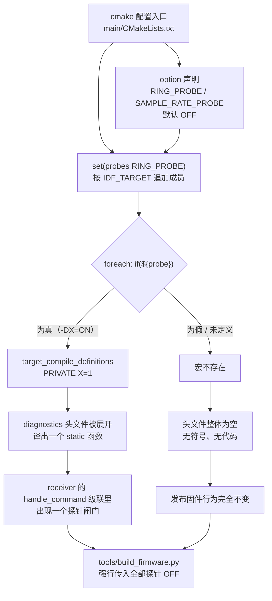
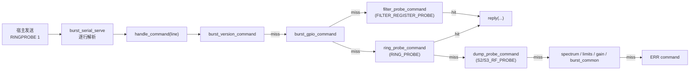

# 寄存器级诊断探针

> 「探针不是给用户用的功能，而是给移植者用的证伪工具。」——`main/diagnostics/` 的三份头文件把这句话写进了注释：`Never package a probe build.`

ESP-SDR 的全部接收能力建立在 Espressif 未公开的 **dump engine（抓取引擎）** 之上：它把接收机基带样本直接写进一块普通 SRAM，CPU 再把这块内存当作数组读出来。寄存器名字、位域语义、所有权编码全部来自对 `librftest.a` 的反汇编与在真板上的试错，官方文档对此一字未提。于是产生了一个移植期的结构性矛盾：每接入一颗新芯片，都要先搞清一组"没人描述过"的寄存器；而验证这些猜测的唯一手段是**运行时的、可交互的寄存器读写**——这种能力一旦进入发布固件，就是一台随板分发的、无鉴权的 MMIO 后门。

`main/diagnostics/` 就是为化解这对矛盾而存在的：三个**编译期可选、发布期强制关闭、运行时带保存/恢复语义**的诊断探针头文件。它们不是产品特性，而是芯片适配流水线上的工装夹具。

Sources: [dump_probe.h](main/diagnostics/dump_probe.h#L1-L3), [filter_probe.h](main/diagnostics/filter_probe.h#L1-L3), [ring_probe.h](main/diagnostics/ring_probe.h#L1-L3), [how-it-works.md](docs/how-it-works.md#L1-L7)

---

## 1. 项目定位与核心价值

### 1.1 诞生背景：一个"无文档硬件"的移植问题

该项目的难点不在于 DSP，也不在于协议，而在于**硬件事实的获取成本**。抓取机制的每一个关键事实都需要实验确认：SRAM 所有权寄存器把哪一段 128 KiB 块交给引擎、控制寄存器第 15/16 位到底是分频还是时钟源选择、lane 选择寄存器的四个 6 位字段对应哪个内部调试信号、环形模式下写指针寄存器低 17 位的回绕行为如何。项目文档坦诚记录了这一状态——一张按芯片罗列的寄存器表，以及一节标题就叫「Things we don't know」的未知清单。

在这种条件下，芯片移植的真实工序并非"写后端代码"，而是"做实验 → 得出结论 → 把结论固化成常量"。`main/diagnostics/` 里的每条命令都精确对应一个待验证的假设：`RXSRC`/`RXMODE`/`RXWIDE`/`RXFLAG`/`RXCLOCK` 是对控制寄存器位域的逐位归因实验，`RXPACK` 是对 lane 选择字段的扫描，`RINGPROBE` 是对"环形模式是否存在、写指针是否推进、所有权位能否逐块归还"三连假设的判定，`FREG`/`FANA`/`FIMASK` 是对模拟滤波器电容 DAC 与掩码语义的映射。

Sources: [how-it-works.md](docs/how-it-works.md#L159-L186), [dump_probe.h](main/diagnostics/dump_probe.h#L16-L45), [ring_probe.h](main/diagnostics/ring_probe.h#L59-L76), [filter_probe.h](main/diagnostics/filter_probe.h#L90-L100)

### 1.2 核心特性：四条不可协商的工程契约

第一是**零足迹**。探针以 `static` 函数形式定义在头文件里，由各芯片 `receiver.c` 在语义上"正确的位置"单点包含；未定义宏时整个头文件被预处理为空，既不产生符号，也不占用 flash，更不会改变发布固件的任何行为路径。这与"加一个 debug.c 再链接进去"的做法有本质区别：后者会留下符号、字符串与可能的段偏移，而本项目对 flash 与 SRAM 布局的敏感度极高（`sram_guard.ld` 与 `SOC_RESERVE_MEMORY_REGION` 把固定地址段从堆和静态区里挖走），任何额外的目标文件都可能踩到保留区的边界。

第二是**写必有偿**。凡是对硬件状态的修改，必须能在同一进程内被撤销。`filter_probe.h` 为 4 个数字寄存器与 64 个 I2C 寄存器各维护一份"首次写前备份 + 脏标志"，`FRESET` 逐项回滚；`ring_probe.h` 在进入前保存 `SRAM_OWNER_REG`，退出前写回并做一次回读、在 `portCLEAR_INTERRUPT_MASK_FROM_ISR()` 之后才返回调度器。这条契约的动机很实际：PHY 的校准状态是跨快照复用的，探针污染了模拟寄存器，后续正常抓取会静默地输出错误噪声底，而错误表现为"信号质量变差"，极难归因。

第三是**位域隔离**。命令参数的上界不是随手写的防御性检查，而是"让写操作严格落在目标位域内、绝不越界到相邻字段"的算术结论。`RXMODE` 限定 `n < 8`，因为它左移 28 位后恰好填满 28–30 位，从而避开第 31 位的 enable；`RXPACK` 限定 `n <= 60`，因为要把 `n..n+3` 四个 6 位字段塞进一个 32 位字；`RXSRC` 限定 `n < 256`，因为它占据从第 20 位起的 8 位源字段。

第四是**有界等待**。探针里的每一个轮询循环都有以 CPU 主频推导出的硬上界（`CONFIG_ESP_DEFAULT_CPU_FREQ_MHZ * 1000u` 即 1 ms，`* 10000u` 即 10 ms），没有 `while(1)`，也没有"等硬件应该会好"的乐观等待。理由是明显的：探针运行的场合正是硬件行为未知的场合，一个无界等待会把"假设错误"变成"板子挂死"。

Sources: [CMakeLists.txt](main/CMakeLists.txt#L68-L71), [filter_probe.h](main/diagnostics/filter_probe.h#L32-L51), [ring_probe.h](main/diagnostics/ring_probe.h#L50-L76), [dump_probe.h](main/diagnostics/dump_probe.h#L27-L38)

---

## 2. 架构设计与模块划分

### 2.1 构建期门控：从 CMake 变量到一个空的目标文件

探针的开关完全在编译期决定，链路是：CMake `option()` → `probes` 列表 → `target_compile_definitions` → 预处理分支。



`main/CMakeLists.txt` 只对 `SAMPLE_RATE_PROBE` 与 `RING_PROBE` 做了正式的 `option()` 声明；其余四个宏（`S2_RF_PROBE`、`S3_RF_PROBE`、`FILTER_REGISTER_PROBE`、`C5_TUNE_PROBE`）只是被追加进 `probes` 列表，靠"CMake 中未定义变量在 `if()` 里求值为假"这一约定隐式关闭。这套做法省掉了大量样板，但代价是**拼错宏名会静默失效**：`-DFILTER_REGISTER_PROBE=ON` 在 C3 上不会报错，因为该目标根本没有把它加入 `probes`，宏永远不会被定义，`filter_probe.h` 也就永远为空。

C6 上还有一条显式的配置期硬失败：`FILTER_REGISTER_PROBE` 与 `esp32c6` 同时为真时 CMake 直接 `FATAL_ERROR`，理由是滤波器寄存器在 C6 上"未被刻画"。这条校验把"危险的未知"从运行期前移到配置期——C6 的模拟前端走的是另一条 `RX_FILTER_REG = 4` 路径，若让探针落进 `filter_probe.h` 的 `#else` 分支（S3 风格地址），写下去的将是完全错误的寄存器。

Sources: [CMakeLists.txt](main/CMakeLists.txt#L11-L11), [CMakeLists.txt](main/CMakeLists.txt#L22-L29), [CMakeLists.txt](main/CMakeLists.txt#L35-L57), [CMakeLists.txt](main/CMakeLists.txt#L94-L98), [chip.h](main/targets/esp32c6/chip.h#L27-L28), [receiver.c](main/families/c5_c6_c61/receiver.c#L52-L56)

### 2.2 头文件层：三份探针 + 一类"内联探针"

`main/diagnostics/` 目录本身只有三个头文件，但完整的探针族共有四类——第四类没有独立文件，而是直接长在对应 `receiver.c` 里，因为它们需要访问该后端独有的静态量（`probe_adc`、`s3_fofs`、`adctrig` 播种序列等），抽出来反而要暴露内部状态。

| 探针 | 载体 | 开放目标 | 命令族 | 解决的问题域 |
| --- | --- | --- | --- | --- |
| `S2_RF_PROBE` / `S3_RF_PROBE` | [dump_probe.h](main/diagnostics/dump_probe.h) | C3 之外仅 S2、S3 | `WORDS?` `MEMTEST` `RX*` `RXREGS?` `RFREG?` `FREQEX` | 抓取引擎控制寄存器的位域归因、保留区可写性 |
| `RING_PROBE` | [ring_probe.h](main/diagnostics/ring_probe.h) | ESP32、S2、C3、C5、C6 | `RINGPROBE rate` | 环形模式是否存在、写指针是否推进、所有权能否归还 |
| `FILTER_REGISTER_PROBE` | [filter_probe.h](main/diagnostics/filter_probe.h) | S3、C5、C61（C6 配置期拒绝） | `FREAD` `FREG` `FANA?` `FIMANA`/`FIMASK` `FANA` `FRESET` | BBTOP/RFPLL 滤波器寄存器与模拟电容 DAC 的映射 |
| `SAMPLE_RATE_PROBE` / `C5_TUNE_PROBE` | 内联于 `receiver.c` | S3、C5 | `RXPROBE` `ADCCLOCK` `FREQEX` | dump 时钟源网格、ADC 分频、C5 5/6 GHz 调谐边界 |

覆盖矩阵需要明确指出其**不完整性**，这正是探针体系最容易被误读的地方：`RING_PROBE` 被无条件加入所有目标的 `probes` 列表，但只有 ESP32、S2、C3 与 C5/C6/C61 家族的 `receiver.c` 真正 `#include "ring_probe.h"`；C2 与 H2 定义了这个宏却不包含头文件，因此 `-DRING_PROBE=ON` 在它们上面是彻底的哑弹。S31 的情况更特殊：它在 `#ifdef RING_PROBE` 下自带一份同名但语义完全不同的 `ring_probe_command` 实现，刻意不走共享头文件。

Sources: [CMakeLists.txt](main/CMakeLists.txt#L29-L29), [receiver.c](main/targets/esp32/receiver.c#L153-L153), [receiver.c](main/targets/esp32s2/receiver.c#L198-L199), [receiver.c](main/targets/esp32c3/receiver.c#L155-L155), [receiver.c](main/families/c5_c6_c61/receiver.c#L214-L214), [receiver.c](main/targets/esp32s31/burst/receiver.c#L226-L288)

### 2.3 调度层：返回 `false` 的透明闸门

所有探针遵循同一个接口契约：`static bool xxx_probe_command(const char* line)`，**处理了返回 true，不认识返回 false**。这条契约让探针成为命令级联里的"可插拔旁路"——它只能在正常协议之前插入新命令，永远不会遮蔽已有的发布命令，因为未命中的行会原样流向下一个 handler。



级联顺序是**有语义的**而非随意的。以 S3 为例，`filter_probe_command` 与 `dump_probe_command` 排在 `limits_command`、`gain_command`、`ring_command`、`burst_common_command` 之前：探针命令（`FREG`、`RXWIDE`、`RXSRC`）与发布命令共享前缀空间，把它们放在前面可以用最短路径截获实验命令，同时保持"发布命令集合不受影响"的结论成立。S2 则把 `ring_probe_command`、`dump_probe_command` 放在 `spectrum_command` 之前、`limits_command` 之前，同理。

Sources: [receiver.c](main/targets/esp32s3/receiver.c#L455-L467), [receiver.c](main/targets/esp32s2/receiver.c#L211-L223), [receiver.c](main/families/c5_c6_c61/receiver.c#L310-L325), [burst_serial.h](main/common/burst_serial.h#L23-L26)

### 2.4 后端层：复用既有采集原语，不另建抓取路径

探针几乎不自己实现抓取，而是复用后端已有的原语，从而保证"探针测到的现象"与"发布路径的现象"出自同一套硬件序列。

- `dump_probe.h` 的 `FREQEX` 直接改写 `frequency_mhz` 并调用 `prepare_rx()`，走的是与 `FREQ` 命令完全相同的重校准 + PHY 唤醒路径，只是绕过了 `frequency_valid()` 的范围裁剪。
- `ring_probe.h` 先用 `spectrum_acquire(256, rate, &data, &elapsed)` 走一次**正常快照**，把返回的 `data`（即 `IQ_BUFFER` 的 CPU 可读窗口）当作探针的观察窗口。这一设计非常克制：它不额外索取 SRAM bank，因此不会把堆或静态数据挤出保留区。
- S31 的探针改用 `filter_apply()` / `filter_restore()` 与 `prepare_rx()`，与快照路径同源。

Sources: [dump_probe.h](main/diagnostics/dump_probe.h#L57-L61), [ring_probe.h](main/diagnostics/ring_probe.h#L14-L16), [receiver.c](main/targets/esp32s31/burst/receiver.c#L276-L283), [receiver.c](main/targets/esp32s2/receiver.c#L192-L196)

### 2.5 发布层：构建脚本的硬性回拨

最后一道防线在 CI 侧的构建脚本里：`tools/build_firmware.py` 在非流式 profile 下，向 `idf.py` 显式追加全部五个探针的 `-D...=OFF`。这不是冗余——CMake 的 `option()` 默认值可以被 `-DSDKCONFIG` 之外的环境携带的缓存变量覆盖，而构建目录 `build-<profile>` 是复用的。脚本显式回拨，等于把"发布物里绝不含探针"从约定升级为可验证的构建事实。

Sources: [build_firmware.py](tools/build_firmware.py#L39-L54)

---

## 3. 技术栈与核心工作流

### 3.1 一次探针调用的执行主链路

| 环节 | 实现位置 | 职责与约束 |
| --- | --- | --- |
| 传输与行解析 | `burst_serial_serve()` / `burst_serial_poll_line()` | 双端口（USB、UART）各自独立解析器；一条完整行锁定后续回复端口 |
| 指令路由 | 各 `handle_command()` | 探针闸门前置，未命中即穿透 |
| 参数解析 | `sscanf(fmt, "%u %c", &n, &extra) == 1` | 尾随 `%c` 用于拒绝"数字后面还跟着东西"的输入 |
| 前置条件 | `prepare_rx()` / `rx_recalibration_stale()` | 若校准已失效则先重校准；探针不得在未准备状态下读 RF 寄存器 |
| 状态备份 | `filter_saved[]` / `filter_ana_saved[]` / 局部 `owner` | 首次写前备份，用脏标志避免二次覆盖 |
| 硬件访问 | `REG_READ/REG_WRITE`、`rom_chip_i2c_*`、`phy_chip_i2c_*` | 按芯片选择 I2C 单元号（S2/S3 用 0，C5/C61 用 1） |
| 观察与统计 | 写指针采样、哨兵比对、`live`/`freed` 计数 | 全部循环有 CPU 周期上界 |
| 恢复与回复 | `FRESET` 语义 / `REG_WRITE(owner)` / `reply()` | 恢复先于返回；回复为单行或两行 ASCII |

Sources: [burst_serial.h](main/common/burst_serial.h#L8-L26), [filter_probe.h](main/diagnostics/filter_probe.h#L60-L72), [ring_probe.h](main/diagnostics/ring_probe.h#L71-L85)

### 3.2 `dump_probe.h`：控制寄存器位域归因实验组

该头文件是"用命令代替电流表"的典型：它把 S2/S3 抓取控制寄存器 `0x60033d64`/`0x60033d5c` 的每一位单独暴露成一条命令，使移植者可以一次只改一位，观察抓取结果的变化，从而把位域语义钉死。

| 命令 | 参数约束 | 触达的硬件位置 | 待验证的假设 |
| --- | --- | --- | --- |
| `WORDS?` | — | 回读 `IQ_BUFFER[0..3]` 与 `SRAM_OWNER_REG` | 该地址段此刻确实由 CPU 拥有且内容可读 |
| `MEMTEST` | — | 向 `IQ_WORDS` 个字写入 `0x12345678 + j` 递增图样 | 保留区可写、未被堆或静态段侵占（写坏即立刻崩溃，是最快的布局校验） |
| `RXWIDE n` | `n < 2` | 控制位 17 | 位 17 是否为 wide/模式位 |
| `RXPREP n` | `n < 4` | 改写 `rx_prep` 并置 `rx_ready = false` | 接收机启动的最小充分步骤（3=完整 PHY 唤醒，2=仅 `esp_wifi_set_channel`，1=再加强制增益） |
| `RXPACK n rate` | `n <= 60`、`rate <= 1` | `0x60033d98` 的四个 6 位字段 + 位 24 | lane 选择字段的起点与 AGC 位的存在性 |
| `RXSRC n` | `n < 256` | 控制位 20 起的源字段 | 数据源编号网格 |
| `RXMODE n` | `n < 8` | 控制位 28–30 | 模式字段（避开位 31 的 enable） |
| `RXFLAG n` | `n < 2` | 控制位 16 | 位 16 的语义 |
| `RXCLOCK n` | `n < 2` | 控制位 15 | 直接覆盖 division 选择的时钟位 |
| `RXREGS?` | — | 扫 `0x60033d50`–`0x60033d98`，每 4 字节一行 | 建立 dump 引擎寄存器块的"已知值地图" |
| `RFREG?` | — | 读 `ctrl`/`ctrl+4`/`ctrl+8`；S2 上基址比 S3 高 8 字节 | 控制字—写索引—索引后一字三元组的结构 |
| `FREQEX n` | `100..6000` | 改写 `frequency_mhz` → `prepare_rx()` | 绕过 `frequency_valid()` 探测 PLL 实际锁定包络 |
| `ANAREAD i r` | 仅 S2，`i<2`、`r<32` | `rom_chip_i2c_readReg(0x67, ...)` | 模拟/RF 寄存器可读性与初值 |
| `GAINREG?` | 仅 S2 | `0x6001c02c` | 增益寄存器的当前编码 |

Sources: [dump_probe.h](main/diagnostics/dump_probe.h#L4-L75)

`RXREGS?` 的实现值得单独一提：它不做任何语义解释，只是把一整段地址区间的当前值倾倒出来。这是移植初期成本最低、信息量最大的动作——先用 `RXREGS?` 在两种不同配置下各取一份快照，diff 出来的位就是"配置真的改动了什么"，随后再用单比特命令逐项确认。`RFREG?` 里那句注释 `the S2's sit 8 bytes higher` 是这类工作的痕迹：同一个逻辑寄存器在不同芯片上的偏移差异，只能靠实验发现。

Sources: [dump_probe.h](main/diagnostics/dump_probe.h#L39-L56)

### 3.3 `filter_probe.h`：带白名单与掩码代数的只读/局部写探针

这是三份头文件里防御最厚的一份，因为它触碰的是**模拟前端**——写错一个电容码，可能让接收链路在一段时间内失锁，而现象与"信号弱"无法区分。它用四层机制把爆炸半径压到最小。

第一层是**地址白名单**：只有数组 `filter_regs[]` 里的 4 个地址可写，其余一律拒绝。第二层是**掩码子集校验**：`FREG` 要求 `m` 非零、`m` 是 `filter_masks[j]` 的子集、`v` 是 `m` 的子集，即"只能改这颗芯片上已被刻画过的那几位"。第三层是**电容码窗口**：`filter_cap_allowed()` 在 C5/C61 上只放行 6–21，在其他芯片上只放行 `4–7 / 12–15 / 20–23 / 28–31` 四个窗口，`FANA` 的取值另外限定 `< 64`（6 位 DAC）。第四层是**控制位隔离**：`FIMASK` 只允许修改 `filter_control_mask()` 声明的位（寄存器 5 上的 `0x68`、寄存器 29 上的 `0x0c`，或 2 号寄存器上的 `0x0c`），避免误触其他功能位。

| 命令 | 语义 | 校验要点 |
| --- | --- | --- |
| `FREAD addr` | 读一个白名单数字寄存器 | 地址必须在表内，否则穿透 |
| `FREG addr mask value` | 掩码写数字寄存器 | `mask ⊆ filter_masks[j]`、`value ⊆ mask`；首次写前备份 |
| `FANA? reg` | 读 I2C 模拟寄存器 | `reg < 64` |
| `FANA reg value` | 改写电容 DAC 低 6 位 | `filter_cap_allowed(reg)`、`value < 64` |
| `FIMASK reg mask value` | 精确位掩码写 I2C 寄存器 | `mask ⊆ filter_control_mask(reg)` |
| `FRESET` | 逐项回滚全部已改状态 | 遍历 `filter_changed[]` 与 `filter_ana_changed[]` |

最后一层防护是一条兜底分支：凡是 `F` 开头、前缀匹配 `FREG`/`FIMASK`/`FANA`/`FREAD` 但参数不合法的行，一律回复 `ERR filter_probe_field` 而**不再向下穿透**。这条设计把"探针拒绝执行"与"发布固件不认识该命令"两种情况区分开，避免移植者误以为自己的命令已经生效。

Sources: [filter_probe.h](main/diagnostics/filter_probe.h#L5-L34), [filter_probe.h](main/diagnostics/filter_probe.h#L38-L107)

### 3.4 `ring_probe.h`：所有权交接与写指针采样

环形模式是连续抓取的前提（C6、C61、S3、S31 的 gapless 频谱都依赖它），因此"环形模式在新芯片上是否可用"是移植期的关键判定。该探针用一次 1 ms 的观测窗口回答四个问题：写指针是否推进（`changes`）、是否发生回绕（`wraps`）、CPU 窗口内的哨兵字是否被硬件覆盖（`live`）、以及归还所有权后窗口是否重新变成 CPU 可写（`freed`）。


按芯片选择的参数集中在一条 `#if` 链里，涵盖控制/写指针地址、可观测字数、所有权选择字与时钟位：

| 目标 | `cr` / `wr` | `count` | 所有权选择字 | 时钟位 |
| --- | --- | --- | --- | --- |
| ESP32 | `DUMP_CTRL` / `DUMP_STATUS` | 16384 | `DPORT_MAC_DUMP_MODE = 3`（DPORT AHB SEL） | `rate 6 → bit16`，`rate 1 → bit15` |
| S2 | `0x60033d64` / `0x60033d68` | 8192 | `(owner & ~15) \| 7` | 同上 |
| C3 | `0x60033d5c` / `0x60033d60` | 16384 | `(owner & ~7) \| 2 \| 8` | 无 |
| C5 | `0x600a9004` / `0x600a9008` | 16384 | `(owner & ~0xf00) \| 0x10200` | 无 |
| C6 | `0x600a9004` / `0x600a9008` | 16384 | `(owner & ~0xf00) \| 0x400` | 无 |

C6 的 `(owner & ~0xf00) | 0x400` 与发布后端的 `stock_capture()` 完全一致，C5 的 `0x10200` 也与 `acquire_iq()` 里的探针分支一致——这不是巧合，而是刻意让探针与发布路径共用同一套所有权编码，这样"探针验证通过"才等于"发布路径可用"。

代码中还有一处刻意的排除：函数体被包在 `#if !CONFIG_IDF_TARGET_ESP32S31 && !CONFIG_IDF_TARGET_ESP32C61` 里。C61 的 64 KiB 级所有权编码是 `(owner & ~0x11f00) | (8u << 8)`，与探针里 `~7u | 2u | 8u` 这类"位即块"的算术完全不同；S31 更是走 TCM dump 路径、根本没有 `SRAM_OWNER_REG` 概念。把方法体编译掉，是对"这套位运算不适用于该芯片"的显式声明。

Sources: [ring_probe.h](main/diagnostics/ring_probe.h#L4-L49), [ring_probe.h](main/diagnostics/ring_probe.h#L47-L76), [chip.h](main/targets/esp32c6/chip.h#L32-L47), [chip.h](main/targets/esp32c61/chip.h#L14-L26), [receiver.c](main/families/c5_c6_c61/receiver.c#L158-L175)

### 3.5 内联探针：`SAMPLE_RATE_PROBE` 与 `C5_TUNE_PROBE`

这两个宏没有独立头文件，因为它们的实现必须嵌入后端的抓取函数内部：

- **S3 的 `SAMPLE_RATE_PROBE`** 在 `capture()` 里插入了两个钩子：抓取前读 `rom_chip_i2c_readReg(0x66, 0, 4)` 并按 `probe_adc` 改 ADC 分频位，抓取后原样写回；控制字则用 `(ctrl & ~0x7ff38000u) | (probe_source << 20) | (probe_clock << 15)` 整段替换源与时钟字段。对外暴露 `RXPROBE source clock`（`source < 2048`、`clock < 8`）、`ADCCLOCK n`、`ADCCLOCK?`。
- **C5 的 `SAMPLE_RATE_PROBE`** 走的是更激进的分支：先用 `adctrig(255, 0, 0, probe_clock * 2u, ...)` 借 stock 序列把打包与时钟配置"播种"好，再直接改 `0x600a9008` 的源字段并手工完成触发/等待/停机。它同时备份 `0x600a0448` 这个数字 ADC 寄存器，形成"模拟 + 数字"双重回滚。
- **C5 的 `C5_TUNE_PROBE`** 只为一件事存在：把 `FREQEX` 的上界从 6000 MHz 推到 **7500 MHz**，用于探测 C5 在 5 GHz/6 GHz 区间的 PLL 锁定边界。这正是「接受不等于锁定」这一结论的产出工具。

Sources: [receiver.c](main/targets/esp32s3/receiver.c#L151-L156), [receiver.c](main/targets/esp32s3/receiver.c#L169-L203), [receiver.c](main/targets/esp32s3/receiver.c#L493-L508), [receiver.c](main/families/c5_c6_c61/receiver.c#L126-L133), [receiver.c](main/families/c5_c6_c61/receiver.c#L148-L185), [receiver.c](main/families/c5_c6_c61/receiver.c#L391-L410), [rx-controls.md](docs/rx-controls.md#L93-L114)

---

## 4. 典型代码示例

### 4.1 掩码代数 + 首次写前备份（`FREG`）

这是整个探针体系里约束最完整的一段：它同时演示了白名单、掩码子集校验、写前备份与"未命中即穿透"三条契约。

```c
if (sscanf(line, "FREG %x %x %x %c", &a, &m, &v, &extra) == 3) {
    for (unsigned j = 0; j < 4; j++)
        if (a == filter_regs[j] && m && !(m & ~filter_masks[j]) && !(v & ~m)) {
            prepare_rx();
            if (!filter_changed[j]) {
                filter_saved[j] = REG_READ(a);   /* 只在第一次写之前备份 */
                filter_changed[j] = true;
            }
            REG_WRITE(a, (REG_READ(a) & ~m) | v);
            reply("OK\n");
            return true;
        }
}
```

`!(m & ~filter_masks[j])` 读作"请求的掩码不得包含该寄存器未刻画过的位"；`!(v & ~m)` 读作"待写值不得超出所请求的掩码"。两者串起来，构成一条不可绕过的性质：**探针无法写入任何未被显式声明的位**。`prepare_rx()` 在写之前调用，确保 RF 处于已知状态（校准未失效、PHY 已唤醒），否则备份下来的初值本身就是脏的。

Sources: [filter_probe.h](main/diagnostics/filter_probe.h#L60-L72)

### 4.2 所有权交接与写指针采样（`ring_probe.h` 核心段）

```c
unsigned irq = portSET_INTERRUPT_MASK_FROM_ISR();
REG_WRITE(cr, 0);
REG_WRITE(own_reg, select);
(void)REG_READ(own_reg);                 /* 回读以使所有权切换生效 */
uint32_t ctrl = bits | count | BIT(17);
REG_WRITE(cr, ctrl | BIT(18));
REG_WRITE(cr, ctrl);
unsigned start = esp_cpu_get_cycle_count();
REG_WRITE(cr, ctrl | BIT(31));
unsigned prev = REG_READ(wr) & 0x1ffffu, first = prev, wraps = 0, changes = 0;
while (esp_cpu_get_cycle_count() - start < CONFIG_ESP_DEFAULT_CPU_FREQ_MHZ * 1000u) {
    unsigned cur = REG_READ(wr) & 0x1ffffu;
    if (cur != prev) changes++;
    if (cur < prev) wraps++;
    prev = cur;
}
```

三个细节都是移植结论的固化。其一是所有权切换后的 `(void)REG_READ(own_reg)`：这类跨时钟域的配置寄存器需要一次回读才能保证写已经落地，多个芯片的 `stock_capture()` 里也都有同样的写法。其二是触发序列 `bit18 脉冲 → 清 bit18 → 置 bit31`：先清完成标志再启动，避免把上一次的完成位误读成这一次的结果。其三是写指针只取低 17 位：环形缓冲深度是 16384，高位属于其他语义（在 C6/C61 家族里 `0x1ffff` 之外还承载状态），掩掉才能得到单调的索引。

Sources: [ring_probe.h](main/diagnostics/ring_probe.h#L50-L65), [chip.h](main/targets/esp32c6/chip.h#L48-L53)

### 4.3 观测窗口的哨兵双向验证

```c
for (unsigned j = 0; j < 8; j++) probe[j] = 0xa5c33c5a;
/* ... 让引擎跑 1 ms ... */
unsigned live = 0, freed = 0;
uint32_t live_words[4];
for (unsigned j = 0; j < 4; j++) live_words[j] = probe[j];
for (unsigned j = 0; j < 8; j++) if (probe[j] != 0xa5c33c5a) live++;
REG_WRITE(cr, 0);
REG_WRITE(own_reg, owner);
(void)REG_READ(own_reg);
for (unsigned j = 0; j < 8; j++) if (probe[j] != 0xa5c33c5a) freed++;
```

同一批哨兵字被统计两次：引擎运行期间被覆盖的字数（`live`）说明引擎确实在往这段内存写；归还所有权之后**再次**被覆盖的字数（`freed`）说明 CPU 重新获得了写权限。若 `live > 0` 而 `freed == 0`，结论就是"引擎在写但所有权没有真正归还"——这是环形模式移植中最危险的一种半失败状态，它会以"数据偶发错乱"的形式出现在远期，而非当场报错。哨兵值 `0xa5c33c5a` 与 `ring_capture.c` 使用的第二哨兵一致，不是随手取的常量。

Sources: [ring_probe.h](main/diagnostics/ring_probe.h#L47-L76), [how-it-works.md](docs/how-it-works.md#L144-L148)

---

## 5. 学习与探索建议

探针代码本身很短（三份头文件合计约 300 行），真正的信息量在"为什么是这个位、为什么是这个上界"。因此阅读顺序应当是**先读发布路径、再读探针**：探针的每一条命令都在为某个发布代码里的魔数提供证据。

| 目标 | 阅读对象 | 关注点 |
| --- | --- | --- |
| 建立寄存器心智模型 | [docs/how-it-works.md](docs/how-it-works.md#L79-L98) 的控制寄存器位表与 [L159-L176](docs/how-it-works.md#L159-L176) 的按芯片地址表 | 先记住 bit0–14 计数、bit18 完成、bit19 触发、bit31 使能这条骨架，探针的参数上界就自然可读 |
| 对照探针与发布实现 | [esp32s3/receiver.c](main/targets/esp32s3/receiver.c#L157-L215) 的 `capture()` | 逐行比对探针写入的位与发布代码的 `ctrl` 组装，理解 `SAMPLE_RATE_PROBE` 为何能整段替换 `0x7ff38000` |
| 理解所有权位编码差异 | [esp32c6/chip.h](main/targets/esp32c6/chip.h#L32-L65)、[esp32c61/chip.h](main/targets/esp32c61/chip.h#L14-L44)、[c5_c6_c61/receiver.c](main/families/c5_c6_c61/receiver.c#L158-L175) | 三处 `SRAM_OWNER_REG` 的写法互不相同，这是 `ring_probe.h` 要按芯片分支、并且排除 C61 的全部原因 |
| 进阶：复现一次实验 | [firmware-targets.json](firmware-targets.json) + `idf.py -DRING_PROBE=ON ...` | 用 `tools/build_firmware.py --matrix` 取目标列表，手工打开单个探针，先跑 `RXREGS?` 取基线，再用单比特命令逐项验证 |
| 进阶：环形捕获语义 | [ring_capture.h](main/common/ring_capture.h#L11-L48) 的 bank 常量与 `ring_status_t` | 探针只有 1 ms 视野，真正的连续运行失败模式（`RING_FAIL_LATE`、`RING_FAIL_AGE`）需要对照 `ring_capture.c` 的阈值判定 |
| 进阶：滤波器曲线来源 | [rx_bandwidth.h](main/common/rx_bandwidth.h#L52-L129) 的 `rx_bandwidth_dcap()` 标定表 | 这些 `{code, MHz}` 点正是 `FANA`/`FIMASK` 实验的产出；理解了表结构，就知道探针该扫哪些码点 |

> ⚠️ **使用纪律**：探针构建**绝不可分发**。除 `tools/build_firmware.py` 的构建回拨之外，探针还会在被调用的瞬间夺走 SRAM 所有权、关闭中断、改写模拟前端寄存器；在共享设备与生产板上运行它们，可能留下需要重新上电才能恢复的 PHY 状态。`MEMTEST` 更会直接覆盖整段保留区——在布局未经验证的芯片上，它是用来"撞出问题"的，而不是用来"验证没问题"的。

Sources: [build_firmware.py](tools/build_firmware.py#L51-L54), [dump_probe.h](main/diagnostics/dump_probe.h#L13-L15), [ring_capture.h](main/common/ring_capture.h#L39-L48), [rx_bandwidth.h](main/common/rx_bandwidth.h#L55-L106)

---

## 🔗 关联模块与上下游

- [burst_serial.h](main/common/burst_serial.h#L8-L26)——`burst_serial_serve()` 与 `reply()` 的契约；探针的 `bool xxx_probe_command(const char*)` 签名由它定义的逐行回调决定。
- [ring_capture.h](main/common/ring_capture.h#L11-L48)——`RING_BANKS`、`RING_THRESHOLD`、`ring_status_t` 与探针共享同一套 bank 与哨兵语义。
- [how-it-works.md](docs/how-it-works.md#L79-L98)——控制寄存器位表与按芯片地址表，是判断探针参数上界是否正确的唯一参照。
