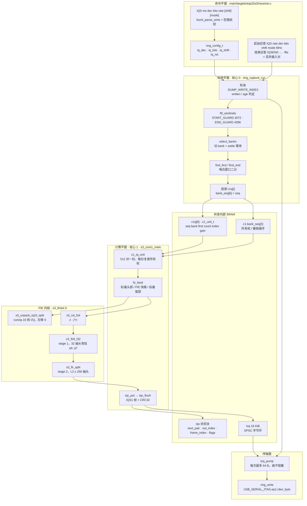
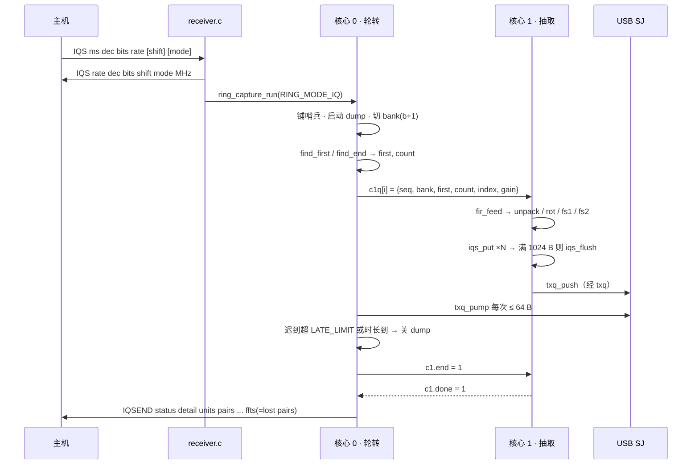

# S3 连续 I/Q 抽取流水线

> 设计理念：`RINGCAP` 给出的是"证明链路没丢数据"的原始证据，`SPEC` 给出的是"数据里有什么"的频谱摘要，而 `IQS` 给出的是**第三件东西——可以交给 SDR 软件直接解调的窄带复基带**。它不追求把 16 Msps 全部搬给主机（物理上不可能），而是追求在**芯片内把带宽压窄到 USB 能承受的量级，同时让"丢了多少"变成主机可精确计算的整数**。整条链路的所有设计选择——因式分解的抽取比、跨单元延续的滤波状态、栅格对齐的绝对采样索引、非阻塞的队列丢弃——都是为了让"连续性"可以被证明，而不是被相信。

## 项目定位与核心价值

ESP32-S3 的连续采集底座是 dump 引擎：它把 ADC 的 I/Q 对以 32 bit 字的形式写入一个 16384 对的 SRAM 环，每写满 12288 对就必须由 CPU 切换 bank，环与 bank 的地址、阈值与哨兵窗口全部固化在 `ring_capture.h` 与 `ring_capture.c` 的宏里，三个 64 KiB bank 共 192 KiB 内部 SRAM 被整块征用。这个底座原本服务于两类消费者：`RING_MODE_CAPTURE` 只抓有限几个单元做原始 IQ 回传，`RING_MODE_SPEC` 把单元切块做 FFT 并把 bin 功率编码成 `SPC1` 帧。对 SDR 主机（SDR++、SDR#、gqrx、GNU Radio 经 SpyServer / rtl_tcp）而言两者都不合用：前者无法持续，后者的输出是频谱而非波形。原始流的带宽账更是硬约束——16 Msps、8 bit I/Q 等于 32 MB/s，而原生 USB Serial/JTAG 的可持续吞吐只有约 1 MB/s 量级，任何"把原始采样先推给主机再抽取"的路线在物理层就破产了。`IQS` 模式的诞生就是为了在这条不可能的链路上凿出一个可行的窄口：**在芯片内完成带限与抽取，把 16 Msps 降到 250 kS/s 乃至 15.6 kS/s，再以 4/8/16 bit 打包经 USB 送出**。

其核心价值首先体现在**算力与抽取倍数解耦**。抽取链路被设计成两级固定形状的 FIR：第一级永远是 8 抽取、32 抽头，第二级抽头数随 `D/8` 线性增长但每输入对的乘法次数恒为 18，因此整条链路对每个输入对的开销稳定在约 12 个周期（PIE 汇编实测），与 `D` 取值无关。换一句话说，**把 16 MSps 压到 15.6 kS/s 和压到 250 kS/s，花掉的 CPU 时间几乎一样**；`D` 只决定输出带宽与 USB 占用，不决定 CPU 成本。这使主机侧可以在运行期自由改变抽取比而不会踩到新的实时性悬崖。其次是**连续性的可证明性**：滤波状态保存在绝对输入索引空间里（`fstage_t.base` / `next_end`），因此可以横跨分片、横跨 bank 切换、横跨单元边界无条件延续；一旦确实发生了数据缺口（bank 被提前回收），下一单元会重新对齐到抽取栅格、把残帧先冲出去、并把 `flags` bit0 置位，主机可以凭 `sample_index` 的跳变确切算出缺了多少个采样。第三是**退化路径的完整性**：第二颗核可用时，整条抽取跑在核 1 的裸机 worker 里，核心 0 只负责 bank 轮转与 USB 泵；核不可用时同一套 `fir_feed` 以 1024 对为一片在核心 0 的轮询间隙里执行，帧格式、失败语义、间隙标记完全一致，主机侧无需区分。

| 输出形态 | `D` 范围 | 典型输出率（16 MSps 环） | 每帧净荷 | 实测连续性（文档口径） |
| --- | --- | --- | --- | --- |
| 4 bit / 分量 | 64…1024（2 的幂） | 250 … 15.6 kS/s | 1024 采样 = 1024 B | 250 kS/s 无洞 |
| 8 bit / 分量 | 64…1024 | 250 … 15.6 kS/s | 512 采样 = 1024 B | 250 kS/s 无洞 |
| 16 bit / 分量 | 64…1024 | 250 … 15.6 kS/s | 256 采样 = 1024 B | 125 kS/s 无洞；250 kS/s 约 80 % 到达 |

Sources: [ring_capture.h](main/common/ring_capture.h#L11-L37), [ring_capture.h](main/common/ring_capture.h#L50-L66), [ring_capture.c](main/common/ring_capture.c#L1-L26), [iq-stream.md](docs/iq-stream.md#L1-L63), [receiver.c](main/targets/esp32s3/receiver.c#L391-L433)

## 架构设计与模块划分

整条流水线沿用 `ring_capture.c` 已经确立的四个平面划分，但在 `IQS` 模式下每个平面的职责被重新裁剪：**命令平面**只做参数校验与起始应答，**轮转平面**（核心 0）保留全部硬实时职责——轮询写索引、铺哨兵、切 bank、二分定位单元边界——并把"已经验证无洞的采样区间"作为唯一种类的产品向下游投递；**计算平面**（核 1 或核心 0 的分片）负责 unpack、旋转、两级 FIR、量化与打包；**共享内存平面**则由 `c1q` 单元队列、`bank_seq` 所有权位、`iqs` 状态块与 `txq` 字节环组成。与前两个模式的关键差别在于：`IQS` 把**帧的封装也放在了计算侧**，于是 `txq` 在双核形态下退化为严格单生产者（核 1 调用 `txq_push`）/单消费者（核心 0 调用 `txq_pump`）队列，核心 0 在 IQ 运行中几乎不碰数据面，只负责喂 USB。



在这张图里，值得注意的是**没有任何一条边表示"双向共享"**：`c1q` 是投递—取走的单向队列，`bank_seq` 是核心 0 授予、核 1 归还的所有权令牌，`iqs` 状态块在双核形态下只由核 1 写、核心 0 仅在收尾阶段读，`txq` 是 SPSC。整个设计的思想是：**用所有权转移代替锁**。核心 0 在需要复用某个 bank 前调用 `reclaim_bank`（双核时即 `c1_revoke`），后者清掉 `bank_seq[b]` 并忙等 `c1.busy == b+1`，保证核 1 不会在核心 0 已经开始往该 bank 铺哨兵之后还去读它；反过来，核 1 每处理 512 对就检查一次 `bank_seq[u->bank] != u->seq`，发现令牌被撤销就立刻停手并把剩余输入对记入 `iqs.lost_pairs`。

Sources: [ring_capture.c](main/common/ring_capture.c#L1085-L1104), [ring_capture.c](main/common/ring_capture.c#L1484-L1500), [ring_capture.c](main/common/ring_capture.c#L1398-L1446), [ring_capture.c](main/common/ring_capture.c#L262-L293), [s3_core1.S](main/targets/esp32s3/s3_core1.S#L16-L36)

### 复用轮转平面：单元即"无洞采样段"

`IQS` 完全不重新发明采集调度，而是复用 `SPEC` 已经验证的 bank 轮转协议。协议的核心是一个可证伪的断言：**每个单元的起始采样必须等于上一单元的结束采样**（`first == expected`），否则直接以 `RING_FAIL_START` 终止整次运行。实现方式是在写者填 bank `b` 的同时，往 `b+1` 的"下一单元最可能起始处与结束处"预先铺下哨兵字 `0xA5C33C5A`，等阈值达到后切 bank，再用二分查找在哨兵窗口里精确定位真实的第一个与最后一个已写采样：`find_first` 在 `[origin, origin+guard)` 中找第一个非哨兵字，`find_end` 从切换前读到的写索引出发找第一个哨兵字。窗口尺寸按最坏迟到量设计——`LATE_LIMIT = 2000`、`START_GUARD = 3072`、`END_GUARD = 4096`，并由编译期断言强制 `2*LATE_LIMIT + 64 < END_GUARD`，从而保证"迟到 2000 对"这种抖动的极端情形下二分区间依然不相交。

对抽取链路而言，这个协议送来的正是一段连续的输入流切片：`iqs.index` 是该单元首对在整条流中的绝对序号，`count` 是长度，`first` 是它在 bank 内的环形偏移。于是 `IQS` 侧完全不需要关心 bank 编号——它只在 `fir_feed` 内部按环回点把 `m` 拆成最多两段连续区（`if (m > RING_PAIRS - a) m = RING_PAIRS - a`），把"物理地址的环"与"逻辑流的直线"彻底解耦。

Sources: [ring_capture.c](main/common/ring_capture.c#L134-L137), [ring_capture.c](main/common/ring_capture.c#L169-L260), [ring_capture.c](main/common/ring_capture.c#L1912-L1933), [ring_capture.c](main/common/ring_capture.c#L857-L876)

### 两级抽取 FIR：为什么必须分解成 8 × D/8

抽取比被强制为 2 的幂且落在 64…1024，然后因式分解为 `D = 8 × D2`。这个"8"不是随手取的，而是三条约束的交点：其一，PIE 的 128 bit 向量寄存器一次装 8 个 `int16`，抽取因子取 8 意味着**每个输出窗口恰好从 8 的倍数的采样处开始**，也就是 `int16` 数组下天然的 16 字节对齐，`ee.vld.128` / `ee.vmulas.s16.accx` 无需任何非对齐处理；其二，`D2 = D/8 ≥ 8` 保证第二级窗口步长（`2*D2` 字节）同样是 16 的倍数；其三，第一级被钉死为 32 抽头后可以整组常驻 `q4…q7`，让内层循环只剩"取 4 个向量 + 4 条乘法"的极小体积——这正是 `s3_fir8_l32` 存在的理由。

第一级的形状是刻意构造的：8 点盒滤波自卷积得到 15 抽头三角窗，再与 18 抽头 Kaiser 低通卷积，得 32 抽头。三角因子在 `fs/8` 的每个整数倍处放置**双重零点**，而这些频点正是 8 抽取后折叠到 0 Hz 的那些边带——包括本振泄漏与它的 1/f 裙边。第二级是常规 Kaiser 加窗 sinc（`beta = 5.65`，约 60 dB），通带 0.4、阻带 0.6 倍输出率，抽头数随 `D2` 增长并封顶 256。两级串联的定点增益也被显式设计成人能算得清的形式：环字里的 10 bit IQ 先左移 6 位进入第一级，第一级系数和归一化到 `2^15` 而累加器右移 17，得到 `I*16`；第二级同样归一化到 `2^15` 而右移 14，得到 `I*32`——所以 `iqs_put` 拿到的是"10 bit 采样 × 32"即 15 bit 量级的值，默认移位就取 `15 - bits`。

```mermaid
flowchart LR
    W["环字 32 bit<br/>I = bits 0..9 · Q = bits 10..19 · gain = bits 20..27"]
    W --> U["s3_unpack_iq10_split<br/>符号扩展 + 左移 6 + vunzip.16 拆成 I/Q 两个数组"]
    U --> R{"iq_rot ?"}
    R -->|"是（mode 2）"| ROT["s3_rot_fs4<br/>z · j^n，等价 +fs/4"]
    R -->|"否（mode 0）"| S1
    ROT --> S1["stage 1：D = 8 · L = 32 · shift 17<br/>s3_fir8_l32 · 三角 × Kaiser，fs/8 双重零点"]
    S1 --> S2["stage 2：D2 = D/8 · L2 = 18·D2 ≤ 256 · shift 14<br/>s3_fir_split · Kaiser beta 5.65"]
    S2 --> PACK["iqs_put<br/>四舍五入右移 · 对称饱和到 4/8/16 bit"]
    PACK --> FR["iqs_flush<br/>24 B IQS1 头 + 1024 B 净荷 + CRC32"]
    FR --> Q["txq 16 KiB"]
    Q --> USB["ring_write → USB Serial/JTAG FIFO"]
```



Sources: [ring_capture.c](main/common/ring_capture.c#L715-L741), [ring_capture.c](main/common/ring_capture.c#L744-L758), [ring_capture.c](main/common/ring_capture.c#L762-L792), [ring_capture.c](main/common/ring_capture.c#L888-L896), [s3_firdot.S](main/targets/esp32s3/s3_firdot.S#L1-L15), [iq-stream.md](docs/iq-stream.md#L65-L79)

### 分片状态机：滚动窗口不变量

真正的难点不在滤波器本身，而在**允许在任意位置被打断**。`fstage_t` 用四个标量描述一个滚动窗口：`base` 是 `wi[0]` 对应的绝对输入索引，`n` 是当前有效样本数，`next_end` 是"下一个尚未产生的输出所对应的最后一个输入索引"，`cap` 是容量（`2L + in_max + 16`）。三个不变量保证分片安全：窗口覆盖 `[base, base+n)`；产生一个输出需要 `[next_end-L+1, next_end]` 全部落在窗口内；只有当被消费掉的前缀长度 `keep` 不小于剩余长度时，才用 `memcpy`（而非 `memmove`）整体前移——因为 `n` 从不超过 `2L`，前半与后半必然不重叠。这样即便分片被切在任何一个采样上，状态都能原样接续，不存在"半窗口"这种中间态。

`fir_reset` 则用于真正的断开：把 `wi/wq` 清零、`n = L`、`base = start - L`、`next_end = start + D - 1`。注意 `next_end = start + D - 1` 这个约定——它意味着**重置后的第一个输出标签就是 `start / D`**，与 `iqs.out_index = index >> log2d` 的赋值严格一致。于是滤波器的群延迟没有被"补偿"，而是被一致地吸收进标签：输出标签永远指向产生该输出所用窗口的最后一拍输入所属的抽取格子，不产生漂移。

Sources: [ring_capture.c](main/common/ring_capture.c#L737-L741), [ring_capture.c](main/common/ring_capture.c#L762-L770), [ring_capture.c](main/common/ring_capture.c#L799-L830)

## 技术栈与核心工作流

主链路的时序边界非常清晰：命令解析与参数校验在 `receiver.c` 里完成（`IQS` 的 dec 必须是 64…1024 的 2 的幂、bits ∈ {4,8,16}、shift ≤ 24、rate ∈ {0,1,6}、且必须是 USB 传输），`ring_capture_run` 进入后先关中断、铺满三个 bank 的哨兵、按 `cycles_per_pair` 算出 `max_age` 与 `settle`，再启动 dump 引擎；此后每一次 bank 切换都会产生一个已证明无洞的单元，被投递给抽取器；运行结束时 `iqs_flush` 把残帧冲出、`fir_free` 归还堆内存、`r->ffts` 复用为"因放弃而丢失的输入对数"，随后由 `ring_report` 输出 `IQSEND` 行。



| 核心构件 | 角色 | 关键实现细节 |
| --- | --- | --- |
| `ring_config_t` | 命令面到引擎的唯一契约 | `iq_dec` / `iq_bits` / `iq_shift` / `iq_rot` 四个字段承载全部抽取语义 |
| `ring_capture_run` | 核心 0 的总调度器 | 轮询—切片—泵队列三层交织；迟到、超龄、单元边界异常都在这里终止 |
| `c1_unit_t` + `c1q[8]` | 单元投递队列 | 队列满时直接丢弃整单元（`c0_lost += todo`），绝不阻塞轮转 |
| `c1_iq_unit` | 核 1 的单元执行体 | 每 512 对复查 `bank_seq`，被撤销则记 `lost_pairs` 并置 `next_pair = ~0` |
| `fir_feed` | 采样搬运与内核派发 | 标量头部补齐 8 对齐 → `s3_unpack_iq10_split` + 可选 `s3_rot_fs4` → 标量尾部 |
| `fstage_run` | 单个 FIR 级的批处理 | 计算可产出的输出数 `no`，交给 `s3_fir8_l32` / `s3_fir_split`，再按需压缩窗口 |
| `iqs_put` | 量化与打包 | 四舍五入右移、对称饱和、按 4/8/16 bit 打包，满 `IQS_PAYLOAD` 即触发 flush |
| `iqs_flush` | 帧封装与背压点 | 24 B 头 + 净荷 + CRC32；`txq_push` 失败则 `drops++` 并置 `flags` bit1 |
| `txq_pump` | 非阻塞输出 | 每拍最多 64 B，读 `txq_tail` 后按实际写入量推进 |

Sources: [receiver.c](main/targets/esp32s3/receiver.c#L391-L447), [ring_capture.c](main/common/ring_capture.c#L1534-L1616), [ring_capture.c](main/common/ring_capture.c#L1952-L1968), [ring_capture.c](main/common/ring_capture.c#L2001-L2021), [receiver.c](main/targets/esp32s3/receiver.c#L220-L228)

### 栅格对齐与间隙记账

抽取带来的第一个语义问题是：**单元边界是随机的绝对索引，而抽取栅格是有相位要求的**。如果第一个单元的起始索引不是 `D` 的倍数，第一级 FIR 的输出就无法与 `index >> log2d` 对齐，整条流的标签会错位。`iqs_accept` 因此实现了"跳一段"—它把索引向上取整到下一个 `D` 的倍数，跳过 `skip` 对，重置滤波器，并把 `out_index` 与 `frame_index` 设为该点对应的抽取索引；如果剩余长度还不够跳到栅格（`skip >= count`），整个单元被丢弃并保持 `next_pair = ~0`，等下一次机会。

```c
if (index != iqs.next_pair) { /* gap (or first unit): realign to the decimation grid */
    iqs_flush();
    uint64_t skip = (iqs.dec - (index & (iqs.dec - 1))) & (iqs.dec - 1);
    if (skip >= count) {
        iqs.next_pair = ~0ull;
        return;
    }
    first = (first + (uint32_t)skip) & RING_MASK;
    count -= (uint32_t)skip;
    index += skip;
    iqs.out_index = iqs.frame_index = index >> iqs.log2d;
    fir_reset(index);
    if (iqs.frame) iqs.flags |= 1;
}
```

这段代码是整个"连续性可度量"机制的心脏：`next_pair` 记录"盒式卷积应从哪个输入对继续"，`index != next_pair` 同时覆盖了首单元、正常单元衔接失败、以及放弃后重入三种情形；`flags` bit0 只在已经输出过至少一帧（`iqs.frame != 0`）时置位，从而让主机把"日志起点的对齐跳过"与"中途的真实缺口"区分开。

Sources: [ring_capture.c](main/common/ring_capture.c#L986-L1009), [ring_capture.c](main/common/ring_capture.c#L1398-L1416), [iq-stream.md](docs/iq-stream.md#L44-L57)

### 输出编码、帧结构与舍弃语义

量化阶段只有两个动作，但都被注释说明了动机：右移采用"加半个 LSB 再右移"的四舍五入，因为裸移位会向下取整，在零输入上留下 −0.5 LSB 的直流；饱和采用对称区间 `[-lim-1, lim]`，保证 4 bit 打包时负数的高半字节是正确的补码（`(i & 15) | (q << 4)`）。帧结构是 24 字节头 + 至多 1024 字节净荷 + 4 字节 CRC32，`sample_index` 是**首采样的抽取后索引**，因此主机只要沿帧累加 `samples` 就能发现任何跳变，并把跳变量换算回输入对。两个标志位承担了全部异常沟通：bit0 表示"本帧之前有缺口"，bit1 表示"本帧之前丢过整帧"——后者由 `txq_push` 返回假触发，此时净荷被丢弃、`frame` 计数不增、`flags |= 2` 留给下一帧，形成"只报告、从不阻塞"的背压哲学。

| 字段 | 偏移 | 语义 |
| --- | --- | --- |
| `magic` | 0 | ASCII `IQS1` |
| `frame` | 4 | 本次运行的帧序号，成功的帧才递增 |
| `sample_index` | 8 | 首采样的抽取后索引（gapless 时钟） |
| `samples` | 16 | 本帧采样数，4 bit 时等于净荷字节数 |
| `bits` / `flags` | 18 / 19 | 每分量位数；bit0 缺口、bit1 丢帧 |
| `dec` / `gain` / `shift` | 20 / 22 / 23 | 抽取比、首字的增益元数据、右移量 |
| CRC32 | 24+N | zlib 多项式，覆盖头与净荷 |

Sources: [ring_capture.c](main/common/ring_capture.c#L677-L713), [ring_capture.c](main/common/ring_capture.c#L898-L957), [iq-stream.md](docs/iq-stream.md#L38-L57)

### 背压与实时性：把"来不及"变成数字

`IQS` 运行中核心 0 的轮询循环里共存着四种时间来源：dump 写索引的推进、bank 准备的固定成本、USB 泵的开销、以及 DSP 分片。设计上用**测得的最坏值**而非静态估计来给每一项定预算：`iqs_cost` 从 8000 周期起步，每次切片后被更新为实测最大值，随后用 `iqs_cost / cpp + 256` 换算成"对"来决定这一片是否还来得及；`tx_guard_pairs` 起始 2048，一旦观察到某个包真的发出去了，就改为 `2 * tx_max_cycles / cpp + 128`——这是从 inlanger/esp-sdr 借鉴的技巧：**给 USB 留出两倍最慢包的时间**，而不是盲目空转固定的 2048 对。当主循环发现 `written + guard < THRESHOLD` 才去泵一次输出，从而把宝贵的阈值前窗口留给 DSP。

另一侧的兜底是"没人读就停"：如果连续 2 秒 `txq_tail` 没有前进（主机断开或挂死），无限时长的 `IQS` 运行会主动收尾并置 `stopped_by_host`；主机发来任意一个字节同样会终止运行。这两条路径使得一个失控的主机不会把设备永久钉在关中断状态里。

Sources: [ring_capture.c](main/common/ring_capture.c#L1721-L1800), [ring_capture.c](main/common/ring_capture.c#L1797-L1858), [ring_capture.c](main/common/ring_capture.c#L1889-L1910), [ring_capture.c](main/common/ring_capture.c#L56-L76)

### 失败语义

抽取流水线不试图"降级继续"，而是**一旦连续性不成立就整次运行失败**，把原因与证据一并回传：

| 状态码 | 触发条件 | `detail` 含义 |
| --- | --- | --- |
| `RING_FAIL_ARG` (2/3/4) | dec/bits/shift 非法、输出缓冲分配失败、`fir_setup` 失败 | 分别标出参数阶段、堆、滤波器初始化 |
| `RING_FAIL_LATE` | 切换迟到超过 `LATE_LIMIT` | 实际已写对数 |
| `RING_FAIL_AGE` | bank 存活时间超过环容量允许 | 流逝周期数 |
| `RING_FAIL_START` | 单元首采样不等于上单元末采样 | 低位=实测首，高位=期望值 |
| `RING_FAIL_END` | 结束哨兵窗口内找不到边界 | 切换前写索引 |
| `RING_FAIL_LENGTH` | 单元长度落在 `MIN_PAIRS…MAX_PAIRS` 之外 | 实测长度 |

需要区别对待的是"放弃"与"失败"：`iqs_abandon`（或核 1 侧被撤销）只是让当前单元作废、累计 `lost_pairs` 并置 `next_pair = ~0`，运行继续，缺口通过 `flags` bit0 上报；只有上表这些结构性问题才终止整次运行。这个区分让"偶尔处理不过来"退化成可观测的少量空洞，而不是整段会话崩溃。

Sources: [ring_capture.h](main/common/ring_capture.h#L39-L48), [ring_capture.c](main/common/ring_capture.c#L979-L985), [ring_capture.c](main/common/ring_capture.c#L1545-L1578), [ring_capture.c](main/common/ring_capture.c#L1503-L1508)

## 典型代码示例

### 派发循环：三种路径共用一条内核

`fir_feed` 是整条流水线唯二的入口之一（另一个是 `iqs_slice`），它把"对齐要求"显式地写成了三段结构：先用标量补齐到 8 的边界，再用 PIE 内核一次吃 8 的倍数个采样，最后用标量收掉尾巴。这种"标量—向量—标量"的三明治是嵌入式 SIMD 代码的通用范式，但这里的细节值得注意：`s3_unpack_iq10_split` 会**多读 16 字节**（`ee.ld.128.usar.ip` 的预取），因此调用方必须保证读取不越过 bank 尾部——这也是为什么分片调用点还要额外约束 `m > RING_PAIRS - a` 的环回拆分。

```c
IRAM_ATTR static void fir_feed(const uint32_t *p, uint32_t a, uint32_t m) {
    while (m) {
        uint32_t take = m > FIR_CHUNK ? FIR_CHUNK : m, done = 0;
        while ((fs1.n & 7u) && done < take) fir_c1(p, a + done++, &fs1);
        uint32_t g = (take - done) / 8u;
        if (g) {
            s3_unpack_iq10_split(p + a + done, fs1.wi + fs1.n, fs1.wq + fs1.n, g);
            if (fir_rot) s3_rot_fs4(fs1.wi + fs1.n, fs1.wq + fs1.n, g, fir_rot_masks);
            fs1.n += 8u * g;
            done += 8u * g;
        }
        while (done < take) fir_c1(p, a + done++, &fs1);
        fs2.n += fstage_run(&fs1, fs2.wi + fs2.n, fs2.wq + fs2.n);
        uint32_t k2 = fstage_run(&fs2, fir_oi, fir_oq);
        for (uint32_t i = 0; i < k2; i++) iqs_put(fir_oi[i], fir_oq[i]);
        a += take;
        m -= take;
    }
}
```

Sources: [ring_capture.c](main/common/ring_capture.c#L857-L876), [ring_capture.c](main/common/ring_capture.c#L831-L856), [s3_firdot.S](main/targets/esp32s3/s3_firdot.S#L1-L15)

### 第一级内核：把 32 个抽头钉在寄存器里

不到五十行（含注释与对齐指令）的 `s3_fir8_l32` 浓缩了第一级的全部性能来源：抽头只在进入时加载一次并常驻 `q4…q7`，之后每个输出窗口的 4 个输入向量直接"融合进乘法"的加载槽（`ee.vmulas.s16.accx.ld.ip`），循环体里没有任何单独的 `vld`；I 与 Q 是两个完全对称的独立累加，输出经 `ee.srs.accx` 带移位饱和取整后以 `s16i` 落盘。因为步长固定为 16 字节（8 个 `int16`），指针推进只是一条 `addi`。

```asm
    loopnez a3, .Lf8_end
    mov     a9, a4                  /* xi */
    ee.zero.accx
    ee.vld.128.ip q0, a9, 16
    ee.vmulas.s16.accx.ld.ip q1, a9, 16, q0, q4
    ee.vmulas.s16.accx.ld.ip q0, a9, 16, q1, q5
    ee.vmulas.s16.accx.ld.ip q1, a9, 16, q0, q6
    ee.vmulas.s16.accx q1, q7
    ee.srs.accx a12, a11, 0         /* >> shift, 带饱和 */
    s16i    a12, a6, 0
```

Sources: [s3_firdot.S](main/targets/esp32s3/s3_firdot.S#L108-L156)

### 核 1 的所有权握手

`c1_iq_unit` 只比单核版 `iqs_slice` 多出两件事：一是把 `fir_feed` 切成 512 对一份（这样撤销延迟有上界，同时把 `p` 保持在连续区内），二是在每份前后各做一次 `bank_seq` 校验，并把 `c1.busy = bank + 1` 发布出去供 `c1_revoke` 忙等。

```c
while (k < count) {
    uint32_t a = (first + k) & RING_MASK, m = count - k;
    if (m > 512u) m = 512u;
    if (m > RING_PAIRS - a) m = RING_PAIRS - a;
    c1.busy = u->bank + 1u;
    MEMW();
    if (c1.bank_seq[u->bank] != u->seq) revoked = true;
    else fir_feed(p, a, m);
    MEMW();
    c1.busy = 0;
    if (revoked) break;
    k += m;
}
```

Sources: [ring_capture.c](main/common/ring_capture.c#L1398-L1446), [ring_capture.c](main/common/ring_capture.c#L1484-L1488)

## 学习与探索建议

| 目标 | 建议路径 | 关注点 |
| --- | --- | --- |
| 想改抽取比或抽头数 | 从 `fir_setup` 与 `fstage_init` 入手，再回看 `s3_firdot.S` 的对齐契约 | `D ≥ 64` 且为 2 的幂、`L2 = 18*D2` 封顶 256、`shift` 的增益预算（stage1 17、stage2 14） |
| 想移植到别的目标 | 先读 `ring_capture.h` 的 bank 几何与 `#if CONFIG_IDF_TARGET_*` 分支，再看 `CMakeLists.txt` 里 S3 专属的四个 `.S` | 目前 `IQS` 仅 S3 实现；C6/C61 走标量 `ring_scalar.h` 路径 |
| 想定位"主机收到空洞" | 顺 `iqs.next_pair` / `iqs.lost_pairs` / `r->abandoned` 三条计数，再对照 `IQSEND` 的 `ffts` 字段 | `ffts` 在 IQ 模式下被复用为丢失输入对数，不是 FFT 次数 |
| 想吃透实时性预算 | 读轮询循环的三处闸门：`written + prep_pairs + LATE_LIMIT`、`written + sl_pairs < limit`、`written + guard < THRESHOLD` | 三者分别对应 bank 准备、DSP 分片、USB 泵 |
| 想研究 PIE 优化范式 | 对照 `s3_firdot.S` 与 `s3_unpack.S`、`s3_fft_rnd.S` | `usar` 环形预取、`vunzip.16` 拆分、`accx` 40 bit 累加与 `srs` 饱和取整 |
| 想核对协议层行为 | 读 `docs/iq-stream.md`，再回到 `ring_report` 与 `receiver.c` 的 `IQS` 解析 | 起始应答六个字段、`IQSEND` 十二字段、`FOFS` 的 ±1 MHz 微调 |

## 🔗 关联模块与上下游

- `main/common/ring_capture.c` —— 同一文件内的轮转调度与 `SPEC` 双核 worker 共享 `c1q`、`bank_seq`、`txq` 三块基础设施，理解 `c1_unit` 与 `c1_iq_unit` 的差异即可看清两种模式的算力分配差异。
- `main/targets/esp32s3/receiver.c` —— `IQS` 命令解析、`FOFS` 本振微调、`IQSEND` 报表都在此处；任何协议层改动从这里起手。
- `docs/iq-stream.md` —— 面向主机的契约文档，帧布局、实测吞吐与信号路径的三段式描述可直接对照源码验证。

Sources: [ring_capture.c](main/common/ring_capture.c#L1330-L1400), [receiver.c](main/targets/esp32s3/receiver.c#L253-L301), [iq-stream.md](docs/iq-stream.md#L1-L79)
