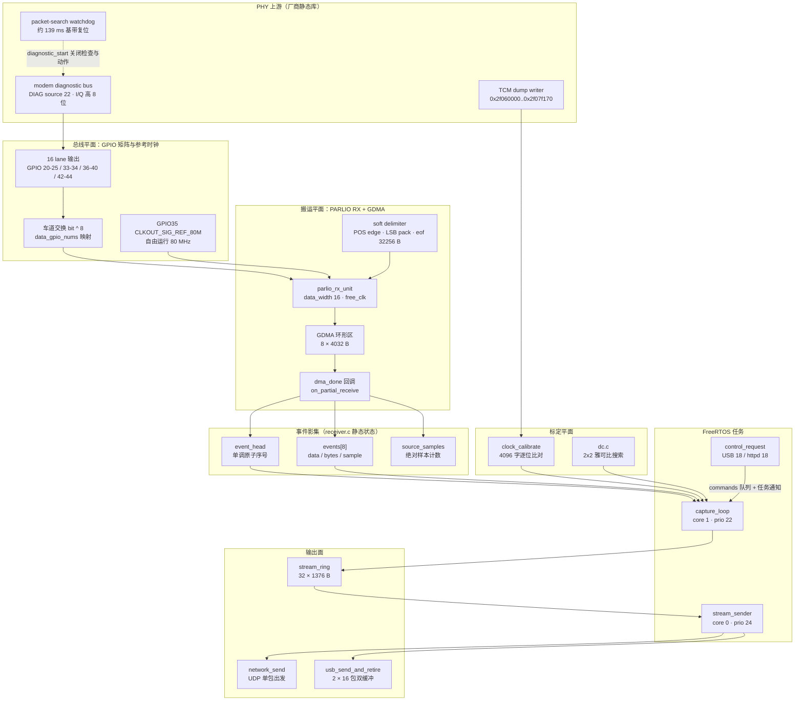
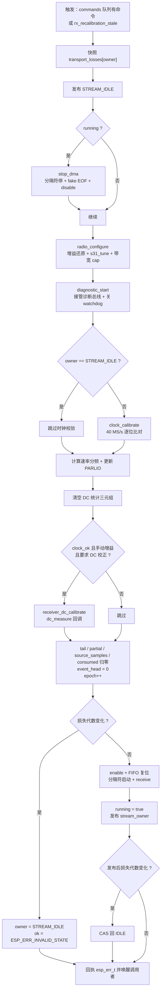

# S31 采集：PARLIO 环形 DMA

> 设计理念：S31 的连续采集把"采样搬运"从 CPU 手里彻底拿走。其他目标靠 dump 引擎把基带样本写进一块 CPU 可见的 SRAM，再由固件轮询、切 bank、填哨兵；S31 走的是另一条路——**把 PHY 的 modem diagnostic bus 用 GPIO 矩阵引出来，当成一条 16 lane 的并行总线，交给 PARLIO 外设 + GDMA 自行搬运**。CPU 从此只做两件事：判定"哪个区域已经写完了、可以安全读"，以及把读到的字节重新切成线上的 I/Q 包。本文解析的就是这条"零 CPU 采样回路"的寄存器级与并发级实现。

## 项目定位与核心价值

S31 的流式固件（`main/targets/esp32s31/streaming`）是整个仓库里唯一一份**不以文本命令协议为主体**的固件：它的目标不是给浏览器查看器提供一次性快照，而是给 SoapyESPSDR 这类主机侧 SDR 软件提供一路持续的、位宽固定为 8 bit 的复基带流，输出面是千兆以太网 UDP 与高速 USB 批量端点。这个定位直接决定了采集后端的形态——主机要的是"没有明显间隙的连续水位"，而不是"每次请求都要重新上电、调谐、标定、采集、校验、打包"的一次性事务。文件头注释把这一点写得很直白：`No CPU sampling loop, TCM refill windows, or TX implementation`，即这份实现刻意不包含 CPU 采样循环、TCM 补充窗口与任何发射路径。

其核心价值体现在三个互相支撑的决定上。第一是**用外设取代固件的时间敏感职责**。在 S3 的环缓冲实现里，CPU 必须在一个 bank 窗口（80 Msps 下约 154 µs）内完成定位、填哨兵、切 bank，任何迟到都会被记录成失败；S31 把这些职责整体移交 PARLIO + GDMA，固件只需要处理"区域完成回调"这一件事，时间预算从"微秒级硬截止"变成"毫秒级软滞后"——8 个 4032 字节的环形区域在 40 MS/s 下提供约 3.2 ms 的容错深度。第二是**把"数据是否可信"变成可判定的前置条件**。采样时钟并非来自 PHY 内部，而是由 `CLKOUT_SIG_REF_80M` 从 GPIO35 引出、经 GPIO 矩阵回灌给 PARLIO 作为外部时钟；这意味着采样相位是固件自己造的，必须被证明。`clock_calibrate()` 因此做了一件相当硬核的事：在 40 MS/s 下抓 4096 个采样字，与 TCM dump 区里同一时刻的 ADC 参考逐位比对，要求**包括 ADC 噪声在内完全一致**才允许开流，两个时钟沿都试，比对失败则不发布 `STREAM_OK` 而是返回 `ESP_FAIL`。第三是**所有退化路径都留下可数的痕迹**。丢样本被分成 DMA 覆写、包环溢出、传输失败三类分别计数，并以上位机可见的绝对样本序号体现为"位置跳变"，而不是让主机拿到一段看起来连续的脏数据。

从"为什么只要 8 bit"这个细节也能看出设计的克制：S31 的 PARLIO 只有一个 16 位接收单元，2 × 10 bit 的满精度 I/Q 塞不进去，于是固件干脆不宣告 10 bit 模式，`stream_packet_t.bits` 恒为 8，`STREAM_PAYLOAD` 恒为 1344 字节（672 对 I/Q）。这不是能力缺失的妥协，而是"宁可少给精度，也不给一条需要主机猜位宽的链路"的一致性选择。

Sources: [receiver.c](main/targets/esp32s31/streaming/receiver.c#L1-L2), [receiver.c](main/targets/esp32s31/streaming/receiver.c#L32-L44), [receiver.c](main/targets/esp32s31/streaming/receiver.c#L258-L327), [stream.h](main/targets/esp32s31/streaming/stream.h#L8-L25), [s31-streaming.md](docs/s31-streaming.md#L100-L133)

## 架构设计与模块划分

采集后端在代码上被切成四个平面：**总线平面**（PHY 诊断总线 → GPIO 矩阵 → PARLIO 输入）、**搬运平面**（PARLIO RX 单元 + 软分隔符 + GDMA 环形区 + 完成回调）、**重组平面**（`capture_loop` 任务与 32 个线包的输出环）、**标定平面**（时钟自校验与 DC 校准）。下图把四个平面与它们的所有权边界画在一起，注意所有的边都是"投递—取走—归还"，没有一条是双向共享的可变状态：



Sources: [receiver.c](main/targets/esp32s31/streaming/receiver.c#L44-L71), [receiver.c](main/targets/esp32s31/streaming/receiver.c#L148-L210), [receiver.c](main/targets/esp32s31/streaming/receiver.c#L469-L528), [control.c](main/targets/esp32s31/streaming/control.c#L136-L171)

### 总线平面：诊断总线如何变成 16 lane 并行口

`receiver_init()` 先用一张 `pins[16]` 表声明数据 lane 的 GPIO 编号，再把 GPIO35 单独作为采样时钟。随后对全部 17 个引脚做一次 `gpio_config`，模式设为 `GPIO_MODE_INPUT_OUTPUT`——这些 pad 在物理上不接任何外部器件，但必须同时允许"输出"（GPIO 矩阵把 PHY 诊断信号驱动到 pad 上）与"输入"（PARLIO 从同一个 pad 采回来），从而在片内完成一次环回。紧接着是 lane 到信号源的映射：`bit < 6` 走 `HP_PROBE_TOP_OUT0_IDX + bit + 2`，`bit ∈ [6,8)` 走 `HP_PROBE_TOP_OUT8_IDX + bit - 6`，`bit ∈ [8,12)` 走 `HP_PROBE_TOP_OUT8_IDX + bit - 4`，最后 4 位走 `LCD_DATA_OUT_PAD_OUT0_IDX`。也就是说，16 条 lane 的奇数编号被拼凑自两个 probe 组和一组 LCD 数据 pad，这是芯片上"恰好能被矩阵驱动、又恰好空闲"的一批引脚——驱动能力与可用性约束，而非逻辑上的连续性，决定了这张表的形状。

最容易被忽略的一行是 `pc.data_gpio_nums[bit] = pins[bit ^ 8]`：PARLIO 的第 `bit` 条数据 lane 读的是承载诊断总线第 `bit ^ 8` 位的那个 GPIO，等于把 16 位字的**高低字节整段交换**。`clock_word()` 的存在证明了这一步是必要的：TCM dump 里一个 32 位字按 `bits 12..19` 与 `bits 2..9` 排布两路 10 位样本（`clock_word()` 把前者放到低字节、后者放到高字节），而"诊断源 22"经 GPIO 矩阵出来的 lane 顺序与 TCM dump **正好相反**，于是固件在硬件接线上做一次 `^8` 交换，让 PARLIO 得到的 16 位字直接就是 `clock_word()` 定义的布局。这样 `clock_calibrate()` 才能用同一套字节序去比对两条物理上完全不同的采集路径。

Sources: [receiver.c](main/targets/esp32s31/streaming/receiver.c#L41-L44), [receiver.c](main/targets/esp32s31/streaming/receiver.c#L474-L505), [receiver.c](main/targets/esp32s31/streaming/receiver.c#L284-L287)

### 搬运平面：PARLIO 单元、软分隔符与 8 个区域

`parlio_rx_unit_config_t` 的每一个字段都对应一条设计约束：`trans_queue_depth = 1`（同一时刻只允许一次接收事务，因为流式采集永远只有一个消费者）、`max_recv_size = DMA_BYTES`（32256 字节，等于整个 GDMA 环的总长度）、`dma_burst_size = 64`（对齐 GDMA 的突发粒度）、`data_width = 16`（一次采 16 lane）、`clk_src = PARLIO_CLK_SRC_EXTERNAL` 且 `ext_clk_freq_hz = 80 MHz`、`flags.free_clk = 1`（不等分隔符，时钟一到就开始搬）、`clk_in_gpio_num = SAMPLE_CLOCK_PIN`、`valid_gpio_num = -1`（没有 valid 握手，纯时钟驱动）。软分隔符则以 `sample_edge = POS`、`bit_pack_order = LSB`、`eof_data_len = DMA_BYTES` 建立"每 32256 字节一个帧边界"的语义，而真正的数据交付靠的是 `on_partial_receive` 回调——即"帧还没结束，但一个区域已经收满"这一事件。

区域长度 4032 字节与数量 8 这两个数字是整条链路的缓冲预算来源：4032 = 63 × 64，落在 GDMA 单描述符的 12 位长度上限之内，同时是 64 字节突发的整数倍；8 个区域合计 32256 字节，在 40 MS/s（2 字节/样本对，80 MB/s）下折合约 403 µs/区域、3.2 ms 总深度。固件侧的 `events[DMA_NODES]` 正好是与这 8 个区域一一对应的影子表，每个表项记录 `data`（驱动给出的区域指针）、`bytes`（本次实际收到的字节数）与 `sample`（该区域第一个样本在 epoch 内的绝对序号）。

`dma_done()` 是唯一在中断上下文运行的代码。它做四件事：取当前的 `event_head`、把回调参数写入 `events[h % 8]`、用 `source_samples += e->recv_bytes / 2` 推进绝对样本计数并把推进前的值写进 `events[h].sample`、最后以 release 语义发布 `event_head = h + 1` 并 `vTaskNotifyGiveFromISR` 唤醒 `capture_loop`。注意 `sample` 的取值发生在自增之前，因此每个区域携带的是"起点位置"而不是"终点位置"，这让下游可以在任意时刻把 `bytes` 换算成采样区间 `[sample, sample + bytes/2)`。

Sources: [receiver.c](main/targets/esp32s31/streaming/receiver.c#L35-L57), [receiver.c](main/targets/esp32s31/streaming/receiver.c#L190-L202), [receiver.c](main/targets/esp32s31/streaming/receiver.c#L485-L511)

### 重组平面：从区域到线包

`capture_loop()` 是一个比它看起来复杂得多的状态机，其职责可以概括成"把 8 个区域按 `DMA_PENDING` 规则转译成 32 个 1376 字节的线包"。它有三个输入：`commands` 队列（深度 1，元素是 `command_t`，携带完整 `receiver_config_t` 与期望 owner）、任务通知（来自 DMA 回调、`receiver_apply` 与 `receiver_transport_lost`）、以及隐式的时间源 `rx_recalibration_stale()`。输出只有两个原子游标：`stream_head`（生产者发布的包数）与 `stream_epoch`。消费者 `stream_sender` 只读这两个变量与 `stream_owner`，因此整个生产/消费关系完全通过原子计数器和 32 槽环表达，没有一把跨任务的锁。

`stream.h` 把线包契约固定死：`magic = "ESR2"`、`version = STREAM_VERSION`、`bits = 8`、`epoch`、`rate`、`sample`、`time_us`、`iq[1344]`，并用 `_Static_assert(sizeof(stream_packet_t) == 1376, "wire packet size")` 在编译期锁住布局，任何字段顺序变更都会直接编译失败。时间戳的算法值得单独一提：`p->time_us = start_us + p->sample / (p->rate / 1000000u)`，先把 rate 除以 1 MHz 再除样本号，保证所有受支持的整数 MHz 采样率下都不会溢出，并且长时间（多日）采集后时间戳仍然有效。

Sources: [stream.h](main/targets/esp32s31/streaming/stream.h#L8-L33), [receiver.c](main/targets/esp32s31/streaming/receiver.c#L329-L333), [receiver.c](main/targets/esp32s31/streaming/receiver.c#L433-L457)

### 标定平面：两套互不干扰的校准

标定平面由两个模块组成，它们的共同点是"都必须在 epoch 发布之前完成，都在 `capture_loop` 里同步调用"。`clock_calibrate()`（在 `receiver.c`）解决"采样时钟是否真的按宣称的速率、在正确的相位上采到了正确的位"；`receiver_dc_calibrate()`（在 `dc.c`）解决"手动增益下残余直流偏置有多大、该往哪个方向补"。前者失败会直接阻止开流，后者失败只是保持 PHY 原值，两者的严格程度不同，反映了"采样正确性"与"信号质量"在优先级上的差别。

Sources: [receiver.c](main/targets/esp32s31/streaming/receiver.c#L258-L327), [dc.c](main/targets/esp32s31/streaming/dc.c#L36-L46), [receiver.c](main/targets/esp32s31/streaming/receiver.c#L362-L378)

## 技术栈与核心工作流

技术栈上，这份组件依赖 `esp_driver_parlio`（PARLIO RX 单元与软分隔符）、`esp_hw_support`（IPC ISR 停顿、时钟树、GPIO 保留检查）、`esp_phy`/`esp_wifi`（射频上电与调谐）、`esp_eth`+`esp_netif`+`esp_http_server`（千兆以太网与配置面）、`espressif__esp_tinyusb`（厂商自定义类、三端点）以及 `espressif__cjson`。构建时还会通过 `--wrap` 劫持 `phy_write_gain_mem` 与 `phy_set_channel_rfpll_freq` 两个厂商符号，把增益表写入变成"可镜像、可追踪、可局部改写 DC 码"的操作。

| 组件 | 在采集链路中的角色 | 关键入口 | 状态归属 |
| --- | --- | --- | --- |
| `receiver.c` | 诊断总线接管、PARLIO 配置、区域→线包重组、epoch 状态机 | `receiver_init`、`capture_loop`、`dma_done` | `events[8]`、`event_head`、`source_samples`、`stream_epoch` |
| `dc.c` | 手动增益下的残余 DC 测量与 2×2 响应矩阵反解 | `receiver_dc_calibrate`、`dc_apply` | `receiver_dc_before/after/jacobian`、`receiver_dc_steps` |
| `stream.h` | 线协议常量、共享状态与原子读写助手 | `stream_packet_t`、`stream_load/store` | `stream_ring`、`stream_head/tail`、`stream_owner` |
| `control.c` | JSON 控制面、丢弃统计聚合、消费端调度 | `control_request`、`stream_sender` | `dropped[3]`、`sender_task` |
| `network.c` / `usb.c` | 两个传输面 | `network_send`、`usb_send_and_retire` | `stream_header`、`samples` 双缓冲 |

Sources: [CMakeLists.txt](main/targets/esp32s31/streaming/CMakeLists.txt#L1-L10), [stream.h](main/targets/esp32s31/streaming/stream.h#L41-L67), [control.c](main/targets/esp32s31/streaming/control.c#L13-L21)

### 启动链路：把 PHY 变成一台"诊断总线发生器"

`receiver_init()` 的顺序本身就是一份硬件初始化时序文档。它先分配两块内部 DMA 内存：`stream_ring`（32 × 1376 字节，64 字节对齐）与 `dma_buffer`（32256 字节，64 字节对齐），并用 `assert` 硬性要求分配成功——这条链路没有"降级到较小缓冲"的余地，因为 PARLIO 的区域长度是配置常量。随后检查 GPIO35 未被保留，配置 17 个 pad，启动 `CLKOUT_SIG_REF_80M` 到 GPIO35 并显式把分频设为 1。注释点明了这一步的用意：**先让参考时钟自由运行、并在 PARLIO 的速率分频器之前选定采样沿，这样时钟校验对所有采样率都成立**。

接下来是 PARLIO 单元与软分隔符的创建、`clk_in_gpio_num` 的外部时钟连线、回调注册。然后固件用一段标准的"Wi-Fi 上电戏法"把 PHY 唤醒：`esp_wifi_power_domain_on` → `esp_phy_rftest_config(1)` → `esp_wifi_init`（存储设为 RAM，避免写 NVS）→ `WIFI_MODE_STA` → `esp_wifi_start` → `WIFI_PS_NONE` → `esp_wifi_set_promiscuous(true)` → `set_channel(1)`。这套序列与其他目标完全一致：固件并不打算用 Wi-Fi 收发，只是借它完成射频与基带的标定与上电。最后创建 `commands`/`replies` 队列、把 `capture_loop` 固定在 core 1、优先级 22，并以 `receiver_apply(&receiver_config, STREAM_IDLE)` 走一遍完整流程——默认 `{2412 MHz, 16 MS/s, gain 40, bandwidth 0, dc_correction 1, agc 0}`，owner 为 IDLE，因此**只调谐、不采集**。

`radio_configure()` 承担"每次重启都要重做一遍"的射频侧工作，顺序如下表。注意其中多处"先复位、再配置、再确认"的三段式动作，全部是为了对抗 PHY 内部状态在多次调谐之间的残留。

| 阶段 | 动作 | 目的 |
| --- | --- | --- |
| 1 | `phy_set_txclk_en(1)` → `burst_gain_mirror(-1)` → `phy_set_txclk_en(0)` | 撤掉上一轮手动增益/DC 覆盖，恢复增益表原件 |
| 2 | 若已保存默认值，回写 `0x20107094` / `0x2010713c` | 让 PHY 的 DC 初值与门限回到标定态 |
| 3 | `s31_tune(mhz)` | 失配重标定 + 标准信道 + 直接写 PLL + PLL 恢复 |
| 4 | 关 loopback、关 CBW40、`phy_bb_cbw_chan_cfg(0)`、`phy_wifi_fbw_sel(0)` | 强制走 20 MHz 基带通路，避免 Wi-Fi 模式残留 |
| 5 | `prepare_rx()` + `phy_pbus_debugmode()` + 清 `phy_param[164]` 的 `0x200` 位 | 打开调试总线输出通道 |
| 6 | `phy_set_rx_gain_table()`，读 `0x2010702c` 得 `receiver_gain_max`，保存两个 DC 默认值 | 建立本频点的增益表与上限 |
| 7 | `burst_gain_mirror(agc ? -1 : gain)`，`phy_rfrx_sat_rst()`，手动模式写 DC 初值 | AGC 交给硬件，手动模式用表内码 |
| 8 | `phy_force_rx_gain(manual, code)` + 双寄存器写 `rx_bandwidth_dcap()` | 落地增益与模拟带宽电容码 |

Sources: [receiver.c](main/targets/esp32s31/streaming/receiver.c#L469-L528), [receiver.c](main/targets/esp32s31/streaming/receiver.c#L104-L147), [tuning.h](main/targets/esp32s31/tuning.h#L5-L15)

### `diagnostic_start()`：在关中断的窗口里夺取诊断总线

这是整个文件里最"寄存器密集"的函数，也是唯一必须 `IRAM_ATTR` 且在 `esp_ipc_isr_stall_other_cpu()` + `taskENTER_CRITICAL()` 双重保护下执行的函数——因为它要改写的寄存器同时被 PHY 后台任务与另一颗核访问。序列的逻辑可以分成四段：

1. **封住 TCM 写入者**：`REG_WRITE(HP_SYSTEM_TCM_DATA_DUMP_CTRL_REG, 0xff000000)` 再 `fence`，让 TCM dump 引擎的输出门关闭，此时 0x2f060000 那块预留区不再被改写；这也是 `clock_calibrate()` 之后必须把该寄存器写回 0 的原因。
2. **建立诊断源**：清 `0x201008cc` 的 lane 位段、把 `0x201070b8` 的低 3 位置 1、置 `0x20100800` bit4、写 `MODEM_WIDGETS_MODEM_DIAG_EXCHANGE_REG = 0x32f2`（握手魔数）、写 `MODEM_WIDGETS_MODEM_DIAG_FIX_SEL_REG = DIAG_BUS_FIX_LOW_EN | (22 << 5)`——即把诊断总线的固定源选成 **source 22**，随后 `HP_SYSTEM_MODEM_DIAG_EN_REG = UINT32_MAX` 全使能。
3. **对齐与触发**：`0x20109004` 先写 `ctrl|BIT(18)` 再写 `ctrl`，形成一次触发脉冲，最后置 `BIT(31)` 启动，并插入 64 个 `nop` 给硬件留稳定时间。
4. **关掉会打断输出的看门狗**：注释写得非常具体——在没有 Wi-Fi 包的情况下，PHY 的 packet-search watchdog 约每 139 ms 复位一次基带，把诊断 I/Q 输出按住约 1.7 µs；而信道配置会把这个看门狗重新装回去，所以这里必须清 `0x20107c3c` 与 `0x20107c40` 的 bit31/bit30。最后把 `HP_SYSTEM_TCM_DATA_DUMP_CTRL_REG` 写回 0 并再次 `fence`，释放临界区。

Sources: [receiver.c](main/targets/esp32s31/streaming/receiver.c#L148-L189), [receiver.c](main/targets/esp32s31/streaming/receiver.c#L261-L283)

### 时钟自校验：用 ADC 自己的数据证明采样相位

`clock_calibrate()` 是全篇最具"可证明性"的设计。它先把速率分频强制为整数 2（即 40 MS/s），然后对两个时钟相位各做一次完整采样：`esp_rom_gpio_connect_in_signal(SAMPLE_CLOCK_PIN, PARLIO_RX_CLK_PAD_IN_IDX, phase != 0)` 的第三个参数就是"反相"开关。每次采样后立刻调用 `clock_reference()`，在同一个关中断窗口里让 TCM dump 引擎跑一小段、读 `0x20109008` 的低 17 位计数，要求计数进入 `[15000, 16383)` 区间且总耗时不超过 100000 个 CPU 周期——这既是"参考数据够用"的门槛，也是"这一步没有卡死"的保险。

比对逻辑本身很短但很严格：从 `dma_buffer + 4096` 起取 4096 个 16 位字（跳过头部 4 KiB 以避开启动瞬态），先要求这 4096 个字的相邻变化数 ≥ 32（否则说明信号是静态的，比对没有意义），然后在参考区内以 256～6807 的窗口起点、步长 2 滑动（因为 40 MS/s 只取 80 MS/s 的每隔一个样本），逐字比较 `data[n] == clock_word(reference[offset + 2*n])`。只有当 4096 个字**全部相等**时才 `return true`，否则记录最长前缀与对应偏移，两个相位都失败后打印 `ADC reference mismatch` 并返回 false。这条"要求完全相等、包括 ADC 噪声"的规则在注释里被明确辩解过：不接受"看起来合理的波形"，因为一旦位序或速率错了，任何模糊的相似性判据都会给出假阳性。

`clock_ok` 的后果是硬的：在重启路径里，`esp_err_t ok = clock_ok ? ESP_OK : ESP_FAIL`，且 `if (clock_ok && cmd.owner != STREAM_IDLE)` 才真正启动 DMA。也就是说**时钟校验不通过时，固件宁可让控制面收到失败回执，也不会把未经证实的样本送上网络**。

Sources: [receiver.c](main/targets/esp32s31/streaming/receiver.c#L258-L327), [receiver.c](main/targets/esp32s31/streaming/receiver.c#L288-L306), [receiver.c](main/targets/esp32s31/streaming/receiver.c#L373-L395)

### 重启状态机：epoch、owner 与"损失代数"

每次配置变更（或 PHY 后台标定导致 `rx_recalibration_stale()`）都要走一遍完整重启：停 DMA、重配射频、重开诊断总线、重校时钟、重算分频、可选 DC 校准、清空计数器、推进 `stream_epoch`、重新挂载 DMA。下图给出这条路径的全部判定点：



这条流程图里有三个值得单独解释的并发细节。

**其一，`stop_dma()` 必须是三段式。** 注释写得很直接：只 `parlio_rx_unit_disable()` 会把"部分接收"的 PARLIO 帧留在挂起状态，而这个残留帧的提前 EOF 会在下一次采集中截断一个 DMA 描述符——包括 DC 校准之后的那一次。所以顺序是：停软分隔符 → `parlio_rx_unit_trigger_fake_eof()` 伪造一个帧结束把它冲掉 → 再 disable。这是全模块唯一的拆除入口，采样路径与校准路径都复用它。

**其二，`receiver_transport_lost()` 用"按传输分别记代"来对抗竞态。** 它先对 `transport_losses[owner]` 做 `__atomic_fetch_add`，再用 CAS 尝试把 `stream_owner` 拉回 `STREAM_IDLE`，最后 `xTaskNotifyGive(capture_task)`。注释解释了这个设计的必要性：**一次损失可能发生在重启已经把 owner 发布成 IDLE 之后**——如果不带代数，重启路径看到的"损失次数没变"就会误判为链路健康。因此重启路径在开始时快照、在发布 owner 之前再查一次、在发布之后用 CAS 再查一次，形成"前后夹逼"的三重检查。以太网侧由 `ETHERNET_EVENT_DISCONNECTED`/`STOP` 触发，USB 侧由端点 `reset()` 回调触发。

**其三，稳态里 owner 也是一条实时判据。** 主循环每轮都读 `stream_owner`，一旦发现它变成 `STREAM_IDLE`，或者变成 `STREAM_USB` 而 `usb_ready()` 为假（拔出），立刻 `stop_dma()` 并清 `running`。这让"拔线"能在毫秒级停下 DMA，而不是继续把一个没人要的流灌进环里。

Sources: [receiver.c](main/targets/esp32s31/streaming/receiver.c#L329-L404), [receiver.c](main/targets/esp32s31/streaming/receiver.c#L59-L68), [receiver.c](main/targets/esp32s31/streaming/receiver.c#L203-L210), [network.c](main/targets/esp32s31/streaming/network.c#L109-L123), [usb.c](main/targets/esp32s31/streaming/usb.c#L53-L59)

### 稳态核心：`DMA_PENDING` 与"发布不变量"

S31 的 PARLIO 有一个不友好的硬件事实，被注释记录下来并直接塑造了整个消费逻辑：**部分接收（partial-RX）回调发生在写入该区域最后几个字之前**。因此回调报告"区域 i 完成"的那一刻，区域 i 的尾部可能仍在被 GDMA 改写。固件的应对是把"可安全读取"定义为"已经有更新的区域上报"，即 `DMA_PENDING = 1`：只有当 `event_head - tail > 1` 时，`tail` 指向的区域才被认为是冻结的。这条规则在三个地方重复出现，必须完全一致：`capture_loop` 的主循环、`capture_loop` 的过载跳转、以及 `dc_measure` 的采样循环。DC 校准甚至用了更保守的窗口——在"已稳定"之后要求 `stream_load(&event_head) - tail < DMA_NODES - 1`，即只在环形区尚未被追上的窗口内累计，避免把正在被覆盖的数据算进均值。

围绕这条规则，`capture_loop` 建立了三条不变量：

- **绝不发布半个包**：拷贝前先用 `slots = (partial + bytes + STREAM_PAYLOAD - 1) / STREAM_PAYLOAD` 算出这次拷贝需要多少个输出槽（注意把已存在的半包也算一个槽），若超过剩余容量就整段丢弃并记 `STREAM_DROP_RING`，绝不做部分写入。
- **绝不让被覆写的拷贝泄漏出去**：拷贝完成后必须复查 `stream_load(&event_head) - tail >= DMA_NODES - 1`。如果 DMA 在拷贝期间已经追上并覆盖，那么这次拷贝的字节可能来自两个不同的时间点，固件于是把 `out` 回滚到 `first_out`、清空 `partial`、记 `STREAM_DROP_DMA`——**宁可丢掉整段，也不发布撕裂的数据**。
- **绝不静默跳变**：只要发现滞后超过一个区域，就用 `tail = h - 1 - DMA_PENDING` 跳到最近一个安全区域，把跳过的样本数 `next - consumed + partial / 2` 记入丢弃统计，并把 `consumed` 更新为新区间的起点。主机侧看到的 `sample` 字段会出现一次精确的跳跃，跳跃量就是丢失量。

```c
/* 区域完成回调：记录区域指针、长度与该区域的绝对样本起点 */
static bool IRAM_ATTR dma_done(parlio_rx_unit_handle_t u, const parlio_rx_event_data_t *e, void *arg) {
    uint32_t h = stream_load(&event_head);
    events[h % DMA_NODES].data = e->data;
    events[h % DMA_NODES].bytes = e->recv_bytes;
    events[h % DMA_NODES].sample = source_samples;
    source_samples += e->recv_bytes / 2;
    stream_store(&event_head, h + 1);
    BaseType_t woke = pdFALSE;
    vTaskNotifyGiveFromISR(capture_task, &woke);
    return woke == pdTRUE;
}
```

Sources: [receiver.c](main/targets/esp32s31/streaming/receiver.c#L36-L40), [receiver.c](main/targets/esp32s31/streaming/receiver.c#L190-L202), [receiver.c](main/targets/esp32s31/streaming/receiver.c#L405-L465), [receiver.c](main/targets/esp32s31/streaming/receiver.c#L226-L251)

### 打包与交付：从区域到 1376 字节

打包循环本身很短，但每一行都在处理跨区域的连续性。`partial` 是"当前未完成包已填的字节数"，它跨区域存活：当一个 4032 字节的区域与上一个区域剩下的半包拼接时，`n = STREAM_PAYLOAD - partial` 决定本次能填多少，`copied` 推进到区域末尾。新包只在 `partial == 0` 时写头，头部字段全部来自当前区域与 `cmd.config`（`epoch` 取实时 `stream_epoch`，`sample` 取 `sample + copied / 2`，`time_us` 用整数 MHz 除法）。循环结束后 `stream_store(&stream_head, out)`，并且**只在确实产出了完整包时**才 `stream_wake_sender()`——避免无意义的唤醒把发送任务从阻塞态拉起来空转。

消费侧的两个传输面在语义上完全不同。以太网路径预先把 42 字节的链路/IP/UDP 头烧进 `stream_header`（`network_destination()` 时计算校验和、ARP 解析下一跳、固定 UDP 长度），`network_send()` 每次只做一次 `taskENTER_CRITICAL` 拷头 + `esp_eth_transmit_ctrl_bufs` 双缓冲零拷贝发送，并在 `ESP_ERR_NO_MEM` 上以 1 ms 为界重试。USB 路径则必须解决"环可能被覆盖"与"端点可能还没空"的冲突，于是用两块各 16 包（约 22 KiB）的内部 DMA 缓冲做乒乓：`usb_send_and_retire()` 先 `memcpy` 到当前缓冲、**立刻**把 `stream_tail` 推进到 `tail_after_copy`（释放环槽给生产者）、然后再去等上一个传输完成的信号量。这样即使主机迟迟不取走上一批，缓冲区也已经与环解耦，生产者不会被一个慢主机拖住。

```c
bool usb_send_and_retire(const void *data, size_t bytes, uint32_t tail_after_copy) {
    if (!usb_ready() || bytes > STREAM_USB_BATCH * sizeof(stream_packet_t)) return false;
    uint8_t *buffer = samples + next_buffer * STREAM_USB_BATCH * sizeof(stream_packet_t);
    memcpy(buffer, data, bytes);
    /* Capture may reuse these slots now: the staged batch is independent of
     * the ring even if the host delays completion of the preceding transfer. */
    stream_store(&stream_tail, tail_after_copy);
    if (xSemaphoreTake(complete, pdMS_TO_TICKS(100)) != pdTRUE) return false;
    ...
}
```

Sources: [receiver.c](main/targets/esp32s31/streaming/receiver.c#L433-L465), [control.c](main/targets/esp32s31/streaming/control.c#L136-L171), [network.c](main/targets/esp32s31/streaming/network.c#L124-L177), [usb.c](main/targets/esp32s31/streaming/usb.c#L156-L178)

### DC 校准：为什么必须先测 2×2 响应矩阵

`dc.c` 面对的是一个物理上"方向不可假设"的问题：诊断总线上看到的 I/Q 与两个基带 DC DAC 的码值之间的关系，既不保证同相，也不保证正交。注释把立场讲得很清楚——**不要假设另一条诊断采集路径上的映射关系，每条通路都要现场识别完整的 2×2 响应**。于是流程是：先测一次基线 `receiver_dc_before`，若其代价 `i² + q²` 已小于 0.25 就直接返回（已经够干净），否则对 I 轴与 Q 轴各施加 ±16 的扰动脉冲，得到两个响应向量，除以扰动步长即得雅可比矩阵的四项 `a,b,c,d`。

这个矩阵随后被用来做"带边界的最速下降"：`determinant = ad - bc` 必须绝对值 ≥ 0.002，且四个偏导都在 ±4 以内，否则判定这次识别不可信、立即回滚到基准码。可行的矩阵则进入最多 5 轮、每轮最多 3 次试探的迭代：先用逆矩阵算出去往零点的位移 `delta`，把它夹到 ±32 再按 `1 << trial` 逐次减半，同时把码值夹在 `[base-96, base+96]` 与 `[0, 511]` 两个范围内——这个"基准 ±96"的窗口保证校准不会跑到增益表另一个工作点上去。任何一次测量失败、任何一轮没有改善，循环立刻结束，最后无条件 `dc_apply(best)` 把**实测最好的码值**锁存进去，而不是锁存最后一次试探的结果。

写码路径同样有两层保护。第一层是 `burst_gain_dc_set()`：它只在增益表镜像有效（`mirrored == index`）时工作，并把改写同时写进 4 个槽位——`index`、`index + 80`（高表镜像）、`79`、`159`（两个表的末槽），且只动 DC 相关位段（`words[index][0]` 的 bit31 与 bits 13..21、`words[index][1]` 的低 8 位），保留 RF DC、RF/基带增益与原生 I/Q 校准字段。第二层是 `dc_apply()` 的 PBUS 冗余写：`phy_pbus_force_test(2, 2, i)` 与 `(3, 2, q)` 只是"顺带"，真正生效的是增益表 RAM，因为"仅写 PBUS 的码值会被接收过程中的增益/状态切换覆盖"；随后用 `0x2010702c` 的两次写（先写 `79 << 24` 的影子项、再写真实 `gain << 24`）强制前端重新加载，并 `vTaskDelay(10 ms)` 等它稳定。

`dc_measure()` 是 `dc.c` 与 `receiver.c` 之间的唯一接口，它是一个函数指针，由 `capture_loop` 在重启路径里传进去。它的实现细节体现了"测量不能被信号内容欺骗"的谨慎：先等 50 ms 让模拟链路稳定（这段时间的数据只读不计），再给 50 ms 的硬截止，要求至少累计 16384 个样本，并且**逐对全量求和**——注释明确拒绝周期性稀疏取样，因为稀疏取样会把测试音混叠进 DC 估计；同时它拒绝 `bytes > 4092` 或奇数长度的区域（说明那是未完成的 partial 区域）。测量结束后同样走 `stop_dma()`，保证下一次采样从一个完整的帧边界开始。

Sources: [dc.c](main/targets/esp32s31/streaming/dc.c#L10-L35), [dc.c](main/targets/esp32s31/streaming/dc.c#L36-L102), [dc.c](main/targets/esp32s31/streaming/dc.c#L19-L32), [burst_gain_table.c](main/common/burst_gain_table.c#L39-L55), [receiver.c](main/targets/esp32s31/streaming/receiver.c#L212-L257)

### 过载语义与调度预算

整条链路的背压不是"阻塞生产者"，而是"丢样本 + 记账 + 让位置跳变可见"。丢弃被分成三类，并在状态回复里以四个字段呈现：

| 枚举 | 触发点 | 语义 | 状态字段 |
| --- | --- | --- | --- |
| `STREAM_DROP_DMA` | 区域滞后 ≥ `DMA_NODES - 1`，或拷贝期间被覆写 | GDMA 环形区被生产者追过，数据物理上已不存在 | `capture_overruns` |
| `STREAM_DROP_RING` | `slots > STREAM_RING` 或剩余槽不足 | 32 包输出环满，写入会破坏已发布数据 | `ring_drops` |
| `STREAM_DROP_TRANSPORT` | `network_send` 或 `usb_send_and_retire` 失败 | 传输面拒绝/超时，样本已出环但没上线路 | `transport_drops` |

`capture_drops` 是前两者之和，因为主机关心的是"采集侧丢了多少"，而"为什么丢"由另外两个字段区分。这套语义的价值在于：主机不需要信任固件的"我没丢"，只要看 `sample` 是否连续即可独立验证；固件的计数只是把原因分类，方便定位是 DMA 追上了、环满了、还是链路饱和。

调度预算是另一层保护。`capture_loop` 固定在 core 1、优先级 22；`stream_sender` 与 TinyUSB 任务都在 core 0、优先级 24，后者高于 Wi-Fi 常见的 23；控制面（HTTP handler 与 `usb_control_worker`）在 18。这个排序不是随手写的：`usb.c` 的注释明确指出"一次完整的 RTOS 时间片在同优先级下就足以掏空样本环"，所以 USB 事件任务必须高于 Wi-Fi housekeeping；而控制面被刻意压低，因为一次 DC 校准可能耗时数百毫秒（`dc_measure` 单次预算 100 ms，5 轮 × 3 试探最坏情况下叠加），如果它与采样共用优先级就会直接造成丢样本。HTTP 侧 `hc.stack_size = 6144`、`task_priority = 18`、`core_id = 0` 与之呼应。

Sources: [stream.h](main/targets/esp32s31/streaming/stream.h#L41-L44), [control.c](main/targets/esp32s31/streaming/control.c#L13-L17), [control.c](main/targets/esp32s31/streaming/control.c#L53-L66), [usb.c](main/targets/esp32s31/streaming/usb.c#L78-L88), [usb.c](main/targets/esp32s31/streaming/usb.c#L206-L215), [network.c](main/targets/esp32s31/streaming/network.c#L218-L229), [receiver.c](main/targets/esp32s31/streaming/receiver.c#L537-L553)

### 控制面与采集面之间的握手

`receiver_apply()` 是一个同步 RPC：把 `{config, owner}` 打包进 `commands` 队列（深度 1，阻塞发送），`xTaskNotifyGive(capture_task)` 唤醒采集任务，然后在 `replies` 队列上阻塞等待 `esp_err_t`。这保证了"配置生效"与"控制面回执"是同一件事——主机收到 `status` 时，`stream_epoch` 已经推进，DMA 已经在跑（或被明确拒绝）。`control_request()` 在调用它之前会做完整的参数校验（频率 2150–2800 MHz 步长 1 MHz、采样率只允许 4/8/16/20/40 MS/s、带宽 0 或 13–54 MHz、增益 ≤ `receiver_gain_max`、USB 上限 20 MS/s），并且**任何一项失败都不做部分应用**，直接返回 `error` 字符串。这个"全有或全无"的语义与采集侧的重启原子性正好配套：要么整条链路以新参数重新开流，要么完全不动。文件里的 `cmd_parse()` 是一个恒返回 `-1` 的空实现，它显式宣告这份固件不参与文本命令协议。

Sources: [receiver.c](main/targets/esp32s31/streaming/receiver.c#L97-L103), [receiver.c](main/targets/esp32s31/streaming/receiver.c#L529-L536), [control.c](main/targets/esp32s31/streaming/control.c#L83-L135)

## 学习与探索建议

读这份实现最容易踩的坑是"把它当成 S3 环缓冲的 S31 版本"——两者的时间尺度、失败语义与所有权威来源完全不同。建议按下表推进：

| 读者 | 建议路径 | 要盯住的问题 |
| --- | --- | --- |
| 想先建立全局 | 本文「架构设计与模块划分」→ [核心架构设计](3-core-architecture.md) 的 L5/L6 两节 | 为什么"dump 引擎 + CPU 轮询"在 S31 上被整体替换成 PARLIO + GDMA |
| 关注并发正确性 | `capture_loop` 的稳态段（`receiver.c` L398–L467）× 3 遍，对照 `dc_measure` L226–L251 | `DMA_PENDING = 1` 为什么在三处出现，三处的条件有何细微差别 |
| 关注寄存器逆向 | `diagnostic_start()` L148–L189 与 `clock_reference()` L261–L283 | 每一个 `REG_WRITE` 的注释解释了哪条 PHY 行为；关中断窗口为什么不可省略 |
| 关注信号质量 | `dc.c` 全文 + `burst_gain_table.c` L39–L55 | 为什么必须现场识别 2×2 矩阵；`±96` 码值窗口与 4 槽位写入的作用 |
| 关注吞吐与背压 | `stream.h` L8–L16、`control.c` L136–L171、`usb.c` L156–L178 | 32 包环（0.54 ms @40 MS/s）与 8 区域（3.2 ms）哪一个先成为瓶颈 |
| 想验证行为 | 用 `{"op":"status"}` 读 `capture_overruns`/`ring_drops`/`transport_drops`，同时观察 `sample` 跳变 | 三类丢弃如何各自定位问题 |
| 想改代码 | `receiver_init()` L469–L528 的 PARLIO 配置、`capture_loop` L362–L395 的重启序列 | 改采样率、改区域长度、加 10 bit 通路分别会碰坏哪条不变量 |

> 一个可操作的实验：把 `DMA_PENDING` 从 1 改成 0，在 40 MS/s 下持续采集几分钟，观察 `capture_overruns` 是否开始增长、以及主机侧是否出现"包内数据错位"。这个实验能直观说明"回调先于写入完成"这条硬件事实的代价。

## 🔗 关联模块与上下游

- 输出面的两个传输实现（本文只讲生产侧）：[S31 传输面：UDP 与高速 USB](17-s31-transport-udp-usb.md)，对应 `main/targets/esp32s31/streaming/network.c` 与 `usb.c`
- 控制面参数语义与 `status` 字段全表的展开：[S31 控制面：JSON 配置接口](18-s31-control-api.md)，对应 `main/targets/esp32s31/streaming/control.c`
- 采集前的调谐与 PHY 标定（`s31_tune` 的实际行为）：[频率调谐：PLL 与 5/6 分频 LO](7-tuning-lo-pll.md) 与 [接收校准：IQ 失配与 DC 漂移](10-rx-calibration.md)
- 增益表镜像与 DC 码写入的公共实现：`main/common/burst_gain_table.c`、`main/common/burst_gain_table.h`（参考 [增益控制：AGC 与手动索引映射](8-gain-control.md)）
- 官方文字说明（与本文逐节对应）：`docs/s31-streaming.md`，尤其是 "How it works" 与 "DC correction" 两节
