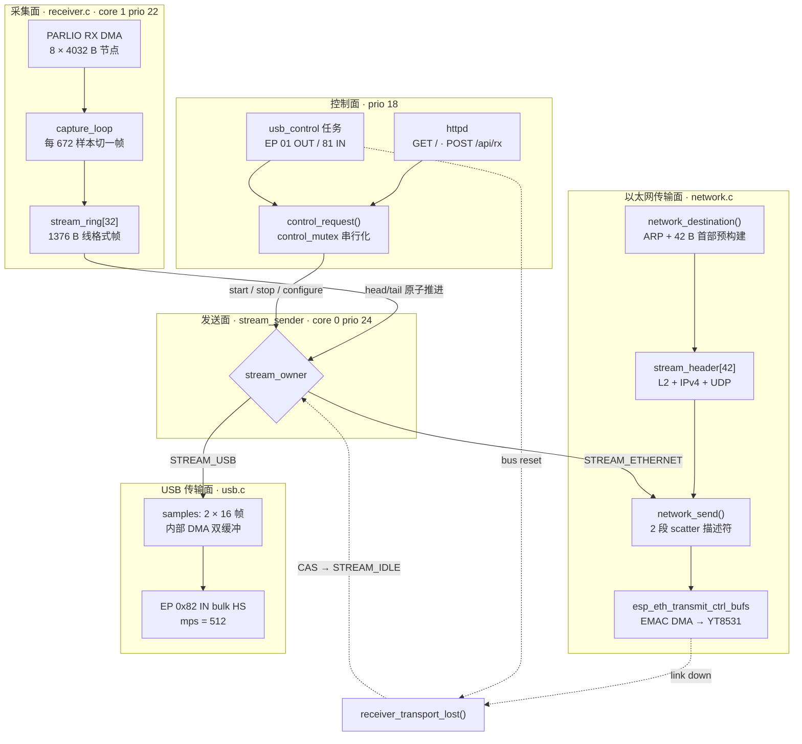
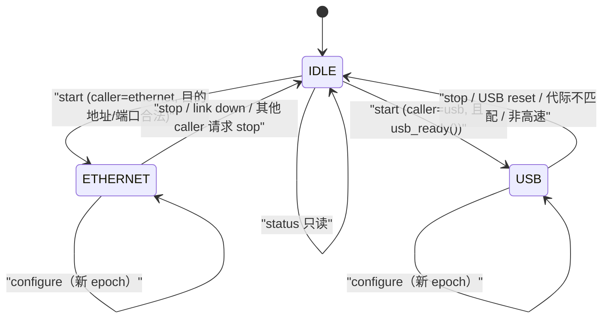
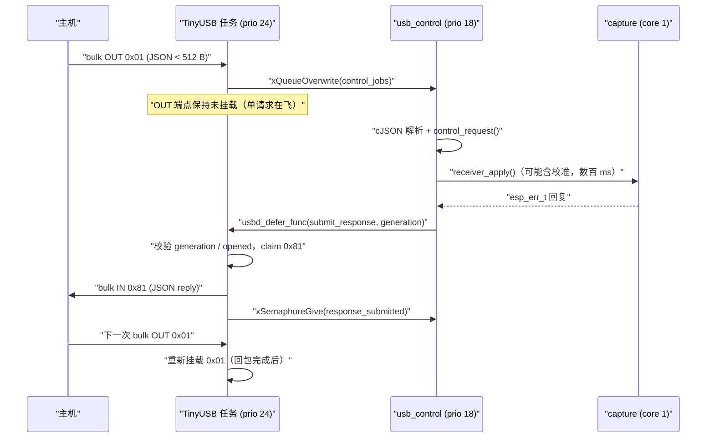

# S31 传输面：UDP 与高速 USB

> **设计哲学速写**：连续 I/Q 与突发抓包是两种完全不同的工程问题。抓包可以重传、可以握手、可以把数据留在板上等主机慢慢取；连续流不行——40 MSa/s 下每秒有 8000 万个样本必须离开芯片，任何一个环节引入一次"等待确认"，样本环就会溢出。因此 S31 的传输面被刻意裁剪成**两条不含重传、不含流控协商、不含 socket 层的数据滑道**：以太网上是原始 L2 帧直发 EMAC，USB 上是主控端 vendor bulk 端点直推。丢包不是错误，而是被显式量化、上报、并可从样本位置反推的可观测事件。

---

## 1. 项目定位与核心价值

`esp32s31-stream` 固件把一块 ESP32-S31 Function-CoreBoard（YT8531 千兆 PHY、16 MB PSRAM）变成一个**纯接收的连续 I/Q 信号源**，供 SoapyESPSDR 使用。它不复用普通 `esp32s31` 固件的串口突发协议，而是另建了一条从 PARLIO DMA 直达网络/总线外设的通路。在这个整体中，`network.c` 与 `usb.c` 构成**传输面（transport plane）**：它们不接触射频、不接触采集时序，只回答一个问题——已经打包成 1376 字节线格式帧的样本，如何以最小的 CPU 代价、最小的延迟抖动，送到主机。

这对文件解决的问题可以拆成四个具体的痛点。**其一是带宽与成本的矛盾**：40 MSa/s、8 bit I + 8 bit Q 意味着 80 MB/s 的净载荷，封装成 1418 字节的以太网帧后线上速率约 680–690 Mbit/s，恰好需要千兆链路"全程不打折"；USB 侧则被 480 Mbit/s 的 High-Speed 信令与批量端点的实际吞吐上限压在 20 MSa/s。**其二是样本路径的 CPU 预算**：若走 lwIP socket，每包都要经历 pbuf 分配、系统调用、tcpip 线程上下文切换（该线程优先级 20、固定在 core 0），在 6 万包/秒的节奏下这些开销会直接吃掉采集任务的余量。**其三是生产者不能被消费者阻塞**：采集侧的设计前提是"生产者永不阻塞、永不覆盖已排队输出"，因此传输面必须在失败时快速返回 false，由上层记账丢弃，而不是让发送任务在原地等待网络恢复。**其四是双运输面的互斥与失联传播**：同一时刻只能有一条滑道持有样本流，链路断开、USB 复位、总线重枚举都必须可靠地使采集停机，且不能与并发的 `start` 请求产生竞态。

核心特性因此呈现出鲜明的取舍色彩。以太网面采用**首部预构建（header pre-build）**：由于载荷长度恒为 1344 字节，IP 总长、UDP 长度、校验和全部是常量，于是 42 字节的 L2+L3+L4 首部在 `start` 时一次性构造完毕并缓存，热路径上只剩一次 42 字节的临界区拷贝加上两段描述符提交；UDP 校验和显式置零并留下注释说明理由——以太网 FCS 覆盖链路完整性，样本位置本身可检测丢包，省下的是一次 1376 字节的第二次遍历。USB 面采用**内部 DMA 双缓冲 + 端点所有权信号量**：样本先被复制进两块 22 KB 的内部 RAM 暂存区，环形槽位在复制完成后、等待前一次传输完成之前就被释放，使采集端可以立即复用；`next_buffer` 在两块缓冲间交替，与 DWC2 IN 端点的双缓冲配置（`bm_double_buffered = 1u << 2`）对齐。控制面则被彻底隔离出数据路径：以太网走 `POST /api/rx`，USB 走 vendor 接口的 `01/81` 端点对，两者共用同一个由互斥量串行化的 `control_request()`，并统一跑在优先级 18——低于发送任务与 USB 事件任务，因此一次 `status` 查询或一次耗时数百毫秒的直流校准都不会拖垮样本流。

Sources: [network.c](main/targets/esp32s31/streaming/network.c#L1-L21), [usb.c](main/targets/esp32s31/streaming/usb.c#L1-L29), [stream.h](main/targets/esp32s31/streaming/stream.h#L8-L26), [s31-streaming.md](docs/s31-streaming.md#L1-L47)

---

## 2. 架构设计与模块划分

### 2.1 分层拓扑

传输面在整体固件中处于"最后一跳"的位置：向上只消费一个 32 槽的环形数组，向下分裂成两条物理滑道，侧面挂着一个共享的控制面。



三层职责的边界非常干净：采集面拥有 DMA 与时间戳，独占 core 1；发送面是样本环的**唯一消费者**，位于 core 0 且优先级 24，高于 lwIP、高于 HTTP，与 TinyUSB 事件任务同级；传输面自身不持有任何环形状态，只把"一帧"或"连续 16 帧"变成一次外设提交。控制面通过 `stream_owner` 这一个 32 位变量与发送面耦合——这是整个设计里最关键的解耦点，也是唯一需要内存序保证的共享状态。

Sources: [receiver.c](main/targets/esp32s31/streaming/receiver.c#L525-L553), [control.c](main/targets/esp32s31/streaming/control.c#L136-L171), [stream.h](main/targets/esp32s31/streaming/stream.h#L26-L26), [stream.h](main/targets/esp32s31/streaming/stream.h#L62-L67)

### 2.2 环形出口：两条滑道共享的唯一数据契约

`stream_packet_t` 是两条运输面之间**唯一的线格式契约**：32 字节 little-endian 首部（`ESR2` 魔数、协议版本 2、位宽 8、epoch、采样率、样本位置、启动后微秒时间戳）加 1344 字节的 `(I, Q)` 交错的 `int8_t` 数组，编译期用 `_Static_assert` 钉死为 1376 字节。传输面完全不需要知道样本从哪来，也无需为不同传输增加私有封装——`stream.h` 的注释直言"没有按传输区分的样本封装"。这个决策的直接收益是：UDP 的一报文一帧与 USB 的连帧拼接可以共用同一套上层解析器，主机端 `SoapyESPSDR` 只需按 1376 字节切分。

| 常量 | 值 | 作用 |
| --- | --- | --- |
| `STREAM_PAYLOAD` | 1344 | 每帧载荷字节数，即 672 个 I/Q 对 |
| `STREAM_RING` | 32 | 样本环槽位数，约 44 KB，置于内部 DMA RAM |
| `STREAM_USB_BATCH` | 16 | 单次 USB 批量传输的最大帧数（22 016 字节） |
| `STREAM_USB_VID/PID` | `0x303a` / `0x4531` | 主机侧 USB 识别 |
| `STREAM_VERSION` | 2 | 线格式版本，与 `status.reply.protocol` 一致 |

Sources: [stream.h](main/targets/esp32s31/streaming/stream.h#L8-L25), [s31-streaming.md](docs/s31-streaming.md#L74-L98)

### 2.3 以太网传输面：预构建首部与 L2 直发

#### 2.3.1 首部预构建（header pre-build）

`network_destination()` 在 `start` 请求被受理时被调用一次，任务是把"主机地址 + UDP 端口"翻译成一个完整的、可以逐帧原样复用的 42 字节首部。它做三件事：解析 IPv4 地址、通过 ARP 取得目的 MAC、按固定长度填满 L2/L3/L4 字段。

```c
/* main/targets/esp32s31/streaming/network.c */
uint8_t *h = d.header;              /* 14 B Ethernet + 20 B IPv4 + 8 B UDP */
h[12] = 8;                          /* EtherType 0x0800, h[13] 保持 0 */
h[14] = 0x45;                       /* IPv4, IHL = 5 */
unsigned ip_length = 28 + sizeof(stream_packet_t);   /* 常量 1404 */
h[16] = ip_length >> 8;  h[17] = ip_length;
h[20] = 0x40;                       /* DF：原子数据报，不参与分片 */
h[22] = 64;                         /* TTL */
h[23] = 17;                         /* UDP */
memcpy(h + 30, &d.peer, 4);         /* 目的 IP */
```

这一段的工程价值在于"把它挪出热路径"：帧长恒定意味着 `total length`、`UDP length`、IP 首部校验和都是不变量，于是每帧只需一次 `memcpy(header, stream_header, 42)`。首部里唯一"看起来奇怪"的字段组合是 `DF = 1` 且 `ID = 0`——这正是 RFC 6864 对原子数据报的推荐形式，也解释了为什么代码从不递增分片标识。UDP 校验和留 0 是一个被明确记录下来的取舍：IPv4 允许零校验和，链路层 FCS 已覆盖传输错误，而样本位置的跳变足以暴露丢包，因此不必为了一次校验再读一遍 1376 字节载荷——在 6 万包/秒下，那相当于额外的 82 MB/s 内存带宽。

Sources: [network.c](main/targets/esp32s31/streaming/network.c#L124-L161)

| 帧内偏移 | 长度 | 字段 | 写入方式 |
| --- | --- | --- | --- |
| 0–5 | 6 | 目的 MAC | ARP 命中项，或非本网段时的网关 MAC |
| 6–11 | 6 | 源 MAC | `netif->hwaddr` |
| 12–13 | 2 | EtherType `0x0800` | 仅写低字节 |
| 14–33 | 20 | IPv4 首部 | DF、TTL 64、proto 17、现场计算校验和 |
| 34–41 | 8 | UDP 首部 | 源端口 `0xD551`、目的端口、长度 1384、校验和 0 |

Sources: [network.c](main/targets/esp32s31/streaming/network.c#L132-L154)

#### 2.3.2 目的地解析：为什么必须借道 tcpip 线程

`etharp_find_addr` / `etharp_request` 属于 lwIP 内核 API，必须在其独占线程上下文中调用，而控制请求可能来自 HTTP 服务任务或 USB 控制任务。因此 `network_destination()` 把一个栈上的 `destination_t` 打包成回调参数，用 `tcpip_callback()` 投递到 tcpip 线程，再用一个二进制信号量同步等待——典型的"跨线程借用内核上下文"模式。路由判断同样被内联：若对端与本机不在同一网段（`ip4_addr_netcmp` 失败），则 ARP 的目标改为默认网关，这正是"主机在外网段、接收机在局域网"这一常见部署的最小处理。

ARP 未命中时函数的行为是**立即失败而非阻塞重试**：先发一个 `etharp_request` 触发解析，然后返回 `false`，由 `control_request()` 折叠成 HTTP 400 / USB 错误 JSON。这是一个值得注意的交互设计——第一次 `start` 可能因为 ARP 表为空而失败，主机稍后重试即可成功。代价是控制互斥量在等待 ARP 期间被持有（见 3.3 节），但 ARP 往返通常在毫秒级，而校准这类真正的长操作发生在互斥量之内、却不在任何实时路径上。

Sources: [network.c](main/targets/esp32s31/streaming/network.c#L22-L47), [network.c](main/targets/esp32s31/streaming/network.c#L124-L131), [control.c](main/targets/esp32s31/streaming/control.c#L107-L117)

#### 2.3.3 提交路径与 1 ms 重试窗口

`network_send()` 是热路径函数，它把预构建首部拷到栈上（保证本次提交期间帧内容不被并发的 `network_destination()` 改写），然后以两段缓冲区描述符（首部 + 载荷）直接提交给 EMAC。这里绕开了 lwIP 的 pbuf、socket 与 `send()` 语义：没有内存分配，没有系统调用，也没有 `ERR_MEM` 之外的失败分支。

```c
/* main/targets/esp32s31/streaming/network.c */
const esp_eth_buf_desc_t buffers[] = {{header, sizeof(header)}, {(uint8_t *)p, sizeof(*p)}};
int64_t deadline = esp_timer_get_time() + 1000;
for (;;) {
    esp_err_t error = esp_eth_transmit_ctrl_bufs(ethernet, NULL, buffers, 2);
    if (error == ESP_OK) return true;
    if (error != ESP_ERR_NO_MEM || esp_timer_get_time() >= deadline ||
        stream_load(&stream_owner) != STREAM_ETHERNET)
        return false;
    esp_rom_delay_us(2);
}
```

这个循环体现了三个有意的约束。**第一，重试窗口被硬性限制在 1 ms**：以太网发送失败的根因几乎只有"TX 描述符耗尽"（`ESP_ERR_NO_MEM`），板级配置给了 12 个 TX 缓冲；超过 1 ms 仍无空位，说明链路已经实质性堵塞或断开，继续等待只会让样本环溢出，因此立刻放弃并交给上层计数。**第二，重试期间复检 `stream_owner`**：如果 1 ms 内发生了 `stop` 或链路断开，函数立刻返回，避免在所有权变更后继续把旧 epoch 的帧推上线路。**第三，等待方式是无阻塞忙等 2 µs**：发送任务优先级 24，一旦调用任何阻塞延时都会给低优先级任务让出时间片，从而拉长整条流水线的抖动。

调用方 `stream_sender()` 在 `ok == false` 时累加 `STREAM_DROP_TRANSPORT` 计数、释放环形槽位并 `vTaskDelay(1)` 退让一拍——这是整条路径上唯一的背压动作，且只影响发送任务自身。

Sources: [network.c](main/targets/esp32s31/streaming/network.c#L162-L177), [control.c](main/targets/esp32s31/streaming/control.c#L145-L170), [sdkconfig.defaults.esp32s31-stream](sdkconfig.defaults.esp32s31-stream#L17-L22)

#### 2.3.4 PHY 与链路事件

`network_init()` 完成的是"从裸 PHY 到可用 Web 服务器"的全套装配：MDC/MDIO 分配在 GPIO 5/6、复位脚 GPIO 7、`phy_addr = -1` 表示自动探测；随后通过 `0x1e`（间接地址寄存器）/`0x1f`（数据端口）两次间接访问写入厂商扩展配置——先在 `0xa001` 指向的寄存器上置位 bit 8，再在 `0xa003` 指向的寄存器上把低字节改写为 `(13 << 4) | 13`。这类写在 YT8531 上对应的是 RGMII 时序/时钟偏斜一类板级相关配置，也是"必须锁定特定 IDF commit"的直接原因之一（依赖内部 PHY 接口，非稳定 API）。

链路事件被分成两个关注点：`got_ip` 只负责把 DHCP 地址写进全局 `stream_ip` 并打印一行 `Web interface: http://...`（该字符串随后出现在每次 `status` 响应中）；`link_event` 则承担带宽上报与失联传播——连接时通过 `ETH_CMD_G_SPEED` 把 `1000/100/10` 写进 `stream_link_mbps`，断开或停止时把它清零并调用 `receiver_transport_lost(STREAM_ETHERNET)`。这个"链路速率只上报、不参与调度"的选择很克制：速率仅用于让主机侧判断 40 MSa/s 是否可行，固件本身不根据速率拒绝 `start`。

Sources: [network.c](main/targets/esp32s31/streaming/network.c#L101-L123), [network.c](main/targets/esp32s31/streaming/network.c#L178-L217), [s31-streaming.md](docs/s31-streaming.md#L19-L27)

### 2.4 USB 传输面：自定义类驱动与端点所有权

#### 2.4.1 描述符与端点布局

USB 面以一个 TinyUSB 自定义类驱动（`usbd_class_driver_t`，名为 `ESPRX`）的形式注册，通过 `usbd_app_driver_get_cb()` 返回给协议栈。设备侧 `bcdUSB = 0x0200`、`bMaxPacketSize0 = 64`；接口声明为 vendor 类 `0xff / 0x53 / 0x02`，三个 bulk 端点：

| 端点 | 方向 | 用途 | 帧长 |
| --- | --- | --- | --- |
| `0x01` | OUT | 主机下发 JSON 请求（< 512 字节） | HS/FS 512/64 |
| `0x81` | IN | 设备回复 JSON（< 1024 字节） | HS/FS 512/64 |
| `0x82` | IN | 连续 I/Q 批量流 | HS/FS 512/64 |

配置描述符用宏 `CONFIG_DESCRIPTOR(mps)` 生成两份（HS `mps=512`、FS `mps=64`），总长 39 字节、`bNumInterfaces = 1`、`bmAttributes = 0x80`、`bMaxPower = 250 mA`；序列号字符串在 `usb_init()` 里由 `esp_read_mac()` 生成 12 位十六进制。`open_driver()` 严格校验类/子类/协议三元组与 `maxlen >= 30`，然后一次性打开三个端点、置 `opened = 1` 并挂上第一个 OUT 请求——这是控制通道的"开机自举"。

```c
/* main/targets/esp32s31/streaming/usb.c */
if (itf->bInterfaceClass != 0xff || itf->bInterfaceSubClass != 0x53 ||
    itf->bInterfaceProtocol != 2 || maxlen < 30)
    return 0;
```

Sources: [usb.c](main/targets/esp32s31/streaming/usb.c#L30-L71), [s31-streaming.md](docs/s31-streaming.md#L41-L47)

#### 2.4.2 控制通道：单请求在飞 + 延迟提交

USB 控制通道的设计核心是**同一时刻只允许一条请求在飞**：`0x01` 的 OUT 端点只有在回包 `0x81` 传输完成（`transfer()` 中的 `ep == 0x81` 分支）之后才被重新挂起。这条规则带来两个直接好处：一是主机天然无法"流水线式"轰炸设备，无需额外流控协议；二是不存在被覆盖仍在使用的请求缓冲区。

更微妙的是回包的**提交时机**。命令执行可能包含 PHY 重调、直流校准（文档记载需 50 ms 稳定加至少 16 384 样本平均，必要时五步迭代，整体可达数百毫秒），绝不能在 TinyUSB 任务上下文里做——那会阻塞 `0x82` 的完成回调，而完成回调正是样本流端点所有权的释放点。于是结构被切成两段：`control_worker`（优先级 18，core 0）负责解析与执行，把结果写进共享的 `response_data`；然后用 `usbd_defer_func()` 把"代际检查 + `usbd_edpt_xfer` 提交"推回 TinyUSB 任务上下文执行，并通过 `response_submitted` 信号量等待它完成，之后才允许复用响应缓冲区。

```c
/* main/targets/esp32s31/streaming/usb.c */
if (job.generation != stream_load(&generation)) receiver_transport_lost(STREAM_USB);
/* Check generation and submit in USB task context so bus reset cannot
 * interleave the check with endpoint submission. */
usbd_defer_func(submit_response, (void *)(uintptr_t)job.generation, false);
xSemaphoreTake(response_submitted, portMAX_DELAY);
```

`generation` 计数器在 `reset()` 中自增，因此总线复位后所有在飞的旧请求与旧回包都会被识别为过期：工作线程丢弃旧代际任务、提交函数拒绝挂载旧代际回包。这就是"拔插一次 USB 不会让上一会话的 JSON 回复串到新会话"的实现方式。此外还有两条防御性规则：`submit_response()` 若因代际或 `opened` 检查失败而无法挂包，仍然重新挂起 OUT 端点，让主机看到超时但通道不致卡死；`transfer()` 在 `XFER_RESULT_SUCCESS` 之外的失败上也重新挂起 OUT，遵循同一原则——**控制通道宁可丢弃一次交互，也不能停在无请求状态**。

Sources: [usb.c](main/targets/esp32s31/streaming/usb.c#L53-L59), [usb.c](main/targets/esp32s31/streaming/usb.c#L78-L141), [s31-streaming.md](docs/s31-streaming.md#L134-L144)

#### 2.4.3 数据通道：双缓冲与"先退休后等待"

`usb_send_and_retire()` 是整个传输面里最具实时考量的一段函数。它接收发送任务聚合好的一段**连续**帧区间（最多 16 帧），执行顺序被精心安排为：

1. 校验 `usb_ready()` 与长度上界；
2. 把数据 `memcpy` 进 `samples + next_buffer * STREAM_USB_BATCH * 1376`，即两块 22 016 字节暂存区之一；
3. **立刻** `stream_store(&stream_tail, tail_after_copy)`——环形槽位就此交给采集端复用，即使前一次 USB 传输尚未完成；
4. 取 `complete` 信号量（100 ms 超时），复检 `usb_ready()`，`usbd_edpt_claim(port, 0x82)` 抢占端点所有权，`usbd_edpt_xfer()` 挂载；
5. `next_buffer ^= 1`，为下一批切换缓冲区。

第 3 步与第 4 步的先后顺序是设计要点：如果先等上一次传输完成再释放环形槽位，采集端就会在 USB 主机调度抖动时直接溢出；而推迟释放之所以安全，正是因为第 2 步已经把数据搬进了一块**与环形解耦**的私有暂存区。这也解释了为什么暂存区必须是两块：一块在 DMA 中被 USB 取走时，另一块可以被 CPU 填充。代码注释还明确指出，`complete` 信号量是**唯一的端点所有权令牌**，不能用额外的 busy 标志替代——因为发送任务可能抢占 USB 完成回调，两个变量之间的窗口会产生竞态。

暂存区的内存属性同样是被约束死的：`heap_caps_aligned_alloc(64, ..., MALLOC_CAP_INTERNAL | MALLOC_CAP_DMA)`——必须是内部 RAM 且 DMA 可达，不能落在 PSRAM；64 字节对齐满足缓存行/DMA 对齐要求。分配失败直接 `assert`，因为这条路径没有降级方案（`usb_init()` 会把剩余内部堆打印出来，方便判断余量）。DWC2 配置里的 `bm_double_buffered = 1u << 2` 对应 IN 端点 2（即 `0x82`），与两块暂存区形成硬件层的呼应。

Sources: [usb.c](main/targets/esp32s31/streaming/usb.c#L153-L178), [usb.c](main/targets/esp32s31/streaming/usb.c#L179-L198), [stream.h](main/targets/esp32s31/streaming/stream.h#L54-L56)

### 2.5 控制面双入口：共享一个语义核心

两条运输面各自提供控制入口，但语义完全一致，因为二者最终都调用 `control_request(request, caller, peer)`：`caller` 是 `STREAM_ETHERNET` 或 `STREAM_USB`，用于所有权判定；`peer` 只有以太网侧使用，作为 UDP 目的地址。

以太网侧的 handler 在 `network.c` 中，职责是"HTTP 适配器"：检查 `content_len` 上下界（`> 0` 且 `< 512`），循环 `httpd_req_recv` 收满，用 `require_null_terminated = true` 严格解析（尾部垃圾即拒），再通过 `getpeername()` 从 socket 取出对端地址。这里有一处被注释强调的细节——HTTP 监听是双栈的，IPv4 客户端会以 `sockaddr_in6` 的 v4-mapped 形式出现，因此必须先判 `IN6_IS_ADDR_V4MAPPED` 再取 `s6_addr[12]`，"绝不能把 flow-info 误读成 IPv4 地址"。响应侧则用 `cJSON_HasObjectItem(out, "error")` 反推状态码：控制层以"错误对象"而非返回码表达失败，HTTP 适配器据此把响应码改成 400，并统一加 `Cache-Control: no-store`。

USB 侧的适配器在 `usb.c` 中，形态完全不同但语义对齐：请求是 `0x01` 上的单次 bulk OUT，上限 512 字节；回复是 `0x81` 上的单次 bulk IN，上限 1024 字节。请求任务队列深度为 1 且使用 `xQueueOverwrite`——复位后新会话的请求可以覆盖尚未执行的旧请求，避免为一条已死的会话做无用功。

Sources: [network.c](main/targets/esp32s31/streaming/network.c#L61-L100), [usb.c](main/targets/esp32s31/streaming/usb.c#L89-L120), [control.c](main/targets/esp32s31/streaming/control.c#L83-L135)

### 2.6 所有权状态机与失联传播

`stream_owner` 是一个三值枚举，构成传输面的互斥锁：只有持有者对应的滑道会被发送任务使用。



状态迁移的执行者分布在不同上下文，因此 `receiver_transport_lost()` 采用"世代号 + CAS"双重机制：先对 `transport_losses[owner]` 做一次原子自增（每个传输面独立的丢失世代），再用 `compare_exchange` 尝试把 `stream_owner` 从当前 owner 换回 `IDLE`（若已被别的传输面接管则不动），最后 `xTaskNotifyGive` 唤醒采集任务。

```c
/* main/targets/esp32s31/streaming/receiver.c */
void receiver_transport_lost(stream_owner_t owner) {
    __atomic_fetch_add(&transport_losses[owner], 1, __ATOMIC_ACQ_REL);
    uint32_t expected = owner;
    __atomic_compare_exchange_n(&stream_owner, &expected, STREAM_IDLE, false,
                                __ATOMIC_ACQ_REL, __ATOMIC_ACQUIRE);
    if (capture_task) xTaskNotifyGive(capture_task);
}
```

为什么需要世代号而不只是把 owner 置为 IDLE？因为采集线程的重启流程是"读 owner → 关 DMA → 重调射频 → 时钟校验 → 可能做直流校准（数百毫秒）→ 重新使能 DMA → 发布 owner"。若一次链路断开恰好发生在这段窗口内，纯 owner 判断会被"随后发布的 owner"掩盖，于是采集会在一条已死的滑道上继续跑。世代号让重启流程能在发布前后两次比对：`capture_loop` 在进入重启时记住 `losses`，在 `parlio_rx_unit_receive()` 之前比对一次，在发布 `stream_owner` 之后再比对一次，任一次发现变化就把本次重启判为 `ESP_ERR_INVALID_STATE` 并回到 IDLE。

采集侧还有一道"消费端校验"：每轮循环若发现 `owner == STREAM_USB && !usb_ready()`，立即停 DMA。这是为了覆盖"USB 拔线但没有产生总线复位事件"的情形——`usb_ready()` 要求 `opened && tud_mounted() && tud_speed_get() == TUSB_SPEED_HIGH`，把"接口打开""设备挂载""确实是高速"三个条件绑成一个每次都可廉价复检的谓词。

Sources: [receiver.c](main/targets/esp32s31/streaming/receiver.c#L56-L68), [receiver.c](main/targets/esp32s31/streaming/receiver.c#L329-L404), [usb.c](main/targets/esp32s31/streaming/usb.c#L153-L155), [control.c](main/targets/esp32s31/streaming/control.c#L107-L131)

---

## 3. 技术栈与核心工作流

### 3.1 技术栈构成

| 层次 | 组件 | 在本模块中的具体角色 |
| --- | --- | --- |
| 应用层 | cJSON (`espressif/cjson 1.7.19~2`) | 唯一的控制报文编解码器，HTTP 与 USB 共用 |
| 应用层 | `esp_http_server` | 以太网控制入口，栈 6 KB、优先级 18、绑定 core 0 |
| 传输层 | lwIP (`tcpip` 线程 prio 20 / core 0) | 仅用于 DHCP、ARP、HTTP；**数据面完全绕过** |
| 链路/驱动 | `esp_eth` + `esp_eth_mac_new_esp32` | EMAC DMA、发送描述符池、PHY 间接寄存器访问 |
| 链路/驱动 | PHY 泛型驱动 (`esp_eth_phy_new_generic`) | YT8531 自协商、速率读取 |
| 设备层 | TinyUSB 0.21.0 + `esp_tinyusb` 2.2.0 | 自定义类驱动、DWC2 双缓冲、`usbd_defer_func` |
| 运行时 | FreeRTOS（1000 Hz tick） | 任务优先级分层、临界区、信号量/队列作为所有权令牌 |
| 构建 | ESP-IDF `c712a0d`（S31 preview） | 依赖内部 PARLIO/PHY 接口的唯一已知可用提交 |

Sources: [idf_component.yml](main/targets/esp32s31/streaming/idf_component.yml), [CMakeLists.txt](main/targets/esp32s31/streaming/CMakeLists.txt), [firmware-targets.json](firmware-targets.json#L84-L93), [sdkconfig.defaults.esp32s31-stream](sdkconfig.defaults.esp32s31-stream#L1-L44)

### 3.2 数据主链路（发送侧）

发送任务 `stream_sender()` 是样本环的唯一消费者，其主循环只做四件事：推进 head/tail 的原子比较、按 `stream_owner` 选择滑道、按 epoch 过滤过期帧、在失败时记账并退让。

以太网分支是"一帧一次提交"：取出槽位 `p`，校验 `p->epoch == stream_epoch` 且 owner 非 IDLE，调用 `network_send(p)`；失败则 `stream_record_drop(count * STREAM_SAMPLES, STREAM_DROP_TRANSPORT)`。

USB 分支则是"聚合成批"，且聚合策略包含一处精妙的条件：

```c
/* main/targets/esp32s31/streaming/control.c */
unsigned batch = STREAM_USB_BATCH;
if (batch > STREAM_RING - (t % STREAM_RING)) batch = STREAM_RING - (t % STREAM_RING);
if (h - t < batch && stream_ring[(h - 1) % STREAM_RING].epoch == p->epoch) {
    ulTaskNotifyTake(pdTRUE, pdMS_TO_TICKS(2));
    continue;
}
while (count < STREAM_USB_BATCH && count < h - t &&
       (t % STREAM_RING) + count < STREAM_RING && p[count].epoch == p->epoch)
    count++;
```

三个约束同时生效：**不跨环形边界**（保证 `count` 个帧在数组内连续，可直接整段 `memcpy`）、**不跨 epoch**（避免把新旧采集期的样本混进同一次传输，主机端无需再校验）、**凑批有上限等待**（不足 16 帧时最多等 2 ms，且仅当队列里最新一帧仍属同一 epoch 时才等）。最后一条的例外分支正是延迟优化：若环形里已经出现了新 epoch 的帧，说明刚发生了配置切换或重启，此时应立即把手上这批送走，而不是为了凑满 22 KB 再把新采集期的数据压后。

Sources: [control.c](main/targets/esp32s31/streaming/control.c#L136-L171), [stream.h](main/targets/esp32s31/streaming/stream.h#L8-L14)

### 3.3 控制主链路（USB 侧时序）

USB 控制的完整往返涉及三个上下文（TinyUSB 任务、USB 工作线程、采集线程），时序如下：



这张图解释了为什么 `control_worker` 的优先级必须低于发送任务、而提交动作必须回到 TinyUSB 任务：`receiver_apply()` 会通过 `commands` 队列把命令交给采集线程并同步等待回执（`xQueueReceive(replies, ..., portMAX_DELAY)`），如果它跑在 TinyUSB 任务里，`0x82` 的完成回调就会被数百毫秒地卡住，而那个回调正是样本流端点所有权的唯一释放点——样本环必然溢出。

以太网侧的主链路形态不同但对称：HTTP handler 在服务任务中直接调用 `control_request()`，`control_mutex` 保证同一条命令不会与其他传输面的命令交叉执行。

Sources: [usb.c](main/targets/esp32s31/streaming/usb.c#L78-L141), [receiver.c](main/targets/esp32s31/streaming/receiver.c#L529-L536), [control.c](main/targets/esp32s31/streaming/control.c#L126-L134)

### 3.4 核心接口一览

| 接口 | 所在文件 | 调用者 | 语义与约束 |
| --- | --- | --- | --- |
| `network_destination(address, port)` | network.c | `control_request` | 构建 42 B 首部；ARP 失败返回 false；非本网段则解析网关 |
| `network_send(packet)` | network.c | `stream_sender` | 提交首部+载荷两段描述符；1 ms 重试窗；owner 变更即中止 |
| `usb_ready()` | usb.c | sender / collector / status | `opened && mounted && HS` 三合一谓词 |
| `usb_send_and_retire(data, bytes, tail)` | usb.c | `stream_sender` | 复制入暂存区→释放环形槽→取令牌→claim→挂载 |
| `usb_init()` | usb.c | `app_main` | 建任务/信号量/队列、分配 DMA 暂存区、安装 TinyUSB |
| `network_init()` | network.c | `app_main` | PHY 装配、netif、事件、HTTP 路由注册 |
| `receiver_transport_lost(owner)` | receiver.c | link_event / reset / worker | 世代自增 + CAS 回 IDLE + 唤醒采集 |

Sources: [network.c](main/targets/esp32s31/streaming/network.c#L124-L177), [usb.c](main/targets/esp32s31/streaming/usb.c#L153-L216), [receiver.c](main/targets/esp32s31/streaming/receiver.c#L62-L68)

### 3.5 实时约束：优先级与线速预算

传输面的可用性本质上是优先级排序问题。板内各执行体的相对次序被固定为"采集 ≈ USB 完成回调 > 发送 > Wi-Fi 记账 ≈ lwIP > 控制"：

| 执行体 | 核心 | 优先级 | 关键约束 |
| --- | --- | --- | --- |
| `capture` 任务 | 1 | 22 | 唯一读 PARLIO DMA 节点者 |
| EMAC RX 任务 | 固定在单核 | 22 | `ETH_MAC_FLAG_PIN_TO_CORE` |
| TinyUSB 事件任务 | 0 | 24 | 必须压过 Wi-Fi（通常 23），等优先级抢一次时间片就可能耗尽样本环 |
| `sender` | 0 | 24 | 与 TinyUSB 同级；只做有界的端点/描述符操作 |
| lwIP `tcpip` | 0 | 20 | 仅承载 ARP/DHCP/HTTP |
| `httpd` | 0 | 18 | 栈 6 KB |
| `usb_control` | 0 | 18 | 可长时间阻塞，不与实时路径争用 |

线速预算可以逐档核算：每帧载荷 1344 字节装 672 个样本，线上帧长 1418 字节，加 8 字节前导与 12 字节帧间隙后 1438 字节/帧。

| 采样率 | 净载荷 | 帧速率 | 以太网线上速率 | USB 可行性 |
| --- | --- | --- | --- | --- |
| 4 MSa/s | 8 MB/s | ≈ 5 952 pkt/s | ≈ 68 Mbit/s | 可 |
| 8 MSa/s | 16 MB/s | ≈ 11 905 pkt/s | ≈ 137 Mbit/s | 可 |
| 16 MSa/s | 32 MB/s | ≈ 23 810 pkt/s | ≈ 274 Mbit/s | 可 |
| 20 MSa/s | 40 MB/s | ≈ 29 762 pkt/s | ≈ 343 Mbit/s | 可（接近 HS 实际上限） |
| 40 MSa/s | 80 MB/s | ≈ 59 524 pkt/s | ≈ 685 Mbit/s | 不可 |

这解释了 `control_request()` 中那条只在 USB 所有权下生效的硬性拒绝：`owner == STREAM_USB && cfg.rate > 20000000` 直接返回错误，提示改用以太网。它也解释了文档里"40 MSa/s 需要千兆全链路 + 主机侧 `net.core.rmem_max` 至少 32 MB"的要求：链路上任何一段百兆化、或主机内核在应用取包前丢包，都会表现为样本位置跳变。

Sources: [receiver.c](main/targets/esp32s31/streaming/receiver.c#L525-L526), [network.c](main/targets/esp32s31/streaming/network.c#L178-L182), [usb.c](main/targets/esp32s31/streaming/usb.c#L204-L215), [control.c](main/targets/esp32s31/streaming/control.c#L124-L125), [s31-streaming.md](docs/s31-streaming.md#L36-L39)

### 3.6 失败模式与可观测性

传输面把"失败"全部折叠成三类计数器与一个位置字段，主机端因此可以精确定位丢包发生在哪一层。

| 现象 | 代码路径 | 上报字段 |
| --- | --- | --- |
| 发送失败（描述符耗尽/链路消失） | `stream_sender` 中 `ok == false` | `transport_drops` |
| USB 端点 claim/挂载失败 | `usb_send_and_retire` 返回 false | `transport_drops` |
| 采集跟丢 DMA 节点 | `capture_loop` 的 `STREAM_DROP_DMA` | `capture_overruns` |
| 样本环满 | `capture_loop` 的 `STREAM_DROP_RING` | `ring_drops` |
| 精确位置 | `stream_packet_t.sample` 跳变 | 帧头内，主机侧直接观察 |
| 链路健康 | `stream_link_mbps`、`usb_connected`、`epoch` | `status` 响应 |

其中 `epoch` 的作用不可替代：每次配置变更或重启都会自增并重置样本位置计数，因此主机在同一 epoch 内看到的位置跳变必然意味着真实的样本丢失，而不是序号回绕或重连造成的假象。这也是"零 UDP 校验和"能够成立的观测前提。

Sources: [control.c](main/targets/esp32s31/streaming/control.c#L27-L67), [receiver.c](main/targets/esp32s31/streaming/receiver.c#L410-L432), [s31-streaming.md](docs/s31-streaming.md#L67-L98)

---

## 4. 典型代码示例

### 4.1 首部缓存的并发保护

首部是全局资源，写者（控制上下文）与读者（发送上下文）之间用一个 `portMUX` 临界区而不是互斥量来协调——因为拷贝只有 42 字节，固定开销的关中断远比可能阻塞的睡眠锁划算：

```c
/* 写侧：network_destination() 末尾 */
taskENTER_CRITICAL(&header_mux);
memcpy(stream_header, h, sizeof(stream_header));
taskEXIT_CRITICAL(&header_mux);

/* 读侧：network_send() 开头 */
taskENTER_CRITICAL(&header_mux);
memcpy(header, stream_header, sizeof(header));
taskEXIT_CRITICAL(&header_mux);
```

读侧之所以不直接引用 `stream_header`，是为了让本次提交的帧在函数返回前保持不可变——描述符指向的是栈副本，而不是可能被下一次 `start` 改写的全局缓冲。

Sources: [network.c](main/targets/esp32s31/streaming/network.c#L156-L166)

### 4.2 端点所有权令牌

```c
/* main/targets/esp32s31/streaming/usb.c */
if (xSemaphoreTake(complete, pdMS_TO_TICKS(100)) != pdTRUE) return false;
if (!usb_ready() || !usbd_edpt_claim(port, 0x82)) {
    xSemaphoreGive(complete);
    return false;
}
if (!usbd_edpt_xfer(port, 0x82, buffer, bytes, false)) {
    usbd_edpt_release(port, 0x82);
    xSemaphoreGive(complete);
    return false;
}
next_buffer ^= 1;
```

三条失败分支都必须把令牌归还，否则下一次发送会白等 100 ms；而 `complete` 在初始化时被显式 `xSemaphoreGive` 一次，表示"端点空闲"是初始状态——把二值信号量当作互斥量使用，是为了让"完成回调"与"发送任务"之间的交接点只有一个。

Sources: [usb.c](main/targets/esp32s31/streaming/usb.c#L166-L177), [usb.c](main/targets/esp32s31/streaming/usb.c#L186-L186)

### 4.3 高速链路是硬门槛

```c
bool usb_ready(void) {
    return stream_load(&opened) && tud_mounted() && tud_speed_get() == TUSB_SPEED_HIGH;
}
```

全速（12 Mbit/s）在物理上不可能承载哪怕是 4 MSa/s 的 8 MB/s 载荷，因此"全速枚举"不被视为可用状态，也不会被 `start` 接受；`usb_init()` 里同时准备了 FS 描述符，只是为了枚举阶段不违反规范。

Sources: [usb.c](main/targets/esp32s31/streaming/usb.c#L153-L155), [usb.c](main/targets/esp32s31/streaming/usb.c#L41-L46)

---

## 5. 学习与探索建议

| 目标 | 建议阅读顺序 | 关注点 |
| --- | --- | --- |
| 复现一次完整的 40 MSa/s 以太网流 | `docs/s31-streaming.md` → `control.c` 的 `start` 分支 → `network.c` 的 `network_destination` | 目的地址来自 HTTP 对端；ARP 未命中会失败一次；主机需放大 UDP 收缓冲 |
| 理解样本环的两端契约 | `stream.h`（结构体与原子助手）→ `receiver.c` 的 `capture_loop` 发布段 → `control.c` 的 `stream_sender` | `head`/`tail` 用 acquire/release 语义，热路径无锁 |
| 排查 USB 掉流 | `usb.c` 的 `transfer` → `reset` → `usb_send_and_retire` | `generation` 与 `opened` 如何让旧会话的回包失效；`complete` 令牌的归还路径 |
| 调整实时优先级 | `receiver.c` 的 `receiver_init` → `usb.c` 的 `usb_init` → `network.c` 的 `network_init` | 24 > 23(Wi-Fi) > 22(采集/EMAC RX) > 20(lwIP) > 18(控制) 的排序理由写在注释里 |
| 替换 PHY 或板型 | `network.c` 的 `network_init` | MDC/MDIO 引脚、复位脚、`0x1e/0x1f` 间接寄存器写入都是板级相关的 |
| 想减少以太网 CPU 占用 | `network_send` 的重试循环 + `sdkconfig.defaults.esp32s31-stream` | TX 描述符数、缓冲区尺寸（1536 刚好容纳 1418 字节帧）、`CONFIG_ETH_TRANSMIT_MUTEX` |

**进阶练习建议**：尝试为 `stream_packet_t` 增加一个递增的帧序号字段，观察它如何与 `sample` 位置字段互补；或把 `network_send` 的单帧提交改成 2–4 帧聚合并测量 `transport_drops` 与延迟的权衡——这会迫使你正面处理"零拷贝缓冲区生命周期"这个传输面真正的难点。

Sources: [s31-streaming.md](docs/s31-streaming.md#L100-L132), [stream.h](main/targets/esp32s31/streaming/stream.h#L34-L67), [sdkconfig.defaults.esp32s31-stream](sdkconfig.defaults.esp32s31-stream#L17-L44)

---

## 🔗 关联模块与上下游

- **`main/targets/esp32s31/streaming/control.c`** — 两条滑道的联合调度者：`control_request()` 决定所有权与合法性，`stream_sender()` 决定聚合与丢弃记账，传输面所有输入输出都经由它。
- **`main/targets/esp32s31/streaming/receiver.c`** — 上游生产者与失联汇合点：提供 `stream_ring` / `head` / `tail` / `epoch`，并在重启流程中通过 `transport_losses` 与传输面完成"失联世代"握手。
- **`main/targets/esp32s31/streaming/stream.h`** — 线格式与原子访问的唯一契约源：1376 字节帧布局、`STREAM_USB_BATCH`、`stream_load/stream_store` 的内存序定义都只在这里出现一次。
- **`docs/s31-streaming.md`** — 面向使用者的契约文档：端点编号、JSON 操作集、丢包计数字段与采样率/运输面矩阵，与上述源码逐条对应。
