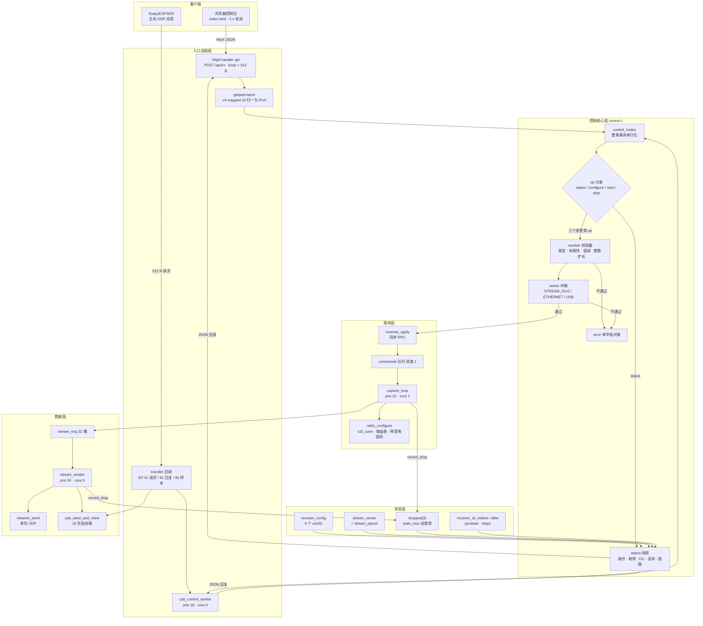
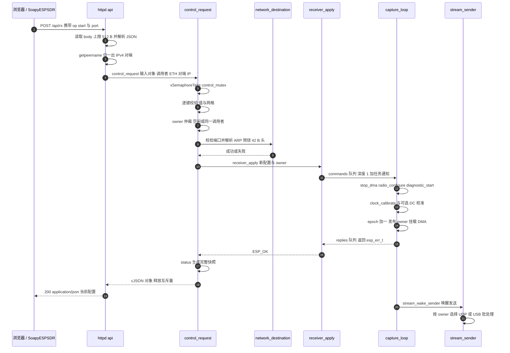

# S31 控制面：JSON 配置接口

> 设计理念：S31 流式固件放弃整个仓库最核心的资产——ASCII 行协议——换来的是一份**只有一条解释器、只有一种错误表达方式、只有一个所有权变量**的控制面。数据面可以有三层缓冲、两个传输、四种时钟相位校验；控制面不允许有第二套真相。`control_request()` 就是那个唯一真相的入口：HTTP 与 USB 各自只负责把字节搬进来、把字节搬出去，中间的全部判断都发生在同一段代码里。

## 项目定位与核心价值

在 ESP-SDR 的其他目标上，主机与固件之间是一条"一问一答"的 ASCII 行协议：`INFO`、`CAP`、`SPEC`、`GAIN HW 40`，每条命令立刻产生一条文本回应，固件几乎不持有跨命令的状态，也不需要判断"这个客户端是否有权控制接收机"——因为采集本身是瞬时事务，命令之间天然串行。S31 的流式固件面对的是一个完全不同的对象：它要把接收机长时间地租给某一个主机应用，让那台应用以 40 MSa/s 的速度持续取走数据，同时还要允许另一个客户端（浏览器）在流运行期间查询状态、改写参数、甚至停机。这就把问题从"命令解析"变成了**会话与资源仲裁**，也解释了为什么这个组件不需要、也不能复用 `burst_commands.h` 那一套片段：`cmd_parse()` 在 `receiver.c` 里被保留成一个恒返回 `-1` 的空实现，正是这份固件"不参与文本命令协议"的显式宣告。

于是控制面要解决的痛点被压缩成四个必须同时成立的命题。**其一是原子性**：射频参数是一组互相耦合的量（采样率决定时钟分频与 USB 带宽上限，带宽决定模拟滤波器电容码，增益决定 DC 校准是否有意义），任何"部分应用"都会让后续状态无法解释，因此校验必须在一份副本上完成、失败必须整笔回滚。**其二是双入口收敛**：以太网 HTTP 与高速 USB 厂商类都能发控制请求，二者的语义不能有任何漂移，否则同一份主机代码在两条链路上会得到不同行为。**其三是所有权**：同一时刻只能有一个传输取走样本，因此需要一个显式的 owner 变量，以及一套"你不能抢占别人、但可以自由支配自己"的仲裁规则。**其四是控制延迟隔离**：一次带 DC 校准的配置变更可能耗时接近两秒，这段时间绝不能让采样停摆，也不能让状态查询读到半应用的状态。

这份实现的核心价值，就体现在它用极小的代码量把这四个命题同时解决的方式上。它没有引入协议版本协商、没有引入会话 token、没有引入命令队列，而是把全部复杂度收拢到 `control_request()` 这一个函数里：一个 `control_mutex` 把整笔事务串行化，一个 `number()` 校验器把"可选字段 + 严格数值域"的 PATCH 语义变成七行代码，一个 `stream_owner_t` 枚举承担全部仲裁，一个 `error()` 工厂函数把所有失败收敛成同一种 JSON 形状。与之配套的浏览器控制台 `index.html` 则是一个 40 行的单文件页面：无框架、无构建步骤、无外部依赖，靠三秒轮询与一个 `dirty` 标志完成"状态展示"与"用户输入保护"的共存。

> 该框架采用了一种非常克制的事务模型：**错误不是返回值，而是数据**。`control_request()` 永远返回一个 cJSON 对象，失败时该对象只有一个 `error` 字段。传输层因此只需要一行 `cJSON_HasObjectItem(out, "error")` 就能决定 HTTP 状态码，而 USB 侧连这一行都不需要——它只管把对象序列化后发回去。控制面的语义因此可以在两种完全不同的传输上保持字节级一致。

Sources: [control.c](main/targets/esp32s31/streaming/control.c#L22-L26), [control.c](main/targets/esp32s31/streaming/control.c#L83-L135), [receiver.c](main/targets/esp32s31/streaming/receiver.c#L97-L103), [network.c](main/targets/esp32s31/streaming/network.c#L88-L99), [stream.h](main/targets/esp32s31/streaming/stream.h#L57-L61), [s31-streaming.md](docs/s31-streaming.md#L41-L72)

## 架构设计与模块划分

控制面在代码上被切成四层，每一层只对下一层负责：**入口适配层**（`network.c` 的 `api()` 与 `usb.c` 的 `control_worker`）负责字节进出与传输特有的约束；**控制核心层**（`control.c`）负责串行化、分发、校验、仲裁与快照；**状态层**（`stream.h` 声明的全局变量与 `receiver.c` 里的 `capture_loop`）是唯一真相所在；**落地层**（`receiver_apply` → `radio_configure`）把一份 `receiver_config_t` 变成寄存器写入。下图把四层与它们之间的调用方向画在一起，注意两条入口在 `control_mutex` 处合流，而数据面只在两个极短的临界区里与控制面接触：



Sources: [control.c](main/targets/esp32s31/streaming/control.c#L9-L21), [control.c](main/targets/esp32s31/streaming/control.c#L79-L135), [network.c](main/targets/esp32s31/streaming/network.c#L61-L100), [usb.c](main/targets/esp32s31/streaming/usb.c#L89-L120), [receiver.c](main/targets/esp32s31/streaming/receiver.c#L529-L536), [stream.h](main/targets/esp32s31/streaming/stream.h#L26-L44)

### 入口适配层：两种传输，一条解释器

两个入口的实现差异几乎是纯粹"传输物理"的，而不是语义的。以太网侧是 `api()`：它先把请求体读进一个 512 字节的栈缓冲，长度判定用的是 `content_len <= 0 || content_len >= sizeof(body)`——也就是**最多 511 字节正文加一个 NUL**，超长直接回 `HTTPD_400_BAD_REQUEST` 并故意返回 `ESP_FAIL` 以关闭连接，而不是留下一个未读的请求体污染 keep-alive 连接。随后 `cJSON_ParseWithOpts(body, NULL, true)` 以"要求 NUL 结尾"的模式解析。同样重要的是它如何确定数据面的目标地址：不是从 JSON 里读一个 IP，而是用 `getpeername()` 从套接字反查对端地址，并且专门处理了双栈监听下 IPv4 对端被映射成 `sockaddr_in6` 的情形——注释明确禁止把 flow-info 字段误当作 IPv4 地址重新解释。这条约定意味着**控制请求的来源地址就是数据报的发送目的地址**，主机无法让固件把样本打到第三方地址上。

USB 侧是 `control_worker`：它从一个深度为 1 的队列里取出 `control_job_t`（`generation` + `bytes` + 512 字节数据），检查代数是否仍然是当前 USB 会话，用 `job.bytes < sizeof(job.data)` 确保末尾有空位写 NUL，然后调用同一个 `control_request(in, STREAM_USB, NULL)`——注意第三个参数 `peer` 传的是 `NULL`，因为 USB 传输没有 UDP 目的地址的概念，`start` 也不需要端口。回复路径则分三步：先 `cJSON_PrintUnformatted` 打印、检查长度是否落在 1024 字节的 `response_data` 之内（超长时降级为一条固定的 `{"error":"Control response unavailable"}`），再通过 `usbd_defer_func` 把提交动作推迟到 TinyUSB 任务上下文里执行——注释解释了为什么必须这样：`control_request` 内部可能触发数百毫秒的 DC 校准，绝不能在端点回调上下文里跑。

两个入口对"回复大小"的预算构成了控制面一条隐式契约：请求侧 512 字节、回复侧 1024 字节。这两个数字同时出现在 `api()` 的栈缓冲、`request_data`、`job.data` 与 `response_data` 上，因此增加一个新的 `status` 字段并不是"加一行 `cJSON_AddNumberToObject`"那么简单——它必须挤进这 1024 字节。按最长的十进制数值估算，当前约 30 个键的 `status` 回复在 0.7 KB 量级，仍有余量但已不再宽裕。

Sources: [network.c](main/targets/esp32s31/streaming/network.c#L61-L87), [usb.c](main/targets/esp32s31/streaming/usb.c#L22-L29), [usb.c](main/targets/esp32s31/streaming/usb.c#L89-L120), [usb.c](main/targets/esp32s31/streaming/usb.c#L121-L141)

### 控制核心层：control.c 的四件设施

`control.c` 的静态状态只有四组，每一组对应一种职责，且都不需要初始化以外的管理：

| 设施 | 声明 | 职责 | 同步原语 |
| --- | --- | --- | --- |
| `control_mutex` | L9 | 串行化整笔控制事务（含校验、落地、快照） | FreeRTOS 互斥量，`portMAX_DELAY` |
| `stats_mux` / `dropped[3]` | L11-L12 | 三类丢弃样本计的跨核累加与一致性快照 | `portMUX_TYPE` 自旋锁 |
| `sender_task` | L10 | 让生产者能唤醒消费端 | 原子读写 + `xTaskNotifyGive` |
| `stream_record_drop` / `stream_wake_sender` | L13-L21 | 上述两者的唯一操作入口 | 见上 |

`stats_mux` 之所以必须是自旋锁而不是互斥量，原因在调用者：`stream_record_drop()` 会被 `capture_loop`（core 1）与 `stream_sender`（core 0）从两颗核上调用，临界区里只做一次 `uint64_t` 加法；而 `status()` 在同一个锁下做一次 24 字节的 `memcpy` 快照，因此 `capture_drops`（前两类之和）、`capture_overruns`、`ring_drops`、`transport_drops` 四个字段在同一时刻被采样，不会出现"合计小于分项"的自相矛盾。这是整个控制面与数据面之间最短的一条接触路径——一次加法和一次 24 字节拷贝，就是全部。

`sender_task` 的发布用了显式的 release/acquire 语义：`stream_sender` 一进入就用 `__atomic_store_n(&sender_task, xTaskGetCurrentTaskHandle(), __ATOMIC_RELEASE)` 登记自己的句柄，而 `stream_wake_sender()` 用 `__atomic_load_n(..., __ATOMIC_ACQUIRE)` 读取并判空。判空不是防御性编程的洁癖：`app_main` 里 `receiver_init()`/`control_init()`/`usb_init()`/`network_init()` 全部先于创建 `stream_sender` 任务，启动早期任何一条唤醒都必须安全地变成空操作。

Sources: [control.c](main/targets/esp32s31/streaming/control.c#L9-L21), [control.c](main/targets/esp32s31/streaming/control.c#L53-L60), [receiver.c](main/targets/esp32s31/streaming/receiver.c#L537-L553)

### 校验层：`number()` 与 PATCH 语义

`control_request()` 的参数校验全部由一个 11 行的辅助函数承担，它的返回值语义是整个 PATCH 式接口的支点：**返回 `true` 表示"这个字段可用"，包括"字段根本不存在"这种可用**。因此 `configure` 可以只带 `rate` 一个键，其余字段保持当前值——实现方式是把全局 `receiver_config` 先整体拷进局部 `cfg`，再让每个 `number()` 就地把通过校验的值写回 `cfg` 的对应字段。

```c
static bool number(const cJSON *obj, const char *key, uint32_t *value, uint32_t low, uint32_t high,
                   uint32_t step) {
    const cJSON *v = cJSON_GetObjectItemCaseSensitive(obj, key);
    if (!v) return true;
    if (!cJSON_IsNumber(v) || !isfinite(v->valuedouble) || v->valuedouble < low || v->valuedouble > high)
        return false;
    uint32_t n = (uint32_t)v->valuedouble;
    if (n != v->valuedouble || (n - low) % step) return false;
    *value = n;
    return true;
}
```

这五行判定各自拦掉一类真实错误：`cJSON_IsNumber` 拒绝布尔字面量与字符串（因此 `"agc": true` 是非法的，必须写 `0`/`1`，这也解释了为什么 `agc` 与 `dc_correction` 用 `number(..., 0, 1, 1)` 而不是布尔解析）；`isfinite` 拦掉 `1e400` 这类被解析成 `inf` 的输入与 NaN；范围判定与 cJSON 内部的双精度存储配合，`n != v->valuedouble` 则拒绝任何小数——`frequency: 2442.5e6` 不会静默截断成 2442 MHz，而是整笔失败；最后 `(n - low) % step` 强制网格对齐，这是"中心频率必须是 1 MHz 整数倍"这条硬件约束的唯一执行点。

| 键 | 校验位置 | 值域 | 网格/白名单 | 备注 |
| --- | --- | --- | --- | --- |
| `frequency` | L96 | 2 150 000 000 – 2 800 000 000 | 步长 1 MHz | 下限与实测可用接收范围一致（S31 约从 2150 MHz 起） |
| `dc_correction` | L97 | 0–1 | 步长 1 | 1 = 手动增益下开模拟 DC 校准 |
| `agc` | L98 | 0–1 | 步长 1 | 1 = 硬件 AGC，`gain` 失效 |
| `gain` | L99 | 0 – `receiver_gain_max` | 步长 1 | 上限是运行时从 PHY 增益表读出的，非编译期常量 |
| `rate` | L100 | 1 000 000 – 40 000 000 | 另外必须是 4/8/16/20/40 MS/s 之一 | 白名单用三个 `!=` 连写实现 |
| `bandwidth` | L101-L102 | 0 – 54 000 000 | 步长 1 MHz，且必须为 0 或 ≥ 13 MHz | 0 表示跟随采样率（下限 13 MHz） |
| `port` | L112 | 1024–65535 | 步长 1，且非 0 | 仅以太网 `start` 使用 |

表里有两处值得单独说明。**第一处是 `bandwidth` 的"0 与 13 之间"**：`number(..., 0, 54000000, 1000000)` 本身允许 1–12 MHz，但模拟滤波器物理上做不到，所以后面多挂了一条 `(cfg.bandwidth && cfg.bandwidth < 13000000)`——用"非零且小于 13 MHz"把 0 这个合法特例摘出去，而不是把值域拆成两段。浏览器控制台在 `onsubmit` 里也做了同样的判断并给出更友好的文案，属于"固件守底线、页面做体验"的分工。**第二处是 `rate` 的白名单**：1–40 MS/s 之间明明还有大量可用数值，固件只认五个——因为这些是唯一经过时钟自校验（`clock_calibrate` 固定按 40 MS/s 逐位比对）与模拟滤波器曲线标定的档位，接受中间值只会得到一条无法被证明的链路。

```c
else if (!number(request, "frequency", &cfg.frequency_hz, 2150000000u, 2800000000u, 1000000) ||
         !number(request, "dc_correction", &cfg.dc_correction, 0, 1, 1) ||
         ...
         (cfg.bandwidth && cfg.bandwidth < 13000000) ||
         (cfg.rate != 4000000 && cfg.rate != 8000000 && cfg.rate != 16000000 && cfg.rate != 20000000 &&
          cfg.rate != 40000000))
    r = error("Unsupported receiver setting");
```

这一整串 `||` 的短路求值同时完成了两件事：任何一个字段失败就立刻停止校验，且**已经被写入 `cfg` 的前序字段不会产生任何外部效果**，因为 `cfg` 只是栈上副本，真正的落地发生在后面的 `receiver_apply()`。这就是"全有或全无"在代码层面的形态，它没有任何回滚逻辑，因为从未前移过。

Sources: [control.c](main/targets/esp32s31/streaming/control.c#L68-L78), [control.c](main/targets/esp32s31/streaming/control.c#L89-L105), [index.html](main/targets/esp32s31/streaming/index.html#L36-L36), [stream.h](main/targets/esp32s31/streaming/stream.h#L27-L33), [rx-controls.md](docs/rx-controls.md#L116-L136)

### 仲裁层：owner 租约与两个方向的所有权检查

`stream_owner_t` 只有三个取值：`STREAM_IDLE`、`STREAM_ETHERNET`、`STREAM_USB`。它同时是一个"资源状态"和一份"租约"——没有过期时间、没有 token、没有引用计数，因为租约的释放不是靠超时，而是靠传输层自己上报失败：以太网侧由 `ETHERNET_EVENT_DISCONNECTED`/`STOP` 触发 `receiver_transport_lost(STREAM_ETHERNET)`，USB 侧由端点 `reset()` 回调触发 `receiver_transport_lost(STREAM_USB)`。两者都会把 `stream_owner` 用 CAS 拉回 `IDLE` 并推进对应的"损失代数"。

仲裁规则本身只有两条，但它在三个方向上都成立。`start` 时要求 `owner == IDLE || owner == caller`，否则回 `Receiver is owned by the other transport`；`stop` 时要求同一条规则，因此**你只能停掉自己的流，无法停掉别人的流**；而 `configure` 不受这条规则约束——它可以在任何 owner 下生效，包括 IDLE，这正是"先配置、再让 SDR 应用启动"这一正常使用序列所需要的。所有权检查的第二层是传输特有的前置条件：以太网 `start` 必须给出合法 `port` 且 `network_destination(peer, port)` 成功（后者内部要做 ARP 解析并预烧 42 字节链路/IP/UDP 头，ARP 失败即视为启动失败）；USB `start` 则要求 `usb_ready()`——即端点已打开、TinyUSB 已挂载、且链路速率是高通（`tusb_speed_get() == TUSB_SPEED_HIGH`）。

第三层检查发生在所有权确定之后，位置很容易被忽略：

```c
if (!r && owner == STREAM_USB && cfg.rate > 20000000)
    r = error("USB supports at most 20 MS/s; use Ethernet for 40 MS/s");
```

它用的是**本地已更新的 `owner`**：`start` 分支里 `owner = caller`，`stop` 分支里 `owner = STREAM_IDLE`，`configure` 分支里则是读出来的当前 owner。于是这条检查同时覆盖了两种情形——"用 USB 起 40 MS/s 的流"和"流已经在 USB 上跑着，来了一条把 rate 改到 40 MS/s 的 `configure`"。这也是为什么浏览器控制台在 USB 占用时会主动把 `40000000` 这个 option 置灰：页面在做同一件事的"事前劝阻"，固件在做"事后拒绝"。

值得注意的次序细节是：`start` 成功并不等于 `stream_owner` 立刻变成 `caller`。控制层只是把期望的 owner 传进 `receiver_apply()`，真正发布 owner 的动作发生在 `capture_loop` 里（`stream_store(&stream_owner, cmd.owner)`），而且发布前后各做一次损失代数比对，形成"前后夹逼"。因此在 `receiver_apply()` 返回之前的一次 `status` 仍可能报 `transport: "idle"`——这在语义上是正确的，因为那时 DMA 确实还没开始搬样本。

Sources: [control.c](main/targets/esp32s31/streaming/control.c#L107-L125), [receiver.c](main/targets/esp32s31/streaming/receiver.c#L59-L68), [receiver.c](main/targets/esp32s31/streaming/receiver.c#L343-L396), [network.c](main/targets/esp32s31/streaming/network.c#L109-L123), [network.c](main/targets/esp32s31/streaming/network.c#L124-L161), [usb.c](main/targets/esp32s31/streaming/usb.c#L53-L59), [usb.c](main/targets/esp32s31/streaming/usb.c#L153-L155), [index.html](main/targets/esp32s31/streaming/index.html#L34-L34)

### 落地层与快照层：一笔事务的两个端点

`receiver_apply()` 是一个严格的同步 RPC：把 `{config, owner}` 塞进深度 1 的 `commands` 队列（阻塞发送）、`xTaskNotifyGive(capture_task)` 唤醒采集任务、然后在 `replies` 队列上 `portMAX_DELAY` 等待一个 `esp_err_t`。这个设计让"配置已生效"与"控制面回执"成为同一件事：只要 `control_request()` 返回的是 `status()` 而不是 `Receiver configuration failed`，就意味着 `radio_configure()` 已经把新频率写进了 PLL、增益表已按新档位重建、`stream_epoch` 已经推进。这种同步性不是性能优化，而是**语义正确性的必要条件**——若改成异步投递，主机在收到"成功"之后立刻开流，就有机会落在旧配置上。

快照层就是 `status()`。它把五类信息塞进同一个对象，每一类服务于不同的读者：

| 分组 | 字段 | 读者 |
| --- | --- | --- |
| 身份与协议 | `product`、`protocol`（= `STREAM_VERSION` = 2）、`epoch`、`time_us` | SoapyESPSDR 的能力判断与主机侧计时 |
| 传输与链路 | `transport`、`usb_connected`、`ip`、`ethernet_mbps` | 浏览器卡片区与链路诊断 |
| 射频设置 | `frequency`、`rate`、`gain`、`agc`、`gain_max`、`bandwidth`、`effective_bandwidth`、`dc_correction` | 表单回填与"当前真实生效值" |
| DC 标定结果 | `dc_before_i/q`、`dc_after_i/q`、`dc_steps`、`dc_j00/j01/j10/j11` | 信号质量诊断，主机侧无需建模 |
| 丢弃与资源 | `capture_drops`、`capture_overruns`、`ring_drops`、`transport_drops`、`dma_free` | 过载定位 |

其中 `effective_bandwidth` 是通过 `receiver_bandwidth(&receiver_config)` 求出的**实际生效带宽**——`bandwidth == 0` 时它返回 `max(rate, 13 MHz)`，因此主机不用自己复述那条"0 表示跟随采样率、并有 13 MHz 模拟地板"的规则。`transport` 字段的实现则有一个值得诚实记录的细节：它在三元表达式里把 `stream_load(&stream_owner)` 读了两次，在 owner 恰好切换的瞬间理论上可能两次读到不同的值，最坏结果是"报 idle 但实际已在传输"一类瞬时不一致；由于 owner 只在 `IDLE` 与某一个传输之间切换，这种不一致不影响任何控制决策，但它提醒读者：`status()` 提供的是**一致性快照**而非**事务快照**。

Sources: [control.c](main/targets/esp32s31/streaming/control.c#L27-L67), [control.c](main/targets/esp32s31/streaming/control.c#L126-L131), [receiver.c](main/targets/esp32s31/streaming/receiver.c#L529-L536), [stream.h](main/targets/esp32s31/streaming/stream.h#L30-L33), [dc.c](main/targets/esp32s31/streaming/dc.c#L14-L15)

### 控制台：`index.html` 的四个状态机变量

浏览器控制台是这份控制面的"参考客户端"，它只用四个模块级变量 `initialized`、`dirty`、`busy`、`lastStatus` 就解决了一个真实的 UI 难题：**周期性状态刷新不能覆盖用户正在输入的内容**。`form` 的 `input` 事件把 `dirty` 置真；`poll()` 每三秒发一次 `{"op":"status"}`，并且只在"从未初始化"或"用户没有改动"时才回填表单（`display(s, !initialized || !dirty)`）；任何一次 `action()` 成功后都以服务端回复为准强制回填并清 `dirty`，因为这时服务端是唯一的真相来源。

页面的功能边界也值得注意：**它没有"开始接收"按钮**。表单只有"应用设置"（`configure`）与"停止以太网"（`stop`），正文里明确写着让用户在 SDR 应用里启动接收。这是一个刻意的分工——数据面的 owner 属于 SDR 应用，页面的角色是"配置台 + 状态板"；`start` 只由 SoapyESPSDR 通过 `POST /api/rx` 或 USB 端点发出。同样的逻辑体现在 `stop` 按钮的可用性上：只有 `transport === 'ethernet'` 时才可点，因为从以太网页面发出的 `stop` 的调用者身份是 `STREAM_ETHERNET`，若流正被 USB 占用，这条请求会被仲裁层拒绝——UI 的禁用状态实际上是仲裁规则的前置投影。

其余细节都服务于同一目标：在没有任何构建工具、没有 CDN、没有 TLS 的部署环境里保持可用。`request()` 用 `AbortSignal.timeout(5000)` 给每个请求加硬超时，这个数字与固件侧最坏情况相称（一次 DC 校准链最多 1 + 2 + 5×3 = 18 次测量，每次含 50 ms 稳定期与 50 ms 截止期，量级约 1.8 s，仍在 5 s 之内）；复制按钮优先用 `navigator.clipboard`，而在 `window.isSecureContext` 为假时退回 `document.execCommand('copy')`——局域网明文 HTTP 恰好不是安全上下文，这段 fallback 不是兼容性摆设而是必需路径；`gain` 输入的静态上限写死 71，但首次拿到 `status` 后会被 `form.elements.gain.max = s.gain_max` 覆盖成 PHY 实际测得的表上限。整个页面通过 `EMBED_TXTFILES` 编进固件，由 `_binary_index_html_start/_end` 符号直接以 `httpd_resp_send` 发出，连文件系统的抽象层都省掉了。

Sources: [index.html](main/targets/esp32s31/streaming/index.html#L16-L28), [index.html](main/targets/esp32s31/streaming/index.html#L31-L39), [network.c](main/targets/esp32s31/streaming/network.c#L49-L60), [CMakeLists.txt](main/targets/esp32s31/streaming/CMakeLists.txt#L1-L10), [dc.c](main/targets/esp32s31/streaming/dc.c#L74-L99)

## 技术栈与核心工作流

技术栈上，控制面几乎不依赖任何"重"组件：`espressif__cjson` 提供 JSON 解析与序列化，`esp_http_server` 提供 HTTP 端点（`stack_size = 6144`、`task_priority = 18`、`core_id = 0`——6 KiB 栈是为 cJSON 的递归解析与打印留的余量），`espressif__esp_tinyusb` + `espressif__tinyusb` 提供厂商自定义类的三个批量端点，FreeRTOS 提供互斥量、队列、自旋锁与任务通知。没有 WebSocket、没有事件流、没有鉴权层——文档也明说这份控制接口是不认证的，只能用在可信网络里。

| 组件 | 在控制链路中的角色 | 关键入口 | 独占状态 |
| --- | --- | --- | --- |
| `control.c` | 串行化、分发、校验、仲裁、快照；并兼管发送泵 | `control_request`、`status`、`number`、`stream_sender` | `control_mutex`、`dropped[3]`、`sender_task` |
| `index.html` | 参考客户端：配置台 + 状态板 | `request`、`display`、`action`、`poll` | `initialized`/`dirty`/`busy`/`lastStatus` |
| `network.c` | 以太网入口与出口；`peer` 地址归一 | `api`、`network_destination`、`network_send` | `stream_header`、`stream_ip`、`stream_link_mbps` |
| `usb.c` | USB 控制通道（EP 01/81）与样本通道（EP 82） | `control_worker`、`transfer`、`submit_response` | `generation`、`control_jobs`、`response_data` |
| `receiver.c` | 配置的落地执行者与 `epoch` 推进者 | `receiver_apply`、`capture_loop`、`radio_configure` | `receiver_config`、`stream_owner`、`stream_epoch` |
| `stream.h` | 线协议与共享状态的公共契约 | `receiver_config_t`、`stream_owner_t`、`STREAM_VERSION` | — |

### 主链路：一笔 `start` 请求穿过四层

以以太网上的一次启动为例，整条链路可以逐步追踪：浏览器或 SoapyESPSDR 发出 `POST /api/rx`，`api()` 读体、解析、取对端 IP，交给 `control_request()`；控制层取互斥量、快照当前配置、逐键校验、做 owner 仲裁、做 UDP 目标解析（ARP + 预烧头部）、调用 `receiver_apply()` 并阻塞等待；`capture_loop` 收到命令后停 DMA、重配射频、重开诊断总线、校验时钟、可选地跑 DC 校准、推进 `stream_epoch`、重新挂载 DMA、发布 owner，并回一个 `esp_err_t`；控制层随即调用 `status()` 生成完整快照，释放互斥量并返回对象；适配层把对象打印成 JSON，按是否含 `error` 字段决定 HTTP 400 或 200，或把它塞进 USB 的 1024 字节回复缓冲。



Sources: [network.c](main/targets/esp32s31/streaming/network.c#L61-L100), [control.c](main/targets/esp32s31/streaming/control.c#L83-L135), [receiver.c](main/targets/esp32s31/streaming/receiver.c#L334-L397), [receiver.c](main/targets/esp32s31/streaming/receiver.c#L529-L536), [network.c](main/targets/esp32s31/streaming/network.c#L124-L161)

### `op` 语义表

四个动词共用同一套字段校验，`op` 只决定两件事：**owner 如何变化**与**是否需要传输特有的前置条件**。这个设计的直接后果是 `start` 天然是"配置并启动"——`{"op":"start","port":50000}` 不带任何射频字段时沿用当前配置，带上字段时则先改配置再启动。

| `op` | owner 变化 | 传输前置条件 | 是否重启采集 | 失败时的错误串 |
| --- | --- | --- | --- | --- |
| `status` | 不变 | 无 | 否（纯读，不触碰 `receiver_apply`） | 无（除了解析失败） |
| `configure` | 不变 | 无（`IDLE` 下也可用） | **是**（走完整重启并推进 `epoch`） | `Unsupported receiver setting` |
| `start` | `IDLE → caller` | 以太网：`port` ∈ [1024, 65535] 且 ARP 成功；USB：`usb_ready()` | 是 | `Invalid UDP destination` / `USB is not connected at high speed` |
| `stop` | `caller → IDLE` | 无（但 owner 必须是 `IDLE` 或 `caller`） | 是（重调谐并停 DMA，`epoch` 仍推进） | `Receiver is owned by the other transport` |

`configure` 会重启采集这一点值得强调：它不是一个"热更新"接口。因为射频参数的重建必然要经过 `radio_configure()` 与 `diagnostic_start()`，而 `capture_loop` 对任何命令的处理路径都是"先 `stream_owner = STREAM_IDLE`、停 DMA、再重建"，所以一次 `configure` 在主机侧表现为**流中断 + 新 epoch + 样本序号归零**。这正是页面提示"流运行期间请用 SDR 应用自己的控件"的原因——配置台适合在开流前使用，运行期的频繁调参应该交给主机应用。

Sources: [control.c](main/targets/esp32s31/streaming/control.c#L91-L132), [receiver.c](main/targets/esp32s31/streaming/receiver.c#L334-L352), [receiver.c](main/targets/esp32s31/streaming/receiver.c#L372-L372), [index.html](main/targets/esp32s31/streaming/index.html#L23-L24)

### 错误词典与状态码映射

所有失败路径都收敛到九条固定字符串，它们的价值在于"可被主机精确分支"而不是"可读"：

| 错误串 | 触发条件 | 归属层 |
| --- | --- | --- |
| `Expected a JSON object` | 请求不是 JSON 对象（含 USB 侧解析失败得到 `NULL`） | 控制核心 L84 |
| `Missing operation` | `op` 缺失或不是字符串 | 控制核心 L86 |
| `Unknown operation` | `op` 不在四动词之内 | 控制核心 L95 |
| `Unsupported receiver setting` | 任一字段类型/值域/网格/白名单不通过 | 校验层 L105 |
| `Receiver is owned by the other transport` | `start`/`stop` 的 owner 冲突 | 仲裁层 L109/L120 |
| `Invalid UDP destination` | 端口非法、为 0，或 ARP 解析失败 | 仲裁层 L114 |
| `USB is not connected at high speed` | USB `start` 但链路非高速或未挂载 | 仲裁层 L116 |
| `USB supports at most 20 MS/s; use Ethernet for 40 MS/s` | owner 为 USB 且 `rate > 20 MS/s` | 仲裁层 L125 |
| `Receiver configuration failed` | `receiver_apply()` 返回非 `ESP_OK`（含时钟校验失败） | 落地层 L128 |

映射到 HTTP 只有一行判断：`bool bad = cJSON_HasObjectItem(out, "error")`，为真则 `httpd_resp_set_status(req, "400 Bad Request")`，并且所有回复都带 `Cache-Control: no-store`——轮询式状态接口绝不能被任何中间层缓存。同时注意 `cJSON_IsObject(NULL)` 在这套实现里是安全的：USB 侧解析失败时 `in` 就是 `NULL`，会自然地落到 `Expected a JSON object`，不需要在调用点另加判空。

Sources: [control.c](main/targets/esp32s31/streaming/control.c#L83-L131), [network.c](main/targets/esp32s31/streaming/network.c#L88-L99), [usb.c](main/targets/esp32s31/streaming/usb.c#L95-L101)

### 互斥、延迟预算与三条优先级带

`control_mutex` 的持有时长是整个控制面最重要的性能参数：它跨越"校验 + ARP 解析 + `receiver_apply` 的同步等待 + `status` 快照"，因此一笔带 DC 校准的 `configure` 可以把它占据接近两秒。这带来两个后果，都是可接受的：并发到达的第二笔控制请求会在互斥量上排队（HTTP 侧是 `portMAX_DELAY`，表现为浏览器"转圈"）；而数据面完全不受影响，因为 `capture_loop` 与 `stream_sender` **从不获取这把锁**，它们与控制面的唯一共享是 `stats_mux` 自旋锁下的一个加法和一次 24 字节拷贝。

控制面之所以能承受这种"长事务"，是因为调度优先级把它压在了数据面之下：

| 任务 | 核心 | 优先级 | 角色 | 依据 |
| --- | --- | --- | --- | --- |
| `stream_sender` | 0 | 24 | UDP/USB 发送泵 | `receiver.c` L551 |
| TinyUSB 事件任务 | 0 | 24 | 端点完成回调与样本送达 | `usb.c` L210 |
| `capture_loop` | 1 | 22 | 区域 → 线包重组 | `receiver.c` L525 |
| httpd 任务 | 0 | 18 | HTTP 控制入口 | `network.c` L218-L221 |
| `usb_control_worker` | 0 | 18 | USB 控制请求解释 | `usb.c` L184 |

于是"控制请求再慢也不会饿死采样"成为一条结构性保证，而不是靠代码里的自觉。反过来说，任何把 `control_request()` 移进高优先级上下文的改动都会立刻破坏这条保证——这也是 `usb.c` 把控制解释单独放到 `control_worker`、并用 `usbd_defer_func` 把回复提交送回 USB 任务的原因：端点回调上下文只做有界的端点工作，绝不做可能持续数百毫秒的校准。

Sources: [control.c](main/targets/esp32s31/streaming/control.c#L87-L133), [receiver.c](main/targets/esp32s31/streaming/receiver.c#L525-L552), [network.c](main/targets/esp32s31/streaming/network.c#L218-L229), [usb.c](main/targets/esp32s31/streaming/usb.c#L78-L88), [usb.c](main/targets/esp32s31/streaming/usb.c#L184-L215), [dc.c](main/targets/esp32s31/streaming/dc.c#L74-L99)

### `stream_sender`：藏在控制文件里的数据面泵

`control.c` 的第二个职责容易被忽略——它同时是消费端的调度器。这个位置安排有内在理由：`stream_sender` 需要读 `stream_owner` 与 `stream_epoch` 来判断"这一槽要不要发"，而这两个变量正是控制面仲裁的产物；把两者放在同一个编译单元里，可以让"谁有权发"和"发什么"在同一处被审视。

它的主循环是一个"零锁"的生产者-消费者：取 `tail` 与 `head`，相等就在任务通知上阻塞；否则取 `stream_ring[t % STREAM_RING]`，若该包的 `epoch` 与当前 `stream_epoch` 不符或 owner 为 `IDLE`，就**静默推进 `tail` 而不计丢弃**——epoch 边界上的样品是被合法作废的，不属于"丢失"。这一条语义很重要：它保证了 `epoch++` 之后旧包不会污染新流，同时不会让丢弃计数出现无法解释的跳变。

两个传输的发送策略在同一个分支里分叉。以太网路径一次一个包：`network_send()` 内部把预烧的 42 字节头与 1376 字节包用 `esp_eth_transmit_ctrl_bufs` 以双缓冲零拷贝方式发出，遇 `ESP_ERR_NO_MEM` 时以 1 ms 为界重试（并随时检查 owner 是否已被改走）。USB 路径则做批处理优化：最多攒 `STREAM_USB_BATCH = 16` 个包，同时把批长度夹在环形缓冲的物理回绕边界内（`STREAM_RING - (t % STREAM_RING)`）；更精细的一步是"等一等再发"的判据——只有当 `h - t < batch` **且** 生产者最新发布的那个包仍属于同一 epoch 时，才 `ulTaskNotifyTake(..., pdMS_TO_TICKS(2))` 稍等以凑满一批。第二个条件避免了在 epoch 切换后徒劳等待永远不会到来的同代包。

失败处理统一走两行：`stream_record_drop(count * STREAM_SAMPLES, STREAM_DROP_TRANSPORT)` 记账，`vTaskDelay(1)` 让出一拍。而 `tail` 的推进在注释里被专门解释过——`usb_send_and_retire()` 在拷贝完就已经把 `tail` 前移（把环槽提前还给生产者），所以这里的 `stream_store(&stream_tail, t + count)` 是对"拷贝之前的失败、被作废的 epoch、以及以太网路径"的统一兜底：

```c
/* USB already releases after copying; this also covers failures
 * before the copy, discarded epochs, and the Ethernet path. */
stream_store(&stream_tail, t + count);
```

Sources: [control.c](main/targets/esp32s31/streaming/control.c#L136-L171), [stream.h](main/targets/esp32s31/streaming/stream.h#L8-L16), [network.c](main/targets/esp32s31/streaming/network.c#L162-L177), [usb.c](main/targets/esp32s31/streaming/usb.c#L156-L178)

### 已知边界与次序观察

有三处次序细节值得未来的维护者注意，它们都不是缺陷，但都会在扩展接口时变成陷阱。

**第一，`gain` 的上限是"上一次调谐"学到的。** `receiver_gain_max` 由 `radio_configure()` 在 `phy_set_rx_gain_table()` 之后从 `0x2010702c` 读出并写入全局，而 `control_request()` 的校验发生在 `receiver_apply()` 之前。因此"同一笔请求里既换到另一个频点、又把 `gain` 顶到旧上限"的情形，校验通过时用的是旧值，落地时用的可能是新表——只能依赖 PHY 侧的行为而不越界。`status()` 报告 `gain_max`、页面动态改写输入 `max`，都是这条"上限是运行时量"的显式承认。

**第二，`bandwidth` 与采样率的耦合只在 `receiver_bandwidth()` 里表达。** 控制层把 `bandwidth` 的合法性与 `rate` 的合法性分开校验，二者的关系（`0` 表示跟随采样率、并受 13 MHz 模拟地板限制）不进入校验、只在状态快照里以 `effective_bandwidth` 呈现。这是"校验只管硬件可执行、语义留给状态字段"的一致选择，但也意味着客户端不能指望控制层拒绝一个"带宽小于采样率"的组合。

**第三，`status` 与后台重标定共用 `receiver_config`。** `capture_loop` 在 `rx_recalibration_stale()` 触发的自发重启里会执行 `cmd.config = receiver_config` 再 `receiver_config = cmd.config`，即一次自拷贝；它与持锁的 `status()` 读取在理论上可以交错，但因为写回的值与读到的值相同，这种撕裂是无害的。若将来有人把那条路径改成"算出新配置再写回"，这个无害性就不再成立，届时需要把 `receiver_config` 的更新也纳入 `control_mutex` 或改用原子整体发布。

Sources: [control.c](main/targets/esp32s31/streaming/control.c#L99-L102), [control.c](main/targets/esp32s31/streaming/control.c#L50-L52), [receiver.c](main/targets/esp32s31/streaming/receiver.c#L129-L133), [receiver.c](main/targets/esp32s31/streaming/receiver.c#L334-L350), [stream.h](main/targets/esp32s31/streaming/stream.h#L30-L33), [index.html](main/targets/esp32s31/streaming/index.html#L34-L34)

## 典型代码示例

控制面的入口就是一个函数签名，它的参数决定了全部的调用语义：`request` 是调用方拥有所有权的 cJSON 对象，`caller` 是这次请求的传输身份，`peer` 是数据面的潜在目标地址（USB 传 `NULL`）。返回值同样由调用方负责释放——`stream.h` 的注释把这条所有权约定写在了声明旁边。

```c
/* Caller owns result. Shared by HTTP and USB; all mutations are serialized. */
cJSON *control_request(const cJSON *request, stream_owner_t caller, const char *peer);
```

最小可用的调用序列如下。注意 `status` 也是 `POST`（API 只注册了 POST 处理器），这是"单一端点、单一动词集"的必然结果：

```sh
# 读状态：无副作用，可安全轮询
curl -s http://192.168.1.50/api/rx -H 'Content-Type: application/json' -d '{"op":"status"}'

# 只改采样率：PATCH 语义，其余字段保持当前值
curl -s http://192.168.1.50/api/rx -d '{"op":"configure","rate":20000000}'

# 启动以太网流：目标地址由这条连接的来源地址决定，port 是唯一需要给的数据面参数
curl -s http://192.168.1.50/api/rx -d '{"op":"start","port":50000}'

# 停机：只有当前 owner 是以太网时才会成功
curl -s http://192.168.1.50/api/rx -d '{"op":"stop"}'
```

浏览器侧的请求与轮询逻辑一共十二行，它把"超时、错误上浮、忙碌门控、刷新保护"四件事压在同一个函数里：

```js
async function request(body){
  const r=await fetch('/api/rx',{method:'POST',
    headers:{'Content-Type':'application/json'},
    body:JSON.stringify(body),signal:AbortSignal.timeout(5000)});
  const data=await r.json();
  if(!r.ok||data.error)throw Error(data.error||'Request failed');
  return data;
}

async function poll(){
  if(!busy)try{
    const s=await request({op:'status'});
    if(!busy){display(s,!initialized||!dirty);initialized=true;}
  }catch(e){
    connection.textContent='Receiver unavailable · retrying';
    connection.className='error';
    document.querySelector('#apply').disabled=true;
    document.querySelector('#stop').disabled=true;
  }
  setTimeout(poll,3000);
}
```

`if(!busy)` 出现了两次——外层避免在动作进行中发起新请求，内层避免一个慢回复在动作已经改变界面之后又把旧状态盖回去。这类细节构成了"无框架客户端"的全部技巧：没有状态管理库，只有两个布尔量与一个时间常数。

Sources: [stream.h](main/targets/esp32s31/streaming/stream.h#L58-L59), [control.c](main/targets/esp32s31/streaming/control.c#L83-L86), [index.html](main/targets/esp32s31/streaming/index.html#L33-L39), [network.c](main/targets/esp32s31/streaming/network.c#L228-L229), [s31-streaming.md](docs/s31-streaming.md#L49-L54)

## 学习与探索建议

读这份控制面最容易犯的错，是把它当成"一个 JSON 路由"——真正决定行为的是校验、仲裁、落地三段之间的**次序**，以及 `receiver_apply()` 那一次同步阻塞所承载的事务语义。建议按下表推进：

| 读者 | 建议路径 | 要盯住的问题 |
| --- | --- | --- |
| 想先建立全局 | 本文「架构设计与模块划分」→ [核心架构设计](3-core-architecture.md) 中关于协议收敛的论述 | 为什么流式固件必须放弃 ASCII 行协议，而不是在其上叠加新命令 |
| 想改接口 | `control.c` L83–L135 连续读三遍，逐行标注"哪个字段在什么时候离开副本" | 新增一个字段需要动几处：`receiver_config_t`、`number()` 调用链、`status()`、`radio_configure()`、页面表单、512 B 请求预算 |
| 关注并发正确性 | `control.c` L9–L21 与 L87–L133，对照 `receiver.c` L334–L397 | 为什么 `stats_mux` 是自旋锁而 `control_mutex` 是互斥量；两把锁的持有者分别在哪颗核上 |
| 关注事务语义 | `receiver_apply`（`receiver.c` L529–L536）+ `commands`/`replies` 深度 1 的用意 | 为什么"配置生效"与"控制回执"必须是同一件事；改成异步会破坏什么 |
| 关注双传输一致性 | `network.c` L61–L100 与 `usb.c` L89–L141 并读 | 两侧各有哪些传输特有的前置条件，哪些被刻意留在了控制层 |
| 关注客户端实现 | `index.html` L31–L39，配合 `display()` 的 `fill` 参数 | `dirty`/`busy`/`initialized` 三个标志各拦掉哪一类竞态 |
| 想验证行为 | 轮询 `status` 同时观察 `epoch`、`transport`、`capture_drops`、`transport_drops` | 一次 `configure` 之后 `epoch` 是否必然加一；三类丢弃如何各自定位瓶颈 |
| 想加新传输 | `stream_owner_t` 的三值枚举与 `dropped[3]` 的定长数组 | owner 变成四值、丢失分类变成四类时，哪些数组与 `transport` 字符串需要同步扩展 |

> 一个可操作的实验：在 `status` 回复里临时追加十几个字段，然后用 USB 控制端点发一次 `{"op":"status"}`，观察回复是否退化为 `{"error":"Control response unavailable"}`。这个实验能直观说明"1024 字节回复缓冲"是一条真实存在的接口约束，而不是注释里的假设。

## 🔗 关联模块与上下游

- 采集侧对 `receiver_apply()` 的实际消费与 `epoch` 推进：[S31 采集：PARLIO 环形 DMA](16-s31-parlio-capture.md)，对应 `main/targets/esp32s31/streaming/receiver.c`
- 控制面仲裁出的 owner 如何决定发送路径：[S31 传输面：UDP 与高速 USB](17-s31-transport-udp-usb.md)，对应 `main/targets/esp32s31/streaming/network.c` 与 `usb.c`
- 参数语义的外部文档（与本文逐节对应）：`docs/s31-streaming.md` 的 "Control protocol" 一节，以及 `docs/rx-controls.md` 中关于增益/带宽/频率域的实测依据
